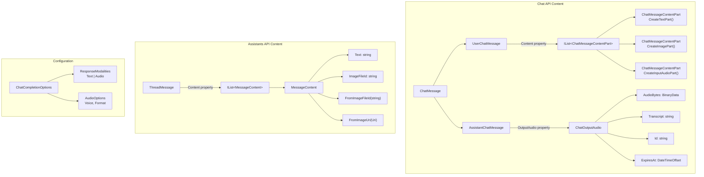
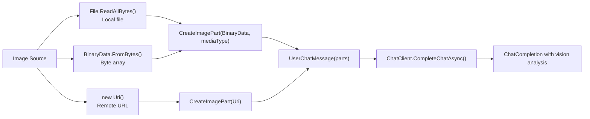
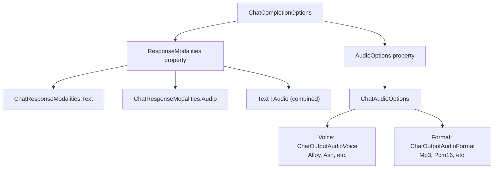
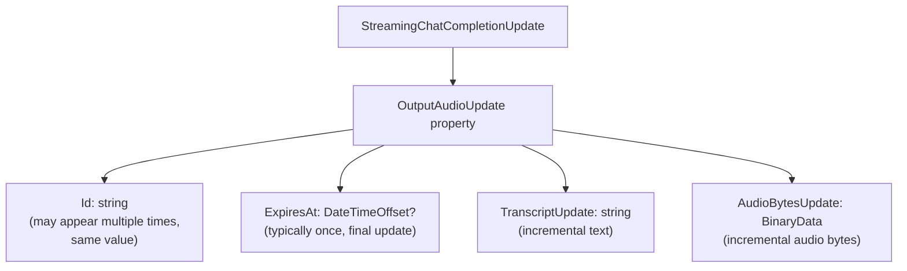
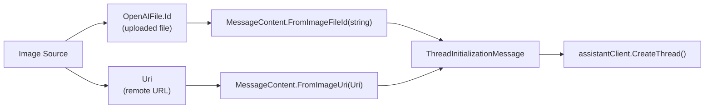

<!-- source: DeepWiki mcp.deepwiki.com · repo openai/openai-dotnet · page 5.2 Multimodal Content · fetched 2026-10-26 -->

# Multimodal Content

<details>
<summary>Relevant source files</summary>

The following files were used as context for generating this wiki page:

- [README.md](README.md)
- [examples/Assistants/Example01_RetrievalAugmentedGeneration.cs](examples/Assistants/Example01_RetrievalAugmentedGeneration.cs)
- [examples/Assistants/Example01_RetrievalAugmentedGenerationAsync.cs](examples/Assistants/Example01_RetrievalAugmentedGenerationAsync.cs)
- [examples/Assistants/Example05_AssistantsWithVision.cs](examples/Assistants/Example05_AssistantsWithVision.cs)
- [examples/Assistants/Example05_AssistantsWithVisionAsync.cs](examples/Assistants/Example05_AssistantsWithVisionAsync.cs)
- [examples/Chat/Example02_SimpleChatStreaming.cs](examples/Chat/Example02_SimpleChatStreaming.cs)
- [examples/Chat/Example02_SimpleChatStreamingAsync.cs](examples/Chat/Example02_SimpleChatStreamingAsync.cs)
- [examples/Chat/Example03_FunctionCalling.cs](examples/Chat/Example03_FunctionCalling.cs)
- [examples/Chat/Example06_StructuredOutputs.cs](examples/Chat/Example06_StructuredOutputs.cs)
- [examples/Chat/Example06_StructuredOutputsAsync.cs](examples/Chat/Example06_StructuredOutputsAsync.cs)
- [src/Custom/Chat/ChatClient.cs](src/Custom/Chat/ChatClient.cs)
- [src/Custom/Chat/ChatCompletionOptions.cs](src/Custom/Chat/ChatCompletionOptions.cs)
- [tests/Chat/ChatTests.cs](tests/Chat/ChatTests.cs)
- [tests/SessionRecords/ChatTests/ChatServiceTierWorks.json](tests/SessionRecords/ChatTests/ChatServiceTierWorks.json)
- [tests/SessionRecords/ChatTests/ChatServiceTierWorksAsync.json](tests/SessionRecords/ChatTests/ChatServiceTierWorksAsync.json)
- [tests/SessionRecords/ChatTests/StructuredRefusalWorks.json](tests/SessionRecords/ChatTests/StructuredRefusalWorks.json)
- [tests/SessionRecords/ChatTests/StructuredRefusalWorksAsync.json](tests/SessionRecords/ChatTests/StructuredRefusalWorksAsync.json)
- [tests/SessionRecords/ChatTests/ValidateConcurrency.json](tests/SessionRecords/ChatTests/ValidateConcurrency.json)
- [tests/SessionRecords/ChatTests/ValidateConcurrencyAsync.json](tests/SessionRecords/ChatTests/ValidateConcurrencyAsync.json)
- [tests/SessionRecords/ChatTests/WebSearchWorks.json](tests/SessionRecords/ChatTests/WebSearchWorks.json)
- [tests/SessionRecords/ChatTests/WebSearchWorksAsync.json](tests/SessionRecords/ChatTests/WebSearchWorksAsync.json)
- [tests/Telemetry/ChatTelemetryTests.cs](tests/Telemetry/ChatTelemetryTests.cs)

</details>


This document describes how the OpenAI .NET SDK supports multiple content modalities—including text, images (vision), and audio—across different API surfaces. Multimodal content allows AI models to process and generate more than just text, enabling richer interactions through visual and auditory channels.

For information about structured outputs that constrain text generation, see [Structured Outputs and JSON Schema](#5.3). For streaming patterns, see [Streaming Patterns](#5.1).

## Overview

The SDK provides multimodal content support through two primary mechanisms:

1. **Chat Completions API** - Supports text, image (vision), and audio modalities via `ChatMessageContentPart`
2. **Assistants API** - Supports text and images via `MessageContent`

Not all models support all modalities. Audio input/output requires specific models like `gpt-4o-audio-preview`, while vision capabilities are available in models like `gpt-4o` and `gpt-4o-mini`.

**Sources:** [README.md:122-486](), [tests/Chat/ChatTests.cs:122-280]()

## Content Modality Architecture



**Sources:** [src/Custom/Chat/ChatClient.cs:134-308](), [examples/Assistants/Example05_AssistantsWithVision.cs:40-47]()

## Chat Message Content Parts

The `ChatMessageContentPart` class represents individual content pieces within a chat message. Messages can contain multiple parts of different types.

### Creating Content Parts

| Method | Purpose | Content Type |
|--------|---------|--------------|
| `CreateTextPart(string)` | Plain text content | Text |
| `CreateImagePart(BinaryData, string)` | Image from bytes with media type | Image (vision) |
| `CreateImagePart(Uri)` | Image from URL | Image (vision) |
| `CreateInputAudioPart(BinaryData, ChatInputAudioFormat)` | Audio input with format | Audio |

### Text and Image Content Example

```csharp
// Multi-part message with text and image
List<ChatMessage> messages = [
    new UserChatMessage(
        ChatMessageContentPart.CreateTextPart("Describe this image for me."),
        ChatMessageContentPart.CreateImagePart(imageData, "image/png"))
];
```

**File reference:** [tests/Chat/ChatTests.cs:130-134]()

### Content Part Kinds

Content parts are discriminated by the `ChatMessageContentPartKind` enum:
- `Text` - Text content
- `Image` - Image content (vision)
- `InputAudio` - Audio input
- `Refusal` - Model refusal content

**Sources:** [README.md:122-140](), [tests/Chat/ChatTests.cs:122-140]()

## Vision (Image Input)

Vision capabilities allow models to analyze images provided as part of user messages. Images can be supplied as:
- **Binary data** with media type (e.g., `image/png`, `image/jpeg`)
- **URLs** pointing to accessible images

### Image Input Flow



### Usage Pattern

```csharp
// Vision with local file
using Stream stream = File.OpenRead("images_dog_and_cat.png");
BinaryData imageData = BinaryData.FromStream(stream);

ChatClient client = new("gpt-4o", apiKey);
List<ChatMessage> messages = [
    new UserChatMessage(
        ChatMessageContentPart.CreateTextPart("Describe this image for me."),
        ChatMessageContentPart.CreateImagePart(imageData, "image/png"))
];

ChatCompletion completion = await client.CompleteChatAsync(messages);
```

**File reference:** [tests/Chat/ChatTests.cs:122-140]()

**Important:** The model may require `MaxOutputTokenCount` to be set for detailed image descriptions.

**Sources:** [tests/Chat/ChatTests.cs:122-140](), [README.md:122-140]()

## Audio Input

Audio input allows models to process spoken content. Audio must be provided in supported formats with explicit format specification.

### Supported Audio Input Formats

The `ChatInputAudioFormat` enum defines supported formats:
- `Wav` - WAV format audio
- `Mp3` - MP3 format audio

### Audio Input Construction

```csharp
string audioFilePath = "audio_hello_world.mp3";
BinaryData audioBytes = BinaryData.FromBytes(File.ReadAllBytes(audioFilePath));

ChatMessageContentPart audioPart = ChatMessageContentPart.CreateInputAudioPart(
    audioBytes, 
    ChatInputAudioFormat.Mp3);

List<ChatMessage> messages = [
    new UserChatMessage([audioPart])
];
```

**File reference:** [tests/Chat/ChatTests.cs:197-206]()

### Model Requirements

Audio input is only supported on specific models, beginning with `gpt-4o-audio-preview`.

**Sources:** [tests/Chat/ChatTests.cs:193-280](), [README.md:425-485]()

## Audio Output

Models can generate audio responses in addition to or instead of text. Audio output requires configuration through `ChatCompletionOptions`.

### Audio Output Configuration



### ChatOutputAudioVoice Options

Available voice options include:
- `Alloy`
- `Ash`
- `Ballad`
- `Coral`
- `Echo`
- `Sage`
- `Shimmer`
- `Verse`

### ChatOutputAudioFormat Options

Available format options include:
- `Mp3` - MP3 audio
- `Pcm16` - 16-bit PCM audio
- `Wav` - WAV format

### Requesting Audio Output

```csharp
ChatClient client = new("gpt-4o-audio-preview", apiKey);

ChatCompletionOptions options = new()
{
    ResponseModalities = ChatResponseModalities.Text | ChatResponseModalities.Audio,
    AudioOptions = new(ChatOutputAudioVoice.Alloy, ChatOutputAudioFormat.Mp3)
};

ChatCompletion completion = await client.CompleteChatAsync(messages, options);

if (completion.OutputAudio is ChatOutputAudio outputAudio)
{
    Console.WriteLine($"Transcript: {outputAudio.Transcript}");
    File.WriteAllBytes($"{outputAudio.Id}.mp3", outputAudio.AudioBytes.ToArray());
}
```

**File reference:** [tests/Chat/ChatTests.cs:143-190](), [README.md:436-474]()

### ChatOutputAudio Structure

The `ChatOutputAudio` class contains:
- `Id` - Unique identifier for the audio output
- `AudioBytes` - Binary audio data as `BinaryData`
- `Transcript` - Text transcript of the audio
- `ExpiresAt` - Expiration time for the audio reference

**Sources:** [tests/Chat/ChatTests.cs:143-190](), [README.md:425-485]()

## Audio Reference in Conversation History

Audio output can be referenced in subsequent messages using its ID, avoiding the need to resend audio bytes.

### Using Audio References

```csharp
// First completion with audio output
ChatCompletion firstCompletion = await client.CompleteChatAsync(messages, options);

// Create assistant message from completion (automatically includes audio reference)
AssistantChatMessage audioMessage = new(firstCompletion);
messages.Add(audioMessage);

// Audio reference is preserved for context
messages.Add("Can you say that like a pirate?");

ChatCompletion secondCompletion = await client.CompleteChatAsync(messages, options);
```

**File reference:** [README.md:476-484]()

The `AssistantChatMessage` constructor automatically extracts the audio reference from `ChatCompletion.OutputAudio` when present, allowing the model to reference previous audio in the conversation.

**Sources:** [README.md:476-484](), [tests/Chat/ChatTests.cs:226-239]()

## Streaming Audio Output

Audio output streams incrementally during generation. Each streaming update may contain different audio components.

### Streaming Audio Update Structure



### Streaming Audio Example

```csharp
StringBuilder transcriptBuilder = new();
using MemoryStream audioStream = new();
string audioId = null;
DateTimeOffset? expiresAt = null;

await foreach (StreamingChatCompletionUpdate update 
    in client.CompleteChatStreamingAsync(messages, options))
{
    if (update.OutputAudioUpdate is not null)
    {
        // ID appears across multiple updates but is always the same
        audioId ??= update.OutputAudioUpdate.Id;
        
        // ExpiresAt typically appears once in the final update
        expiresAt ??= update.OutputAudioUpdate.ExpiresAt;
        
        // Transcript and bytes stream incrementally
        transcriptBuilder.Append(update.OutputAudioUpdate.TranscriptUpdate);
        audioStream.Write(update.OutputAudioUpdate.AudioBytesUpdate);
    }
}
```

**File reference:** [tests/Chat/ChatTests.cs:158-182](), [README.md:487-492]()

### Streaming Audio Properties

- **Id**: Appears across multiple updates with the same value; used for referencing in subsequent requests
- **ExpiresAt**: Typically appears once in the final streaming update
- **TranscriptUpdate**: Incremental transcript text that concatenates to form complete transcript
- **AudioBytesUpdate**: Incremental audio bytes that concatenate to form complete audio output

**Sources:** [tests/Chat/ChatTests.cs:158-182](), [README.md:487-492]()

## Assistants with Image Content

The Assistants API supports images through the `MessageContent` class, which differs from the Chat API's content part system.

### MessageContent Image Methods



### Assistant Vision Example

```csharp
OpenAIFileClient fileClient = openAIClient.GetOpenAIFileClient();
AssistantClient assistantClient = openAIClient.GetAssistantClient();

// Upload image for file-based content
OpenAIFile imageFile = await fileClient.UploadFileAsync(
    "images_apple.png",
    FileUploadPurpose.Vision);

// Or use a remote URL
Uri imageUri = new("https://example.com/image.png");

// Create thread with image content
AssistantThread thread = await assistantClient.CreateThreadAsync(new()
{
    InitialMessages =
    {
        new ThreadInitializationMessage(
            MessageRole.User,
            [
                "Compare these images:",
                MessageContent.FromImageFileId(imageFile.Id),
                MessageContent.FromImageUri(imageUri)
            ])
    }
});
```

**File reference:** [examples/Assistants/Example05_AssistantsWithVision.cs:23-49]()

### File Upload Purposes

When uploading files for vision, use `FileUploadPurpose.Vision` to ensure proper handling:

```csharp
OpenAIFile imageFile = fileClient.UploadFile(
    imagePath,
    FileUploadPurpose.Vision);
```

**Sources:** [examples/Assistants/Example05_AssistantsWithVision.cs:1-78](), [examples/Assistants/Example05_AssistantsWithVisionAsync.cs:1-78]()

## Multi-Part Message Construction

Messages can combine multiple content types in a single message. Both text strings and content parts can be mixed.

### String Implicit Conversion

For convenience, strings are implicitly converted to text content parts:

```csharp
// These are equivalent
new UserChatMessage("Hello");
new UserChatMessage(ChatMessageContentPart.CreateTextPart("Hello"));

// Multi-part with implicit string conversion
new UserChatMessage(
    "Please analyze this:",
    ChatMessageContentPart.CreateImagePart(imageData, "image/png"));
```

### System Messages with Multiple Parts

System messages also support multi-part content for providing rich instructions:

```csharp
List<ChatMessage> messages = [
    new SystemChatMessage(
        "You talk like a pirate.",
        "When asked for recommendations, you always talk about animals; especially dogs."
    ),
    new UserChatMessage(
        "Hello, assistant! I need some advice.",
        "Can you recommend some small, cute things I can think about?"
    )
];
```

**File reference:** [tests/Chat/ChatTests.cs:456-467]()

**Sources:** [tests/Chat/ChatTests.cs:456-473](), [README.md:130-140]()

## Content Type Detection

Content parts expose their type through the `Kind` property of type `ChatMessageContentPartKind`:

```csharp
foreach (ChatMessageContentPart part in completion.Content)
{
    switch (part.Kind)
    {
        case ChatMessageContentPartKind.Text:
            Console.WriteLine($"Text: {part.Text}");
            break;
        case ChatMessageContentPartKind.Image:
            Console.WriteLine($"Image: {part.ImageBytesMediaType}");
            break;
        case ChatMessageContentPartKind.InputAudio:
            Console.WriteLine("Audio input detected");
            break;
        case ChatMessageContentPartKind.Refusal:
            Console.WriteLine($"Refusal: {part.Refusal}");
            break;
    }
}
```

**File reference:** [tests/Chat/ChatTests.cs:41-42]()

**Sources:** [tests/Chat/ChatTests.cs:34-43]()

## Token Usage with Audio

Audio modalities affect token consumption differently than text. Token usage includes separate counts for audio tokens.

### Audio Token Tracking

```csharp
ChatCompletion completion = await client.CompleteChatAsync(messages, options);
ChatTokenUsage usage = completion.Usage;

// Audio-specific token details
int? inputAudioTokens = usage?.InputTokenDetails?.AudioTokenCount;
int? outputAudioTokens = usage?.OutputTokenDetails?.AudioTokenCount;

Console.WriteLine($"Input audio tokens: {inputAudioTokens}");
Console.WriteLine($"Output audio tokens: {outputAudioTokens}");
```

**File reference:** [tests/Chat/ChatTests.cs:187-189](), [tests/Chat/ChatTests.cs:278-279]()

The `InputTokenDetails` and `OutputTokenDetails` properties on `ChatTokenUsage` provide granular token counts including audio-specific consumption.

**Sources:** [tests/Chat/ChatTests.cs:187-189](), [tests/Chat/ChatTests.cs:278-279]()

---

