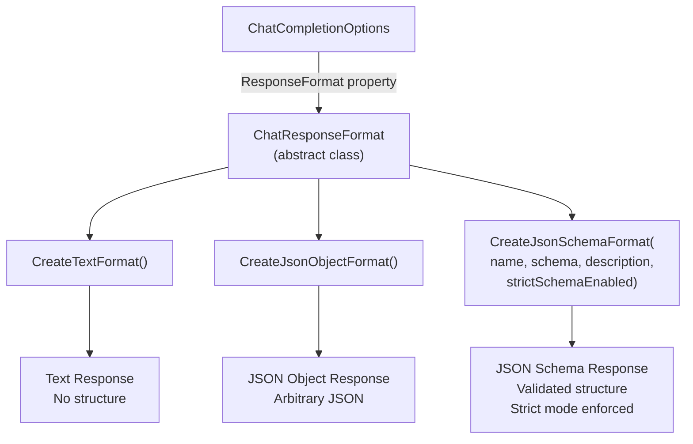
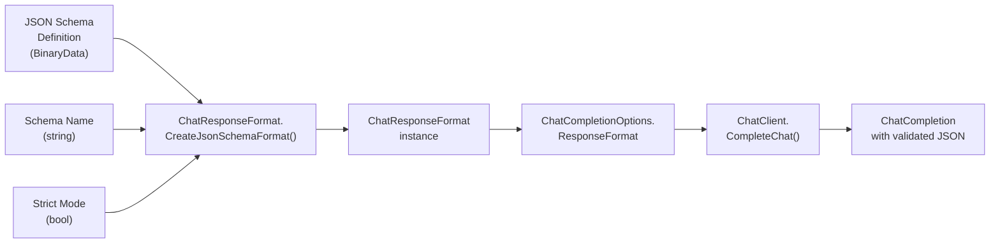
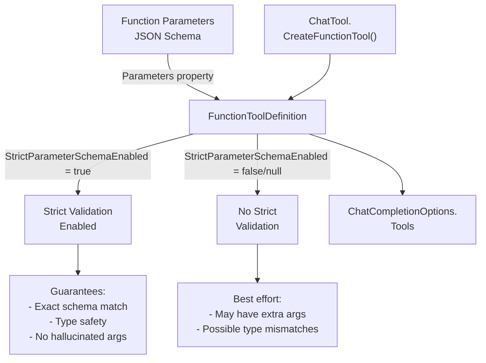
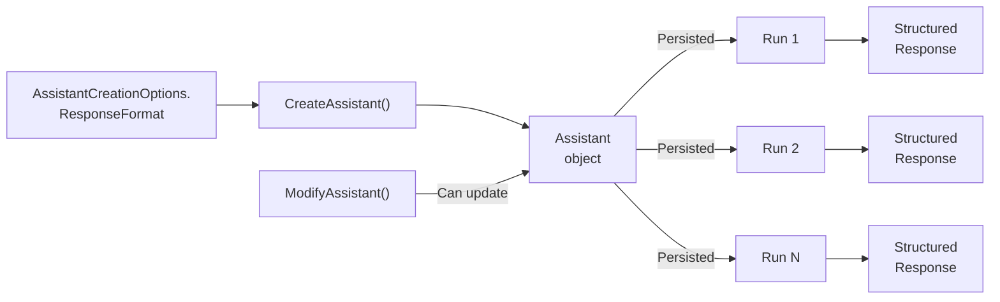
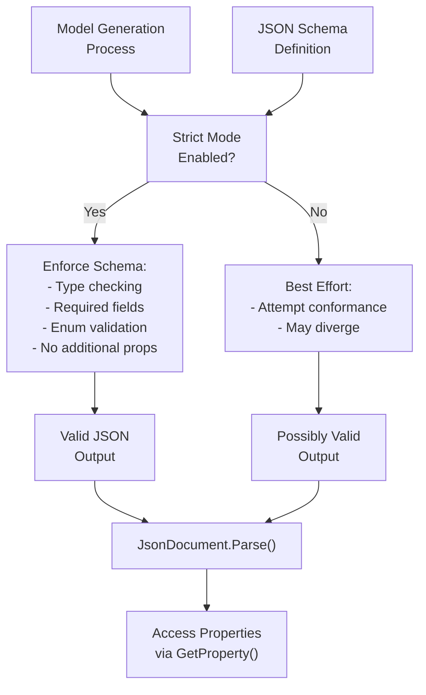
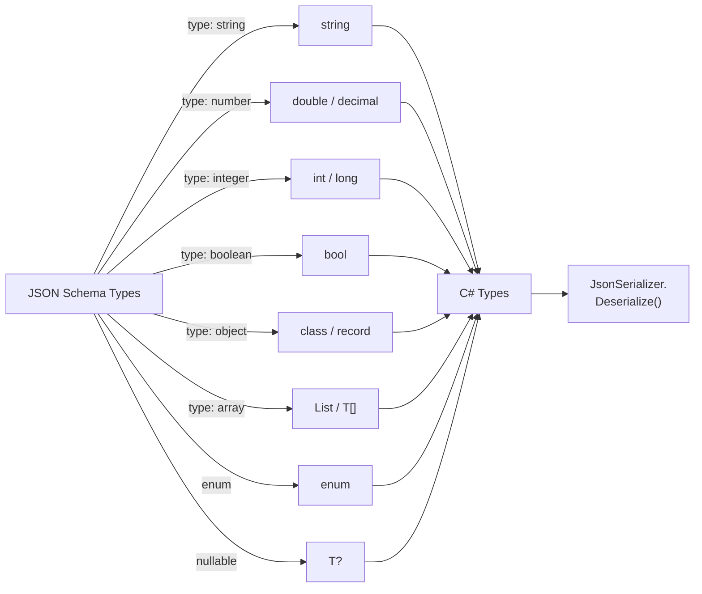

<!-- source: DeepWiki mcp.deepwiki.com · repo openai/openai-dotnet · page 5.3 Structured Outputs and JSON Schema · fetched 2026-10-26 -->

# Structured Outputs and JSON Schema

<details>
<summary>Relevant source files</summary>

The following files were used as context for generating this wiki page:

- [README.md](README.md)
- [examples/Assistants/Example01_RetrievalAugmentedGeneration.cs](examples/Assistants/Example01_RetrievalAugmentedGeneration.cs)
- [examples/Assistants/Example01_RetrievalAugmentedGenerationAsync.cs](examples/Assistants/Example01_RetrievalAugmentedGenerationAsync.cs)
- [examples/Assistants/Example05_AssistantsWithVision.cs](examples/Assistants/Example05_AssistantsWithVision.cs)
- [examples/Assistants/Example05_AssistantsWithVisionAsync.cs](examples/Assistants/Example05_AssistantsWithVisionAsync.cs)
- [examples/Chat/Example02_SimpleChatStreaming.cs](examples/Chat/Example02_SimpleChatStreaming.cs)
- [examples/Chat/Example02_SimpleChatStreamingAsync.cs](examples/Chat/Example02_SimpleChatStreamingAsync.cs)
- [examples/Chat/Example03_FunctionCalling.cs](examples/Chat/Example03_FunctionCalling.cs)
- [examples/Chat/Example06_StructuredOutputs.cs](examples/Chat/Example06_StructuredOutputs.cs)
- [examples/Chat/Example06_StructuredOutputsAsync.cs](examples/Chat/Example06_StructuredOutputsAsync.cs)
- [src/Custom/Chat/ChatClient.cs](src/Custom/Chat/ChatClient.cs)
- [src/Custom/Chat/ChatCompletionOptions.cs](src/Custom/Chat/ChatCompletionOptions.cs)
- [tests/Chat/ChatTests.cs](tests/Chat/ChatTests.cs)
- [tests/SessionRecords/ChatTests/ChatServiceTierWorks.json](tests/SessionRecords/ChatTests/ChatServiceTierWorks.json)
- [tests/SessionRecords/ChatTests/ChatServiceTierWorksAsync.json](tests/SessionRecords/ChatTests/ChatServiceTierWorksAsync.json)
- [tests/SessionRecords/ChatTests/StructuredRefusalWorks.json](tests/SessionRecords/ChatTests/StructuredRefusalWorks.json)
- [tests/SessionRecords/ChatTests/StructuredRefusalWorksAsync.json](tests/SessionRecords/ChatTests/StructuredRefusalWorksAsync.json)
- [tests/SessionRecords/ChatTests/ValidateConcurrency.json](tests/SessionRecords/ChatTests/ValidateConcurrency.json)
- [tests/SessionRecords/ChatTests/ValidateConcurrencyAsync.json](tests/SessionRecords/ChatTests/ValidateConcurrencyAsync.json)
- [tests/SessionRecords/ChatTests/WebSearchWorks.json](tests/SessionRecords/ChatTests/WebSearchWorks.json)
- [tests/SessionRecords/ChatTests/WebSearchWorksAsync.json](tests/SessionRecords/ChatTests/WebSearchWorksAsync.json)
- [tests/Telemetry/ChatTelemetryTests.cs](tests/Telemetry/ChatTelemetryTests.cs)

</details>


## Purpose and Scope

This document describes how to use **Structured Outputs** and **JSON Schema** validation in the OpenAI .NET SDK to constrain model responses to specific formats. Structured outputs guarantee that the model's response will conform to a provided JSON schema, enabling reliable integration with downstream systems and type-safe parsing.

This feature is available for:
- **Chat completions** via `ChatResponseFormat` (see [Chat Client](#4.2))
- **Assistants API** via `AssistantResponseFormat` (see [Assistants Client](#4.4))
- **Responses API** via response format configuration (see [Responses API Client](#4.3))
- **Function calling** via `FunctionToolDefinition` (see [Function Calling](#6.1))

For general information about response streaming and non-JSON response formats, see [Streaming Patterns](#5.1).

Sources: [README.md:370-424](), [api/OpenAI.netstandard2.0.cs:1-50]()

---

## Response Format Types

The SDK provides multiple response format types to control how models structure their output.

### ChatResponseFormat Class

The `ChatResponseFormat` class controls output format for chat completions through static factory methods:

| Factory Method | Purpose | Strict Mode Support |
|---|---|---|
| `CreateTextFormat()` | Plain text output (default) | No |
| `CreateJsonObjectFormat()` | Unstructured JSON object | No |
| `CreateJsonSchemaFormat()` | JSON conforming to schema | Yes (required) |

**Mermaid: ChatResponseFormat Type Hierarchy**



Sources: [api/OpenAI.netstandard2.0.cs:1348-1379](), [README.md:373-410]()

### AssistantResponseFormat Class

The `AssistantResponseFormat` class provides equivalent functionality for the Assistants API:

- `AssistantResponseFormat.CreateAutoFormat()` - Let the model choose
- `AssistantResponseFormat.CreateTextFormat()` - Plain text
- `AssistantResponseFormat.CreateJsonObjectFormat()` - Unstructured JSON
- `AssistantResponseFormat.CreateJsonSchemaFormat()` - Structured JSON with schema

Sources: [api/OpenAI.netstandard2.0.cs:258-265](), [api/OpenAI.net8.0.cs:258-265]()

---

## JSON Schema Structured Outputs

### Creating a JSON Schema Format

To use structured outputs, call `CreateJsonSchemaFormat()` with:

1. **jsonSchemaFormatName** (`string`) - A descriptive name for the schema
2. **jsonSchema** (`BinaryData`) - The JSON schema definition
3. **description** (`string`, optional) - Human-readable schema description
4. **strictSchemaEnabled** (`bool?`, optional) - Enable strict validation (recommended `true`)

**Mermaid: JSON Schema Format Creation Flow**



Sources: [api/OpenAI.netstandard2.0.cs:1348-1379](), [examples/Chat/Example06_StructuredOutputs.cs:23-46]()

### Strict Mode Validation

When `strictSchemaEnabled: true`, the model guarantees:

- **Exact schema conformance** - All required properties present
- **No additional properties** - Only schema-defined properties included (when `additionalProperties: false`)
- **Type safety** - Values match declared types
- **Enum validation** - Values restricted to declared enum values

Sources: [README.md:370-410]()

---

## Chat Completions with Structured Outputs

### Basic Example

```csharp
// Define the JSON schema
BinaryData jsonSchema = BinaryData.FromBytes("""
{
    "type": "object",
    "properties": {
        "steps": {
            "type": "array",
            "items": {
                "type": "object",
                "properties": {
                    "explanation": { "type": "string" },
                    "output": { "type": "string" }
                },
                "required": ["explanation", "output"],
                "additionalProperties": false
            }
        },
        "final_answer": { "type": "string" }
    },
    "required": ["steps", "final_answer"],
    "additionalProperties": false
}
"""u8.ToArray());

// Configure response format
ChatCompletionOptions options = new()
{
    ResponseFormat = ChatResponseFormat.CreateJsonSchemaFormat(
        jsonSchemaFormatName: "math_reasoning",
        jsonSchema: jsonSchema,
        jsonSchemaIsStrict: true)
};

// Generate completion
ChatCompletion completion = client.CompleteChat(messages, options);
```

Sources: [examples/Chat/Example06_StructuredOutputs.cs:1-60](), [README.md:376-410]()

### Parsing Structured Output

The model's response is returned as a JSON string in `completion.Content[0].Text`. Parse it using `System.Text.Json`:

```csharp
using JsonDocument structuredJson = JsonDocument.Parse(completion.Content[0].Text);

string finalAnswer = structuredJson.RootElement.GetProperty("final_answer").GetString();

foreach (JsonElement step in structuredJson.RootElement.GetProperty("steps").EnumerateArray())
{
    string explanation = step.GetProperty("explanation").GetString();
    string output = step.GetProperty("output").GetString();
}
```

Sources: [examples/Chat/Example06_StructuredOutputs.cs:48-59](), [README.md:413-422]()

---

## Function Calling with Strict Schemas

### FunctionToolDefinition Schema Configuration

The `FunctionToolDefinition` class supports strict schema validation for function parameters via the `StrictParameterSchemaEnabled` property:

**Mermaid: Function Tool Schema Flow**



Sources: [api/OpenAI.netstandard2.0.cs:1498-1510](), [api/OpenAI.net8.0.cs:360-370]()

### Creating Function Tools with Strict Schemas

```csharp
ChatTool tool = ChatTool.CreateFunctionTool(
    functionName: "get_weather",
    functionDescription: "Get current weather",
    functionParameters: BinaryData.FromBytes("""
    {
        "type": "object",
        "properties": {
            "location": { "type": "string" },
            "unit": { "type": "string", "enum": ["celsius", "fahrenheit"] }
        },
        "required": ["location"],
        "additionalProperties": false
    }
    """u8.ToArray()),
    strictParameterSchemaEnabled: true
);
```

Sources: [api/OpenAI.netstandard2.0.cs:1498-1510](), [README.md:241-268]()

---

## Assistants API with Structured Outputs

### AssistantResponseFormat Configuration

For assistants, configure structured outputs during assistant creation or modification:

```csharp
AssistantCreationOptions options = new()
{
    ResponseFormat = AssistantResponseFormat.CreateJsonSchemaFormat(
        name: "task_result",
        jsonSchema: schemaData,
        description: "Structured task output",
        strictSchemaEnabled: true
    )
};

Assistant assistant = client.CreateAssistant("gpt-4o", options);
```

Sources: [api/OpenAI.netstandard2.0.cs:214-229](), [api/OpenAI.netstandard2.0.cs:258-265]()

### Response Format Persistence

The `ResponseFormat` property is stored with the assistant and applies to all runs:

**Mermaid: Assistant Response Format Lifecycle**



Sources: [api/OpenAI.netstandard2.0.cs:58-77](), [api/OpenAI.netstandard2.0.cs:214-229]()

---

## Responses API with Structured Outputs

The Responses API supports structured outputs through the `ResponseTextFormatConfiguration` in `ResponseCreationOptions`:

```csharp
ResponseCreationOptions options = new()
{
    ResponseFormat = ResponseTextFormatConfiguration.CreateJsonSchemaFormat(
        name: "response_schema",
        jsonSchema: schemaData,
        strictSchemaEnabled: true
    )
};

OpenAIResponse response = await client.CreateResponseAsync(userInput, options);
```

Sources: [specification/base/typespec/responses/models.tsp:217-262](), [specification/client/responses.client.tsp:132-136]()

---

## JSON Schema Specification

### Supported Schema Features

The SDK supports standard JSON Schema Draft 2020-12 with the following commonly used features:

| Schema Feature | Description | Example |
|---|---|---|
| `type` | Primitive types | `"string"`, `"number"`, `"boolean"`, `"object"`, `"array"`, `"null"` |
| `properties` | Object property definitions | `{ "name": { "type": "string" } }` |
| `required` | Required property names | `["name", "age"]` |
| `additionalProperties` | Allow extra properties | `false` (recommended for strict mode) |
| `enum` | Restricted value set | `["small", "medium", "large"]` |
| `items` | Array element schema | `{ "type": "string" }` |
| `description` | Documentation | `"User's full name"` |
| `minimum` / `maximum` | Numeric bounds | `{ "minimum": 0, "maximum": 100 }` |
| `minLength` / `maxLength` | String length bounds | `{ "minLength": 1 }` |
| `pattern` | Regular expression | `"^[A-Z]{2}$"` |

**Mermaid: Schema Validation Flow**



Sources: [README.md:385-407](), [examples/Chat/Example06_StructuredOutputs.cs:25-45]()

### Schema Serialization

Schemas are provided as `BinaryData`. Convert JSON strings to `BinaryData` using:

```csharp
// From string
BinaryData schema = BinaryData.FromBytes("""{ "type": "object" }"""u8.ToArray());

// From file
BinaryData schema = BinaryData.FromBytes(File.ReadAllBytes("schema.json"));

// From object (serialize to JSON first)
string schemaJson = JsonSerializer.Serialize(schemaObject);
BinaryData schema = BinaryData.FromString(schemaJson);
```

Sources: [examples/Chat/Example06_StructuredOutputs.cs:25-46](), [README.md:385-407]()

---

## Model Support and Limitations

### Supported Models

Structured outputs with strict mode are available on:

- **gpt-4o** series: `gpt-4o`, `gpt-4o-2024-08-06`, `gpt-4o-2024-11-20`
- **gpt-4o-mini** series: `gpt-4o-mini`, `gpt-4o-mini-2024-07-18`
- **Newer models** released after August 2024

Sources: [README.md:372-373]()

### Limitations

1. **Strict mode required for guarantees** - Without `strictSchemaEnabled: true`, the model makes a best effort but doesn't guarantee conformance
2. **No streaming support for strict validation** - Strict schema validation occurs after complete generation
3. **Schema complexity limits** - Very complex schemas (deep nesting, many properties) may impact performance
4. **additionalProperties: false recommended** - For strict guarantees, explicitly disallow additional properties

Sources: [README.md:370-424]()

---

## Integration with Type Systems

### Mapping to C# Types

**Mermaid: JSON Schema to C# Type Mapping**



### Deserialization Example

```csharp
// Define C# type matching schema
public class MathReasoning
{
    public List<Step> Steps { get; set; }
    public string FinalAnswer { get; set; }
}

public class Step
{
    public string Explanation { get; set; }
    public string Output { get; set; }
}

// Deserialize structured output
string jsonText = completion.Content[0].Text;
MathReasoning result = JsonSerializer.Deserialize<MathReasoning>(jsonText);
```

Sources: [examples/Chat/Example06_StructuredOutputs.cs:48-59]()

---

## Error Handling

### Schema Validation Failures

When strict mode is enabled, the model will always produce valid output. If it cannot, the completion fails with an error:

```csharp
try
{
    ChatCompletion completion = client.CompleteChat(messages, options);
}
catch (ClientResultException ex) when (ex.Status == 400)
{
    // Invalid schema or model cannot satisfy constraints
}
```

### Common Schema Errors

| Error Condition | Cause | Solution |
|---|---|---|
| 400 Bad Request | Invalid JSON schema syntax | Validate schema with JSON Schema validator |
| Schema too complex | Too many nested levels/properties | Simplify schema structure |
| Unsupported feature | Schema feature not supported by model | Use only supported JSON Schema features |
| Model cannot satisfy | Prompt incompatible with schema | Adjust prompt or schema |

Sources: [api/OpenAI.netstandard2.0.cs:1348-1379]()

---

## Complete Code Entity Reference

### Key Classes and Methods

**Chat Completions:**
- `ChatResponseFormat.CreateJsonSchemaFormat(string, BinaryData, string, bool?)` - [api/OpenAI.netstandard2.0.cs:1348-1379]()
- `ChatResponseFormat.CreateJsonObjectFormat()` - [api/OpenAI.netstandard2.0.cs:1348-1379]()
- `ChatResponseFormat.CreateTextFormat()` - [api/OpenAI.netstandard2.0.cs:1348-1379]()
- `ChatCompletionOptions.ResponseFormat` property - [api/OpenAI.netstandard2.0.cs:1251-1524]()

**Assistants:**
- `AssistantResponseFormat.CreateJsonSchemaFormat(string, BinaryData, string, bool?)` - [api/OpenAI.netstandard2.0.cs:258-265]()
- `AssistantCreationOptions.ResponseFormat` property - [api/OpenAI.netstandard2.0.cs:214-229]()
- `AssistantModificationOptions.ResponseFormat` property - [api/OpenAI.netstandard2.0.cs:240-256]()

**Function Calling:**
- `FunctionToolDefinition.StrictParameterSchemaEnabled` property - [api/OpenAI.netstandard2.0.cs:360-370]()
- `FunctionToolDefinition.Parameters` property - [api/OpenAI.netstandard2.0.cs:360-370]()

**Responses API:**
- `ResponseTextFormatConfiguration` class - [specification/base/typespec/responses/models.tsp:217-262]()
- `ResponseCreationOptions.ResponseFormat` property - [specification/base/typespec/responses/models.tsp:217-220]()

Sources: [api/OpenAI.netstandard2.0.cs:1-500](), [api/OpenAI.net8.0.cs:1-500](), [specification/base/typespec/responses/models.tsp:217-262]()

---

