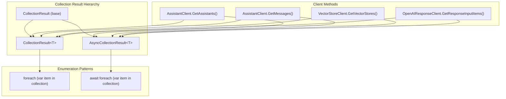
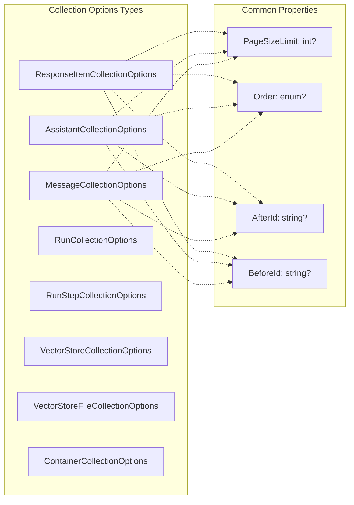
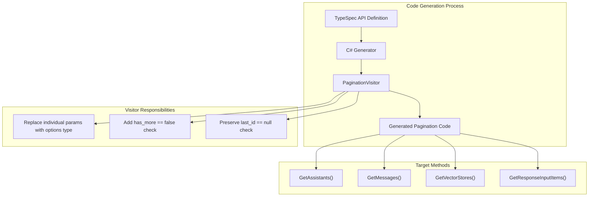
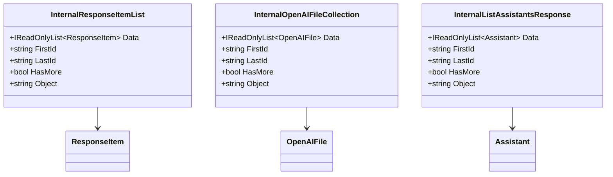

<!-- source: DeepWiki mcp.deepwiki.com · repo openai/openai-dotnet · page 5.4 Pagination and Collection Results · fetched 2026-10-26 -->

# Pagination and Collection Results

<details>
<summary>Relevant source files</summary>

The following files were used as context for generating this wiki page:

- [api/OpenAI.net8.0.cs](api/OpenAI.net8.0.cs)
- [api/OpenAI.netstandard2.0.cs](api/OpenAI.netstandard2.0.cs)
- [src/Generated/Models/OpenAIContext.cs](src/Generated/Models/OpenAIContext.cs)
- [src/Generated/OpenAIModelFactory.cs](src/Generated/OpenAIModelFactory.cs)
- [tests/Assistants/Assistants.VectorStoresTests.cs](tests/Assistants/Assistants.VectorStoresTests.cs)
- [tests/Assistants/AssistantsTests.cs](tests/Assistants/AssistantsTests.cs)
- [tests/Responses/ResponsesTests.cs](tests/Responses/ResponsesTests.cs)
- [tests/SessionRecords/ResponsesToolTests/ImageGenToolInputMaskWithFileId.json](tests/SessionRecords/ResponsesToolTests/ImageGenToolInputMaskWithFileId.json)
- [tests/SessionRecords/ResponsesToolTests/ImageGenToolInputMaskWithFileIdAsync.json](tests/SessionRecords/ResponsesToolTests/ImageGenToolInputMaskWithFileIdAsync.json)
- [tests/SessionRecords/ResponsesToolTests/ImageGenToolInputMaskWithImageUri.json](tests/SessionRecords/ResponsesToolTests/ImageGenToolInputMaskWithImageUri.json)
- [tests/SessionRecords/ResponsesToolTests/ImageGenToolInputMaskWithImageUriAsync.json](tests/SessionRecords/ResponsesToolTests/ImageGenToolInputMaskWithImageUriAsync.json)
- [tspCodeModel.json](tspCodeModel.json)

</details>


## Purpose and Scope

This document explains the pagination system used throughout the OpenAI .NET SDK for retrieving large collections of items. The SDK implements cursor-based pagination using `HasMore` and `LastId` fields, providing both synchronous and asynchronous enumeration patterns. This page covers the collection result types, pagination options, and usage patterns for list operations across all clients.

For information about streaming responses with incremental updates, see [Streaming Patterns](#5.1). For persisting and continuing long-running operations, see [State Management and Persistence](#5.5).

---

## Collection Result Types

The SDK provides two primary collection result types that implement the pagination pattern:

| Type | Description | Usage |
|------|-------------|-------|
| `CollectionResult<T>` | Synchronous collection enumeration | Use with `foreach` loops |
| `AsyncCollectionResult<T>` | Asynchronous collection enumeration | Use with `await foreach` loops |

Both types provide:
- Automatic page fetching as you enumerate
- Transparent cursor management
- Support for continuation tokens
- Access to raw page responses



**Diagram: Collection Result Type Hierarchy and Usage**

Sources: [api/OpenAI.netstandard2.0.cs:114-141](), [src/Custom/Responses/Pagination/Internal/ResponseItemCollectionResult.cs:1-98](), [src/Custom/Responses/Pagination/Internal/AsyncResponseItemCollectionResult.cs:1-90]()

---

## Cursor-Based Pagination Model

The SDK uses cursor-based pagination with two key fields returned in paginated responses:

### Pagination Fields

| Field | Type | Description |
|-------|------|-------------|
| `has_more` | `bool` | Indicates whether additional pages exist |
| `last_id` | `string` | The ID of the last item in the current page, used as cursor for next page |

```mermaid
sequenceDiagram
    participant Client as Client Code
    participant Collection as CollectionResult&lt;T&gt;
    participant API as OpenAI API
    
    Client->>Collection: Begin enumeration
    Collection->>API: Request page 1 (no cursor)
    API-->>Collection: {data: [...], has_more: true, last_id: "item_5"}
    Collection-->>Client: Yield items 1-5
    
    Client->>Collection: Continue enumeration
    Collection->>API: Request page 2 (after: "item_5")
    API-->>Collection: {data: [...], has_more: true, last_id: "item_10"}
    Collection-->>Client: Yield items 6-10
    
    Client->>Collection: Continue enumeration
    Collection->>API: Request page 3 (after: "item_10")
    API-->>Collection: {data: [...], has_more: false, last_id: "item_12"}
    Collection-->>Client: Yield items 11-12
    
    Collection-->>Client: End enumeration (has_more == false)
```

**Diagram: Cursor-Based Pagination Flow**

### Termination Conditions

The SDK stops pagination when **either** of these conditions is true:
- `has_more` is `false`
- `last_id` is `null`

This dual check is implemented in generated pagination code:

[src/Generated/OpenAIResponseClientGetResponseInputItemsAsyncCollectionResult.cs:45-52]()

Sources: [codegen/generator/src/Visitors/PaginationVisitor.cs:259-320](), [src/Custom/Responses/Pagination/Internal/ResponseItemCollectionResult.cs:80-90]()

---

## Collection Options

Most list operations accept a collection options parameter to control pagination behavior:

### Common Options Types



**Diagram: Collection Options Type Structure**

### Options Properties

| Property | Type | Description |
|----------|------|-------------|
| `PageSizeLimit` | `int?` | Maximum number of items per page (typically 1-100) |
| `Order` | `enum?` | Sort order: `Ascending` or `Descending` |
| `AfterId` | `string?` | Return items after this ID (forward pagination) |
| `BeforeId` | `string?` | Return items before this ID (backward pagination) |

The order enums are specific to each collection type (e.g., `AssistantCollectionOrder`, `MessageCollectionOrder`, `ResponseItemCollectionOrder`).

Sources: [api/OpenAI.netstandard2.0.cs:167-176](), [api/OpenAI.netstandard2.0.cs:338-347](), [api/OpenAI.netstandard2.0.cs:368-377](), [specification/client/responses.client.tsp:283-285]()

---

## Usage Patterns

### Basic Enumeration

Simple iteration through all items:

```csharp
AssistantClient client = new AssistantClient(apiKey);

// Async enumeration
await foreach (Assistant assistant in client.GetAssistantsAsync())
{
    Console.WriteLine($"Assistant: {assistant.Name}");
}

// Sync enumeration
foreach (Assistant assistant in client.GetAssistants())
{
    Console.WriteLine($"Assistant: {assistant.Name}");
}
```

### Pagination with Options

Control page size and sort order:

```csharp
OpenAIResponseClient client = new OpenAIResponseClient(model, apiKey);

var options = new ResponseItemCollectionOptions
{
    PageSizeLimit = 10,
    Order = ResponseItemCollectionOrder.Descending
};

await foreach (ResponseItem item in client.GetResponseInputItemsAsync(responseId, options))
{
    // Process each item
}
```

[tests/Responses/ResponseStoreTests.cs:42-56]()

### Forward Pagination with Cursor

Resume from a specific point using `AfterId`:

```csharp
var options = new ResponseItemCollectionOptions
{
    AfterId = "item_xyz123",
    PageSizeLimit = 20
};

await foreach (ResponseItem item in client.GetResponseInputItemsAsync(responseId, options))
{
    // Only items after item_xyz123 are returned
}
```

[tests/Responses/ResponseStoreTests.cs:139-153]()

### Backward Pagination

Use `BeforeId` to paginate backwards:

```csharp
var options = new MessageCollectionOptions
{
    BeforeId = "msg_abc456",
    PageSizeLimit = 10,
    Order = MessageCollectionOrder.Descending
};

await foreach (ThreadMessage message in client.GetMessagesAsync(threadId, options))
{
    // Messages before msg_abc456
}
```

### Limited Enumeration

Stop after processing a specific number of items:

```csharp
int count = 0;
await foreach (Assistant assistant in client.GetAssistantsAsync())
{
    ProcessAssistant(assistant);
    if (++count >= 50) break;
}
```

[tests/Responses/ResponseStoreTests.cs:50-56]()

### Manual Page Control

Access raw pages for advanced scenarios:

```csharp
AsyncCollectionResult<Assistant> collection = client.GetAssistantsAsync(options);

await foreach (ClientResult page in collection.GetRawPagesAsync())
{
    // Process entire page at once
    PipelineResponse response = page.GetRawResponse();
    // Parse response content...
}
```

Sources: [tests/Responses/ResponseStoreTests.cs:26-60](), [tests/Responses/ResponseStoreTests.cs:115-153](), [tests/Responses/ResponseStoreTests.cs:156-202]()

---

## Implementation Details

### Code Generation Customization

The pagination implementation is customized during code generation through `PaginationVisitor`:



**Diagram: Pagination Code Generation Pipeline**

The visitor performs two key transformations:

1. **Parameter Replacement**: Converts individual pagination parameters (`limit`, `order`, `after`, `before`) into a single options parameter

[codegen/generator/src/Visitors/PaginationVisitor.cs:154-257]()

2. **HasMore Check Addition**: Adds `!hasMore` condition to pagination termination logic

[codegen/generator/src/Visitors/PaginationVisitor.cs:264-320]()

### Collection Result Implementation

Each paginated endpoint gets generated collection classes:

| Class Pattern | Purpose | Example |
|---------------|---------|---------|
| `{Client}{Method}CollectionResult` | Sync collection | `OpenAIResponseClientGetResponseInputItemsCollectionResult` |
| `{Client}{Method}AsyncCollectionResult` | Async collection | `OpenAIResponseClientGetResponseInputItemsAsyncCollectionResult` |
| `{Client}{Method}CollectionResultOfT` | Typed sync collection | `OpenAIResponseClientGetResponseInputItemsCollectionResultOfT` |
| `{Client}{Method}AsyncCollectionResultOfT` | Typed async collection | `OpenAIResponseClientGetResponseInputItemsAsyncCollectionResultOfT` |

### Internal Pagination Loop

The generated async pagination loop follows this pattern:

```csharp
public override async IAsyncEnumerable<ClientResult> GetRawPagesAsync()
{
    PipelineMessage message = CreateInitialRequest();
    string nextToken = null;
    while (true)
    {
        ClientResult result = await ProcessMessageAsync(message);
        yield return result;

        bool hasMore = ((InternalResponseItemList)result).HasMore;
        nextToken = ((InternalResponseItemList)result).LastId;
        
        // Exit if no more pages OR hasMore is false
        if (nextToken == null || !hasMore)
        {
            yield break;
        }
        
        message = CreateNextPageRequest(nextToken);
    }
}
```

[src/Generated/OpenAIResponseClientGetResponseInputItemsAsyncCollectionResult.cs:36-55]()

### Response Model Structure

Paginated responses are deserialized into internal list types with consistent structure:



**Diagram: Internal Pagination Response Models**

These internal models expose:
- `Data`: The collection of items
- `FirstId`: ID of the first item in the page
- `LastId`: ID of the last item (used as next cursor)
- `HasMore`: Boolean indicating more pages exist

### Custom Collection Implementations

Some endpoints require custom collection implementations for specialized behavior:

[src/Custom/Responses/Pagination/Internal/ResponseItemCollectionResult.cs:10-97]()

[src/Custom/Responses/Pagination/Internal/AsyncResponseItemCollectionResult.cs:12-89]()

These custom implementations:
- Store initial request parameters
- Implement `GetRawPages()` / `GetRawPagesAsync()`
- Parse responses to extract `LastId` for next page
- Check `HasMore` to determine continuation
- Support continuation tokens for resumption

Sources: [codegen/generator/src/Visitors/PaginationVisitor.cs:12-327](), [src/Generated/OpenAIResponseClientGetResponseInputItemsAsyncCollectionResult.cs:1-71](), [src/Custom/Responses/Pagination/Internal/ResponseItemCollectionResult.cs:1-98](), [src/Custom/Responses/Pagination/Internal/AsyncResponseItemCollectionResult.cs:1-90]()

---

## Pagination Across Clients

The following table shows which clients support paginated list operations:

| Client | Method | Options Type | Item Type |
|--------|--------|--------------|-----------|
| `AssistantClient` | `GetAssistants()` | `AssistantCollectionOptions` | `Assistant` |
| `AssistantClient` | `GetMessages()` | `MessageCollectionOptions` | `ThreadMessage` |
| `AssistantClient` | `GetRuns()` | `RunCollectionOptions` | `ThreadRun` |
| `AssistantClient` | `GetRunSteps()` | `RunStepCollectionOptions` | `RunStep` |
| `VectorStoreClient` | `GetVectorStores()` | `VectorStoreCollectionOptions` | `VectorStore` |
| `VectorStoreClient` | `GetVectorStoreFiles()` | `VectorStoreFileCollectionOptions` | `VectorStoreFile` |
| `VectorStoreClient` | `GetVectorStoreFilesInBatch()` | `VectorStoreFileCollectionOptions` | `VectorStoreFile` |
| `OpenAIResponseClient` | `GetResponseInputItems()` | `ResponseItemCollectionOptions` | `ResponseItem` |
| `ContainerClient` | `GetContainers()` | `ContainerCollectionOptions` | `ContainerResource` |
| `ContainerClient` | `GetContainerFiles()` | `ContainerFileCollectionOptions` | `ContainerFileResource` |
| `ChatClient` | `GetChatCompletions()` | `ChatCompletionCollectionOptions` | `ChatCompletion` |

All methods follow the same pattern with both synchronous and asynchronous variants.

Sources: [api/OpenAI.netstandard2.0.cs:114-141](), [codegen/generator/src/Visitors/PaginationVisitor.cs:32-130]()

---

