<!-- source: DeepWiki mcp.deepwiki.com · repo openai/openai-dotnet · page 5.5 State Management and Persistence · fetched 2026-10-26 -->

# State Management and Persistence

<details>
<summary>Relevant source files</summary>

The following files were used as context for generating this wiki page:

- [api/OpenAI.net8.0.cs](api/OpenAI.net8.0.cs)
- [api/OpenAI.netstandard2.0.cs](api/OpenAI.netstandard2.0.cs)
- [src/Generated/Models/OpenAIContext.cs](src/Generated/Models/OpenAIContext.cs)
- [src/Generated/OpenAIModelFactory.cs](src/Generated/OpenAIModelFactory.cs)
- [tests/Assistants/Assistants.VectorStoresTests.cs](tests/Assistants/Assistants.VectorStoresTests.cs)
- [tests/Assistants/AssistantsTests.cs](tests/Assistants/AssistantsTests.cs)
- [tests/Responses/ResponsesTests.cs](tests/Responses/ResponsesTests.cs)
- [tests/SessionRecords/ResponsesToolTests/ImageGenToolInputMaskWithFileId.json](tests/SessionRecords/ResponsesToolTests/ImageGenToolInputMaskWithFileId.json)
- [tests/SessionRecords/ResponsesToolTests/ImageGenToolInputMaskWithFileIdAsync.json](tests/SessionRecords/ResponsesToolTests/ImageGenToolInputMaskWithFileIdAsync.json)
- [tests/SessionRecords/ResponsesToolTests/ImageGenToolInputMaskWithImageUri.json](tests/SessionRecords/ResponsesToolTests/ImageGenToolInputMaskWithImageUri.json)
- [tests/SessionRecords/ResponsesToolTests/ImageGenToolInputMaskWithImageUriAsync.json](tests/SessionRecords/ResponsesToolTests/ImageGenToolInputMaskWithImageUriAsync.json)
- [tspCodeModel.json](tspCodeModel.json)

</details>


This document explains resource lifecycle management, metadata handling, storage control, and response persistence patterns in the OpenAI .NET SDK. The SDK provides comprehensive state management across multiple resource types including chat completions, assistants, threads, messages, vector stores, files, and batch jobs.

For information about pagination patterns, see [Pagination and Collection Results](#5.4). For streaming patterns, see [Streaming Patterns](#5.1).

---

## Overview

The SDK provides state management capabilities across multiple API surfaces:

### Resource Types with Lifecycle Management

| Resource Type | Client | Creation | Retrieval | Modification | Deletion | Metadata |
|--------------|---------|----------|-----------|--------------|----------|----------|
| **Chat Completions** | `ChatClient` | `CompleteChatAsync` | `GetChatCompletionAsync` | `UpdateChatCompletionAsync` | `DeleteChatCompletionAsync` | ✓ |
| **Assistants** | `AssistantClient` | `CreateAssistantAsync` | `GetAssistantAsync` | `ModifyAssistantAsync` | `DeleteAssistantAsync` | ✓ |
| **Threads** | `AssistantClient` | `CreateThreadAsync` | `GetThreadAsync` | `ModifyThreadAsync` | `DeleteThreadAsync` | ✓ |
| **Messages** | `AssistantClient` | `CreateMessageAsync` | `GetMessageAsync` | `ModifyMessageAsync` | `DeleteMessageAsync` | ✓ |
| **Vector Stores** | `VectorStoreClient` | `CreateVectorStoreAsync` | `GetVectorStoreAsync` | `ModifyVectorStoreAsync` | `DeleteVectorStoreAsync` | ✓ |
| **Files** | `OpenAIFileClient` | `UploadFileAsync` | `GetFileAsync` | N/A | `DeleteFileAsync` | Limited |
| **Batches** | `BatchClient` | `CreateBatchAsync` | `GetBatchAsync` | N/A | `CancelBatchAsync` | ✓ |

### Common Patterns

All resources follow consistent patterns:
- **Unique Identifiers**: Resources return server-generated IDs for retrieval
- **Metadata Support**: Most resources support 16 key-value metadata pairs (keys ≤64 chars, values ≤512 chars)
- **Collection Enumeration**: Paginated enumeration with filtering and ordering options
- **Deletion Results**: Deletion operations return results confirming removal

**Sources:** [tests/Chat/ChatStoreTests.cs:1-517](), [tests/Assistants/AssistantsTests.cs:85-138](), [tests/Assistants/Assistants.VectorStoresTests.cs:37-105]()

---

## Resource Lifecycle Architecture

### Title: Unified Resource Lifecycle Pattern

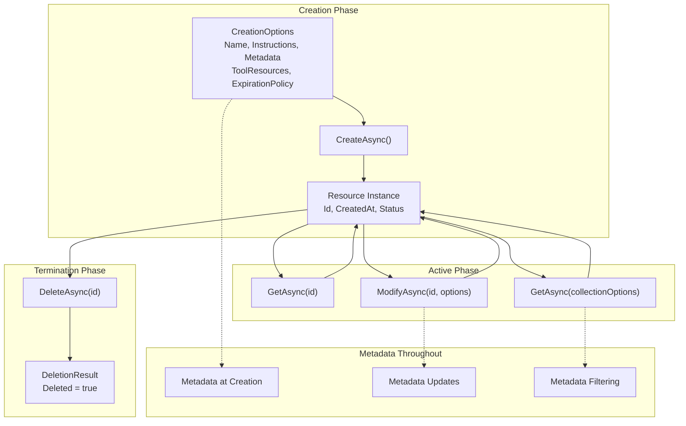

**Sources:** [tests/Chat/ChatStoreTests.cs:438-470](), [tests/Assistants/AssistantsTests.cs:85-138](), [tests/Assistants/Assistants.VectorStoresTests.cs:37-105]()

---

## Chat Completion Storage

### Storage Architecture

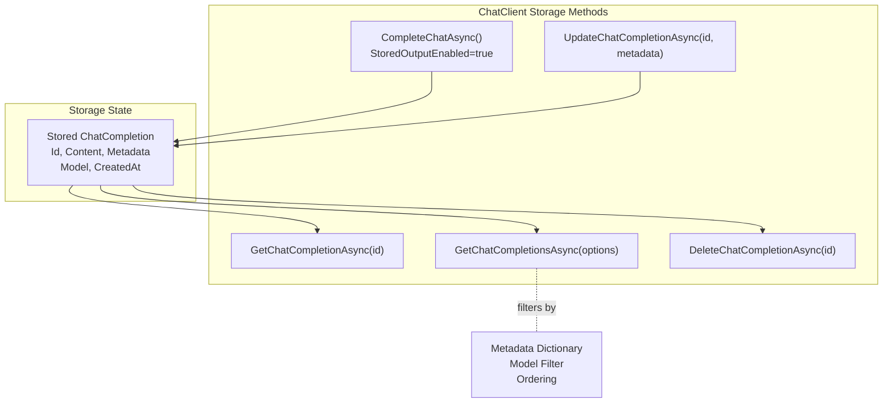

**Sources:** [tests/Chat/ChatStoreTests.cs:438-470](), [src/Custom/Chat/ChatClient.cs:313-381]()

### Enabling Storage for Chat Completions

Storage must be explicitly enabled by setting `StoredOutputEnabled = true` in `ChatCompletionOptions`:

```csharp
ChatCompletionOptions options = new()
{
    StoredOutputEnabled = true,
    Metadata = 
    {
        ["user_id"] = "12345",
        ["session_id"] = "session_abc"
    }
};

ChatCompletion completion = await client.CompleteChatAsync(
    ["Hello, world!"],
    options);

// The completion now has an ID for retrieval
string completionId = completion.Id;
```

**Key Properties:**
- `StoredOutputEnabled`: Boolean flag to enable server-side storage
- `Metadata`: Dictionary for attaching key-value pairs (up to 16 pairs, keys max 64 chars, values max 512 chars)

**Method References:**
- [src/Custom/Chat/ChatClient.cs:313-319](): `GetChatCompletionAsync(string completionId, CancellationToken)`
- [src/Custom/Chat/ChatClient.cs:325-331](): `GetChatCompletion(string completionId, CancellationToken)`
- [src/Custom/Chat/ChatClient.cs:336-344](): `UpdateChatCompletion(string id, IDictionary<string, string>, CancellationToken)`
- [src/Custom/Chat/ChatClient.cs:349-357](): `UpdateChatCompletionAsync(string id, IDictionary<string, string>, CancellationToken)`
- [src/Custom/Chat/ChatClient.cs:363-369](): `DeleteChatCompletionAsync(string completionId, CancellationToken)`
- [src/Custom/Chat/ChatClient.cs:375-381](): `DeleteChatCompletion(string completionId, CancellationToken)`

**Sources:** [tests/Chat/ChatStoreTests.cs:28-40](), [tests/Chat/ChatStoreTests.cs:442-449](), [src/Custom/Chat/ChatClient.cs:313-381]()

### Retrieving Stored Completions

#### Retrieve by ID

```csharp
ChatCompletion storedCompletion = await client.GetChatCompletionAsync(completionId);

Assert.That(storedCompletion.Id, Is.EqualTo(completionId));
Assert.That(storedCompletion.Content[0].Text, Is.Not.Null);
```

#### List Completions with Pagination

```csharp
ChatCompletionCollectionOptions options = new()
{
    PageSizeLimit = 10,
    Order = ChatCompletionCollectionOrder.Descending,
    Metadata = { ["user_id"] = "12345" }
};

await foreach (ChatCompletion completion in client.GetChatCompletionsAsync(options))
{
    Console.WriteLine($"ID: {completion.Id}, Model: {completion.Model}");
    Console.WriteLine($"Content: {completion.Content[0].Text}");
}
```

**Sources:** [tests/Chat/ChatStoreTests.cs:50-104](), [tests/Chat/ChatStoreTests.cs:24-47]()

### ChatCompletionCollectionOptions

#### Title: ChatCompletionCollectionOptions Structure

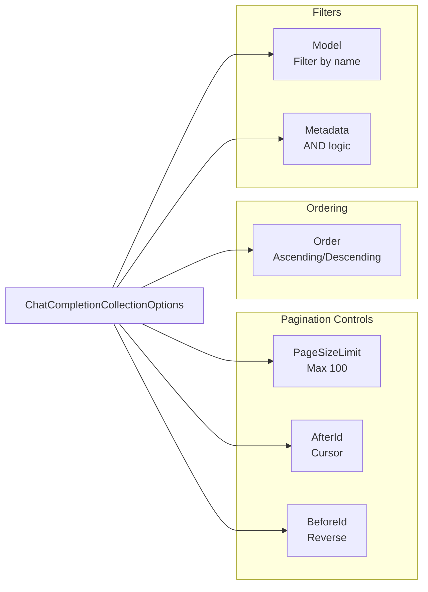

**Available Filters:**
- `PageSizeLimit`: Number of items per page (default 20, max 100)
- `AfterId`: Return items created after this ID
- `BeforeId`: Return items created before this ID
- `Order`: `Ascending` or `Descending` by creation time
- `Model`: Filter by specific model name
- `Metadata`: Dictionary for filtering by metadata key-value pairs (AND logic)

**Sources:** [tests/Chat/ChatStoreTests.cs:72-92](), [tests/Chat/ChatStoreTests.cs:140-154](), [tests/Chat/ChatStoreTests.cs:192-226]()

### Pagination Patterns

#### Cursor-Based Pagination

```csharp
ChatCompletionCollectionOptions options = new()
{
    AfterId = "chatcmpl-abc123",
    PageSizeLimit = 5
};

int count = 0;
await foreach (ChatCompletion completion in client.GetChatCompletionsAsync(options))
{
    // Process items after the specified ID
    count++;
    if (count >= 10) break;
}
```

#### Order-Based Retrieval

```csharp
// Get newest completions first
ChatCompletionCollectionOptions descOptions = new()
{
    Order = ChatCompletionCollectionOrder.Descending,
    PageSizeLimit = 10
};

// Get oldest completions first
ChatCompletionCollectionOptions ascOptions = new()
{
    Order = ChatCompletionCollectionOrder.Ascending,
    PageSizeLimit = 10
};
```

**Sources:** [tests/Chat/ChatStoreTests.cs:106-164](), [tests/Chat/ChatStoreTests.cs:166-236]()

---

## Assistant Resource Lifecycle

### Title: Assistant, Thread, and Message Lifecycle

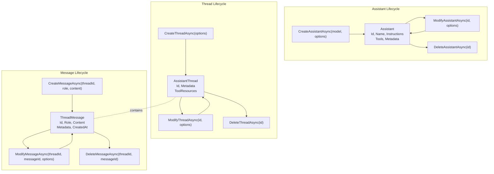

**Sources:** [tests/Assistants/AssistantsTests.cs:85-138](), [tests/Assistants/AssistantsTests.cs:140-173](), [tests/Assistants/AssistantsTests.cs:175-221]()

### Assistant Creation and Retrieval

```csharp
// Create assistant with metadata
AssistantCreationOptions creationOptions = new()
{
    Name = "Customer Support Bot",
    Instructions = "You are a helpful customer support assistant.",
    Metadata =
    {
        ["department"] = "support",
        ["version"] = "2.0"
    }
};

Assistant assistant = await client.CreateAssistantAsync("gpt-4o", creationOptions);
string assistantId = assistant.Id;

// Retrieve assistant
Assistant retrieved = await client.GetAssistantAsync(assistantId);

// Modify assistant
AssistantModificationOptions modificationOptions = new()
{
    Name = "Updated Support Bot",
    Metadata =
    {
        ["department"] = "support",
        ["version"] = "2.1"
    }
};

Assistant modified = await client.ModifyAssistantAsync(assistantId, modificationOptions);

// Delete assistant
AssistantDeletionResult deletionResult = await client.DeleteAssistantAsync(assistantId);
```

**Sources:** [tests/Assistants/AssistantsTests.cs:85-138]()

### Thread Management

```csharp
// Create thread with metadata
ThreadCreationOptions threadOptions = new()
{
    Metadata =
    {
        ["user_id"] = "user_12345",
        ["session_type"] = "support"
    }
};

AssistantThread thread = await client.CreateThreadAsync(threadOptions);

// Retrieve thread
AssistantThread retrievedThread = await client.GetThreadAsync(thread.Id);

// Modify thread metadata
ThreadModificationOptions modificationOptions = new()
{
    Metadata =
    {
        ["user_id"] = "user_12345",
        ["session_type"] = "support",
        ["status"] = "resolved"
    }
};

thread = await client.ModifyThreadAsync(thread.Id, modificationOptions);

// Delete thread
ThreadDeletionResult deletionResult = await client.DeleteThreadAsync(thread.Id);
```

**Sources:** [tests/Assistants/AssistantsTests.cs:140-173]()

### Message Lifecycle

```csharp
// Create message with metadata
MessageCreationOptions messageOptions = new()
{
    Metadata =
    {
        ["message_type"] = "question",
        ["priority"] = "high"
    }
};

ThreadMessage message = await client.CreateMessageAsync(
    thread.Id,
    MessageRole.User,
    ["How do I reset my password?"],
    messageOptions);

// Retrieve message
ThreadMessage retrievedMessage = await client.GetMessageAsync(thread.Id, message.Id);

// Modify message metadata
MessageModificationOptions modOptions = new()
{
    Metadata =
    {
        ["message_type"] = "question",
        ["priority"] = "normal",
        ["resolved"] = "true"
    }
};

message = await client.ModifyMessageAsync(thread.Id, message.Id, modOptions);

// List messages in thread
MessageCollectionOptions collectionOptions = new()
{
    Order = MessageCollectionOrder.Ascending
};

List<ThreadMessage> messages = await client.GetMessagesAsync(thread.Id, collectionOptions)
    .ToListAsync();

// Delete message
MessageDeletionResult deletionResult = await client.DeleteMessageAsync(thread.Id, message.Id);
```

**Sources:** [tests/Assistants/AssistantsTests.cs:175-221]()

---

## Vector Store Lifecycle

### Title: Vector Store Resource Management with Expiration

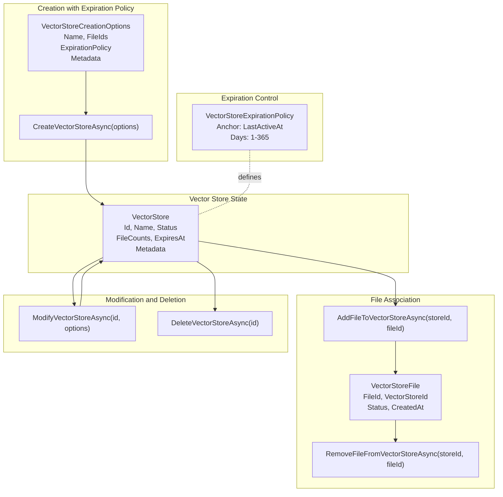

**Sources:** [tests/Assistants/Assistants.VectorStoresTests.cs:37-105]()

### Creating Vector Stores with Expiration

```csharp
VectorStoreCreationOptions creationOptions = new()
{
    Name = "Customer Support Documents",
    FileIds = { fileId1, fileId2, fileId3 },
    ExpirationPolicy = new VectorStoreExpirationPolicy(
        VectorStoreExpirationAnchor.LastActiveAt, 
        days: 7),
    Metadata =
    {
        ["department"] = "support",
        ["document_type"] = "knowledge_base"
    }
};

VectorStore vectorStore = await client.CreateVectorStoreAsync(creationOptions);

// Verify expiration settings
Assert.That(vectorStore.ExpirationPolicy.Anchor, Is.EqualTo(VectorStoreExpirationAnchor.LastActiveAt));
Assert.That(vectorStore.ExpirationPolicy.Days, Is.EqualTo(7));
Assert.That(vectorStore.ExpiresAt, Is.GreaterThan(DateTimeOffset.UtcNow));
```

**Sources:** [tests/Assistants/Assistants.VectorStoresTests.cs:50-90]()

### File Association Management

```csharp
// Add file to vector store
VectorStoreFile vectorStoreFile = await client.AddFileToVectorStoreAsync(
    vectorStore.Id, 
    fileId);

Assert.That(vectorStoreFile.VectorStoreId, Is.EqualTo(vectorStore.Id));
Assert.That(vectorStoreFile.FileId, Is.EqualTo(fileId));
Assert.That(vectorStoreFile.Status, Is.EqualTo(VectorStoreFileStatus.InProgress));

// List files in vector store
await foreach (VectorStoreFile file in client.GetVectorStoreFilesAsync(vectorStore.Id))
{
    Console.WriteLine($"File: {file.FileId}, Status: {file.Status}");
}

// Remove file from vector store
FileFromStoreRemovalResult removalResult = await client.RemoveFileFromVectorStoreAsync(
    vectorStore.Id, 
    fileId);

Assert.That(removalResult.Removed, Is.True);
```

**Sources:** [tests/Assistants/Assistants.VectorStoresTests.cs:154-202]()

### Modifying Vector Store Metadata

```csharp
VectorStoreModificationOptions modificationOptions = new()
{
    Name = "Updated Support Documents",
    Metadata =
    {
        ["department"] = "support",
        ["document_type"] = "knowledge_base",
        ["last_updated"] = DateTimeOffset.UtcNow.ToString("o")
    }
};

VectorStore modified = await client.ModifyVectorStoreAsync(vectorStore.Id, modificationOptions);
```

**Sources:** [tests/Assistants/Assistants.VectorStoresTests.cs:37-105]()

---

## File Management Lifecycle

### Title: File Upload and Lifecycle Management

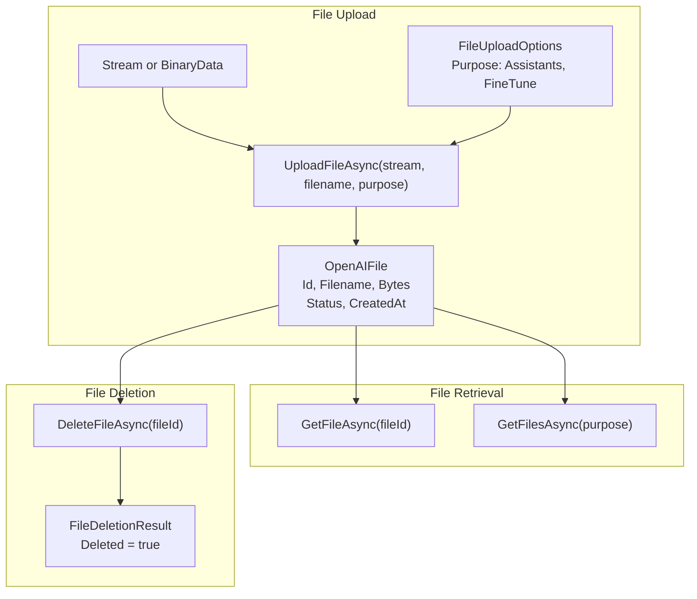

**Sources:** [tests/Assistants/AssistantsTests.cs:24-83](), [tests/Assistants/Assistants.VectorStoresTests.cs:163-177]()

### File Upload and Management

```csharp
// Upload file
using Stream fileStream = File.OpenRead("document.pdf");
OpenAIFile uploadedFile = await fileClient.UploadFileAsync(
    fileStream, 
    "document.pdf",
    FileUploadPurpose.Assistants);

string fileId = uploadedFile.Id;

// Retrieve file metadata
OpenAIFile retrievedFile = await fileClient.GetFileAsync(fileId);

Assert.That(retrievedFile.Id, Is.EqualTo(fileId));
Assert.That(retrievedFile.Filename, Is.EqualTo("document.pdf"));
Assert.That(retrievedFile.Status, Is.EqualTo(OpenAIFileStatus.Processed));

// List files by purpose
await foreach (OpenAIFile file in fileClient.GetFilesAsync(FileUploadPurpose.Assistants))
{
    Console.WriteLine($"File: {file.Filename}, Size: {file.Bytes} bytes");
}

// Delete file
FileDeletionResult deletionResult = await fileClient.DeleteFileAsync(fileId);
Assert.That(deletionResult.Deleted, Is.True);
```

**Sources:** [tests/Assistants/AssistantsTests.cs:24-83](), [tests/Assistants/Assistants.VectorStoresTests.cs:163-177]()

---

## Metadata Management Patterns

Metadata support is consistent across multiple resource types with common constraints and patterns.

### Title: Metadata Pattern Across Resources

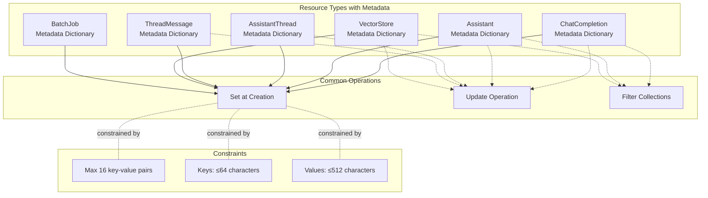

**Sources:** [tests/Chat/ChatStoreTests.cs:472-517](), [tests/Assistants/AssistantsTests.cs:102-138](), [tests/Assistants/Assistants.VectorStoresTests.cs:50-90]()

### Metadata at Creation

```csharp
// Chat Completion
ChatCompletionOptions chatOptions = new()
{
    StoredOutputEnabled = true,
    Metadata = 
    {
        ["user_id"] = "user_12345",
        ["session_type"] = "support"
    }
};

// Assistant
AssistantCreationOptions assistantOptions = new()
{
    Metadata =
    {
        ["department"] = "support",
        ["version"] = "2.0"
    }
};

// Vector Store
VectorStoreCreationOptions vectorStoreOptions = new()
{
    Metadata =
    {
        ["document_type"] = "knowledge_base",
        ["last_updated"] = DateTimeOffset.UtcNow.ToString("o")
    }
};
```

**Sources:** [tests/Chat/ChatStoreTests.cs:442-449](), [tests/Assistants/AssistantsTests.cs:102-138](), [tests/Assistants/Assistants.VectorStoresTests.cs:50-90]()

### Updating Metadata

**Important:** Update operations replace the entire metadata dictionary; they do not merge with existing metadata.

```csharp
// Update chat completion metadata
Dictionary<string, string> newMetadata = new()
{
    ["user_id"] = "user_12345",
    ["session_type"] = "support",
    ["status"] = "resolved",
    ["resolved_at"] = DateTime.UtcNow.ToString("o")
};

ChatCompletion updated = await client.UpdateChatCompletionAsync(completionId, newMetadata);

// Update assistant metadata
AssistantModificationOptions assistantMod = new()
{
    Metadata =
    {
        ["department"] = "support",
        ["version"] = "2.1",
        ["last_modified"] = DateTimeOffset.UtcNow.ToString("o")
    }
};

Assistant modifiedAssistant = await client.ModifyAssistantAsync(assistantId, assistantMod);

// Update thread metadata
ThreadModificationOptions threadMod = new()
{
    Metadata =
    {
        ["status"] = "closed",
        ["closed_at"] = DateTimeOffset.UtcNow.ToString("o")
    }
};

AssistantThread modifiedThread = await client.ModifyThreadAsync(threadId, threadMod);
```

**Sources:** [tests/Chat/ChatStoreTests.cs:472-517](), [tests/Assistants/AssistantsTests.cs:114-138](), [tests/Assistants/AssistantsTests.cs:162-173]()

### Filtering by Metadata

Filtering uses **AND logic**: all specified metadata pairs must match.

```csharp
// Filter chat completions
ChatCompletionCollectionOptions chatFilter = new()
{
    Metadata = { ["user_id"] = "user_12345", ["status"] = "active" },
    PageSizeLimit = 20
};

await foreach (ChatCompletion completion in client.GetChatCompletionsAsync(chatFilter))
{
    // Only returns completions matching ALL specified metadata
    Console.WriteLine($"Found: {completion.Id}");
}

// Filter assistants
AssistantCollectionOptions assistantFilter = new()
{
    PageSizeLimit = 10,
    Order = AssistantCollectionOrder.Descending
};

await foreach (Assistant assistant in client.GetAssistantsAsync(assistantFilter))
{
    if (assistant.Metadata.TryGetValue("department", out string dept) && dept == "support")
    {
        Console.WriteLine($"Support Assistant: {assistant.Name}");
    }
}
```

**Sources:** [tests/Chat/ChatStoreTests.cs:238-302](), [tests/Assistants/AssistantsTests.cs:122-138]()

---

## Storage Control and Expiration

### Vector Store Expiration Policies

Vector stores support automatic expiration using `VectorStoreExpirationPolicy`:

```csharp
VectorStoreCreationOptions options = new()
{
    Name = "Temporary Documents",
    ExpirationPolicy = new VectorStoreExpirationPolicy(
        VectorStoreExpirationAnchor.LastActiveAt,
        days: 7)
};

VectorStore vectorStore = await client.CreateVectorStoreAsync(options);

// Verify expiration
Assert.That(vectorStore.ExpirationPolicy.Anchor, 
    Is.EqualTo(VectorStoreExpirationAnchor.LastActiveAt));
Assert.That(vectorStore.ExpirationPolicy.Days, Is.EqualTo(7));
Assert.That(vectorStore.ExpiresAt, Is.Not.Null);
```

**Expiration Anchors:**
- `LastActiveAt`: Expires N days after last use
- Days range: 1-365

**Sources:** [tests/Assistants/Assistants.VectorStoresTests.cs:50-90]()

### Storage Duration Considerations

Different resource types have different persistence characteristics:

| Resource Type | Persistence | Expiration Control | Automatic Cleanup |
|--------------|-------------|-------------------|-------------------|
| **Chat Completions** | Server-side, opt-in | Manual deletion | Via deletion API |
| **Assistants** | Persistent | Manual deletion | Via deletion API |
| **Threads** | Persistent | Manual deletion | Via deletion API |
| **Messages** | Persistent | Manual deletion | Via deletion API |
| **Vector Stores** | Persistent | Expiration policy | Automatic after expiry |
| **Files** | Persistent | Manual deletion | Via deletion API |
| **Batches** | Persistent | Cancellation | N/A |

**Sources:** [tests/Chat/ChatStoreTests.cs:1-517](), [tests/Assistants/AssistantsTests.cs:85-221](), [tests/Assistants/Assistants.VectorStoresTests.cs:37-105]()

---

## Deletion Patterns

### Title: Deletion Result Types

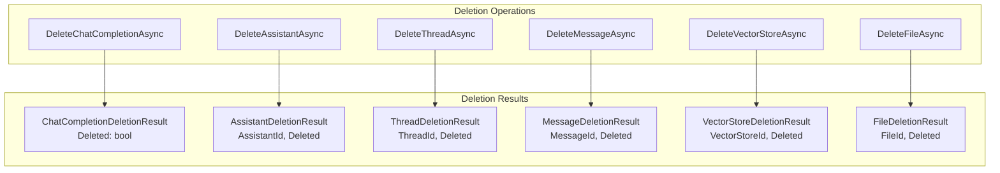

**Sources:** [tests/Chat/ChatStoreTests.cs:459-470](), [tests/Assistants/AssistantsTests.cs:96-101](), [tests/Assistants/AssistantsTests.cs:147-150]()

### Deletion Examples

```csharp
// Delete chat completion
ChatCompletionDeletionResult chatDeletion = 
    await client.DeleteChatCompletionAsync(completionId);
Assert.That(chatDeletion.Deleted, Is.True);

// Delete assistant
AssistantDeletionResult assistantDeletion = 
    await client.DeleteAssistantAsync(assistantId);
Assert.That(assistantDeletion.Deleted, Is.True);
Assert.That(assistantDeletion.AssistantId, Is.EqualTo(assistantId));

// Delete thread
ThreadDeletionResult threadDeletion = 
    await client.DeleteThreadAsync(threadId);
Assert.That(threadDeletion.Deleted, Is.True);

// Delete message
MessageDeletionResult messageDeletion = 
    await client.DeleteMessageAsync(threadId, messageId);
Assert.That(messageDeletion.Deleted, Is.True);

// Delete vector store
VectorStoreDeletionResult vectorStoreDeletion = 
    await client.DeleteVectorStoreAsync(vectorStoreId);
Assert.That(vectorStoreDeletion.Deleted, Is.True);

// Delete file
FileDeletionResult fileDeletion = 
    await fileClient.DeleteFileAsync(fileId);
Assert.That(fileDeletion.Deleted, Is.True);
```

**Note:** Attempting to retrieve deleted resources will throw `ClientResultException`.

**Sources:** [tests/Chat/ChatStoreTests.cs:459-470](), [tests/Assistants/AssistantsTests.cs:96-101](), [tests/Assistants/AssistantsTests.cs:147-150](), [tests/Assistants/AssistantsTests.cs:187-190]()

---

## Response Persistence Patterns

### Response Storage Options

The `ResponsesClient` supports storing responses with `StoredOutputEnabled` and retrieving prior responses using `PreviousResponseId` for multi-turn conversations.

#### Title: Response Storage and Multi-Turn Pattern

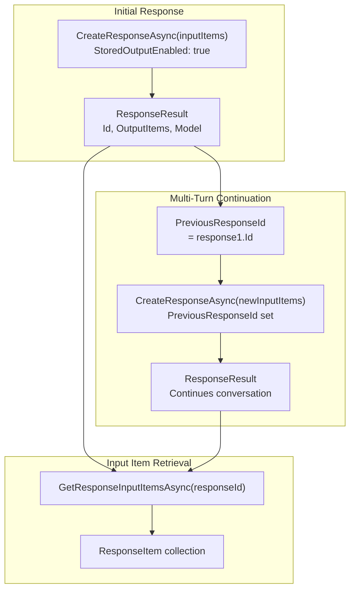

**Sources:** [tests/Responses/ResponsesTests.cs:439-465](), [tests/Responses/ResponseStoreTests.cs:24-110]()

### Storing and Continuing Responses

```csharp
// Initial response with storage enabled
CreateResponseOptions options1 = new([
    ResponseItem.CreateUserMessageItem("Hello, world!")
])
{
    StoredOutputEnabled = true,
    Metadata =
    {
        ["user_id"] = "user_12345",
        ["session_id"] = "session_abc"
    }
};

ResponseResult response1 = await client.CreateResponseAsync(options1);
string responseId = response1.Id;

// Continue with previous response
CreateResponseOptions options2 = new([
    ResponseItem.CreateUserMessageItem("Tell me more.")
])
{
    PreviousResponseId = responseId,
    StoredOutputEnabled = true
};

ResponseResult response2 = await client.CreateResponseAsync(options2);

// Response 2 continues the conversation from response 1
```

**Sources:** [tests/Responses/ResponsesTests.cs:439-465]()

### Retrieving Response Input Items

```csharp
ResponseResult response = await client.CreateResponseAsync(
    [
        ResponseItem.CreateUserMessageItem("Item 1"),
        ResponseItem.CreateUserMessageItem("Item 2"),
        ResponseItem.CreateUserMessageItem("Item 3")
    ]);

// Retrieve input items with pagination
ResponseItemCollectionOptions options = new()
{
    PageSizeLimit = 10,
    Order = ResponseItemCollectionOrder.Ascending
};

List<ResponseItem> inputItems = new();
await foreach (ResponseItem item in client.GetResponseInputItemsAsync(response.Id, options))
{
    inputItems.Add(item);
    if (item is MessageResponseItem messageItem)
    {
        Console.WriteLine($"Message: {messageItem.Content[0].Text}");
    }
}
```

**Available Options:**
- `PageSizeLimit`: Items per page
- `AfterId`: Cursor-based pagination
- `Order`: `Ascending` or `Descending`

**Sources:** [tests/Responses/ResponseStoreTests.cs:24-58](), [tests/Responses/ResponseStoreTests.cs:60-110]()

### Response Store Disabled Mode

When `StoredOutputEnabled = false`, the response is not stored server-side but can still be passed as context via `PreviousResponseId` for multi-turn conversations:

```csharp
// First turn with store disabled
CreateResponseOptions options1 = new([
    ResponseItem.CreateUserMessageItem("Hello!")
])
{
    StoredOutputEnabled = false
};

ResponseResult response1 = await client.CreateResponseAsync(options1);

// Include output items from response 1 as input for response 2
List<ResponseItem> inputItems = new(response1.OutputItems);
inputItems.Add(ResponseItem.CreateUserMessageItem("Tell me more."));

CreateResponseOptions options2 = new(inputItems)
{
    StoredOutputEnabled = false
};

ResponseResult response2 = await client.CreateResponseAsync(options2);
```

**Sources:** [tests/Responses/ResponsesTests.cs:439-465]()

---

## Serialization and Deserialization

### Serializing Chat Messages

Use `ModelReaderWriter` and `IJsonModel<T>` interface for standard serialization:

```csharp
public static BinaryData SerializeMessages(IEnumerable<ChatMessage> messages)
{
    using MemoryStream stream = new();
    using Utf8JsonWriter writer = new(stream);

    writer.WriteStartArray();

    foreach (IJsonModel<ChatMessage> message in messages)
    {
        message.Write(writer, ModelReaderWriterOptions.Json);
    }

    writer.WriteEndArray();
    writer.Flush();

    return BinaryData.FromBytes(stream.GetBuffer().AsMemory(0, (int)stream.Length));
}
```

### Deserializing Chat Messages

```csharp
public static IEnumerable<ChatMessage> DeserializeMessages(BinaryData data)
{
    using JsonDocument messagesAsJson = JsonDocument.Parse(data.ToMemory());

    foreach (JsonElement jsonElement in messagesAsJson.RootElement.EnumerateArray())
    {
        yield return ModelReaderWriter.Read<ChatMessage>(
            BinaryData.FromObjectAsJson(jsonElement), 
            ModelReaderWriterOptions.Json);
    }
}
```

### Example Usage

```csharp
// Deserialize from stored JSON
BinaryData serializedData = BinaryData.FromBytes("""
    [
        { "role": "user", "content": "Who won the world series in 2020?" },
        { "role": "assistant", "content": "The Los Angeles Dodgers won..." },
        { "role": "user", "content": "Where was it played?" }
    ]
    """u8.ToArray());

List<ChatMessage> messages = DeserializeMessages(serializedData).ToList();

// Use in chat completion
ChatCompletion completion = client.CompleteChat(messages);

// Add new message and serialize back
messages.Add(new AssistantChatMessage(completion));
serializedData = SerializeMessages(messages);
```

**Key Interfaces:**
- `IJsonModel<T>`: Implemented by all message types for standard JSON serialization
- `ModelReaderWriter`: Static utility class for reading/writing model instances

**Sources:** [examples/Chat/Example08_ChatSerialization.cs:15-44](), [examples/Chat/Example08_ChatSerialization.cs:47-100]()

---

## Complete Lifecycle Examples

### Title: Chat Completion Lifecycle Sequence

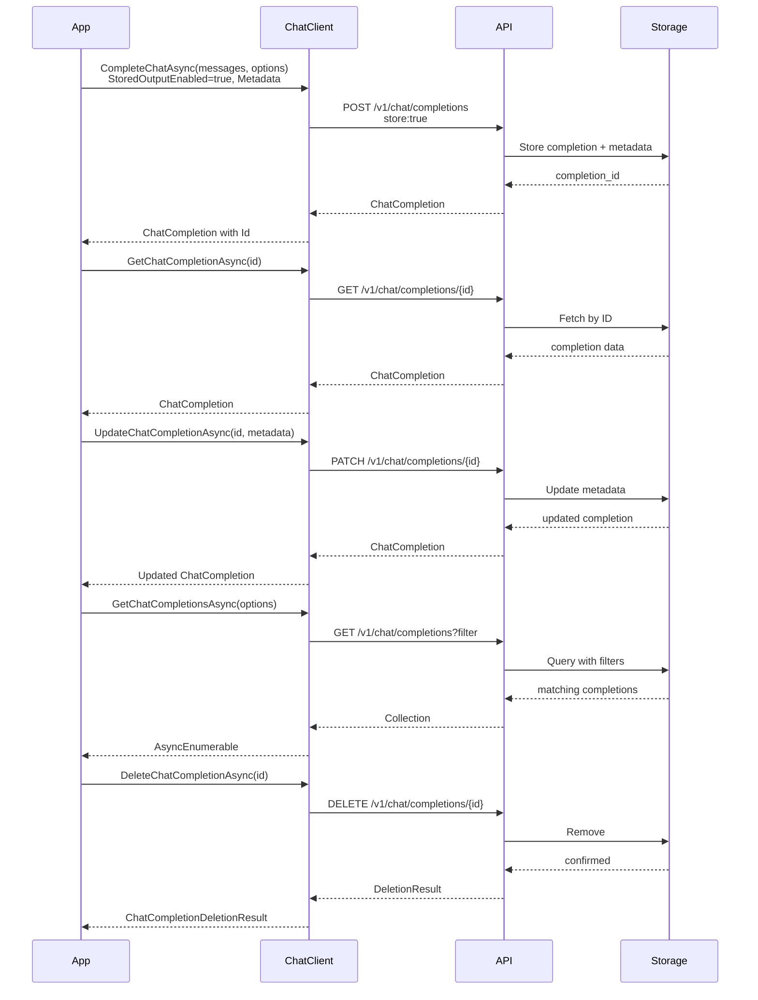

**Sources:** [tests/Chat/ChatStoreTests.cs:438-470](), [src/Custom/Chat/ChatClient.cs:313-381]()

### Title: Assistant and Thread Lifecycle

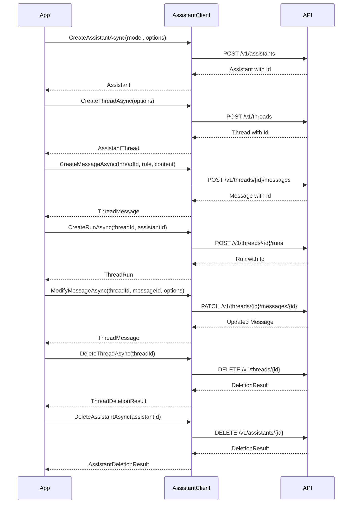

**Sources:** [tests/Assistants/AssistantsTests.cs:85-221]()

---

## Storage Limitations and Considerations

| Aspect | Limit/Behavior |
|--------|----------------|
| **Metadata Keys** | Maximum 16 pairs per completion |
| **Key Length** | Maximum 64 characters |
| **Value Length** | Maximum 512 characters |
| **Storage Duration** | Completions are stored server-side; retention policies apply |
| **Retrieval Latency** | Additional network round-trip required |
| **Metadata Updates** | Replace entire metadata dictionary (no merging) |
| **Pagination Max** | 100 items per page |

**Important Notes:**
1. Storage is **opt-in** via `StoredOutputEnabled`
2. Retrieval requires the completion ID returned from creation
3. Metadata filtering uses **AND logic** (all specified filters must match)
4. Deleted completions cannot be retrieved and throw `ClientResultException`
5. Use serialization for **client-side** persistence of conversation history

**Sources:** [tests/Chat/ChatStoreTests.cs:1-517](), [tests/Responses/ResponseStoreTests.cs:1-274]()

---

