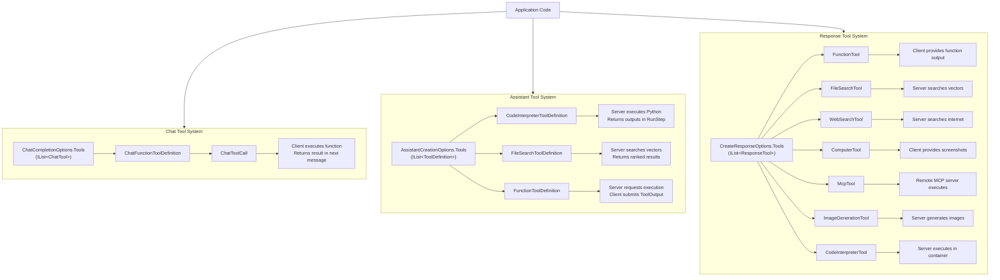
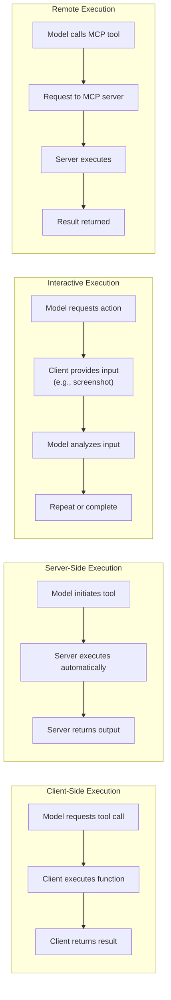
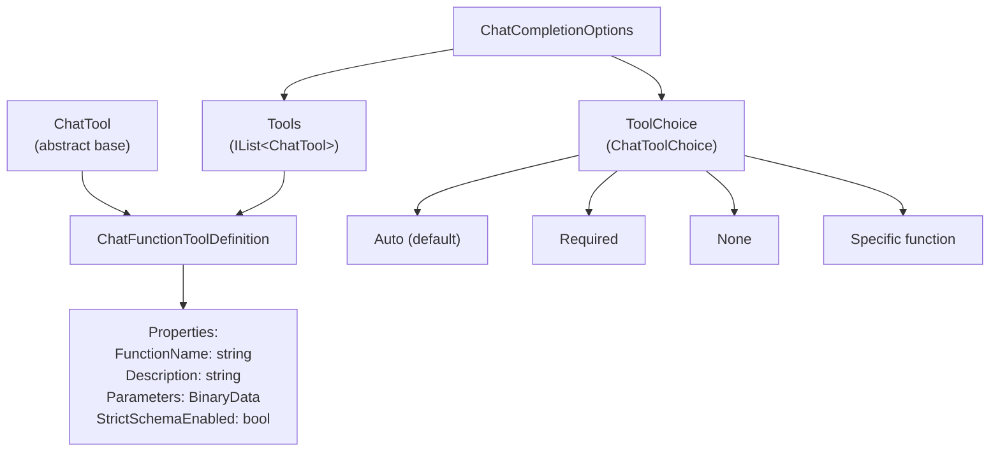
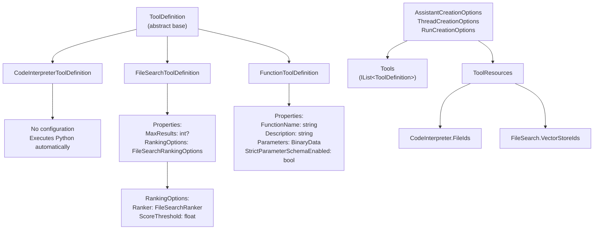
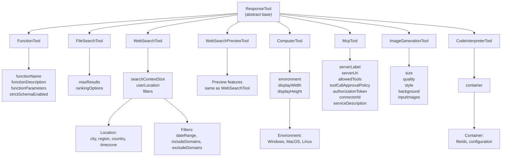
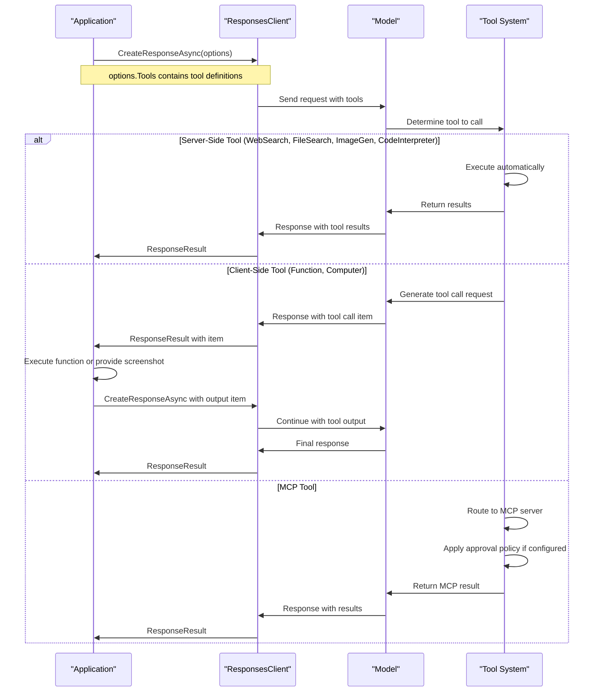
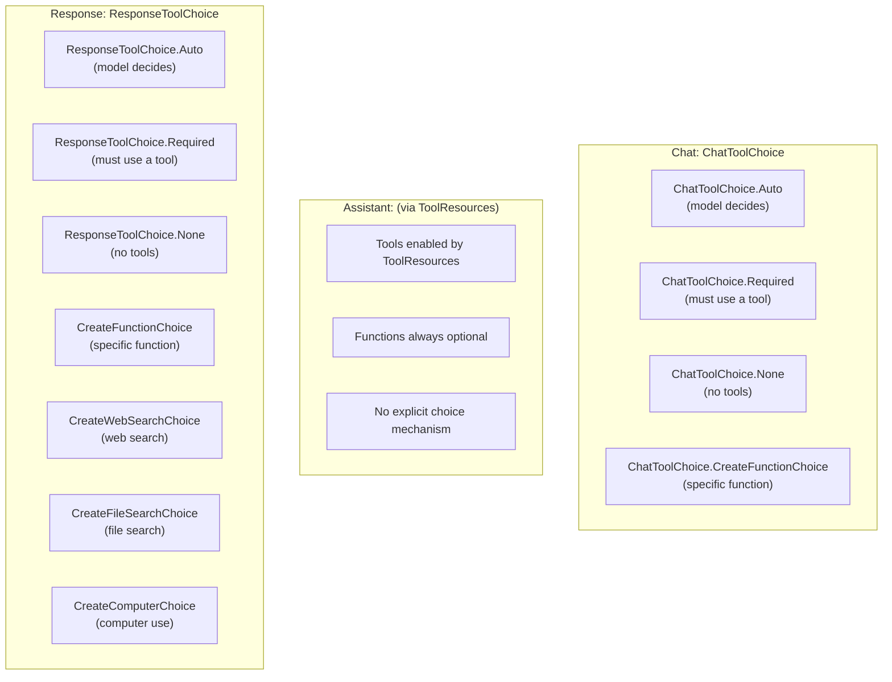

<!-- source: DeepWiki mcp.deepwiki.com · repo openai/openai-dotnet · page 6 Tool Integration · fetched 2026-10-26 -->

# Tool Integration

<details>
<summary>Relevant source files</summary>

The following files were used as context for generating this wiki page:

- [CHANGELOG.md](CHANGELOG.md)
- [api/OpenAI.net8.0.cs](api/OpenAI.net8.0.cs)
- [api/OpenAI.netstandard2.0.cs](api/OpenAI.netstandard2.0.cs)
- [scripts/Test-ApiCompatibility.ps1](scripts/Test-ApiCompatibility.ps1)
- [src/Generated/Models/OpenAIContext.cs](src/Generated/Models/OpenAIContext.cs)
- [src/Generated/OpenAIModelFactory.cs](src/Generated/OpenAIModelFactory.cs)
- [src/OpenAI.csproj](src/OpenAI.csproj)
- [tests/Responses/ResponsesTests.cs](tests/Responses/ResponsesTests.cs)
- [tests/SessionRecords/ResponsesTests/WebSearchCallStreaming.json](tests/SessionRecords/ResponsesTests/WebSearchCallStreaming.json)
- [tests/SessionRecords/ResponsesTests/WebSearchCallStreamingAsync.json](tests/SessionRecords/ResponsesTests/WebSearchCallStreamingAsync.json)
- [tspCodeModel.json](tspCodeModel.json)

</details>


This document provides an overview of the tool integration capabilities in the OpenAI .NET SDK. Tools extend model functionality by enabling interaction with external systems, code execution environments, search services, and custom functions.

The SDK supports three distinct tool systems:
- **Chat Tools** - Function calling for `ChatClient` (see [#4.2](#4.2))
- **Assistant Tools** - Server-side tools for `AssistantClient` including file search and code execution (see [#4.4](#4.4))
- **Response Tools** - Advanced tool suite for `ResponsesClient` including web search, computer use, and MCP integration (see [#4.3](#4.3))

For detailed implementation patterns of specific tools, see sections [#6.1](#6.1) through [#6.6](#6.6).

Sources: [api/OpenAI.net8.0.cs:1-15000](), [tspCodeModel.json:1-1000](), [tests/Responses/ResponsesTests.cs:1-500]()

## Tool System Architecture

The SDK implements three independent tool systems, each tailored to different API surfaces and use cases:

**Tool System Comparison**

| System | Client | Base Class | Execution Model | Primary Use Cases |
|--------|--------|------------|-----------------|-------------------|
| Chat Tools | `ChatClient` | `ChatTool` | Client-side function execution | Synchronous function calling, structured outputs |
| Assistant Tools | `AssistantClient` | `ToolDefinition` | Server-side execution with runs | RAG workflows, code execution, persistent sessions |
| Response Tools | `ResponsesClient` | `ResponseTool` | Hybrid (client + server) | Web search, computer use, MCP integration, multi-turn workflows |

**Tool System Architecture Diagram**



Sources: [api/OpenAI.net8.0.cs:2050-2150](), [api/OpenAI.net8.0.cs:214-340](), [api/OpenAI.net8.0.cs:7100-7300]()

## Tool Execution Patterns

Tools follow different execution patterns based on where and how the work is performed:

**Execution Pattern Categories**



**Pattern Mapping by Tool Type**

| Tool Type | Pattern | Client Responsibility | Server Responsibility |
|-----------|---------|----------------------|----------------------|
| `ChatFunctionToolDefinition` | Client-Side | Execute function, format response | Generate tool call request |
| `FunctionToolDefinition` (Assistant) | Client-Side | Submit `ToolOutput` via `SubmitToolOutputsToRun` | Request function execution in run |
| `FunctionTool` (Response) | Client-Side | Provide output in `FunctionCallOutputResponseItem` | Generate function call |
| `CodeInterpreterToolDefinition` | Server-Side | None (automatic) | Execute Python code, return outputs |
| `CodeInterpreterTool` | Server-Side | None (automatic) | Execute in container, stream logs |
| `FileSearchToolDefinition` | Server-Side | None (automatic) | Search vectors, rank results |
| `FileSearchTool` | Server-Side | None (automatic) | Search vectors, return citations |
| `WebSearchTool` | Server-Side | None (automatic) | Search internet, return results |
| `ComputerTool` | Interactive | Provide screenshots via `ComputerCallOutput` | Generate UI actions |
| `McpTool` | Remote | Configure auth/approval | Route to MCP server |
| `ImageGenerationTool` | Server-Side | None (automatic) | Generate images with DALL-E |

Sources: [src/Custom/Chat/ChatToolCall.cs:1-50](), [src/Custom/Assistants/ToolOutput.cs:1-50](), [src/Custom/Responses/ResponseItem.Serialization.cs:1-100]()

## Chat Tools

Chat tools enable synchronous function calling during chat completions. The model determines when to call functions based on the conversation context.

**Chat Tool Class Hierarchy**



**Usage Example**

[examples/Chat/Example04_FunctionCalling.cs:1-100]() demonstrates creating a function tool:

```csharp
ChatTool tool = ChatTool.CreateFunctionTool(
    functionName: "get_weather",
    functionDescription: "Get weather for a location",
    functionParameters: BinaryData.FromString("""
        {
            "type": "object",
            "properties": {
                "location": { "type": "string" }
            }
        }
        """)
);

ChatCompletionOptions options = new()
{
    Tools = { tool }
};
```

When the model calls a tool, the response includes `ChatToolCall` objects in the assistant message's `ToolCalls` property. The client must execute the function and provide the result in a `ToolChatMessage` in the next request.

Sources: [api/OpenAI.net8.0.cs:2050-2150](), [src/Custom/Chat/ChatFunctionToolDefinition.cs:1-100](), [src/Custom/Chat/ChatToolCall.cs:1-100]()

## Assistant Tools

Assistant tools operate within the context of persistent threads and runs, with server-side execution for most operations.

**Assistant Tool Class Hierarchy**



**Tool Resources Configuration**

Tools that operate on files require resource configuration:

```csharp
AssistantCreationOptions options = new()
{
    Tools = 
    { 
        new CodeInterpreterToolDefinition(),
        new FileSearchToolDefinition 
        { 
            MaxResults = 20,
            RankingOptions = new FileSearchRankingOptions(0.7f)
            {
                Ranker = FileSearchRanker.Auto
            }
        }
    },
    ToolResources = new()
    {
        CodeInterpreter = new() { FileIds = { "file-abc123" } },
        FileSearch = new() { VectorStoreIds = { "vs-xyz789" } }
    }
};
```

For function tools, use `SubmitToolOutputsToRun` when the run status becomes `RequiresAction`:

[src/Custom/Assistants/AssistantClient.cs:300-400]() shows the workflow:
1. Monitor run status via polling or streaming
2. Check `RequiredAction.Type` for `SubmitToolOutputs`
3. Call `SubmitToolOutputsToRun` with `ToolOutput` collection
4. Continue monitoring until run completes

Sources: [api/OpenAI.net8.0.cs:298-340](), [src/Custom/Assistants/ToolDefinition.cs:1-100](), [src/Custom/Assistants/ToolResources.cs:1-100]()

## Response Tools

Response tools provide the most comprehensive tool suite, supporting advanced scenarios like web search, computer use, and Model Context Protocol integration.

**Response Tool Type System**



**Factory Methods for Response Tools**

Response tools use factory methods on `ResponseTool` for instantiation:

| Factory Method | Purpose | Key Parameters |
|----------------|---------|----------------|
| `CreateFunctionTool` | External function calling | `functionName`, `functionDescription`, `functionParameters` |
| `CreateFileSearchTool` | Vector store search | `maxResults`, `rankingOptions` |
| `CreateWebSearchTool` | Internet search (stable) | `searchContextSize`, `userLocation`, `filters` |
| `CreateWebSearchPreviewTool` | Internet search (preview) | Same as `WebSearchTool` |
| `CreateComputerTool` | UI automation | `environment`, `displayWidth`, `displayHeight` |
| `CreateMcpTool` | MCP integration | `serverLabel`, `serverUri`, `allowedTools` |
| `CreateImageGenerationTool` | Image generation | `size`, `quality`, `style` |
| `CreateCodeInterpreterTool` | Python execution | `container` |

**Response Tool Integration Flow**



**Web Search Tool Example**

[tests/Responses/ResponsesTests.cs:140-164]() demonstrates web search:

```csharp
ResponseResult response = await client.CreateResponseAsync(
    new CreateResponseOptions([
        ResponseItem.CreateUserMessageItem("What's the weather like in Seattle?")
    ])
    {
        Tools = { ResponseTool.CreateWebSearchTool() },
        ToolChoice = ResponseToolChoice.CreateWebSearchChoice()
    });

// Response contains WebSearchCallResponseItem and MessageResponseItem
WebSearchCallResponseItem searchItem = response.OutputItems[0] as WebSearchCallResponseItem;
MessageResponseItem messageItem = response.OutputItems[1] as MessageResponseItem;

// Message content includes annotations with URL citations
foreach (var part in messageItem.Content)
{
    Console.WriteLine(part.Text);
    foreach (var annotation in part.OutputTextAnnotations)
    {
        // Annotations contain source URLs
    }
}
```

**Computer Tool Example**

[tests/Responses/ResponsesTests.cs:76-137]() demonstrates interactive computer use:

```csharp
ResponseTool computerTool = ResponseTool.CreateComputerTool(
    ComputerToolEnvironment.Windows, 1024, 768);

CreateResponseOptions options = new([
    ResponseItem.CreateDeveloperMessageItem("Call tools for computer tasks."),
    ResponseItem.CreateUserMessageItem("Click on the Save button.")
])
{
    Tools = { computerTool }
};

ResponseResult response = await client.CreateResponseAsync(options);

// Handle screenshot requests
while (true)
{
    ComputerCallResponseItem computerCall = 
        response.OutputItems.OfType<ComputerCallResponseItem>().LastOrDefault();
    
    if (computerCall?.Action.Kind == ComputerCallActionKind.Screenshot)
    {
        BinaryData screenshot = GetScreenshot(); // Client captures screen
        
        ResponseItem screenshotReply = ResponseItem.CreateComputerCallOutputItem(
            computerCall.CallId,
            ComputerCallOutput.CreateScreenshotOutput(screenshot, "image/png"));
        
        options.PreviousResponseId = response.Id;
        options.InputItems.Clear();
        options.InputItems.Add(screenshotReply);
        
        response = await client.CreateResponseAsync(options);
    }
    else if (computerCall?.Action.Kind == ComputerCallActionKind.Click)
    {
        break; // Model has determined the action
    }
}
```

Sources: [api/OpenAI.net8.0.cs:7100-7300](), [src/Custom/Responses/ResponseTool.cs:1-200](), [tests/Responses/ResponsesTests.cs:76-260]()

## Tool Selection and Control

Each tool system provides mechanisms to control which tools the model uses.

**Tool Choice Mechanisms**



**Tool Choice Configuration Examples**

For `ChatClient`:
```csharp
ChatCompletionOptions options = new()
{
    Tools = { functionTool },
    ToolChoice = ChatToolChoice.CreateFunctionChoice("get_weather")
};
```

For `AssistantClient`:
```csharp
// Tool availability determined by ToolResources
// Functions are always optional; model decides when to call
RunCreationOptions runOptions = new()
{
    ToolResources = new()
    {
        FileSearch = new() { VectorStoreIds = { vectorStoreId } }
    }
};
```

For `ResponsesClient`:
```csharp
CreateResponseOptions options = new(inputItems)
{
    Tools = 
    { 
        ResponseTool.CreateWebSearchTool(),
        ResponseTool.CreateFunctionTool("calculator", "Do math", parameters)
    },
    ToolChoice = ResponseToolChoice.CreateWebSearchChoice() // Force web search
};
```

**Parallel Tool Execution**

Chat and Response APIs support parallel tool calls:

| Property | Client | Default | Description |
|----------|--------|---------|-------------|
| `AllowParallelToolCalls` | `ChatClient` | `true` | Chat can call multiple functions in one response |
| `ParallelToolCallsEnabled` | `ResponsesClient` | `true` | Response can execute multiple tools concurrently |

Example:
```csharp
ChatCompletionOptions options = new()
{
    Tools = { weatherTool, timeTool, calculatorTool },
    AllowParallelToolCalls = false // Force sequential execution
};
```

Parallel execution reduces round trips but requires handling multiple tool calls in a single response.

Sources: [api/OpenAI.net8.0.cs:2200-2250](), [api/OpenAI.net8.0.cs:7350-7400](), [src/Custom/Chat/ChatToolChoice.cs:1-100](), [src/Custom/Responses/ResponseToolChoice.cs:1-100]()

## Tool Response Items

Response tools produce various output item types depending on the tool used:

**Response Item Type Mapping**

```mermaid
graph TB
    ResponseItem["ResponseItem<br/>(abstract base)"]
    
    ResponseItem --> MRI["MessageResponseItem<br/>(assistant text output)"]
    ResponseItem --> FCRI["FunctionCallResponseItem<br/>(function call request)"]
    ResponseItem --> FCORI["FunctionCallOutputResponseItem<br/>(client function result)"]
    ResponseItem --> FSCRI["FileSearchCallResponseItem<br/>(vector search results)"]
    ResponseItem --> WSCRI["WebSearchCallResponseItem<br/>(internet search results)"]
    ResponseItem --> CCRI["ComputerCallResponseItem<br/>(UI action request)"]
    ResponseItem --> CCORI["ComputerCallOutputResponseItem<br/>(screenshot/action result)"]
    ResponseItem --> IGCRI["ImageGenerationCallResponseItem<br/>(generated image)"]
    ResponseItem --> CICRI["CodeInterpreterCallResponseItem<br/>(code execution)"]
    
    FCRI --> FCProps["CallId<br/>FunctionName<br/>FunctionArguments<br/>Status"]
    FCORI --> FCOProps["CallId<br/>Output"]
    FSCRI --> FSCProps["Status<br/>Results[]<br/>Each result: content, score, fileId"]
    WSCRI --> WSCProps["Status<br/>Action.Query"]
    CCRI --> CCProps["CallId<br/>Action (Click, Type, Screenshot, etc)<br/>Status"]
    CCORI --> CCOProps["CallId<br/>Output (Screenshot or Error)"]
    IGCRI --> IGCProps["Status<br/>Images[]"]
    CICRI --> CICProps["Status<br/>Outputs[]<br/>(Logs, Images)"]
```



**Tool Status Lifecycle**

Many tool response items include a `Status` property tracking execution:

| Status | Meaning | Applicable Tools |
|--------|---------|------------------|
| `InProgress` | Tool call initiated | All tools |
| `Completed` | Tool execution finished successfully | All tools |
| `Failed` | Tool execution encountered an error | All tools |
| `RequiresAction` | Client must provide input | `FunctionCallResponseItem`, `ComputerCallResponseItem` |

**Handling Tool Outputs in Multi-Turn**

For client-side tools, provide outputs using factory methods on `ResponseItem`:

```csharp
// Function tool output
ResponseItem functionOutput = ResponseItem.CreateFunctionCallOutputItem(
    callId: functionCall.CallId,
    output: JsonSerializer.Serialize(result));

// Computer tool output (screenshot)
ResponseItem screenshotOutput = ResponseItem.CreateComputerCallOutputItem(
    callId: computerCall.CallId,
    output: ComputerCallOutput.CreateScreenshotOutput(screenshotBytes, "image/png"));

// Continue conversation
CreateResponseOptions nextOptions = new([functionOutput])
{
    PreviousResponseId = previousResponse.Id
};
```

Sources: [api/OpenAI.net8.0.cs:7500-7800](), [src/Custom/Responses/ResponseItem.cs:1-200](), [tests/Responses/ResponsesTests.cs:76-137]()

---

