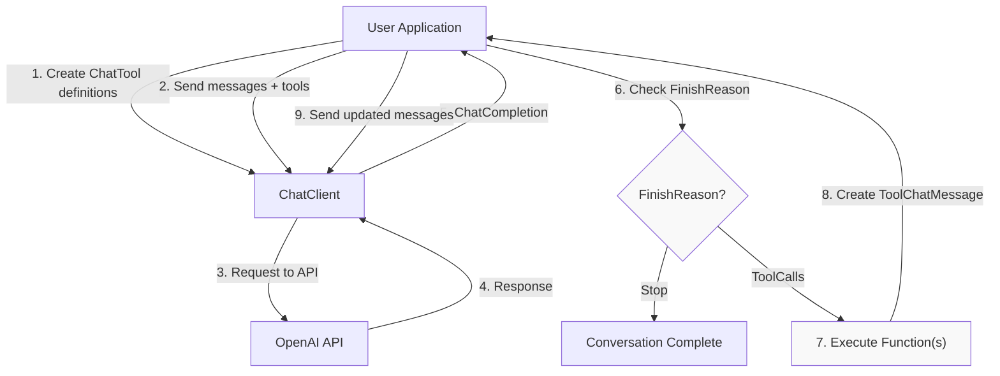
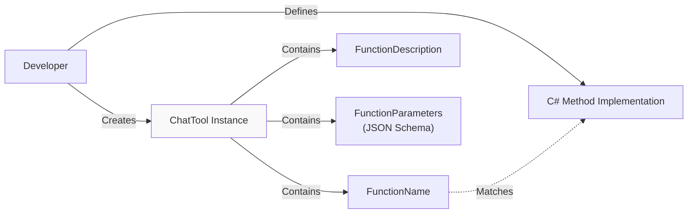
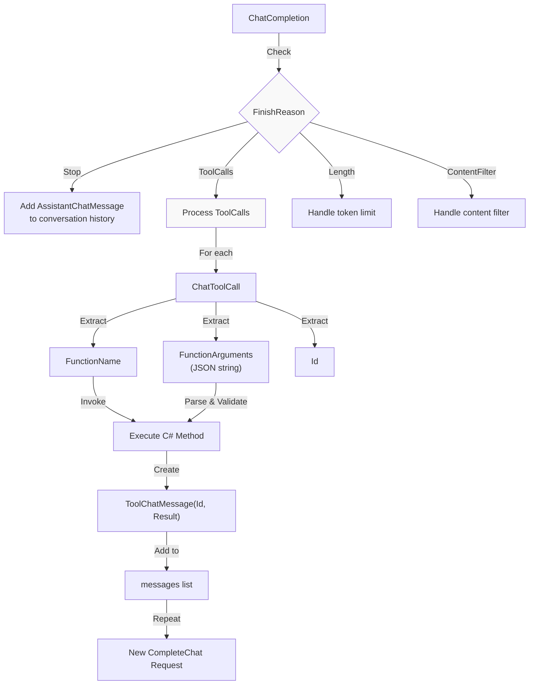
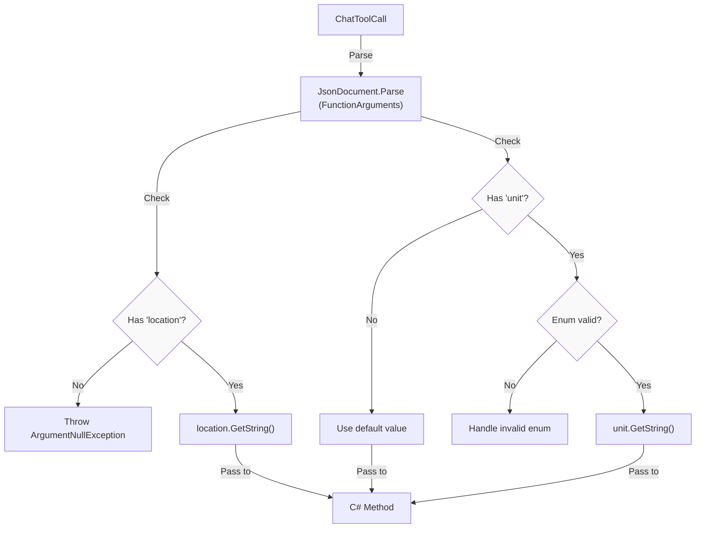
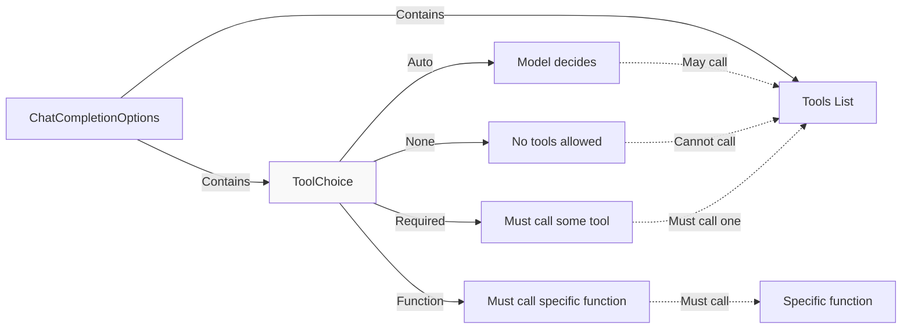
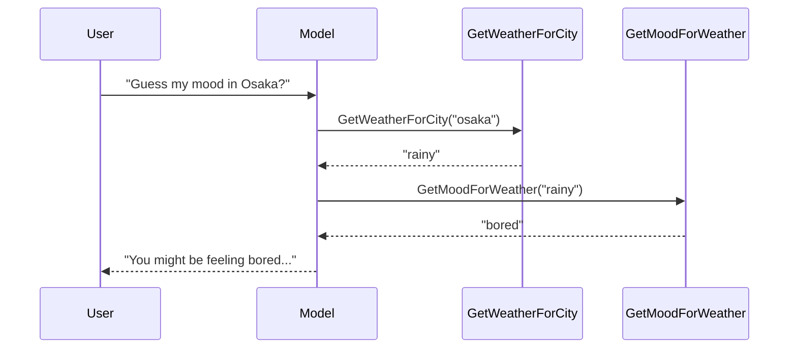
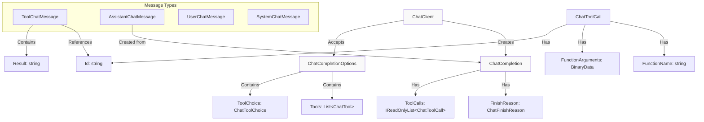
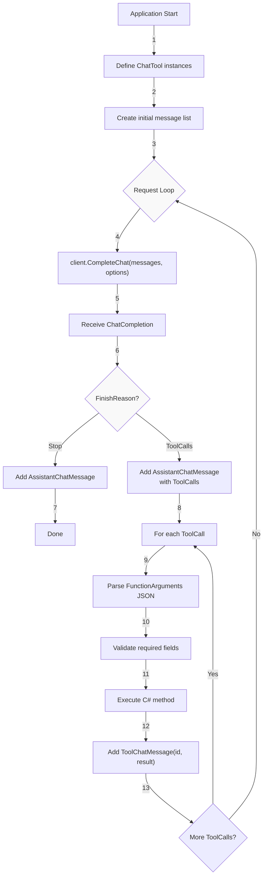

<!-- source: DeepWiki mcp.deepwiki.com · repo openai/openai-dotnet · page 6.1 Function Calling · fetched 2026-10-26 -->

# Function Calling

<details>
<summary>Relevant source files</summary>

The following files were used as context for generating this wiki page:

- [README.md](README.md)
- [api/OpenAI.net8.0.cs](api/OpenAI.net8.0.cs)
- [api/OpenAI.netstandard2.0.cs](api/OpenAI.netstandard2.0.cs)
- [examples/Assistants/Example01_RetrievalAugmentedGeneration.cs](examples/Assistants/Example01_RetrievalAugmentedGeneration.cs)
- [examples/Assistants/Example01_RetrievalAugmentedGenerationAsync.cs](examples/Assistants/Example01_RetrievalAugmentedGenerationAsync.cs)
- [examples/Assistants/Example05_AssistantsWithVision.cs](examples/Assistants/Example05_AssistantsWithVision.cs)
- [examples/Assistants/Example05_AssistantsWithVisionAsync.cs](examples/Assistants/Example05_AssistantsWithVisionAsync.cs)
- [examples/Chat/Example02_SimpleChatStreaming.cs](examples/Chat/Example02_SimpleChatStreaming.cs)
- [examples/Chat/Example02_SimpleChatStreamingAsync.cs](examples/Chat/Example02_SimpleChatStreamingAsync.cs)
- [examples/Chat/Example03_FunctionCalling.cs](examples/Chat/Example03_FunctionCalling.cs)
- [examples/Chat/Example06_StructuredOutputs.cs](examples/Chat/Example06_StructuredOutputs.cs)
- [examples/Chat/Example06_StructuredOutputsAsync.cs](examples/Chat/Example06_StructuredOutputsAsync.cs)
- [src/Custom/Chat/ChatClient.cs](src/Custom/Chat/ChatClient.cs)
- [src/Custom/Chat/ChatCompletionOptions.cs](src/Custom/Chat/ChatCompletionOptions.cs)
- [src/Generated/Models/OpenAIContext.cs](src/Generated/Models/OpenAIContext.cs)
- [src/Generated/OpenAIModelFactory.cs](src/Generated/OpenAIModelFactory.cs)
- [tests/Chat/ChatTests.cs](tests/Chat/ChatTests.cs)
- [tests/Responses/ResponsesTests.cs](tests/Responses/ResponsesTests.cs)
- [tests/SessionRecords/ChatTests/ChatServiceTierWorks.json](tests/SessionRecords/ChatTests/ChatServiceTierWorks.json)
- [tests/SessionRecords/ChatTests/ChatServiceTierWorksAsync.json](tests/SessionRecords/ChatTests/ChatServiceTierWorksAsync.json)
- [tests/SessionRecords/ChatTests/StructuredRefusalWorks.json](tests/SessionRecords/ChatTests/StructuredRefusalWorks.json)
- [tests/SessionRecords/ChatTests/StructuredRefusalWorksAsync.json](tests/SessionRecords/ChatTests/StructuredRefusalWorksAsync.json)
- [tests/SessionRecords/ChatTests/ValidateConcurrency.json](tests/SessionRecords/ChatTests/ValidateConcurrency.json)
- [tests/SessionRecords/ChatTests/ValidateConcurrencyAsync.json](tests/SessionRecords/ChatTests/ValidateConcurrencyAsync.json)
- [tests/SessionRecords/ChatTests/WebSearchWorks.json](tests/SessionRecords/ChatTests/WebSearchWorks.json)
- [tests/SessionRecords/ChatTests/WebSearchWorksAsync.json](tests/SessionRecords/ChatTests/WebSearchWorksAsync.json)
- [tests/Telemetry/ChatTelemetryTests.cs](tests/Telemetry/ChatTelemetryTests.cs)
- [tspCodeModel.json](tspCodeModel.json)

</details>


## Purpose and Scope

This page documents function calling in the OpenAI .NET SDK, which enables language models to invoke developer-defined functions during chat completion generation. Function calling allows the model to recognize when it needs external information or actions, describe the function it wants to call and the arguments it wants to use, and return control to your application to execute the function and provide the results back to the model.

**Scope**: This page covers function tools specifically. For other tool types, see:
- [File Search Tool](#6.2) for vector store-based retrieval
- [Web Search Tool](#6.3) for web-based search
- [Code Interpreter Tool](#6.4) for Python code execution
- [Computer Use Tool](#6.5) for computer interaction
- [MCP (Model Context Protocol)](#6.6) for external server integration

For general chat completion usage without tools, see [Chat Client](#4.2).

---

## Function Calling Mechanism Overview

Function calling follows a request-response loop pattern where the model can request function execution during generation:



**Diagram**: Function calling request-response lifecycle

**Sources**: [README.md:222-368](), [examples/Chat/Example03_FunctionCalling.cs:1-182]()

### Key Classes and Types

| Class/Type | Namespace | Purpose |
|------------|-----------|---------|
| `ChatTool` | `OpenAI.Chat` | Represents a function tool definition |
| `ChatCompletionOptions` | `OpenAI.Chat` | Container for tools and configuration |
| `ChatFinishReason` | `OpenAI.Chat` | Indicates why generation stopped (e.g., `ToolCalls`) |
| `ChatToolCall` | `OpenAI.Chat` | Represents a single function call request from the model |
| `ToolChatMessage` | `OpenAI.Chat` | Message type for providing function results |
| `ChatToolChoice` | `OpenAI.Chat` | Controls tool usage behavior |

**Sources**: [README.md:222-368](), [tests/Chat/ChatToolTests.cs:1-389]()

---

## Defining Function Tools

### Basic Function Tool Creation

Function tools are created using the static factory method `ChatTool.CreateFunctionTool()`. The method accepts:
- **functionName**: The name of the function (should match your actual method name)
- **functionDescription**: A description that helps the model understand when to call it
- **functionParameters** (optional): JSON schema describing the parameters
- **strictSchemaEnabled** (optional): Whether to use strict schema validation



**Diagram**: Function tool definition structure

### Function Tool Without Parameters

For functions that require no arguments:

```csharp
ChatTool tool = ChatTool.CreateFunctionTool(
    functionName: "GetCurrentLocation",
    functionDescription: "Get the user's current location"
);
```

**Sources**: [README.md:243-246](), [examples/Chat/Example03_FunctionCalling.cs:26-29](), [tests/Chat/ChatToolTests.cs:309-312]()

### Function Tool With Parameters

For functions with parameters, provide a JSON schema describing the expected arguments:

```csharp
ChatTool tool = ChatTool.CreateFunctionTool(
    functionName: "GetCurrentWeather",
    functionDescription: "Get the current weather in a given location",
    functionParameters: BinaryData.FromBytes("""
        {
            "type": "object",
            "properties": {
                "location": {
                    "type": "string",
                    "description": "The city and state, e.g. Boston, MA"
                },
                "unit": {
                    "type": "string",
                    "enum": [ "celsius", "fahrenheit" ],
                    "description": "The temperature unit to use."
                }
            },
            "required": [ "location" ]
        }
        """u8.ToArray())
);
```

The JSON schema follows the JSON Schema specification with:
- `type`: Data type (e.g., "object", "string", "number")
- `properties`: Object properties and their schemas
- `description`: Helps the model understand parameter usage
- `enum`: For constrained string values
- `required`: Array of required property names

**Sources**: [README.md:248-268](), [examples/Chat/Example03_FunctionCalling.cs:32-51](), [tests/Chat/ChatToolTests.cs:315-330]()

### Strict Schema Mode

For models supporting structured outputs (e.g., `gpt-4o-2024-08-06` and later), enable strict schema validation:

```csharp
ChatTool tool = ChatTool.CreateFunctionTool(
    functionName: "GetFavoriteColorForDay",
    functionDescription: "Gets the favorite color for a day of the week",
    functionParameters: schema,
    strictSchemaEnabled: true
);
```

When strict mode is enabled:
- The schema must set `additionalProperties: false`
- All required fields must be specified
- The model's output is guaranteed to conform to the schema

**Sources**: [tests/Chat/ChatToolTests.cs:220-290]()

---

## The Request-Response Loop

### Adding Tools to Chat Completion

Add tools to a `ChatCompletionOptions` instance and include it in the chat completion request:

```csharp
List<ChatMessage> messages = 
[
    new UserChatMessage("What's the weather like today?"),
];

ChatCompletionOptions options = new()
{
    Tools = { getCurrentLocationTool, getCurrentWeatherTool },
};

ChatCompletion completion = client.CompleteChat(messages, options);
```

**Sources**: [README.md:274-283](), [examples/Chat/Example03_FunctionCalling.cs:60-69]()

### Handling the Response

The `ChatCompletion.FinishReason` property indicates why the model stopped generating:



**Diagram**: Response handling and tool call execution flow

**Sources**: [README.md:285-368](), [examples/Chat/Example03_FunctionCalling.cs:74-151]()

### Complete Request-Response Loop Pattern

The following pattern is used for handling tool calls:

```csharp
bool requiresAction;

do
{
    requiresAction = false;
    ChatCompletion completion = client.CompleteChat(messages, options);

    switch (completion.FinishReason)
    {
        case ChatFinishReason.Stop:
            messages.Add(new AssistantChatMessage(completion));
            break;

        case ChatFinishReason.ToolCalls:
            // Add assistant message with tool calls
            messages.Add(new AssistantChatMessage(completion));

            // Execute each tool call
            foreach (ChatToolCall toolCall in completion.ToolCalls)
            {
                string toolResult = ExecuteFunction(toolCall);
                messages.Add(new ToolChatMessage(toolCall.Id, toolResult));
            }

            requiresAction = true;
            break;
    }
} while (requiresAction);
```

**Key points**:
1. Always add the `AssistantChatMessage` before adding `ToolChatMessage` responses
2. Each `ToolChatMessage` must reference the `toolCall.Id` from the corresponding `ChatToolCall`
3. Continue the loop until `FinishReason.Stop` is reached

**Sources**: [README.md:288-368](), [examples/Chat/Example03_FunctionCalling.cs:72-152]()

---

## Argument Parsing and Validation

### Parsing Function Arguments

The `ChatToolCall.FunctionArguments` property contains a JSON string representation of the arguments the model wants to use:

```csharp
foreach (ChatToolCall toolCall in completion.ToolCalls)
{
    using JsonDocument argumentsJson = JsonDocument.Parse(toolCall.FunctionArguments);
    
    bool hasLocation = argumentsJson.RootElement.TryGetProperty("location", out JsonElement location);
    bool hasUnit = argumentsJson.RootElement.TryGetProperty("unit", out JsonElement unit);

    if (!hasLocation)
    {
        throw new ArgumentNullException(nameof(location), "Required argument missing.");
    }

    string toolResult = hasUnit
        ? GetCurrentWeather(location.GetString(), unit.GetString())
        : GetCurrentWeather(location.GetString());
    
    messages.Add(new ToolChatMessage(toolCall.Id, toolResult));
}
```

**Important**: The model may hallucinate arguments or provide invalid values. Always:
- Parse the JSON safely
- Validate required fields exist
- Validate types and formats
- Validate enum values match expected options
- Handle parsing errors gracefully

**Sources**: [README.md:323-340](), [examples/Chat/Example03_FunctionCalling.cs:106-125](), [tests/Chat/ChatToolTests.cs:97-101]()

### Argument Validation Example



**Diagram**: Argument parsing and validation flow

**Sources**: [README.md:323-340](), [tests/Chat/ChatToolTests.cs:82-107]()

---

## Tool Choice Configuration

### Controlling Tool Usage

The `ChatToolChoice` class controls how the model uses tools:

| Choice Type | Behavior | Use Case |
|-------------|----------|----------|
| `CreateAutoChoice()` | Model decides whether to call tools | Default; recommended for most scenarios |
| `CreateNoneChoice()` | Model cannot call any tools | Force text-only responses |
| `CreateFunctionChoice(name)` | Model must call the specified function | Guarantee a specific tool is used |
| `CreateRequiredChoice()` | Model must call at least one tool | Ensure tools are invoked |

**Sources**: [tests/Chat/ChatToolTests.cs:29-51]()

### Usage Example

```csharp
ChatCompletionOptions options = new()
{
    Tools = { tool1, tool2 },
    ToolChoice = ChatToolChoice.CreateNoneChoice() // Force no tool calls
};
```



**Diagram**: Tool choice behavior options

**Sources**: [tests/Chat/ChatToolTests.cs:29-51]()

---

## Advanced Scenarios

### Parallel Tool Calls

The model can request multiple tool calls in a single response:

```csharp
ChatCompletion completion = client.CompleteChat(
    ["Tell me the weather in Santiago and Karachi"],
    options);

Assert.That(completion.FinishReason, Is.EqualTo(ChatFinishReason.ToolCalls));
Assert.That(completion.ToolCalls.Count, Is.EqualTo(2));

// Process all tool calls
messages.Add(new AssistantChatMessage(completion));
foreach (ChatToolCall toolCall in completion.ToolCalls)
{
    string result = ExecuteFunction(toolCall);
    messages.Add(new ToolChatMessage(toolCall.Id, result));
}
```

The `ChatCompletion.ToolCalls` collection contains all requested function calls. Each must be executed and responded to with a separate `ToolChatMessage`.

**Sources**: [README.md:285-368](), [tests/Chat/ChatToolTests.cs:139-176]()

### Consecutive Tool Calls

The model may chain tool calls across multiple requests to gather information:



**Diagram**: Sequential tool call chain

In this scenario:
1. First request: Model calls `GetWeatherForCity` to get weather data
2. Second request: Model uses the weather result to call `GetMoodForWeather`
3. Third request: Model generates final text response

**Sources**: [tests/Chat/ChatToolTests.cs:178-218]()

### Structured Outputs for Tool Arguments

For models supporting structured outputs, enable strict schema mode to guarantee argument conformance:

```csharp
ChatTool tool = ChatTool.CreateFunctionTool(
    "get_favorite_color_for_day",
    "Gets the favorite color for a weekday",
    BinaryData.FromObjectAsJson(new
    {
        type = "object",
        properties = new
        {
            the_day_of_the_week = new { type = "string" }
        },
        required = new[] { "the_day_of_the_week" },
        additionalProperties = false // Required for strict mode
    }),
    strictSchemaEnabled: true
);
```

With strict mode:
- The model's arguments are guaranteed to match the schema exactly
- No additional properties beyond those defined in the schema
- All `required` fields are present
- Type conformance is enforced

**Sources**: [tests/Chat/ChatToolTests.cs:220-290]()

---

## Code Entity Reference

### Key Classes in OpenAI.Chat Namespace



**Diagram**: Function calling class relationship map

**Sources**: [README.md:222-368](), [tests/Chat/ChatToolTests.cs:1-389]()

### Method Signatures

| Method | Location | Signature |
|--------|----------|-----------|
| `CreateFunctionTool` | `ChatTool` | `static ChatTool CreateFunctionTool(string functionName, string functionDescription, BinaryData functionParameters = null, bool? strictSchemaEnabled = null)` |
| `CompleteChat` | `ChatClient` | `ChatCompletion CompleteChat(IEnumerable<ChatMessage> messages, ChatCompletionOptions options = null)` |
| `CompleteChatAsync` | `ChatClient` | `Task<ChatCompletion> CompleteChatAsync(IEnumerable<ChatMessage> messages, ChatCompletionOptions options = null)` |

**Sources**: [README.md:243-268](), [tests/Chat/ChatToolTests.cs:28-51]()

---

## Deprecated: Legacy Function Calling API

Prior to tools, the API supported a `Functions` property on `ChatCompletionOptions`. This is now deprecated in favor of `Tools`:

```csharp
#pragma warning disable CS0618
ChatCompletionOptions options = new()
{
    Functions = { functionDefinition } // Deprecated
};
#pragma warning restore CS0618
```

Legacy behavior:
- `FinishReason.FunctionCall` instead of `FinishReason.ToolCalls`
- `ChatCompletion.FunctionCall` property instead of `ToolCalls` collection
- `FunctionChatMessage` instead of `ToolChatMessage`

**Migration**: Replace `Functions` with `Tools` using `ChatTool.CreateFunctionTool()`.

**Sources**: [tests/Chat/ChatToolTests.cs:109-136](), [README.md:361-362]()

---

## Complete Example



**Diagram**: Complete function calling workflow from start to finish

**Sources**: [README.md:222-368](), [examples/Chat/Example03_FunctionCalling.cs:1-182](), [tests/Chat/ChatToolTests.cs:54-78]()

---

## Testing and Validation

### Test Coverage

The SDK includes comprehensive tests for function calling:

| Test Category | File | Coverage |
|---------------|------|----------|
| Basic function tools | `ChatToolTests.cs` | Parameters, no-parameters, tool constraints |
| Parallel execution | `ChatToolTests.cs` | Multiple simultaneous tool calls |
| Sequential execution | `ChatToolTests.cs` | Chained tool calls across requests |
| Structured outputs | `ChatToolTests.cs` | Strict schema validation |
| Legacy functions | `ChatToolTests.cs` | Deprecated function calling API |

**Sources**: [tests/Chat/ChatToolTests.cs:1-389]()

### Key Test Patterns

Pattern for testing tool calls:
```csharp
[RecordedTest]
public async Task ParametersWork()
{
    ChatClient client = GetProxiedOpenAIClient<ChatClient>(TestScenario.Chat);
    ChatCompletionOptions options = new()
    {
        Tools = { tool },
    };
    List<ChatMessage> messages = [new UserChatMessage("...")];

    ChatCompletion completion = await client.CompleteChatAsync(messages, options);
    
    Assert.That(completion.FinishReason, Is.EqualTo(ChatFinishReason.ToolCalls));
    Assert.That(completion.ToolCalls?.Count, Is.EqualTo(1));
    
    ChatToolCall toolCall = completion.ToolCalls[0];
    // Validate and execute...
}
```

**Sources**: [tests/Chat/ChatToolTests.cs:80-107]()

---

**Summary**: Function calling enables language models to invoke developer-defined functions during chat completion. Key components include `ChatTool` for function definitions, `ChatCompletionOptions.Tools` for registration, `ChatFinishReason.ToolCalls` for detection, `ChatToolCall` for accessing function call details, and `ToolChatMessage` for providing results. The request-response loop continues until the model reaches `FinishReason.Stop`, allowing for parallel and sequential function execution patterns.

---

