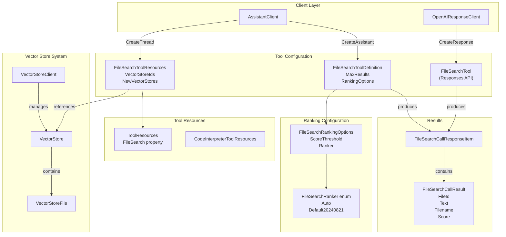
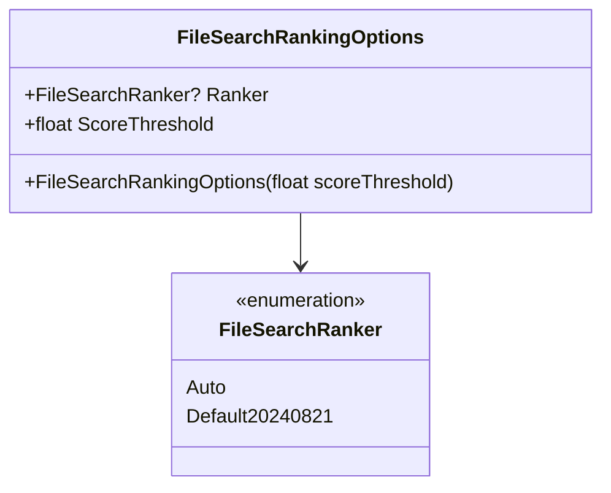
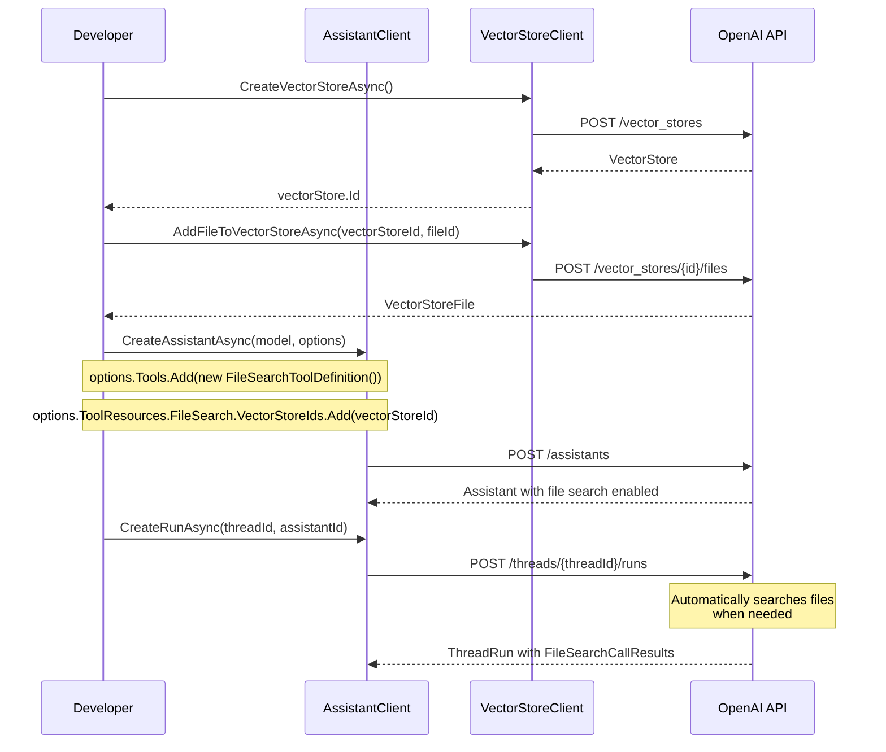
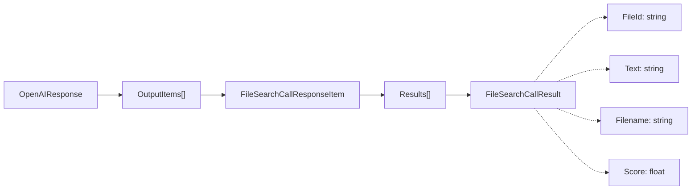
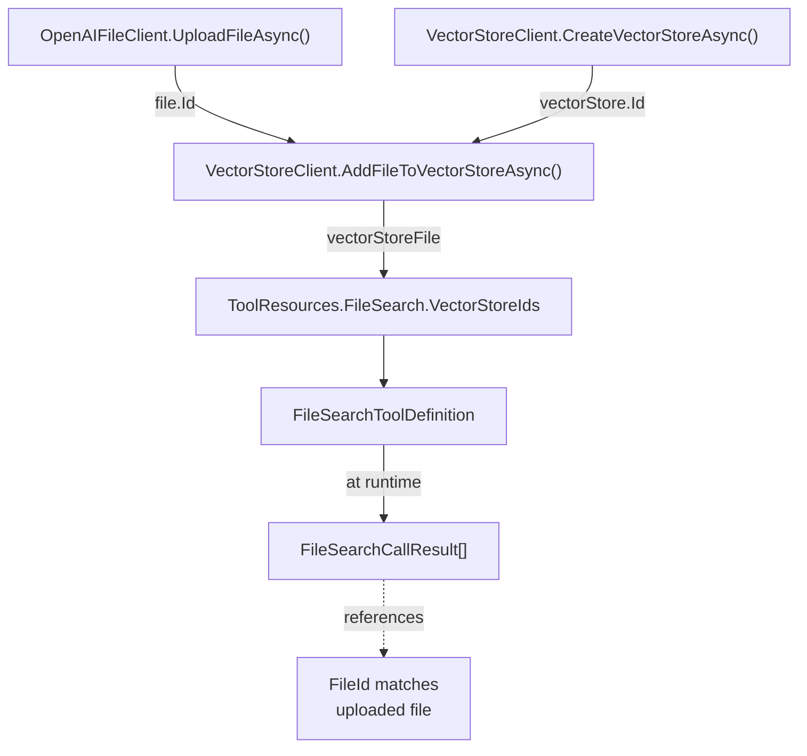

<!-- source: DeepWiki mcp.deepwiki.com · repo openai/openai-dotnet · page 6.2 File Search Tool · fetched 2026-10-26 -->

# File Search Tool

<details>
<summary>Relevant source files</summary>

The following files were used as context for generating this wiki page:

- [CHANGELOG.md](CHANGELOG.md)
- [api/OpenAI.net8.0.cs](api/OpenAI.net8.0.cs)
- [api/OpenAI.netstandard2.0.cs](api/OpenAI.netstandard2.0.cs)
- [scripts/Test-ApiCompatibility.ps1](scripts/Test-ApiCompatibility.ps1)
- [src/Generated/Models/OpenAIContext.cs](src/Generated/Models/OpenAIContext.cs)
- [src/Generated/OpenAIModelFactory.cs](src/Generated/OpenAIModelFactory.cs)
- [src/OpenAI.csproj](src/OpenAI.csproj)
- [tests/Assistants/Assistants.VectorStoresTests.cs](tests/Assistants/Assistants.VectorStoresTests.cs)
- [tests/Assistants/AssistantsTests.cs](tests/Assistants/AssistantsTests.cs)
- [tests/Responses/ResponsesTests.cs](tests/Responses/ResponsesTests.cs)
- [tests/SessionRecords/ResponsesTests/WebSearchCallStreaming.json](tests/SessionRecords/ResponsesTests/WebSearchCallStreaming.json)
- [tests/SessionRecords/ResponsesTests/WebSearchCallStreamingAsync.json](tests/SessionRecords/ResponsesTests/WebSearchCallStreamingAsync.json)
- [tests/SessionRecords/ResponsesToolTests/ImageGenToolInputMaskWithFileId.json](tests/SessionRecords/ResponsesToolTests/ImageGenToolInputMaskWithFileId.json)
- [tests/SessionRecords/ResponsesToolTests/ImageGenToolInputMaskWithFileIdAsync.json](tests/SessionRecords/ResponsesToolTests/ImageGenToolInputMaskWithFileIdAsync.json)
- [tests/SessionRecords/ResponsesToolTests/ImageGenToolInputMaskWithImageUri.json](tests/SessionRecords/ResponsesToolTests/ImageGenToolInputMaskWithImageUri.json)
- [tests/SessionRecords/ResponsesToolTests/ImageGenToolInputMaskWithImageUriAsync.json](tests/SessionRecords/ResponsesToolTests/ImageGenToolInputMaskWithImageUriAsync.json)
- [tspCodeModel.json](tspCodeModel.json)

</details>


## Overview and Scope

The File Search Tool enables assistants and responses to search through uploaded documents using vector-based similarity search. This tool automatically integrates with vector stores to retrieve relevant content from files, making it essential for retrieval-augmented generation (RAG) scenarios.

This page covers the File Search Tool configuration and usage patterns. For information about vector store management, see [Files and Vector Stores](#4.8). For function calling patterns, see [Function Calling](#6.1). For the Responses API tool integration, see [Responses API Client](#4.3).

**Sources**: [api/OpenAI.net8.0.cs:340-358](), [specification/base/typespec/responses/models.tsp:1-20]()

## Architecture and Component Overview



**Sources**: [api/OpenAI.net8.0.cs:340-358](), [src/Generated/OpenAIModelFactory.cs:50-53](), [src/Generated/OpenAIModelFactory.cs:87-93]()

## Core Components and Types

### FileSearchToolDefinition (Assistants API)

The `FileSearchToolDefinition` class configures file search behavior for assistants. It inherits from `ToolDefinition` and provides control over result count and ranking strategy.

| Property | Type | Description |
|----------|------|-------------|
| `MaxResults` | `int?` | Maximum number of search results to return (optional) |
| `RankingOptions` | `FileSearchRankingOptions` | Controls result ranking and filtering |

**Sources**: [api/OpenAI.net8.0.cs:340-349](), [api/OpenAI.netstandard2.0.cs:311-319]()

### FileSearchTool (Responses API)

The `FileSearchTool` class is used in the Responses API to enable file search capabilities. It provides similar configuration but follows the Responses API pattern.

| Property | Type | Description |
|----------|------|-------------|
| `MaxResultCount` | `int?` | Maximum number of results (renamed from MaxResults) |
| `RankingOptions` | `FileSearchToolRankingOptions` | Ranking and scoring configuration |

**Sources**: [specification/client/responses.client.tsp:62-63](), [specification/base/typespec/responses/models.tsp:224-239]()

### FileSearchToolResources

The `FileSearchToolResources` class associates vector stores with assistants or threads, enabling the file search tool to access uploaded documents.

| Property | Type | Description |
|----------|------|-------------|
| `VectorStoreIds` | `IList<string>` | IDs of existing vector stores to use |
| `NewVectorStores` | `IList<VectorStoreCreationHelper>` | Vector stores to create inline |

**Sources**: [api/OpenAI.net8.0.cs:350-358](), [src/Generated/OpenAIModelFactory.cs:87-93]()

### FileSearchRankingOptions

Controls how search results are filtered and ranked based on relevance scores.



**Sources**: [api/OpenAI.net8.0.cs:330-339](), [tspCodeModel.json:66-110]()

## Configuration Flow



**Sources**: [tests/Assistants/AssistantsTests.cs:344-452](), [tests/Assistants/Assistants.VectorStoresTests.cs:156-177]()

## Usage in Assistants API

### Basic Setup with Vector Store

The typical pattern for using file search in the Assistants API involves:

1. Creating a vector store
2. Adding files to the vector store
3. Creating an assistant with `FileSearchToolDefinition`
4. Associating the vector store via `ToolResources`

```csharp
// Example pattern from tests
VectorStoreClient vectorStoreClient = client.GetVectorStoreClient();
VectorStore vectorStore = await vectorStoreClient.CreateVectorStoreAsync();

OpenAIFileClient fileClient = client.GetOpenAIFileClient();
OpenAIFile file = await fileClient.UploadFileAsync(filePath, FileUploadPurpose.Assistants);

VectorStoreFile vectorStoreFile = await vectorStoreClient.AddFileToVectorStoreAsync(
    vectorStore.Id, 
    file.Id);

AssistantCreationOptions options = new()
{
    Tools = { new FileSearchToolDefinition() },
    ToolResources = new()
    {
        FileSearch = new FileSearchToolResources()
        {
            VectorStoreIds = { vectorStore.Id }
        }
    }
};

Assistant assistant = await assistantClient.CreateAssistantAsync("gpt-4o", options);
```

**Sources**: [tests/Assistants/AssistantsTests.cs:344-377](), [tests/Assistants/Assistants.VectorStoresTests.cs:156-177]()

### Inline Vector Store Creation

The `NewVectorStores` property allows creating vector stores inline during assistant or thread creation:

```csharp
VectorStoreCreationHelper helper = new()
{
    FileIds = { fileId1, fileId2 },
    Metadata = { ["purpose"] = "documentation" }
};

AssistantCreationOptions options = new()
{
    Tools = { new FileSearchToolDefinition() },
    ToolResources = new()
    {
        FileSearch = new FileSearchToolResources()
        {
            NewVectorStores = { helper }
        }
    }
};
```

**Sources**: [api/OpenAI.net8.0.cs:350-358](), [src/Generated/OpenAIModelFactory.cs:95-101]()

### Thread-Level Tool Resources

File search can be configured at the thread level, allowing different threads to search different document sets:

```csharp
ThreadCreationOptions threadOptions = new()
{
    ToolResources = new()
    {
        FileSearch = new FileSearchToolResources()
        {
            VectorStoreIds = { vectorStoreId }
        }
    }
};

AssistantThread thread = await assistantClient.CreateThreadAsync(threadOptions);
```

**Sources**: [tests/Assistants/AssistantsTests.cs:344-377]()

## Usage in Responses API

### File Search Tool Configuration

The Responses API uses `ResponseTool.CreateFileSearchTool()` to enable file search:

```csharp
ResponseCreationOptions options = new()
{
    Tools = 
    {
        ResponseTool.CreateFileSearchTool(
            maxResultCount: 10,
            rankingOptions: new FileSearchToolRankingOptions(scoreThreshold: 0.5f)
            {
                Ranker = FileSearchRanker.Auto
            })
    }
};

OpenAIResponse response = await client.CreateResponseAsync(inputItems, options);
```

**Sources**: [specification/base/typespec/responses/models.tsp:224-239](), [specification/client/responses.client.tsp:62-63]()

### Result Processing

File search results appear as `FileSearchCallResponseItem` in the response output:



**Sources**: [src/Generated/OpenAIModelFactory.cs:50-53](), [specification/base/typespec/responses/models.tsp:15-29]()

## Ranking and Filtering Options

### Score Threshold

The `ScoreThreshold` property filters results by relevance score (0.0 to 1.0):

| Threshold | Behavior |
|-----------|----------|
| 0.0 | Return all results regardless of relevance |
| 0.5 | Return only moderately relevant results |
| 0.8+ | Return only highly relevant results |

```csharp
FileSearchRankingOptions rankingOptions = new(scoreThreshold: 0.7f)
{
    Ranker = FileSearchRanker.Default20240821
};

FileSearchToolDefinition tool = new()
{
    MaxResults = 5,
    RankingOptions = rankingOptions
};
```

**Sources**: [api/OpenAI.net8.0.cs:330-339](), [tspCodeModel.json:105-110]()

### Ranker Selection

The `FileSearchRanker` enum specifies the ranking algorithm:

| Value | Description |
|-------|-------------|
| `Auto` | Automatically select the best ranking algorithm |
| `Default20240821` | Use the specific ranker version from August 21, 2024 |

**Sources**: [api/OpenAI.net8.0.cs:315-329](), [tspCodeModel.json:66-110]()

## Integration with Vector Stores

### Vector Store File Management

The file search tool searches through files added to vector stores. The integration flow:



**Sources**: [tests/Assistants/Assistants.VectorStoresTests.cs:156-177](), [api/OpenAI.net8.0.cs:350-358]()

### Chunking Strategy Impact

Vector stores use chunking strategies to split documents. This affects file search granularity:

```csharp
// Auto chunking (default)
VectorStoreCreationOptions options = new();

// Static chunking with custom parameters
FileChunkingStrategy chunkingStrategy = FileChunkingStrategy.CreateStaticStrategy(
    maxTokensPerChunk: 800,
    chunkOverlapTokens: 400);

VectorStoreCreationHelper helper = new()
{
    FileIds = { fileId },
    ChunkingStrategy = chunkingStrategy
};
```

**Sources**: [tests/Assistants/Assistants.VectorStoresTests.cs:180-203]()

## Result Structure and Processing

### FileSearchCallResult Properties

Each search result contains metadata about the matched content:

| Property | Type | Description |
|----------|------|-------------|
| `FileId` | `string` | ID of the file containing the match |
| `Text` | `string` | The matched text snippet |
| `Filename` | `string` | Name of the source file |
| `Score` | `float` | Relevance score (0.0-1.0) |

**Sources**: [specification/base/typespec/responses/models.tsp:15-29]()

### Including Search Results in Response

By default, file search results are not included in the response payload. Use `IncludedResponseProperty.FileSearchCallResults` to retrieve them:

```csharp
ResponseCreationOptions options = new()
{
    Tools = { ResponseTool.CreateFileSearchTool() },
    IncludedProperties = { IncludedResponseProperty.FileSearchCallResults }
};

OpenAIResponse response = await client.CreateResponseAsync(input, options);

foreach (ResponseItem item in response.OutputItems)
{
    if (item is FileSearchCallResponseItem searchItem)
    {
        foreach (FileSearchCallResult result in searchItem.Results)
        {
            Console.WriteLine($"File: {result.Filename}, Score: {result.Score}");
            Console.WriteLine($"Text: {result.Text}");
        }
    }
}
```

**Sources**: [src/Generated/Models/Responses/IncludedResponseProperty.cs:16-29](), [src/Custom/Responses/IncludedResponseProperty.cs:1-11]()

## Test Coverage and Examples

### Assistant with File Search Test Pattern

The test suite demonstrates complete file search integration:

```csharp
// From AssistantsTests.cs
OpenAIFile testFile = await fileClient.UploadFileAsync(testFilePath, FileUploadPurpose.Assistants);
VectorStore vectorStore = await vectorStoreClient.CreateVectorStoreAsync();
VectorStoreFile vectorStoreFile = await vectorStoreClient.AddFileToVectorStoreAsync(vectorStore.Id, testFile.Id);

AssistantCreationOptions options = new()
{
    Tools = { new FileSearchToolDefinition() },
    ToolResources = new()
    {
        FileSearch = new FileSearchToolResources()
        {
            VectorStoreIds = { vectorStore.Id }
        }
    }
};

Assistant assistant = await assistantClient.CreateAssistantAsync("gpt-4o", options);
```

**Sources**: [tests/Assistants/AssistantsTests.cs:344-377]()

### Vector Store File Association Test Pattern

```csharp
// From VectorStoresTests.cs
VectorStore vectorStore = await client.CreateVectorStoreAsync();
IReadOnlyList<OpenAIFile> files = await GetNewTestFiles(3);

foreach (OpenAIFile file in files)
{
    VectorStoreFile vectorStoreFile = await client.AddFileToVectorStoreAsync(
        vectorStore.Id, 
        file.Id);
    
    Assert.That(vectorStoreFile.FileId, Is.EqualTo(file.Id));
    Assert.That(vectorStoreFile.VectorStoreId, Is.EqualTo(vectorStore.Id));
    Assert.That(vectorStoreFile.Status, Is.EqualTo(VectorStoreFileStatus.InProgress));
}
```

**Sources**: [tests/Assistants/Assistants.VectorStoresTests.cs:156-177]()

## Type Generation and Serialization

### Model Factory Support

The `OpenAIModelFactory` provides factory methods for creating test instances:

```csharp
// FileSearchRankingOptions factory
FileSearchRankingOptions rankingOptions = OpenAIModelFactory.FileSearchRankingOptions(
    ranker: FileSearchRanker.Auto,
    scoreThreshold: 0.5f);

// FileSearchToolResources factory  
FileSearchToolResources resources = OpenAIModelFactory.FileSearchToolResources(
    vectorStoreIds: new[] { "vs_123" },
    newVectorStores: new[] { helper });
```

**Sources**: [src/Generated/OpenAIModelFactory.cs:50-53](), [src/Generated/OpenAIModelFactory.cs:87-93]()

### JSON Serialization Context

File search types are registered in the `OpenAIContext` for JSON serialization:

- `FileSearchRankingOptions` - [src/Generated/Models/OpenAIContext.cs:120]()
- `FileSearchTool` - [src/Generated/Models/OpenAIContext.cs:122]()
- `FileSearchToolDefinition` - [src/Generated/Models/OpenAIContext.cs:122]()
- `FileSearchToolResources` - [src/Generated/Models/OpenAIContext.cs:124]()

**Sources**: [src/Generated/Models/OpenAI Context.cs:120-124]()

## Common Patterns and Best Practices

### Pattern 1: Assistant-Level Configuration

Configure file search once at assistant creation for consistent behavior across all threads:

```csharp
AssistantCreationOptions options = new()
{
    Tools = { new FileSearchToolDefinition { MaxResults = 10 } },
    ToolResources = new()
    {
        FileSearch = new FileSearchToolResources()
        {
            VectorStoreIds = { primaryVectorStoreId }
        }
    }
};
```

### Pattern 2: Thread-Level Override

Override file search resources per thread for specialized document access:

```csharp
ThreadCreationOptions threadOptions = new()
{
    ToolResources = new()
    {
        FileSearch = new FileSearchToolResources()
        {
            VectorStoreIds = { specializedVectorStoreId }
        }
    }
};
```

### Pattern 3: Responses API with Ranking

Use ranking options in the Responses API for quality control:

```csharp
ResponseTool fileSearchTool = ResponseTool.CreateFileSearchTool(
    maxResultCount: 5,
    rankingOptions: new FileSearchToolRankingOptions(0.6f)
    {
        Ranker = FileSearchRanker.Default20240821
    });

ResponseCreationOptions options = new()
{
    Tools = { fileSearchTool },
    IncludedProperties = { IncludedResponseProperty.FileSearchCallResults }
};
```

**Sources**: [tests/Assistants/AssistantsTests.cs:344-452](), [specification/base/typespec/responses/models.tsp:224-239]()

---

