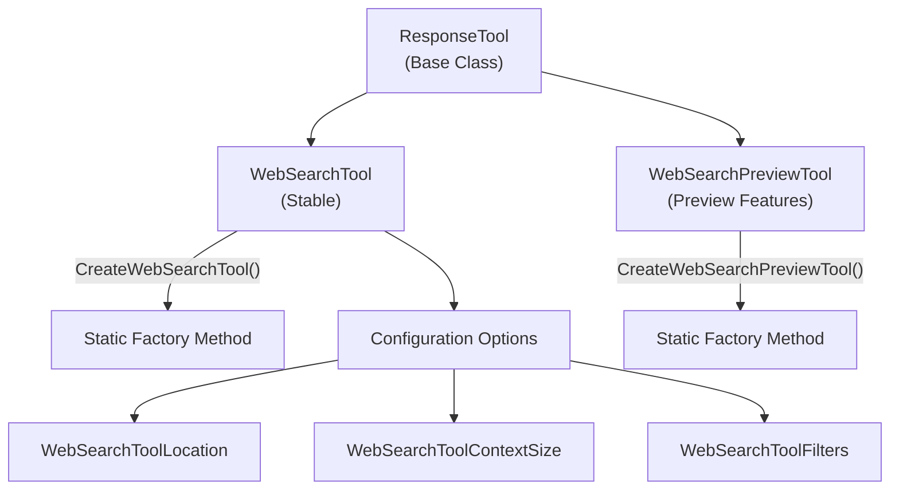
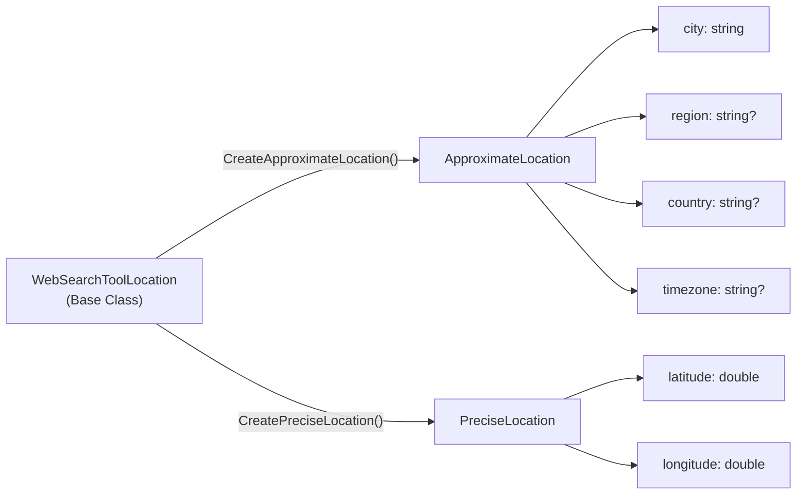
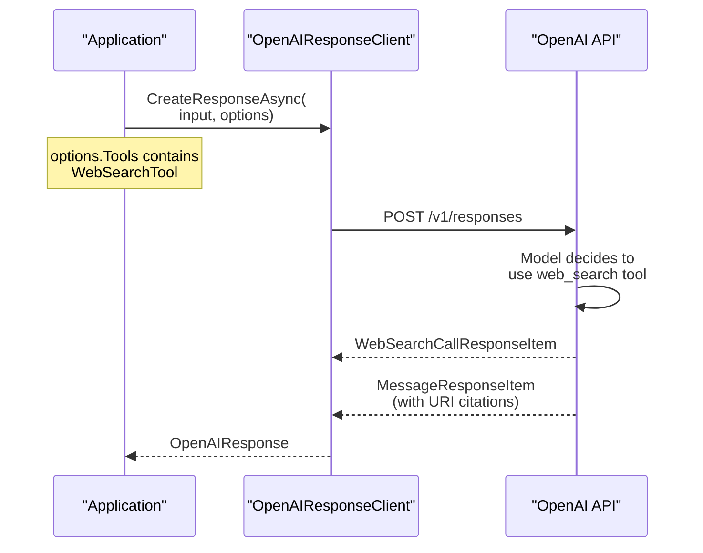
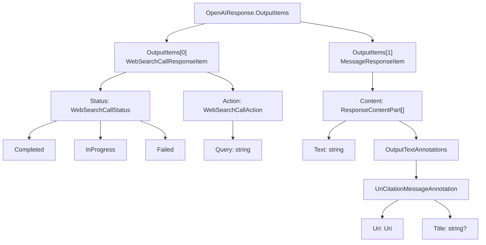
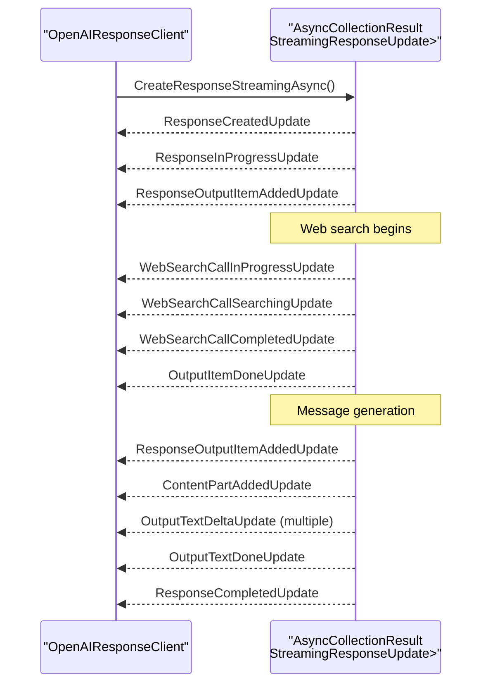
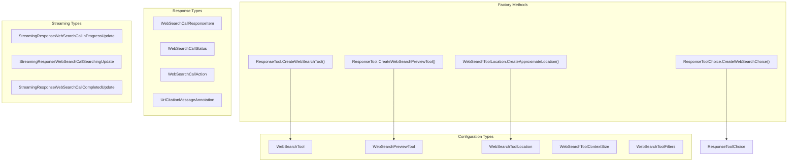

<!-- source: DeepWiki mcp.deepwiki.com · repo openai/openai-dotnet · page 6.3 Web Search Tool · fetched 2026-10-26 -->

# Web Search Tool

<details>
<summary>Relevant source files</summary>

The following files were used as context for generating this wiki page:

- [CHANGELOG.md](CHANGELOG.md)
- [api/OpenAI.net8.0.cs](api/OpenAI.net8.0.cs)
- [api/OpenAI.netstandard2.0.cs](api/OpenAI.netstandard2.0.cs)
- [scripts/Test-ApiCompatibility.ps1](scripts/Test-ApiCompatibility.ps1)
- [src/Generated/Models/OpenAIContext.cs](src/Generated/Models/OpenAIContext.cs)
- [src/Generated/OpenAIModelFactory.cs](src/Generated/OpenAIModelFactory.cs)
- [src/OpenAI.csproj](src/OpenAI.csproj)
- [tests/Responses/ResponsesTests.cs](tests/Responses/ResponsesTests.cs)
- [tests/SessionRecords/ResponsesTests/WebSearchCallStreaming.json](tests/SessionRecords/ResponsesTests/WebSearchCallStreaming.json)
- [tests/SessionRecords/ResponsesTests/WebSearchCallStreamingAsync.json](tests/SessionRecords/ResponsesTests/WebSearchCallStreamingAsync.json)
- [tspCodeModel.json](tspCodeModel.json)

</details>


## Purpose and Scope

This page documents the Web Search tool integration in the OpenAI .NET SDK's Responses API. The Web Search tool enables models to search the internet to answer questions requiring real-time information. This page covers tool configuration, usage patterns, response handling, and streaming behavior.

For general tool integration concepts, see [Tool Integration](#6). For the Responses API client, see [Responses API Client](#4.3).

---

## Overview

The SDK provides two web search tool types for different stability levels:



**Sources:** [CHANGELOG.md:23-24](), [tests/Responses/ResponsesTests.cs:138-192]()

---

## Tool Types

### WebSearchTool

The stable web search tool for production use. Available via `ResponseTool.CreateWebSearchTool()`.

| Property | Type | Description |
|----------|------|-------------|
| `UserLocation` | `WebSearchToolLocation?` | Optional user location hint for search results |
| `SearchContextSize` | `WebSearchToolContextSize?` | Size of search context (Low, Medium, High) |
| `Filters` | `WebSearchToolFilters?` | Optional search filters |

### WebSearchPreviewTool

The preview version with experimental features. Available via `ResponseTool.CreateWebSearchPreviewTool()`. Same configuration options as `WebSearchTool` but marked as preview/experimental.

**Sources:** [CHANGELOG.md:23-24](), [tests/Responses/ResponsesTests.cs:148-149](), [tests/Responses/ResponsesTests.cs:176-177]()

---

## Configuration

### User Location

Provide location hints to improve search result relevance:



**Example:**
```csharp
// Approximate location
var location = WebSearchToolLocation.CreateApproximateLocation(
    city: "San Francisco",
    region: "California",
    country: "USA"
);

// Precise location
var location = WebSearchToolLocation.CreatePreciseLocation(
    latitude: 37.7749,
    longitude: -122.4194
);
```

**Sources:** [tests/Responses/ResponsesTests.cs:206-207](), [tests/SessionRecords/ResponsesTests/WebSearchCallStreaming.json:17-22]()

### Search Context Size

Control the amount of search context provided to the model:

| Value | Description |
|-------|-------------|
| `WebSearchToolContextSize.Low` | Minimal search context |
| `WebSearchToolContextSize.Medium` | Moderate search context |
| `WebSearchToolContextSize.High` | Maximum search context |

Lower context sizes reduce token usage but may provide less comprehensive information.

**Sources:** [tests/Responses/ResponsesTests.cs:208]()

### Search Filters

Optional filters to refine search behavior. The `WebSearchToolFilters` class provides filtering capabilities (implementation details depend on the service).

**Sources:** [specification/client/responses.client.tsp:221]()

---

## Using Web Search in Responses

### Basic Usage



**Code Example:**
```csharp
OpenAIResponseClient client = new("gpt-4o-mini", apiKey);

ResponseCreationOptions options = new()
{
    Tools =
    {
        ResponseTool.CreateWebSearchTool(
            userLocation: WebSearchToolLocation.CreateApproximateLocation(
                city: "San Francisco"),
            searchContextSize: WebSearchToolContextSize.Low)
    }
};

OpenAIResponse response = await client.CreateResponseAsync(
    "What was a positive news story from today?",
    options);
```

**Sources:** [tests/Responses/ResponsesTests.cs:138-151]()

### Tool Choice

Force the model to use web search:

```csharp
ResponseCreationOptions options = new()
{
    Tools =
    {
        ResponseTool.CreateWebSearchTool()
    },
    ToolChoice = ResponseToolChoice.CreateWebSearchChoice()
};
```

**Sources:** [tests/Responses/ResponsesTests.cs:150]()

---

## Response Output

### Output Items

When web search completes, the response contains two output items:



**Code Example:**
```csharp
OpenAIResponse response = await client.CreateResponseAsync(...);

// Check first item is web search call
WebSearchCallResponseItem searchCall = 
    response.OutputItems[0] as WebSearchCallResponseItem;
Assert.That(searchCall.Status, Is.EqualTo(WebSearchCallStatus.Completed));

// Check second item is the message with citations
MessageResponseItem message = 
    response.OutputItems[1] as MessageResponseItem;
Assert.That(message.Content[0].Text, Is.Not.Null);
Assert.That(message.Content[0].OutputTextAnnotations.Count, Is.GreaterThan(0));
```

**Sources:** [tests/Responses/ResponsesTests.cs:153-163]()

### URI Citations

Web search results include URI citations in the message annotations:

| Property | Type | Description |
|----------|------|-------------|
| `Uri` | `Uri` | The source URL |
| `Title` | `string?` | Optional page title |
| `StartIndex` | `int` | Character offset in text where citation begins |
| `EndIndex` | `int` | Character offset in text where citation ends |

**Sources:** [tests/Responses/ResponsesTests.cs:162]()

---

## Streaming Web Search

### Streaming Event Flow



### Streaming Update Types

| Update Type | Description | Properties |
|-------------|-------------|------------|
| `StreamingResponseWebSearchCallInProgressUpdate` | Search initiated | `ItemId`, `OutputIndex` |
| `StreamingResponseWebSearchCallSearchingUpdate` | Search executing | `ItemId`, `OutputIndex` |
| `StreamingResponseWebSearchCallCompletedUpdate` | Search finished | `ItemId`, `OutputIndex` |
| `StreamingResponseOutputItemDoneUpdate` | Item complete | `Item` (WebSearchCallResponseItem) |

**Code Example:**
```csharp
string searchItemId = null;
bool searchCompleted = false;

await foreach (StreamingResponseUpdate update 
    in client.CreateResponseStreamingAsync(input, options))
{
    if (update is StreamingResponseWebSearchCallInProgressUpdate inProgress)
    {
        searchItemId = inProgress.ItemId;
        Console.WriteLine($"Search started: {searchItemId}");
    }
    else if (update is StreamingResponseWebSearchCallSearchingUpdate searching)
    {
        Console.WriteLine($"Searching: {searching.ItemId}");
    }
    else if (update is StreamingResponseWebSearchCallCompletedUpdate completed)
    {
        Console.WriteLine($"Search completed: {completed.ItemId}");
    }
    else if (update is StreamingResponseOutputItemDoneUpdate itemDone
        && itemDone.Item is WebSearchCallResponseItem searchItem)
    {
        Assert.That(searchItem.Status, Is.EqualTo(WebSearchCallStatus.Completed));
        searchCompleted = true;
    }
}
```

**Sources:** [tests/Responses/ResponsesTests.cs:194-260](), [tests/SessionRecords/ResponsesTests/WebSearchCallStreaming.json:64-76]()

### Tracking Search Progress

Each streaming update for a web search call includes:
- `ItemId`: Unique identifier for the search operation
- `OutputIndex`: Position in the output array (typically 0 for the search call)
- `SequenceNumber`: Monotonically increasing event sequence number

**Sources:** [tests/Responses/ResponsesTests.cs:221-243](), [tests/SessionRecords/ResponsesTests/WebSearchCallStreaming.json:63-75]()

---

## Key Classes and Methods



**Sources:** [tests/Responses/ResponsesTests.cs:148](), [tests/Responses/ResponsesTests.cs:176](), [tests/Responses/ResponsesTests.cs:206](), [tests/Responses/ResponsesTests.cs:150]()

---

## Common Patterns

### Search with Location Hint

```csharp
ResponseTool searchTool = ResponseTool.CreateWebSearchTool(
    userLocation: WebSearchToolLocation.CreateApproximateLocation(
        city: "San Francisco",
        region: "California"),
    searchContextSize: WebSearchToolContextSize.Low
);
```

### Extract Search Query

```csharp
if (response.OutputItems[0] is WebSearchCallResponseItem searchCall
    && searchCall.Status == WebSearchCallStatus.Completed)
{
    string query = searchCall.Action?.Query;
    Console.WriteLine($"Model searched for: {query}");
}
```

### Process Citations

```csharp
MessageResponseItem message = response.OutputItems[1] as MessageResponseItem;
foreach (ResponseContentPart part in message.Content)
{
    if (part.Kind == ResponseContentPartKind.OutputText)
    {
        foreach (ResponseMessageAnnotation annotation in part.OutputTextAnnotations)
        {
            if (annotation is UriCitationMessageAnnotation uriCitation)
            {
                Console.WriteLine($"Source: {uriCitation.Uri}");
                Console.WriteLine($"Title: {uriCitation.Title}");
            }
        }
    }
}
```

**Sources:** [tests/Responses/ResponsesTests.cs:153-163](), [tests/SessionRecords/ResponsesTests/WebSearchCallStreaming.json:76]()

---

