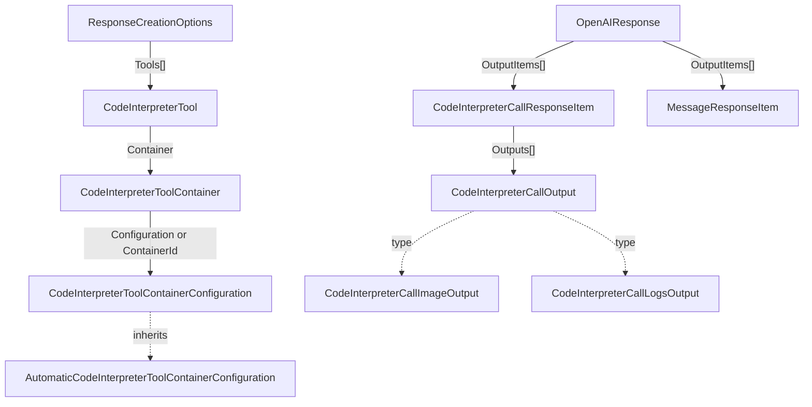
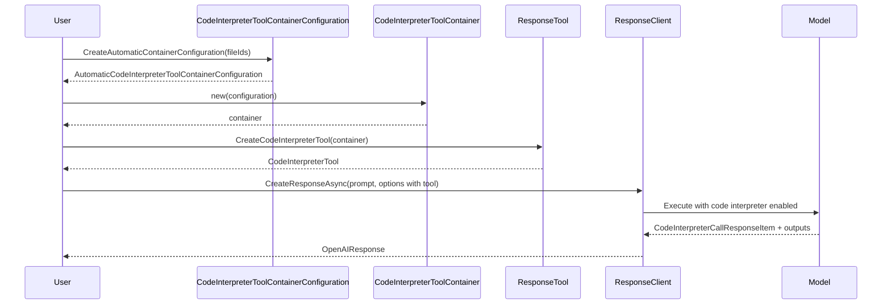
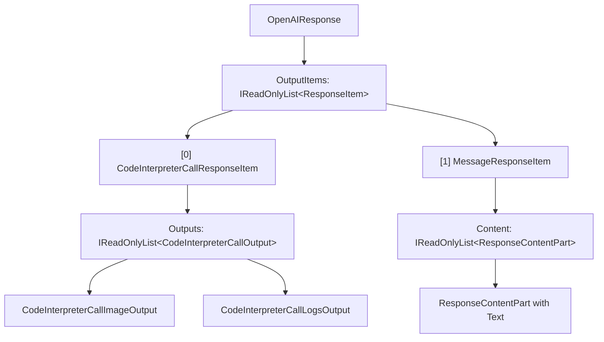
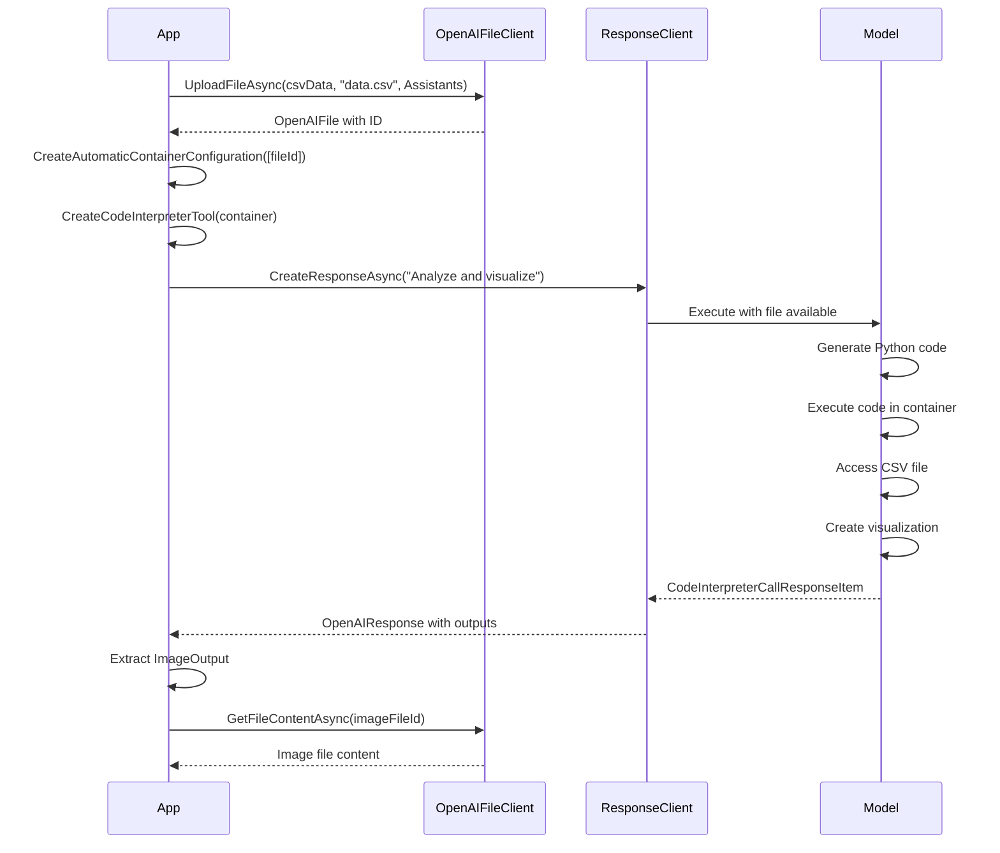
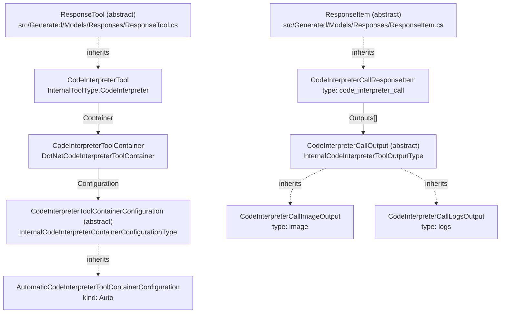
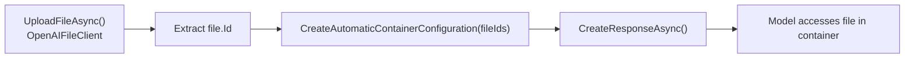
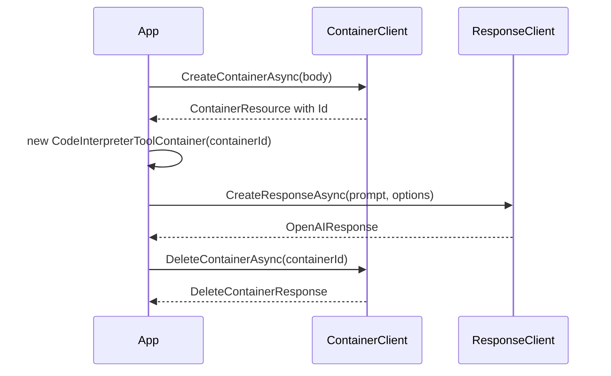

<!-- source: DeepWiki mcp.deepwiki.com · repo openai/openai-dotnet · page 6.4 Code Interpreter Tool · fetched 2026-10-26 -->

# Code Interpreter Tool

<details>
<summary>Relevant source files</summary>

The following files were used as context for generating this wiki page:

- [CHANGELOG.md](CHANGELOG.md)
- [api/OpenAI.net8.0.cs](api/OpenAI.net8.0.cs)
- [api/OpenAI.netstandard2.0.cs](api/OpenAI.netstandard2.0.cs)
- [scripts/Test-ApiCompatibility.ps1](scripts/Test-ApiCompatibility.ps1)
- [src/Generated/Models/OpenAIContext.cs](src/Generated/Models/OpenAIContext.cs)
- [src/Generated/OpenAIModelFactory.cs](src/Generated/OpenAIModelFactory.cs)
- [src/OpenAI.csproj](src/OpenAI.csproj)
- [tests/Assistants/Assistants.VectorStoresTests.cs](tests/Assistants/Assistants.VectorStoresTests.cs)
- [tests/Assistants/AssistantsTests.cs](tests/Assistants/AssistantsTests.cs)
- [tests/Responses/ResponsesTests.cs](tests/Responses/ResponsesTests.cs)
- [tests/SessionRecords/ResponsesTests/WebSearchCallStreaming.json](tests/SessionRecords/ResponsesTests/WebSearchCallStreaming.json)
- [tests/SessionRecords/ResponsesTests/WebSearchCallStreamingAsync.json](tests/SessionRecords/ResponsesTests/WebSearchCallStreamingAsync.json)
- [tests/SessionRecords/ResponsesToolTests/ImageGenToolInputMaskWithFileId.json](tests/SessionRecords/ResponsesToolTests/ImageGenToolInputMaskWithFileId.json)
- [tests/SessionRecords/ResponsesToolTests/ImageGenToolInputMaskWithFileIdAsync.json](tests/SessionRecords/ResponsesToolTests/ImageGenToolInputMaskWithFileIdAsync.json)
- [tests/SessionRecords/ResponsesToolTests/ImageGenToolInputMaskWithImageUri.json](tests/SessionRecords/ResponsesToolTests/ImageGenToolInputMaskWithImageUri.json)
- [tests/SessionRecords/ResponsesToolTests/ImageGenToolInputMaskWithImageUriAsync.json](tests/SessionRecords/ResponsesToolTests/ImageGenToolInputMaskWithImageUriAsync.json)
- [tspCodeModel.json](tspCodeModel.json)

</details>


## Purpose and Scope

The Code Interpreter tool enables AI models to write and execute Python code in sandboxed containers to solve complex problems in data analysis, mathematics, and coding. This page covers configuration, usage, and output handling of the Code Interpreter tool within the Responses API.

For general information about the Responses API, see [Responses API Client](#4.3). For information about other tool types like File Search or Function Calling, see [Tool Integration](#6). For file management operations, see [Files and Vector Stores](#4.8).

## Overview

The Code Interpreter tool provides models with capabilities to:
- Execute Python code in isolated containers
- Process uploaded files as inputs to code
- Generate text outputs, images, and execution logs
- Solve mathematical, data analysis, and visualization problems

The tool was introduced in version 2.5.0 and integrates with the Responses API's tool system.

Sources: [CHANGELOG.md:120-128]()

## Architecture

### Core Component Relationships



Sources: [src/Generated/Models/OpenAIContext.cs:42,71-77](), [CHANGELOG.md:120-128]()

### Tool Creation and Usage Flow



Sources: [src/Generated/Models/OpenAIContext.cs:75-77](), [CHANGELOG.md:120-128]()

## Creating Code Interpreter Tools

### Basic Usage Without Files

Create a Code Interpreter tool with automatic container configuration:

| Step | Code Element |
|------|--------------|
| Create configuration | `CodeInterpreterToolContainerConfiguration.CreateAutomaticContainerConfiguration()` |
| Create container wrapper | `new CodeInterpreterToolContainer(configuration)` |
| Create tool | `ResponseTool.CreateCodeInterpreterTool(container)` |

Basic usage pattern:
```csharp
ResponseTool codeInterpreterTool = ResponseTool.CreateCodeInterpreterTool(
    new CodeInterpreterToolContainer(
        CodeInterpreterToolContainerConfiguration.CreateAutomaticContainerConfiguration()));

ResponseCreationOptions responseOptions = new()
{
    Tools = { codeInterpreterTool }
};

OpenAIResponse response = await client.CreateResponseAsync(
    "Calculate the factorial of 5 using Python code.",
    responseOptions);
```

Sources: [src/Generated/Models/OpenAIContext.cs:75-77](), [CHANGELOG.md:120-128]()

### With File Inputs

Provide files for code to process by uploading them first and passing their IDs:

```csharp
// Upload files
OpenAIFile csvFile = await fileClient.UploadFileAsync(
    csvStream, "test_data.csv", FileUploadPurpose.Assistants);
OpenAIFile pythonFile = await fileClient.UploadFileAsync(
    pythonStream, "test_script.py", FileUploadPurpose.Assistants);

List<string> fileIds = new() { csvFile.Id, pythonFile.Id };

// Create tool with file IDs
ResponseTool codeInterpreterTool = ResponseTool.CreateCodeInterpreterTool(
    new CodeInterpreterToolContainer(
        CodeInterpreterToolContainerConfiguration.CreateAutomaticContainerConfiguration(fileIds)));
```

Sources: [src/Generated/Models/OpenAIContext.cs:75-77](), [CHANGELOG.md:120-128]()

### With Pre-existing Container

Reference a container created via the Containers API:

```csharp
// Create container using ContainerClient
CreateContainerBody containerBody = new("test-container-for-code-interpreter");
var containerResult = await containerClient.CreateContainerAsync(containerBody);
string containerId = containerResult.Value.Id;

try
{
    // Create tool with container ID
    ResponseTool codeInterpreterTool = ResponseTool.CreateCodeInterpreterTool(
        new CodeInterpreterToolContainer(containerId));
    
    // Use tool...
}
finally
{
    await containerClient.DeleteContainerAsync(containerId);
}
```

Sources: [src/Generated/Models/OpenAIContext.cs:75-77]()

## Configuration Classes

### CodeInterpreterToolContainer

Specifies the sandboxed environment for code execution.

| Constructor | Purpose |
|-------------|---------|
| `CodeInterpreterToolContainer(string containerId)` | Use existing container from Containers API |
| `CodeInterpreterToolContainer(CodeInterpreterToolContainerConfiguration configuration)` | Create container with automatic configuration |

Sources: [src/Generated/Models/OpenAIContext.cs:76]()

### CodeInterpreterToolContainerConfiguration

Abstract base class for container configurations. Currently one implementation:

**AutomaticCodeInterpreterToolContainerConfiguration**: Service manages container lifecycle automatically.

Factory method signature:
```csharp
public static AutomaticCodeInterpreterToolContainerConfiguration CreateAutomaticContainerConfiguration(
    IEnumerable<string> fileIds = null)
```

| Parameter | Type | Description |
|-----------|------|-------------|
| `fileIds` | `IEnumerable<string>` (optional) | File IDs to make available in container |

Sources: [src/Generated/Models/OpenAIContext.cs:42,77](), [src/Custom/Responses/Internal/GeneratorStubs.cs:3]()

## Output Structure

### Response Layout



Sources: [src/Generated/Models/OpenAIContext.cs:71-74]()

### Output Types

#### CodeInterpreterCallResponseItem

Represents code execution within the response.

| Property | Type | Description |
|----------|------|-------------|
| `Kind` | `ResponseItemKind` | Always `ResponseItemKind.CodeInterpreterCall` |
| `Id` | `string` | Unique identifier |
| `Outputs` | `IReadOnlyList<CodeInterpreterCallOutput>` | Execution outputs |

Sources: [src/Generated/Models/OpenAIContext.cs:74]()

#### CodeInterpreterCallOutput

Abstract base class with two derived types:

| Type | Contents | Use Case |
|------|----------|----------|
| `CodeInterpreterCallImageOutput` | `FileId: string`, `MimeType: string` | Images generated by code (charts, plots) |
| `CodeInterpreterCallLogsOutput` | `Logs: string` | Text output from print statements or execution |

Sources: [src/Generated/Models/OpenAIContext.cs:71-73](), [specification/base/typespec/responses/models.tsp:31-38]()

### Processing Outputs

```csharp
OpenAIResponse response = await client.CreateResponseAsync(prompt, options);

// First output item is typically the code execution
CodeInterpreterCallResponseItem codeCall = 
    (CodeInterpreterCallResponseItem)response.OutputItems[0];

// Iterate through outputs
foreach (var output in codeCall.Outputs)
{
    if (output is CodeInterpreterCallImageOutput imageOutput)
    {
        // Handle generated image
        string fileId = imageOutput.FileId;
        string mimeType = imageOutput.MimeType;
        // Download using OpenAIFileClient.GetFileContentAsync(fileId)
    }
    else if (output is CodeInterpreterCallLogsOutput logsOutput)
    {
        // Handle text logs
        Console.WriteLine(logsOutput.Logs);
    }
}

// Second output item is typically the assistant's message
MessageResponseItem message = (MessageResponseItem)response.OutputItems[1];
Console.WriteLine(message.Content[0].Text);
```

Sources: [src/Generated/Models/OpenAIContext.cs:71-74]()

## Complete Usage Example

### Data Analysis with Visualization



Sources: [src/Generated/Models/OpenAIContext.cs:71-77]()

## Type Hierarchy



Sources: [src/Generated/Models/OpenAIContext.cs:42,71-77](), [src/Custom/Responses/Internal/GeneratorStubs.cs:3,94-96]()

## Factory Methods Reference

### ResponseTool.CreateCodeInterpreterTool

```csharp
public static CodeInterpreterTool CreateCodeInterpreterTool(
    CodeInterpreterToolContainer container)
```

Creates a Code Interpreter tool instance.

**Parameters:**
- `container`: Container configuration for sandboxed environment

**Returns:** `CodeInterpreterTool` configured with specified container

**Throws:** `ArgumentNullException` if `container` is null

Sources: [src/Generated/Models/OpenAIContext.cs:75]()

### CodeInterpreterToolContainerConfiguration.CreateAutomaticContainerConfiguration

```csharp
public static AutomaticCodeInterpreterToolContainerConfiguration CreateAutomaticContainerConfiguration(
    IEnumerable<string> fileIds = null)
```

Creates automatic container configuration with optional file IDs.

**Parameters:**
- `fileIds`: Optional list of file IDs to make available in container

**Returns:** `AutomaticCodeInterpreterToolContainerConfiguration` instance

Sources: [src/Generated/Models/OpenAIContext.cs:42,77]()

## Common Use Cases

### Mathematical Computation

Solve complex calculations:

| Task | Code Prompt Example |
|------|---------------------|
| Factorial calculation | `"Calculate the factorial of 5 using Python code."` |
| Statistical analysis | `"Compute mean, median, and standard deviation of this dataset."` |
| Numerical integration | `"Numerically integrate the function f(x) = x^2 from 0 to 10."` |

Sources: [src/Generated/Models/OpenAIContext.cs:74-77]()

### Data Analysis

Process and analyze data files:

```csharp
// Upload data file
OpenAIFile csvFile = await fileClient.UploadFileAsync(
    csvStream, "test_data.csv", FileUploadPurpose.Assistants);

// Create tool with file access
var tool = ResponseTool.CreateCodeInterpreterTool(
    new CodeInterpreterToolContainer(
        CodeInterpreterToolContainerConfiguration
            .CreateAutomaticContainerConfiguration([csvFile.Id])));

// Request analysis
var response = await client.CreateResponseAsync(
    "Analyze the CSV data in the uploaded file and create a simple visualization.",
    new ResponseCreationOptions { Tools = { tool } });
```

Sources: [src/Generated/Models/OpenAIContext.cs:74-77]()

### Chart and Plot Generation

Generate visualizations using matplotlib:

```csharp
var response = await client.CreateResponseAsync(
    "Generate a simple chart using matplotlib. Ensure you emit debug logging and include any resulting log file output.",
    new ResponseCreationOptions { Tools = { codeInterpreterTool } });

// Extract generated images
var codeCall = (CodeInterpreterCallResponseItem)response.OutputItems[0];
foreach (var output in codeCall.Outputs)
{
    if (output is CodeInterpreterCallImageOutput imageOutput)
    {
        // imageOutput.FileId contains the generated chart
        BinaryData imageContent = await fileClient.GetFileContentAsync(imageOutput.FileId);
    }
}
```

Sources: [src/Generated/Models/OpenAIContext.cs:71-74]()

## File Management Integration

### File Upload Requirements

Files for Code Interpreter must be uploaded with proper purpose:

| Upload Purpose | Use Case |
|----------------|----------|
| `FileUploadPurpose.Assistants` | Files for Code Interpreter and other assistant tools |

Sources: [CHANGELOG.md:120-128]()

### File Lifecycle



Sources: [src/Generated/Models/OpenAIContext.cs:74-77]()

## Container Management

### Automatic Container Lifecycle

When using `CreateAutomaticContainerConfiguration`:

| Phase | Behavior |
|-------|----------|
| Creation | Container created on demand by service |
| File Mounting | Specified files made available in container filesystem |
| Execution | Python code runs with file access |
| Cleanup | Automatic cleanup after response completion |

Sources: [src/Generated/Models/OpenAIContext.cs:42,77]()

### Manual Container Lifecycle

For explicit control using Containers API:



Sources: [src/Generated/Models/OpenAIContext.cs:75-76]()

## Internal Implementation Details

### Discriminated Type Serialization

The Code Interpreter tool uses discriminated unions for JSON serialization:

| Base Type | Discriminator Property | Discriminator Value |
|-----------|------------------------|---------------------|
| `ResponseTool` | `type` | `"code_interpreter"` |
| `ResponseItem` | `type` | `"code_interpreter_call"` |
| `CodeInterpreterCallOutput` | (type-specific) | `"image"` or `"logs"` |

Sources: [src/Generated/Models/OpenAIContext.cs:73-75]()

### Generator Stub Mappings

Internal type mappings for code generation:

| TypeSpec Name | C# Internal Type |
|---------------|------------------|
| `CodeInterpreterContainerConfiguration` | `CodeInterpreterToolContainerConfiguration` |
| `CodeInterpreterContainerConfigurationType` | `InternalCodeInterpreterContainerConfigurationType` |
| `CodeInterpreterFileOutputType` | `InternalCodeInterpreterFileOutputType` |
| `CodeInterpreterTextOutputType` | `InternalCodeInterpreterTextOutputType` |
| `CodeInterpreterToolOutputType` | `InternalCodeInterpreterToolOutputType` |
| `CodeInterpreterToolCallItemParam` | `InternalCodeInterpreterToolCallItemParam` |

Sources: [src/Custom/Responses/Internal/GeneratorStubs.cs:3,94-96,110]()

## Related Documentation

The Code Interpreter tool integrates with several SDK components:

- **[Responses API Client](#4.3)**: Primary API for tool usage
- **[Files and Vector Stores](#4.8)**: File upload and management with `OpenAIFileClient`
- **[Tool Integration](#6)**: General tool system architecture
- **Function Calling ([#6.1](#6.1))**: Compare with custom function tools
- **File Search Tool ([#6.2](#6.2))**: Compare with document search capabilities

## Version History

| Version | Release Date | Changes |
|---------|--------------|---------|
| 2.5.0 | 2025-09-23 | Initial Code Interpreter tool support added with `CodeInterpreterTool`, `CodeInterpreterToolContainer`, and automatic container configuration |

Sources: [CHANGELOG.md:21-34]()

---

