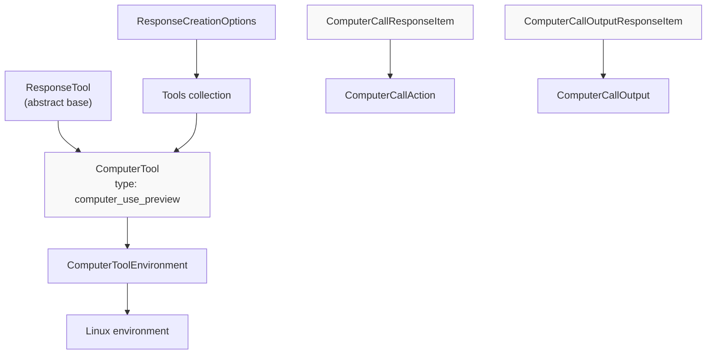
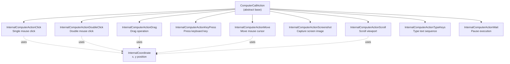
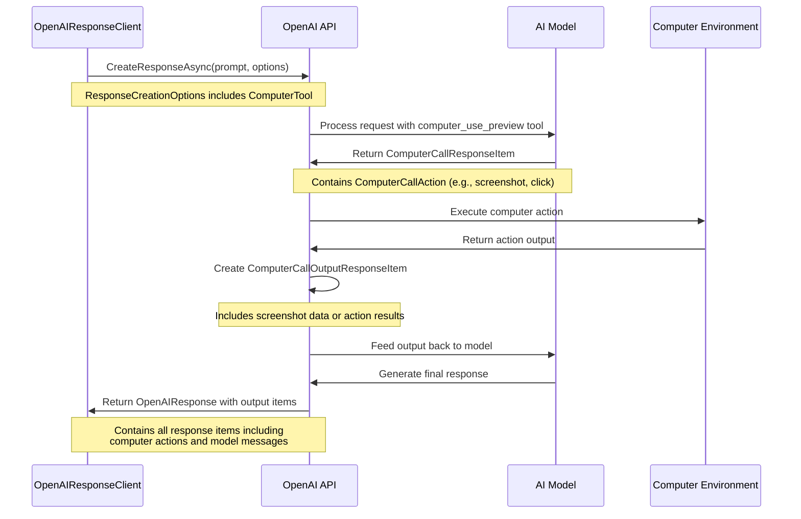
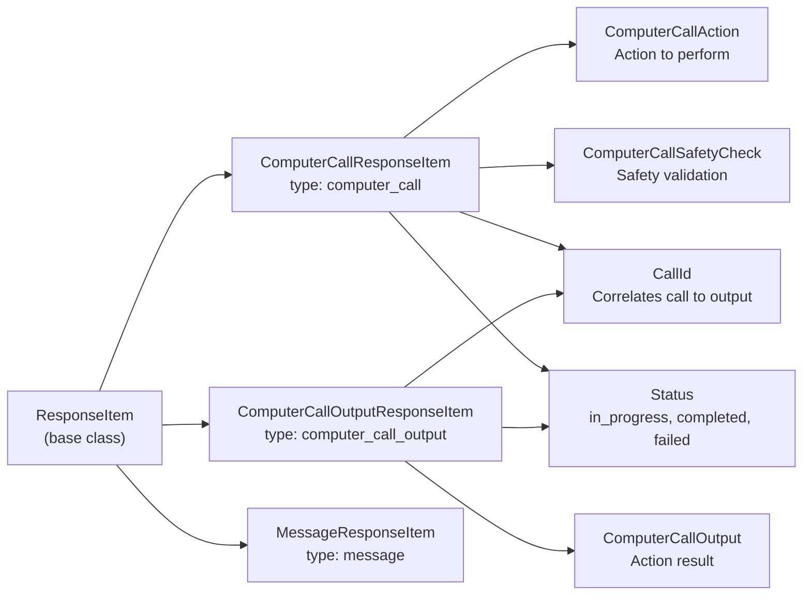
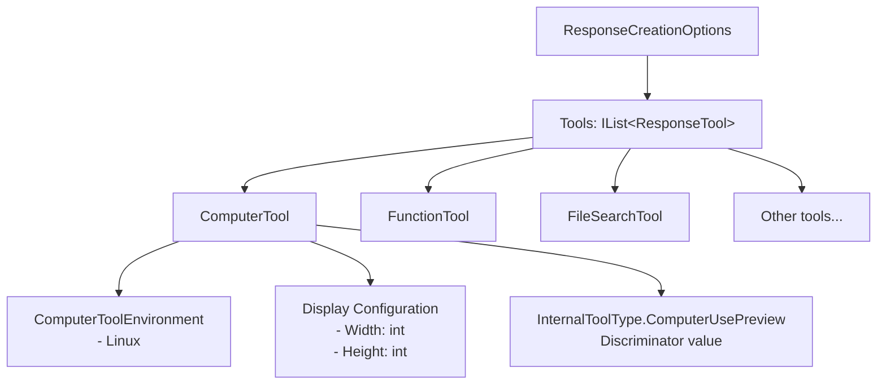
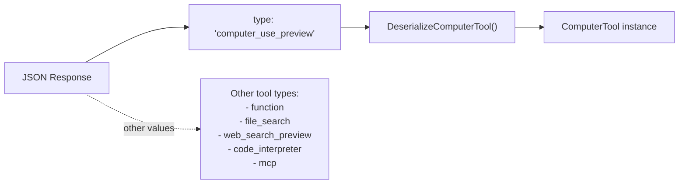

<!-- source: DeepWiki mcp.deepwiki.com · repo openai/openai-dotnet · page 6.5 Computer Use Tool · fetched 2026-10-26 -->

# Computer Use Tool

<details>
<summary>Relevant source files</summary>

The following files were used as context for generating this wiki page:

- [CHANGELOG.md](CHANGELOG.md)
- [api/OpenAI.net8.0.cs](api/OpenAI.net8.0.cs)
- [api/OpenAI.netstandard2.0.cs](api/OpenAI.netstandard2.0.cs)
- [scripts/Test-ApiCompatibility.ps1](scripts/Test-ApiCompatibility.ps1)
- [src/Generated/Models/OpenAIContext.cs](src/Generated/Models/OpenAIContext.cs)
- [src/Generated/OpenAIModelFactory.cs](src/Generated/OpenAIModelFactory.cs)
- [src/OpenAI.csproj](src/OpenAI.csproj)
- [tests/Responses/ResponsesTests.cs](tests/Responses/ResponsesTests.cs)
- [tests/SessionRecords/ResponsesTests/WebSearchCallStreaming.json](tests/SessionRecords/ResponsesTests/WebSearchCallStreaming.json)
- [tests/SessionRecords/ResponsesTests/WebSearchCallStreamingAsync.json](tests/SessionRecords/ResponsesTests/WebSearchCallStreamingAsync.json)
- [tspCodeModel.json](tspCodeModel.json)

</details>


The Computer Use Tool enables AI models to perform programmatic computer interactions such as clicking, typing, taking screenshots, and navigating user interfaces. This experimental feature is part of the Responses API and allows models to interact with computer environments in a controlled, sandboxed manner.

**Note**: This feature is currently in preview and marked as experimental. For information about other Responses API tools, see [Tool Integration](#6).

## Overview

The Computer Use Tool provides the model with the ability to:
- Control mouse movements and clicks
- Type text and press keyboard keys
- Take screenshots to observe the current state
- Scroll and navigate interfaces
- Execute timed wait operations

This tool is designed for scenarios where an AI model needs to interact with graphical user interfaces, perform UI automation, or demonstrate computer-based workflows.

**Experimental Status**: Computer Use Tool APIs are marked with `[Experimental("OPENAICUA001")]` and may change in future releases.

Sources: [CHANGELOG.md:105](), [src/Custom/Responses/Tools/ResponseTool.cs:27-36]()

## Architecture and Component Hierarchy



**Key Classes**:
- `ResponseTool`: Abstract base class for all tools in the Responses API
- `ComputerTool`: Concrete implementation for computer interaction capabilities
- `ComputerToolEnvironment`: Specifies the operating system environment (currently Linux)
- `ComputerCallResponseItem`: Response item representing a computer action call
- `ComputerCallOutputResponseItem`: Response item containing the output of a computer action
- `ComputerCallAction`: Base class for all computer actions
- `ComputerCallOutput`: Contains the results of executing a computer action

Sources: [src/Custom/Responses/Tools/ResponseTool.cs:27-36](), [src/Generated/Models/Responses/ResponseTool.Serialization.cs:78](), [CHANGELOG.md:299]()

## Creating a Computer Tool

To enable computer use capabilities, create a `ComputerTool` instance and add it to your `ResponseCreationOptions`:

```csharp
// Factory method in ResponseTool class
public static ComputerTool CreateComputerTool(
    ComputerToolEnvironment environment,
    int displayWidth,
    int displayHeight)
```

**Parameters**:
- `environment`: The operating system environment (`ComputerToolEnvironment.Linux`)
- `displayWidth`: Width of the display in pixels
- `displayHeight`: Height of the display in pixels

**Example Usage Pattern**:
```csharp
// Create computer tool with Linux environment and 1920x1080 display
ComputerTool computerTool = ResponseTool.CreateComputerTool(
    ComputerToolEnvironment.Linux,
    displayWidth: 1920,
    displayHeight: 1080);

ResponseCreationOptions options = new()
{
    Tools = { computerTool }
};

OpenAIResponse response = await client.CreateResponseAsync(
    "Take a screenshot and click on the search button",
    options);
```

Sources: [src/Custom/Responses/Tools/ResponseTool.cs:27-36]()

## Computer Action Types



**Action Categories**:

| Action Type | Description | Key Properties |
|------------|-------------|----------------|
| Click | Performs a single mouse click at coordinates | x, y position |
| DoubleClick | Performs a double-click at coordinates | x, y position |
| Drag | Drags from one position to another | start x/y, end x/y |
| KeyPress | Presses a specific keyboard key | key identifier |
| Move | Moves mouse cursor to coordinates | x, y position |
| Screenshot | Captures the current display state | none |
| Scroll | Scrolls the viewport | x, y scroll deltas |
| TypeKeys | Types a sequence of characters | text string |
| Wait | Pauses execution for a duration | milliseconds |

Sources: [src/Custom/Responses/Internal/GeneratorStubs.cs:16-24]()

## Request and Response Flow



**Response Item Flow**:
1. Model decides to use the computer tool
2. `ComputerCallResponseItem` is created with the action to perform
3. Action is executed in the sandboxed environment
4. `ComputerCallOutputResponseItem` is created with the results
5. Output is fed back to the model for continued reasoning
6. Final `MessageResponseItem` contains the model's response

Sources: [src/Generated/Models/Responses/ResponseItem.Serialization.cs:83-85]()

## Response Item Types



**ComputerCallResponseItem Properties**:
- `Kind`: Set to `InternalItemType.computer_call`
- `CallId`: Unique identifier for the call
- `Action`: The computer action to execute
- `Status`: Current status of the call
- `SafetyCheck`: Optional safety validation results

**ComputerCallOutputResponseItem Properties**:
- `Kind`: Set to `InternalItemType.computer_call_output`
- `CallId`: Matches the corresponding `ComputerCallResponseItem`
- `Output`: Results of the action execution
- `Status`: Final status (completed or failed)

**Screenshot Output**:
The `ComputerCallOutput` for screenshot actions contains:
- Image data as `BinaryData`
- Image format information
- Timestamp of capture

Sources: [src/Generated/Models/Responses/ResponseItem.Serialization.cs:83-85](), [src/Custom/Responses/Internal/GeneratorStubs.cs:25-26]()

## Integration with ResponseCreationOptions



**Tool Configuration**:
- Computer Use Tool can be combined with other tools in a single request
- The model can choose which tool to use based on the prompt
- Use `ToolChoice` property to force selection of the computer tool
- Display dimensions must match the actual environment configuration

**Serialization**:
- Type discriminator: `"computer_use_preview"`
- Serialized as JSON with environment and display properties
- Deserialized from response items using `ComputerTool.DeserializeComputerTool`

Sources: [src/Custom/Responses/Tools/ResponseTool.cs:27-36](), [src/Generated/Models/Responses/ResponseTool.Serialization.cs:78]()

## Safety and Limitations

**Safety Mechanisms**:
- `ComputerCallSafetyCheck`: Validates actions before execution
- Sandboxed environment prevents access to sensitive resources
- Actions are rate-limited to prevent abuse
- Screenshot data may be filtered for privacy

**Current Limitations**:
1. **Environment**: Currently supports Linux only
2. **Preview Status**: Marked as experimental; APIs may change
3. **Action Scope**: Limited to the configured display dimensions
4. **Execution Context**: Runs in isolated container environment

**Experimental Warning Suppression**:
To use Computer Use Tool, you must acknowledge the experimental status:
```csharp
#pragma warning disable OPENAICUA001 // Computer Use is experimental
ComputerTool tool = ResponseTool.CreateComputerTool(/*...*/);
#pragma warning restore OPENAICUA001
```

Sources: [src/Custom/Responses/Tools/ResponseTool.cs:27](), [CHANGELOG.md:105]()

## Model Support

**Supported Models**:
- `computer-use-preview`
- `computer-use-preview-2025-03-11`

The Computer Use Tool requires models specifically trained for computer interaction tasks. Standard chat models do not support this capability.

```csharp
OpenAIResponseClient client = new OpenAIResponseClient(
    "computer-use-preview",
    apiKey);
```

Sources: [specification/base/typespec/responses/models.tsp:247-248]()

## Tool Type Discriminator



The Computer Use Tool uses `"computer_use_preview"` as its type discriminator in the JSON serialization. This enables the SDK to correctly deserialize tool definitions and response items.

**Deserialization Logic**:
When the deserializer encounters `"type": "computer_use_preview"`, it calls `ComputerTool.DeserializeComputerTool()` to reconstruct the tool instance with its environment and display configuration.

Sources: [src/Generated/Models/Responses/ResponseTool.Serialization.cs:78]()

## Internal Implementation Types

The SDK uses several internal types to represent computer actions and their components:

| Internal Type | Purpose |
|--------------|---------|
| `InternalComputerActionClick` | Click action implementation |
| `InternalComputerActionDoubleClick` | Double-click action implementation |
| `InternalComputerActionDrag` | Drag action implementation |
| `InternalComputerActionKeyPress` | Keyboard press action implementation |
| `InternalComputerActionMove` | Mouse move action implementation |
| `InternalComputerActionScreenshot` | Screenshot action implementation |
| `InternalComputerActionScroll` | Scroll action implementation |
| `InternalComputerActionTypeKeys` | Text typing action implementation |
| `InternalComputerActionWait` | Wait/pause action implementation |
| `InternalCoordinate` | X, Y coordinate representation |
| `InternalComputerToolCallItemParam` | Input parameter model |
| `InternalComputerToolCallOutputItemParam` | Output parameter model |
| `InternalComputerToolCallOutputItemOutputComputerScreenshot` | Screenshot output data |
| `InternalComputerUsePreviewToolCallItemParam` | Preview-specific input model |
| `InternalComputerUsePreviewToolCallOutputItemParam` | Preview-specific output model |

These internal types are code-generated and should not be used directly. Instead, use the public `ComputerTool`, `ComputerCallResponseItem`, and `ComputerCallOutputResponseItem` classes.

Sources: [src/Custom/Responses/Internal/GeneratorStubs.cs:16-28]()

## Code Generation

The Computer Use Tool types are generated from TypeSpec specifications:

**Specification Sources**:
- Base specification: `specification/base/typespec/responses/models.tsp`
- Client customization: `specification/client/models/responses.models.tsp`

**Generated Files**:
- `src/Generated/Models/Responses/ComputerTool.cs`
- `src/Generated/Models/Responses/ComputerTool.Serialization.cs`
- `src/Generated/Models/Responses/ComputerCallResponseItem.cs`
- `src/Generated/Models/Responses/ComputerCallOutputResponseItem.cs`
- `src/Generated/Models/Responses/ComputerCallAction.cs`
- `src/Generated/Models/Responses/ComputerCallOutput.cs`

**Custom Extensions**:
The `ResponseTool.CreateComputerTool()` factory method is a custom extension added to simplify tool creation without requiring knowledge of internal type constructors.

Sources: [src/Custom/Responses/Tools/ResponseTool.cs:27-36](), [specification/client/models/responses.models.tsp:1-70]()

---

