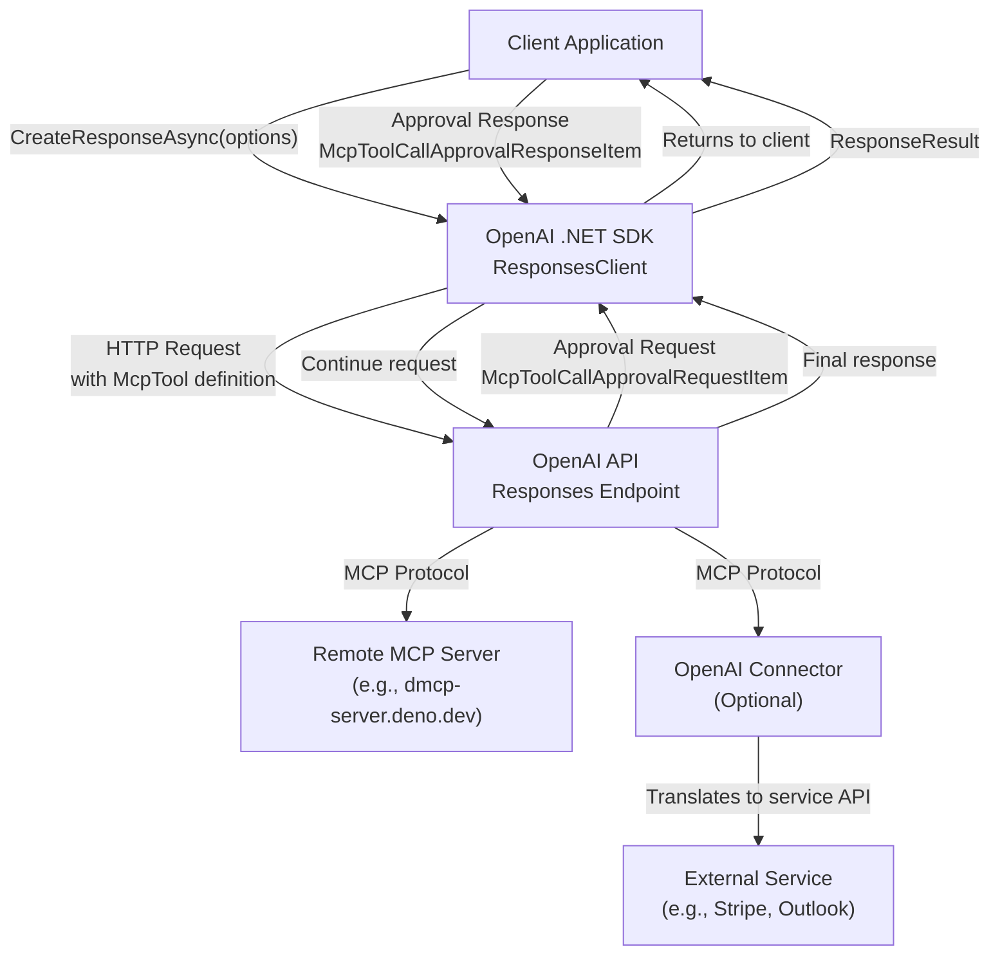
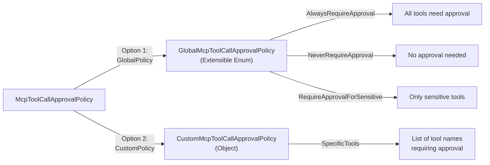
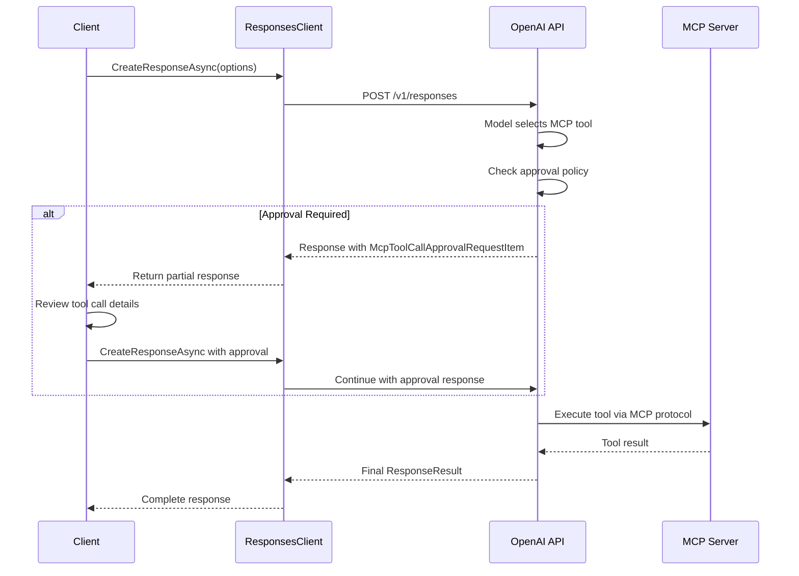

<!-- source: DeepWiki mcp.deepwiki.com · repo openai/openai-dotnet · page 6.6 MCP (Model Context Protocol) · fetched 2026-10-26 -->

# MCP (Model Context Protocol)

<details>
<summary>Relevant source files</summary>

The following files were used as context for generating this wiki page:

- [CHANGELOG.md](CHANGELOG.md)
- [api/OpenAI.net8.0.cs](api/OpenAI.net8.0.cs)
- [api/OpenAI.netstandard2.0.cs](api/OpenAI.netstandard2.0.cs)
- [examples/Responses/Example05_RemoteMcp.cs](examples/Responses/Example05_RemoteMcp.cs)
- [examples/Responses/Example05_RemoteMcpAsync.cs](examples/Responses/Example05_RemoteMcpAsync.cs)
- [examples/Responses/Example06_RemoteMcpAuthentication.cs](examples/Responses/Example06_RemoteMcpAuthentication.cs)
- [examples/Responses/Example06_RemoteMcpAuthenticationAsync.cs](examples/Responses/Example06_RemoteMcpAuthenticationAsync.cs)
- [scripts/Test-ApiCompatibility.ps1](scripts/Test-ApiCompatibility.ps1)
- [src/Custom/Responses/ResponseContentPart.cs](src/Custom/Responses/ResponseContentPart.cs)
- [src/Custom/Responses/Tools/McpTool/McpToolCallApprovalPolicy.cs](src/Custom/Responses/Tools/McpTool/McpToolCallApprovalPolicy.cs)
- [src/Generated/Models/OpenAIContext.cs](src/Generated/Models/OpenAIContext.cs)
- [src/Generated/Models/Responses/McpToolCallApprovalPolicy.cs](src/Generated/Models/Responses/McpToolCallApprovalPolicy.cs)
- [src/Generated/OpenAIModelFactory.cs](src/Generated/OpenAIModelFactory.cs)
- [src/OpenAI.csproj](src/OpenAI.csproj)
- [tests/Responses/ResponsesSmokeTests.cs](tests/Responses/ResponsesSmokeTests.cs)
- [tests/Responses/ResponsesTests.cs](tests/Responses/ResponsesTests.cs)
- [tests/SessionRecords/ResponsesTests/WebSearchCallStreaming.json](tests/SessionRecords/ResponsesTests/WebSearchCallStreaming.json)
- [tests/SessionRecords/ResponsesTests/WebSearchCallStreamingAsync.json](tests/SessionRecords/ResponsesTests/WebSearchCallStreamingAsync.json)
- [tspCodeModel.json](tspCodeModel.json)

</details>


This document describes the Model Context Protocol (MCP) integration within the OpenAI .NET SDK's Responses API. MCP enables AI models to interact with remote services and tools through a standardized protocol. For general information about tool integration patterns, see [Tool Integration](#6). For specific information about other tool types like function calling or web search, see [Function Calling](#6.1) and [Web Search Tool](#6.3).

## Overview

The Model Context Protocol (MCP) allows the Responses API to communicate with remote MCP servers that provide tools and resources. This enables models to access external services like databases, APIs, or specialized functionality without requiring direct implementation in the client application.

MCP tools are defined using the `McpTool` class and can be added to a `CreateResponseOptions` instance alongside other tool types. The SDK handles the communication protocol between the model and the remote MCP server.

**Sources:** [examples/Responses/Example05_RemoteMcp.cs:1-41](), [CHANGELOG.md:216-223]()

## Architecture



**Sources:** [src/Custom/Responses/Tools/McpTool/McpToolCallApprovalPolicy.cs:1-39](), [examples/Responses/Example05_RemoteMcp.cs:14-39]()

## Core Classes and Types

### McpTool

The `McpTool` class represents an MCP server configuration that can be used by the model.

| Property | Type | Required | Description |
|----------|------|----------|-------------|
| `ServerLabel` | `string` | Yes | Unique identifier for the MCP server |
| `ServerUri` | `Uri` | Yes | Endpoint URL of the MCP server |
| `ServerDescription` | `string` | No | Description of the server's capabilities |
| `AllowedTools` | `IList<string>` | No | Whitelist of specific tools the model can call |
| `ToolCallApprovalPolicy` | `McpToolCallApprovalPolicy` | No | Controls which tool calls require approval |
| `AuthorizationToken` | `string` | No | Bearer token for authenticating with the server |
| `ConnectorId` | `string` | No | ID of an OpenAI-maintained connector |

**Sources:** [api/OpenAI.netstandard2.0.cs:2584-2598](), [CHANGELOG.md:136-144]()

### Tool Call Approval Policy



**Sources:** [src/Custom/Responses/Tools/McpTool/McpToolCallApprovalPolicy.cs:1-39](), [api/OpenAI.netstandard2.0.cs:2508-2521]()

## Basic Usage

### Connecting to a Remote MCP Server

```csharp
// From Example05_RemoteMcp.cs
List<ResponseItem> inputItems =
[
    ResponseItem.CreateUserMessageItem("Roll 2d4+1"),
];

CreateResponseOptions options = new(inputItems)
{
    Tools = {
        new McpTool(serverLabel: "dmcp", serverUri: new Uri("https://dmcp-server.deno.dev/sse"))
        {
            ServerDescription = "A Dungeons and Dragons MCP server to assist with dice rolling.",
            ToolCallApprovalPolicy = GlobalMcpToolCallApprovalPolicy.NeverRequireApproval
        }
    }
};

ResponsesClient client = new(model: "gpt-5", apiKey: Environment.GetEnvironmentVariable("OPENAI_API_KEY"));
ResponseResult response = client.CreateResponse(options);
```

**Sources:** [examples/Responses/Example05_RemoteMcp.cs:14-39]()

### Restricting Available Tools

To limit which tools from an MCP server the model can access, use the `AllowedTools` property:

```csharp
McpTool mcpTool = new McpTool(
    serverLabel: "my-server",
    serverUri: new Uri("https://my-mcp-server.com"))
{
    AllowedTools = { "tool1", "tool2", "tool3" }
};
```

Any tools not in the `AllowedTools` list will be unavailable to the model.

**Sources:** [CHANGELOG.md:218-219](), [api/OpenAI.netstandard2.0.cs:2584-2598]()

## Tool Call Approval Flow

When a model attempts to call an MCP tool that requires approval, the SDK returns a `McpToolCallApprovalRequestItem` in the response. The client must then provide a `McpToolCallApprovalResponseItem` to continue.



**Sources:** [api/OpenAI.netstandard2.0.cs:2600-2614](), [CHANGELOG.md:148-150]()

### Approval Policies

#### Global Approval Policies

The `GlobalMcpToolCallApprovalPolicy` enumeration provides pre-defined policies:

| Policy | Description |
|--------|-------------|
| `AlwaysRequireApproval` | All tool calls require explicit approval |
| `NeverRequireApproval` | No approval required for any tool calls |
| `RequireApprovalForSensitive` | Only sensitive operations require approval |

**Implicit Conversion:** Global policies can be implicitly converted to `McpToolCallApprovalPolicy`:

```csharp
McpTool tool = new McpTool(serverLabel: "server", serverUri: uri)
{
    ToolCallApprovalPolicy = GlobalMcpToolCallApprovalPolicy.NeverRequireApproval
};
```

**Sources:** [src/Custom/Responses/Tools/McpTool/McpToolCallApprovalPolicy.cs:13-37](), [examples/Responses/Example05_RemoteMcp.cs:28]()

#### Custom Approval Policies

For fine-grained control, create a `CustomMcpToolCallApprovalPolicy` that specifies exactly which tools require approval:

```csharp
CustomMcpToolCallApprovalPolicy customPolicy = new CustomMcpToolCallApprovalPolicy
{
    RequireApprovalFor = { "delete_file", "send_email", "execute_command" }
};

McpTool tool = new McpTool(serverLabel: "server", serverUri: uri)
{
    ToolCallApprovalPolicy = customPolicy
};
```

**Sources:** [src/Custom/Responses/Tools/McpTool/McpToolCallApprovalPolicy.cs:18-22](), [api/OpenAI.netstandard2.0.cs:2508-2521]()

### Handling Approval Requests

When an approval is required, the response will contain items of type `McpToolCallApprovalRequestItem`:

```csharp
ResponseResult initialResponse = await client.CreateResponseAsync(options);

foreach (ResponseItem item in initialResponse.OutputItems)
{
    if (item is McpToolCallApprovalRequestItem approvalRequest)
    {
        // Inspect the tool call details
        string toolName = approvalRequest.ToolName;
        string serverId = approvalRequest.ServerId;
        
        // Create approval response
        ResponseItem approvalResponse = ResponseItem.CreateMcpToolCallApprovalResponseItem(
            approvalRequest.Id,
            approved: true);
        
        // Continue the conversation
        options.PreviousResponseId = initialResponse.Id;
        options.InputItems.Clear();
        options.InputItems.Add(approvalResponse);
        
        ResponseResult finalResponse = await client.CreateResponseAsync(options);
    }
}
```

**Sources:** [api/OpenAI.netstandard2.0.cs:2600-2614](), [CHANGELOG.md:148-150]()

## Authentication

MCP servers may require authentication. Use the `AuthorizationToken` property to provide a bearer token:

```csharp
McpTool tool = new McpTool(
    serverLabel: "stripe",
    serverUri: new Uri("https://mcp.stripe.com"))
{
    AuthorizationToken = Environment.GetEnvironmentVariable("STRIPE_OAUTH_ACCESS_TOKEN")
};
```

The token is sent in the `Authorization` header when the OpenAI API communicates with the MCP server.

**Sources:** [examples/Responses/Example06_RemoteMcpAuthentication.cs:23-31](), [CHANGELOG.md:140-141]()

## OpenAI Connectors

OpenAI maintains pre-built connectors for popular services. These connectors are MCP wrappers that simplify integration with services like Microsoft Outlook or Dropbox. To use a connector, specify the `ConnectorId` instead of a `ServerUri`:

```csharp
McpTool connectorTool = new McpTool(
    serverLabel: "outlook-connector",
    serverUri: null) // Not needed for connectors
{
    ConnectorId = "outlook",
    AuthorizationToken = Environment.GetEnvironmentVariable("OUTLOOK_TOKEN")
};
```

**Sources:** [CHANGELOG.md:138-139](), [api/OpenAI.netstandard2.0.cs:2584-2598]()

## Streaming with MCP Tools

MCP tools work with both streaming and non-streaming response modes. Approval requests can occur during streaming:

```csharp
CreateResponseOptions options = new(inputItems)
{
    Tools = { mcpTool },
    StreamingEnabled = true
};

await foreach (StreamingResponseUpdate update in client.CreateResponseStreamingAsync(options))
{
    if (update is StreamingResponseMcpToolCallApprovalRequestUpdate approvalUpdate)
    {
        // Handle approval request during streaming
        string toolName = approvalUpdate.ToolName;
        // ... handle approval
    }
}
```

**Sources:** [api/OpenAI.netstandard2.0.cs:3034-3041](), [tests/Responses/ResponsesTests.cs:1-800]()

## Response Items

### McpToolCallApprovalRequestItem

Represents a request from the model to execute an MCP tool that requires approval.

| Property | Type | Description |
|----------|------|-------------|
| `Id` | `string` | Unique identifier for the approval request |
| `ServerId` | `string` | The server label of the MCP server |
| `ToolName` | `string` | Name of the tool being called |
| `ToolArguments` | `BinaryData` | Arguments for the tool call |

**Sources:** [api/OpenAI.netstandard2.0.cs:2600-2614]()

### McpToolCallApprovalResponseItem

Represents the client's response to an approval request.

| Property | Type | Description |
|----------|------|-------------|
| `Id` | `string` | ID matching the approval request |
| `Approved` | `bool` | Whether the tool call is approved |
| `DenialReason` | `string` | Optional reason if denied |

**Sources:** [api/OpenAI.netstandard2.0.cs:2616-2630]()

## Tool Selection

To force the model to use an MCP tool, specify it in the `ToolChoice` property:

```csharp
CreateResponseOptions options = new(inputItems)
{
    Tools = { mcpTool },
    ToolChoice = ResponseToolChoice.CreateMcpChoice("dmcp", "roll_dice")
};
```

The first parameter is the server label, and the second is the tool name.

**Sources:** [api/OpenAI.netstandard2.0.cs:2821-2836](), [tests/Responses/ResponsesSmokeTests.cs:1-400]()

## Error Handling

MCP tool calls can fail for various reasons:

```csharp
ResponseResult response = await client.CreateResponseAsync(options);

foreach (ResponseItem item in response.OutputItems)
{
    if (item is MessageResponseItem message && message.Status == MessageStatus.Failed)
    {
        // Check for MCP-related errors
        if (response.Error != null)
        {
            Console.WriteLine($"Error: {response.Error.Code} - {response.Error.Message}");
        }
    }
}
```

Common error scenarios include:
- MCP server unreachable (`ServerUri` is incorrect or server is down)
- Authentication failure (`AuthorizationToken` is invalid or expired)
- Tool not found (specified tool name doesn't exist on the server)
- Tool execution failure (server returns an error)

**Sources:** [api/OpenAI.netstandard2.0.cs:2326-2344]()

## Complete Example

```csharp
// Setup MCP tool with approval policy
McpTool mcpTool = new McpTool(
    serverLabel: "dmcp",
    serverUri: new Uri("https://dmcp-server.deno.dev/sse"))
{
    ServerDescription = "Dungeons and Dragons dice rolling server",
    AllowedTools = { "roll_dice", "get_stats" },
    ToolCallApprovalPolicy = new CustomMcpToolCallApprovalPolicy
    {
        RequireApprovalFor = { "roll_dice" }
    }
};

// Create initial request
List<ResponseItem> inputItems = [
    ResponseItem.CreateUserMessageItem("Roll 2d6 for initiative")
];

CreateResponseOptions options = new(inputItems)
{
    Tools = { mcpTool }
};

ResponsesClient client = new(model: "gpt-5", apiKey: apiKey);
ResponseResult response = await client.CreateResponseAsync(options);

// Handle approval if required
if (response.OutputItems.FirstOrDefault() is McpToolCallApprovalRequestItem approvalRequest)
{
    Console.WriteLine($"Tool {approvalRequest.ToolName} requires approval");
    
    ResponseItem approvalResponse = ResponseItem.CreateMcpToolCallApprovalResponseItem(
        approvalRequest.Id,
        approved: true);
    
    options.PreviousResponseId = response.Id;
    options.InputItems.Clear();
    options.InputItems.Add(approvalResponse);
    
    response = await client.CreateResponseAsync(options);
}

// Process final response
Console.WriteLine(response.GetOutputText());
```

**Sources:** [examples/Responses/Example05_RemoteMcp.cs:14-39](), [examples/Responses/Example06_RemoteMcpAuthentication.cs:16-38]()

## Related Topics

- For information about other tool types, see [Tool Integration](#6)
- For function calling patterns, see [Function Calling](#6.1)
- For web search capabilities, see [Web Search Tool](#6.3)
- For general Responses API usage, see [Responses API Client](#4.3)

---

