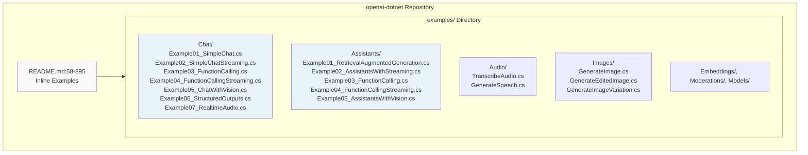
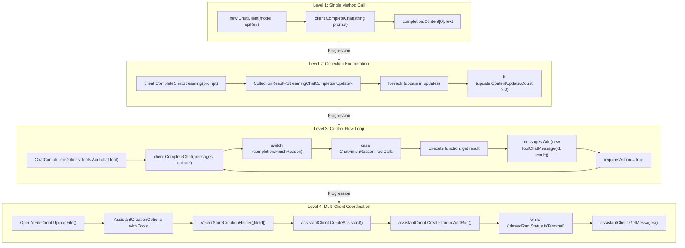
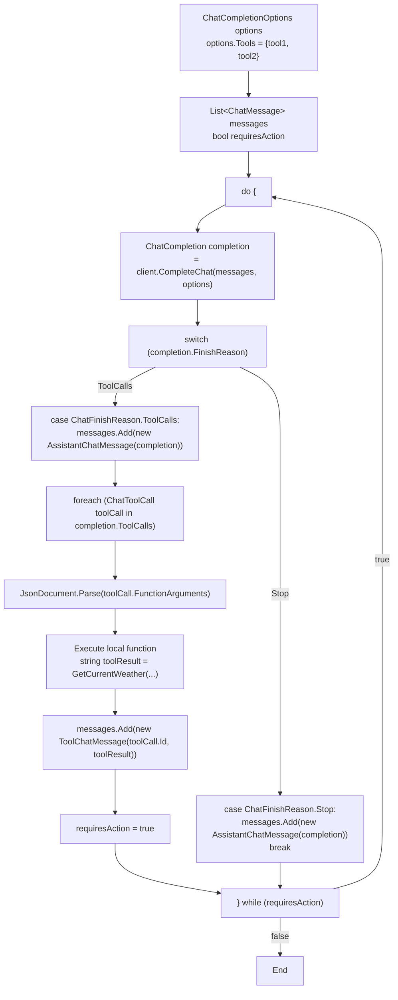
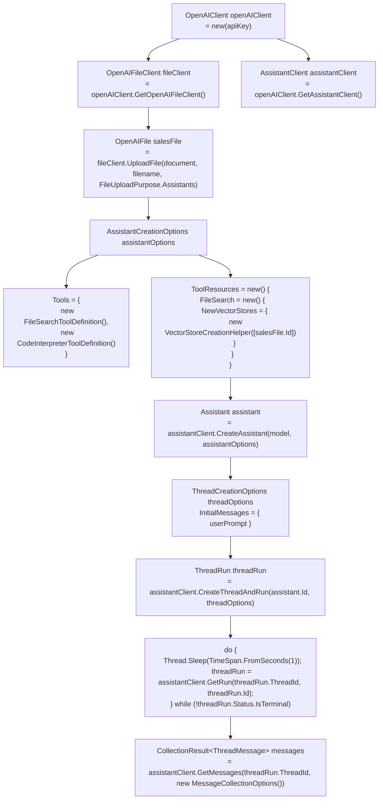

<!-- source: DeepWiki mcp.deepwiki.com · repo openai/openai-dotnet · page 7 Examples and Guides · fetched 2026-10-26 -->

# Examples and Guides

<details>
<summary>Relevant source files</summary>

The following files were used as context for generating this wiki page:

- [CHANGELOG.md](CHANGELOG.md)
- [README.md](README.md)
- [examples/Assistants/Example01_RetrievalAugmentedGeneration.cs](examples/Assistants/Example01_RetrievalAugmentedGeneration.cs)
- [examples/Assistants/Example01_RetrievalAugmentedGenerationAsync.cs](examples/Assistants/Example01_RetrievalAugmentedGenerationAsync.cs)
- [examples/Assistants/Example05_AssistantsWithVision.cs](examples/Assistants/Example05_AssistantsWithVision.cs)
- [examples/Assistants/Example05_AssistantsWithVisionAsync.cs](examples/Assistants/Example05_AssistantsWithVisionAsync.cs)
- [examples/Chat/Example02_SimpleChatStreaming.cs](examples/Chat/Example02_SimpleChatStreaming.cs)
- [examples/Chat/Example02_SimpleChatStreamingAsync.cs](examples/Chat/Example02_SimpleChatStreamingAsync.cs)
- [examples/Chat/Example03_FunctionCalling.cs](examples/Chat/Example03_FunctionCalling.cs)
- [examples/Chat/Example06_StructuredOutputs.cs](examples/Chat/Example06_StructuredOutputs.cs)
- [examples/Chat/Example06_StructuredOutputsAsync.cs](examples/Chat/Example06_StructuredOutputsAsync.cs)
- [scripts/Test-ApiCompatibility.ps1](scripts/Test-ApiCompatibility.ps1)
- [src/OpenAI.csproj](src/OpenAI.csproj)
- [tests/SessionRecords/ResponsesTests/WebSearchCallStreaming.json](tests/SessionRecords/ResponsesTests/WebSearchCallStreaming.json)
- [tests/SessionRecords/ResponsesTests/WebSearchCallStreamingAsync.json](tests/SessionRecords/ResponsesTests/WebSearchCallStreamingAsync.json)
- [tests/Telemetry/ChatTelemetryTests.cs](tests/Telemetry/ChatTelemetryTests.cs)

</details>


This page provides an overview of practical examples demonstrating the OpenAI .NET SDK. Examples are organized by feature area and complexity level, ranging from single-method calls to multi-client orchestrations. All examples are executable NUnit tests located in the [examples/]() directory and inline code snippets in [README.md]().

For client API documentation, see [Client Libraries](#4). For streaming patterns and tool integration details, see [Advanced Features](#5) and [Tool Integration](#6).

## Example Organization

The repository contains two categories of examples:

| Location | Type | Execution | Features |
|----------|------|-----------|----------|
| [README.md:58-895]() | Inline code snippets | Copy-paste | Quick reference, basic patterns |
| [examples/]() | NUnit test projects | `dotnet test` | Complete scenarios, async variants, cleanup |

### Example Repository Structure

**Diagram: Example Files by Feature Area**



**Sources:** [README.md:1-895](), [examples/Chat/Example02_SimpleChatStreaming.cs:1-27](), [examples/Assistants/Example01_RetrievalAugmentedGeneration.cs:1-152](), [examples/Assistants/Example05_AssistantsWithVision.cs:1-78]()

## Example Categories

Examples are categorized by complexity and API surface:

| Category | Example Files | Complexity | Key Code Entities |
|----------|--------------|------------|-------------------|
| **Basic Chat** | [README.md:60-68]() | Simple | `ChatClient`, `CompleteChat`, `ChatCompletion.Content[0].Text` |
| **Streaming** | [examples/Chat/Example02_SimpleChatStreaming.cs](), [examples/Chat/Example02_SimpleChatStreamingAsync.cs]() | Medium | `CompleteChatStreaming`, `CollectionResult<StreamingChatCompletionUpdate>`, `AsyncCollectionResult<T>` |
| **Function Calling** | [examples/Chat/Example03_FunctionCalling.cs](), [README.md:222-367]() | Medium | `ChatTool.CreateFunctionTool`, `ChatFinishReason.ToolCalls`, `ToolChatMessage` |
| **Structured Outputs** | [examples/Chat/Example06_StructuredOutputs.cs](), [README.md:370-423]() | Medium | `ChatResponseFormat.CreateJsonSchemaFormat`, `jsonSchemaIsStrict: true` |
| **Multimodal** | [examples/Assistants/Example05_AssistantsWithVision.cs](), [README.md:425-485]() | Advanced | `MessageContent.FromImageFileId`, `MessageContent.FromImageUri`, `FileUploadPurpose.Vision` |
| **RAG (Assistants)** | [examples/Assistants/Example01_RetrievalAugmentedGeneration.cs](), [README.md:710-857]() | Advanced | `AssistantClient`, `FileSearchToolDefinition`, `VectorStoreCreationHelper`, `ThreadRun.Status.IsTerminal` |
| **Dependency Injection** | [README.md:144-183]() | Advanced | `ServiceCollection.AddSingleton<ChatClient>`, ASP.NET Core integration |

**Sources:** [README.md:10-895](), [examples/Chat/Example02_SimpleChatStreaming.cs:1-27](), [examples/Chat/Example03_FunctionCalling.cs:1-182](), [examples/Chat/Example06_StructuredOutputs.cs:1-64](), [examples/Assistants/Example01_RetrievalAugmentedGeneration.cs:1-152](), [examples/Assistants/Example05_AssistantsWithVision.cs:1-78]()

## Complexity Progression

Examples progress from simple single-method calls to complex multi-client orchestrations:

**Diagram: API Pattern Complexity Ladder**



**Sources:** [README.md:60-68](), [README.md:184-220](), [README.md:222-367](), [examples/Assistants/Example01_RetrievalAugmentedGeneration.cs:54-100]()

## Basic Usage Examples

### Simple Chat Completion

The minimal example demonstrates a three-step pattern: construct client, call method, access result.

**Code Pattern from [README.md:60-68]():**
```
Line 63: ChatClient client = new(model: "gpt-4o", apiKey: Environment.GetEnvironmentVariable("OPENAI_API_KEY"));
Line 65: ChatCompletion completion = client.CompleteChat("Say 'this is a test.'");
Line 67: Console.WriteLine($"[ASSISTANT]: {completion.Content[0].Text}");
```

**Key Code Entities:**
- `ChatClient(string model, string apiKey)` constructor
- `ChatCompletion CompleteChat(string prompt)` method
- `ChatCompletion.Content` property returns `IReadOnlyList<ChatMessageContentPart>`
- `ChatMessageContentPart.Text` property

**Sources:** [README.md:60-68]()

### Asynchronous Variant

All synchronous methods have `Async` suffixed counterparts returning `Task<T>`:

**Code Pattern from [README.md:113-119]():**
```
Line 118: ChatCompletion completion = await client.CompleteChatAsync("Say 'this is a test.'");
```

**Key Code Entities:**
- `Task<ChatCompletion> CompleteChatAsync(string prompt)` method
- Requires `await` keyword

**Sources:** [README.md:113-119]()

### Message History Pattern

Multi-turn conversations use `List<ChatMessage>` for conversation history:

**Code Pattern from [README.md:222-277]():**
```
Line 274: List<ChatMessage> messages = [
Line 276:     new UserChatMessage("What's the weather like today?"),
Line 277: ];
```

**Key Code Entities:**
- `List<ChatMessage>` conversation history
- `UserChatMessage(string content)` constructor
- `AssistantChatMessage(ChatCompletion)` constructor for adding responses
- `SystemChatMessage(string content)` for system instructions

**Sources:** [README.md:222-277]()

## Streaming Examples

### Synchronous Streaming with CollectionResult

Streaming returns `CollectionResult<StreamingChatCompletionUpdate>` enumerable with standard `foreach`:

**Code from [examples/Chat/Example02_SimpleChatStreaming.cs:10-25]():**
```
Line 15: CollectionResult<StreamingChatCompletionUpdate> completionUpdates = client.CompleteChatStreaming("Say 'this is a test.'");
Line 18: foreach (StreamingChatCompletionUpdate completionUpdate in completionUpdates)
Line 20:     if (completionUpdate.ContentUpdate.Count > 0)
Line 22:         Console.Write(completionUpdate.ContentUpdate[0].Text);
```

**Key Code Entities:**
- `CollectionResult<StreamingChatCompletionUpdate> CompleteChatStreaming(string)` method
- `StreamingChatCompletionUpdate` type with incremental data
- `StreamingChatCompletionUpdate.ContentUpdate` property (`IReadOnlyList<ChatMessageContentPart>`)
- `ChatMessageContentPart.Text` for incremental text

**Sources:** [examples/Chat/Example02_SimpleChatStreaming.cs:1-27](), [README.md:184-205]()

### Asynchronous Streaming with AsyncCollectionResult

Async streaming returns `AsyncCollectionResult<T>` enumerable with `await foreach`:

**Code from [examples/Chat/Example02_SimpleChatStreamingAsync.cs:10-26]():**
```
Line 16: AsyncCollectionResult<StreamingChatCompletionUpdate> completionUpdates = client.CompleteChatStreamingAsync("Say 'this is a test.'");
Line 19: await foreach (StreamingChatCompletionUpdate completionUpdate in completionUpdates)
Line 21:     if (completionUpdate.ContentUpdate.Count > 0)
Line 23:         Console.Write(completionUpdate.ContentUpdate[0].Text);
```

**Key Code Entities:**
- `AsyncCollectionResult<StreamingChatCompletionUpdate> CompleteChatStreamingAsync(string)` method
- `await foreach` pattern for asynchronous enumeration
- Same `StreamingChatCompletionUpdate` type as synchronous variant

**Sources:** [examples/Chat/Example02_SimpleChatStreamingAsync.cs:1-28](), [README.md:207-220]()

## Function Calling Examples

### Function Tool Definition

Functions are defined using `ChatTool.CreateFunctionTool` with JSON schema for parameters:

**Code from [examples/Chat/Example03_FunctionCalling.cs:26-52]():**
```
Line 31: private static readonly ChatTool getCurrentWeatherTool = ChatTool.CreateFunctionTool(
Line 32:     functionName: nameof(GetCurrentWeather),
Line 33:     functionDescription: "Get the current weather in a given location",
Line 34:     functionParameters: BinaryData.FromBytes("""
Line 35:         {
Line 36:             "type": "object",
Line 37:             "properties": {
Line 38:                 "location": {
Line 39:                     "type": "string",
Line 40:                     "description": "The city and state, e.g. Boston, MA"
Line 41:                 },
Line 42:                 "unit": {
Line 43:                     "type": "string",
Line 44:                     "enum": [ "celsius", "fahrenheit" ],
Line 45:                     "description": "The temperature unit to use. Infer this from the specified location."
Line 46:                 }
Line 47:             },
Line 48:             "required": [ "location" ]
Line 49:         }
Line 50:         """u8.ToArray())
```

**Key Code Entities:**
- `ChatTool.CreateFunctionTool(string functionName, string functionDescription, BinaryData functionParameters)` static method
- `BinaryData.FromBytes(byte[])` for JSON schema
- JSON schema must conform to OpenAI function calling format

**Sources:** [examples/Chat/Example03_FunctionCalling.cs:26-52](), [README.md:243-268]()

### Tool Execution Control Flow

Function calling uses a `do-while` loop with `ChatFinishReason` switch statement:

**Diagram: Tool Calling Request-Response Cycle**



**Code from [examples/Chat/Example03_FunctionCalling.cs:72-151]():**
```
Line 74: do
Line 77:     ChatCompletion completion = client.CompleteChat(messages, options);
Line 79:     switch (completion.FinishReason)
Line 81:         case ChatFinishReason.Stop:
Line 84:             messages.Add(new AssistantChatMessage(completion));
Line 88:         case ChatFinishReason.ToolCalls:
Line 91:             messages.Add(new AssistantChatMessage(completion));
Line 94:             foreach (ChatToolCall toolCall in completion.ToolCalls)
Line 111:                 using JsonDocument argumentsJson = JsonDocument.Parse(toolCall.FunctionArguments);
Line 123:                 messages.Add(new ToolChatMessage(toolCall.Id, toolResult));
Line 135:             requiresAction = true;
Line 151: } while (requiresAction);
```

**Key Code Entities:**
- `ChatCompletion.FinishReason` property (enum `ChatFinishReason`)
- `ChatFinishReason.Stop` indicates completion
- `ChatFinishReason.ToolCalls` indicates tools must be executed
- `ChatCompletion.ToolCalls` property (`IReadOnlyList<ChatToolCall>`)
- `ChatToolCall.Id` for matching tool response
- `ChatToolCall.FunctionName` for dispatcher
- `ChatToolCall.FunctionArguments` as JSON string
- `ToolChatMessage(string toolCallId, string result)` constructor

**Sources:** [examples/Chat/Example03_FunctionCalling.cs:54-151](), [README.md:285-367]()

## Multi-Client RAG Example

### Assistant with File Search and Code Interpreter

The Retrieval-Augmented Generation (RAG) pattern coordinates three clients: `OpenAIFileClient`, `AssistantClient`, and implicit `VectorStoreClient` through `VectorStoreCreationHelper`:

**Diagram: RAG System Component Interaction**



**Code from [examples/Assistants/Example01_RetrievalAugmentedGeneration.cs:18-104]():**
```
Line 21: OpenAIClient openAIClient = new(Environment.GetEnvironmentVariable("OPENAI_API_KEY"));
Line 22: OpenAIFileClient fileClient = openAIClient.GetOpenAIFileClient();
Line 23: AssistantClient assistantClient = openAIClient.GetAssistantClient();

Line 55: OpenAIFile salesFile = await fileClient.UploadFileAsync(document, "monthly_sales.json", FileUploadPurpose.Assistants);

Line 61: AssistantCreationOptions assistantOptions = new()
Line 68: Tools = {
Line 70:     new FileSearchToolDefinition(),
Line 71:     new CodeInterpreterToolDefinition(),
Line 73: ToolResources = new() {
Line 74:     FileSearch = new() {
Line 76:         NewVectorStores = {
Line 79:             new VectorStoreCreationHelper([salesFile.Id]),

Line 85: Assistant assistant = await assistantClient.CreateAssistantAsync("gpt-4o", assistantOptions);

Line 88: ThreadCreationOptions threadOptions = new() {
Line 90:     InitialMessages = { "How well did product 113045 sell in February? Graph its trend over time." }

Line 93: ThreadRun threadRun = await assistantClient.CreateThreadAndRunAsync(assistant.Id, threadOptions);

Line 96: do {
Line 98:     Thread.Sleep(TimeSpan.FromSeconds(1));
Line 99:     threadRun = assistantClient.GetRun(threadRun.ThreadId, threadRun.Id);
Line 100: } while (!threadRun.Status.IsTerminal);

Line 103: AsyncCollectionResult<ThreadMessage> messages = assistantClient.GetMessagesAsync(threadRun.ThreadId, new MessageCollectionOptions() { Order = MessageCollectionOrder.Ascending });
```

**Key Code Entities:**
- `OpenAIClient.GetOpenAIFileClient()` factory method
- `OpenAIClient.GetAssistantClient()` factory method
- `OpenAIFileClient.UploadFile(Stream, string, FileUploadPurpose)` method
- `FileUploadPurpose.Assistants` enum value
- `AssistantCreationOptions` type with `Tools` and `ToolResources` properties
- `FileSearchToolDefinition` type for RAG functionality
- `CodeInterpreterToolDefinition` type for data analysis
- `VectorStoreCreationHelper` type for automatic vector store creation
- `AssistantClient.CreateAssistant(string model, AssistantCreationOptions)` method
- `ThreadCreationOptions.InitialMessages` property
- `AssistantClient.CreateThreadAndRun(string, ThreadCreationOptions)` method
- `ThreadRun.Status.IsTerminal` property for polling completion
- `AssistantClient.GetMessages(string threadId, MessageCollectionOptions)` method
- `MessageCollectionOptions.Order` property (enum `MessageCollectionOrder`)

**Sources:** [examples/Assistants/Example01_RetrievalAugmentedGeneration.cs:1-152](), [README.md:710-857]()

### Multimodal Vision Example

Vision capabilities combine file upload with URI references in thread messages:

**Code from [examples/Assistants/Example05_AssistantsWithVision.cs:17-58]():**
```
Line 23: OpenAIFile pictureOfAppleFile = fileClient.UploadFile(
Line 24:     Path.Combine("Assets", "images_apple.png"),
Line 25:     FileUploadPurpose.Vision);

Line 27: Uri linkToPictureOfOrange = new("https://raw.githubusercontent.com/openai/openai-dotnet/refs/heads/main/examples/Assets/images_orange.png");

Line 38: AssistantThread thread = assistantClient.CreateThread(new ThreadCreationOptions()
Line 40:     InitialMessages = {
Line 41:         new ThreadInitializationMessage(
Line 42:             MessageRole.User,
Line 43:             [
Line 44:                 "Hello, assistant! Please compare these two images for me:",
Line 45:                 MessageContent.FromImageFileId(pictureOfAppleFile.Id),
Line 46:                 MessageContent.FromImageUri(linkToPictureOfOrange),
Line 47:             ]),
```

**Key Code Entities:**
- `FileUploadPurpose.Vision` enum value for image files
- `ThreadInitializationMessage(MessageRole, IEnumerable<object>)` constructor accepting mixed content
- `MessageContent.FromImageFileId(string fileId)` static factory for uploaded images
- `MessageContent.FromImageUri(Uri uri)` static factory for remote images
- Mixed content list with `string` and `MessageContent` objects

**Sources:** [examples/Assistants/Example05_AssistantsWithVision.cs:1-78](), [README.md:710-857]()

## Structured Outputs Example

### JSON Schema Enforcement

Structured outputs enforce response conformance to a JSON schema using `ChatResponseFormat.CreateJsonSchemaFormat`:

**Code from [examples/Chat/Example06_StructuredOutputs.cs:12-62]():**
```
Line 22: ChatCompletionOptions options = new()
Line 24:     ResponseFormat = ChatResponseFormat.CreateJsonSchemaFormat(
Line 25:         jsonSchemaFormatName: "math_reasoning",
Line 26:         jsonSchema: BinaryData.FromBytes("""
Line 27:             {
Line 28:                 "type": "object",
Line 29:                 "properties": {
Line 30:                     "steps": {
Line 31:                         "type": "array",
Line 32:                         "items": {
Line 33:                             "type": "object",
Line 34:                             "properties": {
Line 35:                                 "explanation": { "type": "string" },
Line 36:                                 "output": { "type": "string" }
Line 37:                             },
Line 38:                             "required": ["explanation", "output"],
Line 39:                             "additionalProperties": false
Line 40:                         }
Line 41:                     },
Line 42:                     "final_answer": { "type": "string" }
Line 43:                 },
Line 44:                 "required": ["steps", "final_answer"],
Line 45:                 "additionalProperties": false
Line 46:             }
Line 47:             """u8.ToArray()),
Line 48:         jsonSchemaIsStrict: true)

Line 51: ChatCompletion completion = await client.CompleteChatAsync(messages, options);
Line 53: using JsonDocument structuredJson = JsonDocument.Parse(completion.Content[0].Text);
```

**Key Code Entities:**
- `ChatResponseFormat.CreateJsonSchemaFormat(string jsonSchemaFormatName, BinaryData jsonSchema, bool jsonSchemaIsStrict)` static method
- `jsonSchemaIsStrict: true` enforces strict conformance
- `BinaryData.FromBytes(byte[])` for schema bytes
- Response in `completion.Content[0].Text` as valid JSON string
- `JsonDocument.Parse()` for accessing structured data

**Sources:** [examples/Chat/Example06_StructuredOutputs.cs:1-64](), [README.md:370-423]()

## ASP.NET Core Integration Example

### Dependency Injection with Singleton Registration

All OpenAI clients are thread-safe and should be registered as singletons for HTTP connection pooling:

**Code from [README.md:144-183]():**
```
Line 151: builder.Services.AddSingleton<ChatClient>(serviceProvider =>
Line 152: {
Line 153:     var apiKey = Environment.GetEnvironmentVariable("OPENAI_API_KEY");
Line 154:     var model = "gpt-4o";
Line 155:
Line 156:     return new ChatClient(model, apiKey);
Line 157: });

Line 169:     public ChatController(ChatClient chatClient)
Line 170:     {
Line 171:         _chatClient = chatClient;
Line 172:     }

Line 175:     public async Task<IActionResult> CompleteChat([FromBody] string message)
Line 176:     {
Line 177:         ChatCompletion completion = await _chatClient.CompleteChatAsync(message);
Line 179:         return Ok(new { response = completion.Content[0].Text });
Line 180:     }
```

**Key Code Entities:**
- `IServiceCollection.AddSingleton<ChatClient>(Func<IServiceProvider, ChatClient>)` extension method
- Thread-safety guarantee documented at line 146: "The OpenAI clients are **thread-safe**"
- Constructor injection pattern in controllers
- `Task<IActionResult>` for async controller actions

**Sources:** [README.md:144-183]()

### Custom Endpoint Configuration

Alternative API endpoints (proxies, self-hosted models) use `OpenAIClientOptions.Endpoint`:

**Code from [README.md:72-90]():**
```
Line 80: ChatClient client = new(
Line 81:     model: "MODEL_NAME",
Line 82:     credential: new ApiKeyCredential(Environment.GetEnvironmentVariable("OPENAI_API_KEY")),
Line 83:     options: new OpenAIClientOptions() 
Line 84:     { 
Line 85:         Endpoint = new Uri("BASE_URL")
Line 86:     }
Line 87: );
```

**Key Code Entities:**
- `ApiKeyCredential(string apiKey)` type from `System.ClientModel` namespace
- `OpenAIClientOptions.Endpoint` property (type `Uri`)
- Three-parameter constructor: `ChatClient(string model, ApiKeyCredential credential, OpenAIClientOptions options)`

**Sources:** [README.md:72-90]()

## Executing Examples

### Running NUnit Test Examples

All examples in the `examples/` directory are NUnit tests executed with `dotnet test`:

```bash
# Run all examples
dotnet test examples/

# Run specific example by name
dotnet test examples/ --filter "FullyQualifiedName~Example02_SimpleChatStreaming"

# Run examples for specific client
dotnet test examples/ --filter "FullyQualifiedName~ChatExamples"
```

**Example Test Structure from [examples/Chat/Example02_SimpleChatStreaming.cs:1-27]():**
```
Line 1:  using NUnit.Framework;
Line 2:  using OpenAI.Chat;
Line 10: public partial class ChatExamples
Line 12:     [Test]
Line 13:     public void Example02_SimpleChatStreaming()
```

**Key Code Entities:**
- `[Test]` attribute marks methods as executable tests
- `partial class` pattern for organizing related examples
- `namespace OpenAI.Examples` for all example files

**Prerequisites:**
- .NET 8.0 SDK minimum (documented at [README.md:54]())
- `OPENAI_API_KEY` environment variable must be set
- NUnit test framework (automatically restored via NuGet)

**Sources:** [examples/Chat/Example02_SimpleChatStreaming.cs:1-27](), [README.md:38-54]()

### Suppressing Experimental Warnings

Examples using experimental APIs require `#pragma warning disable OPENAI001`:

**Code from [examples/Assistants/Example01_RetrievalAugmentedGeneration.cs:10-14]():**
```
Line 10: // This example uses experimental APIs which are subject to change. To use experimental APIs,
Line 11: // please acknowledge their experimental status by suppressing the corresponding warning.
Line 12: #pragma warning disable OPENAI001
Line 14: public partial class AssistantExamples
```

**Key Code Entities:**
- `#pragma warning disable OPENAI001` compiler directive
- `OPENAI001` diagnostic ID for general experimental features
- `OPENAI002` diagnostic ID for Realtime APIs (see [README.md:716]())

**Sources:** [examples/Assistants/Example01_RetrievalAugmentedGeneration.cs:10-14](), [examples/Assistants/Example05_AssistantsWithVision.cs:10-13]()

## Child Pages

This section has detailed example pages for specific scenarios:

- **[Chat Examples](#7.1)**: Simple prompts, roles, instructions, and multi-turn conversations
- **[Assistant RAG Examples](#7.2)**: Building RAG systems with file search and vector stores
- **[Response API Examples](#7.3)**: Advanced tools, reasoning, and output modes
- **[Prompt Templates and Variables](#7.4)**: Server-side templates with variable substitution
- **[Framework Integration](#7.5)**: ASP.NET Core, dependency injection, and production patterns

---

