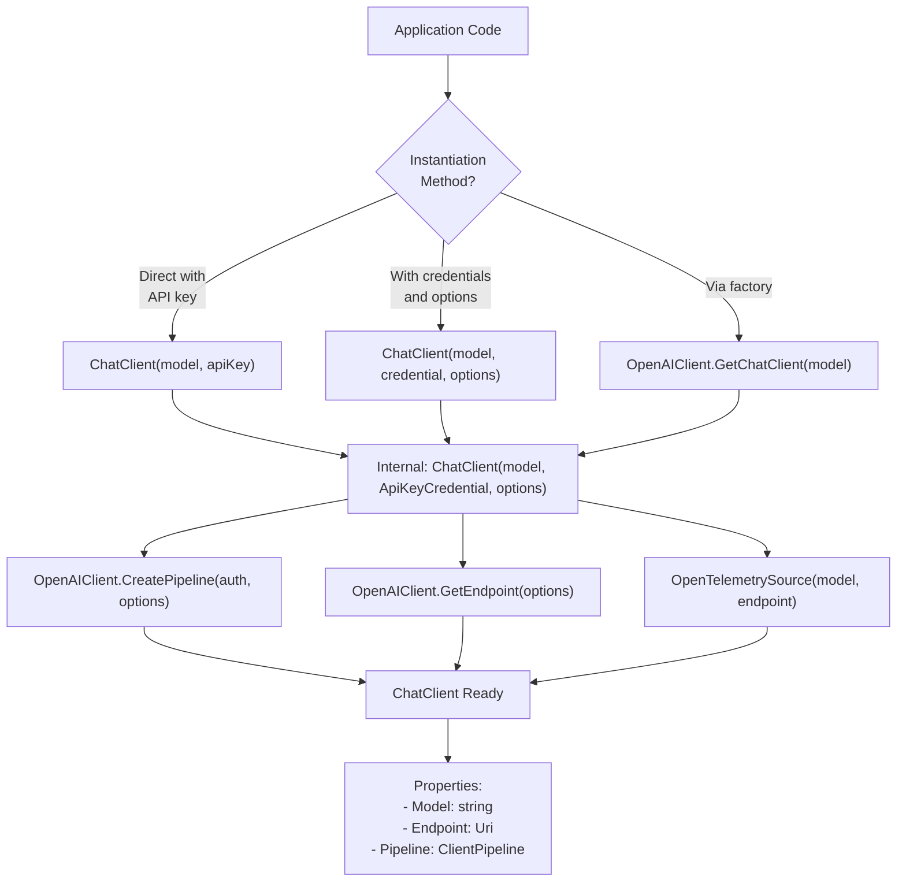
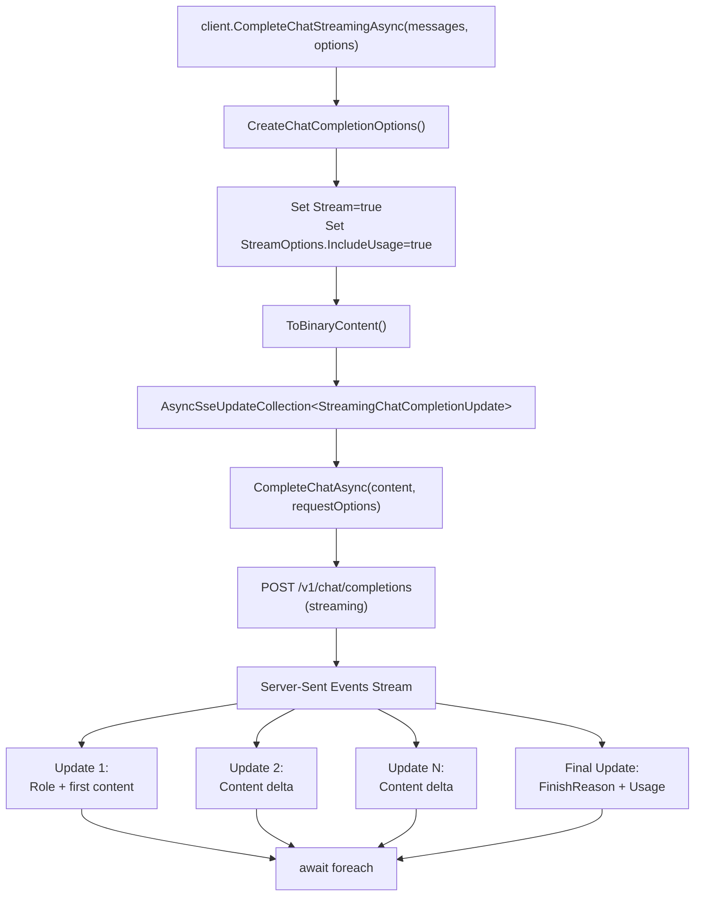
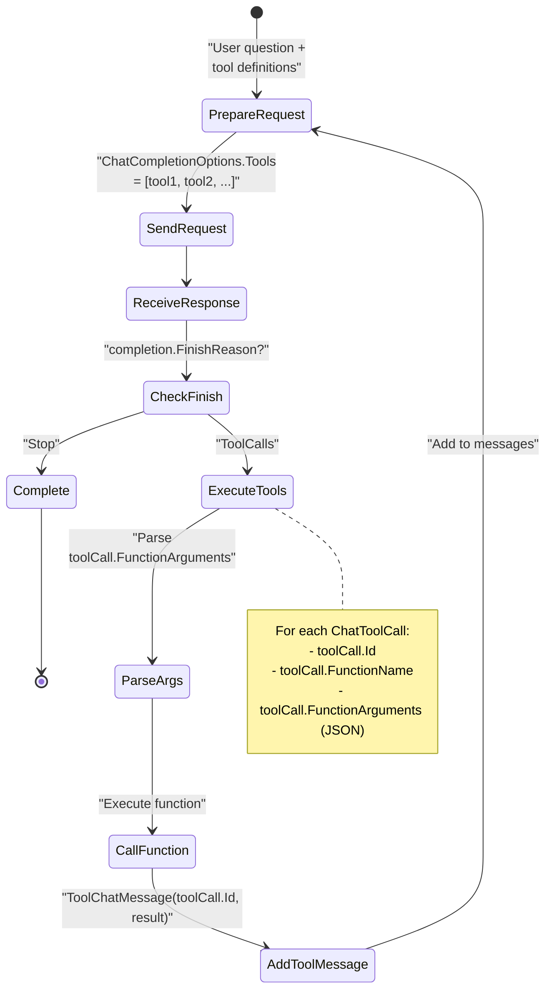
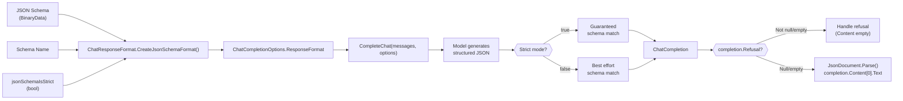
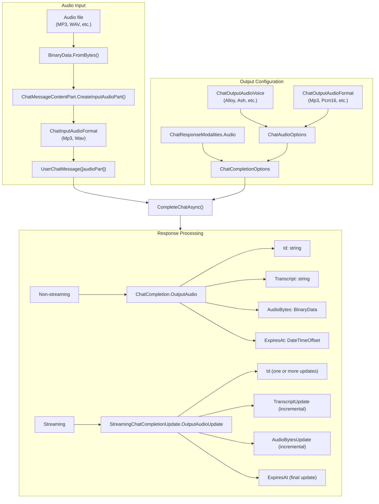
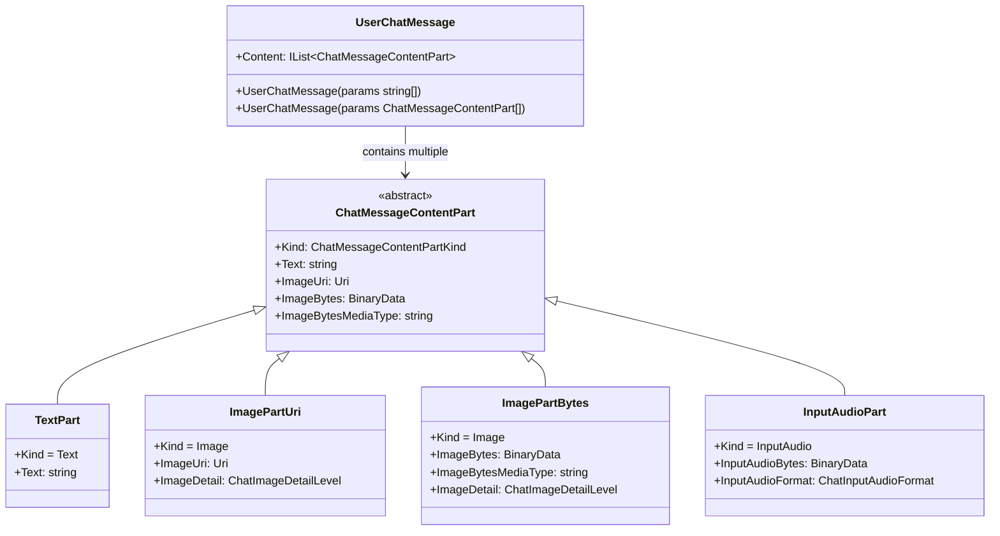
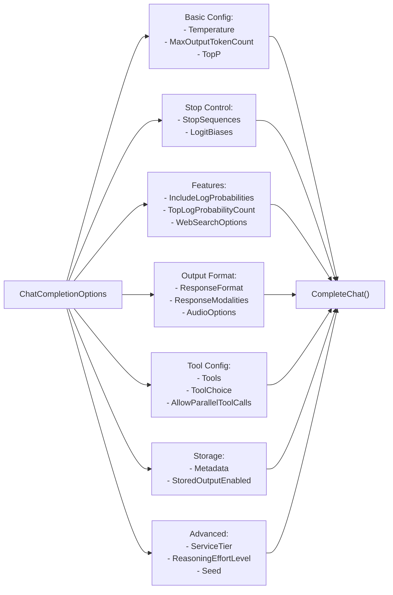

<!-- source: DeepWiki mcp.deepwiki.com · repo openai/openai-dotnet · page 7.1 Chat Examples · fetched 2026-10-26 -->

# Chat Examples

<details>
<summary>Relevant source files</summary>

The following files were used as context for generating this wiki page:

- [README.md](README.md)
- [examples/Assistants/Example01_RetrievalAugmentedGeneration.cs](examples/Assistants/Example01_RetrievalAugmentedGeneration.cs)
- [examples/Assistants/Example01_RetrievalAugmentedGenerationAsync.cs](examples/Assistants/Example01_RetrievalAugmentedGenerationAsync.cs)
- [examples/Assistants/Example05_AssistantsWithVision.cs](examples/Assistants/Example05_AssistantsWithVision.cs)
- [examples/Assistants/Example05_AssistantsWithVisionAsync.cs](examples/Assistants/Example05_AssistantsWithVisionAsync.cs)
- [examples/Chat/Example02_SimpleChatStreaming.cs](examples/Chat/Example02_SimpleChatStreaming.cs)
- [examples/Chat/Example02_SimpleChatStreamingAsync.cs](examples/Chat/Example02_SimpleChatStreamingAsync.cs)
- [examples/Chat/Example03_FunctionCalling.cs](examples/Chat/Example03_FunctionCalling.cs)
- [examples/Chat/Example06_StructuredOutputs.cs](examples/Chat/Example06_StructuredOutputs.cs)
- [examples/Chat/Example06_StructuredOutputsAsync.cs](examples/Chat/Example06_StructuredOutputsAsync.cs)
- [src/Custom/Chat/ChatClient.cs](src/Custom/Chat/ChatClient.cs)
- [src/Custom/Chat/ChatCompletionOptions.cs](src/Custom/Chat/ChatCompletionOptions.cs)
- [tests/Chat/ChatTests.cs](tests/Chat/ChatTests.cs)
- [tests/SessionRecords/ChatTests/ChatServiceTierWorks.json](tests/SessionRecords/ChatTests/ChatServiceTierWorks.json)
- [tests/SessionRecords/ChatTests/ChatServiceTierWorksAsync.json](tests/SessionRecords/ChatTests/ChatServiceTierWorksAsync.json)
- [tests/SessionRecords/ChatTests/StructuredRefusalWorks.json](tests/SessionRecords/ChatTests/StructuredRefusalWorks.json)
- [tests/SessionRecords/ChatTests/StructuredRefusalWorksAsync.json](tests/SessionRecords/ChatTests/StructuredRefusalWorksAsync.json)
- [tests/SessionRecords/ChatTests/ValidateConcurrency.json](tests/SessionRecords/ChatTests/ValidateConcurrency.json)
- [tests/SessionRecords/ChatTests/ValidateConcurrencyAsync.json](tests/SessionRecords/ChatTests/ValidateConcurrencyAsync.json)
- [tests/SessionRecords/ChatTests/WebSearchWorks.json](tests/SessionRecords/ChatTests/WebSearchWorks.json)
- [tests/SessionRecords/ChatTests/WebSearchWorksAsync.json](tests/SessionRecords/ChatTests/WebSearchWorksAsync.json)
- [tests/Telemetry/ChatTelemetryTests.cs](tests/Telemetry/ChatTelemetryTests.cs)

</details>


This page provides comprehensive practical examples for using the `ChatClient` to perform chat completions with OpenAI models. It covers basic usage patterns, streaming responses, function calling, structured outputs, audio I/O, vision, and advanced configuration options.

For general information about the `ChatClient` class and its architecture, see [Chat Client](#4.2). For function calling patterns applicable across different APIs, see [Function Calling](#6.1). For structured output schema definitions, see [Structured Outputs and JSON Schema](#5.3). For streaming architecture details, see [Streaming Patterns](#5.1).

---

## Client Instantiation

The `ChatClient` can be instantiated in several ways depending on authentication needs and configuration requirements.

**Direct instantiation with API key:**

The simplest approach uses the model name and API key string directly:

```csharp
ChatClient client = new("gpt-4o-mini", Environment.GetEnvironmentVariable("OPENAI_API_KEY"));
```

This pattern is demonstrated in [examples/Chat/Example01_SimpleChat.cs:13]() and uses the constructor defined in [src/Custom/Chat/ChatClient.cs:35-37]().

**Using factory pattern from OpenAIClient:**

For shared configuration across multiple clients, use the factory pattern:

```csharp
OpenAIClient openAIClient = new(Environment.GetEnvironmentVariable("OPENAI_API_KEY"));
ChatClient chatClient = openAIClient.GetChatClient("gpt-4o-mini");
```

This approach is shown in [tests/Chat/ChatTests.cs:48-50]() and allows reusing authentication and pipeline configuration.

**Custom endpoint configuration:**

For alternative endpoints or self-hosted models, provide `OpenAIClientOptions`:

```csharp
ChatClient client = new(
    model: "custom-model",
    credential: new ApiKeyCredential(apiKey),
    options: new OpenAIClientOptions()
    {
        Endpoint = new Uri("https://custom-endpoint.example.com")
    }
);
```

This configuration pattern is documented in [README.md:74-87]() and implemented in [src/Custom/Chat/ChatClient.cs:63-65]().

### Client Instantiation Flow



**Sources:** [src/Custom/Chat/ChatClient.cs:35-96](), [README.md:74-87](), [tests/Chat/ChatTests.cs:46-52]()

---

## Basic Chat Completion

A basic chat completion sends one or more messages and receives a single response.

**Minimal example:**

```csharp
ChatCompletion completion = client.CompleteChat("Say 'this is a test.'");
Console.WriteLine(completion.Content[0].Text);
```

This simple form passes a string that is automatically converted to a `UserChatMessage`. The pattern is shown in [README.md:60-68]().

**Using message collection:**

For more control, construct messages explicitly:

```csharp
IEnumerable<ChatMessage> messages = [new UserChatMessage("Hello, world!")];
ClientResult<ChatCompletion> result = await client.CompleteChatAsync(messages);
Console.WriteLine(result.Value.Content[0].Text);
```

This approach is demonstrated in [tests/Chat/ChatTests.cs:35-43]() and uses the method signature from [src/Custom/Chat/ChatClient.cs:140-143]().

**Response structure:**

The `ChatCompletion` object contains:
- `Content`: Collection of `ChatMessageContentPart` objects (text, images, audio references)
- `FinishReason`: Why the model stopped (`ChatFinishReason.Stop`, `ChatFinishReason.ToolCalls`, etc.)
- `Role`: The message role (`ChatMessageRole.Assistant`)
- `ToolCalls`: Tool calls if the model requested function execution
- `Usage`: Token usage statistics (`InputTokenCount`, `OutputTokenCount`)

**Async vs sync:**

Both synchronous and asynchronous variants are available:
- `CompleteChat(messages, options, cancellationToken)` - Synchronous, defined in [src/Custom/Chat/ChatClient.cs:180-202]()
- `CompleteChatAsync(messages, options, cancellationToken)` - Asynchronous, defined in [src/Custom/Chat/ChatClient.cs:140-172]()

### Basic Completion Flow

```mermaid
flowchart LR
    Messages["IEnumerable&lt;ChatMessage&gt;"] --> Method["client.CompleteChatAsync(messages, options)"]
    Options["ChatCompletionOptions<br/>(optional)"] --> Method
    
    Method --> Internal["CreateChatCompletionOptions(messages, options)"]
    Internal --> Telemetry["StartChatScope()"]
    Internal --> Content["ToBinaryContent()"]
    
    Content --> Protocol["CompleteChatAsync(content, requestOptions)"]
    Protocol --> API["POST /v1/chat/completions"]
    
    API --> Response["HTTP Response"]
    Response --> Deserialize["ChatCompletion.Deserialize()"]
    Deserialize --> Record["scope.RecordChatCompletion()"]
    
    Record --> Result["ClientResult&lt;ChatCompletion&gt;"]
```



**Sources:** [src/Custom/Chat/ChatClient.cs:140-202](), [tests/Chat/ChatTests.cs:35-65](), [README.md:60-68]()

---

## Streaming Chat Completions

Streaming allows receiving partial results as they are generated, reducing perceived latency.

**Basic streaming:**

```csharp
AsyncCollectionResult<StreamingChatCompletionUpdate> updates = 
    client.CompleteChatStreamingAsync("Say 'this is a test.'");

await foreach (StreamingChatCompletionUpdate update in updates)
{
    if (update.ContentUpdate.Count > 0)
    {
        Console.Write(update.ContentUpdate[0].Text);
    }
}
```

This pattern is shown in [README.md:188-220]() and [examples/Chat/Example02_SimpleChatStreamingAsync.cs:13-26]().

**Synchronous streaming:**

For synchronous code paths, use `CompleteChatStreaming`:

```csharp
CollectionResult<StreamingChatCompletionUpdate> updates = 
    client.CompleteChatStreaming(messages);

foreach (StreamingChatCompletionUpdate update in updates)
{
    Console.Write(update.ContentUpdate[0].Text);
}
```

This synchronous variant is defined in [src/Custom/Chat/ChatClient.cs:268-280]() and demonstrated in [examples/Chat/Example02_SimpleChatStreaming.cs:15-24]().

**StreamingChatCompletionUpdate structure:**

Each update contains incremental data:
- `ContentUpdate`: List of `ChatMessageContentPart` with delta text
- `FinishReason`: Set only in the final update
- `Role`: Message role (set in first update)
- `ToolCallUpdates`: Incremental tool call information
- `Usage`: Token usage (included in final update when `StreamOptions` includes usage)
- `RefusalUpdate`: Incremental refusal text
- `ContentTokenLogProbabilities`: Token-level probability information
- `OutputAudioUpdate`: Incremental audio data and transcript

**Capturing usage statistics:**

Usage information is included automatically in streaming responses. The SDK sets `StreamOptions` internally in [src/Custom/Chat/ChatClient.cs:27]() and [src/Custom/Chat/ChatClient.cs:395-396]():

```csharp
ChatTokenUsage usage = null;

await foreach (StreamingChatCompletionUpdate update in updates)
{
    usage ??= update.Usage;
}

Console.WriteLine($"Input tokens: {usage?.InputTokenCount}");
Console.WriteLine($"Output tokens: {usage?.OutputTokenCount}");
```

This pattern is demonstrated in [tests/Chat/ChatTests.cs:75-98]().

### Streaming Architecture



**Sources:** [src/Custom/Chat/ChatClient.cs:231-253](), [src/Custom/Chat/ChatClient.cs:268-280](), [README.md:188-220](), [tests/Chat/ChatTests.cs:69-99]()

---

## Multi-turn Conversations

Multi-turn conversations maintain context by including previous messages in subsequent requests.

**Building conversation history:**

```csharp
List<ChatMessage> messages = 
[
    new UserChatMessage("What are the different kinds of triangles by side length?"),
];

ChatCompletion firstResponse = await client.CompleteChatAsync(messages);
messages.Add(new AssistantChatMessage(firstResponse));

messages.Add(new UserChatMessage("Which one has exactly two equal sides?"));
ChatCompletion secondResponse = await client.CompleteChatAsync(messages);
```

This pattern is demonstrated in [tests/Chat/ChatTests.cs:102-118]() and shows how to maintain conversation state.

**Message types:**

The SDK provides several message types for different roles:

| Message Type | Role | Purpose |
|--------------|------|---------|
| `SystemChatMessage` | `system` | System-level instructions and personality |
| `UserChatMessage` | `user` | User input and queries |
| `AssistantChatMessage` | `assistant` | Model responses |
| `ToolChatMessage` | `tool` | Tool execution results |
| `FunctionChatMessage` | `function` | Legacy function results (deprecated) |

These types are defined in the `OpenAI.Chat` namespace and documented in [README.md:26-29]().

**System messages:**

System messages define assistant behavior:

```csharp
List<ChatMessage> messages =
[
    new SystemChatMessage("You are a helpful assistant. You always talk like a pirate."),
    new UserChatMessage("Hello, assistant! Can you help me train my parrot?"),
];
```

This usage is shown in [tests/Chat/ChatTests.cs:56-64]() and [README.md:60-65]().

**Multipart messages:**

Messages can contain multiple content parts:

```csharp
List<ChatMessage> messages = [
    new SystemChatMessage(
        "You talk like a pirate.",
        "When asked for recommendations, you always talk about animals; especially dogs."
    ),
    new UserChatMessage(
        "Hello, assistant! I need some advice.",
        "Can you recommend some small, cute things I can think about?"
    )
];
```

This multipart pattern is demonstrated in [tests/Chat/ChatTests.cs:456-473]().

### Multi-turn Message Flow

```mermaid
sequenceDiagram
    participant App as "Application"
    participant Messages as "List&lt;ChatMessage&gt;"
    participant Client as "ChatClient"
    participant API as "OpenAI API"
    
    App->>Messages: Add SystemChatMessage
    App->>Messages: Add UserChatMessage (1)
    App->>Client: CompleteChatAsync(messages)
    Client->>API: POST /v1/chat/completions
    API-->>Client: ChatCompletion (1)
    Client-->>App: Response (1)
    
    App->>Messages: Add AssistantChatMessage(completion)
    App->>Messages: Add UserChatMessage (2)
    App->>Client: CompleteChatAsync(messages)
    Client->>API: POST /v1/chat/completions
    API-->>Client: ChatCompletion (2)
    Client-->>App: Response (2)
    
    App->>Messages: Add AssistantChatMessage(completion)
    App->>Messages: Add UserChatMessage (3)
    Note over App,API: Context grows with each turn
```

**Sources:** [tests/Chat/ChatTests.cs:102-118](), [tests/Chat/ChatTests.cs:56-64](), [tests/Chat/ChatTests.cs:456-473](), [README.md:60-65]()

---

## Function Calling and Tools

Function calling allows the model to request execution of external functions. The developer executes these functions and returns results.

**Defining tools:**

Tools are defined using `ChatTool.CreateFunctionTool`:

```csharp
ChatTool getCurrentWeatherTool = ChatTool.CreateFunctionTool(
    functionName: "GetCurrentWeather",
    functionDescription: "Get the current weather in a given location",
    functionParameters: BinaryData.FromBytes("""
        {
            "type": "object",
            "properties": {
                "location": {
                    "type": "string",
                    "description": "The city and state, e.g. Boston, MA"
                },
                "unit": {
                    "type": "string",
                    "enum": ["celsius", "fahrenheit"]
                }
            },
            "required": ["location"]
        }
        """u8.ToArray())
);
```

This pattern is shown in [README.md:243-268]() and [examples/Chat/Example03_FunctionCalling.cs:26-51]().

**Tool execution loop:**

The application must loop until the model returns `ChatFinishReason.Stop`:

```csharp
List<ChatMessage> messages = [new UserChatMessage("What's the weather like today?")];
ChatCompletionOptions options = new() { Tools = { getCurrentWeatherTool } };

bool requiresAction;
do
{
    requiresAction = false;
    ChatCompletion completion = client.CompleteChat(messages, options);

    switch (completion.FinishReason)
    {
        case ChatFinishReason.Stop:
            messages.Add(new AssistantChatMessage(completion));
            break;

        case ChatFinishReason.ToolCalls:
            messages.Add(new AssistantChatMessage(completion));
            
            foreach (ChatToolCall toolCall in completion.ToolCalls)
            {
                string result = ExecuteFunction(toolCall);
                messages.Add(new ToolChatMessage(toolCall.Id, result));
            }
            requiresAction = true;
            break;
    }
} while (requiresAction);
```

This pattern is demonstrated in [README.md:288-367]() and [examples/Chat/Example03_FunctionCalling.cs:72-151]().

**Parsing function arguments:**

Tool call arguments are provided as JSON strings. Parse and validate them before execution:

```csharp
using JsonDocument argumentsJson = JsonDocument.Parse(toolCall.FunctionArguments);
bool hasLocation = argumentsJson.RootElement.TryGetProperty("location", out JsonElement location);
bool hasUnit = argumentsJson.RootElement.TryGetProperty("unit", out JsonElement unit);

if (!hasLocation)
{
    throw new ArgumentNullException(nameof(location), "Required argument missing");
}

string result = GetCurrentWeather(location.GetString(), unit.GetString());
```

This validation approach is shown in [README.md:327-340]() and [examples/Chat/Example03_FunctionCalling.cs:111-124]().

**Tool choice control:**

Control which tools the model can use via `ChatToolChoice`:

```csharp
options.ToolChoice = ChatToolChoice.Auto;      // Model decides (default)
options.ToolChoice = ChatToolChoice.None;      // No tool calls
options.ToolChoice = ChatToolChoice.Required;  // Must call at least one tool
options.ToolChoice = new ChatToolChoice(specificTool); // Force specific tool
```

The `ToolChoice` property is defined in [src/Custom/Chat/ChatCompletionOptions.cs:91]().

**Parallel tool calls:**

By default, the model can call multiple tools simultaneously. Control this with:

```csharp
options.AllowParallelToolCalls = false;
```

This property is defined in [src/Custom/Chat/ChatCompletionOptions.cs:108]().

### Function Calling Flow



**Sources:** [README.md:224-367](), [examples/Chat/Example03_FunctionCalling.cs:54-181](), [src/Custom/Chat/ChatCompletionOptions.cs:84-108](), [tests/Chat/ChatTests.cs:639-844]()

---

## Structured Outputs

Structured outputs use JSON Schema to constrain the model's response format.

**Defining a JSON schema:**

```csharp
ChatCompletionOptions options = new()
{
    ResponseFormat = ChatResponseFormat.CreateJsonSchemaFormat(
        jsonSchemaFormatName: "math_reasoning",
        jsonSchema: BinaryData.FromBytes("""
            {
                "type": "object",
                "properties": {
                    "steps": {
                        "type": "array",
                        "items": {
                            "type": "object",
                            "properties": {
                                "explanation": { "type": "string" },
                                "output": { "type": "string" }
                            },
                            "required": ["explanation", "output"],
                            "additionalProperties": false
                        }
                    },
                    "final_answer": { "type": "string" }
                },
                "required": ["steps", "final_answer"],
                "additionalProperties": false
            }
            """u8.ToArray()),
        jsonSchemaIsStrict: true)
};
```

This pattern is shown in [README.md:376-409]() and [examples/Chat/Example06_StructuredOutputs.cs:22-48]().

**Parsing structured response:**

The response content is valid JSON matching the schema:

```csharp
ChatCompletion completion = await client.CompleteChatAsync(messages, options);

using JsonDocument structuredJson = JsonDocument.Parse(completion.Content[0].Text);

string finalAnswer = structuredJson.RootElement.GetProperty("final_answer").GetString();

foreach (JsonElement step in structuredJson.RootElement.GetProperty("steps").EnumerateArray())
{
    string explanation = step.GetProperty("explanation").GetString();
    string output = step.GetProperty("output").GetString();
}
```

This parsing is demonstrated in [README.md:413-422]() and [examples/Chat/Example06_StructuredOutputs.cs:52-62]().

**Strict mode:**

When `jsonSchemaIsStrict: true`, the model guarantees output matching the schema. Non-strict mode (`jsonSchemaIsStrict: false`) provides guidance but not strict enforcement, as shown in [tests/Chat/ChatTests.cs:412-431]().

**Handling refusals:**

Models may refuse to answer certain requests even with structured outputs. Check the `Refusal` property:

```csharp
ChatCompletion completion = await client.CompleteChatAsync(messages, options);

if (!string.IsNullOrEmpty(completion.Refusal))
{
    Console.WriteLine($"Model refused: {completion.Refusal}");
    // completion.Content will be empty
}
else
{
    // Process completion.Content[0].Text as structured JSON
}
```

This pattern is tested in [tests/Chat/ChatTests.cs:522-577]() and [tests/Chat/ChatTests.cs:579-638]().

**Refusal in conversation context:**

Refusals can be added to conversation history:

```csharp
messages.Add(new AssistantChatMessage(completion));  // Includes refusal
messages.Add(new UserChatMessage("Why can't you help me?"));
ChatCompletion followUp = await client.CompleteChatAsync(messages);
```

The `AssistantChatMessage` constructor that accepts a `ChatCompletion` preserves refusal information, as shown in [tests/Chat/ChatTests.cs:567-576]().

**Simple JSON object format:**

For less constrained JSON, use `CreateJsonObjectFormat`:

```csharp
options.ResponseFormat = ChatResponseFormat.CreateJsonObjectFormat();
```

This simpler format is demonstrated in [tests/Chat/ChatTests.cs:435-452]().

### Structured Output Schema Flow



**Sources:** [README.md:370-423](), [examples/Chat/Example06_StructuredOutputs.cs:12-63](), [tests/Chat/ChatTests.cs:476-638]()

---

## Audio Input and Output

Audio capabilities allow the model to process spoken input and generate spoken output.

**Model requirement:**

Audio features require specific models like `gpt-4o-audio-preview`, shown in [tests/Chat/ChatTests.cs:145]() and [README.md:438]().

**Audio input:**

Provide audio as `ChatMessageContentPart.CreateInputAudioPart`:

```csharp
string audioFilePath = Path.Combine("Assets", "audio_hello_world.mp3");
BinaryData audioBytes = BinaryData.FromBytes(File.ReadAllBytes(audioFilePath));

ChatMessageContentPart audioPart = ChatMessageContentPart.CreateInputAudioPart(
    audioBytes,
    ChatInputAudioFormat.Mp3
);

List<ChatMessage> messages = [new UserChatMessage([audioPart])];
```

This pattern is demonstrated in [README.md:441-446]() and [tests/Chat/ChatTests.cs:197-208]().

**Requesting audio output:**

Configure `ChatCompletionOptions` to request audio:

```csharp
ChatCompletionOptions options = new()
{
    ResponseModalities = ChatResponseModalities.Text | ChatResponseModalities.Audio,
    AudioOptions = new(ChatOutputAudioVoice.Alloy, ChatOutputAudioFormat.Mp3),
};
```

This configuration is shown in [README.md:449-455]() and [tests/Chat/ChatTests.cs:147-151]().

**Accessing audio output:**

Non-streaming responses provide audio via `ChatCompletion.OutputAudio`:

```csharp
ChatCompletion completion = await client.CompleteChatAsync(messages, options);

ChatOutputAudio outputAudio = completion.OutputAudio;
Console.WriteLine($"Transcript: {outputAudio.Transcript}");
Console.WriteLine($"Audio ID: {outputAudio.Id}");
Console.WriteLine($"Expires at: {outputAudio.ExpiresAt}");

byte[] audioData = outputAudio.AudioBytes.ToArray();
```

This usage is demonstrated in [README.md:459-472]() and [tests/Chat/ChatTests.cs:216-225]().

**Streaming audio output:**

Streaming provides incremental audio data:

```csharp
StringBuilder transcriptBuilder = new();
using MemoryStream outputAudioStream = new();
string audioId = null;
DateTimeOffset? expiresAt = null;

await foreach (StreamingChatCompletionUpdate update in 
    client.CompleteChatStreamingAsync(messages, options))
{
    if (update.OutputAudioUpdate?.Id is not null)
    {
        audioId ??= update.OutputAudioUpdate.Id;
    }
    if (update.OutputAudioUpdate?.ExpiresAt is not null)
    {
        expiresAt = update.OutputAudioUpdate.ExpiresAt;
    }
    transcriptBuilder.Append(update.OutputAudioUpdate?.TranscriptUpdate);
    outputAudioStream.Write(update.OutputAudioUpdate?.AudioBytesUpdate);
}
```

This streaming pattern is shown in [tests/Chat/ChatTests.cs:156-182]() and [README.md:487-493]().

**Audio references in conversation:**

Reference past audio output using the audio ID:

```csharp
messages.Add(new AssistantChatMessage(completion));  // Includes audio reference
messages.Add("Can you say that like a pirate?");
completion = await client.CompleteChatAsync(messages, options);
```

The `AssistantChatMessage` automatically creates an audio reference from the completion's `OutputAudio`, as tested in [tests/Chat/ChatTests.cs:226-232]().

**Audio token usage:**

Token usage includes separate counters for audio:

```csharp
Console.WriteLine($"Input audio tokens: {usage.InputTokenDetails?.AudioTokenCount}");
Console.WriteLine($"Output audio tokens: {usage.OutputTokenDetails?.AudioTokenCount}");
```

Audio token tracking is validated in [tests/Chat/ChatTests.cs:187-189]() and [tests/Chat/ChatTests.cs:278-279]().

### Audio Input/Output Flow



**Sources:** [README.md:425-485](), [tests/Chat/ChatTests.cs:142-280](), [src/Custom/Chat/ChatCompletionOptions.cs:164-215]()

---

## Vision and Multimodal Content

Vision capabilities allow the model to analyze images provided as URLs or binary data.

**Image from URL:**

```csharp
Uri imageUri = new("https://example.com/image.png");
ChatMessageContentPart imagePart = ChatMessageContentPart.CreateImagePart(imageUri);

List<ChatMessage> messages = [
    new UserChatMessage(
        ChatMessageContentPart.CreateTextPart("Describe this image."),
        imagePart
    )
];
```

This URL-based pattern is shown in [examples/Assistants/Example05_AssistantsWithVision.cs:27-47]() (using assistants).

**Image from binary data:**

```csharp
string filePath = Path.Combine("Assets", "images_dog_and_cat.png");
using Stream stream = File.OpenRead(filePath);
BinaryData imageData = BinaryData.FromStream(stream);

ChatMessageContentPart imagePart = ChatMessageContentPart.CreateImagePart(
    imageData, 
    "image/png"
);

List<ChatMessage> messages = [
    new UserChatMessage(
        ChatMessageContentPart.CreateTextPart("Describe this image for me."),
        imagePart
    )
];
```

This binary pattern is demonstrated in [tests/Chat/ChatTests.cs:122-140]().

**Multiple images:**

Pass multiple image parts in a single message:

```csharp
messages = [
    new UserChatMessage(
        "Compare these images:",
        ChatMessageContentPart.CreateImagePart(image1Data, "image/png"),
        ChatMessageContentPart.CreateImagePart(image2Data, "image/png")
    )
];
```

**Vision with other modalities:**

Combine text, images, and audio in messages:

```csharp
messages = [
    new UserChatMessage(
        [
            ChatMessageContentPart.CreateTextPart("Answer the question in this audio:"),
            ChatMessageContentPart.CreateInputAudioPart(audioData, ChatInputAudioFormat.Wav),
            ChatMessageContentPart.CreateTextPart("Using information from this image:"),
            ChatMessageContentPart.CreateImagePart(imageData, "image/png"),
        ]
    )
];
```

This multimodal approach is tested in [tests/Chat/ChatTests.cs:234-238]().

**MaxOutputTokenCount for vision:**

Vision requests may need higher token limits:

```csharp
ChatCompletionOptions options = new() { MaxOutputTokenCount = 2048 };
```

This configuration is shown in [tests/Chat/ChatTests.cs:135]().

### Multimodal Content Part Types



**Sources:** [tests/Chat/ChatTests.cs:122-140](), [tests/Chat/ChatTests.cs:193-280](), [examples/Assistants/Example05_AssistantsWithVision.cs:23-49]()

---

## Advanced Options

### Token Log Probabilities

Log probabilities provide token-level probability distributions for model outputs.

**Enabling log probabilities:**

```csharp
ChatCompletionOptions options = new()
{
    IncludeLogProbabilities = true,
    TopLogProbabilityCount = 3
};
```

This configuration is shown in [tests/Chat/ChatTests.cs:315-319]().

**Accessing log probabilities:**

```csharp
ChatCompletion completion = await client.CompleteChatAsync(messages, options);

foreach (ChatTokenLogProbabilityDetails tokenLogProbs in completion.ContentTokenLogProbabilities)
{
    Console.WriteLine($"Token: {tokenLogProbs.Token}");
    Console.WriteLine($"Log probability: {tokenLogProbs.LogProbability}");
    
    foreach (ChatTokenTopLogProbabilityDetails topLogProb in tokenLogProbs.TopLogProbabilities)
    {
        Console.WriteLine($"  Alternative: {topLogProb.Token} (logprob: {topLogProb.LogProbability})");
    }
}
```

The structure is validated in [tests/Chat/ChatTests.cs:333-353]().

**Streaming log probabilities:**

In streaming mode, log probabilities arrive with their corresponding content updates:

```csharp
await foreach (StreamingChatCompletionUpdate update in updates)
{
    if (update.ContentUpdate.Count > 0 && update.ContentTokenLogProbabilities.Count > 0)
    {
        ChatTokenLogProbabilityDetails logProbs = update.ContentTokenLogProbabilities[0];
        Console.WriteLine($"Token: {logProbs.Token}, LogProb: {logProbs.LogProbability}");
    }
}
```

This streaming pattern is tested in [tests/Chat/ChatTests.cs:378-409]().

### Web Search

Web search allows models to query the internet for current information.

**Enabling web search:**

```csharp
ChatClient client = new("gpt-4o-search-preview", apiKey);

ChatCompletionOptions options = new()
{
    WebSearchOptions = new()
};

ChatCompletion completion = await client.CompleteChatAsync(
    "What was a positive news story from today?",
    options
);
```

This pattern is shown in the recorded tests [tests/SessionRecords/ChatTests/WebSearchWorks.json:14-21]() and validated in [tests/Chat/ChatTests.cs:1351-1368]().

**URL citations:**

Web search results include URL citations in annotations:

```csharp
foreach (ChatMessageContentPart content in completion.Content)
{
    foreach (ChatUrlCitation citation in content.Annotations.OfType<ChatUrlCitation>())
    {
        Console.WriteLine($"Source: {citation.Title}");
        Console.WriteLine($"URL: {citation.Url}");
        Console.WriteLine($"Text range: {citation.StartIndex}-{citation.EndIndex}");
    }
}
```

Citation structure is visible in [tests/SessionRecords/ChatTests/WebSearchWorks.json:62-81]().

### Service Tier

Service tier selection controls latency and throughput characteristics.

**Setting service tier:**

```csharp
ChatCompletionOptions options = new()
{
    ServiceTier = ChatServiceTier.Default
};
```

This property is defined in [src/Custom/Chat/ChatCompletionOptions.cs:251]() and tested in [tests/Chat/ChatTests.cs:1305-1319]().

### Reasoning Effort

Reasoning models like `o3-mini` support effort level configuration.

**Setting reasoning effort:**

```csharp
ChatCompletionOptions options = new()
{
    ReasoningEffortLevel = ChatReasoningEffortLevel.Medium
};
```

This property is defined in [src/Custom/Chat/ChatCompletionOptions.cs:161]() and validated in [tests/Chat/ChatTests.cs:1149-1167]().

**Reasoning token usage:**

Reasoning models report reasoning token usage separately:

```csharp
Console.WriteLine($"Reasoning tokens: {completion.Usage?.OutputTokenDetails?.ReasoningTokenCount}");
```

Reasoning tokens are tracked in [tests/Chat/ChatTests.cs:98]() and [tests/Chat/ChatTests.cs:1233]().

### Metadata and Storage

**Adding metadata:**

Metadata tags completions for filtering in the OpenAI dashboard:

```csharp
ChatCompletionOptions options = new()
{
    Metadata = 
    {
        ["user_id"] = "12345",
        ["session_id"] = "abc-def-ghi"
    }
};
```

The `Metadata` property is defined in [src/Custom/Chat/ChatCompletionOptions.cs:140]().

**Enabling storage:**

Store completions for model distillation or evaluations:

```csharp
options.StoredOutputEnabled = true;
```

This property is defined in [src/Custom/Chat/ChatCompletionOptions.cs:149]().

### Additional Parameters

| Option | Type | Description | Reference |
|--------|------|-------------|-----------|
| `Temperature` | `float?` | Sampling temperature (0-2) | [src/Custom/Chat/ChatCompletionOptions.cs:248]() |
| `TopP` | `float?` | Nucleus sampling threshold | [src/Custom/Chat/ChatCompletionOptions.cs:249]() |
| `FrequencyPenalty` | `float?` | Penalize frequent tokens | [src/Custom/Chat/ChatCompletionOptions.cs:252]() |
| `PresencePenalty` | `float?` | Penalize present tokens | [src/Custom/Chat/ChatCompletionOptions.cs:253]() |
| `Seed` | `long?` | Deterministic sampling seed | [src/Custom/Chat/ChatCompletionOptions.cs:256]() |
| `MaxOutputTokenCount` | `int?` | Maximum output tokens | [src/Custom/Chat/ChatCompletionOptions.cs:128]() |
| `StopSequences` | `IList<string>` | Stop generation sequences | [src/Custom/Chat/ChatCompletionOptions.cs:71]() |
| `LogitBiases` | `IDictionary<int, int>` | Token probability biases | [src/Custom/Chat/ChatCompletionOptions.cs:80]() |
| `EndUserId` | `string` | End user identifier | [src/Custom/Chat/ChatCompletionOptions.cs:116]() |

### Advanced Configuration Example



**Sources:** [src/Custom/Chat/ChatCompletionOptions.cs:1-259](), [tests/Chat/ChatTests.cs:306-409](), [tests/Chat/ChatTests.cs:1301-1368]()

---

## Telemetry and Observability

The SDK includes OpenTelemetry integration for distributed tracing and metrics.

**Enabling telemetry:**

Set the AppContext switch to enable telemetry:

```csharp
AppContext.SetSwitch("OpenAI.Experimental.EnableOpenTelemetry", true);
```

This switch is used in [tests/Telemetry/ChatTelemetryTests.cs:57]().

**Activity tracing:**

Activities track individual chat operations:

```csharp
using ActivityListener listener = new();
listener.ShouldListenTo = (source) => source.Name == "OpenAI.ChatClient";
listener.Sample = (ref ActivityCreationOptions<ActivityContext> _) => ActivitySamplingResult.AllData;

ActivitySource.AddActivityListener(listener);

// Activities automatically created for each CompleteChat call
ChatCompletion completion = await client.CompleteChatAsync(messages);
```

Activity tracing is tested in [tests/Telemetry/ChatTelemetryTests.cs:100-127]().

**Metrics:**

The SDK emits two metrics:

1. `gen_ai.client.operation.duration` - Operation duration histogram
2. `gen_ai.client.token.usage` - Token usage counter (separate for input/output)

Metrics collection is validated in [tests/Telemetry/ChatTelemetryTests.cs:54-98]().

**Telemetry tags:**

Both activities and metrics include tags:
- `gen_ai.operation.name`: Operation type (e.g., "chat")
- `gen_ai.request.model`: Requested model
- `gen_ai.response.model`: Response model
- `gen_ai.response.finish_reasons`: Finish reason
- `server.address`: API endpoint host
- `server.port`: API endpoint port
- `gen_ai.token.type`: "input" or "output" (for usage metric)

Tag validation is shown in [tests/Telemetry/ChatTelemetryTests.cs:261-298]().

**Sources:** [tests/Telemetry/ChatTelemetryTests.cs:19-298](), [src/Custom/Chat/ChatClient.cs:156-164](), [src/Custom/Chat/ChatClient.cs:186-195]()

---

## Concurrent Usage

`ChatClient` instances are thread-safe and can be safely shared across concurrent operations.

**Concurrent requests:**

```csharp
ChatClient client = new("gpt-4o-mini", apiKey);

// Safe to use same client concurrently
Task<ChatCompletion>[] tasks = 
[
    client.CompleteChatAsync("Question 1"),
    client.CompleteChatAsync("Question 2"),
    client.CompleteChatAsync("Question 3"),
];

ChatCompletion[] results = await Task.WhenAll(tasks);
```

This concurrent pattern is tested in [tests/Chat/ChatTests.cs:1408-1423]() and [tests/Telemetry/ChatTelemetryTests.cs:177-217]().

**Dependency injection:**

Register clients as singletons:

```csharp
builder.Services.AddSingleton<ChatClient>(serviceProvider =>
{
    var apiKey = Environment.GetEnvironmentVariable("OPENAI_API_KEY");
    return new ChatClient("gpt-4o", apiKey);
});
```

This registration pattern is documented in [README.md:148-157]().

**Sources:** [tests/Chat/ChatTests.cs:1408-1423](), [README.md:144-182](), [tests/Telemetry/ChatTelemetryTests.cs:177-217]()

---

