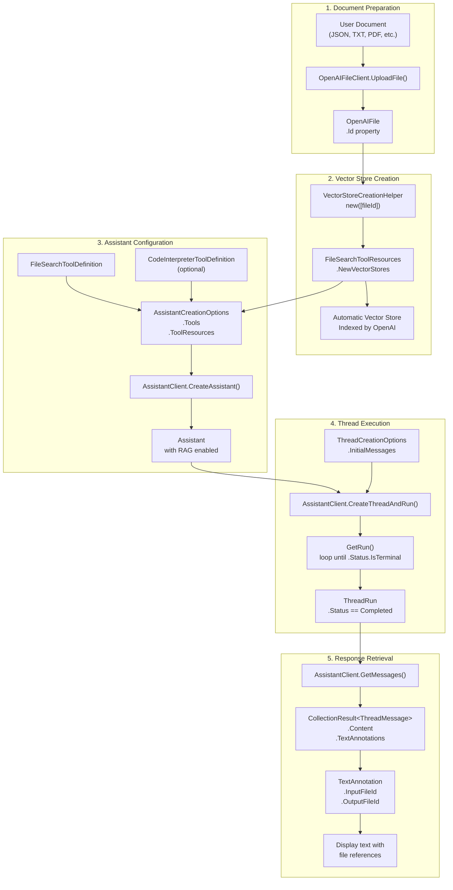
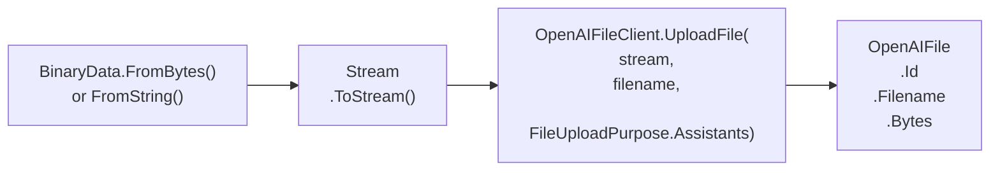
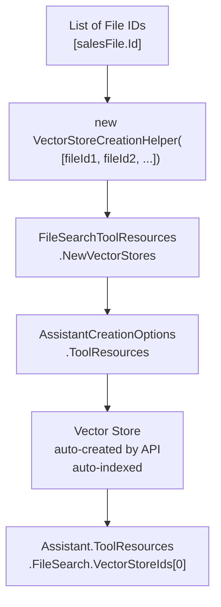
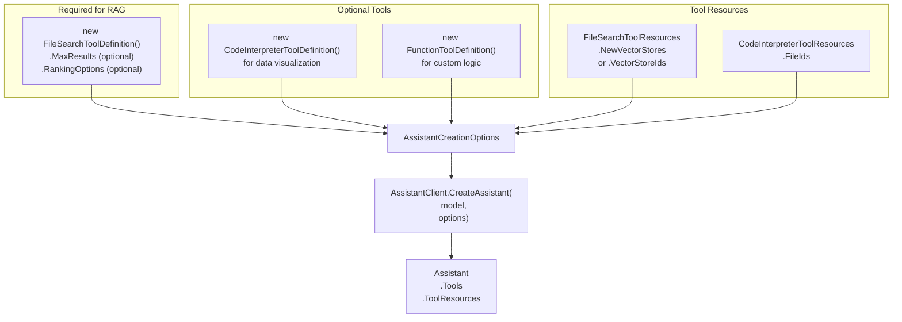
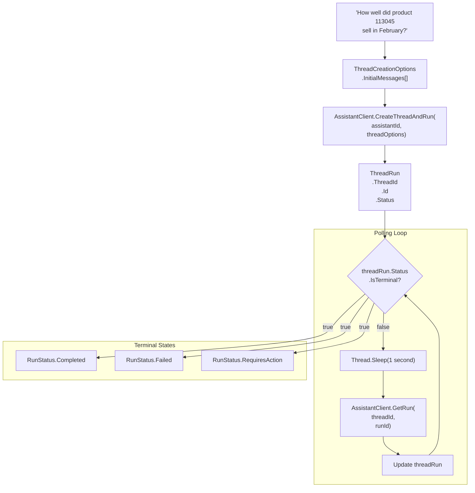
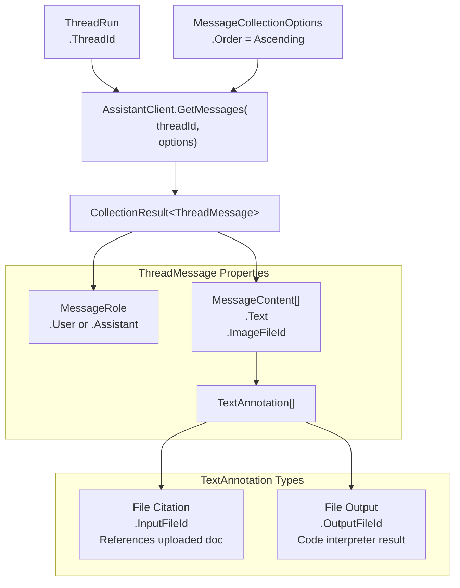
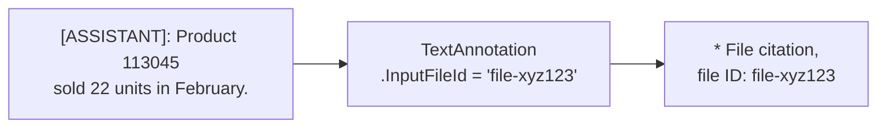
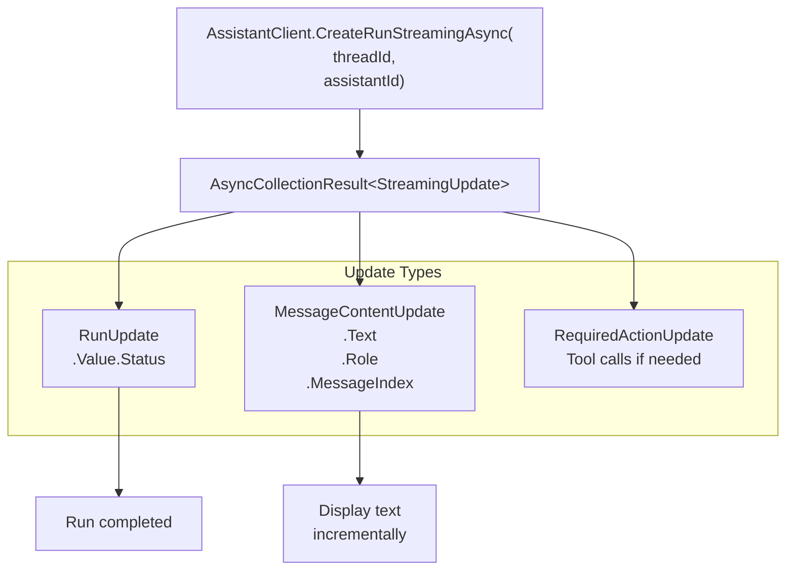
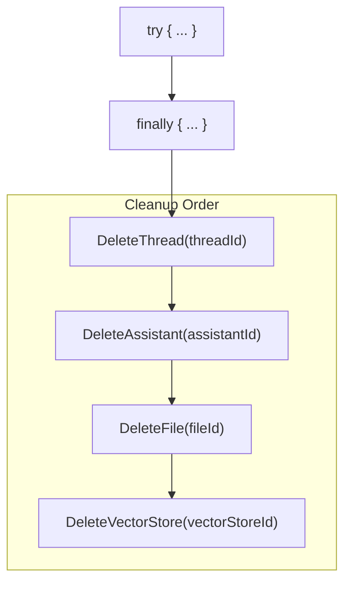

<!-- source: DeepWiki mcp.deepwiki.com · repo openai/openai-dotnet · page 7.2 Assistant RAG Examples · fetched 2026-10-26 -->

# Assistant RAG Examples

<details>
<summary>Relevant source files</summary>

The following files were used as context for generating this wiki page:

- [README.md](README.md)
- [examples/Assistants/Example01_RetrievalAugmentedGeneration.cs](examples/Assistants/Example01_RetrievalAugmentedGeneration.cs)
- [examples/Assistants/Example01_RetrievalAugmentedGenerationAsync.cs](examples/Assistants/Example01_RetrievalAugmentedGenerationAsync.cs)
- [examples/Assistants/Example05_AssistantsWithVision.cs](examples/Assistants/Example05_AssistantsWithVision.cs)
- [examples/Assistants/Example05_AssistantsWithVisionAsync.cs](examples/Assistants/Example05_AssistantsWithVisionAsync.cs)
- [examples/Chat/Example02_SimpleChatStreaming.cs](examples/Chat/Example02_SimpleChatStreaming.cs)
- [examples/Chat/Example02_SimpleChatStreamingAsync.cs](examples/Chat/Example02_SimpleChatStreamingAsync.cs)
- [examples/Chat/Example03_FunctionCalling.cs](examples/Chat/Example03_FunctionCalling.cs)
- [examples/Chat/Example06_StructuredOutputs.cs](examples/Chat/Example06_StructuredOutputs.cs)
- [examples/Chat/Example06_StructuredOutputsAsync.cs](examples/Chat/Example06_StructuredOutputsAsync.cs)
- [tests/Assistants/Assistants.VectorStoresTests.cs](tests/Assistants/Assistants.VectorStoresTests.cs)
- [tests/Assistants/AssistantsTests.cs](tests/Assistants/AssistantsTests.cs)
- [tests/SessionRecords/ResponsesToolTests/ImageGenToolInputMaskWithFileId.json](tests/SessionRecords/ResponsesToolTests/ImageGenToolInputMaskWithFileId.json)
- [tests/SessionRecords/ResponsesToolTests/ImageGenToolInputMaskWithFileIdAsync.json](tests/SessionRecords/ResponsesToolTests/ImageGenToolInputMaskWithFileIdAsync.json)
- [tests/SessionRecords/ResponsesToolTests/ImageGenToolInputMaskWithImageUri.json](tests/SessionRecords/ResponsesToolTests/ImageGenToolInputMaskWithImageUri.json)
- [tests/SessionRecords/ResponsesToolTests/ImageGenToolInputMaskWithImageUriAsync.json](tests/SessionRecords/ResponsesToolTests/ImageGenToolInputMaskWithImageUriAsync.json)
- [tests/Telemetry/ChatTelemetryTests.cs](tests/Telemetry/ChatTelemetryTests.cs)

</details>


This page demonstrates retrieval-augmented generation (RAG) patterns using the Assistants API. RAG enables assistants to answer questions by searching through uploaded documents and incorporating relevant information into their responses. For general assistant usage without document retrieval, see [Assistants Client](#4.4). For vector store management details, see [Files and Vector Stores](#4.8).

## Purpose and Scope

This page covers:
- Uploading files for assistant knowledge retrieval
- Creating vector stores with `VectorStoreCreationHelper`
- Configuring assistants with `FileSearchToolDefinition`
- Executing threads and processing file citations
- Working with text annotations in assistant responses
- Combining file search with code interpreter tools

The examples use the experimental Assistants API, which requires suppressing the `OPENAI001` warning.

---

## RAG Workflow Architecture



**RAG Workflow Architecture**: This diagram shows the complete flow from document upload through vector store creation, assistant configuration, thread execution, and response retrieval with file citations.

Sources: [examples/Assistants/Example01_RetrievalAugmentedGeneration.cs:1-150](), [README.md:710-857]()

---

## File Upload for RAG

### Basic File Upload

Files must be uploaded with `FileUploadPurpose.Assistants` to be available for retrieval:



**File Upload Flow**: Documents are converted to streams and uploaded with the Assistants purpose, returning an `OpenAIFile` with an ID used for vector store creation.

The example demonstrates uploading a JSON document containing sales data:

[examples/Assistants/Example01_RetrievalAugmentedGeneration.cs:25-57]()

Key points:
- `BinaryData.FromBytes()` or `BinaryData.FromString()` creates in-memory document content
- `ToStream()` converts to a stream for upload
- `FileUploadPurpose.Assistants` ensures the file is available for retrieval
- The returned `OpenAIFile.Id` is used in vector store creation

Sources: [examples/Assistants/Example01_RetrievalAugmentedGeneration.cs:24-57](), [examples/Assistants/Example01_RetrievalAugmentedGenerationAsync.cs:26-58]()

---

## Vector Store Configuration

### VectorStoreCreationHelper

The `VectorStoreCreationHelper` simplifies vector store creation by automatically creating and indexing a vector store from file IDs:



**Vector Store Creation with Helper**: The `VectorStoreCreationHelper` eliminates manual vector store management by auto-creating stores during assistant creation.

Configuration example:

[examples/Assistants/Example01_RetrievalAugmentedGeneration.cs:72-81]()

The helper is part of `AssistantCreationOptions.ToolResources.FileSearch.NewVectorStores`, which accepts a collection of helpers. Each helper specifies file IDs to include in a new vector store.

After creation, the assistant's `ToolResources.FileSearch.VectorStoreIds` contains the auto-generated vector store ID.

### Manual Vector Store Management

For more control, use `VectorStoreClient` directly:

| Operation | Method | Returns |
|-----------|--------|---------|
| Create store | `CreateVectorStoreAsync(VectorStoreCreationOptions)` | `VectorStore` |
| Add file | `AddFileToVectorStoreAsync(vectorStoreId, fileId)` | `VectorStoreFile` |
| Remove file | `RemoveFileFromVectorStoreAsync(vectorStoreId, fileId)` | `FileFromStoreRemovalResult` |
| Delete store | `DeleteVectorStoreAsync(vectorStoreId)` | `VectorStoreDeletionResult` |

Sources: [examples/Assistants/Example01_RetrievalAugmentedGeneration.cs:72-82](), [tests/Assistants/AssistantsTests.cs:648-752]()

---

## Assistant Configuration with RAG

### Tool Definitions

RAG assistants require `FileSearchToolDefinition` and optionally `CodeInterpreterToolDefinition`:



**Assistant Tool Configuration**: Assistants combine file search for retrieval, code interpreter for visualization, and optional function tools.

Complete configuration example:

[examples/Assistants/Example01_RetrievalAugmentedGeneration.cs:61-84]()

Key configuration elements:
- `.Name`: Identifies the assistant (displayed in Playground)
- `.Instructions`: System prompt describing assistant behavior
- `.Tools`: Collection of tool definitions (`FileSearchToolDefinition`, `CodeInterpreterToolDefinition`)
- `.ToolResources.FileSearch`: Vector store configuration via `NewVectorStores` or `VectorStoreIds`
- `.ToolResources.CodeInterpreter`: Files available to code interpreter (if used)

### Advanced File Search Options

`FileSearchToolDefinition` supports ranking and result limits:

[tests/Assistants/AssistantsTests.cs:671-678]()

- `.MaxResults`: Limits number of retrieved chunks (default varies by model)
- `.RankingOptions`: Configures retrieval scoring with `FileSearchRanker` enum and threshold

Sources: [examples/Assistants/Example01_RetrievalAugmentedGeneration.cs:59-84](), [tests/Assistants/AssistantsTests.cs:648-752]()

---

## Thread Execution and Polling

### Creating and Running Threads



**Thread Execution Polling**: Threads are created with initial messages and polled until reaching a terminal status.

Implementation:

[examples/Assistants/Example01_RetrievalAugmentedGeneration.cs:87-99]()

Polling pattern details:
- `CreateThreadAndRun()` combines thread creation and run initiation
- `GetRun()` retrieves current run status
- `Status.IsTerminal` indicates completion (`Completed`, `Failed`, `RequiresAction`, etc.)
- Typical poll interval: 1 second
- For playback tests: [tests/Assistants/AssistantsTests.cs:322-327]()

### Run Status Handling

| Status | Description | Action |
|--------|-------------|--------|
| `Queued` | Run waiting to start | Continue polling |
| `InProgress` | Run actively processing | Continue polling |
| `RequiresAction` | Tool outputs needed | Submit tool results |
| `Completed` | Run finished successfully | Retrieve messages |
| `Failed` | Run encountered error | Check `.LastError` |

Sources: [examples/Assistants/Example01_RetrievalAugmentedGeneration.cs:87-100](), [tests/Assistants/AssistantsTests.cs:296-341]()

---

## Message Retrieval and Citations

### Retrieving Thread Messages



**Message Retrieval Structure**: Messages contain text content with annotations linking to input files (citations) and output files (generated content).

### Processing Text Annotations

Annotations indicate file references in assistant responses:

[examples/Assistants/Example01_RetrievalAugmentedGeneration.cs:106-143]()

Annotation processing logic:
- Iterate through `message.Content` items
- Check `contentItem.TextAnnotations` for references
- `.InputFileId`: Citation of uploaded document (file search result)
- `.OutputFileId`: Generated file from code interpreter
- Download output files using `OpenAIFileClient.DownloadFile()`

### Citation Display Example



**Citation Display Pattern**: Assistant messages include inline text with separate annotation markers showing source file IDs.

Output format from example:

```
[USER]: How well did product 113045 sell in February? Graph its trend over time.

[ASSISTANT]: Product 113045 sold 22 units in February.

* File citation, file ID: file-abc123

<image: graph.png>
* File output, new file ID: file-def456
```

Sources: [examples/Assistants/Example01_RetrievalAugmentedGeneration.cs:102-143](), [README.md:826-857]()

---

## Complete Synchronous Example

This walkthrough combines all RAG components:

```mermaid
graph TB
    Start["Start RAG Example"]
    
    subgraph "Setup Clients"
        GetClients["OpenAIClient<br/>OpenAIFileClient<br/>AssistantClient"]
    end
    
    subgraph "Prepare Document"
        CreateDoc["BinaryData.FromBytes()<br/>JSON sales data"]
        Upload["UploadFile(<br/>  'monthly_sales.json',<br/>  FileUploadPurpose.Assistants)"]
        FileId["OpenAIFile.Id"]
    end
    
    subgraph "Configure Assistant"
        AssistOpts["AssistantCreationOptions<br/>+ FileSearchToolDefinition<br/>+ CodeInterpreterToolDefinition<br/>+ VectorStoreCreationHelper"]
        CreateAssist["CreateAssistant(<br/>  'gpt-4o',<br/>  assistantOptions)"]
    end
    
    subgraph "Execute Thread"
        ThreadOpts["ThreadCreationOptions<br/>.InitialMessages"]
        RunThread["CreateThreadAndRun()"]
        Poll["Poll until<br/>.Status.IsTerminal"]
    end
    
    subgraph "Process Results"
        GetMsgs["GetMessages(<br/>  threadId,<br/>  Ascending order)"]
        PrintMsgs["Iterate messages<br/>Display text<br/>Show annotations<br/>Save images"]
    end
    
    subgraph "Cleanup"
        DeleteThread["DeleteThread()"]
        DeleteAssist["DeleteAssistant()"]
        DeleteFile["DeleteFile()"]
    end
    
    Start --> GetClients
    GetClients --> CreateDoc
    CreateDoc --> Upload
    Upload --> FileId
    FileId --> AssistOpts
    AssistOpts --> CreateAssist
    CreateAssist --> ThreadOpts
    ThreadOpts --> RunThread
    RunThread --> Poll
    Poll --> GetMsgs
    GetMsgs --> PrintMsgs
    PrintMsgs --> DeleteThread
    DeleteThread --> DeleteAssist
    DeleteAssist --> DeleteFile
```



**Complete RAG Workflow**: End-to-end example showing client setup, file upload, assistant configuration, thread execution, and cleanup.

Full implementation:

[examples/Assistants/Example01_RetrievalAugmentedGeneration.cs:1-150]()

Key steps:
1. **Line 20-22**: Initialize `OpenAIClient`, `OpenAIFileClient`, `AssistantClient`
2. **Line 25-57**: Create and upload JSON document
3. **Line 61-84**: Configure assistant with file search and code interpreter
4. **Line 87-99**: Create thread and poll for completion
5. **Line 102-143**: Retrieve messages, display text and annotations, save images
6. **Line 146-148**: Delete thread, assistant, and file

Sources: [examples/Assistants/Example01_RetrievalAugmentedGeneration.cs:1-150]()

---

## Asynchronous Example

The async variant uses identical patterns with `async`/`await`:

```csharp
// Key async method calls
OpenAIFile salesFile = await fileClient.UploadFileAsync(...);
Assistant assistant = await assistantClient.CreateAssistantAsync(...);
ThreadRun threadRun = await assistantClient.CreateThreadAndRunAsync(...);
AsyncCollectionResult<ThreadMessage> messages = assistantClient.GetMessagesAsync(...);

await foreach (ThreadMessage message in messages)
{
    // Process messages asynchronously
}
```

Implementation details:

[examples/Assistants/Example01_RetrievalAugmentedGenerationAsync.cs:1-153]()

Differences from synchronous version:
- Methods suffixed with `Async`
- `await` for async operations
- `AsyncCollectionResult<ThreadMessage>` instead of `CollectionResult<ThreadMessage>`
- `await foreach` for async enumeration
- Polling uses `await Task.Delay()` in live scenarios

Sources: [examples/Assistants/Example01_RetrievalAugmentedGenerationAsync.cs:1-153]()

---

## Advanced RAG Patterns

### Streaming Assistants with RAG

Streaming enables real-time response display while maintaining file search capabilities:



**Streaming RAG Updates**: Streaming provides incremental text updates while file search happens in the background.

Implementation:

[tests/Assistants/AssistantsTests.cs:539-584]()

Streaming characteristics:
- `CreateRunStreamingAsync()` returns `AsyncCollectionResult<StreamingUpdate>`
- `StreamingUpdate.UpdateKind` indicates update type
- `MessageContentUpdate` contains incremental `.Text` values
- File search results appear in annotations after streaming completes

### Multiple Files in Vector Stores

```csharp
VectorStoreCreationOptions options = new()
{
    ChunkingStrategy = FileChunkingStrategy.CreateStaticStrategy(1200, 250),
    FileIds = { file1.Id, file2.Id, file3.Id }
};

VectorStore vectorStore = await vectorStoreClient.CreateVectorStoreAsync(options);
```

Configuration options:

[tests/Assistants/Assistants.VectorStoresTests.cs:582-634]()

Vector store features:
- `.ChunkingStrategy`: Controls document segmentation (auto or static)
- `.FileIds`: Collection of uploaded file IDs
- `.Name`: Identifies the vector store
- `.ExpirationPolicy`: Automatic deletion configuration

### Batch File Operations

Efficient bulk file addition to vector stores:

[tests/Assistants/Assistants.VectorStoresTests.cs:542-577]()

- `AddFileBatchToVectorStoreAsync()` adds multiple files in one operation
- Returns `VectorStoreFileBatch` with batch status
- `GetVectorStoreFilesInBatchAsync()` retrieves batch processing results
- Supports pagination with `VectorStoreFileCollectionOptions`

### Thread-Level Vector Store Override

Threads can override assistant-level vector stores:

[tests/Assistants/AssistantsTests.cs:719-752]()

Pattern:
1. Assistant created with vector store A
2. Thread created with `.ToolResources.FileSearch.NewVectorStores` specifying vector store B
3. Thread uses vector store B instead of assistant's default

This enables per-conversation document sets without modifying the assistant.

Sources: [tests/Assistants/AssistantsTests.cs:539-584](), [tests/Assistants/Assistants.VectorStoresTests.cs:541-577](), [tests/Assistants/AssistantsTests.cs:719-752]()

---

## Error Handling and Cleanup

### Run Status Validation

```csharp
do
{
    Thread.Sleep(TimeSpan.FromSeconds(1));
    threadRun = assistantClient.GetRun(threadRun.ThreadId, threadRun.Id);
} while (!threadRun.Status.IsTerminal);

if (threadRun.Status == RunStatus.Failed)
{
    Console.WriteLine($"Run failed: {threadRun.LastError?.Message}");
}
```

Common failure scenarios:
- Rate limits exceeded
- Invalid file references
- Model timeout
- Content policy violations

### Resource Cleanup Pattern



**Resource Cleanup Order**: Clean up in reverse order of creation (thread → assistant → file → vector store) to avoid orphaned resources.

Test cleanup implementation:

[tests/Assistants/AssistantsTests.cs:42-83]()

Cleanup best practices:
- Use `OneTimeTearDown` in tests to ensure cleanup
- Store resource IDs in lists for batch deletion
- Use `RequestOptions` with `NoThrow` error behavior
- Delete in reverse creation order
- For vector stores created via `VectorStoreCreationHelper`, track IDs from `Assistant.ToolResources.FileSearch.VectorStoreIds`

Sources: [tests/Assistants/AssistantsTests.cs:42-83](), [examples/Assistants/Example01_RetrievalAugmentedGeneration.cs:145-148]()

---

## Summary

RAG with assistants requires:

| Component | Class/Method | Purpose |
|-----------|--------------|---------|
| File upload | `OpenAIFileClient.UploadFile()` | Provides documents for retrieval |
| Vector store | `VectorStoreCreationHelper` | Auto-creates indexed search store |
| Tool definition | `FileSearchToolDefinition` | Enables file search capability |
| Assistant config | `AssistantCreationOptions` | Combines tools and resources |
| Thread execution | `CreateThreadAndRun()` | Runs query against documents |
| Message retrieval | `GetMessages()` | Accesses responses with citations |
| Annotations | `TextAnnotation` | Links to source files |

For production deployments:
- Cache vector stores for frequently-used document sets
- Monitor `VectorStore.FileCounts` for indexing progress
- Use `.ChunkingStrategy` to optimize retrieval quality
- Implement proper error handling for rate limits
- Clean up resources after use to avoid quota issues

Sources: [examples/Assistants/Example01_RetrievalAugmentedGeneration.cs:1-150](), [README.md:710-857]()

---

