<!-- source: DeepWiki mcp.deepwiki.com · repo openai/openai-dotnet · page 7.3 Response API Examples · fetched 2026-10-26 -->

# Response API Examples

<details>
<summary>Relevant source files</summary>

The following files were used as context for generating this wiki page:

- [CHANGELOG.md](CHANGELOG.md)
- [examples/Responses/Example05_RemoteMcp.cs](examples/Responses/Example05_RemoteMcp.cs)
- [examples/Responses/Example05_RemoteMcpAsync.cs](examples/Responses/Example05_RemoteMcpAsync.cs)
- [examples/Responses/Example06_RemoteMcpAuthentication.cs](examples/Responses/Example06_RemoteMcpAuthentication.cs)
- [examples/Responses/Example06_RemoteMcpAuthenticationAsync.cs](examples/Responses/Example06_RemoteMcpAuthenticationAsync.cs)
- [scripts/Test-ApiCompatibility.ps1](scripts/Test-ApiCompatibility.ps1)
- [src/Custom/Responses/ResponseContentPart.cs](src/Custom/Responses/ResponseContentPart.cs)
- [src/Custom/Responses/Tools/McpTool/McpToolCallApprovalPolicy.cs](src/Custom/Responses/Tools/McpTool/McpToolCallApprovalPolicy.cs)
- [src/Generated/Models/Responses/McpToolCallApprovalPolicy.cs](src/Generated/Models/Responses/McpToolCallApprovalPolicy.cs)
- [src/OpenAI.csproj](src/OpenAI.csproj)
- [tests/Responses/ResponsesSmokeTests.cs](tests/Responses/ResponsesSmokeTests.cs)
- [tests/SessionRecords/ResponsesTests/WebSearchCallStreaming.json](tests/SessionRecords/ResponsesTests/WebSearchCallStreaming.json)
- [tests/SessionRecords/ResponsesTests/WebSearchCallStreamingAsync.json](tests/SessionRecords/ResponsesTests/WebSearchCallStreamingAsync.json)

</details>


This page provides practical examples of using the Responses API (`OpenAIResponseClient`) with various tools, input types, and configuration options. The Responses API is a unified interface for advanced AI interactions that support tool calling, multimodal inputs, reasoning modes, and sophisticated output controls.

For general information about the Responses API Client and its capabilities, see [Responses API Client](#4.3). For tool integration concepts and patterns, see [Tool Integration](#6). For streaming patterns applicable to responses, see [Streaming Patterns](#5.1).

## Response API Request Flow

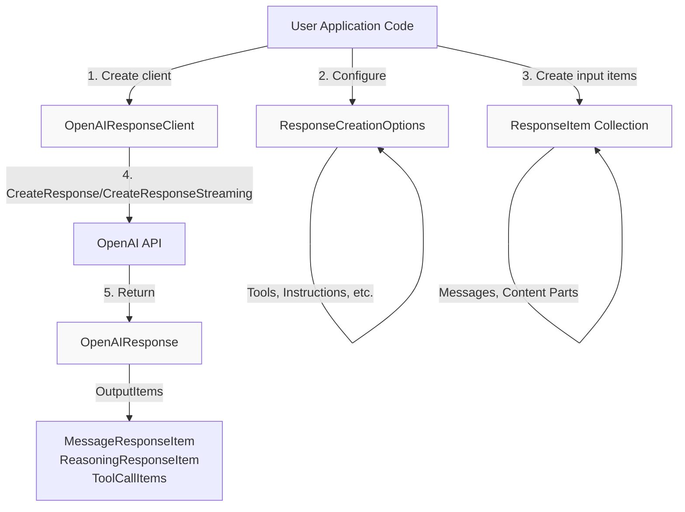

**Sources:** [tests/Responses/ResponsesTests.cs:138-162](), [tests/Responses/ResponsesTests.cs:232-269]()

## Basic Response Creation

### Simple Text Response

The simplest use case involves sending a text message and receiving a text response:

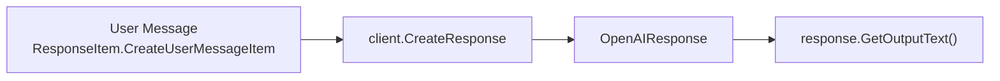

**Example from tests:**
- Create user message: [tests/Responses/ResponsesTests.cs:621]()
- Get output text: [tests/Responses/ResponsesTests.cs:670-676]()

The `GetOutputText()` helper method concatenates all text content from message output items, providing a convenient way to extract the final response text. This method returns `null` if no text output exists (e.g., when only tool calls are present).

**Sources:** [tests/Responses/ResponsesTests.cs:617-635](), [src/Custom/Responses/OpenAIResponse.cs:64-71]()

### Message History and Multi-Turn Conversations

The Responses API supports maintaining conversation history by including previous messages:

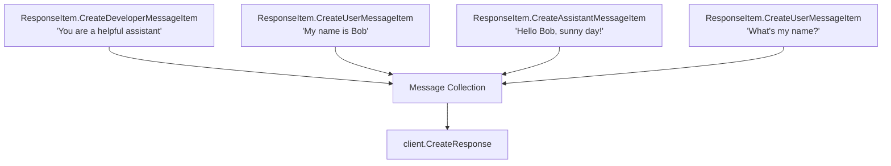

**Test demonstrating history:** [tests/Responses/ResponsesTests.cs:699-712]()

The model maintains context across the conversation by processing the complete message history in order.

**Sources:** [tests/Responses/ResponsesTests.cs:699-712]()

### Instructions: Three Methods

The Responses API supports three different ways to provide system instructions:

| Method | Property/Type | When to Use |
|--------|---------------|-------------|
| Instructions Property | `ResponseCreationOptions.Instructions` | Preferred for instructions that should remain separate from conversation history |
| System Message | `ResponseItem.CreateSystemMessageItem()` | Legacy compatibility; included in message history |
| Developer Message | `ResponseItem.CreateDeveloperMessageItem()` | Stronger directive signal; included in message history |

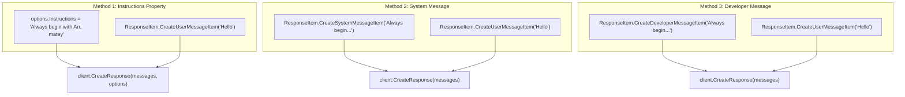

**Test demonstrating all three methods:** [tests/Responses/ResponsesTests.cs:792-860]()

When using the `Instructions` property, the instructions are stored separately and can be retrieved via `response.Instructions`. When using message-based instructions, they appear in the input items collection returned by `GetResponseInputItemsAsync()`.

**Sources:** [tests/Responses/ResponsesTests.cs:792-860]()

## Tool Integration Examples

### Function Calling

Function calling allows the model to request execution of user-defined functions:

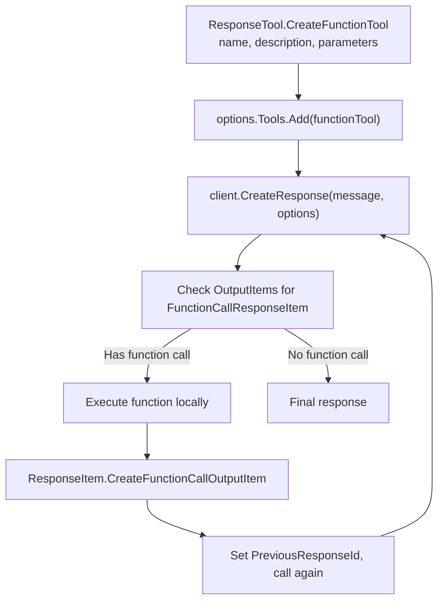

**Example with function definition:** [tests/Responses/ResponsesTests.cs:507-551]()
**Example from docs:** [docs/guides/tools/responses/function_calling.cs:15-41]()

The function parameters are defined using JSON Schema format via `BinaryData`. Setting `strictModeEnabled: true` enforces strict schema validation.

**Sources:** [tests/Responses/ResponsesTests.cs:507-551](), [docs/guides/tools/responses/function_calling.cs:1-42]()

### Web Search Tool

The web search tool enables real-time internet access:

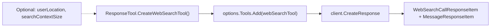

**Basic web search example:** [tests/Responses/ResponsesTests.cs:138-162]()
**Streaming web search example:** [tests/Responses/ResponsesTests.cs:164-230]()
**Documentation example:** [docs/guides/tools/responses/web_search.cs:14-23]()

Web search can be configured with:
- `userLocation`: `WebSearchToolLocation.CreateApproximateLocation(city: "San Francisco")`
- `searchContextSize`: `WebSearchToolContextSize.Low` (or High)

**Sources:** [tests/Responses/ResponsesTests.cs:138-230](), [docs/guides/tools/responses/web_search.cs:1-25]()

### File Search Tool

The file search tool performs RAG (Retrieval Augmented Generation) over vector stores:

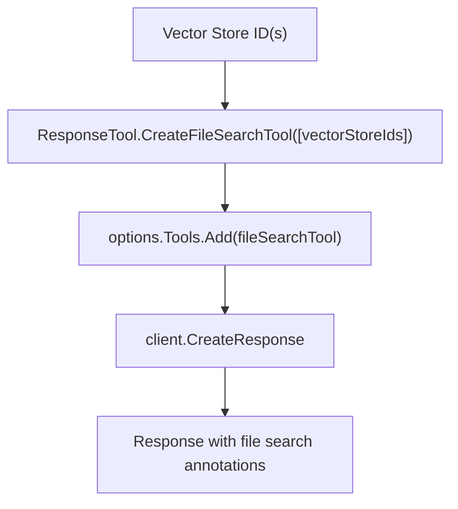

**Documentation example:** [docs/guides/tools/responses/file_search.cs:14-21]()

The response will include output text with annotations referencing the searched documents.

**Sources:** [docs/guides/tools/responses/file_search.cs:1-23]()

### Image Generation Tool

The image generation tool allows the model to create images:

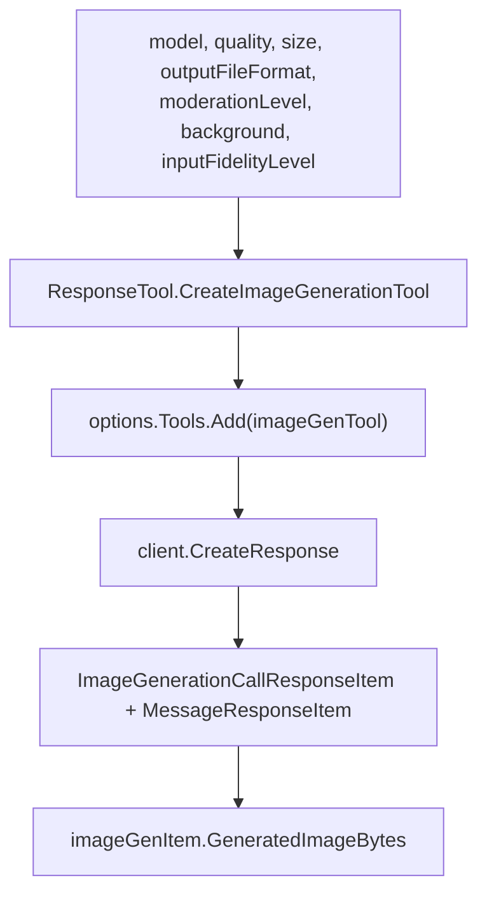

**Full image generation example:** [tests/Responses/ResponsesTests.cs:232-269]()
**Streaming example:** [tests/Responses/ResponsesTests.cs:271-352]()

Configuration options include:
- `model`: "gpt-image-1"
- `quality`: `ImageGenerationToolQuality.High`
- `size`: `ImageGenerationToolSize.W1024xH1024`
- `outputFileFormat`: `ImageGenerationToolOutputFileFormat.Png`
- `background`: `ImageGenerationToolBackground.Transparent`
- `inputImageMask`: Optional mask for image editing (via bytes, URI, or file ID)

**Examples with input masks:**
- Bytes: [tests/Responses/ResponsesTests.cs:354-389]()
- URI: [tests/Responses/ResponsesTests.cs:391-424]()
- File ID: [tests/Responses/ResponsesTests.cs:426-476]()

**Sources:** [tests/Responses/ResponsesTests.cs:232-476]()

### MCP (Model Context Protocol) Integration

MCP enables connection to remote tool servers:

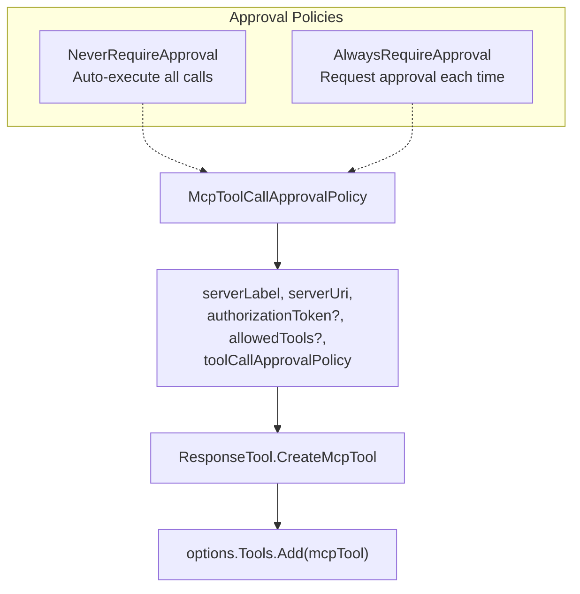

**Basic MCP example:** [docs/guides/tools-connectors-mcp/responses/quickstart-remote-mcp.cs:14-25]()

**MCP with authentication:** [docs/guides/tools-connectors-mcp/responses/authentication.cs:15-26]()

**MCP with tool filtering:** [docs/guides/tools-connectors-mcp/responses/filtering-tools.cs:14-26]()

**Approval workflow (AlwaysRequireApproval):**
1. First request returns `McpToolCallApprovalRequestItem` in output
2. User approves/denies via `ResponseItem.CreateMcpApprovalResponseItem(approvalRequestItem.Id, approved: true)`
3. Set `options.PreviousResponseId` to first response ID
4. Second request returns final result

**Example with approval flow:** [docs/guides/tools-connectors-mcp/responses/approvals-always-require-approval.cs:14-36]()

**Sources:** [docs/guides/tools-connectors-mcp/responses/quickstart-remote-mcp.cs:1-27](), [docs/guides/tools-connectors-mcp/responses/approvals-always-require-approval.cs:1-37](), [docs/guides/tools-connectors-mcp/responses/filtering-tools.cs:1-28]()

## Multimodal Input Examples

### Image Input

The Responses API supports three methods for providing images:

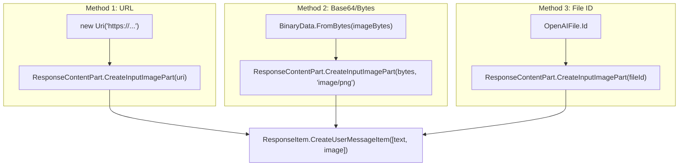

**Image analysis with URL:** [docs/guides/images-vision/responses/analyze_images_passing_url.cs:14-21]()

**Image analysis with base64:** [docs/guides/images-vision/responses/analyze_images_passing_base64_string.cs:20-38]()

**Image analysis with file ID:** [docs/guides/images-vision/responses/analyze_images_passing_file.cs:22-30]()

Image detail level can be specified:
- `ResponseImageDetailLevel.Low`: Faster, less detailed
- `ResponseImageDetailLevel.High`: Slower, more detailed (default)
- `ResponseImageDetailLevel.Auto`: Let model decide

**Example with detail level:** [tests/Responses/ResponsesTests.cs:716-734]()

**Sources:** [tests/Responses/ResponsesTests.cs:716-734](), [docs/guides/images-vision/responses/analyze_images_passing_url.cs:1-23](), [docs/guides/images-vision/responses/analyze_images_passing_base64_string.cs:1-40]()

### File Input (PDF, Documents)

Files can be provided via file ID (after upload) or directly as bytes:

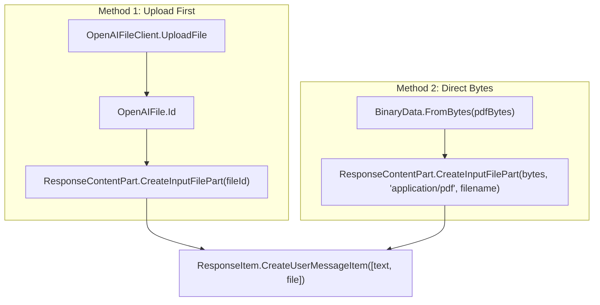

**File input from uploaded file ID:** [tests/Responses/ResponsesTests.cs:737-763]()

**File input from bytes directly:** [tests/Responses/ResponsesTests.cs:765-783]()

Both methods allow the model to analyze document content (e.g., PDFs, text files, spreadsheets).

**Sources:** [tests/Responses/ResponsesTests.cs:737-783]()

## Advanced Features

### Reasoning with o3-mini

The o3-mini model family supports enhanced reasoning capabilities:

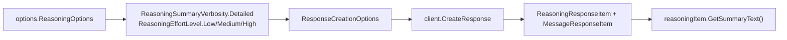

**Full reasoning example:** [tests/Responses/ResponsesTests.cs:553-591]()

Key components:
- `ResponseReasoningOptions` with:
  - `ReasoningSummaryVerbosity`: Minimal, Brief, or Detailed
  - `ReasoningEffortLevel`: Low, Medium, or High
- Output includes `ReasoningResponseItem` with summary parts
- Token usage includes `OutputTokenDetails.ReasoningTokenCount`

The reasoning response item contains:
- `SummaryParts`: Collection of `ReasoningSummaryPart` objects
- `GetSummaryText()`: Helper method to concatenate all summary text
- `EncryptedContent`: Encrypted internal reasoning (not directly accessible)

**Sources:** [tests/Responses/ResponsesTests.cs:553-591](), [src/Custom/Responses/Items/Reasoning/ReasoningResponseItem.cs:1-25]()

### Streaming Responses

Streaming provides real-time updates as the response is generated:

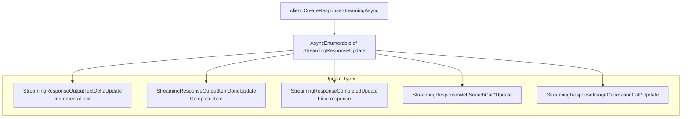

**Basic streaming example:** [tests/Responses/ResponsesTests.cs:479-502]()

**Web search streaming example:** [tests/Responses/ResponsesTests.cs:164-230]()

**Image generation streaming example:** [tests/Responses/ResponsesTests.cs:271-352]()

Streaming update types include:
- `StreamingResponseOutputTextDeltaUpdate`: Text fragments with `.Delta` property
- `StreamingResponseWebSearchCall*Update`: InProgress, Searching, Completed phases
- `StreamingResponseImageGenerationCall*Update`: PartialImage, InProgress, Generating, Completed
- `StreamingResponseCompletedUpdate`: Final complete response with `.Response` property

For detailed streaming patterns, see [Streaming Patterns](#5.1).

**Sources:** [tests/Responses/ResponsesTests.cs:479-502](), [tests/Responses/ResponsesTests.cs:164-230](), [tests/Responses/ResponsesTests.cs:271-352]()

### Response Continuation

Multi-turn interactions can continue from a previous response using `PreviousResponseId`:

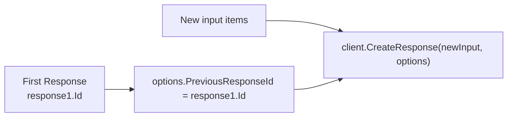

**Example with continuation:** [tests/Responses/ResponsesTests.cs:863-938]()

This enables:
- Multi-turn tool calling workflows
- Approval workflows (MCP, computer use)
- Context preservation across requests

**Sources:** [tests/Responses/ResponsesTests.cs:863-938]()

### Storage and Retrieval

Responses are automatically stored by default and can be retrieved later:

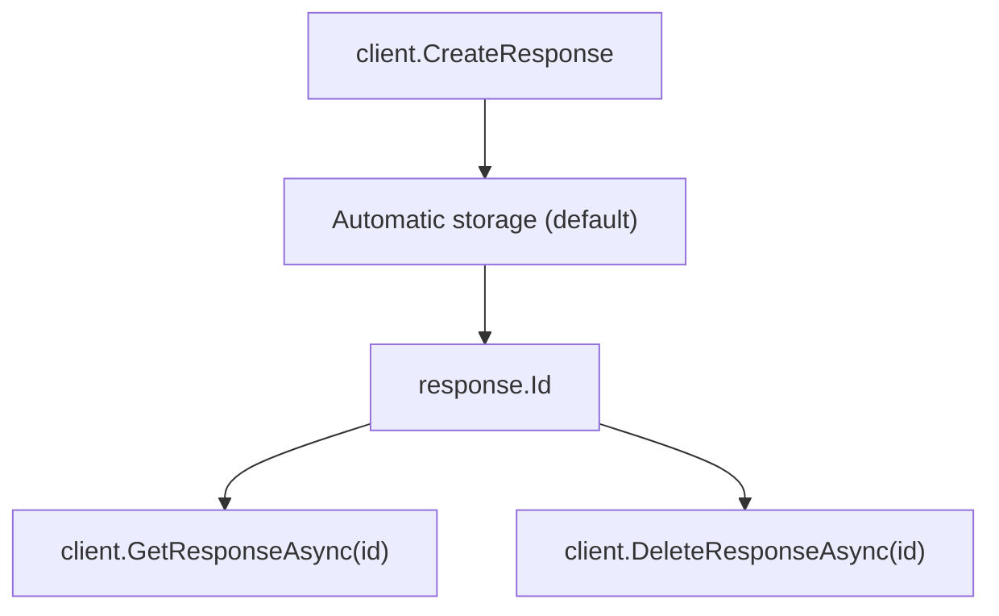

**Storage control:**
- Enabled by default
- Disable via `options.StoredOutputEnabled = false`
- Retrieve via `client.GetResponseAsync(responseId)`
- Delete via `client.DeleteResponseAsync(responseId)`
- List input items via `client.GetResponseInputItemsAsync(responseId)`

**Test examples:**
- Retrieve and delete: [tests/Responses/ResponsesTests.cs:617-635]()
- Opt-out of storage: [tests/Responses/ResponsesTests.cs:637-651]()
- Input item retrieval: [tests/Responses/ResponsesTests.cs:838-859]()

**Sources:** [tests/Responses/ResponsesTests.cs:617-651]()

### Service Tier Configuration

Service tier controls latency and throughput characteristics:

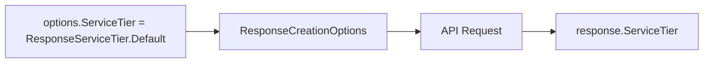

**Example:** [tests/Responses/ResponsesTests.cs:653-667]()

Available service tiers:
- `ResponseServiceTier.Default`: Standard latency
- `ResponseServiceTier.Auto`: Automatic selection

The response echoes back the service tier used: `response.ServiceTier`

**Sources:** [tests/Responses/ResponsesTests.cs:653-667]()

## Response Structure and Output

### Response Output Items

The `OpenAIResponse.OutputItems` collection contains various item types:

| Output Item Type | Description | Key Properties |
|------------------|-------------|----------------|
| `MessageResponseItem` | Text message from assistant | `Content` (list of content parts), `Role` |
| `ReasoningResponseItem` | Reasoning summary (o3-mini) | `SummaryParts`, `GetSummaryText()` |
| `FunctionCallResponseItem` | Function call request | `Name`, `Arguments` |
| `WebSearchCallResponseItem` | Web search completion | `Status`, search results |
| `ImageGenerationCallResponseItem` | Generated image | `GeneratedImageBytes`, `Status` |
| `McpToolCallApprovalRequestItem` | MCP approval request | Approval required |
| `ComputerCallResponseItem` | Computer use action | `Action`, `CallId` |
| `ReferenceResponseItem` | Reference to stored item | `Id` |

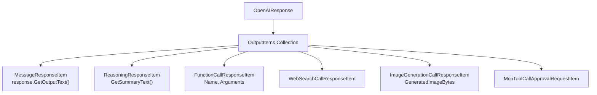

**Sources:** [src/Custom/Responses/OpenAIResponse.cs:47](), [tests/Responses/ResponsesTests.cs:153-160](), [tests/Responses/ResponsesTests.cs:256-268]()

### Token Usage

Token usage information is available in `response.Usage`:

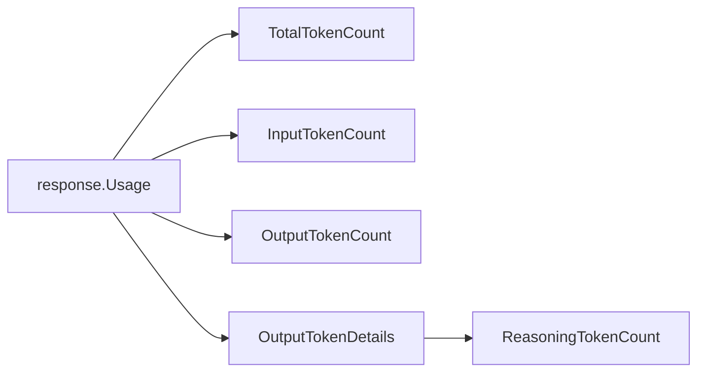

**Example with reasoning tokens:** [tests/Responses/ResponsesTests.cs:579-581]()

For reasoning models (o3-mini), `OutputTokenDetails.ReasoningTokenCount` shows tokens used for internal reasoning.

**Sources:** [tests/Responses/ResponsesTests.cs:579-581]()

### Metadata

Custom metadata can be attached to responses:

```csharp
options.Metadata["key"] = "value";
// Retrieved in response:
string value = response.Metadata["key"];
```

**Example:** [tests/Responses/ResponsesTests.cs:565-567](), [tests/Responses/ResponsesTests.cs:582-583]()

Metadata is useful for:
- Tracking request identifiers
- Storing application-specific context
- Debugging and logging

**Sources:** [tests/Responses/ResponsesTests.cs:565-583]()

## Cross-Model Continuations

Responses can be continued across different models by setting the `Model` property:

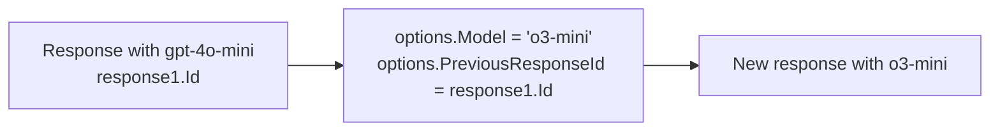

**Test example:** [tests/Responses/ResponsesTests.cs:863-938]()

This enables workflows where:
- Initial processing uses a fast model
- Follow-up reasoning uses a specialized model
- Tool results are processed by different models

**Sources:** [tests/Responses/ResponsesTests.cs:863-938]()

## Complete Example Pattern

Typical Responses API workflow combining multiple features:

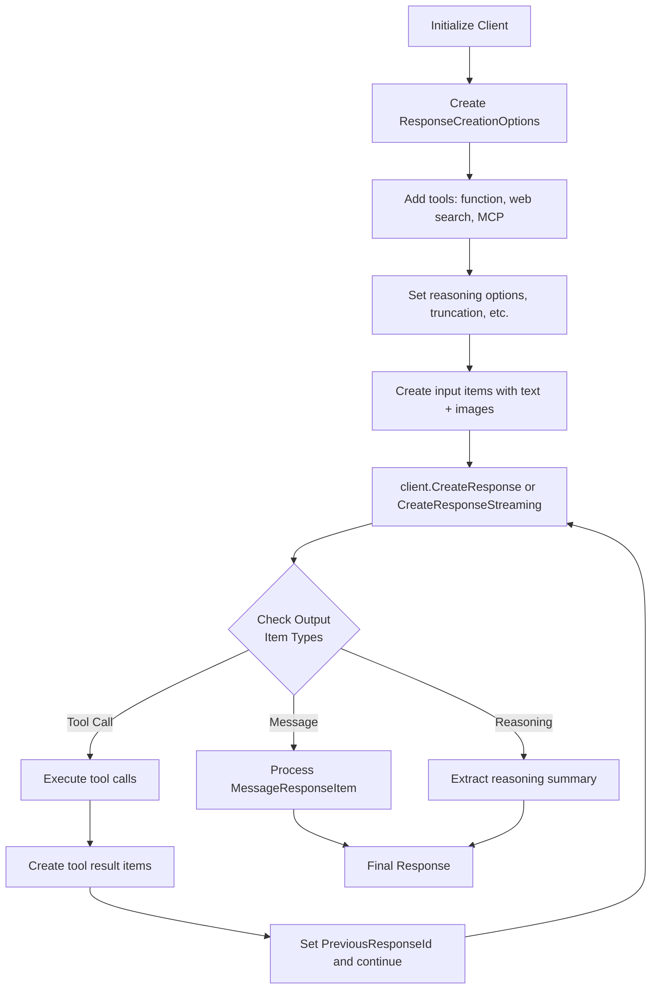

This pattern demonstrates:
1. Client and options initialization
2. Tool registration
3. Input item creation with multimodal content
4. Response processing with type checking
5. Tool execution and continuation
6. Final output extraction

**Sources:** [tests/Responses/ResponsesTests.cs:507-551](), [tests/Responses/ResponsesTests.cs:863-938]()

---

