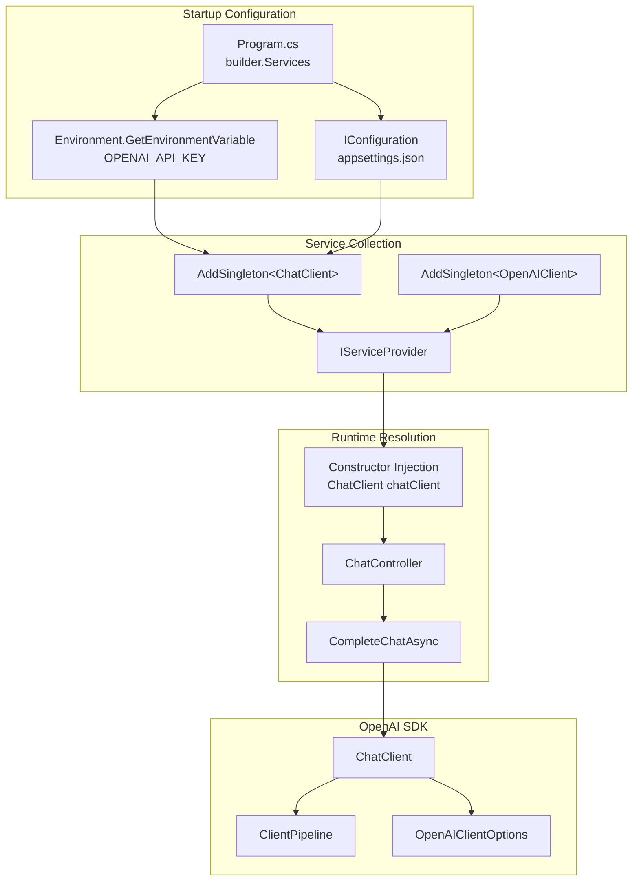
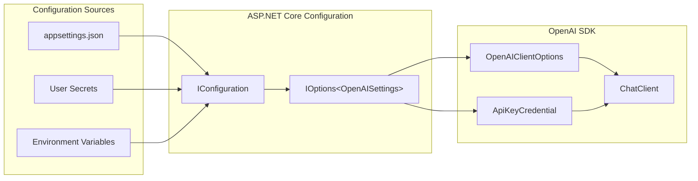
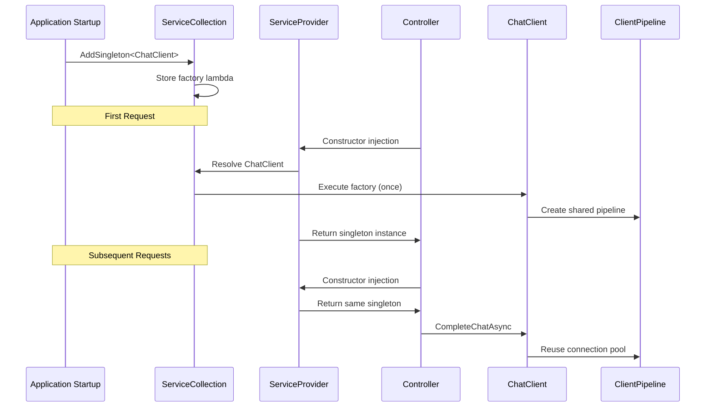

<!-- source: DeepWiki mcp.deepwiki.com · repo openai/openai-dotnet · page 7.4 Dependency Injection · fetched 2026-10-26 -->

# Dependency Injection

<details>
<summary>Relevant source files</summary>

The following files were used as context for generating this wiki page:

- [README.md](README.md)
- [examples/Assistants/Example01_RetrievalAugmentedGeneration.cs](examples/Assistants/Example01_RetrievalAugmentedGeneration.cs)
- [examples/Assistants/Example01_RetrievalAugmentedGenerationAsync.cs](examples/Assistants/Example01_RetrievalAugmentedGenerationAsync.cs)
- [examples/Assistants/Example05_AssistantsWithVision.cs](examples/Assistants/Example05_AssistantsWithVision.cs)
- [examples/Assistants/Example05_AssistantsWithVisionAsync.cs](examples/Assistants/Example05_AssistantsWithVisionAsync.cs)
- [examples/Chat/Example02_SimpleChatStreaming.cs](examples/Chat/Example02_SimpleChatStreaming.cs)
- [examples/Chat/Example02_SimpleChatStreamingAsync.cs](examples/Chat/Example02_SimpleChatStreamingAsync.cs)
- [examples/Chat/Example03_FunctionCalling.cs](examples/Chat/Example03_FunctionCalling.cs)
- [examples/Chat/Example06_StructuredOutputs.cs](examples/Chat/Example06_StructuredOutputs.cs)
- [examples/Chat/Example06_StructuredOutputsAsync.cs](examples/Chat/Example06_StructuredOutputsAsync.cs)
- [specification/base/typespec/common/models.tsp](specification/base/typespec/common/models.tsp)
- [specification/base/typespec/main.tsp](specification/base/typespec/main.tsp)
- [specification/base/typespec/videos/main.tsp](specification/base/typespec/videos/main.tsp)
- [specification/client/videos.client.tsp](specification/client/videos.client.tsp)
- [src/Custom/OpenAIClient.cs](src/Custom/OpenAIClient.cs)
- [src/Custom/OpenAIClientOptions.cs](src/Custom/OpenAIClientOptions.cs)
- [src/Generated/Models/Chat/ChatReasoningEffortLevel.cs](src/Generated/Models/Chat/ChatReasoningEffortLevel.cs)
- [src/Generated/Models/Responses/ResponseReasoningEffortLevel.cs](src/Generated/Models/Responses/ResponseReasoningEffortLevel.cs)
- [tests/Telemetry/ChatTelemetryTests.cs](tests/Telemetry/ChatTelemetryTests.cs)

</details>


This page documents how to integrate OpenAI .NET SDK clients with ASP.NET Core's Dependency Injection (DI) container. It covers thread safety guarantees, singleton registration patterns, configuration strategies, and advanced scenarios like custom authentication policies. For information about client instantiation and configuration outside of DI contexts, see [OpenAIClient](#4.1).

## Thread Safety and Lifetime Management

All OpenAI client classes are **thread-safe** and designed to be registered as **singletons** in dependency injection containers. This design maximizes resource efficiency by:

- **Connection pooling**: Reusing HTTP connections across requests through a shared `ClientPipeline`
- **Memory efficiency**: Avoiding redundant allocation of client instances
- **Configuration sharing**: All clients created through `OpenAIClient` share authentication, endpoint, and pipeline customization

The singleton lifetime is appropriate because:
- Client instances hold no per-request state
- The underlying `ClientPipeline` manages connection pooling internally
- API keys and configuration are immutable after construction

**Sources**: [README.md:144-158](), [src/Custom/OpenAIClient.cs:83-164]()

## Client Registration Architecture



**Sources**: [README.md:144-182](), [src/Custom/OpenAIClient.cs:94-164]()

## Basic Client Registration

### Registering Individual Clients

The simplest pattern registers a single specialized client directly as a singleton:

```csharp
builder.Services.AddSingleton<ChatClient>(serviceProvider =>
{
    var apiKey = Environment.GetEnvironmentVariable("OPENAI_API_KEY");
    var model = "gpt-4o";
    
    return new ChatClient(model, apiKey);
});
```

This pattern is appropriate when your application uses only one or two client types. The registered client can then be injected into controllers or services:

```csharp
[ApiController]
[Route("api/[controller]")]
public class ChatController : ControllerBase
{
    private readonly ChatClient _chatClient;
    
    public ChatController(ChatClient chatClient)
    {
        _chatClient = chatClient;
    }
    
    [HttpPost("complete")]
    public async Task<IActionResult> CompleteChat([FromBody] string message)
    {
        ChatCompletion completion = await _chatClient.CompleteChatAsync(message);
        return Ok(new { response = completion.Content[0].Text });
    }
}
```

**Sources**: [README.md:148-182](), [examples/Chat/Example02_SimpleChatStreamingAsync.cs:13-14]()

### Registering the OpenAIClient Factory

For applications that use multiple client types, register `OpenAIClient` as a singleton factory:

```csharp
builder.Services.AddSingleton<OpenAIClient>(serviceProvider =>
{
    var apiKey = Environment.GetEnvironmentVariable("OPENAI_API_KEY");
    return new OpenAIClient(apiKey);
});
```

Consumers can then resolve `OpenAIClient` and call the appropriate `Get*Client` methods:

```csharp
public class MultiModalService
{
    private readonly ChatClient _chatClient;
    private readonly ImageClient _imageClient;
    private readonly AudioClient _audioClient;
    
    public MultiModalService(OpenAIClient openAIClient)
    {
        _chatClient = openAIClient.GetChatClient("gpt-4o");
        _imageClient = openAIClient.GetImageClient("dall-e-3");
        _audioClient = openAIClient.GetAudioClient("whisper-1");
    }
}
```

**Note**: Each call to `Get*Client` returns a **new instance** that shares the same `ClientPipeline` and `OpenAIClientOptions`. The clients are not cached by `OpenAIClient`.

**Sources**: [src/Custom/OpenAIClient.cs:26-29](), [src/Custom/OpenAIClient.cs:182-364](), [examples/Assistants/Example01_RetrievalAugmentedGeneration.cs:20-23]()

## Configuration Patterns

### Configuration from appsettings.json

For production scenarios, store configuration in `appsettings.json` instead of environment variables:

```json
{
  "OpenAI": {
    "ApiKey": "your-api-key-here",
    "Model": "gpt-4o",
    "Endpoint": "https://api.openai.com/v1",
    "OrganizationId": "org-123456",
    "ProjectId": "proj-789012"
  }
}
```

Register clients using `IConfiguration`:

```csharp
builder.Services.AddSingleton<ChatClient>(serviceProvider =>
{
    var configuration = serviceProvider.GetRequiredService<IConfiguration>();
    var apiKey = configuration["OpenAI:ApiKey"];
    var model = configuration["OpenAI:Model"];
    
    var options = new OpenAIClientOptions
    {
        OrganizationId = configuration["OpenAI:OrganizationId"],
        ProjectId = configuration["OpenAI:ProjectId"]
    };
    
    if (!string.IsNullOrEmpty(configuration["OpenAI:Endpoint"]))
    {
        options.Endpoint = new Uri(configuration["OpenAI:Endpoint"]);
    }
    
    return new ChatClient(model, apiKey, options);
});
```

**Sources**: [src/Custom/OpenAIClient.cs:117-121](), [README.md:72-90]()

### Options Pattern Integration



Define a strongly-typed settings class:

```csharp
public class OpenAISettings
{
    public string ApiKey { get; set; }
    public string Model { get; set; }
    public string Endpoint { get; set; }
    public string OrganizationId { get; set; }
    public string ProjectId { get; set; }
}
```

Configure it in `Program.cs`:

```csharp
builder.Services.Configure<OpenAISettings>(
    builder.Configuration.GetSection("OpenAI"));

builder.Services.AddSingleton<ChatClient>(serviceProvider =>
{
    var settings = serviceProvider
        .GetRequiredService<IOptions<OpenAISettings>>()
        .Value;
    
    var options = new OpenAIClientOptions();
    if (!string.IsNullOrEmpty(settings.Endpoint))
    {
        options.Endpoint = new Uri(settings.Endpoint);
    }
    if (!string.IsNullOrEmpty(settings.OrganizationId))
    {
        options.OrganizationId = settings.OrganizationId;
    }
    if (!string.IsNullOrEmpty(settings.ProjectId))
    {
        options.ProjectId = settings.ProjectId;
    }
    
    return new ChatClient(settings.Model, settings.ApiKey, options);
});
```

**Sources**: [src/Custom/OpenAIClient.cs:94-124]()

## Advanced Registration Scenarios

### Custom Authentication Policies

For scenarios requiring custom authentication (e.g., token refresh, Azure AD integration), register clients with a custom `AuthenticationPolicy`:

```csharp
builder.Services.AddSingleton<AuthenticationPolicy>(serviceProvider =>
{
    // Implement custom token acquisition logic
    var tokenProvider = serviceProvider.GetRequiredService<ITokenProvider>();
    return new CustomAuthenticationPolicy(tokenProvider);
});

builder.Services.AddSingleton<OpenAIClient>(serviceProvider =>
{
    var authPolicy = serviceProvider.GetRequiredService<AuthenticationPolicy>();
    var options = new OpenAIClientOptions
    {
        Endpoint = new Uri("https://custom-endpoint.com/v1")
    };
    
    return new OpenAIClient(authPolicy, options);
});
```

**Sources**: [src/Custom/OpenAIClient.cs:126-149]()

### Custom ClientPipeline

For advanced scenarios requiring full control over the HTTP pipeline (e.g., custom retry policies, telemetry):

```csharp
builder.Services.AddSingleton<ClientPipeline>(serviceProvider =>
{
    var authPolicy = OpenAIClient.CreateApiKeyAuthenticationPolicy(
        new ApiKeyCredential(Environment.GetEnvironmentVariable("OPENAI_API_KEY")));
    
    var options = new OpenAIClientOptions();
    // Add custom policies, configure retry behavior, etc.
    
    return OpenAIClient.CreatePipeline(authPolicy, options);
});

builder.Services.AddSingleton<OpenAIClient>(serviceProvider =>
{
    var pipeline = serviceProvider.GetRequiredService<ClientPipeline>();
    var options = new OpenAIClientOptions();
    
    return new OpenAIClient(pipeline, options);
});
```

**Sources**: [src/Custom/OpenAIClient.cs:151-164](), [src/Custom/OpenAIClient.cs:372-379]()

## Client Lifetime Flow



**Sources**: [README.md:144-182](), [src/Custom/OpenAIClient.cs:145-148]()

## Experimental Clients

Clients marked with `[Experimental("OPENAI001")]` or `[Experimental("OPENAI002")]` can be registered the same way, but require warning suppression:

```csharp
#pragma warning disable OPENAI001

builder.Services.AddSingleton<AssistantClient>(serviceProvider =>
{
    var openAIClient = serviceProvider.GetRequiredService<OpenAIClient>();
    return openAIClient.GetAssistantClient();
});

#pragma warning restore OPENAI001
```

The experimental clients include:
- `AssistantClient` (OPENAI001)
- `OpenAIResponseClient` (OPENAI001)
- `VectorStoreClient` (OPENAI001)
- `BatchClient` (OPENAI001)
- `FineTuningClient` (OPENAI001)
- `RealtimeClient` (OPENAI002)
- `VideoClient` (OPENAI001)

**Sources**: [examples/Assistants/Example01_RetrievalAugmentedGeneration.cs:12-13](), [src/Custom/OpenAIClient.cs:181-182]()

## Testing Considerations

### Mocking Clients for Unit Tests

All client classes are non-sealed and have virtual methods, enabling mock-based testing:

```csharp
[Test]
public async Task TestChatCompletion()
{
    var mockClient = new Mock<ChatClient>();
    mockClient
        .Setup(c => c.CompleteChatAsync(
            It.IsAny<IEnumerable<ChatMessage>>(), 
            It.IsAny<ChatCompletionOptions>(),
            It.IsAny<CancellationToken>()))
        .ReturnsAsync(CreateMockCompletion());
    
    var controller = new ChatController(mockClient.Object);
    var result = await controller.CompleteChat("test message");
    
    Assert.IsInstanceOf<OkObjectResult>(result);
}
```

### Integration Testing with Test Containers

For integration tests, register clients with test-specific configuration:

```csharp
public class TestStartup : Startup
{
    public override void ConfigureServices(IServiceCollection services)
    {
        services.AddSingleton<ChatClient>(serviceProvider =>
        {
            var options = new OpenAIClientOptions
            {
                Endpoint = new Uri("http://localhost:8080/v1")
            };
            return new ChatClient("test-model", "test-key", options);
        });
    }
}
```

**Sources**: [examples/OpenAI.Examples.csproj:25](), [README.md:34]()

## Reference Implementation Matrix

| Client Type | Constructor Parameters | Factory Method | Experimental |
|-------------|----------------------|----------------|--------------|
| `ChatClient` | `(string model, string apiKey)` | `GetChatClient(string model)` | No |
| `AudioClient` | `(string model, string apiKey)` | `GetAudioClient(string model)` | No |
| `EmbeddingClient` | `(string model, string apiKey)` | `GetEmbeddingClient(string model)` | No |
| `ImageClient` | `(string model, string apiKey)` | `GetImageClient(string model)` | No |
| `OpenAIFileClient` | `(string apiKey)` | `GetOpenAIFileClient()` | No |
| `ModerationClient` | `(string model, string apiKey)` | `GetModerationClient(string model)` | No |
| `OpenAIModelClient` | `(string apiKey)` | `GetOpenAIModelClient()` | No |
| `AssistantClient` | `(string apiKey)` | `GetAssistantClient()` | OPENAI001 |
| `OpenAIResponseClient` | `(string model, string apiKey)` | `GetOpenAIResponseClient(string model)` | OPENAI001 |
| `VectorStoreClient` | `(string apiKey)` | `GetVectorStoreClient()` | OPENAI001 |
| `BatchClient` | `(string apiKey)` | `GetBatchClient()` | OPENAI001 |
| `FineTuningClient` | `(string apiKey)` | `GetFineTuningClient()` | OPENAI001 |
| `RealtimeClient` | `(string apiKey)` | `GetRealtimeClient()` | OPENAI002 |
| `VideoClient` | `(string apiKey)` | `GetVideoClient()` | OPENAI001 |

All clients also accept `ApiKeyCredential` and `OpenAIClientOptions` overloads. Clients with model parameters require a model string; others operate at the account level.

**Sources**: [src/Custom/OpenAIClient.cs:182-364](), [README.md:96-111]()

---

