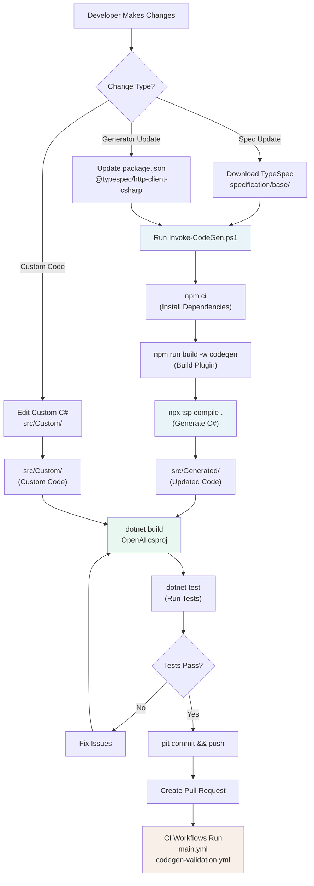
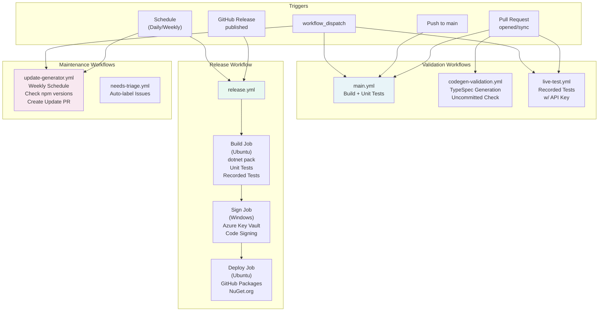
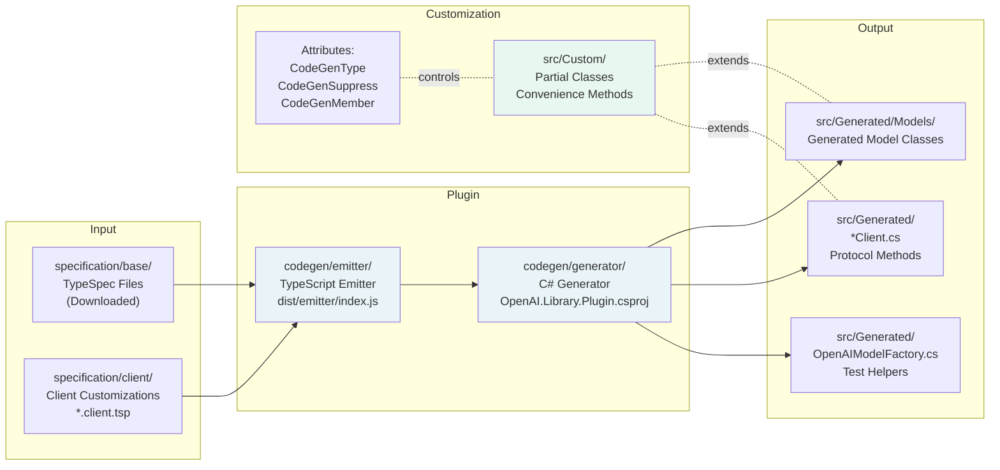
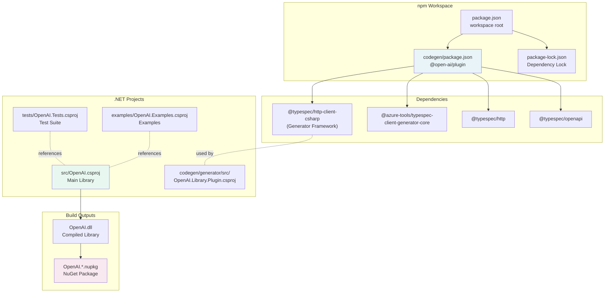
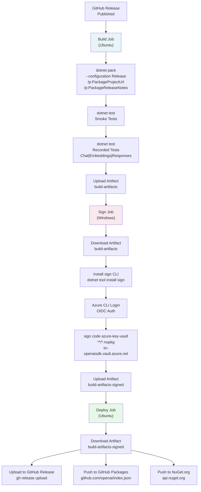
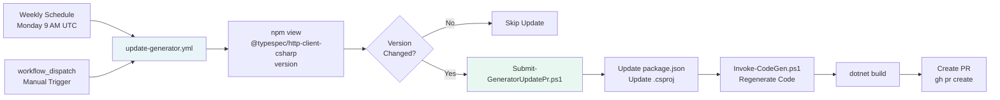

<!-- source: DeepWiki mcp.deepwiki.com · repo openai/openai-dotnet · page 8 Development and Contributing · fetched 2026-10-26 -->

# Development and Contributing

<details>
<summary>Relevant source files</summary>

The following files were used as context for generating this wiki page:

- [.github/CODEOWNERS](.github/CODEOWNERS)
- [.github/workflows/codegen-validation.yml](.github/workflows/codegen-validation.yml)
- [.github/workflows/live-test.yml](.github/workflows/live-test.yml)
- [.github/workflows/main.yml](.github/workflows/main.yml)
- [.github/workflows/needs-triage.yml](.github/workflows/needs-triage.yml)
- [.github/workflows/release.yml](.github/workflows/release.yml)
- [.github/workflows/update-generator.yml](.github/workflows/update-generator.yml)
- [codegen/generator/src/OpenAI.Library.Plugin.csproj](codegen/generator/src/OpenAI.Library.Plugin.csproj)
- [codegen/package.json](codegen/package.json)
- [examples/OpenAI.Examples.csproj](examples/OpenAI.Examples.csproj)
- [global.json](global.json)
- [package-lock.json](package-lock.json)
- [package.json](package.json)
- [scripts/Invoke-CodeGen.ps1](scripts/Invoke-CodeGen.ps1)
- [scripts/Submit-GeneratorUpdatePr.ps1](scripts/Submit-GeneratorUpdatePr.ps1)
- [src/Custom/Conversations/IncludedConversationItemProperty.cs](src/Custom/Conversations/IncludedConversationItemProperty.cs)
- [src/Custom/Videos/Internal/InternalOrderEnum.cs](src/Custom/Videos/Internal/InternalOrderEnum.cs)
- [src/Custom/Videos/Internal/InternalVideoContentVariant.cs](src/Custom/Videos/Internal/InternalVideoContentVariant.cs)
- [src/Generated/Models/Conversations/IncludedConversationItemProperty.cs](src/Generated/Models/Conversations/IncludedConversationItemProperty.cs)
- [src/Generated/Models/Videos/InternalOrderEnum.cs](src/Generated/Models/Videos/InternalOrderEnum.cs)
- [src/Generated/Models/Videos/InternalVideoContentVariant.cs](src/Generated/Models/Videos/InternalVideoContentVariant.cs)
- [tests/OpenAI.Tests.csproj](tests/OpenAI.Tests.csproj)
- [tests/Responses/ResponsesToolTests.cs](tests/Responses/ResponsesToolTests.cs)

</details>


This page provides an overview of the development infrastructure, tooling, and processes for contributing to the OpenAI .NET SDK repository. It covers repository structure, code generation, build automation, testing approaches, and how the CI/CD pipeline operates.

For detailed information on specific topics:
- Code generation system architecture: see [Code Generation System](#8.1)
- CI/CD pipeline configuration and workflows: see [CI/CD Pipeline](#8.2)
- Testing infrastructure and recorded tests: see [Testing Strategy](#8.3)
- API surface validation and compatibility: see [API Compatibility](#8.4)
- Telemetry and diagnostics: see [Observability and Telemetry](#8.5)
- Contribution process and guidelines: see [Contributing Guidelines](#8.6)

---

## Repository Structure

The repository follows a workspace-based organization with TypeSpec code generation at its core.

```mermaid
graph TB
    Root["openai-dotnet/<br/>(Repository Root)"]
    
    Root --> Src["src/<br/>Custom C# Code"]
    Root --> SrcGen["src/Generated/<br/>Generated C# Code"]
    Root --> Tests["tests/<br/>OpenAI.Tests.csproj"]
    Root --> Examples["examples/<br/>OpenAI.Examples.csproj"]
    Root --> Spec["specification/<br/>TypeSpec Definitions"]
    Root --> Codegen["codegen/<br/>@open-ai/plugin"]
    Root --> Scripts["scripts/<br/>PowerShell Scripts"]
    Root --> Workflows[".github/workflows/<br/>CI/CD Pipelines"]
    Root --> Api["api/<br/>API Surface Docs"]
    
    Src --> CustomClients["Custom/*Client.cs<br/>Convenience Methods"]
    Src --> CustomModels["Custom/Models/<br/>Partial Classes"]
    
    SrcGen --> GenClients["Generated/*Client.cs<br/>Protocol Methods"]
    SrcGen --> GenModels["Generated/Models/<br/>Generated Types"]
    
    Spec --> Base["base/<br/>Downloaded TypeSpec"]
    Spec --> Client["client/<br/>Client Customizations"]
    
    Codegen --> Emitter["emitter/<br/>TypeScript Emitter"]
    Codegen --> Generator["generator/<br/>C# Generator"]
    Codegen --> GeneratorSrc["generator/src/<br/>OpenAI.Library.Plugin.csproj"]
    
    Scripts --> InvokeCodeGen["Invoke-CodeGen.ps1"]
    Scripts --> SubmitPR["Submit-GeneratorUpdatePr.ps1"]
    
    Workflows --> Main["main.yml"]
    Workflows --> Release["release.yml"]
    Workflows --> LiveTest["live-test.yml"]
    Workflows --> CodegenVal["codegen-validation.yml"]
    Workflows --> UpdateGen["update-generator.yml"]
    
    Api --> ApiFiles["OpenAI.*.cs<br/>Public API Snapshots"]
    
    style Root fill:#f9f9f9
    style Codegen fill:#e8f4f8
    style Src fill:#e8f8f0
    style Spec fill:#f8f0e8
```



**Key Directories:**

| Directory | Purpose | Key Files |
|-----------|---------|-----------|
| `src/Custom/` | Hand-written C# code with convenience methods and customizations | `*Client.cs`, `Models/*.cs` |
| `src/Generated/` | Auto-generated C# code from TypeSpec | `*Client.cs`, `Models/*.cs`, `OpenAIModelFactory.cs` |
| `specification/base/` | TypeSpec specifications (downloaded from upstream) | `typespec/*.tsp` |
| `specification/client/` | Client-specific TypeSpec customizations | `*.client.tsp` |
| `codegen/` | npm workspace containing the code generation plugin | `package.json`, `emitter/`, `generator/` |
| `scripts/` | PowerShell scripts for development tasks | `Invoke-CodeGen.ps1`, `Submit-GeneratorUpdatePr.ps1` |
| `.github/workflows/` | GitHub Actions workflow definitions | `main.yml`, `release.yml`, `codegen-validation.yml` |
| `tests/` | Test project with unit, recorded, and live tests | `OpenAI.Tests.csproj`, `SessionRecords/` |
| `api/` | API surface documentation for compatibility validation | `OpenAI.*.cs` |

**Sources:** [package.json:1-15](), [codegen/package.json:1-47](), [.github/workflows/](), [scripts/Invoke-CodeGen.ps1:1-325]()

---

## Development Workflow

The typical development workflow involves code generation, customization, building, and testing. Changes can originate from TypeSpec specification updates or custom C# code modifications.



**Development Scripts:**

| Script | Purpose | Key Actions |
|--------|---------|-------------|
| `Invoke-CodeGen.ps1` | Main code generation script | Downloads specs, runs `npm ci`, builds plugin, executes `tsp compile` |
| `Submit-GeneratorUpdatePr.ps1` | Automated generator updates | Updates package versions, regenerates code, creates PR |

**Sources:** [scripts/Invoke-CodeGen.ps1:234-325](), [scripts/Submit-GeneratorUpdatePr.ps1:1-325](), [.github/workflows/codegen-validation.yml:39-50]()

---

## CI/CD Automation

The repository uses GitHub Actions for continuous integration and deployment. Different workflows handle validation, testing, release, and maintenance tasks.



**Workflow Summary:**

| Workflow | Trigger | Purpose | Key Steps |
|----------|---------|---------|-----------|
| `main.yml` | PR, push to main | Build and unit test validation | `dotnet pack`, `dotnet test` (smoke tests) |
| `codegen-validation.yml` | PR (codegen changes) | Validate code generation | `Invoke-CodeGen.ps1`, check uncommitted changes |
| `live-test.yml` | Manual or PR label | Run live API tests | `dotnet test` with `OPENAI_API_KEY` |
| `release.yml` | GitHub release, daily | Build, sign, publish package | Multi-job: build → sign → deploy |
| `update-generator.yml` | Weekly, manual | Update TypeSpec generator | Check npm versions, `Submit-GeneratorUpdatePr.ps1` |

**Sources:** [.github/workflows/main.yml:1-57](), [.github/workflows/release.yml:1-184](), [.github/workflows/codegen-validation.yml:1-86](), [.github/workflows/update-generator.yml:1-77](), [.github/workflows/live-test.yml:1-56]()

---

## Code Generation System

The repository uses a custom TypeSpec-based code generation system. The `@open-ai/plugin` npm package contains both a TypeScript emitter and a C# generator that work together to produce the SDK code.



The code generation process is orchestrated by `Invoke-CodeGen.ps1`, which:

1. Downloads or uses existing TypeSpec specifications in `specification/base/`
2. Runs `npm ci` to install dependencies (including `@typespec/http-client-csharp`)
3. Builds the custom plugin with `npm run build -w codegen`
4. Executes `npx tsp compile .` to generate C# code

The generated code in `src/Generated/` is then extended by custom code in `src/Custom/` using partial classes and code generation attributes like `[CodeGenType]`, `[CodeGenSuppress]`, and `[CodeGenMember]`.

For details on the code generation architecture, see [Code Generation System](#8.1).

**Sources:** [scripts/Invoke-CodeGen.ps1:294-323](), [codegen/generator/src/OpenAI.Library.Plugin.csproj:1-21](), [package-lock.json:17-37]()

---

## Build and Package Management

The repository uses a combination of npm workspaces for TypeScript/JavaScript tooling and MSBuild for .NET compilation.



**Key Package Files:**

- **`package.json`**: Root workspace definition with `@open-ai/plugin` as a workspace member
- **`codegen/package.json`**: Plugin package with TypeSpec dependencies
- **`package-lock.json`**: Centrally managed dependency lock file
- **`global.json`**: Specifies .NET SDK version (10.0.100 with feature rollForward)

**Build Commands:**

```bash
# Install dependencies
npm ci

# Build code generator plugin
npm run build -w codegen

# Generate C# code from TypeSpec
cd specification && npx tsp compile .

# Build .NET library
dotnet build src/OpenAI.csproj

# Create NuGet package
dotnet pack --configuration Release
```

**Sources:** [package.json:1-15](), [codegen/package.json:1-47](), [package-lock.json:1-50](), [global.json:1-6]()

---

## Testing Infrastructure

The test suite is organized into three categories, each serving different validation purposes:

| Test Category | Purpose | Execution Context | API Key Required |
|---------------|---------|-------------------|------------------|
| **Smoke Tests** | Fast unit tests, serialization validation | All CI workflows | No |
| **Recorded Tests** | HTTP session replay tests | `release.yml`, `live-test.yml` | No (playback) / Yes (record) |
| **Live Tests** | Real API calls against OpenAI service | Manual or labeled PRs | Yes |

**Test Project:**

- **`tests/OpenAI.Tests.csproj`**: Main test project targeting multiple frameworks (.NET 8, 9, 10)
- **`tests/SessionRecords/`**: Recorded HTTP sessions for playback testing
- Base class: `OpenAIRecordedTestBase` provides recording/playback infrastructure

**Test Execution:**

```bash
# Run smoke tests only
dotnet test --filter="TestCategory=Smoke&TestCategory!=Manual"

# Run recorded tests for specific APIs
dotnet test --filter="(TestCategory=Chat|TestCategory=Embeddings|TestCategory=Responses)&TestCategory!=MPFD"

# Set API key for live test recording
export OPENAI_API_KEY="sk-..."
dotnet test
```

For detailed testing patterns and infrastructure, see [Testing Strategy](#8.3).

**Sources:** [tests/OpenAI.Tests.csproj:1-36](), [.github/workflows/main.yml:44-50](), [.github/workflows/release.yml:56-72](), [.github/workflows/live-test.yml:40-48]()

---

## Release Process

The release process is a multi-stage pipeline that builds, signs, and publishes the NuGet package.



**Key Points:**

1. **Build Job** (Ubuntu): Compiles code, runs tests, creates unsigned NuGet package
2. **Sign Job** (Windows): Uses Azure Key Vault for Authenticode signing via OIDC
3. **Deploy Job** (Ubuntu): Publishes signed package to GitHub Packages and NuGet.org

**Certificate Details:**
- Azure Key Vault: `sc-openaisdk.vault.azure.net`
- Certificate: `OpenAISDKSCCert`
- Publisher: `OpenAI`

**Versioning:**

- Release builds: Use tag version from GitHub release
- Daily builds: Use alpha suffix with run number (`alpha.{run_number}`)

For complete CI/CD details, see [CI/CD Pipeline](#8.2).

**Sources:** [.github/workflows/release.yml:18-184]()

---

## API Compatibility Validation

The repository maintains API surface documentation to validate breaking changes:

- **`api/`** directory contains `*.cs` files with public API signatures
- **GenAPI tool** extracts API surface from compiled assemblies
- **apicompat tool** validates changes against previous versions

This validation ensures stable APIs maintain backward compatibility while experimental APIs can evolve.

For details on API compatibility validation, see [API Compatibility](#8.4).

**Sources:** High-level architecture diagrams, [api/]() directory

---

## Automated Maintenance

The repository includes automated workflows for ongoing maintenance:



The `update-generator.yml` workflow automatically:

1. Checks for new versions of `@typespec/http-client-csharp` on npm
2. Updates `codegen/package.json` and related `.csproj` files
3. Regenerates SDK code with the new generator
4. Creates a pull request with all changes

**Sources:** [.github/workflows/update-generator.yml:1-77](), [scripts/Submit-GeneratorUpdatePr.ps1:1-325]()

---

## Getting Started for Contributors

To set up a development environment:

**Prerequisites:**

- .NET SDK 10.0+ (see `global.json`)
- Node.js 22.x
- PowerShell 7+
- Git

**Setup Steps:**

1. **Clone the repository:**
   ```bash
   git clone https://github.com/openai/openai-dotnet.git
   cd openai-dotnet
   ```

2. **Install npm dependencies:**
   ```bash
   npm ci
   ```

3. **Run code generation (if needed):**
   ```bash
   pwsh scripts/Invoke-CodeGen.ps1
   ```

4. **Build the library:**
   ```bash
   dotnet build src/OpenAI.csproj
   ```

5. **Run tests:**
   ```bash
   dotnet test --filter="TestCategory=Smoke"
   ```

For contribution guidelines, code style, and PR requirements, see [Contributing Guidelines](#8.6).

**Sources:** [scripts/Invoke-CodeGen.ps1:234-325](), [global.json:1-6](), [package.json:1-15]()

---

## Related Documentation

- **[Code Generation System](#8.1)**: TypeSpec specifications, emitter architecture, C# generator
- **[CI/CD Pipeline](#8.2)**: GitHub Actions workflows, build configuration, release automation
- **[Testing Strategy](#8.3)**: Test categories, recording infrastructure, test execution patterns
- **[API Compatibility](#8.4)**: GenAPI tool, apicompat validation, stable vs experimental APIs
- **[Observability and Telemetry](#8.5)**: OpenTelemetry integration, activity tracing, metrics
- **[Contributing Guidelines](#8.6)**: Code style, PR process, development environment setup

---

