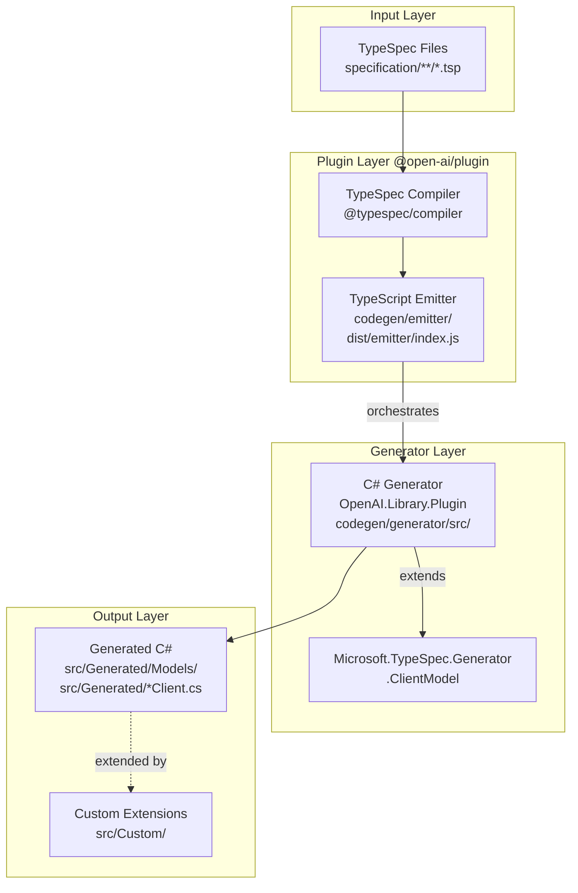
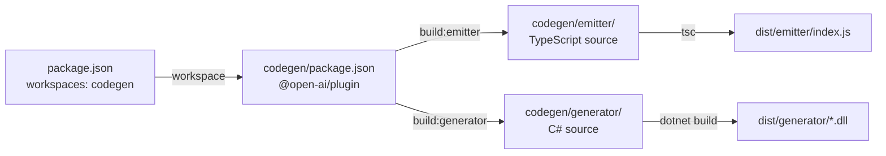
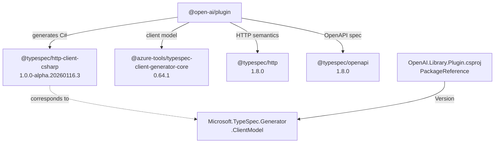
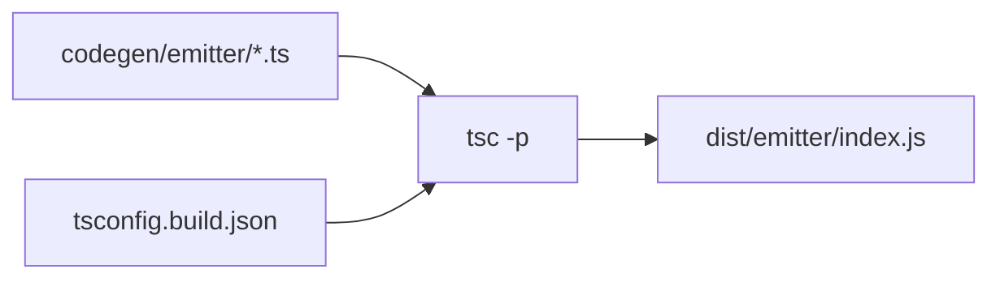
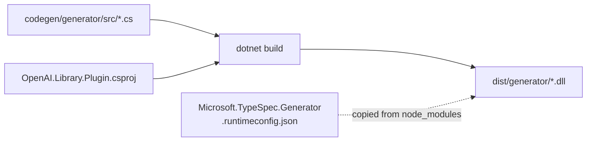
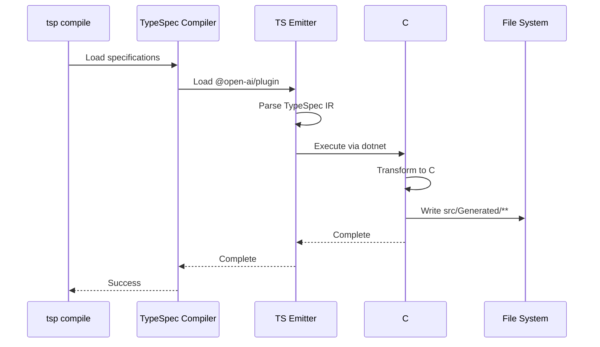
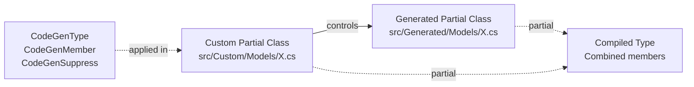
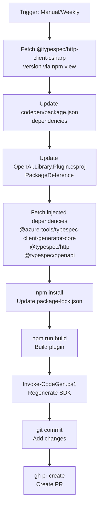

<!-- source: DeepWiki mcp.deepwiki.com · repo openai/openai-dotnet · page 8.1 Code Generation System · fetched 2026-10-26 -->

# Code Generation System

<details>
<summary>Relevant source files</summary>

The following files were used as context for generating this wiki page:

- [codegen/generator/src/OpenAI.Library.Plugin.csproj](codegen/generator/src/OpenAI.Library.Plugin.csproj)
- [codegen/package.json](codegen/package.json)
- [package-lock.json](package-lock.json)
- [package.json](package.json)
- [scripts/Submit-GeneratorUpdatePr.ps1](scripts/Submit-GeneratorUpdatePr.ps1)
- [src/Custom/Conversations/IncludedConversationItemProperty.cs](src/Custom/Conversations/IncludedConversationItemProperty.cs)
- [src/Custom/Videos/Internal/InternalOrderEnum.cs](src/Custom/Videos/Internal/InternalOrderEnum.cs)
- [src/Custom/Videos/Internal/InternalVideoContentVariant.cs](src/Custom/Videos/Internal/InternalVideoContentVariant.cs)
- [src/Generated/Models/Conversations/IncludedConversationItemProperty.cs](src/Generated/Models/Conversations/IncludedConversationItemProperty.cs)
- [src/Generated/Models/Videos/InternalOrderEnum.cs](src/Generated/Models/Videos/InternalOrderEnum.cs)
- [src/Generated/Models/Videos/InternalVideoContentVariant.cs](src/Generated/Models/Videos/InternalVideoContentVariant.cs)

</details>


## Purpose and Scope

The Code Generation System transforms TypeSpec API specifications into C# client code for the OpenAI .NET SDK. This system automates the generation of models, clients, and protocol methods while providing extension points for custom implementations. The generated code is located in [src/Generated/]() while custom extensions reside in [src/Custom/]().

For information about TypeSpec specification structure, see [TypeSpec Specifications](#8.1.1). For customization patterns and extension mechanisms, see [Custom Extensions and Visitors](#8.1.2).

---

## Architecture Overview

The code generation pipeline consists of three layers: TypeSpec compilation, plugin-based emission, and C# code generation.



**Sources:** [codegen/package.json:1-46](), [package.json:1-15](), [codegen/generator/src/OpenAI.Library.Plugin.csproj:1-20]()

---

## Component Structure

### Package Organization

The code generation system is organized as an npm workspace with a nested C# project.

| Component | Path | Purpose |
|-----------|------|---------|
| Root Package | `package.json` | Workspace configuration |
| Plugin Package | `codegen/package.json` | TypeScript emitter and dependencies |
| C# Generator | `codegen/generator/src/` | C# code generation logic |
| Emitter Output | `codegen/dist/emitter/` | Compiled TypeScript emitter |
| Generator Output | `codegen/dist/generator/` | Compiled C# generator binaries |



**Sources:** [package.json:1-15](), [codegen/package.json:1-46]()

---

## Dependencies and Versioning

### Core Dependencies

The plugin depends on specific versions of TypeSpec packages coordinated through npm.



The `@typespec/http-client-csharp` npm package version must match the `Microsoft.TypeSpec.Generator.ClientModel` NuGet package version referenced in [codegen/generator/src/OpenAI.Library.Plugin.csproj:8]().

**Sources:** [codegen/package.json:30-36](), [codegen/generator/src/OpenAI.Library.Plugin.csproj:1-20](), [package-lock.json:53-78]()

---

## Build Process

### Emitter Build Pipeline

The TypeScript emitter is compiled using the TypeScript compiler and outputs to `dist/emitter/`.



The build script is defined in [codegen/package.json:20]() as `tsc -p ./tsconfig.build.json`.

### Generator Build Pipeline

The C# generator project builds to `dist/generator/` and includes a post-build copy step.



The post-build target `CopyForNpmPackage` at [codegen/generator/src/OpenAI.Library.Plugin.csproj:12-19]() copies:
1. Build output to `dist/generator/`
2. Runtime configuration from `@typespec/http-client-csharp` node module

**Sources:** [codegen/package.json:19-22](), [codegen/generator/src/OpenAI.Library.Plugin.csproj:12-19]()

---

## Invocation Flow

When TypeSpec compilation is invoked, the system follows this execution sequence:



The emitter main entry point is [codegen/package.json:14]() which exports `dist/emitter/index.js`. This JavaScript file orchestrates the .NET generator execution.

**Sources:** [codegen/package.json:13-16]()

---

## Generated Code Structure

The generator outputs three categories of files:

### Model Classes

Generated models are placed in namespace-specific subdirectories:

```
src/Generated/Models/
├── Chat/
│   ├── ChatCompletion.cs
│   ├── ChatMessage.cs
│   └── StreamingChatUpdate.cs
├── Assistants/
│   ├── Assistant.cs
│   ├── AssistantThread.cs
│   └── ThreadRun.cs
├── Responses/
│   ├── ResponseResult.cs
│   └── ResponseItem.cs
└── Videos/
    ├── InternalOrderEnum.cs
    └── InternalVideoContentVariant.cs
```

Example from [src/Generated/Models/Videos/InternalOrderEnum.cs:1-44]():
- Enum-like struct pattern with string backing
- Static property accessors
- Equality and implicit conversion operators
- `[EditorBrowsable(EditorBrowsableState.Never)]` on infrastructure methods

### Client Classes

Generated clients follow the pattern `[Namespace][Entity]Client.cs`:

```
src/Generated/
├── ChatClient.cs
├── AudioClient.cs
├── EmbeddingClient.cs
├── AssistantClient.cs
└── VideoClient.cs
```

Each generated client contains protocol methods for direct HTTP interaction.

### Factory Classes

The generator creates `OpenAIModelFactory.cs` with test helper methods for instantiating models with specific properties.

**Sources:** [src/Generated/Models/Videos/InternalOrderEnum.cs:1-44](), [src/Generated/Models/Videos/InternalVideoContentVariant.cs:1-47]()

---

## Customization System

### CodeGen Attributes

Custom code uses attributes from `Microsoft.TypeSpec.Generator.Customizations` to control generation:

| Attribute | Purpose | Example |
|-----------|---------|---------|
| `[CodeGenType]` | Rename or suppress type generation | `[CodeGenType("OrderEnum")]` |
| `[CodeGenMember]` | Rename or suppress member generation | `[CodeGenMember("MessageInputImageImageUrl")]` |
| `[CodeGenSuppress]` | Suppress specific generated members | `[CodeGenSuppress("ConstructorName")]` |

### Custom Extension Pattern

Generated types are partial classes, allowing extension in `src/Custom/`:



### Practical Example

The `IncludedConversationItemProperty` type demonstrates attribute usage:

From [src/Custom/Conversations/IncludedConversationItemProperty.cs:1-27]():
```csharp
[CodeGenType("IncludeEnum")]  // Renames from IncludeEnum
public readonly partial struct IncludedConversationItemProperty
{
    [CodeGenMember("MessageInputImageImageUrl")]  // Renames property
    public static IncludedConversationItemProperty MessageInputImageUri { get; }
    
    [CodeGenMember("ComputerCallOutputOutputImageUrl")]
    public static IncludedConversationItemProperty ComputerCallOutputImageUri { get; }
}
```

The generated partial at [src/Generated/Models/Conversations/IncludedConversationItemProperty.cs:1-61]() provides the base implementation, while the custom partial adds renamed properties.

**Sources:** [src/Custom/Conversations/IncludedConversationItemProperty.cs:1-27](), [src/Custom/Videos/Internal/InternalOrderEnum.cs:1-12](), [src/Custom/Videos/Internal/InternalVideoContentVariant.cs:1-12]()

---

## Automated Updates

The repository includes automation for keeping the generator version current.

### Update Workflow

The [scripts/Submit-GeneratorUpdatePr.ps1:1-325]() script automates version updates:



### Version Synchronization

The script maintains consistency between:
- `@typespec/http-client-csharp` npm package [codegen/package.json:34]()
- `Microsoft.TypeSpec.Generator.ClientModel` NuGet package [codegen/generator/src/OpenAI.Library.Plugin.csproj:8]()
- Injected dependencies from the `devDependencies` of `@typespec/http-client-csharp`

Key update logic at [scripts/Submit-GeneratorUpdatePr.ps1:139-164]():
1. Fetches dependencies using `npm view @typespec/http-client-csharp@version devDependencies --json`
2. Updates injected dependencies in [codegen/package.json]()
3. Ensures version alignment across npm and NuGet ecosystems

**Sources:** [scripts/Submit-GeneratorUpdatePr.ps1:1-325](), [scripts/Submit-GeneratorUpdatePr.ps1:94-98]()

---

## Integration with Build System

The generated code is committed to source control and used directly by the SDK build process. Regeneration occurs when:

1. TypeSpec specifications change
2. Generator versions are updated
3. Manual regeneration is triggered via `Invoke-CodeGen.ps1`

The generated files are validated in CI through:
- Compilation in `dotnet build`
- API compatibility checking via `apicompat` tool
- Test execution against recorded sessions

For build and release pipeline details, see [CI/CD Pipeline](#8.2). For API surface validation, see [API Compatibility](#8.4).

**Sources:** [codegen/package.json:19-25]()

---

