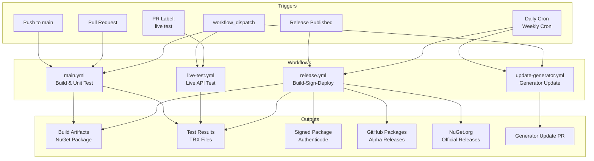
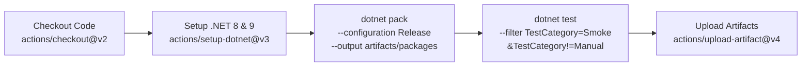
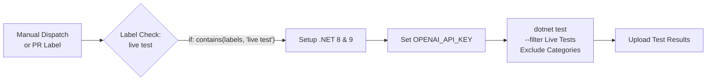
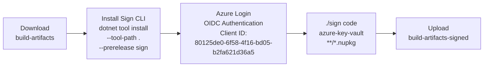
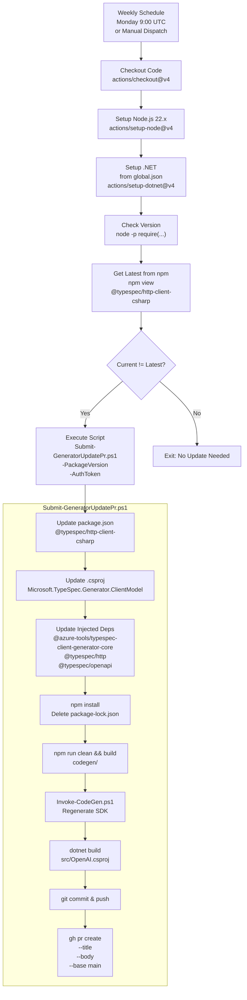
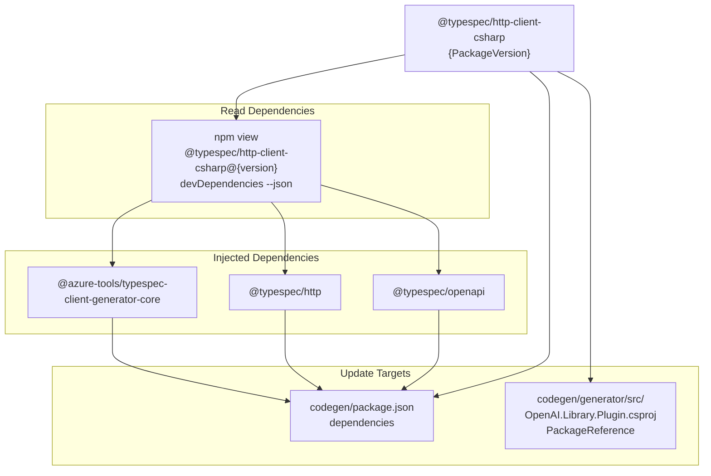
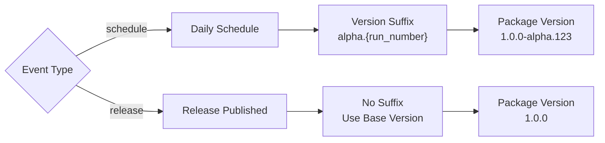

<!-- source: DeepWiki mcp.deepwiki.com · repo openai/openai-dotnet · page 8.2 CI/CD Pipeline · fetched 2026-10-26 -->

# CI/CD Pipeline

<details>
<summary>Relevant source files</summary>

The following files were used as context for generating this wiki page:

- [.github/CODEOWNERS](.github/CODEOWNERS)
- [.github/workflows/codegen-validation.yml](.github/workflows/codegen-validation.yml)
- [.github/workflows/live-test.yml](.github/workflows/live-test.yml)
- [.github/workflows/main.yml](.github/workflows/main.yml)
- [.github/workflows/needs-triage.yml](.github/workflows/needs-triage.yml)
- [.github/workflows/release.yml](.github/workflows/release.yml)
- [.github/workflows/update-generator.yml](.github/workflows/update-generator.yml)
- [CHANGELOG.md](CHANGELOG.md)
- [examples/OpenAI.Examples.csproj](examples/OpenAI.Examples.csproj)
- [global.json](global.json)
- [scripts/Invoke-CodeGen.ps1](scripts/Invoke-CodeGen.ps1)
- [scripts/Test-ApiCompatibility.ps1](scripts/Test-ApiCompatibility.ps1)
- [src/OpenAI.csproj](src/OpenAI.csproj)
- [tests/OpenAI.Tests.csproj](tests/OpenAI.Tests.csproj)
- [tests/Responses/ResponsesToolTests.cs](tests/Responses/ResponsesToolTests.cs)
- [tests/SessionRecords/ResponsesTests/WebSearchCallStreaming.json](tests/SessionRecords/ResponsesTests/WebSearchCallStreaming.json)
- [tests/SessionRecords/ResponsesTests/WebSearchCallStreamingAsync.json](tests/SessionRecords/ResponsesTests/WebSearchCallStreamingAsync.json)

</details>


## Purpose and Scope

This document describes the automated build, test, signing, and release infrastructure for the OpenAI .NET SDK. The CI/CD pipeline consists of four GitHub Actions workflows that handle continuous integration, live testing, official releases, and automated dependency updates.

For information about the TypeSpec code generation system that feeds into these pipelines, see [Code Generation System](#8.1). For details about the testing strategy and test categories, see [Testing Strategy](#8.3).

---

## Workflow Architecture

The SDK uses four primary GitHub Actions workflows that coordinate to provide continuous integration, quality assurance, and automated releases.



**Sources:** [.github/workflows/main.yml:1-52](), [.github/workflows/live-test.yml:1-48](), [.github/workflows/release.yml:1-176](), [.github/workflows/update-generator.yml:1-77]()

### Workflow Trigger Matrix

| Workflow | Triggers | Environment | Secrets Required |
|----------|----------|-------------|------------------|
| `main.yml` | Push to main, PR, Manual | N/A | None |
| `live-test.yml` | Manual, PR label "live test" | Live Testing | `OPENAI_API_KEY` |
| `release.yml` | Release published, Daily cron (00:00 UTC) | Live Testing, release | `OPENAI_API_KEY`, `NUGET_API_KEY`, Azure OIDC |
| `update-generator.yml` | Weekly (Mon 9:00 UTC), Manual | N/A | `GITHUB_TOKEN` |

**Sources:** [.github/workflows/main.yml:5-11](), [.github/workflows/live-test.yml:4-8](), [.github/workflows/release.yml:7-12](), [.github/workflows/update-generator.yml:3-11]()

---

## Main Build Workflow

The `main.yml` workflow provides fast feedback on every code change by building the package and running smoke tests.



**Sources:** [.github/workflows/main.yml:19-52]()

### Build Steps

1. **Environment Setup** - Configures .NET 8 and .NET 9 SDKs
   - Uses `actions/setup-dotnet@v3` for multi-targeting support
   - Sources: [.github/workflows/main.yml:20-28]()

2. **Version Suffix Calculation** - Generates alpha version numbers for non-release builds
   - Format: `alpha.{github.run_number}`
   - Applied via `/p:VersionSuffix` parameter
   - Sources: [.github/workflows/main.yml:18]()

3. **Package Build** - Executes `dotnet pack` with release configuration
   - Output directory: `${{github.workspace}}/artifacts/packages`
   - Includes version suffix for alpha builds
   - Sources: [.github/workflows/main.yml:33-37]()

4. **Smoke Tests** - Runs fast, in-memory unit tests
   - Filter: `TestCategory=Smoke&TestCategory!=Manual`
   - Logger: `trx;LogFilePrefix=smoke`
   - Results directory: `${{github.workspace}}/artifacts/test-results`
   - Sources: [.github/workflows/main.yml:39-45]()

5. **Artifact Upload** - Preserves build outputs and test results
   - Artifact name: `build-artifacts`
   - Runs even if tests fail (`if: ${{ !cancelled() }}`)
   - Sources: [.github/workflows/main.yml:47-52]()

**Sources:** [.github/workflows/main.yml:1-52]()

---

## Live Test Workflow

The `live-test.yml` workflow executes integration tests against the real OpenAI API, providing validation of SDK behavior with actual service endpoints.



**Sources:** [.github/workflows/live-test.yml:1-48]()

### Live Test Execution

**Test Filter Expression:**
```
(TestCategory=Chat|TestCategory=Embeddings|TestCategory=Responses)&TestCategory!=MPFD
```

This filter **explicitly includes** only:
- `Chat` - Chat completion API tests
- `Embeddings` - Embedding generation tests  
- `Responses` - OpenAI Responses API tests

And **excludes**:
- `MPFD` - Multipart form data tests (requires special handling)

This approach uses an allowlist strategy rather than denylisting individual categories, ensuring predictable test execution time and focusing on core API functionality that can be validated quickly against live endpoints.

**Sources:** [.github/workflows/live-test.yml:38](), [.github/workflows/release.yml:61]()

### Trigger Mechanisms

1. **Manual Dispatch** - Triggered via GitHub Actions UI
   - Allows on-demand live testing
   - Useful for pre-release validation
   - Sources: [.github/workflows/live-test.yml:5]()

2. **PR Label** - Automatically triggered when PR labeled with "live test"
   - Conditional: `if: github.event_name == 'workflow_dispatch' || contains(github.event.pull_request.labels.*.name, 'live test')`
   - Prevents automatic live testing on every PR
   - Sources: [.github/workflows/live-test.yml:14]()

**Sources:** [.github/workflows/live-test.yml:4-15]()

---

## Release Workflow

The `release.yml` workflow orchestrates the complete release process through three sequential jobs: build, sign, and deploy. This workflow handles both daily alpha releases and official production releases.

```mermaid
graph TB
    subgraph "Job 1: Build (Ubuntu)"
        B1["Setup .NET 8 & 9"]
        B2["Checkout Code"]
        B3["dotnet pack<br/>--configuration Release"]
        B4["Unit Tests<br/>TestCategory=Smoke"]
        B5["Live Tests<br/>Exclude 10+ Categories"]
        B6["Upload Artifacts<br/>build-artifacts"]
        
        B1 --> B2
        B2 --> B3
        B3 --> B4
        B4 --> B5
        B5 --> B6
    end
    
    subgraph "Job 2: Sign (Windows)"
        S1["Download Artifacts<br/>build-artifacts"]
        S2["Setup .NET 9"]
        S3["Install Sign CLI<br/>dotnet tool install sign"]
        S4["Azure Login<br/>OIDC Client ID"]
        S5["Sign Code<br/>azure-key-vault<br/>**/*.nupkg"]
        S6["Upload Signed<br/>build-artifacts-signed"]
        
        S1 --> S2
        S2 --> S3
        S3 --> S4
        S4 --> S5
        S5 --> S6
    end
    
    subgraph "Job 3: Deploy (Ubuntu)"
        D1["Download Signed<br/>build-artifacts-signed"]
        D2["Upload to GitHub Release<br/>gh release upload"]
        D3["Update Release Notes<br/>Link to CHANGELOG.md"]
        D4["Setup NuGet Auth<br/>GitHub Packages"]
        D5["Push to GitHub<br/>--source github"]
        D6["Push to NuGet.org<br/>if: release event"]
        
        D1 --> D2
        D2 --> D3
        D3 --> D4
        D4 --> D5
        D5 --> D6
    end
    
    B6 -->|"needs: build"| S1
    S6 -->|"needs: sign"| D1
```



**Sources:** [.github/workflows/release.yml:18-176]()

### Build Job

The build job executes on Ubuntu and performs comprehensive testing before creating the package.

**Version Suffix Logic:**
```yaml
version_suffix_args: ${{ github.event_name == 'schedule' && format('/p:VersionSuffix="alpha.{0}"', github.run_number) || '' }}
```

- **Daily Runs (schedule)**: Adds `alpha.{run_number}` suffix (e.g., `1.0.0-alpha.123`)
- **Release Runs**: No suffix, uses version from project file (e.g., `1.0.0`)

**Sources:** [.github/workflows/release.yml:24]()

**Package Metadata:**
The build includes repository links in package metadata:
- `PackageProjectUrl`: `https://github.com/openai/openai-dotnet/tree/{tag_name}`
- `PackageReleaseNotes`: `https://github.com/openai/openai-dotnet/blob/{tag_name}/CHANGELOG.md`

**Sources:** [.github/workflows/release.yml:40-46]()

**Test Execution:**
1. Smoke tests with filter: `TestCategory=Smoke&TestCategory!=Manual`
2. Live tests with exclusion filter (identical to `live-test.yml`)

**Sources:** [.github/workflows/release.yml:48-64]()

### Sign Job

The signing job **must** run on Windows to support Authenticode signing for DLL/EXE files in the NuGet package.



**Sources:** [.github/workflows/release.yml:72-119]()

#### Azure Key Vault Configuration

**Authentication:**
- Method: Azure OIDC (Workload Identity Federation)
- Client ID: `80125de0-6f58-4f16-bd05-b2fa621d36a5`
- Tenant ID: `16076fdc-fcc1-4a15-b1ca-32c9a255900e`
- Permission: `id-token: write` (required for JWT request)

**Sources:** [.github/workflows/release.yml:75-99]()

**Signing Parameters:**
- Vault URL: `https://sc-openaisdk.vault.azure.net/`
- Certificate: `OpenAISDKSCCert`
- Publisher: `OpenAI`
- Description: `OpenAI library for .NET`
- Credential Type: `azure-cli` (uses logged-in Azure context)

**Sources:** [.github/workflows/release.yml:101-112]()

### Deploy Job

The deploy job publishes signed packages to distribution channels.

**Publishing Strategy:**

| Event Type | GitHub Packages | NuGet.org | GitHub Release |
|------------|----------------|-----------|----------------|
| Daily Schedule | ✓ (alpha) | ✗ | ✗ |
| Release Published | ✓ | ✓ | ✓ (attach `*.nupkg`, `*.snupkg`) |

**Sources:** [.github/workflows/release.yml:123-179]()

#### GitHub Packages Publishing

Always executed for both scheduled and release runs:

```bash
dotnet nuget push \
  ./build-artifacts/packages/*.nupkg \
  --source "github" \
  --api-key ${{ secrets.GITHUB_TOKEN }} \
  --skip-duplicate
```

**Source Configuration:**
- URL: `https://nuget.pkg.github.com/openai/index.json`
- Authentication: Username (`github.actor`) + Token (`GITHUB_TOKEN`)
- Skip duplicates: Prevents errors on re-runs

**Sources:** [.github/workflows/release.yml:154-167]()

#### NuGet.org Publishing

Conditional execution (`if: github.event_name == 'release'`):

```bash
dotnet nuget push \
  ./build-artifacts/packages/*.nupkg \
  --source https://api.nuget.org/v3/index.json \
  --api-key ${{ secrets.NUGET_API_KEY }} \
  --skip-duplicate
```

**Sources:** [.github/workflows/release.yml:169-175]()

#### GitHub Release Attachment

Uploads both `.nupkg` (NuGet package) and `.snupkg` (symbol package) files to the GitHub release and updates release notes:

```bash
gh release upload ${{ github.event.release.tag_name }} \
  ${{ github.workspace }}/build-artifacts/packages/*.*nupkg

gh release edit "${{ github.event.release.tag_name }}" \
  --notes "See full changelog: ${{ github.server_url }}/${{ github.repository }}/blob/${{ github.event.release.tag_name }}/CHANGELOG.md"
```

The `*.*nupkg` glob pattern matches both `.nupkg` and `.snupkg` files, ensuring symbol packages are included for debugging support.

**Sources:** [.github/workflows/release.yml:137-149]()

---

## Generator Update Workflow

The `update-generator.yml` workflow automates TypeSpec generator updates by checking for new versions, regenerating code, and creating pull requests.



**Sources:** [.github/workflows/update-generator.yml:1-77](), [scripts/Submit-GeneratorUpdatePr.ps1:1-325]()

### Version Detection

The workflow reads the current version from `codegen/package.json` and compares it with the latest npm registry version:

```bash
CURRENT_VERSION=$(node -p "require('./codegen/package.json').dependencies['@typespec/http-client-csharp']")
LATEST_VERSION=$(npm view @typespec/http-client-csharp version)
```

If versions differ, the update process begins. If identical, the workflow exits early.

**Sources:** [.github/workflows/update-generator.yml:37-65]()

### Update Script Execution

The PowerShell script `Submit-GeneratorUpdatePr.ps1` handles the complete update process:

**Parameters:**
- `PackageVersion`: Target version to update to (e.g., `1.0.0-alpha.20250625.4`)
- `AuthToken`: GitHub token for PR creation
- `BranchName`: Branch name (defaults to `typespec/update-http-client-csharp-{version}`)
- `RepoPath`: Local repository path (defaults to `.`)

**Sources:** [scripts/Submit-GeneratorUpdatePr.ps1:24-37]()

### Dependency Management

The script updates multiple dependency sources to maintain consistency:



**Sources:** [scripts/Submit-GeneratorUpdatePr.ps1:94-184]()

**Injected Dependency Array:**
```powershell
$InjectedDependencies = @(
    '@azure-tools/typespec-client-generator-core',
    '@typespec/http',
    '@typespec/openapi'
)
```

These dependencies are read from the target generator package and synchronized to ensure version compatibility.

**Sources:** [scripts/Submit-GeneratorUpdatePr.ps1:94-98]()

### Code Regeneration

After updating dependencies, the script rebuilds the generator plugin and regenerates SDK code:

1. **Clean Build:**
   ```powershell
   npm run clean && npm run build  # In codegen/
   ```
   **Sources:** [scripts/Submit-GeneratorUpdatePr.ps1:199-205]()

2. **Code Generation:**
   ```powershell
   pwsh scripts/Invoke-CodeGen.ps1
   ```
   **Sources:** [scripts/Submit-GeneratorUpdatePr.ps1:208-215]()

3. **Build Validation:**
   ```powershell
   dotnet build src/OpenAI.csproj
   ```
   **Sources:** [scripts/Submit-GeneratorUpdatePr.ps1:218-228]()

### Pull Request Creation

The script uses GitHub CLI (`gh`) to create a pull request with comprehensive information:

**PR Title:**
- Success: `Update @typespec/http-client-csharp to {version}`
- With Warnings: `Succeeded with Issues: Update @typespec/http-client-csharp to {version}`

**PR Body Includes:**
- Version change summary (`{old} → {new}`)
- Updated files list (package.json, csproj, generated code, package-lock.json)
- Link to NPM package
- Testing instructions
- Notes about automatic creation and potential breaking changes

**Sources:** [scripts/Submit-GeneratorUpdatePr.ps1:270-309]()

**Warning Detection:**
The script tracks warnings during execution (e.g., failed dependency fetch, build errors) and marks the GitHub Action step as failed while still creating the PR. This alerts maintainers to review the changes carefully.

**Sources:** [scripts/Submit-GeneratorUpdatePr.ps1:52-57](), [scripts/Submit-GeneratorUpdatePr.ps1:314-317]()

---

## Test Categorization

The CI/CD pipeline uses NUnit `TestCategory` attributes to control which tests execute in different contexts.

### Category Definitions

| Category | Purpose | Execution Context |
|----------|---------|-------------------|
| `Smoke` | Fast, in-memory unit tests | `main.yml`, `release.yml` (build job) |
| `Chat` | Chat completion API tests | `live-test.yml`, `release.yml` (build job) |
| `Embeddings` | Embedding generation tests | `live-test.yml`, `release.yml` (build job) |
| `Responses` | OpenAI Responses API tests | `live-test.yml`, `release.yml` (build job) |
| `ChatStore` | Chat storage persistence tests | Not in CI/CD (too slow) |
| `ResponsesTools` | Response tool integration tests | Not in CI/CD (requires special setup) |
| `ChatTools` | Function calling tests | Not in CI/CD (requires special setup) |
| `MPFD` | Multipart form data tests | Explicitly excluded from live tests |
| `Manual` | Manually-triggered tests only | Excluded from all automated runs |

**Note:** The CI/CD pipeline uses an **allowlist approach** for live tests, explicitly including only `Chat`, `Embeddings`, and `Responses` categories. All other categories (including `Assistants`, `FineTuning`, `VectorStores`, `Containers`, etc.) are implicitly excluded unless explicitly added to the filter.

**Sources:** [tests/Chat/ChatStoreTests.cs:14-15](), [tests/Responses/ResponsesToolTests.cs:20-21](), [tests/Chat/ChatToolTests.cs:16-17](), [.github/workflows/live-test.yml:38](), [.github/workflows/release.yml:61]()

### Filter Expression Construction

**Smoke Tests (main.yml, release.yml build job):**
```
TestCategory=Smoke&TestCategory!=Manual
```
Runs only smoke tests, excluding manual tests.

**Sources:** [.github/workflows/main.yml:42](), [.github/workflows/release.yml:54]()

**Live/Recorded Tests (live-test.yml, release.yml build job):**
```
(TestCategory=Chat|TestCategory=Embeddings|TestCategory=Responses)&TestCategory!=MPFD
```
Uses an **allowlist approach**: explicitly includes only `Chat`, `Embeddings`, and `Responses` categories while excluding `MPFD`. This strategy:
- Provides predictable test execution time (~5-10 minutes)
- Avoids implicit inclusion of slow or flaky test categories
- Focuses on core SDK functionality that validates quickly
- Makes test selection transparent and maintainable

**Sources:** [.github/workflows/live-test.yml:38](), [.github/workflows/release.yml:61]()

---

## Artifact Management

All workflows upload artifacts for debugging and distribution purposes.

### Artifact Structure

```
artifacts/
├── packages/
│   ├── OpenAI.{version}.nupkg      # Main NuGet package
│   └── OpenAI.{version}.snupkg     # Symbol package
└── test-results/
    ├── smoke*.trx                   # Smoke test results (from --logger "trx;LogFilePrefix=smoke")
    └── live*.trx                    # Live test results (from --logger "trx;LogFilePrefix=live")
```

**Sources:** [.github/workflows/main.yml:36](), [.github/workflows/main.yml:43-44](), [.github/workflows/release.yml:46](), [.github/workflows/release.yml:55](), [.github/workflows/live-test.yml:39]()

### Upload Configuration

**main.yml:**
- Artifact name: `build-artifacts`
- Condition: `if: ${{ !cancelled() }}`
- Preserves packages and test results even if tests fail

**Sources:** [.github/workflows/main.yml:47-52]()

**release.yml Build Job:**
- Artifact name: `build-artifacts`
- Contains unsigned packages and test results

**Sources:** [.github/workflows/release.yml:65-70]()

**release.yml Sign Job:**
- Downloads: `build-artifacts`
- Uploads: `build-artifacts-signed`
- Windows agent requirement for signing tools

**Sources:** [.github/workflows/release.yml:80-118]()

**release.yml Deploy Job:**
- Downloads: `build-artifacts-signed`
- Publishes to GitHub Packages and NuGet.org

**Sources:** [.github/workflows/release.yml:128-132]()

---

## Environment Configuration

### .NET SDK Versions

All workflows use multi-targeting to support both .NET 8 and .NET 9:

```yaml
- name: Setup .NET
  uses: actions/setup-dotnet@v3
  with:
    dotnet-version: '9.x'

- name: Setup .NET 8
  uses: actions/setup-dotnet@v3
  with:
    dotnet-version: '8.x'
```

The `update-generator.yml` workflow reads the SDK version from `global.json` to maintain consistency:

```yaml
- name: Setup .NET
  uses: actions/setup-dotnet@v4
  with:
    global-json-file: global.json
```

**Sources:** [.github/workflows/main.yml:20-28](), [.github/workflows/live-test.yml:19-27](), [.github/workflows/release.yml:26-34](), [.github/workflows/update-generator.yml:31-35](), [global.json:1-7]()

### Node.js Configuration

The generator update workflow requires Node.js 22.x:

```yaml
- name: Setup Node.js
  uses: actions/setup-node@v4
  with:
    node-version: '22.x'
```

**Sources:** [.github/workflows/update-generator.yml:26-29]()

### Environment Secrets

| Secret | Used By | Purpose |
|--------|---------|---------|
| `OPENAI_API_KEY` | `live-test.yml`, `release.yml` | Authenticates live API tests |
| `NUGET_API_KEY` | `release.yml` (deploy job) | Publishes to NuGet.org |
| `GITHUB_TOKEN` | All workflows | GitHub API access, package publishing |
| Azure OIDC Client ID | `release.yml` (sign job) | Authenticates to Azure Key Vault (`80125de0-6f58-4f16-bd05-b2fa621d36a5`) |

**Sources:** [.github/workflows/live-test.yml:43](), [.github/workflows/release.yml:66](), [.github/workflows/release.yml:177](), [.github/workflows/release.yml:100]()

---

## Versioning Strategy

The SDK uses semantic versioning with alpha suffixes for pre-release builds.

### Version Calculation



**Sources:** [.github/workflows/release.yml:24]()

**Implementation:**
```yaml
version_suffix_args: ${{ github.event_name == 'schedule' && format('/p:VersionSuffix="alpha.{0}"', github.run_number) || '' }}
```

This MSBuild parameter is passed to `dotnet pack` and `dotnet test` commands to ensure consistent versioning across artifacts.

**Sources:** [.github/workflows/release.yml:46](), [.github/workflows/release.yml:53](), [.github/workflows/release.yml:61]()

---

## Code Signing Details

### Signing Tool

The `sign` CLI tool is installed from NuGet and used for Authenticode signing:

```powershell
dotnet tool install --tool-path . --prerelease sign
```

The tool is installed to the current directory (`.`) to avoid global installation conflicts.

**Sources:** [.github/workflows/release.yml:91-92]()

### Signing Command

```powershell
./sign code azure-key-vault `
  **/*.nupkg `
  --base-directory "${{ github.workspace }}/build-artifacts/packages" `
  --publisher-name "OpenAI" `
  --description "OpenAI library for .NET" `
  --description-url "https://github.com/openai/openai-dotnet" `
  --azure-credential-type "azure-cli" `
  --azure-key-vault-url "https://sc-openaisdk.vault.azure.net/" `
  --azure-key-vault-certificate "OpenAISDKSCCert"
```

This command:
- Signs all `.nupkg` files in the packages directory
- Uses Azure CLI authentication (from previous `azure/login@v2` step)
- Embeds OpenAI publisher metadata
- Retrieves the signing certificate from Azure Key Vault

**Sources:** [.github/workflows/release.yml:103-112]()

### Windows Requirement

The sign job runs on `windows-latest` because Authenticode signing for DLLs and EXEs within the NuGet package requires Windows-specific cryptographic APIs.

**Sources:** [.github/workflows/release.yml:74]()

---

## Performance Optimizations

### Parallel Test Execution

The test framework supports parallel execution within test assemblies. Test categories enable selective execution to minimize runtime:

- **Smoke tests**: ~30 seconds (fast unit tests)
- **Full live tests**: ~5-10 minutes (with category exclusions)

### Artifact Caching

Workflows use GitHub Actions artifact storage to transfer build outputs between jobs:

1. **Build job** creates and uploads artifacts
2. **Sign job** downloads, signs, and re-uploads
3. **Deploy job** downloads signed artifacts for publishing

This approach avoids rebuilding packages in subsequent jobs.

**Sources:** [.github/workflows/release.yml:65-70](), [.github/workflows/release.yml:80-84](), [.github/workflows/release.yml:128-132]()

### Conditional Execution

Jobs and steps use conditional expressions to avoid unnecessary work:

- `if: github.event_name == 'release'` - NuGet.org publishing only for releases
- `if: steps.check-updates.outputs.needs-update == 'true'` - Skip generator updates if no new version
- `if: ${{ !cancelled() }}` - Upload artifacts even if tests fail

**Sources:** [.github/workflows/release.yml:170](), [.github/workflows/update-generator.yml:68](), [.github/workflows/main.yml:49]()

---

## Failure Handling

### Test Failure Isolation

Test results are uploaded regardless of test outcomes using `if: ${{ !cancelled() }}`. This ensures test results are available for analysis even when tests fail.

**Sources:** [.github/workflows/main.yml:49](), [.github/workflows/release.yml:67]()

### Generator Update Resilience

The `Submit-GeneratorUpdatePr.ps1` script tracks warnings during execution and marks the GitHub Action as failed while still creating a PR. This pattern alerts maintainers to review changes while preserving the update work.

```powershell
if ($WarningsEncountered) {
    Write-Warning-Log "Warnings were encountered during execution. PR was created but marking step as failed."
    exit 1
}
```

**Sources:** [scripts/Submit-GeneratorUpdatePr.ps1:314-317]()

### Retry Logic

Live tests that interact with external services use retry logic to handle transient failures. The test framework includes `RetryWithExponentialBackoffAsync` for flaky operations.

**Sources:** [tests/Chat/ChatStoreTests.cs:452-463](), [tests/Chat/ChatStoreTests.cs:669-683]()

---

## Sources Summary

This document was created using the following source files:

- [.github/workflows/release.yml:1-176]() - Primary release workflow with build, sign, and deploy jobs
- [.github/workflows/main.yml:1-52]() - Main build and smoke test workflow
- [.github/workflows/live-test.yml:1-48]() - Live API integration test workflow
- [.github/workflows/update-generator.yml:1-77]() - Automated TypeSpec generator update workflow
- [scripts/Submit-GeneratorUpdatePr.ps1:1-325]() - PowerShell script for creating generator update PRs
- [tests/OpenAI.Tests.csproj:1-37]() - Test project configuration
- [tests/Chat/ChatStoreTests.cs:1-991]() - Example test file showing category usage
- [global.json:1-6]() - .NET SDK version configuration
- [codegen/package.json:1-48]() - TypeSpec generator package configuration
- [codegen/generator/src/OpenAI.Library.Plugin.csproj:1-25]() - Generator plugin project file

---

