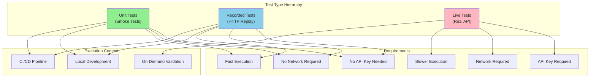
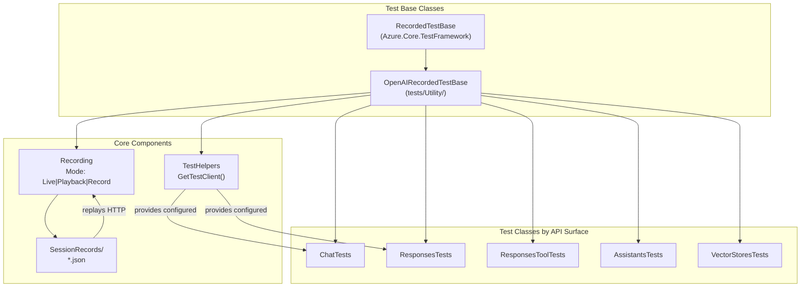
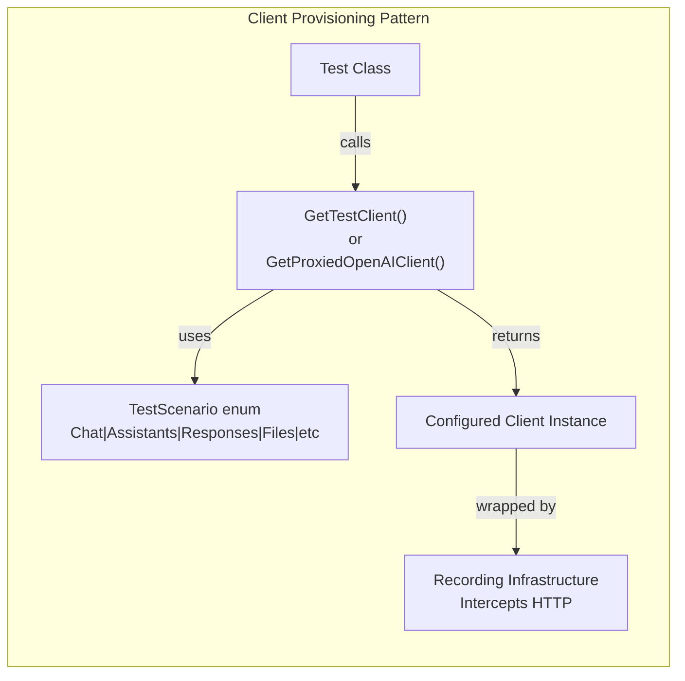
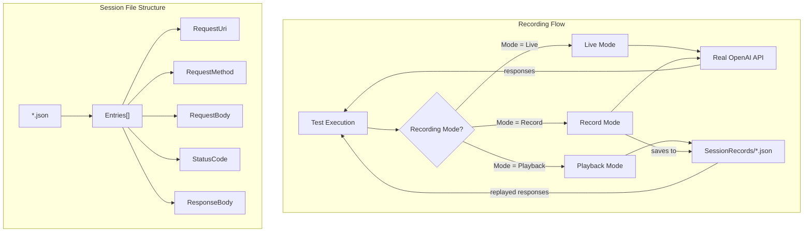
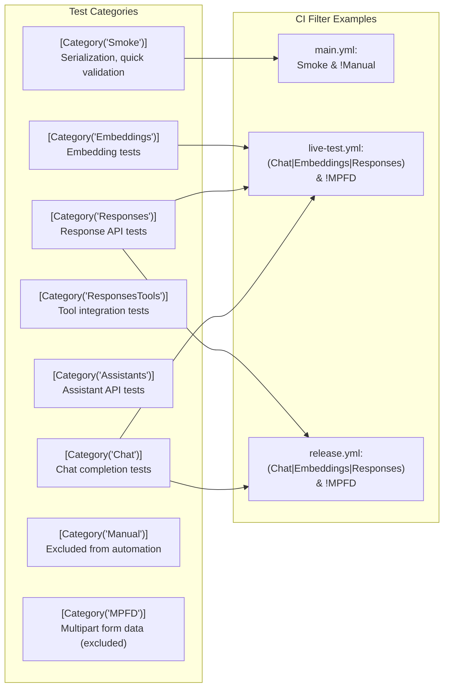
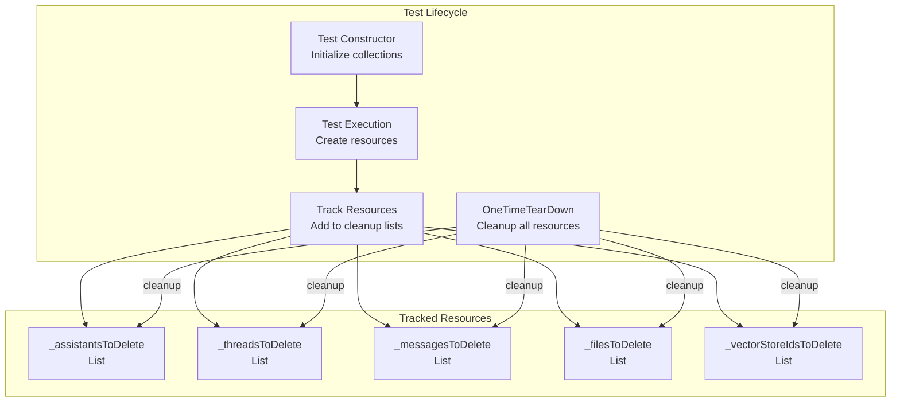
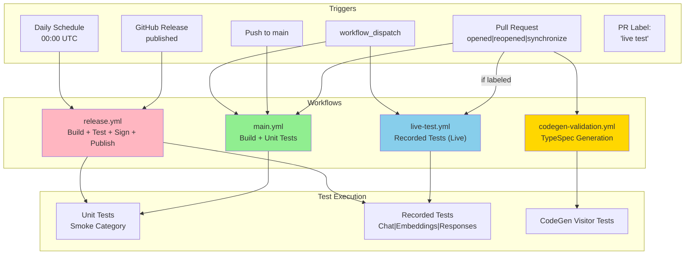
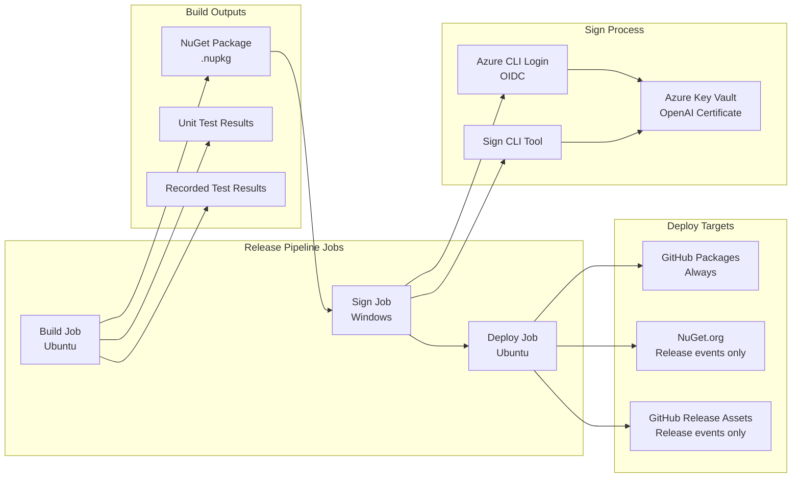

<!-- source: DeepWiki mcp.deepwiki.com · repo openai/openai-dotnet · page 8.3 Testing Strategy · fetched 2026-10-26 -->

# Testing Strategy

<details>
<summary>Relevant source files</summary>

The following files were used as context for generating this wiki page:

- [.github/CODEOWNERS](.github/CODEOWNERS)
- [.github/workflows/codegen-validation.yml](.github/workflows/codegen-validation.yml)
- [.github/workflows/live-test.yml](.github/workflows/live-test.yml)
- [.github/workflows/main.yml](.github/workflows/main.yml)
- [.github/workflows/needs-triage.yml](.github/workflows/needs-triage.yml)
- [.github/workflows/release.yml](.github/workflows/release.yml)
- [.github/workflows/update-generator.yml](.github/workflows/update-generator.yml)
- [examples/OpenAI.Examples.csproj](examples/OpenAI.Examples.csproj)
- [examples/Responses/Example05_RemoteMcp.cs](examples/Responses/Example05_RemoteMcp.cs)
- [examples/Responses/Example05_RemoteMcpAsync.cs](examples/Responses/Example05_RemoteMcpAsync.cs)
- [examples/Responses/Example06_RemoteMcpAuthentication.cs](examples/Responses/Example06_RemoteMcpAuthentication.cs)
- [examples/Responses/Example06_RemoteMcpAuthenticationAsync.cs](examples/Responses/Example06_RemoteMcpAuthenticationAsync.cs)
- [global.json](global.json)
- [scripts/Invoke-CodeGen.ps1](scripts/Invoke-CodeGen.ps1)
- [src/Custom/Responses/ResponseContentPart.cs](src/Custom/Responses/ResponseContentPart.cs)
- [src/Custom/Responses/Tools/McpTool/McpToolCallApprovalPolicy.cs](src/Custom/Responses/Tools/McpTool/McpToolCallApprovalPolicy.cs)
- [src/Generated/Models/Responses/McpToolCallApprovalPolicy.cs](src/Generated/Models/Responses/McpToolCallApprovalPolicy.cs)
- [tests/Assistants/Assistants.VectorStoresTests.cs](tests/Assistants/Assistants.VectorStoresTests.cs)
- [tests/Assistants/AssistantsTests.cs](tests/Assistants/AssistantsTests.cs)
- [tests/OpenAI.Tests.csproj](tests/OpenAI.Tests.csproj)
- [tests/Responses/ResponsesSmokeTests.cs](tests/Responses/ResponsesSmokeTests.cs)
- [tests/Responses/ResponsesToolTests.cs](tests/Responses/ResponsesToolTests.cs)
- [tests/SessionRecords/ResponsesToolTests/ImageGenToolInputMaskWithFileId.json](tests/SessionRecords/ResponsesToolTests/ImageGenToolInputMaskWithFileId.json)
- [tests/SessionRecords/ResponsesToolTests/ImageGenToolInputMaskWithFileIdAsync.json](tests/SessionRecords/ResponsesToolTests/ImageGenToolInputMaskWithFileIdAsync.json)
- [tests/SessionRecords/ResponsesToolTests/ImageGenToolInputMaskWithImageUri.json](tests/SessionRecords/ResponsesToolTests/ImageGenToolInputMaskWithImageUri.json)
- [tests/SessionRecords/ResponsesToolTests/ImageGenToolInputMaskWithImageUriAsync.json](tests/SessionRecords/ResponsesToolTests/ImageGenToolInputMaskWithImageUriAsync.json)

</details>


This document explains the three-tier testing approach used in the OpenAI .NET SDK, covering unit tests, recorded tests, and live tests. The testing infrastructure enables rapid local development while ensuring API compatibility through automated CI/CD workflows.

For information about the code generation validation process, see [CodeGen Validation](#8.1). For details on API compatibility validation, see [API Compatibility](#8.4).

---

## Purpose and Scope

The OpenAI .NET SDK employs a comprehensive testing strategy designed to:
- Enable fast feedback during local development without requiring API keys
- Validate real API behavior through recorded HTTP sessions
- Verify live integration against the actual OpenAI API when needed
- Ensure API surface compatibility and prevent breaking changes
- Support automated testing in CI/CD pipelines

The testing infrastructure supports both synchronous and asynchronous test execution across multiple .NET target frameworks.

---

## Test Types and Organization

### Three-Tier Testing Model

The SDK implements three distinct test types, each serving a specific purpose in the development and validation lifecycle:



**Sources:**
- [.github/workflows/main.yml:44-50]()
- [.github/workflows/live-test.yml:40-48]()
- [.github/workflows/release.yml:56-72]()

### Test Type Characteristics

| Test Type | API Key Required | Network Required | Execution Speed | Primary Use Case |
|-----------|------------------|------------------|-----------------|------------------|
| **Unit/Smoke** | No | No | Fast (<1s per test) | Serialization, model validation, basic logic |
| **Recorded** | No | No | Fast (<1s per test) | API behavior validation via replay |
| **Live** | Yes | Yes | Slow (1-30s per test) | Real integration validation |

**Sources:**
- [tests/Responses/ResponsesSmokeTests.cs:14-15]()
- [tests/Responses/ResponsesToolTests.cs:20-21]()
- [.github/workflows/live-test.yml:14]()

---

## Test Infrastructure

### Base Test Class Architecture



**Sources:**
- [tests/Responses/ResponsesToolTests.cs:22]()
- [tests/Assistants/AssistantsTests.cs:23]()
- [tests/Assistants/Assistants.VectorStoresTests.cs:20]()

### Test Client Provisioning

Test classes use helper methods to obtain properly configured client instances:



**Key Methods:**
- `GetTestClient<T>()`: Returns a client of type `T` configured for the current test scenario
- `GetProxiedOpenAIClient<T>(TestScenario)`: Returns a client for a specific scenario (e.g., `TestScenario.Assistants`)

**Sources:**
- [tests/Responses/ResponsesToolTests.cs:48]()
- [tests/Assistants/AssistantsTests.cs:34]()
- [tests/Responses/ResponsesToolTests.cs:354]()

---

## Session Recording and Playback

### Recording Mechanism

The SDK uses JSON-based session recording to capture and replay HTTP interactions:



**Session File Example:**

Session recordings are stored in `tests/SessionRecords/` with the naming pattern `{TestClassName}/{TestMethodName}.json`. Each file contains an array of HTTP request/response pairs.

**Sources:**
- [tests/SessionRecords/ResponsesToolTests/ImageGenToolInputMaskWithFileId.json:1-167]()
- [tests/SessionRecords/ResponsesToolTests/MCPToolWorks.json]() (referenced)

### Sanitization and Security

Session recordings automatically sanitize sensitive data:
- API keys replaced with "Sanitized"
- Organization and project IDs sanitized
- Request IDs sanitized
- Specific headers marked as "Sanitized"

**Sources:**
- [tests/SessionRecords/ResponsesToolTests/ImageGenToolInputMaskWithFileId.json:8,24-26,33]()

---

## Test Categories and Filtering

### NUnit Category Attributes

Tests are organized using NUnit `[Category]` attributes to enable selective execution:



**Sources:**
- [tests/Responses/ResponsesSmokeTests.cs:13-14]()
- [tests/Responses/ResponsesToolTests.cs:20-21]()
- [tests/Assistants/AssistantsTests.cs:22]()
- [.github/workflows/main.yml:47]()
- [.github/workflows/live-test.yml:43]()
- [.github/workflows/release.yml:66]()

### Filter Expression Patterns

CI workflows use filter expressions to control test execution:

**Main Build (Unit Tests Only):**
```
--filter="TestCategory=Smoke&TestCategory!=Manual"
```

**Live/Recorded Tests:**
```
--filter="(TestCategory=Chat|TestCategory=Embeddings|TestCategory=Responses)&TestCategory!=MPFD"
```

**Sources:**
- [.github/workflows/main.yml:47]()
- [.github/workflows/live-test.yml:43]()
- [.github/workflows/release.yml:66]()

---

## Test Lifecycle and Cleanup

### Resource Management Pattern



**Cleanup Implementation:**

Tests track created resources in collections and clean them up in `OneTimeTearDown`:

**Sources:**
- [tests/Assistants/AssistantsTests.cs:25-29]()
- [tests/Assistants/AssistantsTests.cs:42-83]()
- [tests/Assistants/Assistants.VectorStoresTests.cs:22-25]()

### Mode-Dependent Delays

Tests include conditional delays to avoid timing issues in live mode while keeping playback fast:

```csharp
if (Mode != RecordedTestMode.Playback)
{
    await Task.Delay(TimeSpan.FromSeconds(10));
}
```

**Sources:**
- [tests/Assistants/AssistantsTests.cs:322-325]()
- [tests/Assistants/AssistantsTests.cs:394-397]()
- [tests/Assistants/Assistants.VectorStoresTests.cs:126-129]()

---

## CI/CD Integration

### Workflow Architecture



**Sources:**
- [.github/workflows/main.yml:5-11]()
- [.github/workflows/codegen-validation.yml:5-17]()
- [.github/workflows/live-test.yml:4-14]()
- [.github/workflows/release.yml:7-12]()

### Main Build Workflow

The main build workflow executes on every PR and push to main:

**Execution Steps:**
1. Setup .NET 8, 9, 10
2. Checkout code
3. Build and pack (`dotnet pack`)
4. Run unit tests with filter: `TestCategory=Smoke&TestCategory!=Manual`
5. Upload artifacts (test results)

**Sources:**
- [.github/workflows/main.yml:14-57]()

### Live Test Workflow

Triggered manually or by adding the "live test" label to a PR:

**Execution Steps:**
1. Setup .NET 8, 9, 10
2. Checkout code
3. Run recorded tests with filter: `(TestCategory=Chat|TestCategory=Embeddings|TestCategory=Responses)&TestCategory!=MPFD`
4. Uses `OPENAI_API_KEY` secret from GitHub environment

**Sources:**
- [.github/workflows/live-test.yml:10-56]()

### Release Pipeline

Multi-job workflow for build, sign, and publish:



**Sources:**
- [.github/workflows/release.yml:18-127]()
- [.github/workflows/release.yml:128-184]()

---

## Test Examples and Patterns

### Unit Test Pattern (Smoke Tests)

Unit tests validate serialization and basic model behavior without network calls:

**Example: ResponsesSmokeTests**

Tests in this category validate:
- Serialization of `ResponseItem` types
- `ResponseToolChoice` serialization
- Content part serialization (text, image, file)
- Round-trip serialization integrity

**Sources:**
- [tests/Responses/ResponsesSmokeTests.cs:17-33]()
- [tests/Responses/ResponsesSmokeTests.cs:72-102]()
- [tests/Responses/ResponsesSmokeTests.cs:146-194]()

### Recorded Test Pattern

Recorded tests validate full API interactions via replay:

**Example: ResponsesToolTests.MCPToolWorks**

Test workflow:
1. Create `CreateResponseOptions` with MCP tool configuration
2. Call `client.CreateResponseAsync(options)`
3. Validate response structure and tool outputs
4. Session recording captured in `tests/SessionRecords/ResponsesToolTests/MCPToolWorks.json`

**Sources:**
- [tests/Responses/ResponsesToolTests.cs:29-79]()

### Live Test Pattern with Cleanup

Tests that create resources track them for cleanup:

**Example: AssistantsTests.FileSearchWorks**

Test workflow:
1. Upload test file using `OpenAIFileClient`
2. Create vector store with file
3. Create assistant with file search tool
4. Create thread and run
5. Resources tracked in `_filesToDelete`, `_vectorStoreIdsToDelete`, etc.
6. Cleanup in `OneTimeTearDown`

**Sources:**
- [tests/Assistants/AssistantsTests.cs:647-738]()
- [tests/Assistants/AssistantsTests.cs:42-83]()

### Streaming Test Pattern

Tests validate streaming updates incrementally:

**Example: ResponsesToolTests.CodeInterpreterToolStreaming**

Test workflow:
1. Create options with `StreamingEnabled = true`
2. Enumerate `AsyncCollectionResult<StreamingResponseUpdate>`
3. Count specific update types (InProgress, Interpreting, CodeDelta, CodeDone, Completed)
4. Validate expected update sequence

**Sources:**
- [tests/Responses/ResponsesToolTests.cs:586-618]()

---

## Test Configuration and Environment

### Test Project Configuration

The test project targets multiple frameworks and includes necessary test dependencies:

**Target Frameworks:**
- Defined by `$(TestTargetFrameworks)` property
- Typically includes .NET 8.0, 9.0, 10.0

**Key Dependencies:**
- `Microsoft.ClientModel.TestFramework` - Recording infrastructure
- `Microsoft.NET.Test.Sdk` - Test execution
- `NUnit` and `NUnit3TestAdapter` - Test framework
- `Moq` - Mocking library
- `System.Linq.AsyncEnumerable` - Async enumeration support

**Sources:**
- [tests/OpenAI.Tests.csproj:1-36]()

### Environment Variables

Tests use environment variables for configuration:

| Variable | Purpose | Required For |
|----------|---------|--------------|
| `OPENAI_API_KEY` | OpenAI API authentication | Live tests only |

**Conditional Cleanup:**

```csharp
if (Mode == RecordedTestMode.Playback || 
    string.IsNullOrEmpty(Environment.GetEnvironmentVariable("OPENAI_API_KEY")))
{
    return; // Skip cleanup
}
```

**Sources:**
- [tests/Assistants/AssistantsTests.cs:46-48]()
- [.github/workflows/live-test.yml:48]()
- [.github/workflows/release.yml:71]()

---

## Test Execution Examples

### Local Development

**Run all smoke tests:**
```bash
dotnet test --filter="TestCategory=Smoke&TestCategory!=Manual"
```

**Run recorded tests (no API key needed):**
```bash
dotnet test tests/OpenAI.Tests.csproj \
  --filter="TestCategory=Responses"
```

**Run live tests (requires API key):**
```bash
export OPENAI_API_KEY="your-key-here"
dotnet test tests/OpenAI.Tests.csproj \
  --filter="TestCategory=Chat"
```

### CI Execution

Tests run automatically in CI with specific filters:

**Main build (PRs and main branch):**
- Unit tests only
- Fast feedback (< 5 minutes)
- No API key required

**Live test workflow:**
- Triggered by label or manual dispatch
- Uses GitHub secrets for API key
- Full integration validation

**Release pipeline:**
- Daily scheduled run at 00:00 UTC
- On GitHub release events
- Includes smoke + recorded tests
- Signs and publishes packages

**Sources:**
- [.github/workflows/main.yml:44-50]()
- [.github/workflows/live-test.yml:40-48]()
- [.github/workflows/release.yml:56-72]()

---

## Test Timeout Configuration

Tests can configure custom timeout values using the `TestTimeoutInSeconds` property:

**Default Timeout:**
- Standard tests: Default NUnit timeout

**Custom Timeouts:**
```csharp
public AssistantsTests(bool isAsync) : base(isAsync)
{
    TestTimeoutInSeconds = 75;
}
```

**Sources:**
- [tests/Assistants/AssistantsTests.cs:36-40]()
- [tests/Responses/ResponsesToolTests.cs:24-27]()
- [tests/Assistants/Assistants.VectorStoresTests.cs:31-35]()

---

## Best Practices

### Test Organization

1. **Group by API Surface**: Tests organized by client type (Chat, Assistants, Responses)
2. **Use Categories**: Apply `[Category]` attributes for selective execution
3. **Separate Concerns**: Keep unit tests, recorded tests, and integration tests distinct

### Recording Management

1. **Sanitize Secrets**: Session recordings automatically sanitize API keys and sensitive data
2. **Commit Recordings**: Session recordings are committed to source control for CI replay
3. **Update on Changes**: Re-record when API contracts change

### Resource Cleanup

1. **Track Resources**: Add created resources to cleanup collections
2. **Implement Teardown**: Use `OneTimeTearDown` for cleanup
3. **Conditional Cleanup**: Skip cleanup in playback mode or when API key is missing

### Performance

1. **Use Playback for CI**: Recorded tests provide fast feedback without network calls
2. **Conditional Delays**: Use `if (Mode != RecordedTestMode.Playback)` for delays
3. **Filter Strategically**: Use test categories to run only relevant tests

**Sources:**
- [tests/Assistants/AssistantsTests.cs:42-83]()
- [tests/Responses/ResponsesToolTests.cs:20-27]()
- [.github/workflows/main.yml:44-50]()

---

