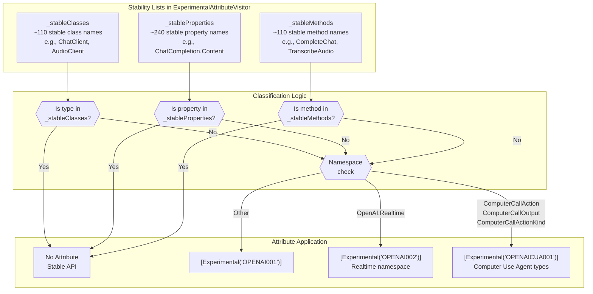
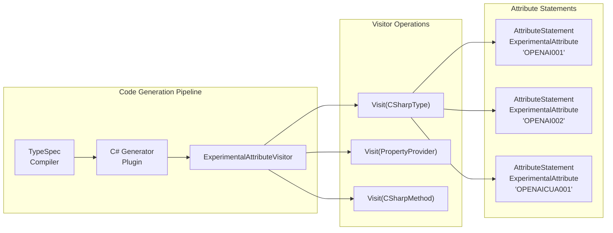
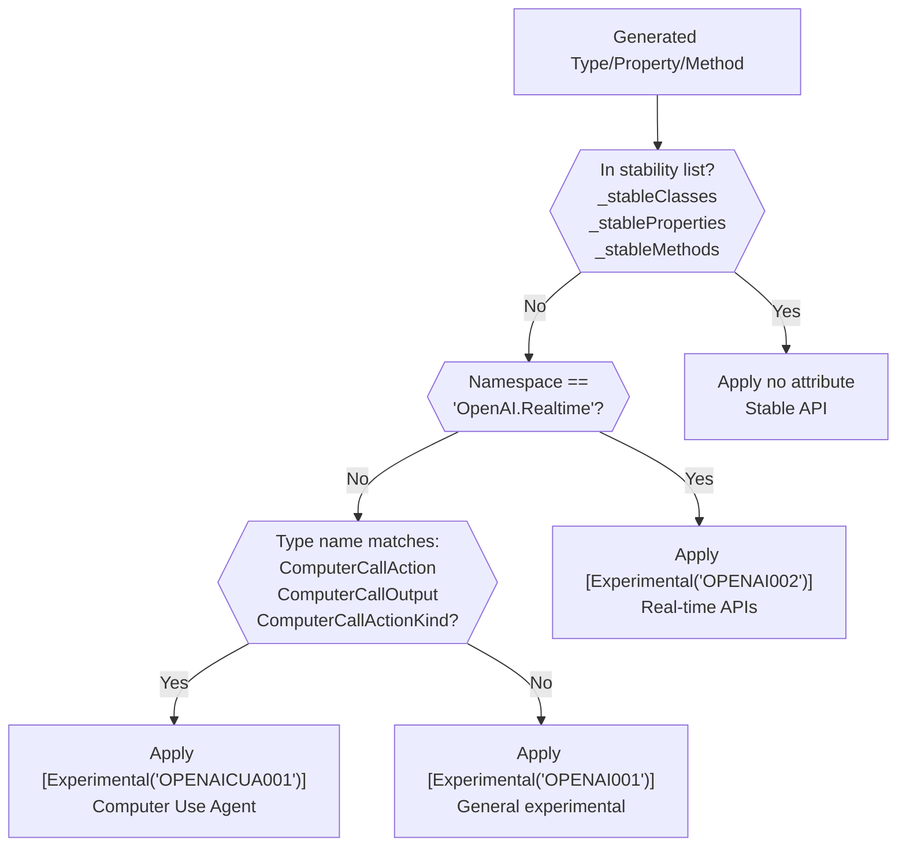
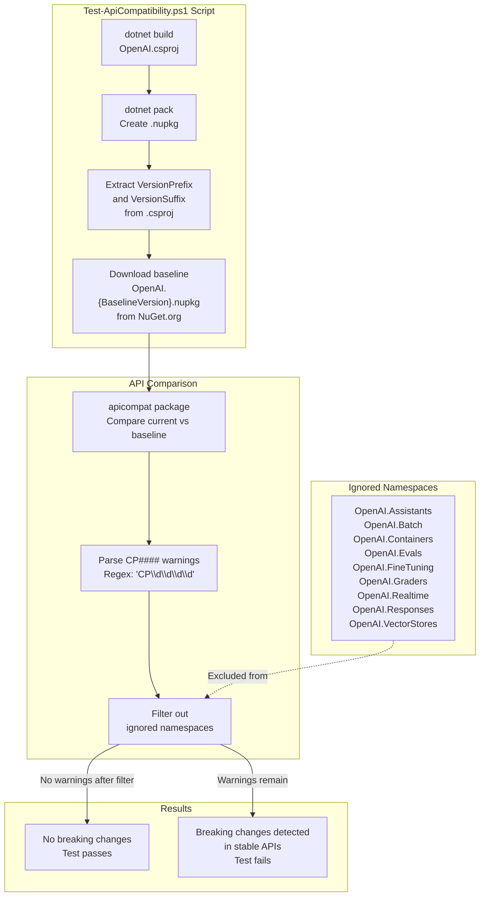

<!-- source: DeepWiki mcp.deepwiki.com · repo openai/openai-dotnet · page 8.4 API Compatibility · fetched 2026-10-26 -->

# API Compatibility

<details>
<summary>Relevant source files</summary>

The following files were used as context for generating this wiki page:

- [.github/CODEOWNERS](.github/CODEOWNERS)
- [.github/workflows/codegen-validation.yml](.github/workflows/codegen-validation.yml)
- [.github/workflows/live-test.yml](.github/workflows/live-test.yml)
- [.github/workflows/main.yml](.github/workflows/main.yml)
- [.github/workflows/needs-triage.yml](.github/workflows/needs-triage.yml)
- [.github/workflows/release.yml](.github/workflows/release.yml)
- [.github/workflows/update-generator.yml](.github/workflows/update-generator.yml)
- [Directory.Build.targets](Directory.Build.targets)
- [Directory.Packages.props](Directory.Packages.props)
- [api/OpenAI.net10.0.cs](api/OpenAI.net10.0.cs)
- [examples/OpenAI.Examples.csproj](examples/OpenAI.Examples.csproj)
- [global.json](global.json)
- [nuget.config](nuget.config)
- [scripts/Export-Api.ps1](scripts/Export-Api.ps1)
- [scripts/Invoke-CodeGen.ps1](scripts/Invoke-CodeGen.ps1)
- [tests/OpenAI.Tests.csproj](tests/OpenAI.Tests.csproj)
- [tests/Responses/ResponsesToolTests.cs](tests/Responses/ResponsesToolTests.cs)

</details>


This document describes the API compatibility testing system used in the OpenAI .NET SDK to maintain backwards compatibility guarantees for stable APIs while allowing experimental features to evolve rapidly. It covers the stability classification mechanism, experimental attribute system, compatibility testing workflow, and the guarantees provided to library consumers.

For information about the code generation system that produces these APIs, see [Code Generation System](#8.1). For details about the CI/CD pipeline that enforces these guarantees, see [CI/CD Pipeline](#8.2).

## Stability Classification System

The OpenAI .NET SDK implements a two-tier API stability system that distinguishes between production-ready stable APIs and experimental preview features. This classification is enforced at code generation time through the `ExperimentalAttributeVisitor` and validated during the build process.

### Stable APIs

Stable APIs are production-ready and guaranteed to maintain backwards compatibility across minor and patch version releases. These APIs have **no experimental attributes** and are safe for production use. The stable APIs include:

| Namespace | Client | Purpose |
|-----------|--------|---------|
| `OpenAI.Audio` | `AudioClient` | Speech generation, audio transcription, translation |
| `OpenAI.Chat` | `ChatClient` | Chat completions, function calling, structured outputs |
| `OpenAI.Embeddings` | `EmbeddingClient` | Text embeddings generation |
| `OpenAI.Files` | `OpenAIFileClient` | File upload, download, management |
| `OpenAI.Images` | `ImageClient` | Image generation, editing, variations |
| `OpenAI.Models` | `OpenAIModelClient` | Model listing and retrieval |
| `OpenAI.Moderations` | `ModerationClient` | Content moderation |
| `OpenAI` | `OpenAIClient` | Client factory |

### Experimental APIs

Experimental APIs are marked with the `[Experimental]` attribute and may have breaking changes in any release. Three distinct diagnostic IDs are used to categorize experimental features:

#### OPENAI001 - General Experimental Features

Applied to most experimental APIs including:
- `OpenAI.Assistants` - Assistant management, threads, runs
- `OpenAI.Batch` - Batch processing operations
- `OpenAI.Containers` - Container management
- `OpenAI.Evals` - Evaluation operations
- `OpenAI.FineTuning` - Fine-tuning job management
- `OpenAI.Graders` - Grading operations
- `OpenAI.Responses` - Response API (except Computer Use Agent types)
- `OpenAI.VectorStores` - Vector store management
- `OpenAI.Videos` - Video generation and remixing

#### OPENAI002 - Realtime APIs

Applied exclusively to real-time conversation features:
- `OpenAI.Realtime` namespace and all contained types

#### OPENAICUA001 - Computer Use Agent Types

Applied to Computer Use Agent integration types within the Responses API:
- `ComputerCallAction` and related types
- `ComputerCallActionKind`
- `ComputerCallOutput`

**Sources:** [codegen/generator/src/Visitors/ExperimentalAttributeVisitor.cs:19-22](), [scripts/Test-ApiCompatibility.ps1:165-175]()

### Stability Lists

The stability classification is driven by hardcoded lists maintained in the `ExperimentalAttributeVisitor`. These lists explicitly enumerate which types, properties, and methods are considered stable:



**Sources:** [codegen/generator/src/Visitors/ExperimentalAttributeVisitor.cs:25-307]()

## Experimental Attribute Visitor

The `ExperimentalAttributeVisitor` is a custom visitor in the code generation pipeline that applies `[Experimental]` attributes to generated types, properties, and methods based on stability rules.

### Visitor Implementation



The visitor overrides three key methods:

- `Visit(CSharpType type)` - [codegen/generator/src/Visitors/ExperimentalAttributeVisitor.cs:309-346]() - Applies experimental attributes to types (classes, enums, structs)
- `Visit(PropertyProvider property)` - [codegen/generator/src/Visitors/ExperimentalAttributeVisitor.cs:348-379]() - Applies attributes to properties
- `Visit(CSharpMethod method)` - [codegen/generator/src/Visitors/ExperimentalAttributeVisitor.cs:381-415]() - Applies attributes to methods

### Attribute Application Logic

The decision logic follows this hierarchy:



This conservative approach ensures that any public API not explicitly whitelisted in the stability lists is treated as experimental by default.

**Sources:** [codegen/generator/src/Visitors/ExperimentalAttributeVisitor.cs:14-415]()

## API Compatibility Testing

The SDK enforces backwards compatibility through automated testing using the `apicompat` tool. This testing is performed by the `Test-ApiCompatibility.ps1` script and integrated into the CI/CD pipeline.

### Compatibility Testing Workflow



**Sources:** [scripts/Test-ApiCompatibility.ps1:1-181]()

### Key Components

#### Invoke-APICompat Function

The main compatibility testing function [scripts/Test-ApiCompatibility.ps1:67-159]() performs these operations:

1. **Build and Pack** - Builds the current project and creates a NuGet package
2. **Download Baseline** - Retrieves the specified baseline version from NuGet.org (currently version 2.6.0)
3. **Run apicompat** - Executes Microsoft's `apicompat` tool to compare assemblies
4. **Parse Output** - Extracts warnings matching the pattern `CP\d\d\d\d`
5. **Filter Warnings** - Removes warnings from experimental namespaces using regex: `OpenAI\.(Assistants|Batch|Containers|Evals|FineTuning|Graders|Realtime|Responses|VectorStores)`
6. **Report Results** - Fails the build if any warnings remain after filtering

#### Excluded Namespaces

The following namespaces are explicitly excluded from compatibility checking [scripts/Test-ApiCompatibility.ps1:165-175]():

```
OpenAI.Assistants
OpenAI.Batch
OpenAI.Containers
OpenAI.Evals
OpenAI.FineTuning
OpenAI.Graders
OpenAI.Realtime
OpenAI.Responses
OpenAI.VectorStores
```

This exclusion allows experimental APIs to evolve without breaking the build.

### CI/CD Integration

The compatibility test is run as part of the CI/CD pipeline, though there isn't a dedicated workflow for it in the provided files. The main validation workflow [.github/workflows/codegen-validation.yml:1-86]() focuses on ensuring deterministic code generation, while the release workflow would typically include compatibility checks before publishing.

**Sources:** [scripts/Test-ApiCompatibility.ps1:1-181](), [.github/workflows/codegen-validation.yml:1-86]()

## Backwards Compatibility Guarantees

The OpenAI .NET SDK provides different compatibility guarantees based on API stability classification.

### Stable API Guarantees

For APIs **without** the `[Experimental]` attribute (stable APIs):

| Guarantee | Description |
|-----------|-------------|
| **Method Signatures** | Public method signatures will not change in breaking ways within the same major version |
| **Property Types** | Public property types will remain compatible |
| **Return Types** | Return types will not change in breaking ways |
| **Constructor Signatures** | Public constructor parameters will remain compatible |
| **Binary Compatibility** | Compiled applications will continue to work without recompilation across minor/patch versions |
| **Semantic Versioning** | Breaking changes only occur in major version increments (e.g., 2.x.x → 3.0.0) |

### Experimental API Non-Guarantees

For APIs marked with `[Experimental("OPENAI001")]`, `[Experimental("OPENAI002")]`, or `[Experimental("OPENAICUA001")]`:

| Non-Guarantee | Implication |
|---------------|-------------|
| **Breaking Changes** | May occur in any release (major, minor, or patch) |
| **API Removal** | Features may be removed entirely |
| **Signature Changes** | Method and property signatures may change |
| **Namespace Changes** | Types may be moved to different namespaces |
| **Graduation to Stable** | When an experimental API graduates to stable, breaking changes cease |

Experimental APIs generate compiler warnings when used, which can be suppressed in the consuming project's `.csproj` file:

```xml
<NoWarn>$(NoWarn);OPENAI001;OPENAI002;OPENAICUA001</NoWarn>
```

This is how the SDK itself suppresses these warnings [src/OpenAI.csproj:44]().

### Version Policy

The SDK follows semantic versioning with these rules:

- **Patch versions** (2.7.1) - Bug fixes, no breaking changes
- **Minor versions** (2.8.0) - New features, experimental API evolution, no breaking changes to stable APIs
- **Major versions** (3.0.0) - Breaking changes to stable APIs, experimental API graduation

The CHANGELOG [CHANGELOG.md:1-600]() documents all breaking changes under a "Breaking Changes in Preview APIs" section for each release.

**Sources:** [src/OpenAI.csproj:44](), [CHANGELOG.md:1-600]()

## Code Entity Reference

The following table maps system components to their code locations:

| Component | Code Entity | Location |
|-----------|-------------|----------|
| Stability Lists | `_stableClasses`, `_stableProperties`, `_stableMethods` | [codegen/generator/src/Visitors/ExperimentalAttributeVisitor.cs:25-307]() |
| Attribute Application | `ExperimentalAttributeVisitor` | [codegen/generator/src/Visitors/ExperimentalAttributeVisitor.cs:17]() |
| Experimental Attributes | `_experimental001Attribute`, `_experimental002Attribute`, `_experimentalCUA001Attribute` | [codegen/generator/src/Visitors/ExperimentalAttributeVisitor.cs:20-22]() |
| Compatibility Testing | `Invoke-APICompat` function | [scripts/Test-ApiCompatibility.ps1:67]() |
| Namespace Exclusions | `$experimentalNamespaces` variable | [scripts/Test-ApiCompatibility.ps1:165]() |
| Baseline Version | Script parameter `BaselineVersion` | [scripts/Test-ApiCompatibility.ps1:79-80]() |
| Warning Pattern | Regex `CP\d\d\d\d` | [scripts/Test-ApiCompatibility.ps1:118]() |
| Ignored Namespace Pattern | Regex concatenation of excluded namespaces | [scripts/Test-ApiCompatibility.ps1:121]() |

**Sources:** [codegen/generator/src/Visitors/ExperimentalAttributeVisitor.cs:1-415](), [scripts/Test-ApiCompatibility.ps1:1-181]()

---

