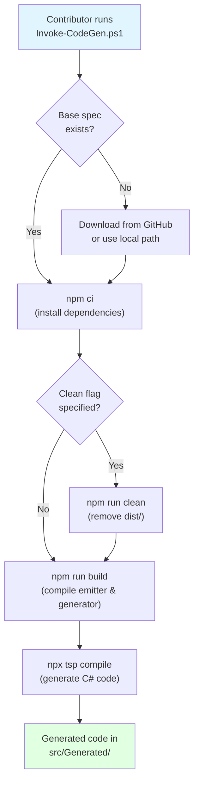
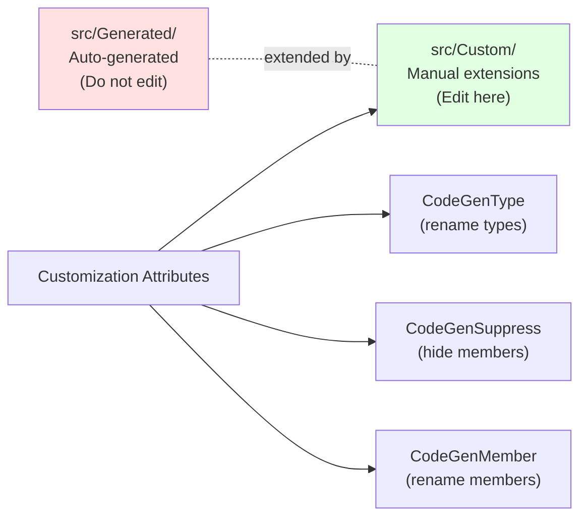
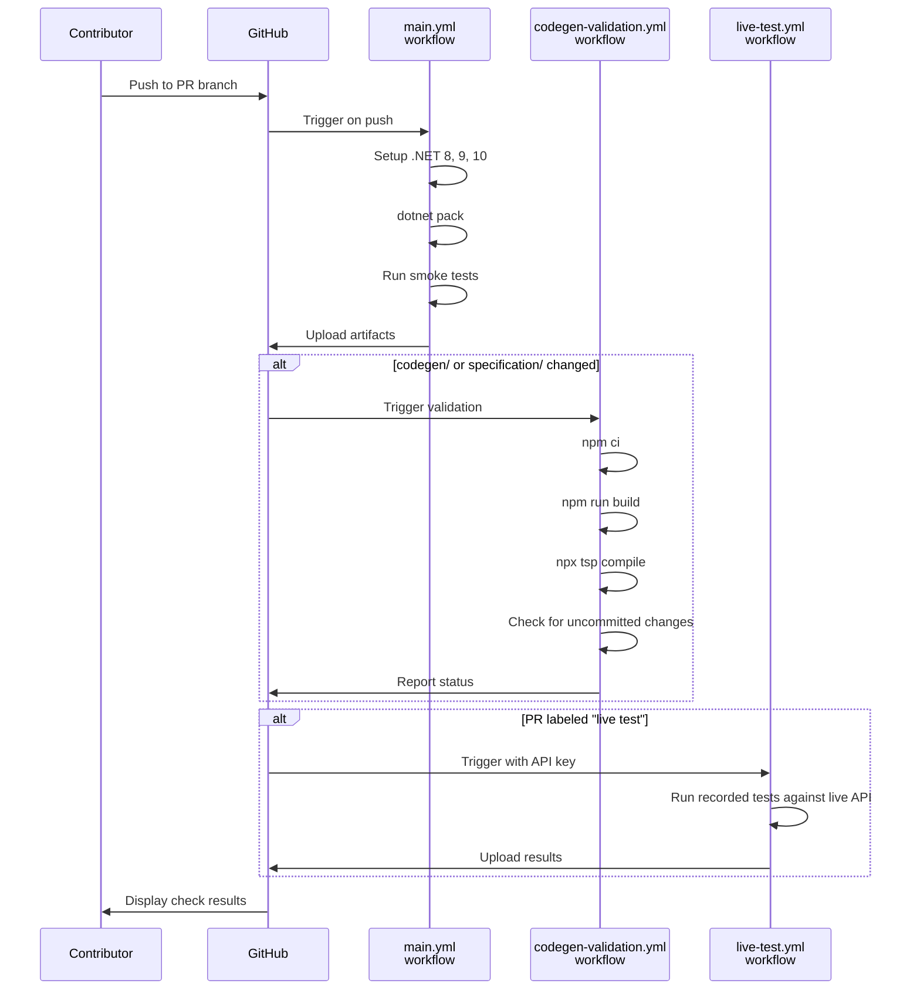
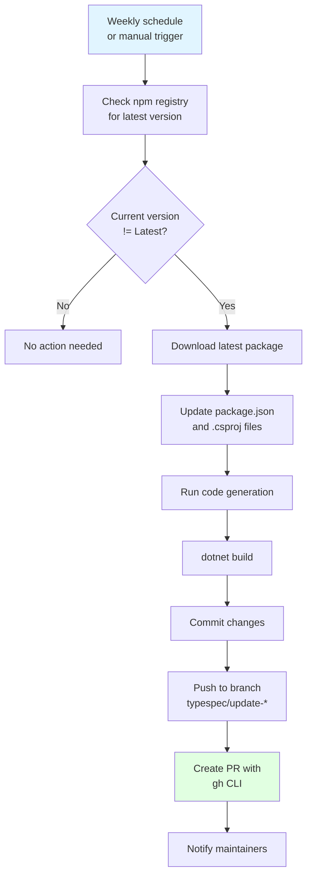
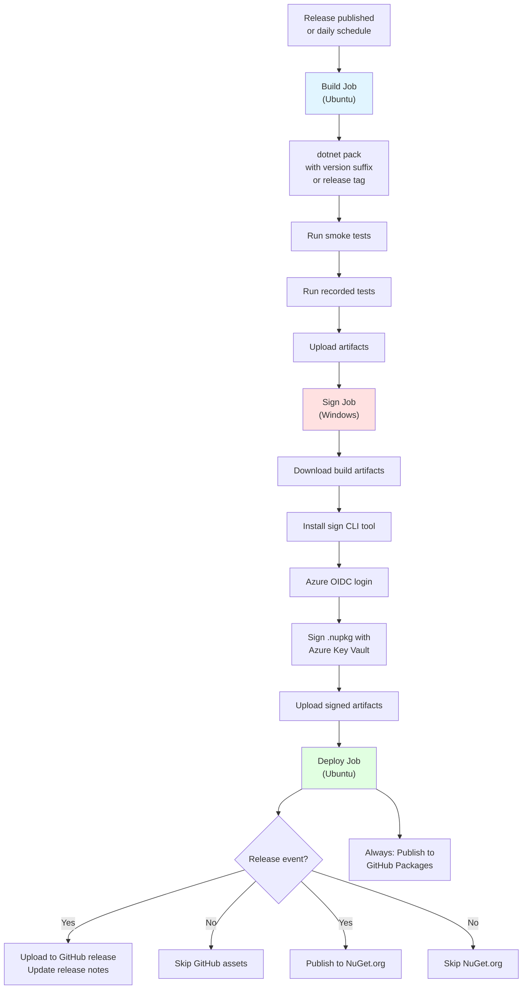

<!-- source: DeepWiki mcp.deepwiki.com · repo openai/openai-dotnet · page 8.6 Contributing Guidelines · fetched 2026-10-26 -->

# Contributing Guidelines

<details>
<summary>Relevant source files</summary>

The following files were used as context for generating this wiki page:

- [.github/CODEOWNERS](.github/CODEOWNERS)
- [.github/workflows/codegen-validation.yml](.github/workflows/codegen-validation.yml)
- [.github/workflows/live-test.yml](.github/workflows/live-test.yml)
- [.github/workflows/main.yml](.github/workflows/main.yml)
- [.github/workflows/needs-triage.yml](.github/workflows/needs-triage.yml)
- [.github/workflows/release.yml](.github/workflows/release.yml)
- [.github/workflows/update-generator.yml](.github/workflows/update-generator.yml)
- [codegen/generator/src/OpenAI.Library.Plugin.csproj](codegen/generator/src/OpenAI.Library.Plugin.csproj)
- [codegen/package.json](codegen/package.json)
- [examples/OpenAI.Examples.csproj](examples/OpenAI.Examples.csproj)
- [global.json](global.json)
- [package-lock.json](package-lock.json)
- [package.json](package.json)
- [scripts/Invoke-CodeGen.ps1](scripts/Invoke-CodeGen.ps1)
- [scripts/Submit-GeneratorUpdatePr.ps1](scripts/Submit-GeneratorUpdatePr.ps1)
- [src/Custom/Conversations/IncludedConversationItemProperty.cs](src/Custom/Conversations/IncludedConversationItemProperty.cs)
- [src/Custom/Videos/Internal/InternalOrderEnum.cs](src/Custom/Videos/Internal/InternalOrderEnum.cs)
- [src/Custom/Videos/Internal/InternalVideoContentVariant.cs](src/Custom/Videos/Internal/InternalVideoContentVariant.cs)
- [src/Generated/Models/Conversations/IncludedConversationItemProperty.cs](src/Generated/Models/Conversations/IncludedConversationItemProperty.cs)
- [src/Generated/Models/Videos/InternalOrderEnum.cs](src/Generated/Models/Videos/InternalOrderEnum.cs)
- [src/Generated/Models/Videos/InternalVideoContentVariant.cs](src/Generated/Models/Videos/InternalVideoContentVariant.cs)
- [tests/OpenAI.Tests.csproj](tests/OpenAI.Tests.csproj)
- [tests/Responses/ResponsesToolTests.cs](tests/Responses/ResponsesToolTests.cs)

</details>


This document provides guidelines for contributing to the OpenAI .NET SDK repository. It covers development environment setup, code generation workflows, testing requirements, and the pull request process.

For information about the code generation system architecture, see [Code Generation System](#8.1). For details on the CI/CD pipeline, see [CI/CD Pipeline](#8.2). For testing infrastructure and strategies, see [Testing Strategy](#8.3).

---

## Development Environment Prerequisites

Contributors need the following tools installed to build and test the SDK:

| Tool | Version | Purpose | Source |
|------|---------|---------|--------|
| **.NET SDK** | 10.0.100+ | Building and testing the library | [global.json:2-5]() |
| **Node.js** | 22.x | Running TypeSpec code generation | [.github/workflows/codegen-validation.yml:28-31]() |
| **PowerShell** | 7.0+ | Running build scripts | [scripts/Invoke-CodeGen.ps1:1]() |
| **Git** | Latest | Version control operations | [scripts/Submit-GeneratorUpdatePr.ps1:238-239]() |

The .NET SDK version is controlled by `global.json` with feature rollforward enabled, meaning any 10.x SDK will work.

**Sources:** [global.json:1-6](), [.github/workflows/codegen-validation.yml:28-38]()

---

## Repository Structure for Contributors

Understanding the key directories helps navigate contribution workflows:

```mermaid
graph TB
    Root["openai-dotnet/"]
    
    Root --> Src["src/<br/>SDK source code"]
    Root --> Tests["tests/<br/>Test projects"]
    Root --> Examples["examples/<br/>Sample code"]
    Root --> Codegen["codegen/<br/>Code generation plugin"]
    Root --> Spec["specification/<br/>TypeSpec definitions"]
    Root --> Scripts["scripts/<br/>Build scripts"]
    Root --> Workflows[".github/workflows/<br/>CI/CD automation"]
    
    Src --> SrcGen["Generated/<br/>Auto-generated code"]
    Src --> SrcCustom["Custom/<br/>Manual extensions"]
    
    Codegen --> CgEmitter["emitter/<br/>TypeScript emitter"]
    Codegen --> CgGenerator["generator/<br/>C# generator"]
    
    Spec --> SpecBase["base/<br/>TypeSpec specs<br/>(from OpenAI repo)"]
    Spec --> SpecClient["client/<br/>Client customizations"]
    
    Scripts --> InvokeCodeGen["Invoke-CodeGen.ps1"]
    Scripts --> SubmitPR["Submit-GeneratorUpdatePr.ps1"]
    
    Workflows --> MainYml["main.yml<br/>Build & unit test"]
    Workflows --> ReleaseYml["release.yml<br/>Release & publish"]
    Workflows --> LiveTestYml["live-test.yml<br/>Live API tests"]
    Workflows --> CodegenValidYml["codegen-validation.yml<br/>Codegen checks"]
    
    style Src fill:#e1f5ff
    style Codegen fill:#fff4e1
    style Workflows fill:#ffe1f5
```



**Sources:** [package.json:1-14](), [codegen/package.json:1-46](), [.github/workflows/]()

---

## Code Generation Workflow

### When to Regenerate Code

Contributors must regenerate code in these scenarios:

1. **TypeSpec specifications change** - When `specification/` files are modified
2. **Generator plugin updates** - When `codegen/` code changes
3. **Generator version updates** - When upgrading `@typespec/http-client-csharp`

### Running Code Generation

The primary code generation script is `Invoke-CodeGen.ps1`:



**Command-line usage:**

```powershell
# Basic usage (uses existing specification)
./scripts/Invoke-CodeGen.ps1

# Clean build
./scripts/Invoke-CodeGen.ps1 -Clean

# Use local specification path
./scripts/Invoke-CodeGen.ps1 -LocalRepositoryPath "C:\path\to\openai-spec"

# Download from GitHub
./scripts/Invoke-CodeGen.ps1 -GitHubOwner "openai" -GitHubRepository "openai-spec" -CommitHash "abc123"
```

**Sources:** [scripts/Invoke-CodeGen.ps1:1-325](), [.github/workflows/codegen-validation.yml:39-50]()

### Code Generation Parameters

The script supports multiple parameter sets:

| Parameter | Required | Purpose |
|-----------|----------|---------|
| `-LocalRepositoryPath` | For local mode | Path to local TypeSpec repository |
| `-GitHubOwner` | For GitHub mode | GitHub repository owner |
| `-GitHubRepository` | For GitHub mode | GitHub repository name |
| `-CommitHash` | Optional | Specific commit to download (default: `706a4fb...`) |
| `-GitHubToken` | Optional | GitHub PAT for private repos |
| `-Force` | Optional | Overwrite existing specifications |
| `-Clean` | Optional | Clean build artifacts before generation |

**Sources:** [scripts/Invoke-CodeGen.ps1:1-23]()

---

## Making Code Changes

### Customization Patterns

The SDK uses partial classes to extend generated code. Contributors should follow these patterns:



**Example customization pattern:**

[src/Custom/Conversations/IncludedConversationItemProperty.cs:1-27]() demonstrates:
- Using `[CodeGenType("IncludeEnum")]` to rename generated type
- Using `[CodeGenMember("...")]` to rename properties
- Implementing custom logic in partial class

**Sources:** [src/Custom/Conversations/IncludedConversationItemProperty.cs:1-27](), [src/Custom/Videos/Internal/InternalVideoContentVariant.cs:1-11]()

### Testing Changes Locally

Before submitting a PR, contributors should:

1. **Run unit tests** (smoke tests):
   ```bash
   dotnet test --configuration Release --filter="TestCategory=Smoke&TestCategory!=Manual"
   ```

2. **Run recorded tests** (no API key needed):
   ```bash
   dotnet test ./tests/OpenAI.Tests.csproj --filter="(TestCategory=Chat|TestCategory=Embeddings|TestCategory=Responses)&TestCategory!=MPFD"
   ```

3. **Optionally run live tests** (requires API key):
   ```bash
   export OPENAI_API_KEY="your-key"
   dotnet test ./tests/OpenAI.Tests.csproj --filter="TestCategory=Chat"
   ```

**Sources:** [.github/workflows/main.yml:44-50](), [.github/workflows/release.yml:56-71]()

---

## Pull Request Process

### PR Validation Workflow

When a PR is created, multiple validation workflows execute automatically:



**Sources:** [.github/workflows/main.yml:1-57](), [.github/workflows/codegen-validation.yml:1-86](), [.github/workflows/live-test.yml:1-56]()

### Code Generation Validation

The `codegen-validation.yml` workflow enforces that generated code is up-to-date:

1. Runs code generation from scratch
2. Checks `git diff --quiet` for uncommitted changes
3. Checks `git ls-files --others --exclude-standard` for untracked files
4. **Fails the PR** if any changes are detected

**Error message if validation fails:**

```
::error::Code generation produced uncommitted changes. 
Please run the codegen script locally and commit the results.
```

**Sources:** [.github/workflows/codegen-validation.yml:52-72]()

### Code Review Assignment

The repository uses `CODEOWNERS` to automatically assign reviewers:

```
*    @joseharriaga @christothes @ShivangiReja @jsquire
```

All PRs are automatically assigned to these maintainers for review.

**Sources:** [.github/CODEOWNERS:1-5]()

### Live Testing Trigger

Contributors can request live API testing by:
1. Adding the `live test` label to the PR, or
2. Maintainers can manually trigger the workflow

The workflow requires secrets (`OPENAI_API_KEY`) accessible only to maintainers.

**Sources:** [.github/workflows/live-test.yml:6-14]()

---

## Testing Guidelines

### Test Categories

The SDK uses three test types with different execution contexts:

| Category | API Calls | Purpose | Execution Context |
|----------|-----------|---------|-------------------|
| **Smoke** | None | Fast serialization/validation tests | Always runs in CI |
| **Recorded** | Replayed from JSON | Integration tests without live API | Runs in CI and release |
| **Live** | Real API calls | End-to-end validation | Manual trigger or labeled PRs |

**Test filter syntax:**

```bash
# Smoke tests only
--filter="TestCategory=Smoke&TestCategory!=Manual"

# Recorded tests for specific features
--filter="(TestCategory=Chat|TestCategory=Embeddings|TestCategory=Responses)&TestCategory!=MPFD"

# All tests for a feature
--filter="TestCategory=Chat"
```

**Sources:** [.github/workflows/main.yml:47-49](), [.github/workflows/release.yml:56-71]()

### Test Infrastructure

Tests inherit from `OpenAIRecordedTestBase` which provides:
- HTTP recording and playback via `SessionRecords/*.json`
- Test client factory methods via `GetTestClient<T>()`
- Environment-based test mode (Playback, Record, Live)

**Example test pattern:**

```csharp
[RecordedTest]
public async Task ExampleTest()
{
    ResponsesClient client = GetTestClient();
    ResponseResult response = await client.CreateResponseAsync(options);
    Assert.That(response.OutputItems, Has.Count.GreaterThan(0));
}
```

**Sources:** [tests/Responses/ResponsesToolTests.cs:20-79]()

### Adding New Tests

When contributing new tests:

1. **Categorize with attributes:**
   ```csharp
   [Category("Feature")]
   [RecordedTest]
   ```

2. **Use test helpers** from [tests/TestHelpers.cs]()

3. **Record sessions** by running with `OPENAI_API_KEY` set

4. **Commit session recordings** in `tests/SessionRecords/`

**Sources:** [tests/Responses/ResponsesToolTests.cs:20-27](), [tests/OpenAI.Tests.csproj:1-36]()

---

## Automated Maintenance Workflows

### Generator Version Updates

The repository automatically checks for new `@typespec/http-client-csharp` versions:



**Workflow schedule:**
- **Weekly:** Monday at 9 AM UTC
- **Manual:** `workflow_dispatch` trigger
- **External:** `repository_dispatch` from TypeSpec repository

**Sources:** [.github/workflows/update-generator.yml:1-77](), [scripts/Submit-GeneratorUpdatePr.ps1:1-325]()

### Update Script Dependencies

The `Submit-GeneratorUpdatePr.ps1` script updates multiple dependencies:

1. **`@typespec/http-client-csharp`** - Primary generator
2. **`Microsoft.TypeSpec.Generator.ClientModel`** - NuGet package
3. **Injected dependencies:**
   - `@azure-tools/typespec-client-generator-core`
   - `@typespec/http`
   - `@typespec/openapi`

These are automatically synchronized based on the generator package's `devDependencies`.

**Sources:** [scripts/Submit-GeneratorUpdatePr.ps1:94-169]()

### Issue Triage Automation

New issues are automatically labeled `needs-triage` unless:
- The issue already has labels, or
- The author has write permissions to the repository

**Sources:** [.github/workflows/needs-triage.yml:1-64]()

---

## Release Process

### Release Workflow

The release process is triggered by creating a GitHub release or runs daily:



**Package destinations:**
- **GitHub Packages:** Every build (including daily)
- **NuGet.org:** Only for GitHub releases
- **GitHub Release Assets:** Only for GitHub releases

**Sources:** [.github/workflows/release.yml:1-184]()

### Code Signing

The release workflow uses Azure Key Vault for code signing:

- **Certificate:** `OpenAISDKSCCert` in `sc-openaisdk.vault.azure.net`
- **Authentication:** OIDC with Azure CLI
- **Platform:** Windows agents required for Authenticode signing
- **Tool:** `sign` CLI from Microsoft

**Sources:** [.github/workflows/release.yml:80-126]()

### Version Suffixes

Builds use different version suffixes based on trigger:

| Trigger | Version Suffix | Example |
|---------|----------------|---------|
| Release | None | `1.0.0` |
| Daily/Manual | `alpha.<run_number>` | `1.0.0-alpha.123` |

**Sources:** [.github/workflows/release.yml:24]()

---

## Code Style Conventions

### Generated vs Custom Code

**Rule:** Never edit files in `src/Generated/` - they are overwritten during code generation.

**Pattern for customizations:**

1. Create partial class in `src/Custom/` matching the namespace
2. Use `[CodeGenType("OriginalName")]` to rename types
3. Use `[CodeGenSuppress]` to hide unwanted members
4. Use `[CodeGenMember("OriginalName")]` to rename members

**Examples:**
- [src/Custom/Conversations/IncludedConversationItemProperty.cs:1-27]() - Type renaming and member renaming
- [src/Custom/Videos/Internal/InternalVideoContentVariant.cs:1-11]() - Making types internal

**Sources:** [src/Custom/Conversations/IncludedConversationItemProperty.cs:1-27](), [src/Custom/Videos/Internal/]()

### Target Frameworks

The SDK supports multiple .NET versions:

- **SDK:** .NET 8, 9, 10
- **Tests:** Multi-targeted per `TestTargetFrameworks` in Directory.Build.props
- **Examples:** Per `SampleTargetFrameworks` in Directory.Build.props

**Sources:** [tests/OpenAI.Tests.csproj:3](), [examples/OpenAI.Examples.csproj:3]()

---

## Workflow Summary

### Contributor Checklist

Before submitting a PR, contributors should:

- [ ] Run `./scripts/Invoke-CodeGen.ps1` if TypeSpec or generator changed
- [ ] Commit all generated code changes
- [ ] Run smoke tests: `dotnet test --filter="TestCategory=Smoke"`
- [ ] Run recorded tests for affected features
- [ ] Update or add test recordings if behavior changed
- [ ] Follow customization patterns for manual code
- [ ] Verify builds succeed: `dotnet build`

**Sources:** [.github/workflows/codegen-validation.yml:52-72](), [.github/workflows/main.yml:44-50]()

### Workflow Trigger Reference

| Workflow | Trigger | Purpose |
|----------|---------|---------|
| `main.yml` | Push to main, PR | Build validation |
| `codegen-validation.yml` | PR with codegen changes | Verify generated code is committed |
| `live-test.yml` | Manual or `live test` label | Run against real API |
| `release.yml` | GitHub release or daily | Build, sign, and publish packages |
| `update-generator.yml` | Weekly or manual | Auto-update generator version |
| `needs-triage.yml` | New issue | Auto-label for triage |

**Sources:** [.github/workflows/]()