# Page: Overview

# Overview

<details>
<summary>Relevant source files</summary>

The following files were used as context for generating this wiki page:

- [README.md](README.md)
- [api/OpenAI.net8.0.cs](api/OpenAI.net8.0.cs)
- [api/OpenAI.netstandard2.0.cs](api/OpenAI.netstandard2.0.cs)
- [examples/Assistants/Example01_RetrievalAugmentedGeneration.cs](examples/Assistants/Example01_RetrievalAugmentedGeneration.cs)
- [examples/Assistants/Example01_RetrievalAugmentedGenerationAsync.cs](examples/Assistants/Example01_RetrievalAugmentedGenerationAsync.cs)
- [examples/Assistants/Example05_AssistantsWithVision.cs](examples/Assistants/Example05_AssistantsWithVision.cs)
- [examples/Assistants/Example05_AssistantsWithVisionAsync.cs](examples/Assistants/Example05_AssistantsWithVisionAsync.cs)
- [examples/Chat/Example02_SimpleChatStreaming.cs](examples/Chat/Example02_SimpleChatStreaming.cs)
- [examples/Chat/Example02_SimpleChatStreamingAsync.cs](examples/Chat/Example02_SimpleChatStreamingAsync.cs)
- [examples/Chat/Example03_FunctionCalling.cs](examples/Chat/Example03_FunctionCalling.cs)
- [examples/Chat/Example06_StructuredOutputs.cs](examples/Chat/Example06_StructuredOutputs.cs)
- [examples/Chat/Example06_StructuredOutputsAsync.cs](examples/Chat/Example06_StructuredOutputsAsync.cs)
- [src/Generated/Models/OpenAIContext.cs](src/Generated/Models/OpenAIContext.cs)
- [src/Generated/OpenAIModelFactory.cs](src/Generated/OpenAIModelFactory.cs)
- [tests/Responses/ResponsesTests.cs](tests/Responses/ResponsesTests.cs)
- [tests/Telemetry/ChatTelemetryTests.cs](tests/Telemetry/ChatTelemetryTests.cs)
- [tspCodeModel.json](tspCodeModel.json)

</details>


## Purpose and Scope

The OpenAI .NET SDK is the official .NET client library for accessing the OpenAI REST API. It provides strongly-typed C# bindings for all OpenAI services including chat completions, embeddings, image generation, audio transcription, assistants, and more. The SDK is code-generated from OpenAI's TypeSpec specifications to ensure consistency with the REST API and rapid integration of new features.

This page provides a high-level overview of the SDK's architecture, capabilities, and design principles. For detailed information about specific features:
- Getting started guide: see [Getting Started](#2)
- Architecture deep-dive: see [Architecture and Design](#3)
- Individual client documentation: see [Client Libraries](#4)
- Advanced features: see [Advanced Features](#5) and [Tool Integration](#6)

**Sources:** [README.md:1-37](), [CHANGELOG.md:1-15](), [src/OpenAI.csproj:1-84]()

---

## Key Features

The OpenAI .NET SDK offers the following capabilities:

| Feature Area | Client | Status | Description |
|-------------|--------|--------|-------------|
| **Chat Completions** | `ChatClient` | Stable | Text generation, streaming, function calling, structured outputs, audio I/O |
| **Audio** | `AudioClient` | Stable | Speech generation (TTS), transcription, translation |
| **Embeddings** | `EmbeddingClient` | Stable | Text embeddings with multi-input support |
| **Images** | `ImageClient` | Stable | Image generation, editing, variations with DALL-E models |
| **Files** | `OpenAIFileClient` | Stable | File upload/download/deletion with purpose management |
| **Moderations** | `ModerationClient` | Stable | Text and image content moderation |
| **Models** | `OpenAIModelClient` | Stable | List and retrieve available model information |
| **Responses** | `ResponsesClient` | Experimental (OPENAI001) | Multi-turn reasoning, advanced tools (web search, file search, computer use, MCP) |
| **Assistants** | `AssistantClient` | Experimental (OPENAI001) | Persistent assistants with threads, runs, file search, code interpreter |
| **Vector Stores** | `VectorStoreClient` | Experimental (OPENAI001) | Vector store management for RAG scenarios with chunking strategies |
| **Batch Processing** | `BatchClient` | Experimental (OPENAI001) | Asynchronous batch job processing with rehydration support |
| **Fine-Tuning** | `FineTuningClient` | Experimental (OPENAI001) | Model fine-tuning with supervised and DPO methods |
| **Realtime** | `RealtimeClient` | Experimental (OPENAI002) | WebSocket-based real-time conversations with voice activity detection |
| **Videos** | `VideoClient` | Experimental (OPENAI001) | Video generation and content operations |
| **Evals** | `EvaluationClient` | Experimental (OPENAI001) | Evaluation operations for model testing |
| **Graders** | `GraderClient` | Experimental (OPENAI001) | Grading and scoring operations |
| **Containers** | `ContainerClient` | Experimental (OPENAI001) | Container resource management for code execution |
| **Conversations** | `ConversationClient` | Experimental (OPENAI001) | Real-time conversation management |

**Additional Features:**
- Synchronous and asynchronous API variants
- Streaming support with `CollectionResult<T>` and `AsyncCollectionResult<T>`
- OpenTelemetry integration for distributed tracing (ChatClient only)
- JSON Patch support for dynamic property access
- Dependency injection friendly (thread-safe singletons)
- Protocol methods for low-level REST access

**Sources:** [README.md:94-111](), [api/OpenAI.netstandard2.0.cs:1-41](), [CHANGELOG.md:13-93]()

---

## Architecture at a Glance

The SDK follows a layered architecture with clear separation between generated and custom code:

**SDK Architecture Layers**

```mermaid
graph TB
    subgraph UserCode["Application Layer"]
        App["User Application"]
    end
    
    subgraph PublicAPI["Client Layer (Public API)"]
        OAIClient["OpenAIClient"]
        ChatCli["ChatClient"]
        AudioCli["AudioClient"]
        EmbedCli["EmbeddingClient"]
        ResponsesCli["ResponsesClient"]
        AssistantCli["AssistantClient"]
        VectorStoreCli["VectorStoreClient"]
        BatchCli["BatchClient"]
        FileCli["OpenAIFileClient"]
        ModelCli["OpenAIModelClient"]
        ImageCli["ImageClient"]
        ModerationCli["ModerationClient"]
        RealtimeCli["RealtimeClient"]
        FineTuneCli["FineTuningClient"]
        Other["+ 4 more clients"]
    end
    
    subgraph Infrastructure["Infrastructure Layer"]
        Pipeline["ClientPipeline"]
        ApiKey["ApiKeyCredential"]
        Options["OpenAIClientOptions"]
        Telemetry["OpenTelemetrySource"]
    end
    
    subgraph CodeGen["Generated Code Layer"]
        GenModels["Generated Models<br/>src/Generated/Models/"]
        GenClients["Generated Clients<br/>src/Generated/*Client.cs"]
        Context["OpenAIContext.cs<br/>ModelReaderWriterContext"]
        Factory["OpenAIModelFactory.cs"]
    end
    
    subgraph Custom["Custom Code Layer"]
        CustomModels["Custom Extensions<br/>src/Custom/Models/"]
        CustomClients["Custom Clients<br/>src/Custom/*Client.cs"]
    end
    
    subgraph Source["Code Generation Sources"]
        TypeSpec["TypeSpec Specs<br/>specification/base/"]
        ClientTsp["Client Customizations<br/>specification/client/*.client.tsp"]
        Generator["@openai/plugin<br/>C# Generator"]
    end
    
    App --> OAIClient
    OAIClient -->|"GetChatClient(model)"| ChatCli
    OAIClient -->|"GetResponsesClient(model)"| ResponsesCli
    OAIClient -->|"GetAssistantClient()"| AssistantCli
    
    ChatCli --> Pipeline
    ResponsesCli --> Pipeline
    AssistantCli --> Pipeline
    
    Pipeline --> ApiKey
    Pipeline --> Options
    ChatCli --> Telemetry
    
    GenClients -.partial class.-> CustomClients
    GenModels -.partial class.-> CustomModels
    
    CustomClients --> Pipeline
    CustomModels --> Context
    GenModels --> Context
    
    TypeSpec --> Generator
    ClientTsp --> Generator
    Generator --> GenModels
    Generator --> GenClients
    Generator --> Context
    Generator --> Factory
```

**Key Architectural Principles:**

1. **Factory Pattern**: `OpenAIClient` serves as a central factory that provisions specialized clients with shared configuration
2. **Generated + Custom Code**: Core functionality is code-generated from TypeSpec, enhanced with partial classes for convenience APIs
3. **Protocol + Convenience Methods**: Each client offers both low-level protocol methods (`BinaryContent`/`RequestOptions`) and high-level convenience methods (strongly-typed models)
4. **Shared Infrastructure**: All clients share common `ClientPipeline`, authentication, and configuration
5. **Streaming First-Class**: Streaming responses are treated as first-class patterns with `CollectionResult<T>` and `AsyncCollectionResult<T>`

**Sources:** [README.md:122-142](), [src/OpenAI.csproj:1-84](), [api/OpenAI.netstandard2.0.cs:2-41]()

---

## Client Library Organization

The SDK is organized into scenario-specific namespaces, each containing a corresponding client class:

**Client Factory Pattern**

```mermaid
graph TB
    OAIClient["OpenAIClient<br/>Factory (api/OpenAI.*.cs)"]
    
    subgraph Stable["Stable Clients (No Attribute)"]
        Chat["ChatClient<br/>OpenAI.Chat"]
        Audio["AudioClient<br/>OpenAI.Audio"]
        Embed["EmbeddingClient<br/>OpenAI.Embeddings"]
        Image["ImageClient<br/>OpenAI.Images"]
        File["OpenAIFileClient<br/>OpenAI.Files"]
        Mod["ModerationClient<br/>OpenAI.Moderations"]
        Model["OpenAIModelClient<br/>OpenAI.Models"]
    end
    
    subgraph Exp001["Experimental [OPENAI001]"]
        Resp["ResponsesClient<br/>OpenAI.Responses"]
        Asst["AssistantClient<br/>OpenAI.Assistants"]
        VS["VectorStoreClient<br/>OpenAI.VectorStores"]
        Batch["BatchClient<br/>OpenAI.Batch"]
        FT["FineTuningClient<br/>OpenAI.FineTuning"]
        Eval["EvaluationClient<br/>OpenAI.Evals"]
        Grade["GraderClient<br/>OpenAI.Graders"]
        Cont["ContainerClient<br/>OpenAI.Containers"]
        Conv["ConversationClient<br/>OpenAI.Conversations"]
        Vid["VideoClient<br/>OpenAI.Videos"]
    end
    
    subgraph Exp002["Experimental [OPENAI002]"]
        RT["RealtimeClient<br/>OpenAI.Realtime"]
    end
    
    OAIClient -->|"GetChatClient(string model)"| Chat
    OAIClient -->|"GetAudioClient(string model)"| Audio
    OAIClient -->|"GetEmbeddingClient(string model)"| Embed
    OAIClient -->|"GetImageClient(string model)"| Image
    OAIClient -->|"GetOpenAIFileClient()"| File
    OAIClient -->|"GetModerationClient(string model)"| Mod
    OAIClient -->|"GetOpenAIModelClient()"| Model
    
    OAIClient -->|"GetResponsesClient(string model)"| Resp
    OAIClient -->|"GetAssistantClient()"| Asst
    OAIClient -->|"GetVectorStoreClient()"| VS
    OAIClient -->|"GetBatchClient()"| Batch
    OAIClient -->|"GetFineTuningClient()"| FT
    OAIClient -->|"GetEvaluationClient()"| Eval
    OAIClient -->|"GetGraderClient()"| Grade
    OAIClient -->|"GetContainerClient()"| Cont
    OAIClient -->|"GetConversationClient()"| Conv
    OAIClient -->|"GetVideoClient()"| Vid
    OAIClient -->|"GetRealtimeClient()"| RT
```

**Client Provisioning Pattern:**

The `OpenAIClient` class provides factory methods (`GetChatClient`, `GetAudioClient`, `GetEmbeddingClient`, etc.) that create specialized clients sharing the same `ClientPipeline`, `ApiKeyCredential`, and `OpenAIClientOptions`:

```csharp
// Single authentication, multiple clients
OpenAIClient client = new(apiKey: Environment.GetEnvironmentVariable("OPENAI_API_KEY"));

// All clients share the same HTTP pipeline and authentication
ChatClient chatClient = client.GetChatClient("gpt-4o");
EmbeddingClient embeddingClient = client.GetEmbeddingClient("text-embedding-3-small");
AssistantClient assistantClient = client.GetAssistantClient();
ResponsesClient responsesClient = client.GetResponsesClient("gpt-4o-mini");
```

**Sources:** [api/OpenAI.netstandard2.0.cs:2-30](), [api/OpenAI.net8.0.cs:2-43](), [README.md:122-142]()

---

## Code Generation Approach

The SDK uses a **TypeSpec-to-C# code generation pipeline** to maintain consistency with the OpenAI REST API:

**Code Generation Pipeline**

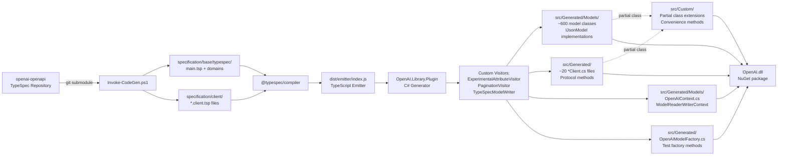

**Key Components:**

| Component | Purpose | Location |
|-----------|---------|----------|
| **TypeSpec Definitions** | OpenAPI-like specifications defining API contracts (20+ domain files) | `specification/base/typespec/` |
| **Client Customizations** | C#-specific annotations (`@@clientName`, `@@alternateType`, `@@projectedName`) | `specification/client/*.client.tsp` |
| **C# Generator Plugin** | TypeSpec emitter that generates C# code via Microsoft.TypeSpec.Generator | `codegen/generator/` (contains OpenAI.Library.Plugin) |
| **ExperimentalAttributeVisitor** | Applies `[Experimental("OPENAI001")]` or `[Experimental("OPENAI002")]` based on stability lists | `codegen/generator/src/visitors/ExperimentalAttributeVisitor.cs` |
| **PaginationVisitor** | Standardizes pagination with `*CollectionOptions` and `CollectionResult<T>` | `codegen/generator/src/visitors/PaginationVisitor.cs` |
| **TypeSpecModelWriter** | Outputs `tspCodeModel.json` for introspection and debugging | `codegen/generator/src/visitors/TypeSpecModelWriter.cs` |
| **Generated Models** | ~600 data classes implementing `IJsonModel<T>` and `IPersistableModel<T>` | `src/Generated/Models/` |
| **Generated Clients** | Protocol methods (BinaryContent/RequestOptions overloads) for each client | `src/Generated/*Client.cs` |
| **OpenAIContext** | Central `ModelReaderWriterContext` with `TryGetTypeBuilderCore` for all models | `src/Generated/Models/OpenAIContext.cs` |
| **OpenAIModelFactory** | Factory methods for creating model instances in tests | `src/Generated/OpenAIModelFactory.cs` |
| **Custom Code** | Partial class extensions adding convenience methods and custom logic | `src/Custom/` |

**Regeneration:** Code is regenerated via `Invoke-CodeGen.ps1`, which:
1. Clones/updates the `openai-openapi` submodule
2. Compiles TypeSpec definitions with `@typespec/compiler`
3. Runs the `@openai/plugin` emitter to generate C# code
4. Outputs to `src/Generated/` (overwriting existing files)
5. Committed to git (validated by `codegen-validation.yml` CI workflow)

**Sources:** [src/Generated/Models/OpenAIContext.cs:1-237](), [src/Generated/OpenAIModelFactory.cs:1-50](), [tspCodeModel.json:1-100](), [README.md:1-8]()

---

## API Stability Model

The SDK uses a **two-tier stability system** to balance innovation with backwards compatibility:

**API Stability Classification**

```mermaid
graph TB
    TypeOrMember["Type or Member"]
    
    StableLists["Hardcoded Stability Lists<br/>StableClasses.txt<br/>StableProperties.txt<br/>StableMethods.txt"]
    
    InStableList{In stable list?}
    
    NamespaceCheck{Check namespace}
    
    subgraph Stable["Stable (No Attribute)"]
        ChatNS["OpenAI.Chat namespace"]
        AudioNS["OpenAI.Audio namespace"]
        EmbedNS["OpenAI.Embeddings namespace"]
        ImagesNS["OpenAI.Images namespace"]
        FilesNS["OpenAI.Files namespace"]
        ModNS["OpenAI.Moderations namespace"]
        ModelsNS["OpenAI.Models namespace"]
    end
    
    subgraph Exp001["[Experimental OPENAI001]"]
        AssistNS["OpenAI.Assistants namespace"]
        BatchNS["OpenAI.Batch namespace"]
        ContNS["OpenAI.Containers namespace"]
        ConvNS["OpenAI.Conversations namespace"]
        EvalsNS["OpenAI.Evals namespace"]
        FTNS["OpenAI.FineTuning namespace"]
        GraderNS["OpenAI.Graders namespace"]
        RespNS["OpenAI.Responses namespace"]
        VSNS["OpenAI.VectorStores namespace"]
        VidNS["OpenAI.Videos namespace"]
    end
    
    subgraph Exp002["[Experimental OPENAI002]"]
        RTNS["OpenAI.Realtime namespace"]
    end
    
    subgraph ExpCUA["[Experimental OPENAICUA001]"]
        CompUse["ComputerCallAction<br/>ComputerCallActionKind<br/>ComputerCallOutput"]
    end
    
    subgraph APICompatTesting["API Compatibility Testing (CI)"]
        Script["scripts/Test-ApiCompatibility.ps1"]
        Tool["apicompat tool"]
        Baseline["Baseline Package:<br/>OpenAI 2.6.0 from NuGet"]
        Current["Current Build:<br/>bin/Debug/net8.0/OpenAI.dll"]
        Exclusions["--exclude-namespace:<br/>OpenAI.Assistants<br/>OpenAI.Batch<br/>OpenAI.Containers<br/>OpenAI.Conversations<br/>OpenAI.Evals<br/>OpenAI.FineTuning<br/>OpenAI.Graders<br/>OpenAI.Realtime<br/>OpenAI.Responses<br/>OpenAI.VectorStores<br/>OpenAI.Videos"]
    end
    
    TypeOrMember --> StableLists
    StableLists --> InStableList
    
    InStableList -->|Yes| ChatNS
    InStableList -->|No| NamespaceCheck
    
    NamespaceCheck -->|"OpenAI.Chat"| ChatNS
    NamespaceCheck -->|"OpenAI.Audio"| AudioNS
    NamespaceCheck -->|"OpenAI.Embeddings"| EmbedNS
    NamespaceCheck -->|"OpenAI.Images"| ImagesNS
    NamespaceCheck -->|"OpenAI.Files"| FilesNS
    NamespaceCheck -->|"OpenAI.Moderations"| ModNS
    NamespaceCheck -->|"OpenAI.Models"| ModelsNS
    
    NamespaceCheck -->|"OpenAI.Realtime"| RTNS
    NamespaceCheck -->|"OpenAI.Assistants"| AssistNS
    NamespaceCheck -->|"OpenAI.Responses"| RespNS
    NamespaceCheck -->|"OpenAI.Batch"| BatchNS
    NamespaceCheck -->|Other experimental| Exp001
    
    Script --> Tool
    Tool --> Baseline
    Tool --> Current
    Tool --> Exclusions
    Exclusions -.excludes.-> Exp001
    Exclusions -.excludes.-> Exp002
```

**Stability Guarantees:**

| Tier | Attribute | Namespaces | Breaking Change Policy |
|------|-----------|------------|------------------------|
| **Stable** | None | `OpenAI.Chat`, `OpenAI.Audio`, `OpenAI.Embeddings`, `OpenAI.Images`, `OpenAI.Files`, `OpenAI.Moderations`, `OpenAI.Models` | Strictly backwards compatible. Breaking changes blocked by CI. |
| **Experimental (OPENAI001)** | `[Experimental("OPENAI001")]` | `OpenAI.Assistants`, `OpenAI.Batch`, `OpenAI.Containers`, `OpenAI.Evals`, `OpenAI.FineTuning`, `OpenAI.Graders`, `OpenAI.Responses`, `OpenAI.VectorStores`, `OpenAI.Videos` | May include breaking changes. Excluded from compatibility checks. |
| **Experimental (OPENAI002)** | `[Experimental("OPENAI002")]` | `OpenAI.Realtime` | May include breaking changes. Excluded from compatibility checks. |
| **Experimental (OPENAICUA001)** | `[Experimental("OPENAICUA001")]` | Specific types: `ComputerCallAction`, `ComputerCallActionKind`, `ComputerCallOutput` | Computer Use Agent preview. May include breaking changes. |

**Compatibility Enforcement:**

The `scripts/Test-ApiCompatibility.ps1` script runs Microsoft's `apicompat` tool to detect breaking changes:
- Compares current build (`bin/Debug/net8.0/OpenAI.dll`) against baseline NuGet package (OpenAI 2.6.0)
- Explicitly excludes experimental namespaces via `--exclude-namespace` flags:
  - `OpenAI.Assistants`, `OpenAI.Batch`, `OpenAI.Containers`, `OpenAI.Conversations`
  - `OpenAI.Evals`, `OpenAI.FineTuning`, `OpenAI.Graders`, `OpenAI.Realtime`
  - `OpenAI.Responses`, `OpenAI.VectorStores`, `OpenAI.Videos`
- Any breaking changes in stable namespaces cause CI failure and block releases
- Run locally via: `.\scripts\Test-ApiCompatibility.ps1`

**Sources:** [scripts/Test-ApiCompatibility.ps1:1-181](), [api/OpenAI.net8.0.cs:6-43](), [api/OpenAI.netstandard2.0.cs:1-30]()

---

## Target Frameworks and Dependencies

**Supported Frameworks:**
- **.NET 8.0** (`net8.0`) - Full feature support with trimming and AOT compatibility
- **.NET Standard 2.0** (`netstandard2.0`) - Broad compatibility (includes .NET Framework 4.6.1+, .NET Core 2.0+, Mono, Xamarin)

**Core Dependencies:**

| Package | Version | Purpose |
|---------|---------|---------|
| `System.ClientModel` | 1.8.1 | HTTP pipeline, authentication, JSON Patch support |
| `System.Net.ServerSentEvents` | 9.0.9 | Server-sent events (SSE) for streaming responses |
| `System.Diagnostics.DiagnosticSource` | 8.0.1 | OpenTelemetry integration (net6.0+) |
| `Microsoft.SourceLink.GitHub` | 8.0.0 | Source debugging support |

**Additional Capabilities:**
- **Trimming Support**: Enabled for .NET 6.0+ via `<IsTrimmable>true</IsTrimmable>`
- **AOT Support**: Enabled for .NET 7.0+ via `<IsAotCompatible>true</IsAotCompatible>`
- **Strong Naming**: Assembly is signed with `OpenAI.snk` (Release and Debug configurations)

**Sources:** [src/OpenAI.csproj:14-84]()

---

## Installation

**NuGet Package Manager:**
```bash
dotnet add package OpenAI
```

**Package Manager Console:**
```powershell
Install-Package OpenAI
```

**For Preview Versions:**
```bash
dotnet add package OpenAI --prerelease
```

**Package Information:**
- **Package ID**: `OpenAI`
- **Latest Stable**: 2.7.0 (released 2025-11-13)
- **License**: MIT
- **Repository**: https://github.com/openai/openai-dotnet
- **NuGet**: https://www.nuget.org/packages/OpenAI

**Sources:** [README.md:44-53](), [src/OpenAI.csproj:1-12](), [CHANGELOG.md:13-14]()

---

## Quick Start Example

**Basic Chat Completion:**

```csharp
using OpenAI.Chat;

ChatClient client = new(
    model: "gpt-4o", 
    apiKey: Environment.GetEnvironmentVariable("OPENAI_API_KEY"));

ChatCompletion completion = client.CompleteChat("Say 'this is a test.'");

Console.WriteLine($"[ASSISTANT]: {completion.Content[0].Text}");
```

**Streaming Chat Completion:**

```csharp
using OpenAI.Chat;
using System.ClientModel;

ChatClient client = new(model: "gpt-4o", apiKey: Environment.GetEnvironmentVariable("OPENAI_API_KEY"));

CollectionResult<StreamingChatCompletionUpdate> updates = 
    client.CompleteChatStreaming("Say 'this is a test.'");

Console.Write("[ASSISTANT]: ");
foreach (StreamingChatCompletionUpdate update in updates)
{
    if (update.ContentUpdate.Count > 0)
    {
        Console.Write(update.ContentUpdate[0].Text);
    }
}
```

**Using OpenAIClient Factory:**

```csharp
using OpenAI;
using OpenAI.Chat;
using OpenAI.Embeddings;

OpenAIClient client = new(Environment.GetEnvironmentVariable("OPENAI_API_KEY"));

// All clients share the same ClientPipeline and ApiKeyCredential
ChatClient chatClient = client.GetChatClient("gpt-4o");
EmbeddingClient embeddingClient = client.GetEmbeddingClient("text-embedding-3-small");
```

**Async Streaming Example:**

```csharp
using OpenAI.Chat;
using System.ClientModel;

ChatClient client = new(model: "gpt-4o", apiKey: Environment.GetEnvironmentVariable("OPENAI_API_KEY"));

AsyncCollectionResult<StreamingChatCompletionUpdate> updates = 
    client.CompleteChatStreamingAsync("Say 'this is a test.'");

Console.Write("[ASSISTANT]: ");
await foreach (StreamingChatCompletionUpdate update in updates)
{
    if (update.ContentUpdate.Count > 0)
    {
        Console.Write(update.ContentUpdate[0].Text);
    }
}
```

**Sources:** [README.md:122-142](), [examples/Chat/Example02_SimpleChatStreaming.cs:1-27](), [examples/Chat/Example02_SimpleChatStreamingAsync.cs:1-28]()

---

## Release Information

**Current Version:** 2.7.0 (Released 2025-11-13)

**Latest Features (2.7.0):**
- Web search support via `WebSearchTool` and `WebSearchPreviewTool`
- Reasoning streaming events for o3-mini model
- File citation filename property
- JSON Patch support for additional properties
- Computer Use Agent tool support
- Image Generation tool for responses
- Conversations API client
- Videos API client

**Breaking Changes:** Breaking changes are only introduced in experimental APIs (marked with `[Experimental]` attributes). Stable APIs maintain strict backwards compatibility.

**Versioning Scheme:**
- **Major.Minor.Patch** semantic versioning
- Preview versions use `-alpha.YYYYMMdd.N` or `-beta.N` suffixes

**Full Changelog:** See [CHANGELOG.md]() for complete release history including acknowledgments, bug fixes, and detailed migration guidance for breaking changes in experimental APIs.

**Upcoming (2.8.0 - Unreleased):** Development version. See [CHANGELOG.md:3-11]() for work in progress.

**Sources:** [CHANGELOG.md:1-100](), [src/OpenAI.csproj:11-12]()

---

# Page: Getting Started

# Getting Started

<details>
<summary>Relevant source files</summary>

The following files were used as context for generating this wiki page:

- [README.md](README.md)
- [examples/Assistants/Example01_RetrievalAugmentedGeneration.cs](examples/Assistants/Example01_RetrievalAugmentedGeneration.cs)
- [examples/Assistants/Example01_RetrievalAugmentedGenerationAsync.cs](examples/Assistants/Example01_RetrievalAugmentedGenerationAsync.cs)
- [examples/Assistants/Example05_AssistantsWithVision.cs](examples/Assistants/Example05_AssistantsWithVision.cs)
- [examples/Assistants/Example05_AssistantsWithVisionAsync.cs](examples/Assistants/Example05_AssistantsWithVisionAsync.cs)
- [examples/Chat/Example02_SimpleChatStreaming.cs](examples/Chat/Example02_SimpleChatStreaming.cs)
- [examples/Chat/Example02_SimpleChatStreamingAsync.cs](examples/Chat/Example02_SimpleChatStreamingAsync.cs)
- [examples/Chat/Example03_FunctionCalling.cs](examples/Chat/Example03_FunctionCalling.cs)
- [examples/Chat/Example06_StructuredOutputs.cs](examples/Chat/Example06_StructuredOutputs.cs)
- [examples/Chat/Example06_StructuredOutputsAsync.cs](examples/Chat/Example06_StructuredOutputsAsync.cs)
- [specification/base/typespec/common/models.tsp](specification/base/typespec/common/models.tsp)
- [specification/base/typespec/main.tsp](specification/base/typespec/main.tsp)
- [specification/base/typespec/videos/main.tsp](specification/base/typespec/videos/main.tsp)
- [specification/client/videos.client.tsp](specification/client/videos.client.tsp)
- [src/Custom/OpenAIClient.cs](src/Custom/OpenAIClient.cs)
- [src/Custom/OpenAIClientOptions.cs](src/Custom/OpenAIClientOptions.cs)
- [src/Generated/Models/Chat/ChatReasoningEffortLevel.cs](src/Generated/Models/Chat/ChatReasoningEffortLevel.cs)
- [src/Generated/Models/Responses/ResponseReasoningEffortLevel.cs](src/Generated/Models/Responses/ResponseReasoningEffortLevel.cs)
- [tests/Telemetry/ChatTelemetryTests.cs](tests/Telemetry/ChatTelemetryTests.cs)

</details>


This page provides a quick start guide for installing and using the OpenAI .NET SDK. It covers package installation, authentication methods, client initialization patterns, and basic usage examples to help you make your first API call.

For detailed information about specific API features, see the [Client Libraries](#4) section. For dependency injection patterns, see [Dependency Injection](#7.4). For architectural details about the SDK's design, see [Architecture and Design](#3).

---

## Purpose and Scope

The OpenAI .NET SDK is a client library that provides convenient access to the OpenAI REST API from .NET applications. It supports all .NET Standard 2.0 compatible frameworks, including .NET 8.0 and later. The SDK follows a factory pattern where a central `OpenAIClient` provisions specialized clients for different API features.

This guide covers:
- Installing the NuGet package
- Obtaining and configuring API credentials
- Creating client instances
- Making basic synchronous and asynchronous API calls
- Understanding the client hierarchy

---

## Installation

### Prerequisites

Before using the SDK, you need an OpenAI API key:

1. Create an account at https://platform.openai.com/signup (or log in if you already have one)
2. Navigate to https://platform.openai.com/account/api-keys
3. Select "Create new secret key" and optionally name the key
4. Save the API key securely - it will not be shown again

**Important**: Never commit API keys to source control. Store them in environment variables or secure configuration systems.

### Installing the NuGet Package

Add the OpenAI SDK to your .NET project using the .NET CLI:

```bash
dotnet add package OpenAI
```

For preview versions with experimental features:

```bash
dotnet add package OpenAI --prerelease
```

The SDK targets .NET Standard 2.0, making it compatible with:
- .NET 8.0 and 9.0
- .NET Core 2.0 and later
- .NET Framework 4.6.1 and later

**Sources**: [README.md:40-55]()

---

## Client Initialization Patterns

### Basic Initialization Flow

The SDK provides multiple ways to create clients depending on your authentication and configuration needs:

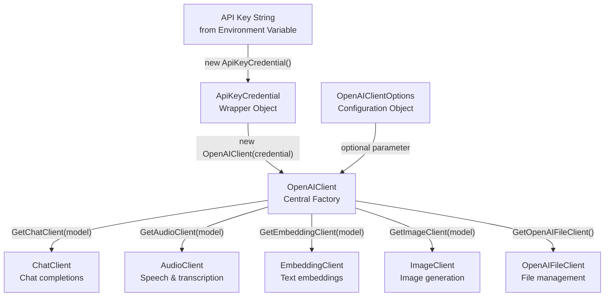

**Sources**: [src/Custom/OpenAIClient.cs:84-165](), [README.md:121-142]()

### Authentication Options

The SDK supports three authentication patterns:

#### 1. Direct API Key (Simplest)

For quick prototyping and simple applications:

```csharp
using OpenAI.Chat;

ChatClient client = new(
    model: "gpt-4o", 
    apiKey: Environment.GetEnvironmentVariable("OPENAI_API_KEY")
);
```

#### 2. ApiKeyCredential (Recommended)

For applications needing configuration options:

```csharp
using OpenAI;
using OpenAI.Chat;

ApiKeyCredential credential = new(Environment.GetEnvironmentVariable("OPENAI_API_KEY"));
OpenAIClientOptions options = new()
{
    Endpoint = new Uri("https://api.openai.com/v1"),
    OrganizationId = "org-123456",
    ProjectId = "proj-789012"
};

OpenAIClient openAIClient = new(credential, options);
ChatClient chatClient = openAIClient.GetChatClient("gpt-4o");
```

#### 3. Custom Authentication Policy (Advanced)

For custom authentication scenarios, including Azure OpenAI:

```csharp
using System.ClientModel.Primitives;

AuthenticationPolicy customAuth = /* custom implementation */;
OpenAIClient client = new(customAuth, new OpenAIClientOptions());
```

The `ApiKeyCredential` is created and managed internally by the `OpenAIClient` constructor at [src/Custom/OpenAIClient.cs:100-124](). Custom authentication policies are marked as experimental with the `OPENAI001` diagnostic.

**Sources**: [src/Custom/OpenAIClient.cs:96-149](), [README.md:60-90]()

---

## Client Hierarchy and Factory Pattern

### The OpenAIClient Factory

The `OpenAIClient` class serves as a central factory for creating specialized API clients. This pattern allows multiple clients to share configuration, authentication, and HTTP pipeline infrastructure:

```mermaid
graph TB
    subgraph "Shared Configuration"
        Pipeline["ClientPipeline<br/>HTTP request/response handling"]
        Options["OpenAIClientOptions<br/>Endpoint, Organization, Project"]
        Auth["ApiKeyCredential<br/>or AuthenticationPolicy"]
    end
    
    subgraph "OpenAIClient Factory"
        Factory["OpenAIClient<br/>src/Custom/OpenAIClient.cs"]
    end
    
    subgraph "Specialized Clients - Stable"
        Chat["ChatClient<br/>GetChatClient(model)"]
        Audio["AudioClient<br/>GetAudioClient(model)"]
        Embed["EmbeddingClient<br/>GetEmbeddingClient(model)"]
        Image["ImageClient<br/>GetImageClient(model)"]
        File["OpenAIFileClient<br/>GetOpenAIFileClient()"]
        Moderate["ModerationClient<br/>GetModerationClient(model)"]
        Model["OpenAIModelClient<br/>GetOpenAIModelClient()"]
    end
    
    subgraph "Specialized Clients - Experimental"
        Response["OpenAIResponseClient<br/>GetOpenAIResponseClient(model)<br/>[Experimental OPENAI001]"]
        Assistant["AssistantClient<br/>GetAssistantClient()<br/>[Experimental OPENAI001]"]
        Vector["VectorStoreClient<br/>GetVectorStoreClient()<br/>[Experimental OPENAI001]"]
        Batch["BatchClient<br/>GetBatchClient()<br/>[Experimental OPENAI001]"]
        FineTune["FineTuningClient<br/>GetFineTuningClient()<br/>[Experimental OPENAI001]"]
        Video["VideoClient<br/>GetVideoClient()<br/>[Experimental OPENAI001]"]
        Realtime["RealtimeClient<br/>GetRealtimeClient()<br/>[Experimental OPENAI002]"]
    end
    
    Auth --> Factory
    Pipeline --> Factory
    Options --> Factory
    
    Factory --> Chat
    Factory --> Audio
    Factory --> Embed
    Factory --> Image
    Factory --> File
    Factory --> Moderate
    Factory --> Model
    
    Factory --> Response
    Factory --> Assistant
    Factory --> Vector
    Factory --> Batch
    Factory --> FineTune
    Factory --> Video
    Factory --> Realtime
```

**Sources**: [src/Custom/OpenAIClient.cs:30-407](), [README.md:92-112]()

### Available Clients

The following table lists all specialized clients accessible through the `OpenAIClient` factory:

| Namespace | Client Class | Factory Method | Model Required | Status |
|-----------|--------------|----------------|----------------|--------|
| `OpenAI.Chat` | `ChatClient` | `GetChatClient(model)` | Yes | Stable |
| `OpenAI.Audio` | `AudioClient` | `GetAudioClient(model)` | Yes | Stable |
| `OpenAI.Embeddings` | `EmbeddingClient` | `GetEmbeddingClient(model)` | Yes | Stable |
| `OpenAI.Images` | `ImageClient` | `GetImageClient(model)` | Yes | Stable |
| `OpenAI.Files` | `OpenAIFileClient` | `GetOpenAIFileClient()` | No | Stable |
| `OpenAI.Moderations` | `ModerationClient` | `GetModerationClient(model)` | Yes | Stable |
| `OpenAI.Models` | `OpenAIModelClient` | `GetOpenAIModelClient()` | No | Stable |
| `OpenAI.Responses` | `OpenAIResponseClient` | `GetOpenAIResponseClient(model)` | Yes | Experimental |
| `OpenAI.Assistants` | `AssistantClient` | `GetAssistantClient()` | No | Experimental |
| `OpenAI.VectorStores` | `VectorStoreClient` | `GetVectorStoreClient()` | No | Experimental |
| `OpenAI.Batch` | `BatchClient` | `GetBatchClient()` | No | Experimental |
| `OpenAI.FineTuning` | `FineTuningClient` | `GetFineTuningClient()` | No | Experimental |
| `OpenAI.Videos` | `VideoClient` | `GetVideoClient()` | No | Experimental |
| `OpenAI.Realtime` | `RealtimeClient` | `GetRealtimeClient()` | No | Experimental |

Clients marked as "Experimental" require suppressing diagnostic warnings (`OPENAI001` or `OPENAI002`) before use. For details on API stability, see [API Compatibility](#8.4).

**Sources**: [src/Custom/OpenAIClient.cs:166-364](), [README.md:94-112]()

---

## Basic Usage Examples

### Synchronous Chat Completion

The simplest usage pattern creates a specialized client directly and makes a synchronous API call:

```csharp
using OpenAI.Chat;

ChatClient client = new(
    model: "gpt-4o", 
    apiKey: Environment.GetEnvironmentVariable("OPENAI_API_KEY")
);

ChatCompletion completion = client.CompleteChat("Say 'this is a test.'");

Console.WriteLine($"[ASSISTANT]: {completion.Content[0].Text}");
```

This example demonstrates:
- Direct `ChatClient` instantiation with model and API key
- Synchronous `CompleteChat` method call
- Accessing response content through the `Content` property

**Sources**: [README.md:60-68](), [examples/Chat/Example02_SimpleChatStreaming.cs:10-26]()

### Asynchronous Chat Completion

For production applications, use asynchronous methods to avoid blocking threads:

```csharp
using OpenAI.Chat;

ChatClient client = new(
    model: "gpt-4o", 
    apiKey: Environment.GetEnvironmentVariable("OPENAI_API_KEY")
);

ChatCompletion completion = await client.CompleteChatAsync("Say 'this is a test.'");

Console.WriteLine($"[ASSISTANT]: {completion.Content[0].Text}");
```

Every synchronous method in the SDK has an asynchronous counterpart with the `Async` suffix (e.g., `CompleteChat` → `CompleteChatAsync`).

**Sources**: [README.md:113-119](), [examples/Chat/Example02_SimpleChatStreamingAsync.cs:10-28]()

### Using the Factory Pattern

For applications using multiple API features, the factory pattern shares configuration and improves resource efficiency:

```csharp
using OpenAI;
using OpenAI.Chat;
using OpenAI.Audio;

OpenAIClient openAIClient = new(Environment.GetEnvironmentVariable("OPENAI_API_KEY"));

// Create multiple specialized clients from the same factory
ChatClient chatClient = openAIClient.GetChatClient("gpt-4o");
AudioClient ttsClient = openAIClient.GetAudioClient("tts-1");
AudioClient whisperClient = openAIClient.GetAudioClient("whisper-1");

// All clients share the same pipeline, authentication, and configuration
ChatCompletion chat = chatClient.CompleteChat("Hello!");
// ... use audio clients ...
```

The factory creates new instances of specialized clients rather than caching singletons. This allows targeting different models with multiple clients of the same type.

**Sources**: [src/Custom/OpenAIClient.cs:26-29](), [README.md:121-142]()

---

## Request and Response Flow

### Making API Calls

The following diagram illustrates the complete flow from client initialization to receiving responses:

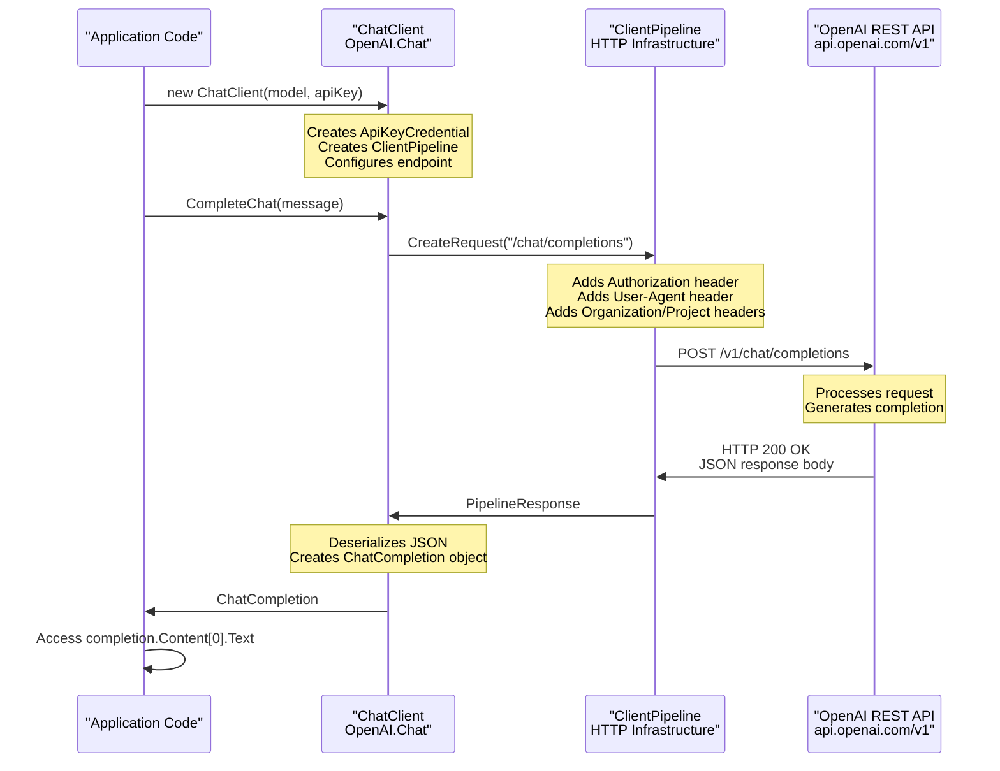

**Sources**: [src/Custom/OpenAIClient.cs:372-406]()

### Streaming Responses

For long-running operations, streaming provides incremental results:

```csharp
using OpenAI.Chat;
using System.ClientModel;

ChatClient client = new(
    model: "gpt-4o", 
    apiKey: Environment.GetEnvironmentVariable("OPENAI_API_KEY")
);

CollectionResult<StreamingChatCompletionUpdate> updates = 
    client.CompleteChatStreaming("Say 'this is a test.'");

Console.Write($"[ASSISTANT]: ");
foreach (StreamingChatCompletionUpdate update in updates)
{
    if (update.ContentUpdate.Count > 0)
    {
        Console.Write(update.ContentUpdate[0].Text);
    }
}
```

Streaming methods return `CollectionResult<T>` (synchronous) or `AsyncCollectionResult<T>` (asynchronous) that can be enumerated to process incremental updates. For details on streaming patterns, see [Streaming Patterns](#5.1).

**Sources**: [README.md:184-220](), [examples/Chat/Example02_SimpleChatStreaming.cs:10-26]()

---

## Configuration Options

### OpenAIClientOptions

The `OpenAIClientOptions` class configures client behavior:

| Property | Type | Description | Default |
|----------|------|-------------|---------|
| `Endpoint` | `Uri` | Base URL for API requests | `https://api.openai.com/v1` |
| `OrganizationId` | `string` | OpenAI organization identifier | `null` |
| `ProjectId` | `string` | OpenAI project identifier | `null` |
| `UserAgentApplicationId` | `string` | Custom application identifier for telemetry | `null` |
| `RetryPolicy` | `ClientRetryPolicy` | Retry behavior for failed requests | Default policy |
| `NetworkTimeout` | `TimeSpan` | Timeout for network operations | Default timeout |

### Custom Endpoint Example

To connect to alternative endpoints (e.g., Azure OpenAI, self-hosted LLMs):

```csharp
using OpenAI;
using OpenAI.Chat;

ChatClient client = new(
    model: "MODEL_NAME",
    credential: new ApiKeyCredential(Environment.GetEnvironmentVariable("OPENAI_API_KEY")),
    options: new OpenAIClientOptions() 
    { 
        Endpoint = new Uri("https://custom-endpoint.example.com/v1")
    }
);
```

The endpoint URL is stored in the internal `_endpoint` field and used by the shared `ClientPipeline` for all API requests.

**Sources**: [README.md:72-90](), [src/Custom/OpenAIClient.cs:94-164]()

---

## Next Steps

After completing this guide, explore these topics:

- **[Chat Client](#4.2)** - Comprehensive chat completions, streaming, function calling, and structured outputs
- **[Audio Client](#4.5)** - Speech generation, transcription, and translation
- **[Images Client](#4.6)** - Image generation, editing, and variations
- **[Assistants Client](#4.4)** - Stateful conversations with tools and file search
- **[Dependency Injection](#7.4)** - Integration with ASP.NET Core
- **[Examples and Guides](#7)** - Practical code examples for common scenarios

For advanced topics like telemetry, protocol methods, and custom pipelines, see [Advanced Features](#5).

**Sources**: [README.md:1-1285](), [examples/OpenAI.Examples.csproj:1-27]()

---

# Page: Architecture and Design

# Architecture and Design

<details>
<summary>Relevant source files</summary>

The following files were used as context for generating this wiki page:

- [api/OpenAI.net8.0.cs](api/OpenAI.net8.0.cs)
- [api/OpenAI.netstandard2.0.cs](api/OpenAI.netstandard2.0.cs)
- [codegen/generator/src/OpenAI.Library.Plugin.csproj](codegen/generator/src/OpenAI.Library.Plugin.csproj)
- [codegen/package.json](codegen/package.json)
- [package-lock.json](package-lock.json)
- [package.json](package.json)
- [scripts/Submit-GeneratorUpdatePr.ps1](scripts/Submit-GeneratorUpdatePr.ps1)
- [specification/base/typespec/common/models.tsp](specification/base/typespec/common/models.tsp)
- [specification/base/typespec/main.tsp](specification/base/typespec/main.tsp)
- [specification/base/typespec/videos/main.tsp](specification/base/typespec/videos/main.tsp)
- [specification/client/videos.client.tsp](specification/client/videos.client.tsp)
- [src/Custom/Conversations/IncludedConversationItemProperty.cs](src/Custom/Conversations/IncludedConversationItemProperty.cs)
- [src/Custom/OpenAIClient.cs](src/Custom/OpenAIClient.cs)
- [src/Custom/OpenAIClientOptions.cs](src/Custom/OpenAIClientOptions.cs)
- [src/Custom/Videos/Internal/InternalOrderEnum.cs](src/Custom/Videos/Internal/InternalOrderEnum.cs)
- [src/Custom/Videos/Internal/InternalVideoContentVariant.cs](src/Custom/Videos/Internal/InternalVideoContentVariant.cs)
- [src/Generated/Models/Chat/ChatReasoningEffortLevel.cs](src/Generated/Models/Chat/ChatReasoningEffortLevel.cs)
- [src/Generated/Models/Conversations/IncludedConversationItemProperty.cs](src/Generated/Models/Conversations/IncludedConversationItemProperty.cs)
- [src/Generated/Models/OpenAIContext.cs](src/Generated/Models/OpenAIContext.cs)
- [src/Generated/Models/Responses/ResponseReasoningEffortLevel.cs](src/Generated/Models/Responses/ResponseReasoningEffortLevel.cs)
- [src/Generated/Models/Videos/InternalOrderEnum.cs](src/Generated/Models/Videos/InternalOrderEnum.cs)
- [src/Generated/Models/Videos/InternalVideoContentVariant.cs](src/Generated/Models/Videos/InternalVideoContentVariant.cs)
- [src/Generated/OpenAIModelFactory.cs](src/Generated/OpenAIModelFactory.cs)
- [tests/Responses/ResponsesTests.cs](tests/Responses/ResponsesTests.cs)
- [tspCodeModel.json](tspCodeModel.json)

</details>


## Purpose and Scope

This document describes the architectural design and key structural patterns of the OpenAI .NET SDK. It covers:
- The code generation system built on TypeSpec
- The client factory pattern and sub-client organization
- The distinction between generated and custom code
- The API stability model (stable vs. experimental)
- Configuration and pipeline architecture

For information about specific client capabilities, see [Client Libraries](#4). For code generation development workflows, see [Code Generation System](#8.1).

---

## High-Level Architecture

The OpenAI .NET SDK follows a layered architecture with four primary systems:

### System Overview

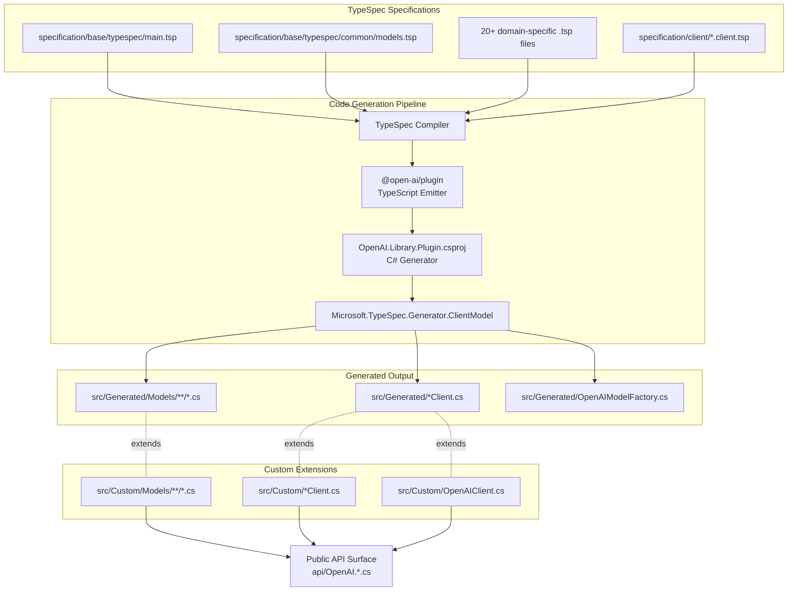

**Sources**: [specification/base/typespec/main.tsp:1-25](), [codegen/package.json:1-46](), [codegen/generator/src/OpenAI.Library.Plugin.csproj:1-20](), [src/Generated/OpenAIModelFactory.cs:1-27]()

---

## Code Generation System

The SDK uses a TypeSpec-based code generation system where API specifications are written in TypeSpec and compiled to C# code.

### TypeSpec-to-C# Pipeline

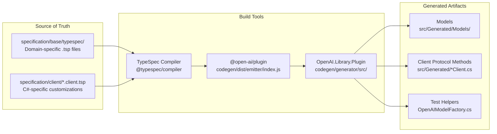

### Key Generation Artifacts

| Artifact Type | Location | Purpose |
|--------------|----------|---------|
| Model classes | `src/Generated/Models/**/*.cs` | DTOs representing API request/response schemas |
| Client protocol methods | `src/Generated/*Client.cs` | Low-level HTTP methods with `BinaryContent` parameters |
| Model factory | `src/Generated/OpenAIModelFactory.cs` | Test helper methods for creating model instances |
| OpenAIContext | `src/Generated/Models/OpenAIContext.cs` | Custom serialization context registration |

The generator produces **protocol methods only** by default. Convenience methods are added through custom code or TypeSpec client customizations.

**Sources**: [specification/base/typespec/main.tsp:1-25](), [codegen/package.json:14-35](), [src/Generated/OpenAIModelFactory.cs:1-50](), [src/Generated/Models/OpenAIContext.cs:1-26]()

---

## Client Factory Pattern

The SDK uses a factory pattern where `OpenAIClient` serves as the central entry point for creating specialized sub-clients.

### OpenAIClient Architecture

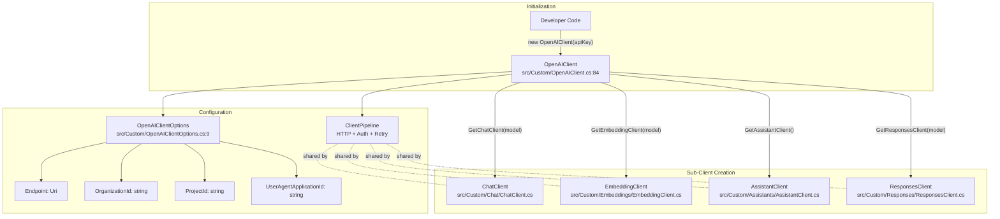

### Factory Method Pattern

Each `Get*Client()` method creates a new instance rather than caching:

```
// OpenAIClient does NOT cache sub-clients
public virtual ChatClient GetChatClient(string model)
    => new(Pipeline, model, _options);

public virtual AssistantClient GetAssistantClient()
    => new(Pipeline, _options);
```

This design allows users to create multiple clients targeting different models or configurations. Sub-clients share the parent's `ClientPipeline` and `OpenAIClientOptions`.

**Sources**: [src/Custom/OpenAIClient.cs:25-86](), [src/Custom/OpenAIClientOptions.cs:1-75](), [api/OpenAI.netstandard2.0.cs:2-30]()

---

## API Stability Model

The SDK distinguishes between **stable** and **experimental** APIs using the `[Experimental("OPENAI001")]` attribute.

### Stable vs. Experimental APIs

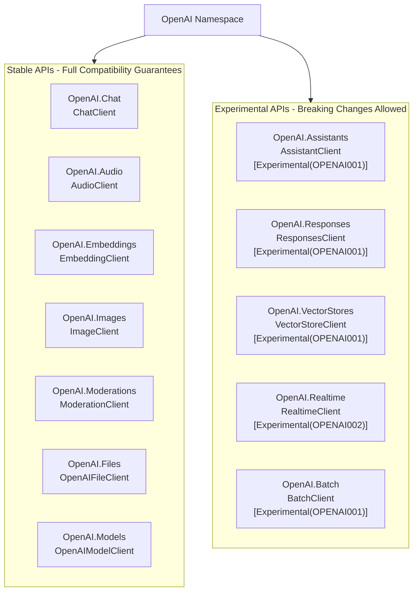

### Experimental API Markers

Experimental APIs are marked at multiple levels:

| Level | Example |
|-------|---------|
| Client class | `[Experimental("OPENAI001")] public class AssistantClient` |
| Individual methods | `[Experimental("OPENAI001")] public virtual AssistantClient GetAssistantClient()` |
| Model types | `[Experimental("OPENAI001")] public class Assistant` |
| Enums | `[Experimental("OPENAI001")] public readonly partial struct FileSearchRanker` |

Stable APIs have no experimental attribute and follow strict semantic versioning for breaking changes.

**Sources**: [api/OpenAI.net8.0.cs:6-43](), [api/OpenAI.netstandard2.0.cs:12-28]()

---

## Custom Code Extensions

The SDK uses partial classes and code generation attributes to extend generated code without modifying generator output.

### Extension Mechanisms

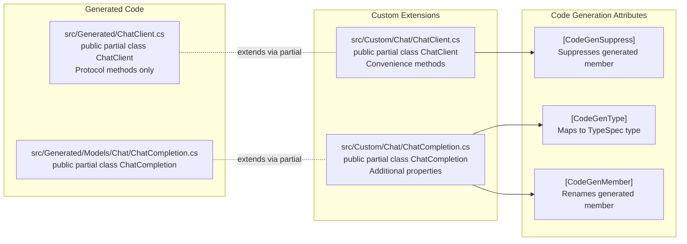

### Common Extension Patterns

**Suppressing Generated Constructors:**
```csharp
[CodeGenSuppress("OpenAIClient", typeof(Uri), typeof(ApiKeyCredential), typeof(OpenAIClientOptions))]
public partial class OpenAIClient
{
    // Custom constructor with different signature
    public OpenAIClient(string apiKey) : this(new ApiKeyCredential(apiKey), new OpenAIClientOptions()) { }
}
```

**Renaming Generated Types:**
```csharp
[CodeGenType("OrderEnum")]
internal readonly partial struct InternalOrderEnum { }
```

**Renaming Generated Members:**
```csharp
[CodeGenMember("MessageInputImageImageUrl")]
public static IncludedConversationItemProperty MessageInputImageUri { get; }
```

**Sources**: [src/Custom/OpenAIClient.cs:36-83](), [src/Custom/Conversations/IncludedConversationItemProperty.cs:1-27](), [src/Custom/Videos/Internal/InternalOrderEnum.cs:1-12]()

---

## Pipeline and Authentication

The SDK uses `System.ClientModel.Primitives.ClientPipeline` for HTTP communication with pluggable authentication.

### Authentication Flow

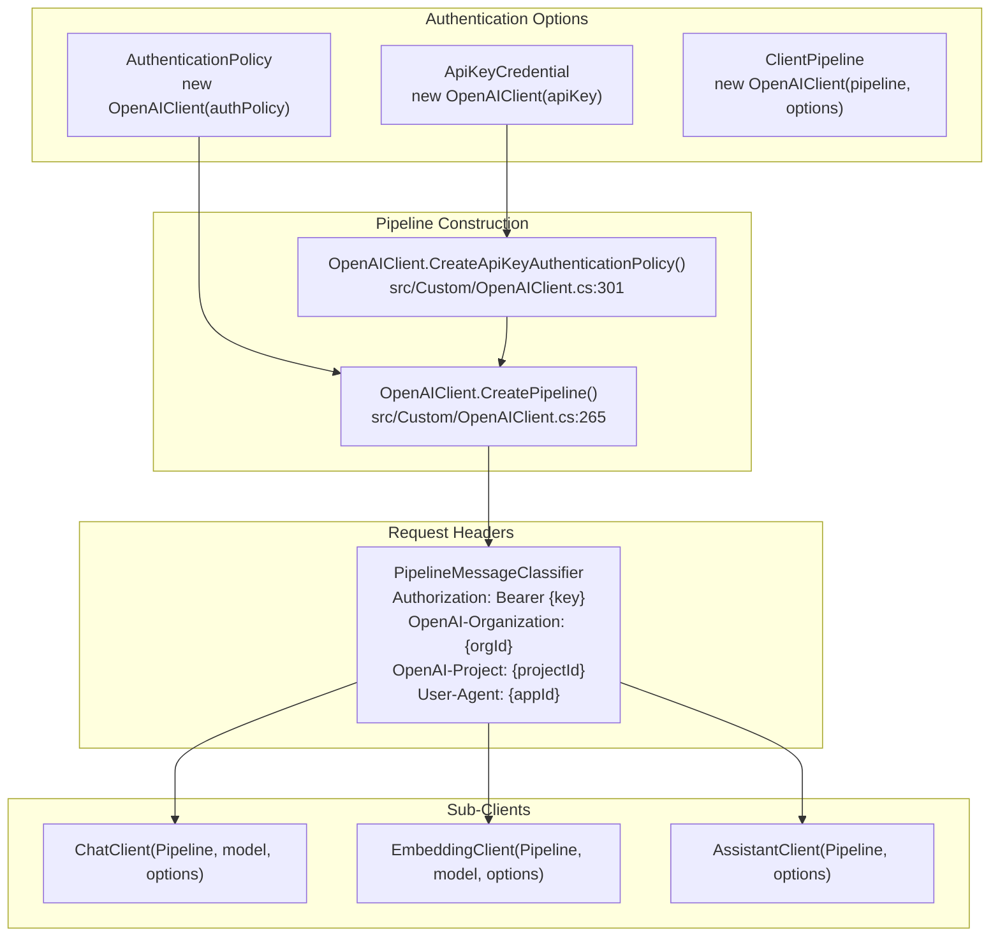

### Configuration Headers

The `OpenAIClientOptions` class controls request headers:

| Property | Header | Purpose |
|----------|--------|---------|
| `Endpoint` | *(used for URI construction)* | Service endpoint (default: `https://api.openai.com/v1`) |
| `OrganizationId` | `OpenAI-Organization` | Specifies which organization to bill |
| `ProjectId` | `OpenAI-Project` | Specifies which project to access |
| `UserAgentApplicationId` | `User-Agent` | Application identifier for telemetry |

All sub-clients inherit these headers via the shared `ClientPipeline`.

**Sources**: [src/Custom/OpenAIClient.cs:86-150](), [src/Custom/OpenAIClientOptions.cs:1-75]()

---

## Namespace Organization

The SDK organizes APIs into domain-specific namespaces, each corresponding to a TypeSpec domain file.

### Domain to Namespace Mapping

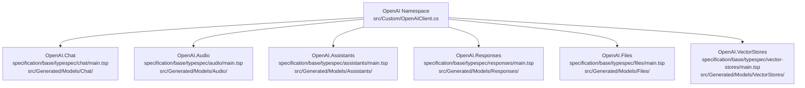

### Client-to-Model Alignment

Each client namespace contains:
- Client class (e.g., `ChatClient`)
- Request option classes (e.g., `ChatCompletionOptions`)
- Response model classes (e.g., `ChatCompletion`)
- Domain-specific enums and helper types (e.g., `ChatMessageRole`, `ChatFinishReason`)

**Sources**: [specification/base/typespec/main.tsp:1-25](), [src/Generated/Models/OpenAIContext.cs:1-200]()

---

## Customization Workflow

Developers extending the SDK follow this pattern:

### Extension Development Flow

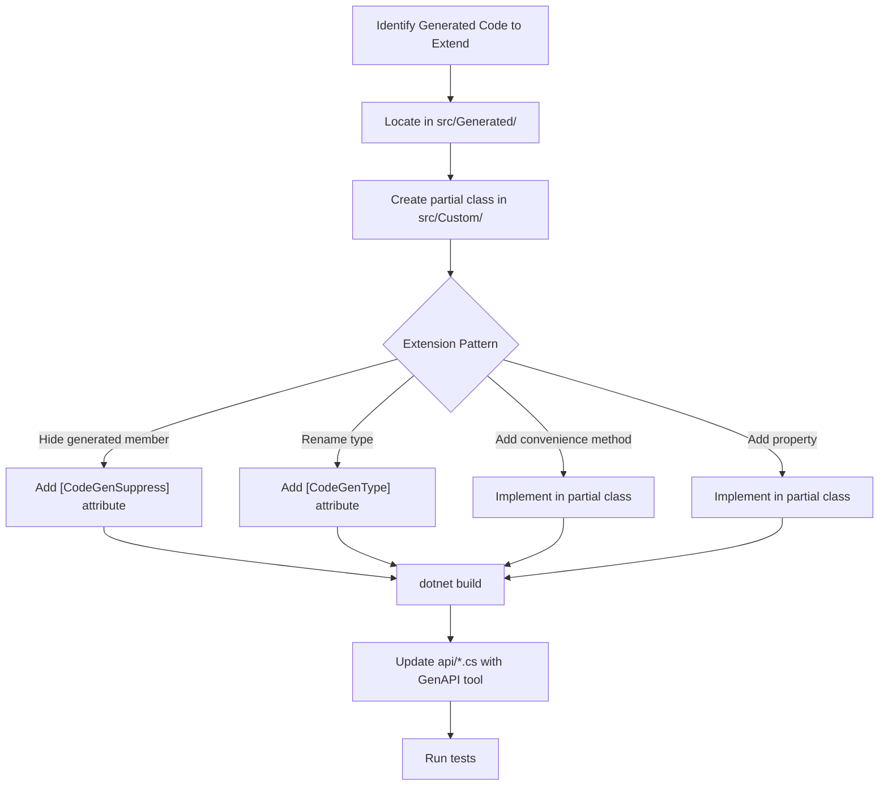

### Example: Extending ChatClient

Generated code provides protocol method:
```csharp
// src/Generated/ChatClient.cs
public virtual ClientResult CompleteChat(BinaryContent content, RequestOptions options = null)
```

Custom code adds convenience method:
```csharp
// src/Custom/Chat/ChatClient.cs
public partial class ChatClient
{
    public virtual ClientResult<ChatCompletion> CompleteChat(
        IEnumerable<ChatMessage> messages,
        ChatCompletionOptions options = null,
        CancellationToken cancellationToken = default)
    {
        // Convenience implementation
    }
}
```

**Sources**: [src/Custom/OpenAIClient.cs:27-83](), [src/Custom/Conversations/IncludedConversationItemProperty.cs:8-26]()

---

## Build and Release Integration

The code generation system integrates with the build pipeline to ensure generated code stays synchronized with TypeSpec specifications.

### Generator Update Flow

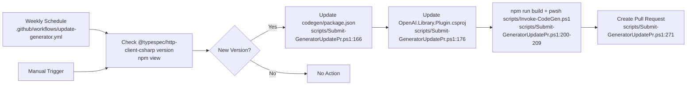

The generator update script automatically:
1. Checks for new TypeSpec generator versions
2. Updates dependency versions in `package.json` and `.csproj` files
3. Regenerates all C# code from TypeSpec specifications
4. Creates a pull request with the changes

**Sources**: [scripts/Submit-GeneratorUpdatePr.ps1:1-325](), [codegen/package.json:18-25]()

---

## Key Design Principles

The SDK architecture follows these core principles:

| Principle | Implementation | Rationale |
|-----------|----------------|-----------|
| **Generated-First** | TypeSpec specifications are the source of truth | Ensures consistency with OpenAI API specs |
| **Partial Class Extensions** | Custom code extends generated code via partial classes | Preserves customizations across regenerations |
| **Factory Pattern** | `OpenAIClient` creates sub-clients, no caching | Allows flexible multi-client scenarios |
| **Shared Pipeline** | All sub-clients share parent's `ClientPipeline` | Consistent authentication and retry behavior |
| **Stable vs. Experimental** | `[Experimental]` attribute marks preview APIs | Allows innovation while protecting stable APIs |
| **Protocol + Convenience** | Generated protocol methods + custom convenience methods | Balances flexibility with usability |

**Sources**: [src/Custom/OpenAIClient.cs:25-165](), [src/Generated/OpenAIModelFactory.cs:1-50](), [api/OpenAI.net8.0.cs:1-56]()

---

# Page: Client Libraries

# Client Libraries

<details>
<summary>Relevant source files</summary>

The following files were used as context for generating this wiki page:

- [api/OpenAI.net8.0.cs](api/OpenAI.net8.0.cs)
- [api/OpenAI.netstandard2.0.cs](api/OpenAI.netstandard2.0.cs)
- [specification/base/typespec/common/models.tsp](specification/base/typespec/common/models.tsp)
- [specification/base/typespec/main.tsp](specification/base/typespec/main.tsp)
- [specification/base/typespec/videos/main.tsp](specification/base/typespec/videos/main.tsp)
- [specification/client/videos.client.tsp](specification/client/videos.client.tsp)
- [src/Custom/OpenAIClient.cs](src/Custom/OpenAIClient.cs)
- [src/Custom/OpenAIClientOptions.cs](src/Custom/OpenAIClientOptions.cs)
- [src/Generated/Models/Chat/ChatReasoningEffortLevel.cs](src/Generated/Models/Chat/ChatReasoningEffortLevel.cs)
- [src/Generated/Models/OpenAIContext.cs](src/Generated/Models/OpenAIContext.cs)
- [src/Generated/Models/Responses/ResponseReasoningEffortLevel.cs](src/Generated/Models/Responses/ResponseReasoningEffortLevel.cs)
- [src/Generated/OpenAIModelFactory.cs](src/Generated/OpenAIModelFactory.cs)
- [tests/Responses/ResponsesTests.cs](tests/Responses/ResponsesTests.cs)
- [tspCodeModel.json](tspCodeModel.json)

</details>


This page provides comprehensive documentation of all available API client libraries in the OpenAI .NET SDK. It covers the central factory pattern, individual client types, and their relationships within the overall SDK architecture.

For information about getting started with basic usage, see [Getting Started](#2). For detailed documentation of specific client implementations, see the individual client pages ([Chat](#4.2), [Assistants](#4.4), [Audio](#4.5), etc.).

## Overview

The OpenAI .NET SDK implements a factory-based client architecture where `OpenAIClient` serves as the central factory for creating specialized API clients. This design enables shared configuration management while providing focused, type-safe interfaces for each OpenAI API surface.

The client library system consists of three main components:

| Component | Purpose | Example |
|-----------|---------|---------|
| **Factory Client** | Central configuration and client creation | `OpenAIClient` |
| **Service Clients** | API-specific functionality | `ChatClient`, `AudioClient`, `AssistantClient` |
| **Internal Clients** | Low-level protocol operations | `InternalAssistantRunClient`, `InternalAssistantMessageClient` |

Sources: [src/Custom/OpenAIClient.cs:28-31](), [src/Custom/OpenAIClient.cs:77-379]()

## Client Factory Architecture

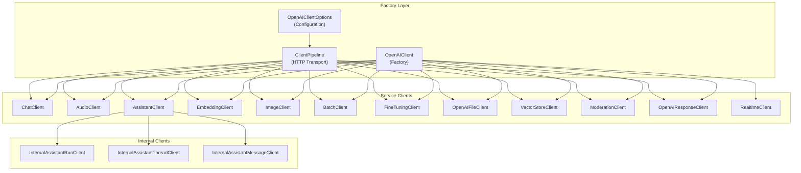

Sources: [src/Custom/OpenAIClient.cs:160-336]()

## Factory Methods and Client Creation

The `OpenAIClient` provides factory methods that create new instances of specialized clients while sharing the same authentication, configuration, and HTTP pipeline:

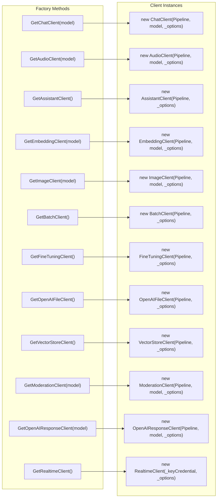

Sources: [src/Custom/OpenAIClient.cs:204](), [src/Custom/OpenAIClient.cs:181](), [src/Custom/OpenAIClient.cs:170](), [src/Custom/OpenAIClient.cs:215](), [src/Custom/OpenAIClient.cs:257](), [src/Custom/OpenAIClient.cs:193](), [src/Custom/OpenAIClient.cs:246](), [src/Custom/OpenAIClient.cs:234](), [src/Custom/OpenAIClient.cs:320](), [src/Custom/OpenAIClient.cs:279](), [src/Custom/OpenAIClient.cs:308](), [src/Custom/OpenAIClient.cs:296]()

## Available Client Libraries

### Model-Specific Clients

These clients require a model parameter and are designed for OpenAI APIs that operate on specific models:

| Client | Purpose | Factory Method | Model Required |
|--------|---------|----------------|----------------|
| `ChatClient` | Chat completions and conversations | `GetChatClient(model)` | Yes |
| `AudioClient` | Speech-to-text and text-to-speech | `GetAudioClient(model)` | Yes |
| `EmbeddingClient` | Text embeddings generation | `GetEmbeddingClient(model)` | Yes |
| `ImageClient` | Image generation and editing | `GetImageClient(model)` | Yes |
| `ModerationClient` | Content moderation | `GetModerationClient(model)` | Yes |
| `OpenAIResponseClient` | Advanced response generation | `GetOpenAIResponseClient(model)` | Yes |

### Service-Specific Clients

These clients operate on OpenAI services that don't require model specification:

| Client | Purpose | Factory Method | Experimental |
|--------|---------|----------------|--------------|
| `AssistantClient` | AI assistants with persistent threads | `GetAssistantClient()` | Yes |
| `BatchClient` | Asynchronous batch operations | `GetBatchClient()` | Yes |
| `FineTuningClient` | Model fine-tuning operations | `GetFineTuningClient()` | Yes |
| `OpenAIFileClient` | File upload and management | `GetOpenAIFileClient()` | No |
| `VectorStoreClient` | Vector storage for RAG | `GetVectorStoreClient()` | Yes |
| `RealtimeClient` | Real-time conversation sessions | `GetRealtimeClient()` | Yes |

Sources: [src/Custom/OpenAIClient.cs:169](), [src/Custom/OpenAIClient.cs:192](), [src/Custom/OpenAIClient.cs:245](), [src/Custom/OpenAIClient.cs:319](), [src/Custom/OpenAIClient.cs:295]()

### Internal Client Architecture

Some complex services use internal clients for low-level protocol operations:

| Internal Client | Purpose | Used By |
|-----------------|---------|---------|
| `InternalAssistantRunClient` | Run execution and management | `AssistantClient` |
| `InternalAssistantThreadClient` | Thread lifecycle operations | `AssistantClient` |
| `InternalAssistantMessageClient` | Message CRUD operations | `AssistantClient` |

Sources: [src/Custom/Assistants/Internal/InternalAssistantRunClient.cs:9](), [src/Custom/Assistants/Internal/InternalAssistantThreadClient.cs:8](), [src/Custom/Assistants/Internal/InternalAssistantMessageClient.cs:8]()

## Authentication and Configuration

All clients share the same authentication and configuration through the factory pattern:

### Constructor Patterns

Each client follows consistent constructor patterns for flexibility:

| Constructor Type | Parameters | Usage |
|------------------|------------|-------|
| **API Key String** | `string apiKey` | Simple authentication |
| **Credential** | `ApiKeyCredential credential` | Structured authentication |
| **Credential + Options** | `ApiKeyCredential credential, OpenAIClientOptions options` | Full configuration |
| **Authentication Policy** | `AuthenticationPolicy authenticationPolicy` | Advanced authentication |
| **Pipeline** | `ClientPipeline pipeline, OpenAIClientOptions options` | Advanced customization |

Sources: [src/Custom/FineTuning/FineTuningClient.cs:54-56](), [src/Custom/FineTuning/FineTuningClient.cs:64-66](), [src/Custom/FineTuning/FineTuningClient.cs:74-76](), [src/Custom/FineTuning/FineTuningClient.cs:82-84](), [src/Custom/FineTuning/FineTuningClient.cs:108-115]()

### Shared Configuration

The `OpenAIClientOptions` class provides shared configuration across all clients:

| Option | Purpose | Header |
|--------|---------|--------|
| `Endpoint` | Custom service endpoint | - |
| `OrganizationId` | OpenAI organization identifier | `OpenAI-Organization` |
| `ProjectId` | OpenAI project identifier | `OpenAI-Project` |
| `UserAgentApplicationId` | Custom application identifier | `User-Agent` |

Sources: [src/Custom/OpenAIClientOptions.cs:18-26](), [src/Custom/OpenAIClientOptions.cs:35-43](), [src/Custom/OpenAIClientOptions.cs:51-59](), [src/Custom/OpenAIClientOptions.cs:64-72]()

## Usage Patterns

### Factory Pattern Usage

The recommended approach is to create a single `OpenAIClient` instance and use it to create specialized clients as needed:

```csharp
var client = new OpenAIClient("your-api-key");
var chatClient = client.GetChatClient("gpt-4");
var audioClient = client.GetAudioClient("whisper-1");
```

### Direct Client Creation

For scenarios requiring only a specific client type, direct instantiation is supported:

```csharp
var chatClient = new ChatClient("gpt-4", "your-api-key");
```

Sources: [src/Custom/OpenAIClient.cs:92-96](), [src/Custom/OpenAIClient.cs:204](), [src/Custom/OpenAIClient.cs:181]()

### Pipeline Sharing

The factory pattern ensures efficient resource usage by sharing the HTTP pipeline across all clients created from the same `OpenAIClient` instance:

```csharp
var client = new OpenAIClient(apiKey, options);
// All these clients share the same pipeline and configuration
var chatClient = client.GetChatClient("gpt-4");
var embedClient = client.GetEmbeddingClient("text-embedding-3-small");
var imageClient = client.GetImageClient("dall-e-3");
```

Sources: [src/Custom/OpenAIClient.cs:140-143](), [src/Custom/OpenAIClient.cs:344-351]()

---

# Page: OpenAIClient

# OpenAIClient

<details>
<summary>Relevant source files</summary>

The following files were used as context for generating this wiki page:

- [api/OpenAI.net8.0.cs](api/OpenAI.net8.0.cs)
- [api/OpenAI.netstandard2.0.cs](api/OpenAI.netstandard2.0.cs)
- [specification/base/typespec/common/models.tsp](specification/base/typespec/common/models.tsp)
- [specification/base/typespec/main.tsp](specification/base/typespec/main.tsp)
- [specification/base/typespec/videos/main.tsp](specification/base/typespec/videos/main.tsp)
- [specification/client/videos.client.tsp](specification/client/videos.client.tsp)
- [src/Custom/OpenAIClient.cs](src/Custom/OpenAIClient.cs)
- [src/Custom/OpenAIClientOptions.cs](src/Custom/OpenAIClientOptions.cs)
- [src/Generated/Models/Chat/ChatReasoningEffortLevel.cs](src/Generated/Models/Chat/ChatReasoningEffortLevel.cs)
- [src/Generated/Models/OpenAIContext.cs](src/Generated/Models/OpenAIContext.cs)
- [src/Generated/Models/Responses/ResponseReasoningEffortLevel.cs](src/Generated/Models/Responses/ResponseReasoningEffortLevel.cs)
- [src/Generated/OpenAIModelFactory.cs](src/Generated/OpenAIModelFactory.cs)
- [tests/Responses/ResponsesTests.cs](tests/Responses/ResponsesTests.cs)
- [tspCodeModel.json](tspCodeModel.json)

</details>


## Purpose and Scope

`OpenAIClient` is the central factory class for instantiating specialized service clients in the OpenAI .NET SDK. It provides a unified entry point for creating client instances that interact with different OpenAI API services, while managing shared configuration such as authentication credentials, endpoint URLs, and HTTP communication pipelines. This document covers the construction, configuration, and factory methods of `OpenAIClient`. For information about individual service clients returned by the factory methods, see their respective documentation pages (e.g., [Chat Client](#4.2), [Assistants Client](#4.4), [Responses API Client](#4.3)).

Sources: [api/OpenAI.netstandard2.0.cs:1-39](), [api/OpenAI.net8.0.cs:1-52]()

## Architecture Overview

```mermaid
graph TB
    subgraph "Client Construction"
        APIKey["string apiKey"]
        Credential["ApiKeyCredential"]
        AuthPolicy["AuthenticationPolicy"]
        Options["OpenAIClientOptions"]
        Pipeline["ClientPipeline"]
    end
    
    subgraph "OpenAIClient Factory"
        OAIClient["OpenAIClient<br/>Factory & Configuration"]
        EndpointProp["Endpoint property"]
        PipelineProp["Pipeline property"]
    end
    
    subgraph "Specialized Service Clients"
        ChatClient["ChatClient<br/>GetChatClient(model)"]
        AudioClient["AudioClient<br/>GetAudioClient(model)"]
        AssistantClient["AssistantClient<br/>GetAssistantClient()"]
        ResponseClient["OpenAIResponseClient<br/>GetOpenAIResponseClient(model)"]
        EmbeddingClient["EmbeddingClient<br/>GetEmbeddingClient(model)"]
        ImageClient["ImageClient<br/>GetImageClient(model)"]
        FileClient["OpenAIFileClient<br/>GetOpenAIFileClient()"]
        VectorStoreClient["VectorStoreClient<br/>GetVectorStoreClient()"]
        ModelClient["OpenAIModelClient<br/>GetOpenAIModelClient()"]
        BatchClient["BatchClient<br/>GetBatchClient()"]
        RealtimeClient["RealtimeClient<br/>GetRealtimeClient()"]
        ModerationClient["ModerationClient<br/>GetModerationClient(model)"]
        FineTuningClient["FineTuningClient<br/>GetFineTuningClient()"]
        ContainerClient["ContainerClient<br/>GetContainerClient()"]
        EvaluationClient["EvaluationClient<br/>GetEvaluationClient()"]
        GraderClient["GraderClient<br/>GetGraderClient()"]
    end
    
    APIKey --> OAIClient
    Credential --> OAIClient
    AuthPolicy --> OAIClient
    Options --> OAIClient
    Pipeline --> OAIClient
    
    OAIClient --> EndpointProp
    OAIClient --> PipelineProp
    
    OAIClient --> ChatClient
    OAIClient --> AudioClient
    OAIClient --> AssistantClient
    OAIClient --> ResponseClient
    OAIClient --> EmbeddingClient
    OAIClient --> ImageClient
    OAIClient --> FileClient
    OAIClient --> VectorStoreClient
    OAIClient --> ModelClient
    OAIClient --> BatchClient
    OAIClient --> RealtimeClient
    OAIClient --> ModerationClient
    OAIClient --> FineTuningClient
    OAIClient --> ContainerClient
    OAIClient --> EvaluationClient
    OAIClient --> GraderClient
```

**OpenAIClient Factory Pattern**: The client acts as a centralized factory that creates specialized service clients with shared configuration

Sources: [api/OpenAI.netstandard2.0.cs:1-39](), [tests/Chat/ChatTests.cs:46-53]()

## Key Responsibilities

`OpenAIClient` serves three primary functions:

1. **Configuration Management**: Accepts and stores authentication credentials, endpoint configuration, and client options that are shared across all service clients
2. **Factory Pattern Implementation**: Provides factory methods to instantiate specialized client instances for different OpenAI services
3. **Pipeline Sharing**: Creates and shares a `ClientPipeline` instance that handles HTTP communication, authentication, retry logic, and telemetry across all clients created from the factory

Sources: [api/OpenAI.netstandard2.0.cs:2-28]()

## Construction and Configuration

### Constructor Overloads

`OpenAIClient` provides multiple constructor overloads to support different authentication and configuration scenarios:

| Constructor Signature | Use Case |
|----------------------|----------|
| `OpenAIClient(string apiKey)` | Simple API key authentication with default options |
| `OpenAIClient(ApiKeyCredential credential)` | API key authentication using credential object |
| `OpenAIClient(ApiKeyCredential credential, OpenAIClientOptions options)` | API key authentication with custom options |
| `OpenAIClient(AuthenticationPolicy authenticationPolicy)` | Custom authentication policy |
| `OpenAIClient(AuthenticationPolicy authenticationPolicy, OpenAIClientOptions options)` | Custom authentication with custom options |
| `OpenAIClient(ClientPipeline pipeline, OpenAIClientOptions options)` | Advanced scenario with pre-configured pipeline |

Sources: [api/OpenAI.netstandard2.0.cs:3-11](), [tests/Chat/ChatSmokeTests.cs:75-101]()

### OpenAIClientOptions

The `OpenAIClientOptions` class configures cross-cutting concerns for all clients created from the factory:

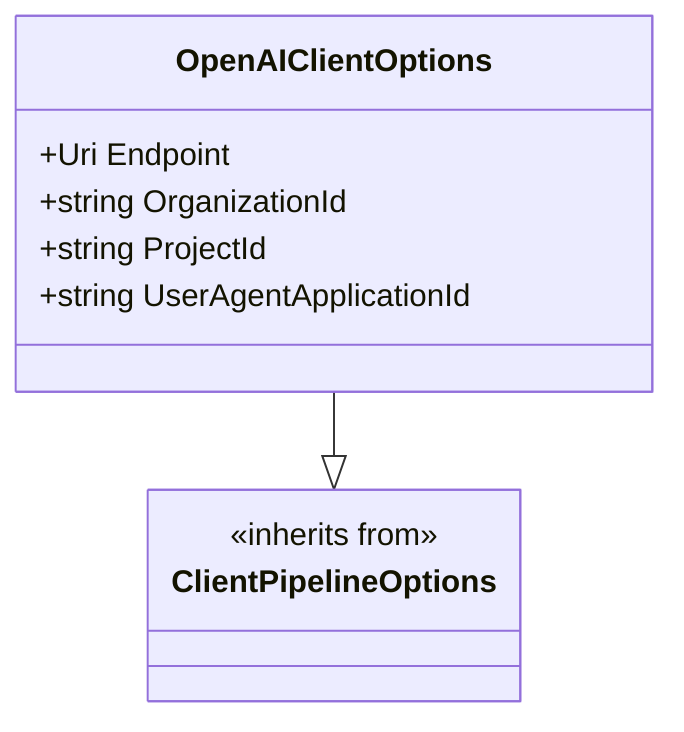

**OpenAIClientOptions Configuration**: Options that apply to all service clients

| Property | Description |
|----------|-------------|
| `Endpoint` | Custom endpoint URL (defaults to OpenAI's API) |
| `OrganizationId` | OpenAI organization identifier for billing and access control |
| `ProjectId` | OpenAI project identifier for resource isolation |
| `UserAgentApplicationId` | Custom user agent string for request identification |

Sources: [api/OpenAI.netstandard2.0.cs:29-34](), [src/OpenAI.csproj:1-84]()

### Construction Examples

```mermaid
sequenceDiagram
    participant App as Application Code
    participant OAI as OpenAIClient
    participant Pipeline as ClientPipeline
    participant ChatClient as ChatClient
    
    App->>OAI: new OpenAIClient(apiKey, options)
    OAI->>Pipeline: Create ClientPipeline with auth
    App->>OAI: GetChatClient(model)
    OAI->>ChatClient: Create with pipeline and model
    ChatClient-->>App: Return ChatClient instance
```

**Client Creation Sequence**: Flow from OpenAIClient construction to specialized client instantiation

Sources: [tests/Chat/ChatTests.cs:46-53](), [tests/Chat/ChatSmokeTests.cs:75-101]()

## Factory Methods

### Model-Scoped Clients

These factory methods require a model identifier and return clients configured for that specific model:

```mermaid
graph LR
    OAIClient["OpenAIClient"]
    
    OAIClient -->|"GetChatClient(model)"| ChatClient["ChatClient"]
    OAIClient -->|"GetAudioClient(model)"| AudioClient["AudioClient"]
    OAIClient -->|"GetEmbeddingClient(model)"| EmbeddingClient["EmbeddingClient"]
    OAIClient -->|"GetImageClient(model)"| ImageClient["ImageClient"]
    OAIClient -->|"GetModerationClient(model)"| ModerationClient["ModerationClient"]
    OAIClient -->|"GetOpenAIResponseClient(model)"| ResponseClient["OpenAIResponseClient"]
```

**Model-Scoped Factory Methods**: Clients that require model selection at creation time

| Method | Returns | Model Parameter Usage |
|--------|---------|----------------------|
| `GetChatClient(string model)` | `ChatClient` | Specifies chat completion model (e.g., "gpt-4o", "gpt-4o-mini") |
| `GetAudioClient(string model)` | `AudioClient` | Specifies TTS or transcription model (e.g., "whisper-1", "tts-1") |
| `GetEmbeddingClient(string model)` | `EmbeddingClient` | Specifies embedding model (e.g., "text-embedding-3-small") |
| `GetImageClient(string model)` | `ImageClient` | Specifies image generation model (e.g., "dall-e-3") |
| `GetModerationClient(string model)` | `ModerationClient` | Specifies moderation model (e.g., "text-moderation-latest") |
| `GetOpenAIResponseClient(string model)` | `OpenAIResponseClient` | Specifies model for response generation with tools |

Sources: [api/OpenAI.netstandard2.0.cs:13-26](), [tests/Chat/ChatTests.cs:48-49]()

### Service-Scoped Clients

These factory methods return clients for specific OpenAI services that are not tied to a particular model at construction time:

| Method | Returns | Service Purpose |
|--------|---------|----------------|
| `GetAssistantClient()` | `AssistantClient` | Assistants API for stateful multi-turn conversations |
| `GetBatchClient()` | `BatchClient` | Batch processing API for asynchronous operations |
| `GetContainerClient()` | `ContainerClient` | Container management for code execution environments |
| `GetEvaluationClient()` | `EvaluationClient` | Model evaluation and testing workflows |
| `GetFineTuningClient()` | `FineTuningClient` | Fine-tuning job management |
| `GetGraderClient()` | `GraderClient` | Model output grading and validation |
| `GetOpenAIFileClient()` | `OpenAIFileClient` | File upload, download, and management |
| `GetOpenAIModelClient()` | `OpenAIModelClient` | Model metadata and capability queries |
| `GetRealtimeClient()` | `RealtimeClient` | Real-time bidirectional audio/text streaming |
| `GetVectorStoreClient()` | `VectorStoreClient` | Vector store creation and RAG document management |

Sources: [api/OpenAI.netstandard2.0.cs:12-27]()

## Shared Infrastructure

### ClientPipeline Management

`OpenAIClient` creates and shares a `ClientPipeline` instance across all specialized clients. This pipeline handles:

- **HTTP Transport**: Network communication with retry policies
- **Authentication**: API key injection via `AuthenticationPolicy`
- **Telemetry**: OpenTelemetry tracing and metrics collection
- **Request/Response Processing**: Header management, serialization, error handling

```mermaid
graph TB
    OAIClient["OpenAIClient<br/>Pipeline property"]
    Pipeline["ClientPipeline"]
    
    subgraph "Pipeline Components"
        AuthPolicy["AuthenticationPolicy<br/>API key management"]
        Transport["HTTP Transport<br/>Network communication"]
        Telemetry["OpenTelemetry<br/>Tracing & metrics"]
        ErrorHandling["Error Handling<br/>Exception mapping"]
    end
    
    subgraph "Shared by All Clients"
        ChatClient["ChatClient"]
        AudioClient["AudioClient"]
        AssistantClient["AssistantClient"]
        Others["...other clients"]
    end
    
    OAIClient --> Pipeline
    Pipeline --> AuthPolicy
    Pipeline --> Transport
    Pipeline --> Telemetry
    Pipeline --> ErrorHandling
    
    Pipeline --> ChatClient
    Pipeline --> AudioClient
    Pipeline --> AssistantClient
    Pipeline --> Others
```

**Shared Pipeline Architecture**: All clients created from OpenAIClient share the same pipeline instance

Sources: [api/OpenAI.netstandard2.0.cs:11](), [tests/Telemetry/ChatTelemetryTests.cs:1-318]()

### Endpoint Property

The `Endpoint` property exposes the configured API endpoint URL. This is set via `OpenAIClientOptions` during construction and defaults to OpenAI's production API endpoint:

```csharp
// Accessing the configured endpoint
Uri endpoint = client.Endpoint;
```

The endpoint property is marked with the `[Experimental("OPENAI001")]` attribute in the .NET 8.0 target, indicating it may change in future versions.

Sources: [api/OpenAI.netstandard2.0.cs:10](), [api/OpenAI.net8.0.cs:12-13]()

## Usage Patterns

### Basic Pattern: Factory Usage

The most common usage pattern is to create an `OpenAIClient` instance once and use it to obtain specialized clients as needed:

```csharp
// Create the factory client
OpenAIClient client = new OpenAIClient(apiKey);

// Obtain specialized clients
ChatClient chatClient = client.GetChatClient("gpt-4o-mini");
ImageClient imageClient = client.GetImageClient("dall-e-3");
```

Sources: [tests/Chat/ChatTests.cs:46-53]()

### Advanced Pattern: Custom Configuration

For scenarios requiring custom endpoints, organization IDs, or authentication policies:

```csharp
OpenAIClientOptions options = new OpenAIClientOptions
{
    Endpoint = new Uri("https://custom.openai.endpoint"),
    OrganizationId = "org-123456",
    ProjectId = "proj-abcdef"
};

OpenAIClient client = new OpenAIClient(credential, options);
ChatClient chatClient = client.GetChatClient("gpt-4o");
```

Sources: [tests/Chat/ChatSmokeTests.cs:82-89](), [api/OpenAI.netstandard2.0.cs:29-34]()

### Alternative Pattern: Direct Client Construction

Specialized clients can also be constructed directly without using `OpenAIClient` as a factory. This approach is useful when only a single service is needed:

```csharp
// Direct construction bypasses OpenAIClient factory
ChatClient chatClient = new ChatClient("gpt-4o-mini", credential, options);
```

Both patterns share the same underlying implementation, as specialized clients have similar constructor overloads that accept credentials and options directly.

Sources: [tests/Chat/ChatSmokeTests.cs:91-100]()

### Testing Pattern: Mocking and Proxies

The test infrastructure uses `OpenAIClient` with custom transport layers for mocking:

```csharp
MockPipelineTransport mockTransport = new MockPipelineTransport(/* ... */);
OpenAIClientOptions options = new OpenAIClientOptions { Transport = mockTransport };
ChatClient client = new ChatClient("model", credential, options);
```

This pattern enables deterministic testing without making actual API calls.

Sources: [tests/Chat/ChatSmokeTests.cs:28-68]()

## Relationship to Other Components

```mermaid
graph TB
    OpenAIClient["OpenAIClient"]
    OpenAIClientOptions["OpenAIClientOptions"]
    ApiKeyCredential["ApiKeyCredential"]
    AuthenticationPolicy["AuthenticationPolicy"]
    ClientPipeline["ClientPipeline"]
    
    subgraph "Specialized Clients"
        ChatClient["ChatClient<br/>Page 4.2"]
        ResponseClient["OpenAIResponseClient<br/>Page 4.3"]
        AssistantClient["AssistantClient<br/>Page 4.4"]
        AudioClient["AudioClient<br/>Page 4.5"]
        ImageClient["ImageClient<br/>Page 4.6"]
        OtherClients["...other clients<br/>Pages 4.7-4.12"]
    end
    
    OpenAIClientOptions --> OpenAIClient
    ApiKeyCredential --> OpenAIClient
    AuthenticationPolicy --> OpenAIClient
    OpenAIClient --> ClientPipeline
    ClientPipeline --> ChatClient
    ClientPipeline --> ResponseClient
    ClientPipeline --> AssistantClient
    ClientPipeline --> AudioClient
    ClientPipeline --> ImageClient
    ClientPipeline --> OtherClients
```

**Component Relationships**: OpenAIClient coordinates configuration and creates specialized service clients

- **Configuration Input**: Receives `OpenAIClientOptions`, credentials, and authentication policies
- **Pipeline Creation**: Instantiates and configures `ClientPipeline` with authentication and transport
- **Client Provisioning**: Factory methods create specialized clients with shared pipeline
- **Documentation Links**: See individual client pages for service-specific functionality

Sources: [api/OpenAI.netstandard2.0.cs:1-39](), [CHANGELOG.md:42-241]()

## Constructor and Property Reference

### Constructors

| Constructor | Accessibility | Description |
|------------|---------------|-------------|
| `OpenAIClient()` | `protected` | Base constructor for derived classes |
| `OpenAIClient(ApiKeyCredential credential, OpenAIClientOptions options)` | `public` | Full configuration with credential object |
| `OpenAIClient(ApiKeyCredential credential)` | `public` | Credential with default options |
| `OpenAIClient(AuthenticationPolicy authenticationPolicy, OpenAIClientOptions options)` | `public` | Custom authentication with options |
| `OpenAIClient(AuthenticationPolicy authenticationPolicy)` | `public` | Custom authentication with default options |
| `OpenAIClient(ClientPipeline pipeline, OpenAIClientOptions options)` | `protected internal` | Advanced pipeline injection |
| `OpenAIClient(string apiKey)` | `public` | Simple API key string |

Sources: [api/OpenAI.netstandard2.0.cs:3-11]()

### Properties

| Property | Type | Description |
|----------|------|-------------|
| `Endpoint` | `Uri` | Configured API endpoint URL |
| `Pipeline` | `ClientPipeline` | Shared HTTP communication pipeline |

Sources: [api/OpenAI.netstandard2.0.cs:10-11]()

## Version and Compatibility Notes

The `OpenAIClient` class is available in both target frameworks:
- **netstandard2.0**: Supports .NET Framework 4.6.2+, .NET Core 2.0+
- **net8.0**: Optimized for .NET 8+ with additional features

Several members are marked with `[Experimental("OPENAI001")]` in the net8.0 build, indicating potential API changes:
- `Endpoint` property
- Factory methods for experimental services (Assistants, Batch, Containers, Evaluations, Fine-tuning, Graders, Realtime, Responses, Vector Stores)

Sources: [api/OpenAI.net8.0.cs:1-52](), [src/OpenAI.csproj:14-15]()

---

# Page: Chat Client

# Chat Client

<details>
<summary>Relevant source files</summary>

The following files were used as context for generating this wiki page:

- [README.md](README.md)
- [examples/Assistants/Example01_RetrievalAugmentedGeneration.cs](examples/Assistants/Example01_RetrievalAugmentedGeneration.cs)
- [examples/Assistants/Example01_RetrievalAugmentedGenerationAsync.cs](examples/Assistants/Example01_RetrievalAugmentedGenerationAsync.cs)
- [examples/Assistants/Example05_AssistantsWithVision.cs](examples/Assistants/Example05_AssistantsWithVision.cs)
- [examples/Assistants/Example05_AssistantsWithVisionAsync.cs](examples/Assistants/Example05_AssistantsWithVisionAsync.cs)
- [examples/Chat/Example02_SimpleChatStreaming.cs](examples/Chat/Example02_SimpleChatStreaming.cs)
- [examples/Chat/Example02_SimpleChatStreamingAsync.cs](examples/Chat/Example02_SimpleChatStreamingAsync.cs)
- [examples/Chat/Example03_FunctionCalling.cs](examples/Chat/Example03_FunctionCalling.cs)
- [examples/Chat/Example06_StructuredOutputs.cs](examples/Chat/Example06_StructuredOutputs.cs)
- [examples/Chat/Example06_StructuredOutputsAsync.cs](examples/Chat/Example06_StructuredOutputsAsync.cs)
- [src/Custom/Chat/ChatClient.cs](src/Custom/Chat/ChatClient.cs)
- [src/Custom/Chat/ChatCompletionOptions.cs](src/Custom/Chat/ChatCompletionOptions.cs)
- [tests/Chat/ChatTests.cs](tests/Chat/ChatTests.cs)
- [tests/SessionRecords/ChatTests/ChatServiceTierWorks.json](tests/SessionRecords/ChatTests/ChatServiceTierWorks.json)
- [tests/SessionRecords/ChatTests/ChatServiceTierWorksAsync.json](tests/SessionRecords/ChatTests/ChatServiceTierWorksAsync.json)
- [tests/SessionRecords/ChatTests/StructuredRefusalWorks.json](tests/SessionRecords/ChatTests/StructuredRefusalWorks.json)
- [tests/SessionRecords/ChatTests/StructuredRefusalWorksAsync.json](tests/SessionRecords/ChatTests/StructuredRefusalWorksAsync.json)
- [tests/SessionRecords/ChatTests/ValidateConcurrency.json](tests/SessionRecords/ChatTests/ValidateConcurrency.json)
- [tests/SessionRecords/ChatTests/ValidateConcurrencyAsync.json](tests/SessionRecords/ChatTests/ValidateConcurrencyAsync.json)
- [tests/SessionRecords/ChatTests/WebSearchWorks.json](tests/SessionRecords/ChatTests/WebSearchWorks.json)
- [tests/SessionRecords/ChatTests/WebSearchWorksAsync.json](tests/SessionRecords/ChatTests/WebSearchWorksAsync.json)
- [tests/Telemetry/ChatTelemetryTests.cs](tests/Telemetry/ChatTelemetryTests.cs)

</details>


## Purpose and Scope

This document covers the `ChatClient` class, which provides access to OpenAI's chat completions API. The `ChatClient` enables conversational AI interactions through both streaming and non-streaming modes, with support for advanced features including function calling, structured outputs, multimodal inputs (vision and audio), and chat completion persistence.

For information about the Responses API (which uses reasoning models like `o3-mini`), see [Responses API Client](#4.3). For information about the Assistants API (which provides stateful conversations with file search and code interpreter), see [Assistants Client](#4.4).

**Sources**: [src/Custom/Chat/ChatClient.cs:1-398](), [README.md:58-68]()

---

## Client Creation and Configuration

### Instantiation Patterns

The `ChatClient` can be instantiated directly or obtained from the factory `OpenAIClient`. The client requires a model identifier and authentication credentials.

```mermaid
graph TB
    subgraph "Creation Patterns"
        Direct["Direct Instantiation<br/>new ChatClient(model, apiKey)"]
        Factory["Factory Pattern<br/>openAIClient.GetChatClient(model)"]
        AuthPolicy["With AuthenticationPolicy<br/>new ChatClient(model, authPolicy, options)"]
    end
    
    subgraph "Constructor Signatures"
        Ctor1["ChatClient(string model, string apiKey)"]
        Ctor2["ChatClient(string model, ApiKeyCredential credential)"]
        Ctor3["ChatClient(string model, ApiKeyCredential credential,<br/>OpenAIClientOptions options)"]
        Ctor4["ChatClient(string model, AuthenticationPolicy authPolicy,<br/>OpenAIClientOptions options)"]
        Ctor5["ChatClient(ClientPipeline pipeline, string model,<br/>OpenAIClientOptions options)"]
    end
    
    subgraph "Infrastructure Components"
        Pipeline["ClientPipeline<br/>HTTP transport layer"]
        Endpoint["Endpoint URI<br/>from OpenAIClientOptions"]
        Model["Model Identifier<br/>e.g. 'gpt-4o-mini'"]
        Telemetry["OpenTelemetrySource<br/>Distributed tracing"]
    end
    
    Direct --> Ctor1
    Direct --> Ctor2
    Factory --> Ctor5
    AuthPolicy --> Ctor4
    
    Ctor1 --> Ctor3
    Ctor2 --> Ctor3
    Ctor3 --> Pipeline
    Ctor4 --> Pipeline
    Ctor5 --> Pipeline
    
    Pipeline --> Endpoint
    Pipeline --> Model
    Pipeline --> Telemetry
```

**Sources**: [src/Custom/Chat/ChatClient.cs:29-119](), [README.md:60-87]()

### Configuration Options

The client accepts `OpenAIClientOptions` for endpoint customization, organization/project IDs, and custom headers.

| Constructor Parameter | Purpose | Default |
|----------------------|---------|---------|
| `model` | Model identifier (e.g., `gpt-4o-mini`, `gpt-4o`, `gpt-4o-audio-preview`) | Required |
| `apiKey` or `credential` | API key authentication | Required |
| `options` | Configuration for endpoint, headers, retry policy | `new OpenAIClientOptions()` |

**Sources**: [src/Custom/Chat/ChatClient.cs:42-95](), [README.md:72-88]()

---

## Basic Chat Completions

### Non-Streaming Completions

The primary methods for generating chat completions are `CompleteChat` and `CompleteChatAsync`. These methods accept a collection of `ChatMessage` instances and return a `ChatCompletion` containing the model's response.

```mermaid
sequenceDiagram
    participant App as Application Code
    participant Client as ChatClient
    participant Options as ChatCompletionOptions
    participant Telemetry as OpenTelemetrySource
    participant Pipeline as ClientPipeline
    participant API as OpenAI API
    
    App->>Client: CompleteChat(messages, options)
    Client->>Options: CreateChatCompletionOptions()
    Options-->>Client: Populated options
    Client->>Telemetry: StartChatScope(options)
    Telemetry-->>Client: OpenTelemetryScope
    Client->>Pipeline: CompleteChatAsync(content, requestOptions)
    Pipeline->>API: POST /v1/chat/completions
    API-->>Pipeline: HTTP Response
    Pipeline-->>Client: ClientResult
    Client->>Client: Extract ChatCompletion
    Client->>Telemetry: RecordChatCompletion(chatCompletion)
    Client-->>App: ClientResult<ChatCompletion>
```

**Method Signatures**:
- `CompleteChat(IEnumerable<ChatMessage> messages, ChatCompletionOptions options = null, CancellationToken cancellationToken = default)`
- `CompleteChatAsync(IEnumerable<ChatMessage> messages, ChatCompletionOptions options = null, CancellationToken cancellationToken = default)`
- `CompleteChat(params ChatMessage[] messages)` - convenience overload
- `CompleteChatAsync(params ChatMessage[] messages)` - convenience overload

**Sources**: [src/Custom/Chat/ChatClient.cs:133-215](), [tests/Chat/ChatTests.cs:35-43]()

### ChatMessage Types

| Message Type | Purpose | Example |
|--------------|---------|---------|
| `UserChatMessage` | User input | `new UserChatMessage("Hello, world!")` |
| `SystemChatMessage` | System instructions | `new SystemChatMessage("You are a helpful assistant.")` |
| `AssistantChatMessage` | Assistant's prior responses | `new AssistantChatMessage(completion)` |
| `ToolChatMessage` | Tool execution results | `new ToolChatMessage(toolCallId, result)` |
| `FunctionChatMessage` | Legacy function results | `new FunctionChatMessage(functionName, result)` |

**Sources**: [tests/Chat/ChatTests.cs:59-65](), [README.md:224-368]()

### ChatCompletion Response

The `ChatCompletion` object contains the model's response with the following key properties:

| Property | Type | Description |
|----------|------|-------------|
| `Id` | `string` | Unique identifier for the completion |
| `CreatedAt` | `DateTimeOffset` | Timestamp of creation |
| `Model` | `string` | Model used for generation |
| `Role` | `ChatMessageRole` | Role (typically `Assistant`) |
| `Content` | `IReadOnlyList<ChatMessageContentPart>` | Response content parts |
| `FinishReason` | `ChatFinishReason` | Completion termination reason |
| `ToolCalls` | `IReadOnlyList<ChatToolCall>` | Tool calls requested by model |
| `ContentTokenLogProbabilities` | `IReadOnlyList<ChatTokenLogProbabilityDetails>` | Token probabilities |
| `Usage` | `ChatTokenUsage` | Token consumption details |
| `OutputAudio` | `ChatOutputAudio` | Audio output (if enabled) |

**Sources**: [tests/Chat/ChatTests.cs:40-42](), [src/Custom/Chat/ChatClient.cs:159-164]()

---

## Streaming Completions

### Streaming API

Streaming completions allow incremental processing of the model's response as it is generated. This reduces perceived latency and enables real-time UI updates.

```mermaid
graph TB
    subgraph "Streaming Request Flow"
        App["Application Code"]
        Client["ChatClient"]
        Method["CompleteChatStreaming(Async)"]
        StreamOptions["InternalChatCompletionStreamOptions<br/>includeUsage: true"]
        BinaryContent["BinaryContent<br/>Serialized options"]
        Pipeline["ClientPipeline"]
    end
    
    subgraph "Response Processing"
        SSE["Server-Sent Events<br/>text/event-stream"]
        Collection["(Async)CollectionResult<br/>&lt;StreamingChatCompletionUpdate&gt;"]
        Updates["StreamingChatCompletionUpdate instances"]
        Enumerate["foreach / await foreach"]
    end
    
    subgraph "Update Types"
        ContentDelta["ContentUpdate<br/>Incremental text tokens"]
        AudioDelta["OutputAudioUpdate<br/>Audio bytes/transcript"]
        UsageUpdate["Usage<br/>Final token counts"]
        FinishUpdate["FinishReason<br/>Completion status"]
    end
    
    App --> Client
    Client --> Method
    Method --> StreamOptions
    Method --> BinaryContent
    BinaryContent --> Pipeline
    Pipeline --> SSE
    SSE --> Collection
    Collection --> Enumerate
    Enumerate --> Updates
    
    Updates --> ContentDelta
    Updates --> AudioDelta
    Updates --> UsageUpdate
    Updates --> FinishUpdate
```

**Method Signatures**:
- `CompleteChatStreaming(IEnumerable<ChatMessage> messages, ChatCompletionOptions options = null, CancellationToken cancellationToken = default)` → `CollectionResult<StreamingChatCompletionUpdate>`
- `CompleteChatStreamingAsync(IEnumerable<ChatMessage> messages, ChatCompletionOptions options = null, CancellationToken cancellationToken = default)` → `AsyncCollectionResult<StreamingChatCompletionUpdate>`

**Sources**: [src/Custom/Chat/ChatClient.cs:217-307](), [tests/Chat/ChatTests.cs:69-99]()

### StreamingChatCompletionUpdate

Each streaming update may contain:

| Property | Type | Description |
|----------|------|-------------|
| `ContentUpdate` | `IReadOnlyList<ChatMessageContentPart>` | Incremental content tokens |
| `OutputAudioUpdate` | `StreamingChatOutputAudioUpdate` | Audio data increments |
| `ToolCallUpdates` | `IReadOnlyList<StreamingChatToolCallUpdate>` | Tool call deltas |
| `FinishReason` | `ChatFinishReason?` | Completion reason (final update) |
| `Usage` | `ChatTokenUsage` | Token usage (final update with `includeUsage: true`) |
| `ContentTokenLogProbabilities` | `IReadOnlyList<ChatTokenLogProbabilityDetails>` | Token probabilities |

**Sources**: [tests/Chat/ChatTests.cs:83-98](), [README.md:184-220]()

---

## Function Calling and Tool Usage

### Tool Definition

Tools (functions) are defined using `ChatTool.CreateFunctionTool` with a name, description, and optional JSON schema for parameters.

```mermaid
graph TB
    subgraph "Tool Definition Phase"
        Define["Define ChatTool"]
        Schema["JSON Schema<br/>for parameters"]
        Options["ChatCompletionOptions<br/>.Tools collection"]
        ToolChoice["ChatToolChoice<br/>auto/none/required/specific"]
    end
    
    subgraph "Request-Response Loop"
        Request1["1. Initial request<br/>with tools"]
        Response1["2. Response with<br/>FinishReason.ToolCalls"]
        Execute["3. Execute tool<br/>Application logic"]
        ToolMessage["4. Add ToolChatMessage<br/>with result"]
        Request2["5. Follow-up request<br/>with tool result"]
        Response2["6. Final response<br/>FinishReason.Stop"]
    end
    
    subgraph "Tool Call Structure"
        ToolCall["ChatToolCall"]
        ID["Id: string"]
        FuncName["FunctionName: string"]
        FuncArgs["FunctionArguments: BinaryData<br/>JSON string"]
    end
    
    Define --> Schema
    Schema --> Options
    Options --> ToolChoice
    
    Request1 --> Response1
    Response1 --> ToolCall
    ToolCall --> ID
    ToolCall --> FuncName
    ToolCall --> FuncArgs
    FuncArgs --> Execute
    Execute --> ToolMessage
    ToolMessage --> Request2
    Request2 --> Response2
```

**Example Tool Definition**:
```csharp
ChatTool tool = ChatTool.CreateFunctionTool(
    functionName: "GetCurrentWeather",
    functionDescription: "Get the current weather in a given location",
    functionParameters: BinaryData.FromBytes("""
        {
            "type": "object",
            "properties": {
                "location": { "type": "string" },
                "unit": { "type": "string", "enum": ["celsius", "fahrenheit"] }
            },
            "required": ["location"]
        }
        """u8.ToArray())
);
```

**Sources**: [README.md:224-268](), [tests/Chat/ChatToolTests.cs:26-77]()

### Tool Execution Loop

The tool calling pattern requires iterative requests:

1. Send user message with tools defined in `ChatCompletionOptions.Tools`
2. Check if `FinishReason == ChatFinishReason.ToolCalls`
3. Extract tool calls from `ChatCompletion.ToolCalls`
4. Execute local functions based on `FunctionName` and parse `FunctionArguments`
5. Add `AssistantChatMessage(completion)` to conversation
6. Add `ToolChatMessage(toolCallId, result)` for each tool call
7. Send follow-up request with updated messages
8. Repeat until `FinishReason == ChatFinishReason.Stop`

**Sources**: [README.md:284-367](), [tests/Chat/ChatToolTests.cs:81-107]()

### Parallel Tool Calls

The model can request multiple tool calls simultaneously. Each must be resolved and added as a separate `ToolChatMessage` before the next request.

**Sources**: [tests/Chat/ChatToolTests.cs:139-176]()

### ChatToolChoice Configuration

| Choice | Behavior |
|--------|----------|
| `ChatToolChoice.CreateAutoChoice()` | Model decides whether to call tools |
| `ChatToolChoice.CreateNoneChoice()` | Model will not call tools |
| `ChatToolChoice.CreateRequiredChoice()` | Model must call a tool |
| `ChatToolChoice.CreateFunctionChoice(functionName)` | Model must call specific function |

**Sources**: [tests/Chat/ChatToolTests.cs:29-50]()

---

## Structured Outputs

### JSON Schema Validation

Structured outputs guarantee that the model's response conforms to a specified JSON schema using `ChatResponseFormat.CreateJsonSchemaFormat`.

```mermaid
graph LR
    subgraph "Configuration"
        Schema["JSON Schema<br/>BinaryData"]
        Format["ChatResponseFormat.CreateJsonSchemaFormat()"]
        Options["ChatCompletionOptions<br/>.ResponseFormat"]
    end
    
    subgraph "Request"
        Messages["User messages"]
        Request["CompleteChat()"]
    end
    
    subgraph "Response"
        Completion["ChatCompletion"]
        Content["Content[0].Text<br/>Guaranteed valid JSON"]
        Parse["JsonDocument.Parse()"]
        Validate["Conforms to schema"]
    end
    
    Schema --> Format
    Format --> Options
    Messages --> Request
    Options --> Request
    Request --> Completion
    Completion --> Content
    Content --> Parse
    Parse --> Validate
```

**Key Parameters**:
- `jsonSchemaFormatName`: Name for the schema
- `jsonSchema`: BinaryData containing JSON schema definition
- `jsonSchemaIsStrict`: When `true`, enforces strict conformance (recommended)

**Example**:
```csharp
ChatCompletionOptions options = new()
{
    ResponseFormat = ChatResponseFormat.CreateJsonSchemaFormat(
        jsonSchemaFormatName: "math_reasoning",
        jsonSchema: BinaryData.FromBytes(/* schema */),
        jsonSchemaIsStrict: true)
};
```

**Sources**: [README.md:370-423](), [tests/Chat/ChatTests.cs:476-536](), [examples/Chat/Example06_StructuredOutputs.cs:1-58]()

---

## Multimodal Capabilities

### Audio Input and Output

Models like `gpt-4o-audio-preview` support audio input and output through `ChatMessageContentPart` and `ChatOutputAudio`.

```mermaid
graph TB
    subgraph "Audio Input Configuration"
        AudioFile["Audio file<br/>WAV, MP3, etc."]
        AudioData["BinaryData.FromBytes()"]
        InputPart["ChatMessageContentPart.CreateInputAudioPart()"]
        InputFormat["ChatInputAudioFormat<br/>Wav, Mp3, etc."]
        UserMessage["UserChatMessage"]
    end
    
    subgraph "Audio Output Configuration"
        ResponseModalities["ChatResponseModalities.Text | Audio"]
        AudioOptions["AudioOptions<br/>Voice: Alloy/Ash/etc<br/>Format: Mp3/Pcm16/etc."]
        CompletionOpts["ChatCompletionOptions"]
    end
    
    subgraph "Response Processing"
        Completion["ChatCompletion"]
        OutputAudio["OutputAudio: ChatOutputAudio"]
        AudioID["Id: string"]
        AudioBytes["AudioBytes: BinaryData"]
        Transcript["Transcript: string"]
        ExpiresAt["ExpiresAt: DateTimeOffset"]
    end
    
    subgraph "History Management"
        HistoryMsg["AssistantChatMessage(completion)"]
        AudioRef["OutputAudioReference.Id"]
        NextRequest["Include in next request"]
    end
    
    AudioFile --> AudioData
    AudioData --> InputPart
    InputFormat --> InputPart
    InputPart --> UserMessage
    
    ResponseModalities --> CompletionOpts
    AudioOptions --> CompletionOpts
    
    CompletionOpts --> Completion
    Completion --> OutputAudio
    OutputAudio --> AudioID
    OutputAudio --> AudioBytes
    OutputAudio --> Transcript
    OutputAudio --> ExpiresAt
    
    Completion --> HistoryMsg
    AudioID --> AudioRef
    AudioRef --> NextRequest
```

**Audio Input**: Use `ChatMessageContentPart.CreateInputAudioPart(audioData, format)` in user messages.

**Audio Output**: Configure `ChatCompletionOptions.AudioOptions` and set `ResponseModalities` to include `ChatResponseModalities.Audio`.

**Sources**: [README.md:425-485](), [tests/Chat/ChatTests.cs:192-280]()

### Streaming Audio

Streaming audio provides incremental updates through `StreamingChatOutputAudioUpdate`:

| Property | Description |
|----------|-------------|
| `Id` | Audio identifier (appears across multiple updates) |
| `AudioBytesUpdate` | Incremental audio data |
| `TranscriptUpdate` | Incremental transcript text |
| `ExpiresAt` | Expiration time (appears once, typically in final update) |

**Sources**: [README.md:487-493](), [tests/Chat/ChatTests.cs:144-190]()

### Vision

Vision capabilities allow including images in messages via `ChatMessageContentPart.CreateImagePart`.

**Image Sources**:
- `BinaryData` with media type (e.g., `"image/png"`)
- `Uri` to remote image

**Sources**: [tests/Chat/ChatTests.cs:122-140]()

---

## Token Log Probabilities

Token log probabilities provide insight into the model's confidence for each generated token.

**Configuration**:
```csharp
ChatCompletionOptions options = new()
{
    IncludeLogProbabilities = true,
    TopLogProbabilityCount = 3  // Top 3 alternatives per token
};
```

**Response Structure**:
- `ChatCompletion.ContentTokenLogProbabilities` → `IReadOnlyList<ChatTokenLogProbabilityDetails>`
- Each `ChatTokenLogProbabilityDetails` contains:
  - `Token`: The selected token
  - `LogProbability`: Log probability value
  - `TopLogProbabilities`: Alternative tokens with their probabilities

**Streaming**: In streaming mode, token log probabilities appear alongside content updates in `StreamingChatCompletionUpdate.ContentTokenLogProbabilities`.

**Sources**: [tests/Chat/ChatTests.cs:303-353](), [tests/Chat/ChatTests.cs:355-409]()

---

## Chat Completion Storage and Retrieval

### Storage Configuration

Chat completions can be stored for later retrieval by enabling `StoredOutputEnabled` in `ChatCompletionOptions`.

```mermaid
graph TB
    subgraph "Storage Workflow"
        Request["ChatCompletionOptions<br/>.StoredOutputEnabled = true<br/>.Metadata = {...}"]
        Complete["CompleteChat()"]
        Stored["Stored ChatCompletion<br/>with ID"]
    end
    
    subgraph "Retrieval Methods"
        GetOne["GetChatCompletion(completionId)"]
        GetMany["GetChatCompletions(options)"]
        GetMessages["GetChatCompletionMessages(completionId, options)"]
    end
    
    subgraph "Collection Options"
        Pagination["ChatCompletionCollectionOptions"]
        PageSize["PageSizeLimit: int"]
        AfterId["AfterId: string"]
        BeforeId["BeforeId: string"]
        Order["Order: Ascending/Descending"]
        ModelFilter["Model: string"]
        MetadataFilter["Metadata: IDictionary"]
    end
    
    subgraph "Management"
        Update["UpdateChatCompletion(id, metadata)"]
        Delete["DeleteChatCompletion(id)"]
    end
    
    Request --> Complete
    Complete --> Stored
    
    Stored --> GetOne
    Stored --> GetMany
    Stored --> GetMessages
    
    Pagination --> PageSize
    Pagination --> AfterId
    Pagination --> BeforeId
    Pagination --> Order
    Pagination --> ModelFilter
    Pagination --> MetadataFilter
    
    Pagination --> GetMany
    Pagination --> GetMessages
    
    Stored --> Update
    Stored --> Delete
```

**Sources**: [tests/Chat/ChatStoreTests.cs:24-46](), [src/Custom/Chat/ChatClient.cs:310-381]()

### Retrieval API

| Method | Purpose | Return Type |
|--------|---------|-------------|
| `GetChatCompletion(completionId)` | Retrieve single completion | `ClientResult<ChatCompletion>` |
| `GetChatCompletions(options)` | List completions with pagination | `IAsyncEnumerable<ChatCompletion>` |
| `GetChatCompletionMessages(completionId, options)` | Retrieve messages from completion | `IAsyncEnumerable<ChatCompletionMessageListDatum>` |
| `UpdateChatCompletion(completionId, metadata)` | Update metadata | `ClientResult<ChatCompletion>` |
| `DeleteChatCompletion(completionId)` | Delete stored completion | `ClientResult<ChatCompletionDeletionResult>` |

**Sources**: [src/Custom/Chat/ChatClient.cs:312-381]()

### Pagination Options

`ChatCompletionCollectionOptions` supports cursor-based pagination:

| Property | Type | Description |
|----------|------|-------------|
| `PageSizeLimit` | `int?` | Maximum results per page |
| `AfterId` | `string` | Cursor for results after this ID |
| `BeforeId` | `string` | Cursor for results before this ID |
| `Order` | `ChatCompletionCollectionOrder` | `Ascending` or `Descending` |
| `Model` | `string` | Filter by model name |
| `Metadata` | `IDictionary<string, string>` | Filter by metadata key-value pairs |

**Sources**: [tests/Chat/ChatStoreTests.cs:50-104](), [tests/Chat/ChatStoreTests.cs:106-164]()

---

## ChatCompletionOptions Configuration

### Core Options

| Property | Type | Description | Default |
|----------|------|-------------|---------|
| `Messages` | `IList<ChatMessage>` | Conversation history | Set by client |
| `Model` | `string` | Model identifier | Set by client constructor |
| `MaxOutputTokenCount` | `int?` | Maximum completion tokens | `null` |
| `Temperature` | `float?` | Sampling temperature (0.0-2.0) | `null` |
| `TopP` | `float?` | Nucleus sampling threshold | `null` |
| `FrequencyPenalty` | `float?` | Penalty for frequent tokens | `null` |
| `PresencePenalty` | `float?` | Penalty for present tokens | `null` |
| `StopSequences` | `IList<string>` | Stop generation sequences | `null` |

**Sources**: [tests/Chat/ChatTests.cs:122-140]()

### Advanced Options

| Property | Type | Description |
|----------|------|-------------|
| `ResponseFormat` | `ChatResponseFormat` | Output format constraint (JSON, text, schema) |
| `Tools` | `IList<ChatTool>` | Available function tools |
| `ToolChoice` | `ChatToolChoice` | Tool selection strategy |
| `ParallelToolCallsEnabled` | `bool?` | Allow parallel tool invocations |
| `AudioOptions` | `ChatAudioOptions` | Audio output configuration |
| `ResponseModalities` | `ChatResponseModalities` | Include text and/or audio |
| `IncludeLogProbabilities` | `bool?` | Include token probabilities |
| `TopLogProbabilityCount` | `int?` | Number of top alternatives |
| `StoredOutputEnabled` | `bool?` | Enable persistence |
| `Metadata` | `IDictionary<string, string>` | Custom metadata |

**Sources**: [tests/Chat/ChatTests.cs:415-428](), [tests/Chat/ChatStoreTests.cs:28-35]()

---

## Observability and Telemetry

### OpenTelemetry Integration

`ChatClient` is the only client with built-in OpenTelemetry support through `OpenTelemetrySource`. Telemetry is enabled via environment variables or app context switches.

```mermaid
graph TB
    subgraph "Telemetry Configuration"
        EnvVar["Environment Variable<br/>OTEL_DOTNET_EXPERIMENTAL_OTLP_EMIT_EVENT_LOG_ATTRIBUTES"]
        AppContext["AppContext Switch<br/>OpenAI.Experimental.EnableOpenTelemetry"]
    end
    
    subgraph "Telemetry Source"
        Source["OpenTelemetrySource"]
        ActivitySource["ActivitySource<br/>Name: 'OpenAI.ChatClient'"]
        MeterSource["Meter<br/>Name: 'OpenAI.ChatClient'"]
    end
    
    subgraph "Activities (Traces)"
        ChatScope["StartChatScope()"]
        Activity["Activity: 'chat'"]
        Attributes["Attributes:<br/>gen_ai.operation.name<br/>gen_ai.request.model<br/>gen_ai.response.model<br/>gen_ai.response.finish_reasons<br/>server.address<br/>server.port"]
    end
    
    subgraph "Metrics"
        DurationMetric["gen_ai.client.operation.duration<br/>Histogram"]
        TokenMetric["gen_ai.client.token.usage<br/>Histogram"]
        TokenAttrs["Dimensions:<br/>gen_ai.token.type<br/>(input/output)"]
    end
    
    EnvVar --> Source
    AppContext --> Source
    Source --> ActivitySource
    Source --> MeterSource
    
    ActivitySource --> ChatScope
    ChatScope --> Activity
    Activity --> Attributes
    
    MeterSource --> DurationMetric
    MeterSource --> TokenMetric
    TokenMetric --> TokenAttrs
```

**Trace Attributes**:
- `gen_ai.operation.name`: Always `"chat"`
- `gen_ai.request.model`: Model from options
- `gen_ai.response.model`: Model from response
- `gen_ai.response.finish_reasons`: Array of finish reasons
- `gen_ai.usage.input_tokens`: Prompt tokens
- `gen_ai.usage.output_tokens`: Completion tokens
- `server.address`: Endpoint host
- `server.port`: Endpoint port

**Metrics**:
- `gen_ai.client.operation.duration`: Request duration in seconds (histogram)
- `gen_ai.client.token.usage`: Token counts by type (histogram)

**Sources**: [src/Custom/Chat/ChatClient.cs:24-26](), [src/Custom/Chat/ChatClient.cs:92-94](), [tests/Telemetry/ChatTelemetryTests.cs:1-324]()

---

## Error Handling

### ClientResultException

Failed requests throw `ClientResultException` with status codes and sanitized error messages.

**Key Properties**:
- `Status`: HTTP status code (e.g., `401` for authentication failure)
- `Message`: Error description (API keys are automatically sanitized)

**Example**:
```csharp
try
{
    ChatCompletion completion = await client.CompleteChatAsync(messages);
}
catch (ClientResultException ex)
{
    Console.WriteLine($"Status: {ex.Status}");
    Console.WriteLine($"Error: {ex.Message}");
    // API key will not appear in ex.Message
}
```

**Sources**: [tests/Chat/ChatTests.cs:283-301](), [tests/Chat/ChatSmokeTests.cs:104-124]()

---

## Examples and Usage Patterns

### Simple Completion
```csharp
ChatClient client = new("gpt-4o-mini", apiKey);
ChatCompletion completion = client.CompleteChat("Hello, world!");
Console.WriteLine(completion.Content[0].Text);
```

### Streaming Completion
```csharp
await foreach (StreamingChatCompletionUpdate update in client.CompleteChatStreamingAsync("Say 'test'"))
{
    if (update.ContentUpdate.Count > 0)
    {
        Console.Write(update.ContentUpdate[0].Text);
    }
}
```

### Multi-Turn Conversation
```csharp
List<ChatMessage> messages = [
    new SystemChatMessage("You are a helpful assistant."),
    new UserChatMessage("What is the capital of France?")
];
ChatCompletion completion = await client.CompleteChatAsync(messages);
messages.Add(new AssistantChatMessage(completion));
messages.Add(new UserChatMessage("What is its population?"));
completion = await client.CompleteChatAsync(messages);
```

**Sources**: [README.md:58-68](), [README.md:184-220](), [tests/Chat/ChatTests.cs:102-118](), [examples/Chat/Example02_SimpleChatStreaming.cs:1-27]()

---

# Page: Responses API Client

# Responses API Client

<details>
<summary>Relevant source files</summary>

The following files were used as context for generating this wiki page:

- [CHANGELOG.md](CHANGELOG.md)
- [api/OpenAI.net8.0.cs](api/OpenAI.net8.0.cs)
- [api/OpenAI.netstandard2.0.cs](api/OpenAI.netstandard2.0.cs)
- [scripts/Test-ApiCompatibility.ps1](scripts/Test-ApiCompatibility.ps1)
- [specification/base/typespec/responses/operations.tsp](specification/base/typespec/responses/operations.tsp)
- [src/Custom/Responses/IncludedResponseProperty.cs](src/Custom/Responses/IncludedResponseProperty.cs)
- [src/Generated/Models/OpenAIContext.cs](src/Generated/Models/OpenAIContext.cs)
- [src/Generated/Models/Responses/IncludedResponseProperty.cs](src/Generated/Models/Responses/IncludedResponseProperty.cs)
- [src/Generated/OpenAIModelFactory.cs](src/Generated/OpenAIModelFactory.cs)
- [src/OpenAI.csproj](src/OpenAI.csproj)
- [tests/Responses/ResponsesTests.cs](tests/Responses/ResponsesTests.cs)
- [tests/SessionRecords/ResponsesTests/WebSearchCallStreaming.json](tests/SessionRecords/ResponsesTests/WebSearchCallStreaming.json)
- [tests/SessionRecords/ResponsesTests/WebSearchCallStreamingAsync.json](tests/SessionRecords/ResponsesTests/WebSearchCallStreamingAsync.json)
- [tspCodeModel.json](tspCodeModel.json)

</details>


The `ResponsesClient` provides access to OpenAI's Responses API, which enables complex multi-turn interactions with advanced tool execution, background processing, and reasoning capabilities. This client supports stateful conversations, parallel tool calls, and integration with external systems through the Model Context Protocol (MCP).

**Scope**: This page covers the `ResponsesClient` class and the Responses API domain models. For basic chat completions without persistent state, see [Chat Client](#4.2). For persistent assistant threads with file storage, see [Assistants Client](#4.4).

**Experimental Status**: The Responses API is marked with `[Experimental("OPENAI001")]` and may introduce breaking changes in future releases.

---

## Client Instantiation

### Factory Pattern

The `ResponsesClient` is obtained from the `OpenAIClient` factory by calling `GetResponsesClient(string model)`:

```mermaid
graph LR
    OpenAIClient["OpenAIClient"]
    GetMethod["GetResponsesClient(model)"]
    ResponsesClient["ResponsesClient"]
    
    OpenAIClient -->|"calls"| GetMethod
    GetMethod -->|"returns"| ResponsesClient
    
    Pipeline["ClientPipeline<br/>(shared auth, retry)"]
    Options["OpenAIClientOptions<br/>(endpoint, org, project)"]
    
    Pipeline -.->|"used by"| ResponsesClient
    Options -.->|"configures"| ResponsesClient
```

**Sources**: [api/OpenAI.netstandard2.0.cs:27](), [api/OpenAI.net8.0.cs:39]()

### Constructor Patterns

The client supports multiple authentication patterns:

| Constructor | Purpose |
|-------------|---------|
| `ResponsesClient(string apiKey)` | Direct API key authentication |
| `ResponsesClient(ApiKeyCredential credential)` | Credential-based authentication |
| `ResponsesClient(AuthenticationPolicy policy)` | Custom authentication policy |
| `ResponsesClient(ClientPipeline pipeline, OpenAIClientOptions options)` | Full control over HTTP pipeline |

**Sources**: [api/OpenAI.netstandard2.0.cs:1950-1957]()

### Model Property

The `ResponsesClient` exposes a `Model` property that returns the model identifier configured during instantiation:

```csharp
ResponsesClient client = openAIClient.GetResponsesClient("gpt-4o-mini");
string model = client.Model; // "gpt-4o-mini"
```

**Sources**: [api/OpenAI.netstandard2.0.cs:1949](), [CHANGELOG.md:136]()

---

## Core Operations

### Operation Method Map

```mermaid
graph TD
    ResponsesClient["ResponsesClient"]
    
    subgraph "Synchronous Methods"
        CreateResponse["CreateResponse<br/>(CreateResponseOptions)"]
        CreateResponseStreaming["CreateResponseStreaming<br/>(CreateResponseOptions)"]
        GetResponse["GetResponse<br/>(responseId)"]
        CancelResponse["CancelResponse<br/>(responseId)"]
        DeleteResponse["DeleteResponse<br/>(responseId)"]
        GetInputItems["GetResponseInputItems<br/>(responseId)"]
    end
    
    subgraph "Asynchronous Methods"
        CreateResponseAsync["CreateResponseAsync"]
        CreateResponseStreamingAsync["CreateResponseStreamingAsync"]
        GetResponseAsync["GetResponseAsync"]
        CancelResponseAsync["CancelResponseAsync"]
        DeleteResponseAsync["DeleteResponseAsync"]
        GetInputItemsAsync["GetResponseInputItemsAsync"]
    end
    
    ResponsesClient --> CreateResponse
    ResponsesClient --> CreateResponseAsync
    ResponsesClient --> CreateResponseStreaming
    ResponsesClient --> CreateResponseStreamingAsync
    ResponsesClient --> GetResponse
    ResponsesClient --> GetResponseAsync
    ResponsesClient --> CancelResponse
    ResponsesClient --> CancelResponseAsync
    ResponsesClient --> DeleteResponse
    ResponsesClient --> DeleteResponseAsync
    ResponsesClient --> GetInputItems
    ResponsesClient --> GetInputItemsAsync
```

**Sources**: [api/OpenAI.netstandard2.0.cs:1959-1997](), [specification/base/typespec/responses/operations.tsp:15-94]()

### CreateResponse Operations

Creates a new response with the specified configuration:

| Method | Return Type | Description |
|--------|-------------|-------------|
| `CreateResponse` | `ClientResult<ResponseResult>` | Synchronous non-streaming |
| `CreateResponseAsync` | `Task<ClientResult<ResponseResult>>` | Asynchronous non-streaming |
| `CreateResponseStreaming` | `AsyncCollectionResult<StreamingResponseUpdate>` | Synchronous streaming |
| `CreateResponseStreamingAsync` | `AsyncCollectionResult<StreamingResponseUpdate>` | Asynchronous streaming |

The streaming methods require `StreamingEnabled = true` in `CreateResponseOptions`.

**Sources**: [api/OpenAI.netstandard2.0.cs:1959-1966](), [CHANGELOG.md:26]()

### GetResponse Operations

Retrieves an existing response by ID, with optional streaming support:

```mermaid
graph LR
    GetResponse["GetResponse(responseId)"]
    GetResponseOptions["GetResponseOptions"]
    
    GetResponse -->|"takes"| GetResponseOptions
    
    Include["IncludedProperties<br/>(additional data)"]
    Stream["StreamingEnabled<br/>(progressive updates)"]
    StartingAfter["StartingAfter<br/>(sequence number)"]
    
    GetResponseOptions --> Include
    GetResponseOptions --> Stream
    GetResponseOptions --> StartingAfter
```

**Sources**: [api/OpenAI.netstandard2.0.cs:1969-1972](), [specification/base/typespec/responses/operations.tsp:34-52]()

### Lifecycle Management

| Method | Purpose | Return Type |
|--------|---------|-------------|
| `CancelResponse` | Stops an in-progress response | `ClientResult<ResponseResult>` |
| `DeleteResponse` | Permanently removes a response | `ClientResult<ResponseDeletionResult>` |

**Sources**: [api/OpenAI.netstandard2.0.cs:1973-1980](), [specification/base/typespec/responses/operations.tsp:54-76]()

---

## Request Configuration

### CreateResponseOptions Class Hierarchy

```mermaid
graph TD
    CreateResponseOptions["CreateResponseOptions"]
    
    subgraph "Input Configuration"
        InputItems["InputItems<br/>IList&lt;ResponseItem&gt;"]
        PreviousResponseId["PreviousResponseId<br/>(multi-turn)"]
        ConversationOptions["ConversationOptions<br/>(state management)"]
    end
    
    subgraph "Model Configuration"
        Instructions["Instructions<br/>(system behavior)"]
        Temperature["Temperature"]
        TopP["TopP"]
        MaxOutputTokens["MaxOutputTokens"]
    end
    
    subgraph "Tool Configuration"
        Tools["Tools<br/>IList&lt;ResponseTool&gt;"]
        ToolChoice["ToolChoice<br/>ResponseToolChoice"]
        ParallelToolCalls["ParallelToolCallsEnabled"]
        MaxToolCallCount["MaxToolCallCount"]
    end
    
    subgraph "Output Configuration"
        StreamingEnabled["StreamingEnabled"]
        IncludedProperties["IncludedProperties<br/>(extra data)"]
        TopLogProbabilityCount["TopLogProbabilityCount"]
        TextVerbosity["TextVerbosity"]
    end
    
    CreateResponseOptions --> InputItems
    CreateResponseOptions --> PreviousResponseId
    CreateResponseOptions --> ConversationOptions
    CreateResponseOptions --> Instructions
    CreateResponseOptions --> Temperature
    CreateResponseOptions --> TopP
    CreateResponseOptions --> MaxOutputTokens
    CreateResponseOptions --> Tools
    CreateResponseOptions --> ToolChoice
    CreateResponseOptions --> ParallelToolCalls
    CreateResponseOptions --> MaxToolCallCount
    CreateResponseOptions --> StreamingEnabled
    CreateResponseOptions --> IncludedProperties
    CreateResponseOptions --> TopLogProbabilityCount
    CreateResponseOptions --> TextVerbosity
```

**Sources**: [api/OpenAI.netstandard2.0.cs:1998-2070](), [CHANGELOG.md:11-16]()

### Key Properties

| Property | Type | Purpose |
|----------|------|---------|
| `InputItems` | `IList<ResponseItem>` | Input messages, tool outputs, etc. |
| `PreviousResponseId` | `string` | Links to previous response for multi-turn |
| `ConversationOptions` | `ConversationOptions` | Automatic state management |
| `Instructions` | `string` | System-level behavior instructions |
| `Tools` | `IList<ResponseTool>` | Available tools for execution |
| `ToolChoice` | `ResponseToolChoice` | Tool selection strategy |
| `StreamingEnabled` | `bool` | Enable progressive streaming |
| `BackgroundModeEnabled` | `bool` | Allow background processing |
| `MaxToolCallCount` | `int?` | Limit total built-in tool calls |
| `IncludedProperties` | `IList<IncludedResponseProperty>` | Additional output data |

**Sources**: [api/OpenAI.netstandard2.0.cs:1998-2070](), [CHANGELOG.md:11-16]()

### ConversationOptions

Introduced in version 2.8.0, `ConversationOptions` enables automatic state management across multi-turn interactions:

```mermaid
graph LR
    CreateResponseOptions["CreateResponseOptions"]
    ConversationOptions["ConversationOptions"]
    
    CreateResponseOptions -->|"contains"| ConversationOptions
    
    ConversationId["ConversationId<br/>(persistent ID)"]
    AutomaticState["Automatic State<br/>Management"]
    
    ConversationOptions --> ConversationId
    ConversationOptions --> AutomaticState
    
    PreviousResponseId["PreviousResponseId<br/>(alternative)"]
    CreateResponseOptions -.->|"OR"| PreviousResponseId
```

Using `ConversationOptions` eliminates the need to manually chain responses via `PreviousResponseId`.

**Sources**: [CHANGELOG.md:11](), [api/OpenAI.netstandard2.0.cs:2019]()

---

## Response Items

### Response Item Type Hierarchy

```mermaid
graph TD
    ResponseItem["ResponseItem<br/>(abstract base)"]
    
    subgraph "Input Items"
        UserMessage["MessageResponseItem<br/>(role: user)"]
        AssistantMessage["MessageResponseItem<br/>(role: assistant)"]
        SystemMessage["MessageResponseItem<br/>(role: system)"]
        DeveloperMessage["MessageResponseItem<br/>(role: developer)"]
        FunctionOutput["FunctionCallOutputResponseItem"]
        ComputerOutput["ComputerCallOutputResponseItem"]
    end
    
    subgraph "Output Items"
        ResponseMessage["MessageResponseItem<br/>(assistant output)"]
        FunctionCall["FunctionCallResponseItem"]
        FileSearchCall["FileSearchCallResponseItem"]
        WebSearchCall["WebSearchCallResponseItem"]
        ComputerCall["ComputerCallResponseItem"]
        CodeInterpreterCall["CodeInterpreterCallResponseItem"]
        ImageGenerationCall["ImageGenerationCallResponseItem"]
        Reasoning["ReasoningResponseItem"]
    end
    
    ResponseItem --> UserMessage
    ResponseItem --> AssistantMessage
    ResponseItem --> SystemMessage
    ResponseItem --> DeveloperMessage
    ResponseItem --> FunctionOutput
    ResponseItem --> ComputerOutput
    ResponseItem --> ResponseMessage
    ResponseItem --> FunctionCall
    ResponseItem --> FileSearchCall
    ResponseItem --> WebSearchCall
    ResponseItem --> ComputerCall
    ResponseItem --> CodeInterpreterCall
    ResponseItem --> ImageGenerationCall
    ResponseItem --> Reasoning
```

**Sources**: [api/OpenAI.netstandard2.0.cs:2071-2205]()

### Factory Methods

`ResponseItem` provides static factory methods for creating input items:

| Factory Method | Creates | Purpose |
|----------------|---------|---------|
| `CreateUserMessageItem` | `MessageResponseItem` | User input message |
| `CreateAssistantMessageItem` | `MessageResponseItem` | Assistant message |
| `CreateSystemMessageItem` | `MessageResponseItem` | System instructions |
| `CreateDeveloperMessageItem` | `MessageResponseItem` | Developer guidance |
| `CreateFunctionCallOutputItem` | `FunctionCallOutputResponseItem` | Function execution result |
| `CreateComputerCallOutputItem` | `ComputerCallOutputResponseItem` | Computer use result |

**Sources**: [api/OpenAI.netstandard2.0.cs:2071-2089]()

### MessageResponseItem Content

Message items contain `ResponseContentPart` objects:

```mermaid
graph TD
    MessageResponseItem["MessageResponseItem"]
    Content["Content<br/>IList&lt;ResponseContentPart&gt;"]
    
    MessageResponseItem --> Content
    
    InputText["InputTextPart"]
    OutputText["OutputTextPart"]
    InputImage["InputImagePart"]
    InputAudio["InputAudioPart"]
    InputFile["InputFilePart"]
    Refusal["RefusalPart"]
    
    Content --> InputText
    Content --> OutputText
    Content --> InputImage
    Content --> InputAudio
    Content --> InputFile
    Content --> Refusal
```

**Sources**: [api/OpenAI.netstandard2.0.cs:2154-2161]()

---

## Tool System

### Tool Type Architecture

```mermaid
graph TD
    ResponseTool["ResponseTool<br/>(abstract base)"]
    
    subgraph "Client-Executed Tools"
        FunctionTool["FunctionTool"]
        McpTool["McpTool<br/>(Model Context Protocol)"]
    end
    
    subgraph "Server-Executed Tools"
        FileSearchTool["FileSearchTool"]
        WebSearchTool["WebSearchTool"]
        WebSearchPreviewTool["WebSearchPreviewTool"]
        ComputerTool["ComputerTool"]
        CodeInterpreterTool["CodeInterpreterTool"]
        ImageGenerationTool["ImageGenerationTool"]
    end
    
    ResponseTool --> FunctionTool
    ResponseTool --> McpTool
    ResponseTool --> FileSearchTool
    ResponseTool --> WebSearchTool
    ResponseTool --> WebSearchPreviewTool
    ResponseTool --> ComputerTool
    ResponseTool --> CodeInterpreterTool
    ResponseTool --> ImageGenerationTool
```

**Sources**: [api/OpenAI.netstandard2.0.cs:2206-2318]()

### FunctionTool Configuration

For custom function execution:

| Property | Type | Purpose |
|----------|------|---------|
| `FunctionName` | `string` | Unique function identifier |
| `Description` | `string` | Natural language description |
| `Parameters` | `BinaryData` | JSON schema for parameters |
| `StrictSchemaEnabled` | `bool?` | Enforce strict validation |

**Factory Method**: `ResponseTool.CreateFunctionTool(functionName, description, parameters, strictModeEnabled)`

**Sources**: [api/OpenAI.netstandard2.0.cs:2207-2211](), [tests/Responses/ResponsesTests.cs:366-381]()

### WebSearchTool Configuration

Enables internet search with location context:

```mermaid
graph LR
    WebSearchTool["WebSearchTool"]
    
    UserLocation["WebSearchToolLocation<br/>(city, region, country)"]
    ContextSize["WebSearchToolContextSize<br/>(low/medium/high)"]
    Filters["WebSearchToolFilters"]
    
    WebSearchTool --> UserLocation
    WebSearchTool --> ContextSize
    WebSearchTool --> Filters
```

**Factory Method**: `ResponseTool.CreateWebSearchTool(userLocation, searchContextSize, filters)`

**Sources**: [api/OpenAI.netstandard2.0.cs:2234-2239](), [tests/Responses/ResponsesTests.cs:143-151]()

### McpTool Configuration

Integrates with Model Context Protocol servers:

| Property | Type | Purpose |
|----------|------|---------|
| `ServerLabel` | `string` | MCP server identifier |
| `ServerUri` | `Uri` | Server endpoint |
| `AllowedTools` | `IList<string>` | Tool whitelist |
| `ToolCallApprovalPolicy` | `McpToolCallApprovalPolicy` | Approval requirements |
| `AuthorizationToken` | `string` | Authentication token |
| `ConnectorId` | `string` | OpenAI connector ID |

**Sources**: [api/OpenAI.netstandard2.0.cs:2273-2301](), [CHANGELOG.md:138-141]()

### ComputerTool Configuration

Enables UI automation with screenshot feedback:

```mermaid
graph LR
    ComputerTool["ComputerTool"]
    
    Environment["ComputerToolEnvironment<br/>(Windows/Linux)"]
    DisplayWidth["DisplayWidthPixels"]
    DisplayHeight["DisplayHeightPixels"]
    
    ComputerTool --> Environment
    ComputerTool --> DisplayWidth
    ComputerTool --> DisplayHeight
    
    Actions["ComputerCallAction<br/>(Click/Type/Screenshot)"]
    ComputerTool -.->|"produces"| Actions
```

**Factory Method**: `ResponseTool.CreateComputerTool(environment, displayWidthPixels, displayHeightPixels)`

**Sources**: [api/OpenAI.netstandard2.0.cs:2212-2217](), [tests/Responses/ResponsesTests.cs:77-136]()

---

## Streaming

### Streaming Update Type System

```mermaid
graph TD
    StreamingResponseUpdate["StreamingResponseUpdate<br/>(base class)"]
    
    subgraph "Response Lifecycle"
        Created["ResponseCreatedUpdate"]
        InProgress["ResponseInProgressUpdate"]
        Completed["ResponseCompletedUpdate"]
        Failed["ResponseFailedUpdate"]
        Cancelled["ResponseCancelledUpdate"]
    end
    
    subgraph "Output Item Events"
        ItemAdded["OutputItemAddedUpdate"]
        ItemDone["OutputItemDoneUpdate"]
    end
    
    subgraph "Content Events"
        ContentPartAdded["ContentPartAddedUpdate"]
        OutputTextDelta["OutputTextDeltaUpdate"]
        OutputTextDone["OutputTextDoneUpdate"]
    end
    
    subgraph "Tool Execution Events"
        FunctionCallArgsUpdate["FunctionCallArgumentsDeltaUpdate"]
        FunctionCallArgsDone["FunctionCallArgumentsDoneUpdate"]
        WebSearchInProgress["WebSearchCallInProgressUpdate"]
        WebSearchSearching["WebSearchCallSearchingUpdate"]
        WebSearchCompleted["WebSearchCallCompletedUpdate"]
    end
    
    subgraph "Reasoning Events"
        ReasoningTextDelta["ReasoningSummaryTextDeltaUpdate"]
        ReasoningTextDone["ReasoningSummaryTextDoneUpdate"]
        ReasoningPartAdded["ReasoningSummaryPartAddedUpdate"]
        ReasoningPartDone["ReasoningSummaryPartDoneUpdate"]
    end
    
    StreamingResponseUpdate --> Created
    StreamingResponseUpdate --> InProgress
    StreamingResponseUpdate --> Completed
    StreamingResponseUpdate --> Failed
    StreamingResponseUpdate --> Cancelled
    StreamingResponseUpdate --> ItemAdded
    StreamingResponseUpdate --> ItemDone
    StreamingResponseUpdate --> ContentPartAdded
    StreamingResponseUpdate --> OutputTextDelta
    StreamingResponseUpdate --> OutputTextDone
    StreamingResponseUpdate --> FunctionCallArgsUpdate
    StreamingResponseUpdate --> FunctionCallArgsDone
    StreamingResponseUpdate --> WebSearchInProgress
    StreamingResponseUpdate --> WebSearchSearching
    StreamingResponseUpdate --> WebSearchCompleted
    StreamingResponseUpdate --> ReasoningTextDelta
    StreamingResponseUpdate --> ReasoningTextDone
    StreamingResponseUpdate --> ReasoningPartAdded
    StreamingResponseUpdate --> ReasoningPartDone
```

**Sources**: [api/OpenAI.netstandard2.0.cs:2329-2581]()

### Streaming Pattern

Basic streaming iteration:

```csharp
CreateResponseOptions options = new(inputItems)
{
    StreamingEnabled = true
};

await foreach (StreamingResponseUpdate update in client.CreateResponseStreamingAsync(options))
{
    if (update is StreamingResponseOutputTextDeltaUpdate textDelta)
    {
        Console.Write(textDelta.Delta);
    }
    else if (update is StreamingResponseCompletedUpdate completed)
    {
        ResponseResult finalResponse = completed.Response;
    }
}
```

**Sources**: [tests/Responses/ResponsesTests.cs:263-288]()

### Background Mode Streaming

When `BackgroundModeEnabled = true`, streaming updates include `SequenceNumber` for ordering:

| Property | Type | Purpose |
|----------|------|---------|
| `SequenceNumber` | `int` | Event ordering identifier |
| `ItemId` | `string` | Associated output item ID |
| `OutputIndex` | `int` | Position in output array |

**Sources**: [api/OpenAI.netstandard2.0.cs:2330](), [CHANGELOG.md:412]()

---

## Multi-turn Conversations

### Chaining Pattern with PreviousResponseId

```mermaid
sequenceDiagram
    participant Client
    participant ResponsesClient
    participant API
    
    Client->>ResponsesClient: CreateResponse(options1)
    ResponsesClient->>API: POST /responses
    API-->>ResponsesClient: Response (id: resp_abc)
    ResponsesClient-->>Client: ResponseResult
    
    Note over Client: Extract response.Id
    
    Client->>ResponsesClient: CreateResponse(options2)
    Note over Client: options2.PreviousResponseId = "resp_abc"
    ResponsesClient->>API: POST /responses
    API-->>ResponsesClient: Response (id: resp_def)
    ResponsesClient-->>Client: ResponseResult
```

**Sources**: [tests/Responses/ResponsesTests.cs:106-109]()

### Automatic State Management with ConversationOptions

Using `ConversationOptions` eliminates manual response chaining:

```mermaid
graph LR
    Options1["CreateResponseOptions<br/>ConversationId: conv_123"]
    Response1["ResponseResult"]
    
    Options2["CreateResponseOptions<br/>ConversationId: conv_123"]
    Response2["ResponseResult"]
    
    Options1 -->|"creates"| Response1
    Options2 -->|"shares state"| Response2
    
    State["Conversation State<br/>(automatic)"]
    Response1 -.->|"persists to"| State
    State -.->|"loaded by"| Options2
```

**Sources**: [CHANGELOG.md:11](), [api/OpenAI.netstandard2.0.cs:2019]()

---

## Background Processing

### Background Mode Architecture

```mermaid
graph TD
    CreateResponseOptions["CreateResponseOptions"]
    BackgroundModeEnabled["BackgroundModeEnabled<br/>= true"]
    
    CreateResponseOptions --> BackgroundModeEnabled
    
    ImmediateReturn["Immediate Response<br/>(status: in_progress)"]
    BackgroundModeEnabled --> ImmediateReturn
    
    GetResponse["GetResponse(responseId)"]
    ImmediateReturn -.->|"poll with"| GetResponse
    
    StreamingGet["GetResponse(responseId)<br/>StreamingEnabled: true"]
    ImmediateReturn -.->|"stream with"| StreamingGet
```

Background mode allows the API to return immediately while processing continues server-side.

**Sources**: [CHANGELOG.md:410](), [api/OpenAI.netstandard2.0.cs:2005]()

### Response Status Lifecycle

| Status | Description |
|--------|-------------|
| `InProgress` | Response is being generated |
| `Completed` | Successfully finished |
| `Failed` | Error occurred during processing |
| `Cancelled` | Cancelled via `CancelResponse` |
| `Expired` | Timed out or retention expired |

**Sources**: [api/OpenAI.netstandard2.0.cs:2600-2616]()

---

## ResponseResult Structure

### Response Result Property Map

```mermaid
graph TD
    ResponseResult["ResponseResult"]
    
    subgraph "Identity"
        Id["Id<br/>(resp_xxx)"]
        CreatedAt["CreatedAt<br/>(DateTimeOffset)"]
        Model["Model<br/>(string)"]
    end
    
    subgraph "Status"
        Status["Status<br/>(ResponseStatus)"]
        Error["Error<br/>(ResponseError)"]
        IncompleteDetails["IncompleteDetails"]
    end
    
    subgraph "Output"
        OutputItems["OutputItems<br/>IList&lt;ResponseItem&gt;"]
        Usage["Usage<br/>ResponseTokenUsage"]
    end
    
    subgraph "Configuration Echo"
        Instructions["Instructions"]
        Tools["Tools<br/>IList&lt;ResponseTool&gt;"]
        Temperature["Temperature"]
        TopP["TopP"]
    end
    
    subgraph "Multi-turn"
        PreviousResponseId["PreviousResponseId"]
        ConversationOptions["ConversationOptions"]
    end
    
    ResponseResult --> Id
    ResponseResult --> CreatedAt
    ResponseResult --> Model
    ResponseResult --> Status
    ResponseResult --> Error
    ResponseResult --> IncompleteDetails
    ResponseResult --> OutputItems
    ResponseResult --> Usage
    ResponseResult --> Instructions
    ResponseResult --> Tools
    ResponseResult --> Temperature
    ResponseResult --> TopP
    ResponseResult --> PreviousResponseId
    ResponseResult --> ConversationOptions
```

**Sources**: [api/OpenAI.netstandard2.0.cs:2618-2689]()

### ResponseTokenUsage

Token consumption details:

| Property | Type | Description |
|----------|------|-------------|
| `InputTokenCount` | `int` | Tokens in input |
| `OutputTokenCount` | `int` | Tokens in output |
| `TotalTokenCount` | `int` | Combined total |
| `InputTokenDetails` | `ResponseInputTokenUsageDetails` | Detailed input breakdown |
| `OutputTokenDetails` | `ResponseOutputTokenUsageDetails` | Detailed output breakdown |

**Sources**: [api/OpenAI.netstandard2.0.cs:2784-2790]()

---

## Advanced Features

### IncludedResponseProperty

Request additional data in responses:

| Property | Purpose |
|----------|---------|
| `FileSearchCallResults` | Include search result details |
| `ReasoningEncryptedContent` | Include encrypted reasoning data |
| `CodeInterpreterCallOutputs` | Include code execution outputs |
| `MessageInputImageUri` | Include image URLs |
| `ComputerCallOutputImageUri` | Include screenshot URLs |

**Sources**: [src/Generated/Models/Responses/IncludedResponseProperty.cs:15-33](), [src/Custom/Responses/IncludedResponseProperty.cs:1-13]()

### TopLogProbabilityCount

Request log probabilities for top tokens:

```csharp
CreateResponseOptions options = new(inputItems)
{
    TopLogProbabilityCount = 5 // Return top 5 token probabilities
};
```

**Sources**: [CHANGELOG.md:13](), [api/OpenAI.netstandard2.0.cs:2061]()

### SafetyIdentifier

Specify a stable user identifier for safety monitoring:

```csharp
CreateResponseOptions options = new(inputItems)
{
    SafetyIdentifier = "user_12345"
};
```

**Sources**: [CHANGELOG.md:10](), [api/OpenAI.netstandard2.0.cs:2048]()

### MaxToolCallCount

Limit total built-in tool calls (applies across all tools):

```csharp
CreateResponseOptions options = new(inputItems)
{
    MaxToolCallCount = 10, // Maximum 10 tool calls total
    Tools = { fileSearchTool, webSearchTool }
};
```

**Sources**: [CHANGELOG.md:12](), [api/OpenAI.netstandard2.0.cs:2043]()

---

## Common Usage Patterns

### Basic Response Creation

```mermaid
sequenceDiagram
    participant App
    participant ResponsesClient
    participant API
    
    App->>App: Create ResponseItem list
    App->>App: Configure CreateResponseOptions
    App->>ResponsesClient: CreateResponseAsync(options)
    ResponsesClient->>API: POST /v1/responses
    API-->>ResponsesClient: ResponseResult
    ResponsesClient-->>App: Extract output items
```

**Sources**: [tests/Responses/ResponsesTests.cs:353-395]()

### Web Search Pattern

Test demonstrates web search with location context:

```csharp
ResponseResult response = await client.CreateResponseAsync(
    new CreateResponseOptions([
        ResponseItem.CreateUserMessageItem("What's the weather like in San Francisco?")
    ])
    {
        Tools =
        {
            ResponseTool.CreateWebSearchTool(
                userLocation: WebSearchToolLocation.CreateApproximateLocation(city: "San Francisco"),
                searchContextSize: WebSearchToolContextSize.Low)
        },
        ToolChoice = ResponseToolChoice.CreateWebSearchChoice()
    });
```

**Sources**: [tests/Responses/ResponsesTests.cs:140-164]()

### Multi-turn with Tool Outputs

Pattern for handling tool calls and providing results:

```mermaid
graph TD
    Request1["Request: User message"]
    Response1["Response: Tool call"]
    
    Request1 --> Response1
    
    ExtractCall["Extract tool call details"]
    ExecuteTool["Execute tool locally"]
    
    Response1 --> ExtractCall
    ExtractCall --> ExecuteTool
    
    Request2["Request: Tool output item"]
    Response2["Response: Final answer"]
    
    ExecuteTool --> Request2
    Request2 --> Response2
    
    PreviousId["Set PreviousResponseId"]
    Response1 -.->|"response.Id"| PreviousId
    PreviousId -.-> Request2
```

**Sources**: [tests/Responses/ResponsesTests.cs:400-526]()

### Streaming with Web Search

Web search streaming includes distinct lifecycle events:

| Event Type | Purpose |
|------------|---------|
| `WebSearchCallInProgressUpdate` | Search initiated |
| `WebSearchCallSearchingUpdate` | Search executing |
| `WebSearchCallCompletedUpdate` | Search finished |
| `OutputItemDoneUpdate` | Final search results |

**Sources**: [tests/Responses/ResponsesTests.cs:195-260](), [tests/SessionRecords/ResponsesTests/WebSearchCallStreaming.json:64-76]()

---

## Error Handling

### ResponseError Structure

```mermaid
graph LR
    ResponseError["ResponseError"]
    
    Code["Code<br/>ResponseErrorCode"]
    Message["Message<br/>(string)"]
    Param["InvalidParameter<br/>(string)"]
    
    ResponseError --> Code
    ResponseError --> Message
    ResponseError --> Param
```

**Sources**: [api/OpenAI.netstandard2.0.cs:2698-2702]()

### ResponseErrorCode Values

| Code | Description |
|------|-------------|
| `InvalidRequest` | Malformed request |
| `RateLimitExceeded` | Too many requests |
| `ServerError` | Internal server error |
| `ContentFilterError` | Content policy violation |

**Sources**: [api/OpenAI.netstandard2.0.cs:2703-2719]()

---

## Protocol Methods

The client provides low-level protocol methods that accept and return `BinaryContent`:

| Method | Purpose |
|--------|---------|
| `CreateResponse(BinaryContent, RequestOptions)` | Raw request/response |
| `GetResponse(string, RequestOptions)` | Retrieve with custom options |
| `GetResponseStreaming(string, RequestOptions)` | Stream with custom options |
| `GetResponseInputItems(string, RequestOptions)` | List input items |

These methods provide full control over request/response payloads when needed.

**Sources**: [api/OpenAI.netstandard2.0.cs:1967-1997]()

---

## Experimental Status

The Responses API is marked `[Experimental("OPENAI001")]` in the .NET 8.0 target and excluded from API compatibility validation. Breaking changes are permitted between releases.

**Sources**: [scripts/Test-ApiCompatibility.ps1:173](), [api/OpenAI.net8.0.cs:38-39]()

---

# Page: Assistants Client

# Assistants Client

<details>
<summary>Relevant source files</summary>

The following files were used as context for generating this wiki page:

- [README.md](README.md)
- [api/OpenAI.net8.0.cs](api/OpenAI.net8.0.cs)
- [api/OpenAI.netstandard2.0.cs](api/OpenAI.netstandard2.0.cs)
- [examples/Assistants/Example01_RetrievalAugmentedGeneration.cs](examples/Assistants/Example01_RetrievalAugmentedGeneration.cs)
- [examples/Assistants/Example01_RetrievalAugmentedGenerationAsync.cs](examples/Assistants/Example01_RetrievalAugmentedGenerationAsync.cs)
- [examples/Assistants/Example05_AssistantsWithVision.cs](examples/Assistants/Example05_AssistantsWithVision.cs)
- [examples/Assistants/Example05_AssistantsWithVisionAsync.cs](examples/Assistants/Example05_AssistantsWithVisionAsync.cs)
- [examples/Chat/Example02_SimpleChatStreaming.cs](examples/Chat/Example02_SimpleChatStreaming.cs)
- [examples/Chat/Example02_SimpleChatStreamingAsync.cs](examples/Chat/Example02_SimpleChatStreamingAsync.cs)
- [examples/Chat/Example03_FunctionCalling.cs](examples/Chat/Example03_FunctionCalling.cs)
- [examples/Chat/Example06_StructuredOutputs.cs](examples/Chat/Example06_StructuredOutputs.cs)
- [examples/Chat/Example06_StructuredOutputsAsync.cs](examples/Chat/Example06_StructuredOutputsAsync.cs)
- [src/Generated/Models/OpenAIContext.cs](src/Generated/Models/OpenAIContext.cs)
- [src/Generated/OpenAIModelFactory.cs](src/Generated/OpenAIModelFactory.cs)
- [tests/Assistants/Assistants.VectorStoresTests.cs](tests/Assistants/Assistants.VectorStoresTests.cs)
- [tests/Assistants/AssistantsTests.cs](tests/Assistants/AssistantsTests.cs)
- [tests/Responses/ResponsesTests.cs](tests/Responses/ResponsesTests.cs)
- [tests/SessionRecords/ResponsesToolTests/ImageGenToolInputMaskWithFileId.json](tests/SessionRecords/ResponsesToolTests/ImageGenToolInputMaskWithFileId.json)
- [tests/SessionRecords/ResponsesToolTests/ImageGenToolInputMaskWithFileIdAsync.json](tests/SessionRecords/ResponsesToolTests/ImageGenToolInputMaskWithFileIdAsync.json)
- [tests/SessionRecords/ResponsesToolTests/ImageGenToolInputMaskWithImageUri.json](tests/SessionRecords/ResponsesToolTests/ImageGenToolInputMaskWithImageUri.json)
- [tests/SessionRecords/ResponsesToolTests/ImageGenToolInputMaskWithImageUriAsync.json](tests/SessionRecords/ResponsesToolTests/ImageGenToolInputMaskWithImageUriAsync.json)
- [tests/Telemetry/ChatTelemetryTests.cs](tests/Telemetry/ChatTelemetryTests.cs)
- [tspCodeModel.json](tspCodeModel.json)

</details>


The `AssistantClient` provides access to OpenAI's Assistants API, enabling creation of persistent AI assistants with stateful, multi-turn conversations. Unlike the stateless ChatClient (see [4.2](#4.2)), assistants maintain conversation history in threads and support advanced capabilities including retrieval-augmented generation (RAG) with vector stores, code execution, and multi-step reasoning.

**Experimental Status**: The Assistants API is marked as experimental (`[Experimental("OPENAI001")]`) and may introduce breaking changes between releases. For stable, stateless chat interactions, see [ChatClient](#4.2). For the newer Responses API with similar multi-turn capabilities, see [ResponsesClient](#4.3).

Sources: [api/OpenAI.net8.0.cs:15-16](), [api/OpenAI.net8.0.cs:78-186](), [README.md:98]()

## Client Instantiation

The `AssistantClient` can be instantiated directly or obtained from `OpenAIClient`:

**Direct instantiation:**
```csharp
AssistantClient client = new("your-api-key");
```

**Via OpenAIClient factory:**
```csharp
OpenAIClient openAIClient = new("your-api-key");
AssistantClient assistantClient = openAIClient.GetAssistantClient();
```

The client constructor accepts `ApiKeyCredential`, `AuthenticationPolicy`, or a raw string API key. It also supports `OpenAIClientOptions` for custom endpoints and configuration.

Sources: [api/OpenAI.net8.0.cs:81-86](), [examples/Assistants/Example01_RetrievalAugmentedGeneration.cs:20-22]()

## Core Entity Relationships

```mermaid
graph TB
    subgraph "Client Layer"
        AC["AssistantClient"]
    end
    
    subgraph "Core Entities"
        A["Assistant<br/>(id, model, instructions, tools)"]
        T["AssistantThread<br/>(id, metadata, toolResources)"]
        M["ThreadMessage<br/>(id, role, content, threadId)"]
        R["ThreadRun<br/>(id, assistantId, threadId, status)"]
        RS["RunStep<br/>(id, type, status, stepDetails)"]
    end
    
    subgraph "Tool Definitions"
        CI["CodeInterpreterToolDefinition"]
        FS["FileSearchToolDefinition"]
        FN["FunctionToolDefinition"]
    end
    
    subgraph "Tool Resources"
        VS["VectorStore"]
        F["OpenAIFile"]
    end
    
    AC -->|"CreateAssistant()"| A
    AC -->|"CreateThread()"| T
    AC -->|"CreateMessage(threadId)"| M
    AC -->|"CreateRun(threadId, assistantId)"| R
    
    A -->|"has"| CI
    A -->|"has"| FS
    A -->|"has"| FN
    
    T -->|"contains"| M
    T -->|"references"| VS
    
    R -->|"executes in"| T
    R -->|"uses"| A
    R -->|"produces"| RS
    R -->|"generates"| M
    
    FS -->|"queries"| VS
    VS -->|"contains"| F
```

**Entity Lifecycle and Relationships**

Sources: [api/OpenAI.net8.0.cs:59-77](), [api/OpenAI.net8.0.cs:287-297](), [api/OpenAI.net8.0.cs:571-690]()

## Assistant Management

### Creating Assistants

Assistants are created with a model identifier and optional configuration:

```csharp
Assistant assistant = await client.CreateAssistantAsync(
    "gpt-4o",
    new AssistantCreationOptions()
    {
        Name = "Sales Data Assistant",
        Instructions = "You are a helpful assistant for analyzing sales data.",
        Tools =
        {
            new FileSearchToolDefinition(),
            new CodeInterpreterToolDefinition()
        },
        Metadata = { ["department"] = "sales" }
    });
```

**Key Properties:**
- `Model`: The model identifier (e.g., "gpt-4o", "gpt-4o-mini")
- `Instructions`: System-level instructions for the assistant's behavior
- `Name`: Optional display name
- `Description`: Optional description
- `Tools`: List of `ToolDefinition` instances (file search, code interpreter, functions)
- `ToolResources`: Resources like vector stores for file search
- `Temperature` / `NucleusSamplingFactor`: Sampling parameters
- `ResponseFormat`: Output format constraints (text, JSON, JSON schema)
- `Metadata`: Up to 16 key-value pairs for organization

Sources: [api/OpenAI.net8.0.cs:95-97](), [api/OpenAI.net8.0.cs:215-229](), [examples/Assistants/Example01_RetrievalAugmentedGeneration.cs:60-82]()

### Modifying Assistants

Existing assistants can be updated using `ModifyAssistantAsync()`:

```csharp
AssistantModificationOptions options = new()
{
    Name = "Updated Name",
    Instructions = "New instructions",
    Metadata = { ["updated"] = "true" }
};
Assistant updated = await client.ModifyAssistantAsync(assistantId, options);
```

**Note:** Only specified fields are modified; omitted fields retain their original values.

Sources: [api/OpenAI.net8.0.cs:166-169](), [api/OpenAI.net8.0.cs:241-256](), [tests/Assistants/AssistantsTests.cs:92-97]()

### Listing and Retrieving Assistants

```csharp
// Retrieve specific assistant
Assistant assistant = await client.GetAssistantAsync(assistantId);

// List all assistants with pagination
AsyncCollectionResult<Assistant> assistants = client.GetAssistantsAsync(
    new AssistantCollectionOptions()
    {
        Order = AssistantCollectionOrder.Descending,
        PageSizeLimit = 20
    });

await foreach (Assistant a in assistants)
{
    Console.WriteLine($"{a.Id}: {a.Name}");
}
```

Sources: [api/OpenAI.net8.0.cs:131-137](), [api/OpenAI.net8.0.cs:188-197](), [tests/Assistants/AssistantsTests.cs:125-134]()

### Deleting Assistants

```csharp
AssistantDeletionResult result = await client.DeleteAssistantAsync(assistantId);
Console.WriteLine($"Deleted: {result.Deleted}, ID: {result.AssistantId}");
```

Sources: [api/OpenAI.net8.0.cs:119-121](), [api/OpenAI.net8.0.cs:231-239]()

## Thread Management

### Creating Threads

Threads represent conversation sessions. They can be created empty or with initial messages:

```csharp
// Empty thread
AssistantThread thread = await client.CreateThreadAsync();

// Thread with initial messages
ThreadCreationOptions options = new()
{
    InitialMessages =
    {
        "Hello, I need help with sales data.",
        new ThreadInitializationMessage(
            MessageRole.User,
            [
                "Can you analyze this image?",
                MessageContent.FromImageUri(imageUri)
            ])
    },
    Metadata = { ["session"] = "abc123" }
};
AssistantThread thread = await client.CreateThreadAsync(options);
```

Sources: [api/OpenAI.net8.0.cs:108-117](), [tests/Assistants/AssistantsTests.cs:152-162](), [tests/Assistants/AssistantsTests.cs:224-259]()

### Thread Modification and Deletion

```csharp
// Modify metadata
ThreadModificationOptions options = new()
{
    Metadata = { ["status"] = "active" }
};
AssistantThread updated = await client.ModifyThreadAsync(threadId, options);

// Delete thread
ThreadDeletionResult result = await client.DeleteThreadAsync(threadId);
```

Sources: [api/OpenAI.net8.0.cs:176-179](), [api/OpenAI.net8.0.cs:127-129](), [tests/Assistants/AssistantsTests.cs:147-150]()

## Message Management

### Creating Messages

Messages are added to threads and represent user or assistant turns:

```csharp
// Simple text message
ThreadMessage message = await client.CreateMessageAsync(
    threadId,
    MessageRole.User,
    ["What were the sales figures for January?"]);

// Multi-content message with images
ThreadMessage message = await client.CreateMessageAsync(
    threadId,
    MessageRole.User,
    [
        "Compare these two charts:",
        MessageContent.FromImageFileId(fileId1),
        MessageContent.FromImageUri(imageUri)
    ],
    new MessageCreationOptions()
    {
        Attachments =
        {
            new MessageCreationAttachment(
                dataFileId,
                [new FileSearchToolDefinition()])
        }
    });
```

**MessageContent Types:**
- `MessageContent.FromText(string)`: Plain text
- `MessageContent.FromImageFileId(string, MessageImageDetail?)`: Image by file ID
- `MessageContent.FromImageUri(Uri, MessageImageDetail?)`: Image by URL

**MessageImageDetail Values:**
- `Auto`: Let the model choose detail level
- `Low`: Faster, cheaper processing
- `High`: More detailed analysis

Sources: [api/OpenAI.net8.0.cs:98-101](), [api/OpenAI.net8.0.cs:400-407](), [api/OpenAI.net8.0.cs:442-446](), [tests/Assistants/AssistantsTests.cs:181-186](), [tests/Assistants/AssistantsTests.cs:261-286]()

### Listing and Retrieving Messages

```csharp
// Get specific message
ThreadMessage message = await client.GetMessageAsync(threadId, messageId);

// List messages with ordering
MessageCollectionOptions options = new()
{
    Order = MessageCollectionOrder.Ascending,
    PageSizeLimit = 50
};

AsyncCollectionResult<ThreadMessage> messages = 
    client.GetMessagesAsync(threadId, options);

await foreach (ThreadMessage msg in messages)
{
    Console.WriteLine($"[{msg.Role}]: {msg.Content[0].Text}");
}
```

Sources: [api/OpenAI.net8.0.cs:139-145](), [api/OpenAI.net8.0.cs:373-382](), [tests/Assistants/AssistantsTests.cs:203-220]()

### Message Modification

Messages can be modified to update metadata:

```csharp
MessageModificationOptions options = new()
{
    Metadata = { ["reviewed"] = "true" }
};
ThreadMessage updated = await client.ModifyMessageAsync(
    threadId,
    messageId,
    options);
```

Sources: [api/OpenAI.net8.0.cs:170-173](), [tests/Assistants/AssistantsTests.cs:206-214]()

## Run Execution

### Run Lifecycle

```mermaid
stateDiagram-v2
    [*] --> Queued: CreateRun()
    Queued --> InProgress: Processing starts
    InProgress --> RequiresAction: Tool calls needed
    InProgress --> Completed: Finished successfully
    InProgress --> Failed: Error occurred
    InProgress --> Cancelled: CancelRun()
    InProgress --> Expired: Timeout
    
    RequiresAction --> InProgress: SubmitToolOutputsToRun()
    RequiresAction --> Expired: No response
    
    Completed --> [*]
    Failed --> [*]
    Cancelled --> [*]
    Expired --> [*]
```

**Run Status Flow**

Sources: [api/OpenAI.net8.0.cs:571-690]()

### Creating and Executing Runs

**Basic Run:**
```csharp
ThreadRun run = await client.CreateRunAsync(
    threadId,
    assistantId,
    new RunCreationOptions()
    {
        AdditionalInstructions = "Focus on Q1 data.",
        MaxCompletionTokens = 1000
    });

// Poll for completion
do
{
    await Task.Delay(TimeSpan.FromSeconds(1));
    run = await client.GetRunAsync(threadId, run.Id);
} while (!run.Status.IsTerminal);
```

**Thread and Run Creation (Combined):**
```csharp
ThreadRun run = await client.CreateThreadAndRunAsync(
    assistantId,
    new ThreadCreationOptions()
    {
        InitialMessages = { "Analyze the sales data." }
    },
    new RunCreationOptions()
    {
        AdditionalInstructions = "Use visualization where helpful."
    });
```

Sources: [api/OpenAI.net8.0.cs:102-105](), [api/OpenAI.net8.0.cs:111-113](), [tests/Assistants/AssistantsTests.cs:86-99](), [examples/Assistants/Example01_RetrievalAugmentedGeneration.cs:92-99]()

### Streaming Runs

Streaming provides real-time updates as the run executes:

```csharp
AsyncCollectionResult<StreamingUpdate> updates = 
    client.CreateRunStreamingAsync(threadId, assistantId);

await foreach (StreamingUpdate update in updates)
{
    if (update is RunUpdate runUpdate)
    {
        Console.WriteLine($"Run status: {runUpdate.Value.Status}");
    }
    else if (update is MessageContentUpdate contentUpdate)
    {
        Console.Write(contentUpdate.Text);
    }
    else if (update is RunStepUpdate stepUpdate)
    {
        Console.WriteLine($"Step: {stepUpdate.Value.Type}");
    }
}
```

**StreamingUpdate Types:**
- `RunUpdate`: Run status changes
- `MessageContentUpdate`: Incremental message content
- `RunStepUpdate`: Run step creation/updates
- `MessageUpdate`: Message metadata updates
- `ThreadUpdate`: Thread updates

Sources: [api/OpenAI.net8.0.cs:106-107](), [api/OpenAI.net8.0.cs:114-115](), [api/OpenAI.net8.0.cs:747-877](), [examples/Assistants/Example05_AssistantsWithVisionAsync.cs:52-70]()

### Handling Tool Calls

When a run requires action (function calling):

```csharp
if (run.Status == RunStatus.RequiresAction)
{
    List<ToolOutput> toolOutputs = new();
    
    foreach (RequiredAction action in run.RequiredActions)
    {
        if (action is SubmitToolOutputsAction toolAction)
        {
            foreach (ToolCall toolCall in toolAction.ToolCalls)
            {
                // Execute function
                string output = ExecuteFunction(
                    toolCall.FunctionName,
                    toolCall.FunctionArguments);
                
                toolOutputs.Add(new ToolOutput(toolCall.Id, output));
            }
        }
    }
    
    // Submit results
    run = await client.SubmitToolOutputsToRunAsync(
        threadId,
        run.Id,
        toolOutputs);
}
```

Streaming tool submission is also supported:

```csharp
AsyncCollectionResult<StreamingUpdate> updates = 
    client.SubmitToolOutputsToRunStreamingAsync(threadId, runId, toolOutputs);
```

Sources: [api/OpenAI.net8.0.cs:180-185](), [tests/Assistants/AssistantsTests.cs:354-419]()

### Run Steps

Run steps provide detailed information about execution stages:

```csharp
AsyncCollectionResult<RunStep> steps = 
    client.GetRunStepsAsync(threadId, runId);

await foreach (RunStep step in steps)
{
    Console.WriteLine($"Step {step.StepNumber}: {step.Type}");
    
    if (step.StepDetails is RunStepCodeInterpreterDetails codeDetails)
    {
        Console.WriteLine($"Code: {codeDetails.Input}");
        foreach (var output in codeDetails.Outputs)
        {
            if (output is RunStepCodeInterpreterLogOutput log)
            {
                Console.WriteLine($"Logs: {log.Logs}");
            }
        }
    }
}
```

**RunStep Types:**
- `MessageCreation`: Assistant generated a message
- `ToolCalls`: Tool execution (code interpreter, file search, function)

Sources: [api/OpenAI.net8.0.cs:154-161](), [api/OpenAI.net8.0.cs:691-746](), [tests/Assistants/AssistantsTests.cs:287-327]()

## Tool Integration

### Tool Definition Architecture

```mermaid
graph TB
    subgraph "Tool Definitions"
        TD["ToolDefinition<br/>(abstract base)"]
        CI["CodeInterpreterToolDefinition"]
        FS["FileSearchToolDefinition"]
        FN["FunctionToolDefinition"]
    end
    
    subgraph "Tool Resources"
        CITR["CodeInterpreterToolResources<br/>(fileIds)"]
        FSTR["FileSearchToolResources<br/>(vectorStoreIds, newVectorStores)"]
    end
    
    subgraph "Tool Execution"
        CIE["Code Execution<br/>(Python sandbox)"]
        FSE["Vector Search<br/>(semantic retrieval)"]
        FNE["Function Call<br/>(client-side execution)"]
    end
    
    subgraph "Tool Outputs"
        CIO["CodeInterpreterOutput<br/>(logs, images, files)"]
        FSO["FileSearchResult<br/>(ranked content, scores)"]
        FNO["ToolOutput<br/>(string result)"]
    end
    
    TD --> CI
    TD --> FS
    TD --> FN
    
    CI --> CITR
    FS --> FSTR
    
    CI --> CIE
    FS --> FSE
    FN --> FNE
    
    CIE --> CIO
    FSE --> FSO
    FNE --> FNO
```

**Tool Integration Architecture**

Sources: [api/OpenAI.net8.0.cs:273-322](), [api/OpenAI.net8.0.cs:359-371]()

### Code Interpreter Tool

Enables Python code execution in a sandboxed environment:

```csharp
new AssistantCreationOptions()
{
    Tools =
    {
        new CodeInterpreterToolDefinition()
    },
    ToolResources = new()
    {
        CodeInterpreter = new()
        {
            FileIds = { dataFileId }
        }
    }
}
```

**Capabilities:**
- Execute Python code
- Access uploaded data files
- Generate visualizations (matplotlib)
- Perform calculations
- Output images and data files

**Code Interpreter Outputs:**
- `RunStepCodeInterpreterLogOutput`: Text logs
- `RunStepCodeInterpreterImageOutput`: Generated images (file ID)

Sources: [api/OpenAI.net8.0.cs:299-305](), [api/OpenAI.net8.0.cs:307-313](), [examples/Assistants/Example01_RetrievalAugmentedGeneration.cs:68-81]()

### File Search Tool

Performs semantic search over vector stores:

```csharp
new AssistantCreationOptions()
{
    Tools =
    {
        new FileSearchToolDefinition()
        {
            MaxResults = 20,
            RankingOptions = new FileSearchRankingOptions(0.7f)
            {
                Ranker = FileSearchRanker.Auto
            }
        }
    },
    ToolResources = new()
    {
        FileSearch = new()
        {
            VectorStoreIds = { existingVectorStoreId },
            NewVectorStores =
            {
                new VectorStoreCreationHelper([file1Id, file2Id])
                {
                    ChunkingStrategy = FileChunkingStrategy.CreateAutoStrategy(),
                    Metadata = { ["source"] = "sales-q1" }
                }
            }
        }
    }
}
```

**FileSearchRankingOptions:**
- `ScoreThreshold`: Minimum relevance score (0.0-1.0)
- `Ranker`: Ranking algorithm (`Auto`, `Default20240821`)

**FileSearchRanker Values:**
- `Auto`: Automatically select best ranker
- `Default20240821`: Specific ranker version

Sources: [api/OpenAI.net8.0.cs:341-349](), [api/OpenAI.net8.0.cs:315-320](), [api/OpenAI.net8.0.cs:331-339](), [api/OpenAI.net8.0.cs:351-358]()

### Function Tool

Defines custom functions for the assistant to call:

```csharp
new AssistantCreationOptions()
{
    Tools =
    {
        new FunctionToolDefinition("get_weather")
        {
            Description = "Get current weather for a location",
            Parameters = BinaryData.FromString("""
                {
                    "type": "object",
                    "properties": {
                        "location": {
                            "type": "string",
                            "description": "City name"
                        },
                        "unit": {
                            "type": "string",
                            "enum": ["celsius", "fahrenheit"]
                        }
                    },
                    "required": ["location"]
                }
                """),
            StrictParameterSchemaEnabled = true
        }
    }
}
```

**Function Tool Properties:**
- `FunctionName`: Function identifier
- `Description`: Purpose and usage
- `Parameters`: JSON Schema for arguments
- `StrictParameterSchemaEnabled`: Enforce strict schema validation

Sources: [api/OpenAI.net8.0.cs:360-371](), [tests/Assistants/AssistantsTests.cs:354-419]()

## Vector Stores and RAG

### Vector Store Creation

Vector stores enable file search by chunking and embedding documents:

```csharp
VectorStoreClient vectorStoreClient = openAIClient.GetVectorStoreClient();

VectorStoreCreationOptions options = new()
{
    Name = "Sales Data Q1 2024",
    FileIds = { file1Id, file2Id },
    ExpirationPolicy = new VectorStoreExpirationPolicy(
        VectorStoreExpirationAnchor.LastActiveAt,
        days: 7),
    ChunkingStrategy = FileChunkingStrategy.CreateStaticStrategy(
        maxChunkSizeTokens: 800,
        chunkOverlapTokens: 400),
    Metadata = { ["quarter"] = "Q1" }
};

VectorStore vectorStore = await vectorStoreClient.CreateVectorStoreAsync(options);
```

**Chunking Strategies:**
- `CreateAutoStrategy()`: Automatic chunking (default)
- `CreateStaticStrategy(maxTokens, overlap)`: Fixed-size chunks with overlap

Sources: [api/OpenAI.net8.0.cs:1248-1269](), [tests/Assistants/Assistants.VectorStoresTests.cs:51-74]()

### File Management in Vector Stores

```csharp
// Add file to vector store
VectorStoreFile vsFile = await vectorStoreClient.AddFileToVectorStoreAsync(
    vectorStoreId,
    fileId);

// Monitor processing
while (vsFile.Status == VectorStoreFileStatus.InProgress)
{
    await Task.Delay(1000);
    vsFile = await vectorStoreClient.GetFileFromVectorStoreAsync(
        vectorStoreId,
        fileId);
}

// List files in vector store
AsyncCollectionResult<VectorStoreFile> files = 
    vectorStoreClient.GetVectorStoreFilesAsync(vectorStoreId);

// Remove file
FileFromStoreRemovalResult removal = 
    await vectorStoreClient.RemoveFileFromVectorStoreAsync(
        vectorStoreId,
        fileId);
```

**VectorStoreFileStatus Values:**
- `InProgress`: Processing/embedding
- `Completed`: Ready for search
- `Failed`: Processing error

Sources: [api/OpenAI.net8.0.cs:1316-1341](), [tests/Assistants/Assistants.VectorStoresTests.cs:156-201]()

### File Batches

Efficiently add multiple files:

```csharp
VectorStoreFileBatch batch = await vectorStoreClient.CreateBatchAsync(
    vectorStoreId,
    [file1Id, file2Id, file3Id]);

// Poll for completion
while (batch.Status == VectorStoreFileBatchStatus.InProgress)
{
    await Task.Delay(1000);
    batch = await vectorStoreClient.GetBatchAsync(vectorStoreId, batch.Id);
}

Console.WriteLine($"Processed: {batch.FileCounts.Completed}/{batch.FileCounts.Total}");
```

Sources: [api/OpenAI.net8.0.cs:1342-1357](), [tests/Assistants/Assistants.VectorStoresTests.cs:356-379]()

## Pagination and Collection Results

All list operations return `CollectionResult<T>` or `AsyncCollectionResult<T>` with built-in pagination:

### Basic Pagination

```csharp
AssistantCollectionOptions options = new()
{
    PageSizeLimit = 20,
    Order = AssistantCollectionOrder.Descending,
    AfterId = "asst_abc123",  // Cursor for next page
    BeforeId = null           // Cursor for previous page
};

AsyncCollectionResult<Assistant> assistants = 
    client.GetAssistantsAsync(options);

// Enumerate all pages automatically
await foreach (Assistant assistant in assistants)
{
    Console.WriteLine(assistant.Name);
}
```

### Manual Page Navigation

```csharp
AsyncCollectionResult<Assistant> assistants = 
    client.GetAssistantsAsync(new AssistantCollectionOptions { PageSizeLimit = 10 });

IAsyncEnumerable<ClientResult> pages = assistants.GetRawPagesAsync();
IAsyncEnumerator<ClientResult> pageEnum = pages.GetAsyncEnumerator();

await pageEnum.MoveNextAsync();
ClientResult firstPage = pageEnum.Current;

// Get continuation token for next page
ContinuationToken token = assistants.GetContinuationToken(firstPage);
BinaryData tokenBytes = token.ToBytes();

// Rehydrate collection from token
ContinuationToken rehydrated = ContinuationToken.FromBytes(tokenBytes);
AsyncCollectionResult<Assistant> nextPage = client.GetAssistantsAsync(
    new AssistantCollectionOptions
    {
        AfterId = rehydrated.ToBytes().ToString(),
        PageSizeLimit = 10
    });
```

**Collection Options:**
- `PageSizeLimit`: Items per page (max varies by endpoint)
- `Order`: `Ascending` or `Descending` by creation time
- `AfterId`: Cursor for pagination (exclusive)
- `BeforeId`: Reverse pagination cursor (exclusive)

Sources: [api/OpenAI.net8.0.cs:188-197](), [tests/Assistants/Assistants.VectorStoresTests.cs:205-262]()

## Configuration Options

### AssistantCreationOptions

| Property | Type | Description |
|----------|------|-------------|
| `Name` | `string` | Display name (max 256 chars) |
| `Description` | `string` | Description (max 512 chars) |
| `Instructions` | `string` | System instructions |
| `Tools` | `IList<ToolDefinition>` | Tool definitions (max 128) |
| `ToolResources` | `ToolResources` | Vector stores and files |
| `Metadata` | `IDictionary<string, string>` | Custom key-value pairs (max 16) |
| `Temperature` | `float?` | Sampling temperature (0.0-2.0) |
| `NucleusSamplingFactor` | `float?` | Top-p sampling (0.0-1.0) |
| `ResponseFormat` | `AssistantResponseFormat` | Output format (text, JSON, JSON schema) |

Sources: [api/OpenAI.net8.0.cs:215-229]()

### RunCreationOptions

| Property | Type | Description |
|----------|------|-------------|
| `AdditionalInstructions` | `string` | Run-specific instructions |
| `AdditionalMessages` | `IList<ThreadInitializationMessage>` | Messages to add before run |
| `OverrideInstructions` | `string` | Replace assistant instructions |
| `OverrideTools` | `IList<ToolDefinition>` | Replace assistant tools |
| `Metadata` | `IDictionary<string, string>` | Custom metadata |
| `Temperature` | `float?` | Override sampling temperature |
| `NucleusSamplingFactor` | `float?` | Override top-p |
| `MaxCompletionTokens` | `int?` | Token limit |
| `MaxPromptTokens` | `int?` | Prompt token limit |
| `TruncationStrategy` | `RunTruncationStrategy` | How to handle context window |
| `ToolChoice` | `ToolConstraint` | Tool selection behavior |
| `ParallelToolCallsEnabled` | `bool?` | Allow parallel tool execution |
| `ResponseFormat` | `AssistantResponseFormat` | Override output format |

Sources: [api/OpenAI.net8.0.cs:878-929]()

### Response Format Options

```csharp
// Plain text (default)
AssistantResponseFormat.Text

// JSON object (unstructured)
AssistantResponseFormat.JsonObject

// JSON Schema (structured)
AssistantResponseFormat.CreateJsonSchemaFormat(
    name: "user_profile",
    jsonSchema: BinaryData.FromString("""
        {
            "type": "object",
            "properties": {
                "name": { "type": "string" },
                "age": { "type": "integer" }
            },
            "required": ["name", "age"],
            "additionalProperties": false
        }
        """),
    description: "User profile data",
    strictSchemaEnabled: true)
```

Sources: [api/OpenAI.net8.0.cs:258-285]()

## Error Handling and Status Management

### Run Status Terminal States

```csharp
if (run.Status.IsTerminal)
{
    switch (run.Status)
    {
        case RunStatus.Completed:
            // Success - retrieve messages
            break;
            
        case RunStatus.Failed:
            Console.WriteLine($"Error: {run.LastError?.Message}");
            break;
            
        case RunStatus.Cancelled:
            Console.WriteLine("Run was cancelled");
            break;
            
        case RunStatus.Expired:
            Console.WriteLine("Run expired - no action taken in time");
            break;
    }
}
```

**RunStatus Values:**
- `Queued`: Waiting to start
- `InProgress`: Currently executing
- `RequiresAction`: Needs tool outputs
- `Cancelling`: Cancellation in progress
- `Cancelled`: Successfully cancelled
- `Failed`: Error occurred
- `Completed`: Successfully finished
- `Expired`: Timed out

Sources: [api/OpenAI.net8.0.cs:571-690](), [tests/Assistants/AssistantsTests.cs:96-99]()

### Cancelling Runs

```csharp
ThreadRun cancelled = await client.CancelRunAsync(threadId, runId);
Console.WriteLine($"Status: {cancelled.Status}");  // Cancelling or Cancelled
```

Sources: [api/OpenAI.net8.0.cs:91-93]()

## Usage Tracking

Run completion provides token usage information:

```csharp
ThreadRun run = await client.GetRunAsync(threadId, runId);

if (run.Status == RunStatus.Completed && run.Usage != null)
{
    Console.WriteLine($"Prompt tokens: {run.Usage.InputTokenCount}");
    Console.WriteLine($"Completion tokens: {run.Usage.OutputTokenCount}");
    Console.WriteLine($"Total: {run.Usage.TotalTokenCount}");
}
```

Sources: [api/OpenAI.net8.0.cs:571-690](), [tests/Assistants/AssistantsTests.cs:335-352]()

## Protocol Methods

All convenience methods have protocol method equivalents accepting `BinaryContent` and `RequestOptions`:

```csharp
// Convenience method
Assistant assistant = await client.CreateAssistantAsync("gpt-4o");

// Protocol method
BinaryContent content = BinaryContent.Create(
    BinaryData.FromString("""
        {
            "model": "gpt-4o",
            "name": "My Assistant"
        }
        """));

ClientResult result = await client.CreateAssistantAsync(content);
Assistant assistant = ModelReaderWriter.Read<Assistant>(result.GetRawResponse().Content);
```

Protocol methods provide:
- Direct control over HTTP requests
- Custom error handling via `RequestOptions.ErrorOptions`
- Access to raw `ClientResult` with HTTP response details

Sources: [api/OpenAI.net8.0.cs:94-97]()

## Best Practices

1. **Resource Cleanup**: Delete assistants, threads, and files when no longer needed to avoid quota limits
2. **Polling Intervals**: Use exponential backoff or 1-second intervals when polling run status
3. **Token Limits**: Set `MaxCompletionTokens` to prevent excessive costs
4. **Metadata Usage**: Leverage metadata for organization, filtering, and tracking
5. **Thread Reuse**: Reuse threads for multi-turn conversations to maintain context
6. **Tool Selection**: Use `FileSearch` for RAG, `CodeInterpreter` for computation, avoid mixing unless necessary
7. **Streaming**: Use streaming for real-time UI updates and better user experience
8. **Error Recovery**: Handle `RequiresAction` status promptly to avoid run expiration (10 minutes)

Sources: [tests/Assistants/AssistantsTests.cs:42-83](), [examples/Assistants/Example01_RetrievalAugmentedGeneration.cs:92-116]()

---

# Page: Audio Client

# Audio Client

<details>
<summary>Relevant source files</summary>

The following files were used as context for generating this wiki page:

- [api/OpenAI.net8.0.cs](api/OpenAI.net8.0.cs)
- [api/OpenAI.netstandard2.0.cs](api/OpenAI.netstandard2.0.cs)
- [examples/Chat/Example08_ChatSerialization.cs](examples/Chat/Example08_ChatSerialization.cs)
- [src/Custom/Assistants/AssistantClient.cs](src/Custom/Assistants/AssistantClient.cs)
- [src/Custom/Audio/AudioClient.cs](src/Custom/Audio/AudioClient.cs)
- [src/Custom/Embeddings/EmbeddingClient.cs](src/Custom/Embeddings/EmbeddingClient.cs)
- [src/Custom/Images/ImageClient.cs](src/Custom/Images/ImageClient.cs)
- [src/Custom/Moderations/ModerationClient.cs](src/Custom/Moderations/ModerationClient.cs)
- [src/Custom/VectorStores/VectorStoreClient.cs](src/Custom/VectorStores/VectorStoreClient.cs)
- [src/Generated/Models/OpenAIContext.cs](src/Generated/Models/OpenAIContext.cs)
- [src/Generated/ModerationClient.cs](src/Generated/ModerationClient.cs)
- [src/Generated/OpenAIModelFactory.cs](src/Generated/OpenAIModelFactory.cs)
- [tests/Responses/ResponsesTests.cs](tests/Responses/ResponsesTests.cs)
- [tspCodeModel.json](tspCodeModel.json)

</details>


The `AudioClient` provides audio processing operations including text-to-speech generation (`GenerateSpeech`), audio transcription (`TranscribeAudio`), and audio translation (`TranslateAudio`). The client is model-specific and supports `tts-1`/`tts-1-hd` for speech generation and `whisper-1`/`gpt-4o-mini` for transcription operations. Streaming transcription is available through `TranscribeAudioStreaming` on compatible models.

For multimodal chat with audio input/output, see [Chat Client](#4.2). For WebSocket-based real-time audio conversations, see [Realtime Client](#4.12).

Sources: [src/Custom/Audio/AudioClient.cs:1-124](), [api/OpenAI.netstandard2.0.cs:1-50]()

---

## Client Architecture

**AudioClient Class Hierarchy and Method Groups**

```mermaid
graph TB
    subgraph "Instantiation"
        OpenAIClient["OpenAIClient"]
        FactoryMethod["GetAudioClient(model)"]
        DirectConstructor["new AudioClient(model, apiKey)"]
        
        OpenAIClient -->|"[OpenAIClient.cs:13]"| FactoryMethod
        FactoryMethod --> AudioClientInstance
        DirectConstructor --> AudioClientInstance
    end
    
    subgraph "AudioClient Instance"
        AudioClientInstance["AudioClient"]
        ModelField["_model: string"]
        PipelineField["Pipeline: ClientPipeline"]
        EndpointField["_endpoint: Uri"]
        
        AudioClientInstance --> ModelField
        AudioClientInstance --> PipelineField
        AudioClientInstance --> EndpointField
    end
    
    subgraph "Speech Generation Methods"
        GenerateSpeech["GenerateSpeech(string, GeneratedSpeechVoice)"]
        GenerateSpeechAsync["GenerateSpeechAsync(string, GeneratedSpeechVoice)"]
        SpeechOptions["SpeechGenerationOptions"]
        SpeechOutput["ClientResult&lt;BinaryData&gt;"]
        
        AudioClientInstance --> GenerateSpeech
        AudioClientInstance --> GenerateSpeechAsync
        GenerateSpeech --> SpeechOptions
        GenerateSpeechAsync --> SpeechOptions
        SpeechOptions --> SpeechOutput
    end
    
    subgraph "Transcription Methods"
        TranscribeAudio["TranscribeAudio(string/Stream)"]
        TranscribeAudioAsync["TranscribeAudioAsync(string/Stream)"]
        TranscribeStreaming["TranscribeAudioStreaming(string/Stream)"]
        TranscriptionOptions["AudioTranscriptionOptions"]
        TranscriptionOutput["ClientResult&lt;AudioTranscription&gt;"]
        StreamingOutput["AsyncCollectionResult&lt;StreamingAudioTranscriptionUpdate&gt;"]
        
        AudioClientInstance --> TranscribeAudio
        AudioClientInstance --> TranscribeAudioAsync
        AudioClientInstance --> TranscribeStreaming
        TranscribeAudio --> TranscriptionOptions
        TranscribeAudioAsync --> TranscriptionOptions
        TranscribeStreaming --> TranscriptionOptions
        TranscriptionOptions --> TranscriptionOutput
        TranscriptionOptions --> StreamingOutput
    end
    
    subgraph "Translation Methods"
        TranslateAudio["TranslateAudio(string/Stream)"]
        TranslateAudioAsync["TranslateAudioAsync(string/Stream)"]
        TranslationOptions["AudioTranslationOptions"]
        TranslationOutput["ClientResult&lt;AudioTranslation&gt;"]
        
        AudioClientInstance --> TranslateAudio
        AudioClientInstance --> TranslateAudioAsync
        TranslateAudio --> TranslationOptions
        TranslateAudioAsync --> TranslationOptions
        TranslationOptions --> TranslationOutput
    end
```

Sources: [src/Custom/Audio/AudioClient.cs:1-438](), [api/OpenAI.netstandard2.0.cs:13]()

---

## Client Initialization

The `AudioClient` can be instantiated directly or obtained through the `OpenAIClient` factory. Multiple `AudioClient` instances targeting different models can coexist for different use cases (e.g., one for TTS, another for transcription).

### Direct Instantiation

```csharp
// Simple constructor with API key
AudioClient ttsClient = new("tts-1", apiKey);

// With credential and options
AudioClient whisperClient = new(
    "whisper-1",
    new ApiKeyCredential(apiKey),
    new OpenAIClientOptions()
    {
        Endpoint = new Uri("https://api.openai.com/v1")
    });
```

### Factory Pattern

```csharp
OpenAIClient openAIClient = new(apiKey);
AudioClient ttsClient = openAIClient.GetAudioClient("tts-1");
AudioClient whisperClient = openAIClient.GetAudioClient("whisper-1");
```

### Constructor Overloads

| Constructor | Purpose |
|-------------|---------|
| `AudioClient(string model, string apiKey)` | Simple initialization with model and API key |
| `AudioClient(string model, ApiKeyCredential credential)` | With credential object |
| `AudioClient(string model, ApiKeyCredential credential, OpenAIClientOptions options)` | Full configuration with options |
| `AudioClient(string model, AuthenticationPolicy authenticationPolicy, OpenAIClientOptions options)` | Custom authentication policy (Experimental) |
| `protected internal AudioClient(ClientPipeline pipeline, string model, OpenAIClientOptions options)` | Internal constructor for factory pattern |

Sources: [src/Custom/Audio/AudioClient.cs:24-111](), [README.md:133-142]()

---

## Speech Generation (Text-to-Speech)

Speech generation converts text into spoken audio using models like `tts-1` (standard quality) or `tts-1-hd` (high definition).

**Speech Generation Request Flow**

```mermaid
graph LR
    subgraph "Method Signature"
        Method["GenerateSpeechAsync(text, voice, options)"]
        TextParam["text: string"]
        VoiceParam["voice: GeneratedSpeechVoice"]
        OptionsParam["options: SpeechGenerationOptions"]
        
        Method --> TextParam
        Method --> VoiceParam
        Method --> OptionsParam
    end
    
    subgraph "Internal Processing"
        CreateOpts["CreateSpeechGenerationOptions"]
        SetModel["options.Model = _model"]
        SetInput["options.Input = text"]
        SetVoice["options.Voice = voice"]
        ToBinary["options.ToBinaryContent()"]
        
        Method --> CreateOpts
        CreateOpts --> SetModel
        CreateOpts --> SetInput
        CreateOpts --> SetVoice
        SetVoice --> ToBinary
    end
    
    subgraph "Protocol Layer"
        GenerateSpeechProtocol["GenerateSpeech(BinaryContent, RequestOptions)"]
        Pipeline["Pipeline.ProcessMessage"]
        Response["PipelineResponse"]
        
        ToBinary --> GenerateSpeechProtocol
        GenerateSpeechProtocol --> Pipeline
        Pipeline --> Response
    end
    
    subgraph "Return Value"
        ExtractContent["response.Content"]
        ClientResult["ClientResult&lt;BinaryData&gt;"]
        
        Response --> ExtractContent
        ExtractContent --> ClientResult
    end
```

Sources: [src/Custom/Audio/AudioClient.cs:125-172]()

### Basic Usage

```csharp
AudioClient client = new("tts-1", apiKey);

BinaryData audioData = await client.GenerateSpeechAsync(
    "Hello, this is a test of text-to-speech.",
    GeneratedSpeechVoice.Alloy);

// Save to file
await File.WriteAllBytesAsync("output.mp3", audioData.ToArray());
```

### Advanced Options

```csharp
SpeechGenerationOptions options = new()
{
    ResponseFormat = GeneratedSpeechFormat.Opus,
    Speed = 1.25f  // 0.25 to 4.0
};

BinaryData audioData = await client.GenerateSpeechAsync(
    text: "Custom audio generation",
    voice: GeneratedSpeechVoice.Nova,
    options: options);
```

### Available Output Formats

| Format | Description | Use Case |
|--------|-------------|----------|
| `GeneratedSpeechFormat.Mp3` | MP3 format (default) | General purpose, widely compatible |
| `GeneratedSpeechFormat.Opus` | Opus format | Low latency, internet streaming |
| `GeneratedSpeechFormat.Aac` | AAC format | Digital audio compression |
| `GeneratedSpeechFormat.Flac` | FLAC format | Lossless compression |
| `GeneratedSpeechFormat.Wav` | WAV format | Uncompressed, high quality |
| `GeneratedSpeechFormat.Pcm` | PCM format | Raw audio data |

Sources: [src/Custom/Audio/AudioClient.cs:125-172](), [README.md:673-708]()

---

## Audio Transcription (Speech-to-Text)

Audio transcription converts spoken audio into text. The client supports both file paths and streams as input, with multiple response formats and optional timestamp granularities.

**Transcription Request Processing**

```mermaid
graph TB
    subgraph "Public API Entry Points"
        FilePathOverload["TranscribeAudioAsync(audioFilePath, options)"]
        StreamOverload["TranscribeAudioAsync(audio, audioFilename, options)"]
    end
    
    subgraph "Internal Validation and Setup"
        CreatePerCall["CreatePerCallTranscriptionOptions(options)"]
        SetModel["options.Model = _model"]
        ValidateFilename["ValidateFileExtension(audioFilename)"]
        OpenStream["File.OpenRead(audioFilePath)"]
    end
    
    subgraph "Multipart Content Creation"
        ToMultipart["options.ToMultipartContent(audio, audioFilename)"]
        FileContent["MultipartFormDataContent"]
        ModelField["Add 'model' field"]
        FileField["Add 'file' field (audio data)"]
        OptionsFields["Add optional fields (language, prompt, etc.)"]
        
        ToMultipart --> FileContent
        FileContent --> ModelField
        FileContent --> FileField
        FileContent --> OptionsFields
    end
    
    subgraph "Protocol Method Invocation"
        ProtocolCall["TranscribeAudio(BinaryContent, contentType, RequestOptions)"]
        PipelineSend["Pipeline.ProcessMessage"]
        HttpResponse["PipelineResponse"]
    end
    
    subgraph "Response Deserialization"
        FromResponse["AudioTranscription.FromResponse(response)"]
        JsonParse["Parse JSON response body"]
        CreateTranscription["new AudioTranscription(...)"]
        PopulateFields["- Text<br/>- Language<br/>- Duration<br/>- Segments<br/>- Words"]
    end
    
    subgraph "Return Value"
        ClientResult["ClientResult&lt;AudioTranscription&gt;"]
    end
    
    FilePathOverload --> OpenStream
    OpenStream --> CreatePerCall
    StreamOverload --> CreatePerCall
    CreatePerCall --> SetModel
    SetModel --> ValidateFilename
    ValidateFilename --> ToMultipart
    ToMultipart --> ProtocolCall
    ProtocolCall --> PipelineSend
    PipelineSend --> HttpResponse
    HttpResponse --> FromResponse
    FromResponse --> JsonParse
    JsonParse --> CreateTranscription
    CreateTranscription --> PopulateFields
    PopulateFields --> ClientResult
```

Sources: [src/Custom/Audio/AudioClient.cs:175-258](), [src/Custom/Audio/AudioClient.cs:410-419]()

### Basic Transcription

```csharp
AudioClient client = new("whisper-1", apiKey);

// From file path
AudioTranscription transcription = await client.TranscribeAudioAsync(
    "path/to/audio.mp3");

Console.WriteLine(transcription.Text);
```

### Transcription with Timestamps

```csharp
AudioTranscriptionOptions options = new()
{
    ResponseFormat = AudioTranscriptionFormat.Verbose,
    TimestampGranularities = AudioTimestampGranularities.Word | AudioTimestampGranularities.Segment
};

AudioTranscription transcription = await client.TranscribeAudioAsync(
    audioFilePath,
    options);

// Word-level timestamps
foreach (TranscribedWord word in transcription.Words)
{
    Console.WriteLine($"{word.Word}: {word.StartTime} - {word.EndTime}");
}

// Segment-level timestamps and metadata
foreach (TranscribedSegment segment in transcription.Segments)
{
    Console.WriteLine($"Segment {segment.Id}: {segment.Text}");
    Console.WriteLine($"  Time: {segment.StartTime} - {segment.EndTime}");
    Console.WriteLine($"  Avg Log Prob: {segment.AverageLogProbability}");
    Console.WriteLine($"  Compression Ratio: {segment.CompressionRatio}");
}
```

### Transcription with Log Probabilities

```csharp
AudioTranscriptionOptions options = new()
{
    Includes = AudioTranscriptionIncludes.Logprobs
};

AudioTranscription transcription = await client.TranscribeAudioAsync(
    audioFilePath,
    options);

foreach (var tokenLogProb in transcription.TranscriptionTokenLogProbabilities)
{
    Console.WriteLine($"Token: {tokenLogProb.Token}");
    Console.WriteLine($"Log Probability: {tokenLogProb.LogProbability}");
    Console.WriteLine($"UTF-8 Bytes: {string.Join(", ", tokenLogProb.Utf8Bytes.ToArray())}");
}
```

### Response Formats

| Format | Value | Description | Includes Metadata |
|--------|-------|-------------|-------------------|
| Text | `AudioTranscriptionFormat.Text` | Plain text only | No |
| Simple JSON | `AudioTranscriptionFormat.Simple` | JSON with text field | No |
| Verbose JSON | `AudioTranscriptionFormat.Verbose` | Full metadata | Yes (duration, language, segments) |
| SRT | `AudioTranscriptionFormat.Srt` | SubRip subtitle format | Segment timestamps |
| VTT | `AudioTranscriptionFormat.Vtt` | WebVTT subtitle format | Segment timestamps |

### Input Methods

| Method | Signature | Use Case |
|--------|-----------|----------|
| File Path | `TranscribeAudio(string audioFilePath, AudioTranscriptionOptions options)` | Simple file-based transcription |
| Stream | `TranscribeAudio(Stream audio, string audioFilename, AudioTranscriptionOptions options)` | In-memory audio data or streaming |

Sources: [src/Custom/Audio/AudioClient.cs:175-258](), [tests/Audio/TranscriptionTests.cs:29-186](), [README.md:673-708]()

---

## Audio Translation

Audio translation converts spoken audio in any supported language into English text. The API is similar to transcription but always outputs English regardless of input language.

**Translation Request Flow**

```mermaid
graph LR
    subgraph "Method Call"
        TranslateMethod["TranslateAudioAsync(audio, audioFilename, options)"]
    end
    
    subgraph "Setup"
        CreateOptions["CreatePerCallTranslationOptions(options)"]
        SetModel["options.Model = _model"]
        ToMultipart["options.ToMultipartContent(audio, audioFilename)"]
    end
    
    subgraph "Protocol Layer"
        TranslateProtocol["TranslateAudio(BinaryContent, contentType, RequestOptions)"]
        Pipeline["Pipeline.ProcessMessage"]
        Response["PipelineResponse"]
    end
    
    subgraph "Deserialization"
        FromResponse["AudioTranslation.FromResponse(response)"]
        ParseJson["JsonDocument.Parse(response.Content)"]
        BuildResult["new AudioTranslation { Text, Language, Duration, Segments }"]
    end
    
    TranslateMethod --> CreateOptions
    CreateOptions --> SetModel
    SetModel --> ToMultipart
    ToMultipart --> TranslateProtocol
    TranslateProtocol --> Pipeline
    Pipeline --> Response
    Response --> FromResponse
    FromResponse --> ParseJson
    ParseJson --> BuildResult
```

Sources: [src/Custom/Audio/AudioClient.cs:357-408](), [src/Custom/Audio/AudioClient.cs:428-437]()

### Basic Translation

```csharp
AudioClient client = new("whisper-1", apiKey);

// Translate French audio to English
AudioTranslation translation = await client.TranslateAudioAsync(
    "path/to/french_audio.wav");

Console.WriteLine(translation.Text);  // English output
```

### Translation with Verbose Format

```csharp
AudioTranslationOptions options = new()
{
    ResponseFormat = AudioTranslationFormat.Verbose
};

AudioTranslation translation = await client.TranslateAudioAsync(
    audioFilePath,
    options);

Console.WriteLine($"Language detected: {translation.Language}");  // "english"
Console.WriteLine($"Duration: {translation.Duration}");

foreach (TranscribedSegment segment in translation.Segments)
{
    Console.WriteLine($"{segment.StartTime} - {segment.EndTime}: {segment.Text}");
}
```

Sources: [src/Custom/Audio/AudioClient.cs:357-408](), [tests/Audio/TranslationTests.cs:26-110]()

---

## Streaming Transcription (Experimental)

Streaming transcription provides real-time audio-to-text conversion as the audio is being processed. This feature is marked as `[Experimental("OPENAI001")]` and requires models that support streaming (e.g., `gpt-4o-mini`, not `whisper-1`).

**Streaming Transcription Flow**

```mermaid
graph TB
    subgraph "Entry Point"
        StreamingMethod["TranscribeAudioStreamingAsync(audioFilePath, options)"]
    end
    
    subgraph "Model Validation"
        EnsureSupport["EnsureModelSupportsStreaming()"]
        CheckModel{_model == 'whisper-1'?}
        CheckEnvVar["Environment.GetEnvironmentVariable<br/>('OPENAI_ENABLE_WHISPER_1_STREAMING')"]
        ThrowException["throw NotSupportedException"]
        Proceed["Continue"]
        
        EnsureSupport --> CheckModel
        CheckModel -->|Yes| CheckEnvVar
        CheckEnvVar -->|!= 'true'| ThrowException
        CheckEnvVar -->|== 'true'| Proceed
        CheckModel -->|No| Proceed
    end
    
    subgraph "Request Setup"
        CreateOptions["CreatePerCallTranscriptionOptions(options)"]
        SetStream["options._stream = true"]
        ToMultipart["options.ToMultipartContent(audio, filename)"]
        RequestOptions["RequestOptions { BufferResponse = false }"]
    end
    
    subgraph "Protocol Invocation"
        TranscribeCall["TranscribeAudio(multipartContent, contentType, requestOptions)"]
        GetRawResponse["result.GetRawResponse()"]
        ContentStream["response.ContentStream"]
    end
    
    subgraph "SSE Processing"
        SseCollection["AsyncSseUpdateCollection.CreateFromStream"]
        GenericCollection["AsyncCollectionResult&lt;StreamingAudioTranscriptionUpdate&gt;"]
        SseLineParser["Parse 'data: ' prefixed lines"]
        Deserializer["DeserializeStreamingAudioTranscriptionUpdate(sseData)"]
    end
    
    subgraph "Update Emission"
        UpdateType{SSE event type}
        DeltaUpdate["StreamingAudioTranscriptionTextDeltaUpdate<br/>{ Delta, TranscriptionTokenLogProbabilities }"]
        DoneUpdate["StreamingAudioTranscriptionTextDoneUpdate<br/>{ Text, TranscriptionTokenLogProbabilities }"]
        
        UpdateType -->|transcription.delta| DeltaUpdate
        UpdateType -->|transcription.done| DoneUpdate
    end
    
    StreamingMethod --> EnsureSupport
    EnsureSupport --> CreateOptions
    CreateOptions --> SetStream
    SetStream --> ToMultipart
    ToMultipart --> RequestOptions
    RequestOptions --> TranscribeCall
    TranscribeCall --> GetRawResponse
    GetRawResponse --> ContentStream
    ContentStream --> SseCollection
    SseCollection --> GenericCollection
    GenericCollection --> SseLineParser
    SseLineParser --> Deserializer
    Deserializer --> UpdateType
```

Sources: [src/Custom/Audio/AudioClient.cs:259-354](), [src/Custom/Audio/AudioClient.cs:440-460]()

### Basic Streaming

```csharp
// Only supported on certain models
AudioClient client = new("gpt-4o-mini", apiKey);

StringBuilder fullTranscription = new();

await foreach (StreamingAudioTranscriptionUpdate update in 
    client.TranscribeAudioStreamingAsync(audioFilePath))
{
    if (update is StreamingAudioTranscriptionTextDeltaUpdate deltaUpdate)
    {
        Console.Write(deltaUpdate.Delta);
        fullTranscription.Append(deltaUpdate.Delta);
    }
    else if (update is StreamingAudioTranscriptionTextDoneUpdate doneUpdate)
    {
        Console.WriteLine();
        Console.WriteLine($"Complete: {doneUpdate.Text}");
        
        // Verify accumulated deltas match final text
        Debug.Assert(fullTranscription.ToString() == doneUpdate.Text);
    }
}
```

### Streaming with Log Probabilities

```csharp
AudioTranscriptionOptions options = new()
{
    Includes = AudioTranscriptionIncludes.Logprobs
};

List<AudioTokenLogProbabilityDetails> allLogProbs = new();

await foreach (var update in client.TranscribeAudioStreamingAsync(
    audioFilePath, 
    options))
{
    if (update is StreamingAudioTranscriptionTextDeltaUpdate deltaUpdate)
    {
        Console.Write(deltaUpdate.Delta);
        allLogProbs.AddRange(deltaUpdate.TranscriptionTokenLogProbabilities);
    }
    else if (update is StreamingAudioTranscriptionTextDoneUpdate doneUpdate)
    {
        // Final log probabilities match accumulated delta log probs
        Console.WriteLine($"Total tokens: {doneUpdate.TranscriptionTokenLogProbabilities.Count}");
    }
}
```

### Model Compatibility

The `AudioClient._model` field determines which operations are supported. The `EnsureModelSupportsStreaming()` method validates model compatibility for streaming operations:

| Model | Speech Generation | Transcription | Translation | Streaming Transcription |
|-------|------------------|---------------|-------------|------------------------|
| `tts-1` | ✅ | ❌ | ❌ | ❌ |
| `tts-1-hd` | ✅ | ❌ | ❌ | ❌ |
| `whisper-1` | ❌ | ✅ | ✅ | ⚠️ Requires env var |
| `gpt-4o-mini` | ❌ | ✅ | ✅ | ✅ |
| `gpt-4o-audio-preview` | ❌ | ✅ | ✅ | ✅ |

The streaming validation logic in `EnsureModelSupportsStreaming()` checks:
1. If `_model` is `"whisper-1"`, read environment variable `OPENAI_ENABLE_WHISPER_1_STREAMING`
2. If not set to `"true"`, throw `NotSupportedException` with message about model compatibility
3. All other models pass validation

Sources: [src/Custom/Audio/AudioClient.cs:440-460](), [tests/Audio/TranscriptionTests.cs:240-265]()

---

## Audio Format Support

### Audio Input Formats

Audio input is validated by the `audioFilename` parameter extension. Supported extensions are checked in `ValidateFileExtension()`:

| Extension | Format | Media Type |
|-----------|--------|------------|
| `.mp3` | MPEG Audio Layer III | audio/mpeg |
| `.mp4`, `.m4a` | MPEG-4 Audio | audio/mp4 |
| `.mpeg`, `.mpga` | MPEG Audio | audio/mpeg |
| `.wav` | Waveform Audio | audio/wav |
| `.webm` | WebM Audio | audio/webm |

When using the stream overload, the `audioFilename` parameter must have a valid extension:

```csharp
using FileStream audioStream = File.OpenRead("recording.mp3");

// audioFilename determines format validation
AudioTranscription transcription = await client.TranscribeAudioAsync(
    audio: audioStream,
    audioFilename: "recording.mp3",  // Extension used for validation
    options: options);
```

Sources: [src/Custom/Audio/AudioClient.cs:178-223]()

---

## Integration Patterns

### Singleton Registration (Dependency Injection)

The `AudioClient` is thread-safe and should be registered as a singleton in ASP.NET Core applications:

```csharp
// Program.cs
builder.Services.AddSingleton<AudioClient>(serviceProvider =>
{
    var apiKey = Environment.GetEnvironmentVariable("OPENAI_API_KEY");
    return new AudioClient("whisper-1", apiKey);
});

// Controller
public class TranscriptionController : ControllerBase
{
    private readonly AudioClient _audioClient;
    
    public TranscriptionController(AudioClient audioClient)
    {
        _audioClient = audioClient;
    }
    
    [HttpPost("transcribe")]
    public async Task<IActionResult> Transcribe(IFormFile audioFile)
    {
        using var stream = audioFile.OpenReadStream();
        var transcription = await _audioClient.TranscribeAudioAsync(
            stream,
            audioFile.FileName);
        
        return Ok(new { text = transcription.Text });
    }
}
```

### Multiple Model Support

Create separate clients for different audio operations:

```csharp
OpenAIClient openAIClient = new(apiKey);

// Text-to-speech with standard quality
AudioClient ttsClient = openAIClient.GetAudioClient("tts-1");

// Text-to-speech with HD quality
AudioClient ttsHdClient = openAIClient.GetAudioClient("tts-1-hd");

// Speech-to-text
AudioClient whisperClient = openAIClient.GetAudioClient("whisper-1");

// Streaming transcription
AudioClient streamingClient = openAIClient.GetAudioClient("gpt-4o-mini");
```

### Error Handling

```csharp
try
{
    AudioTranscription transcription = await client.TranscribeAudioAsync(
        audioFilePath,
        new AudioTranscriptionOptions()
        {
            Language = "invalid-language-code"
        });
}
catch (ClientResultException ex)
{
    // Handle API errors
    Console.WriteLine($"API Error: {ex.Message}");
    Console.WriteLine($"Status: {ex.Status}");
}
catch (NotSupportedException ex)
{
    // Handle unsupported model/feature combinations
    Console.WriteLine($"Not Supported: {ex.Message}");
}
```

Sources: [src/Custom/Audio/AudioClient.cs:1-438](), [README.md:144-182](), [tests/Audio/TranscriptionTests.cs:240-265]()

---

## Configuration Options Reference

### SpeechGenerationOptions Properties

| Property | Type | Default | Description |
|----------|------|---------|-------------|
| `ResponseFormat` | `GeneratedSpeechFormat?` | `Mp3` | Output audio format |
| `Speed` | `float?` | `1.0` | Playback speed (0.25 - 4.0) |

### AudioTranscriptionOptions Properties

| Property | Type | Default | Description |
|----------|------|---------|-------------|
| `ResponseFormat` | `AudioTranscriptionFormat?` | `Verbose` | Output format (Text, Simple, Verbose, Srt, Vtt) |
| `Language` | `string` | Auto-detect | ISO-639-1 language code |
| `Prompt` | `string` | `null` | Optional context to guide transcription |
| `Temperature` | `float?` | `0` | Sampling temperature (0.0 - 1.0) |
| `TimestampGranularities` | `AudioTimestampGranularities?` | `Default` | Request word and/or segment timestamps |
| `Includes` | `AudioTranscriptionIncludes?` | `null` | Request additional data (e.g., log probabilities) |

### AudioTranslationOptions Properties

| Property | Type | Default | Description |
|----------|------|---------|-------------|
| `ResponseFormat` | `AudioTranslationFormat?` | `Verbose` | Output format |
| `Prompt` | `string` | `null` | Optional context for translation |
| `Temperature` | `float?` | `0` | Sampling temperature (0.0 - 1.0) |

Sources: [src/Custom/Audio/AudioClient.cs:125-408](), [tests/Audio/TranscriptionTests.cs:54-123]()

---

# Page: Images Client

# Images Client

<details>
<summary>Relevant source files</summary>

The following files were used as context for generating this wiki page:

- [api/OpenAI.net8.0.cs](api/OpenAI.net8.0.cs)
- [api/OpenAI.netstandard2.0.cs](api/OpenAI.netstandard2.0.cs)
- [examples/Chat/Example08_ChatSerialization.cs](examples/Chat/Example08_ChatSerialization.cs)
- [src/Custom/Assistants/AssistantClient.cs](src/Custom/Assistants/AssistantClient.cs)
- [src/Custom/Audio/AudioClient.cs](src/Custom/Audio/AudioClient.cs)
- [src/Custom/Embeddings/EmbeddingClient.cs](src/Custom/Embeddings/EmbeddingClient.cs)
- [src/Custom/Images/ImageClient.cs](src/Custom/Images/ImageClient.cs)
- [src/Custom/Moderations/ModerationClient.cs](src/Custom/Moderations/ModerationClient.cs)
- [src/Custom/VectorStores/VectorStoreClient.cs](src/Custom/VectorStores/VectorStoreClient.cs)
- [src/Generated/Models/OpenAIContext.cs](src/Generated/Models/OpenAIContext.cs)
- [src/Generated/ModerationClient.cs](src/Generated/ModerationClient.cs)
- [src/Generated/OpenAIModelFactory.cs](src/Generated/OpenAIModelFactory.cs)
- [tests/Responses/ResponsesTests.cs](tests/Responses/ResponsesTests.cs)
- [tspCodeModel.json](tspCodeModel.json)

</details>


## Purpose and Scope

This document describes the `ImageClient` class in the `OpenAI.Images` namespace, which provides access to OpenAI's DALL-E image generation, editing, and variation capabilities. The `ImageClient` enables applications to generate images from text prompts, edit existing images with masks, and create variations of existing images.

For information about other API clients, see:
- Chat operations: [Chat Client](#4.2)
- Audio operations: [Audio Client](#4.5)
- Central factory pattern: [OpenAIClient](#4.1)

**Sources:** [src/Custom/Images/ImageClient.cs:1-30](), [api/OpenAI.netstandard2.0.cs:1-50]()

---

## Architecture Overview

The `ImageClient` follows the SDK's standard client architecture pattern with model-based initialization, shared pipeline infrastructure, and separate methods for each image operation type.

### ImageClient Class Structure

```mermaid
graph TB
    subgraph "OpenAI.Images Namespace"
        IC[ImageClient]
        
        subgraph "Options Classes"
            IGO[ImageGenerationOptions]
            IEO[ImageEditOptions]
            IVO[ImageVariationOptions]
        end
        
        subgraph "Response Types"
            GI[GeneratedImage]
            GIC[GeneratedImageCollection]
        end
        
        subgraph "Enumerations"
            GIF[GeneratedImageFormat]
            GIS[GeneratedImageSize]
            GIQ[GeneratedImageQuality]
            GIST[GeneratedImageStyle]
        end
    end
    
    IC -->|uses| IGO
    IC -->|uses| IEO
    IC -->|uses| IVO
    IC -->|returns| GI
    IC -->|returns| GIC
    
    IGO -.references.- GIF
    IGO -.references.- GIS
    IGO -.references.- GIQ
    IGO -.references.- GIST
    
    IEO -.references.- GIF
    IEO -.references.- GIS
    
    IVO -.references.- GIF
    IVO -.references.- GIS
```

**Sources:** [src/Custom/Images/ImageClient.cs:1-126](), [api/OpenAI.netstandard2.0.cs:1-50]()

---

## Client Initialization

`ImageClient` instances are created through the `OpenAIClient` factory or via direct instantiation with a model identifier.

### Factory Pattern via OpenAIClient

```mermaid
sequenceDiagram
    participant App as Application Code
    participant OAI as OpenAIClient
    participant IC as ImageClient
    participant Pipeline as ClientPipeline
    
    App->>OAI: GetImageClient("dall-e-3")
    OAI->>Pipeline: CreatePipeline(auth, options)
    Pipeline-->>OAI: pipeline instance
    OAI->>IC: new ImageClient(pipeline, "dall-e-3", options)
    IC-->>OAI: client instance
    OAI-->>App: ImageClient
```

### Constructor Variants

The `ImageClient` provides multiple constructors:

| Constructor | Parameters | Use Case |
|------------|-----------|----------|
| `ImageClient(string, string)` | model, apiKey | Simple API key authentication |
| `ImageClient(string, ApiKeyCredential)` | model, credential | Credential-based authentication |
| `ImageClient(string, ApiKeyCredential, OpenAIClientOptions)` | model, credential, options | Full configuration control |
| `ImageClient(string, AuthenticationPolicy)` | model, authenticationPolicy | Custom authentication |
| `ImageClient(string, AuthenticationPolicy, OpenAIClientOptions)` | model, authenticationPolicy, options | Custom auth with configuration |

**Sources:** [src/Custom/Images/ImageClient.cs:26-91](), [api/OpenAI.netstandard2.0.cs:1-50]()

### Properties

| Property | Type | Description |
|---------|------|-------------|
| `Model` | `string` | Model identifier used for requests |
| `Endpoint` | `Uri` | Service endpoint URI |
| `Pipeline` | `ClientPipeline` | Shared HTTP pipeline |

**Sources:** [src/Custom/Images/ImageClient.cs:115-125]()

---

## Image Generation

Image generation creates new images from text prompts using DALL-E models.

### Method Signatures

```mermaid
graph LR
    subgraph "Async Methods"
        GIAS["GenerateImageAsync(string, options, token)"]
        GIASM["GenerateImagesAsync(string, int, options, token)"]
    end
    
    subgraph "Sync Methods"
        GIS["GenerateImage(string, options, token)"]
        GISM["GenerateImages(string, int, options, token)"]
    end
    
    subgraph "Returns"
        GIAS --> GI1["ClientResult&lt;GeneratedImage&gt;"]
        GIASM --> GIC1["ClientResult&lt;GeneratedImageCollection&gt;"]
        GIS --> GI2["ClientResult&lt;GeneratedImage&gt;"]
        GISM --> GIC2["ClientResult&lt;GeneratedImageCollection&gt;"]
    end
```

### Single Image Generation

The `GenerateImage` and `GenerateImageAsync` methods generate a single image:

**Method signature:** [src/Custom/Images/ImageClient.cs:135-145]()
- Parameter `prompt`: Text description of desired image
- Parameter `options`: Optional `ImageGenerationOptions` for configuration
- Parameter `cancellationToken`: Cancellation support
- Returns: `ClientResult<GeneratedImage>` containing single image result

**Sources:** [src/Custom/Images/ImageClient.cs:128-163]()

### Multiple Image Generation

The `GenerateImages` and `GenerateImagesAsync` methods generate multiple images:

**Method signature:** [src/Custom/Images/ImageClient.cs:172-190]()
- Parameter `prompt`: Text description of desired images
- Parameter `imageCount`: Number of images to generate
- Parameter `options`: Optional `ImageGenerationOptions` for configuration
- Parameter `cancellationToken`: Cancellation support
- Returns: `ClientResult<GeneratedImageCollection>` containing all generated images

**Sources:** [src/Custom/Images/ImageClient.cs:165-190]()

### Internal Implementation Flow

```mermaid
sequenceDiagram
    participant App as Application
    participant IC as ImageClient
    participant Helper as CreateImageGenerationOptions
    participant Protocol as GenerateImages (Protocol)
    participant API as OpenAI API
    
    App->>IC: GenerateImageAsync(prompt, options)
    IC->>Helper: CreateImageGenerationOptions(prompt, null, ref options)
    Helper->>Helper: Set model, prompt, imageCount
    IC->>Protocol: GenerateImagesAsync(content, requestOptions)
    Protocol->>API: POST /v1/images/generations
    API-->>Protocol: Response
    Protocol-->>IC: ClientResult
    IC->>IC: Cast to GeneratedImageCollection
    IC->>IC: Extract first image
    IC-->>App: ClientResult&lt;GeneratedImage&gt;
```

**Sources:** [src/Custom/Images/ImageClient.cs:135-163](), [src/Custom/Images/ImageClient.Helpers.cs:1-30]()

---

## Image Editing

Image editing modifies existing images based on a prompt and optional mask to specify the editing region.

### Method Signatures

The `GenerateImageEdit` and `GenerateImageEditAsync` methods support image editing:

**Method signature:** [src/Custom/Images/ImageClient.cs:206-224]()
- Parameter `image`: Image to edit (Stream or file path)
- Parameter `prompt`: Text description of desired edits
- Parameter `imageFileName`: Original filename for multipart upload
- Parameter `options`: Optional `ImageEditOptions` for configuration
- Parameter `cancellationToken`: Cancellation support
- Returns: `ClientResult<GeneratedImage>` containing edited image result

### With Mask Support

When a mask is provided, only the masked regions are edited:

**Method signature:** [src/Custom/Images/ImageClient.cs:297-317]()
- Parameter `image`: Image to edit
- Parameter `mask`: Mask image specifying edit regions (transparent areas)
- Parameter `prompt`: Text description of desired edits
- Additional parameters for file names and options

### Internal Processing

```mermaid
graph TB
    Start["GenerateImageEditAsync"]
    ValidateImage["Validate image parameter"]
    ValidatePrompt["Validate prompt parameter"]
    CreateOptions["CreateImageEditOptions()"]
    ConvertToMultipart["Convert to multipart/form-data"]
    CallProtocol["GenerateImageEditsAsync (Protocol)"]
    ExtractFirst["Extract first GeneratedImage"]
    Return["Return ClientResult"]
    
    Start --> ValidateImage
    ValidateImage --> ValidatePrompt
    ValidatePrompt --> CreateOptions
    CreateOptions --> ConvertToMultipart
    ConvertToMultipart --> CallProtocol
    CallProtocol --> ExtractFirst
    ExtractFirst --> Return
```

**Sources:** [src/Custom/Images/ImageClient.cs:192-386]()

---

## Image Variations

Image variations create similar images based on an existing image without requiring a text prompt.

### Method Signatures

The `GenerateImageVariation` and `GenerateImageVariationAsync` methods generate variations:

**Method signature:** [src/Custom/Images/ImageClient.cs:410-426]()
- Parameter `image`: Source image (Stream or file path)
- Parameter `imageFileName`: Original filename for multipart upload
- Parameter `options`: Optional `ImageVariationOptions` for configuration
- Parameter `cancellationToken`: Cancellation support
- Returns: `ClientResult<GeneratedImage>` containing single variation

### Multiple Variations

Generate multiple variations with `GenerateImageVariations` and `GenerateImageVariationsAsync`:

**Method signature:** [src/Custom/Images/ImageClient.cs:497-515]()
- Parameter `image`: Source image
- Parameter `imageCount`: Number of variations to generate
- Parameter `imageFileName`: Original filename
- Parameter `options`: Optional `ImageVariationOptions`
- Parameter `cancellationToken`: Cancellation support
- Returns: `ClientResult<GeneratedImageCollection>` containing all variations

**Sources:** [src/Custom/Images/ImageClient.cs:388-592]()

---

## Response Types

### GeneratedImage

Represents a single generated, edited, or variant image result.

| Property | Type | Description |
|---------|------|-------------|
| `ImageUri` | `Uri` | URL to the generated image (when format is URL) |
| `ImageBytes` | `BinaryData` | Base64-encoded image data (when format is Base64) |
| `RevisedPrompt` | `string` | The prompt used after revision by the model |

**Sources:** [api/OpenAI.netstandard2.0.cs:1-100]()

### GeneratedImageCollection

Represents a collection of generated images from a single request. Inherits from `IEnumerable<GeneratedImage>`.

| Property | Type | Description |
|---------|------|-------------|
| `CreatedAt` | `DateTimeOffset` | Timestamp of generation |
| `Count` | `int` | Number of images in collection |

**Sources:** [api/OpenAI.netstandard2.0.cs:1-100]()

---

## Configuration Options

### ImageGenerationOptions

Configuration for image generation requests:

| Property | Type | Description |
|---------|------|-------------|
| `Size` | `GeneratedImageSize?` | Image dimensions (256x256, 512x512, 1024x1024, 1792x1024, 1024x1792) |
| `Quality` | `GeneratedImageQuality?` | Quality level (Standard, HD) |
| `Style` | `GeneratedImageStyle?` | Style preference (Vivid, Natural) |
| `ResponseFormat` | `GeneratedImageFormat?` | Output format (Url, Base64) |
| `User` | `string` | End-user identifier for abuse monitoring |

**Sources:** [api/OpenAI.netstandard2.0.cs:1-200]()

### ImageEditOptions

Configuration for image editing requests:

| Property | Type | Description |
|---------|------|-------------|
| `Size` | `GeneratedImageSize?` | Output image dimensions |
| `ResponseFormat` | `GeneratedImageFormat?` | Output format (Url, Base64) |
| `User` | `string` | End-user identifier |

**Sources:** [api/OpenAI.netstandard2.0.cs:1-200]()

### ImageVariationOptions

Configuration for image variation requests:

| Property | Type | Description |
|---------|------|-------------|
| `Size` | `GeneratedImageSize?` | Output image dimensions |
| `ResponseFormat` | `GeneratedImageFormat?` | Output format (Url, Base64) |
| `User` | `string` | End-user identifier |

**Sources:** [api/OpenAI.netstandard2.0.cs:1-200]()

---

## Integration with OpenAIClient

The `ImageClient` integrates with the central `OpenAIClient` factory pattern for unified client creation and configuration management.

### Factory Method Flow

```mermaid
graph TB
    App["Application Code"]
    OAI["OpenAIClient"]
    GetIC["GetImageClient(model)"]
    CreatePipeline["CreatePipeline(auth, options)"]
    GetEndpoint["GetEndpoint(options)"]
    Constructor["new ImageClient(pipeline, model, options)"]
    IC["ImageClient Instance"]
    
    App --> OAI
    OAI --> GetIC
    GetIC --> CreatePipeline
    GetIC --> GetEndpoint
    CreatePipeline --> Constructor
    GetEndpoint --> Constructor
    Constructor --> IC
    IC --> App
    
    subgraph "Shared Infrastructure"
        CreatePipeline
        GetEndpoint
    end
```

### OpenAIClient Factory Method

The `GetImageClient` method in `OpenAIClient`:

**Location:** [api/OpenAI.netstandard2.0.cs:22]()
```
public virtual ImageClient GetImageClient(string model)
```

This method:
1. Creates or reuses the shared `ClientPipeline` with authentication
2. Retrieves the configured endpoint URI
3. Instantiates `ImageClient` with the pipeline, model, and options
4. Returns the configured client instance

**Sources:** [api/OpenAI.netstandard2.0.cs:1-50](), [src/Custom/Images/ImageClient.cs:104-113]()

### Shared Pipeline Benefits

```mermaid
graph LR
    subgraph "ImageClient"
        IC[ImageClient Instance]
        GenerateMethod["GenerateImageAsync()"]
        EditMethod["GenerateImageEditAsync()"]
        VariationMethod["GenerateImageVariationAsync()"]
    end
    
    subgraph "Shared Pipeline"
        Pipeline[ClientPipeline]
        AuthPolicy[AuthenticationPolicy]
        RetryPolicy[Retry Logic]
        Telemetry[Telemetry]
    end
    
    subgraph "Transport"
        HTTP[HTTP Transport]
    end
    
    IC --> Pipeline
    GenerateMethod --> Pipeline
    EditMethod --> Pipeline
    VariationMethod --> Pipeline
    
    Pipeline --> AuthPolicy
    Pipeline --> RetryPolicy
    Pipeline --> Telemetry
    Pipeline --> HTTP
```

The shared pipeline provides:
- Centralized authentication via `ApiKeyCredential` or `AuthenticationPolicy`
- Consistent retry logic for transient failures
- Unified telemetry and logging
- Connection pooling and efficient HTTP transport

**Sources:** [src/Custom/Images/ImageClient.cs:88-113](), [src/Custom/OpenAIClient.cs:1-100]()

---

# Page: Embeddings Client

# Embeddings Client

<details>
<summary>Relevant source files</summary>

The following files were used as context for generating this wiki page:

- [api/OpenAI.net8.0.cs](api/OpenAI.net8.0.cs)
- [api/OpenAI.netstandard2.0.cs](api/OpenAI.netstandard2.0.cs)
- [examples/Chat/Example08_ChatSerialization.cs](examples/Chat/Example08_ChatSerialization.cs)
- [src/Custom/Assistants/AssistantClient.cs](src/Custom/Assistants/AssistantClient.cs)
- [src/Custom/Audio/AudioClient.cs](src/Custom/Audio/AudioClient.cs)
- [src/Custom/Embeddings/EmbeddingClient.cs](src/Custom/Embeddings/EmbeddingClient.cs)
- [src/Custom/Images/ImageClient.cs](src/Custom/Images/ImageClient.cs)
- [src/Custom/Moderations/ModerationClient.cs](src/Custom/Moderations/ModerationClient.cs)
- [src/Custom/VectorStores/VectorStoreClient.cs](src/Custom/VectorStores/VectorStoreClient.cs)
- [src/Generated/Models/OpenAIContext.cs](src/Generated/Models/OpenAIContext.cs)
- [src/Generated/ModerationClient.cs](src/Generated/ModerationClient.cs)
- [src/Generated/OpenAIModelFactory.cs](src/Generated/OpenAIModelFactory.cs)
- [tests/Responses/ResponsesTests.cs](tests/Responses/ResponsesTests.cs)
- [tspCodeModel.json](tspCodeModel.json)

</details>


## Purpose and Scope

The `EmbeddingClient` provides functionality for generating vector embeddings from text inputs (as strings or pre-tokenized integer arrays) using OpenAI's embedding models. Embeddings are numerical representations of text that capture semantic meaning, enabling semantic search, clustering, and similarity comparison operations.

This page covers the `EmbeddingClient` class, its instantiation patterns, core operations, input formats, and return types. For information about using embeddings in retrieval-augmented generation (RAG) systems, see [Assistants Client](#4.4) and [Files and Vector Stores](#4.8).

**Sources:** [src/Custom/Embeddings/EmbeddingClient.cs:1-304]()

---

## Client Instantiation

### Factory Method via OpenAIClient

The `EmbeddingClient` can be instantiated through the `OpenAIClient` factory or directly constructed.

```mermaid
graph TB
    OpenAIClient["OpenAIClient"]
    GetEmbeddingClient["GetEmbeddingClient(model)"]
    EmbeddingClient["EmbeddingClient"]
    
    OpenAIClient -->|"factory method"| GetEmbeddingClient
    GetEmbeddingClient -->|"returns"| EmbeddingClient
    
    DirectConstruction["Direct Construction"]
    DirectConstruction -->|"new EmbeddingClient(model, apiKey)"| EmbeddingClient
    DirectConstruction -->|"new EmbeddingClient(model, credential)"| EmbeddingClient
    DirectConstruction -->|"new EmbeddingClient(model, authPolicy)"| EmbeddingClient
```

**Sources:** [api/OpenAI.netstandard2.0.cs:17](), [src/Custom/Embeddings/EmbeddingClient.cs:23-92]()

### Constructor Patterns

| Constructor | Parameters | Use Case |
|-------------|-----------|----------|
| `EmbeddingClient(string model, string apiKey)` | Model name, API key string | Simple scenarios with API key authentication |
| `EmbeddingClient(string model, ApiKeyCredential credential)` | Model name, credential object | Standard authentication pattern |
| `EmbeddingClient(string model, ApiKeyCredential credential, OpenAIClientOptions options)` | Model name, credential, client options | Custom endpoint or configuration |
| `EmbeddingClient(string model, AuthenticationPolicy authenticationPolicy)` | Model name, custom auth policy | Advanced authentication scenarios |
| `EmbeddingClient(ClientPipeline pipeline, string model, OpenAIClientOptions options)` | Pipeline, model, options | Internal use, custom pipeline injection |

**Sources:** [src/Custom/Embeddings/EmbeddingClient.cs:28-114]()

### Key Properties

```mermaid
graph LR
    EmbeddingClient["EmbeddingClient"]
    Model["Model: string"]
    Endpoint["Endpoint: Uri"]
    Pipeline["Pipeline: ClientPipeline"]
    
    EmbeddingClient -.-> Model
    EmbeddingClient -.-> Endpoint
    EmbeddingClient -.-> Pipeline
```

- **Model**: The name of the embedding model used for requests (e.g., `"text-embedding-3-small"`, `"text-embedding-3-large"`)
- **Endpoint**: The service endpoint URI (from `OpenAIClientOptions`)
- **Pipeline**: The HTTP communication pipeline for request/response handling

**Sources:** [src/Custom/Embeddings/EmbeddingClient.cs:116-126]()

---

## Core Operations

### Single Embedding Generation

The `GenerateEmbedding` method generates a single embedding from a string input.

```mermaid
graph LR
    Input["string input"]
    GenerateEmbedding["GenerateEmbedding(input, options)"]
    OpenAIEmbedding["ClientResult<OpenAIEmbedding>"]
    
    Input --> GenerateEmbedding
    GenerateEmbedding --> OpenAIEmbedding
```

**Method Signatures:**
- `Task<ClientResult<OpenAIEmbedding>> GenerateEmbeddingAsync(string input, EmbeddingGenerationOptions options, CancellationToken cancellationToken)`
- `ClientResult<OpenAIEmbedding> GenerateEmbedding(string input, EmbeddingGenerationOptions options, CancellationToken cancellationToken)`

**Sources:** [src/Custom/Embeddings/EmbeddingClient.cs:128-164]()

### Multiple Embeddings Generation

The `GenerateEmbeddings` method generates embeddings for multiple text inputs in a single request.

```mermaid
graph LR
    Inputs["IEnumerable<string> inputs"]
    GenerateEmbeddings["GenerateEmbeddings(inputs, options)"]
    Collection["ClientResult<OpenAIEmbeddingCollection>"]
    
    Inputs --> GenerateEmbeddings
    GenerateEmbeddings --> Collection
```

**Method Signatures:**
- `Task<ClientResult<OpenAIEmbeddingCollection>> GenerateEmbeddingsAsync(IEnumerable<string> inputs, EmbeddingGenerationOptions options, CancellationToken cancellationToken)`
- `ClientResult<OpenAIEmbeddingCollection> GenerateEmbeddings(IEnumerable<string> inputs, EmbeddingGenerationOptions options, CancellationToken cancellationToken)`

**Sources:** [src/Custom/Embeddings/EmbeddingClient.cs:166-208]()

---

## Input Formats

### Text Input (Strings)

The most common input format is text strings. The client automatically serializes them to the required JSON format.

```mermaid
graph TB
    StringInput["string or IEnumerable<string>"]
    CreateEmbeddingGenerationOptions["CreateEmbeddingGenerationOptions"]
    JsonWriter["Utf8JsonWriter"]
    BinaryData["BinaryData (JSON)"]
    
    StringInput --> CreateEmbeddingGenerationOptions
    CreateEmbeddingGenerationOptions --> JsonWriter
    JsonWriter --> BinaryData
```

**Internal Processing:**
- Single string: Serialized as JSON string value
- Multiple strings: Serialized as JSON array of strings
- Encoding format set to `Base64` for efficient transmission

**Sources:** [src/Custom/Embeddings/EmbeddingClient.cs:248-279]()

### Tokenized Input (Integer Arrays)

For advanced scenarios, pre-tokenized input can be provided as `ReadOnlyMemory<int>` collections.

```mermaid
graph TB
    TokenInput["IEnumerable<ReadOnlyMemory<int>>"]
    CreateTokenOptions["CreateEmbeddingGenerationOptions"]
    TokenWriter["Utf8JsonWriter"]
    TokenBinaryData["BinaryData (JSON array of arrays)"]
    
    TokenInput --> CreateTokenOptions
    CreateTokenOptions --> TokenWriter
    TokenWriter --> TokenBinaryData
```

**Method Signatures:**
- `Task<ClientResult<OpenAIEmbeddingCollection>> GenerateEmbeddingsAsync(IEnumerable<ReadOnlyMemory<int>> inputs, EmbeddingGenerationOptions options, CancellationToken cancellationToken)`
- `ClientResult<OpenAIEmbeddingCollection> GenerateEmbeddings(IEnumerable<ReadOnlyMemory<int>> inputs, EmbeddingGenerationOptions options, CancellationToken cancellationToken)`

**Sources:** [src/Custom/Embeddings/EmbeddingClient.cs:210-246](), [src/Custom/Embeddings/EmbeddingClient.cs:281-304]()

---

## Return Types and Data Models

### OpenAIEmbedding

Represents a single embedding result.

```mermaid
graph TB
    OpenAIEmbedding["OpenAIEmbedding"]
    Index["Index: int"]
    Vector["Vector: ReadOnlyMemory<float>"]
    Object["Object: string"]
    
    OpenAIEmbedding --> Index
    OpenAIEmbedding --> Vector
    OpenAIEmbedding --> Object
```

| Property | Type | Description |
|----------|------|-------------|
| `Index` | `int` | The index of the embedding in the request |
| `Vector` | `ReadOnlyMemory<float>` | The embedding vector as a read-only memory buffer of float values |
| `Object` | `string` | The object type (always `"embedding"`) |

**Sources:** [src/Generated/OpenAIModelFactory.cs:475-479]()

### OpenAIEmbeddingCollection

Represents a collection of embedding results from a batch request.

```mermaid
graph TB
    Collection["OpenAIEmbeddingCollection"]
    Data["Data: IReadOnlyList<OpenAIEmbedding>"]
    Model["Model: string"]
    Usage["Usage: EmbeddingTokenUsage"]
    
    Collection --> Data
    Collection --> Model
    Collection --> Usage
    
    Data --> Embedding1["OpenAIEmbedding[0]"]
    Data --> Embedding2["OpenAIEmbedding[1]"]
    Data --> EmbeddingN["OpenAIEmbedding[n]"]
```

| Property | Type | Description |
|----------|------|-------------|
| `Data` | `IReadOnlyList<OpenAIEmbedding>` | The list of generated embeddings |
| `Model` | `string` | The model used for generation |
| `Object` | `string` | The object type (always `"list"`) |
| `Usage` | `EmbeddingTokenUsage` | Token usage information |

**Sources:** [src/Generated/OpenAIModelFactory.cs:481-486]()

### EmbeddingTokenUsage

Provides token consumption information for the embedding request.

```mermaid
graph LR
    EmbeddingTokenUsage["EmbeddingTokenUsage"]
    InputTokenCount["InputTokenCount: int"]
    TotalTokenCount["TotalTokenCount: int"]
    
    EmbeddingTokenUsage --> InputTokenCount
    EmbeddingTokenUsage --> TotalTokenCount
```

| Property | Type | Description |
|----------|------|-------------|
| `InputTokenCount` | `int` | Number of tokens in the input |
| `TotalTokenCount` | `int` | Total tokens consumed (input only for embeddings) |

**Sources:** [src/Generated/OpenAIModelFactory.cs:493-496]()

---

## Request/Response Flow

### End-to-End Embedding Generation Flow

```mermaid
sequenceDiagram
    participant App as "Application Code"
    participant Client as "EmbeddingClient"
    participant Options as "EmbeddingGenerationOptions"
    participant Pipeline as "ClientPipeline"
    participant API as "OpenAI API"
    
    App->>Client: GenerateEmbeddingsAsync(inputs)
    Client->>Client: CreateEmbeddingGenerationOptions(inputs)
    Note over Client: - Serialize inputs to JSON<br/>- Set model name<br/>- Set encoding format to Base64
    Client->>Options: ToBinaryContent()
    Options-->>Client: BinaryContent
    Client->>Pipeline: GenerateEmbeddingsAsync(content, requestOptions)
    Pipeline->>API: POST /v1/embeddings
    API-->>Pipeline: HTTP Response (JSON)
    Pipeline-->>Client: ClientResult
    Client->>Client: Cast to OpenAIEmbeddingCollection
    Client-->>App: ClientResult<OpenAIEmbeddingCollection>
```

**Sources:** [src/Custom/Embeddings/EmbeddingClient.cs:178-188]()

### Internal Options Configuration

The client configures `EmbeddingGenerationOptions` with the following internal processing:

1. **Input Serialization**: Converts string or token inputs to JSON `BinaryData`
2. **Model Assignment**: Sets the `Model` property to the client's model name
3. **Encoding Format**: Sets `EncodingFormat` to `Base64` for efficient transmission

```mermaid
graph TB
    Input["Input (string/tokens)"]
    CreateOptions["CreateEmbeddingGenerationOptions"]
    
    CreateOptions -->|"1. Serialize"| JsonSerialization["JSON Serialization<br/>(Utf8JsonWriter)"]
    CreateOptions -->|"2. Assign"| ModelProperty["options.Model = _model"]
    CreateOptions -->|"3. Set"| EncodingFormat["options.EncodingFormat = Base64"]
    
    Input --> CreateOptions
    JsonSerialization --> BinaryDataOutput["options.Input = BinaryData"]
    ModelProperty --> BinaryDataOutput
    EncodingFormat --> BinaryDataOutput
    BinaryDataOutput --> BinaryContent["BinaryContent"]
```

**Sources:** [src/Custom/Embeddings/EmbeddingClient.cs:248-259](), [src/Custom/Embeddings/EmbeddingClient.cs:261-279](), [src/Custom/Embeddings/EmbeddingClient.cs:281-304]()

---

## Code Entity Mapping

### Class Hierarchy and Relationships

```mermaid
graph TB
    OpenAIClient["OpenAIClient<br/>(Factory)"]
    EmbeddingClient["EmbeddingClient<br/>(Service Client)"]
    ClientPipeline["ClientPipeline<br/>(HTTP Transport)"]
    ApiKeyCredential["ApiKeyCredential<br/>(Authentication)"]
    AuthenticationPolicy["AuthenticationPolicy<br/>(Auth Strategy)"]
    
    EmbeddingGenerationOptions["EmbeddingGenerationOptions<br/>(Request Configuration)"]
    BinaryContent["BinaryContent<br/>(Request Payload)"]
    
    OpenAIEmbeddingCollection["OpenAIEmbeddingCollection<br/>(Response Container)"]
    OpenAIEmbedding["OpenAIEmbedding<br/>(Single Result)"]
    EmbeddingTokenUsage["EmbeddingTokenUsage<br/>(Usage Metrics)"]
    
    OpenAIClient -->|"GetEmbeddingClient(model)"| EmbeddingClient
    EmbeddingClient -->|"uses"| ClientPipeline
    EmbeddingClient -->|"authenticates with"| ApiKeyCredential
    EmbeddingClient -->|"or uses"| AuthenticationPolicy
    
    EmbeddingClient -->|"configures"| EmbeddingGenerationOptions
    EmbeddingGenerationOptions -->|"ToBinaryContent()"| BinaryContent
    
    EmbeddingClient -->|"returns"| OpenAIEmbeddingCollection
    OpenAIEmbeddingCollection -->|"contains"| OpenAIEmbedding
    OpenAIEmbeddingCollection -->|"includes"| EmbeddingTokenUsage
```

**Sources:** [src/Custom/Embeddings/EmbeddingClient.cs:1-304](), [api/OpenAI.netstandard2.0.cs:17]()

### Key Method Signatures

| Method | File Location | Return Type |
|--------|---------------|-------------|
| `GenerateEmbeddingAsync(string input, ...)` | [src/Custom/Embeddings/EmbeddingClient.cs:135-145]() | `Task<ClientResult<OpenAIEmbedding>>` |
| `GenerateEmbedding(string input, ...)` | [src/Custom/Embeddings/EmbeddingClient.cs:154-164]() | `ClientResult<OpenAIEmbedding>` |
| `GenerateEmbeddingsAsync(IEnumerable<string> inputs, ...)` | [src/Custom/Embeddings/EmbeddingClient.cs:173-189]() | `Task<ClientResult<OpenAIEmbeddingCollection>>` |
| `GenerateEmbeddings(IEnumerable<string> inputs, ...)` | [src/Custom/Embeddings/EmbeddingClient.cs:198-208]() | `ClientResult<OpenAIEmbeddingCollection>` |
| `GenerateEmbeddingsAsync(IEnumerable<ReadOnlyMemory<int>> inputs, ...)` | [src/Custom/Embeddings/EmbeddingClient.cs:217-227]() | `Task<ClientResult<OpenAIEmbeddingCollection>>` |
| `GenerateEmbeddings(IEnumerable<ReadOnlyMemory<int>> inputs, ...)` | [src/Custom/Embeddings/EmbeddingClient.cs:236-246]() | `ClientResult<OpenAIEmbeddingCollection>` |

**Sources:** [src/Custom/Embeddings/EmbeddingClient.cs:128-246]()

---

## Architecture Integration

### Position in SDK Architecture

```mermaid
graph TB
    subgraph "Client Layer"
        ChatClient["ChatClient"]
        EmbeddingClient["EmbeddingClient"]
        AssistantClient["AssistantClient"]
        VectorStoreClient["VectorStoreClient"]
    end
    
    subgraph "Core Infrastructure"
        ClientPipeline["ClientPipeline"]
        AuthenticationPolicy["AuthenticationPolicy"]
    end
    
    subgraph "External Services"
        EmbeddingsAPI["OpenAI Embeddings API<br/>/v1/embeddings"]
        VectorDB["Vector Databases<br/>(External)"]
    end
    
    EmbeddingClient --> ClientPipeline
    EmbeddingClient --> AuthenticationPolicy
    ClientPipeline --> EmbeddingsAPI
    
    EmbeddingClient -.->|"generates embeddings for"| VectorStoreClient
    VectorStoreClient -.->|"stores in"| VectorDB
    AssistantClient -.->|"uses for RAG"| VectorStoreClient
```

**Sources:** [src/Custom/Embeddings/EmbeddingClient.cs:1-304]()

### Common Usage Pattern

The `EmbeddingClient` is typically used in conjunction with vector storage for semantic search and RAG applications:

1. **Generate Embeddings**: Use `EmbeddingClient` to create vector representations of text
2. **Store Vectors**: Store embeddings in vector stores (via `VectorStoreClient`)
3. **Semantic Search**: Use stored embeddings for similarity-based retrieval
4. **RAG Integration**: Provide retrieved context to `AssistantClient` or `ChatClient`

**Sources:** [src/Custom/Embeddings/EmbeddingClient.cs:1-304](), [src/Custom/VectorStores/VectorStoreClient.cs:1-557]()

---

# Page: Files and Vector Stores

# Files and Vector Stores

<details>
<summary>Relevant source files</summary>

The following files were used as context for generating this wiki page:

- [api/OpenAI.net8.0.cs](api/OpenAI.net8.0.cs)
- [api/OpenAI.netstandard2.0.cs](api/OpenAI.netstandard2.0.cs)
- [examples/Chat/Example08_ChatSerialization.cs](examples/Chat/Example08_ChatSerialization.cs)
- [src/Custom/Assistants/AssistantClient.cs](src/Custom/Assistants/AssistantClient.cs)
- [src/Custom/Audio/AudioClient.cs](src/Custom/Audio/AudioClient.cs)
- [src/Custom/Embeddings/EmbeddingClient.cs](src/Custom/Embeddings/EmbeddingClient.cs)
- [src/Custom/Images/ImageClient.cs](src/Custom/Images/ImageClient.cs)
- [src/Custom/Moderations/ModerationClient.cs](src/Custom/Moderations/ModerationClient.cs)
- [src/Custom/VectorStores/VectorStoreClient.cs](src/Custom/VectorStores/VectorStoreClient.cs)
- [src/Generated/Models/OpenAIContext.cs](src/Generated/Models/OpenAIContext.cs)
- [src/Generated/ModerationClient.cs](src/Generated/ModerationClient.cs)
- [src/Generated/OpenAIModelFactory.cs](src/Generated/OpenAIModelFactory.cs)
- [tests/Assistants/Assistants.VectorStoresTests.cs](tests/Assistants/Assistants.VectorStoresTests.cs)
- [tests/Assistants/AssistantsTests.cs](tests/Assistants/AssistantsTests.cs)
- [tests/Responses/ResponsesTests.cs](tests/Responses/ResponsesTests.cs)
- [tests/SessionRecords/ResponsesToolTests/ImageGenToolInputMaskWithFileId.json](tests/SessionRecords/ResponsesToolTests/ImageGenToolInputMaskWithFileId.json)
- [tests/SessionRecords/ResponsesToolTests/ImageGenToolInputMaskWithFileIdAsync.json](tests/SessionRecords/ResponsesToolTests/ImageGenToolInputMaskWithFileIdAsync.json)
- [tests/SessionRecords/ResponsesToolTests/ImageGenToolInputMaskWithImageUri.json](tests/SessionRecords/ResponsesToolTests/ImageGenToolInputMaskWithImageUri.json)
- [tests/SessionRecords/ResponsesToolTests/ImageGenToolInputMaskWithImageUriAsync.json](tests/SessionRecords/ResponsesToolTests/ImageGenToolInputMaskWithImageUriAsync.json)
- [tspCodeModel.json](tspCodeModel.json)

</details>


## Purpose and Scope

This document describes the file management and vector storage capabilities provided by the OpenAI .NET SDK through the `OpenAIFileClient` and `VectorStoreClient` classes. These clients enable uploading files to OpenAI, organizing them into vector stores for semantic search, and integrating them with other OpenAI features such as Assistants for Retrieval Augmented Generation (RAG).

For information about using files and vector stores with the Assistants API, see [Assistants Client](#4.4). For information about file search as a tool, see [File Search Tool](#6.2).

## Architecture Overview

The file and vector store system consists of two primary client classes that work together to enable document-based AI workflows:

```mermaid
graph TB
    subgraph "Client Layer"
        OAIClient["OpenAIClient<br/>(Factory)"]
        FileClient["OpenAIFileClient<br/>OpenAI.Files"]
        VectorClient["VectorStoreClient<br/>OpenAI.VectorStores"]
        AssistantClient["AssistantClient<br/>OpenAI.Assistants"]
    end
    
    subgraph "Core Operations"
        FileOps["File Operations<br/>- UploadFile<br/>- DeleteFile<br/>- DownloadFile<br/>- GetFiles"]
        VectorOps["Vector Store Operations<br/>- CreateVectorStore<br/>- AddFileToVectorStore<br/>- SearchVectorStore<br/>- ModifyVectorStore"]
        RAGOps["RAG Integration<br/>- FileSearchToolDefinition<br/>- VectorStoreCreationHelper<br/>- ToolResources"]
    end
    
    subgraph "Data Models"
        File["OpenAIFile<br/>Id, Filename, Purpose, Bytes"]
        VectorStore["VectorStore<br/>Id, FileCount, Status, Metadata"]
        VectorStoreFile["VectorStoreFile<br/>FileId, VectorStoreId, Status"]
        ChunkingStrategy["FileChunkingStrategy<br/>Auto, Static"]
    end
    
    OAIClient --> FileClient
    OAIClient --> VectorClient
    OAIClient --> AssistantClient
    
    FileClient --> FileOps
    VectorClient --> VectorOps
    AssistantClient --> RAGOps
    
    FileOps --> File
    VectorOps --> VectorStore
    VectorOps --> VectorStoreFile
    VectorOps --> ChunkingStrategy
    RAGOps --> VectorStore
```

**Sources:** [api/OpenAI.netstandard2.0.cs:105-111](), [src/Custom/VectorStores/VectorStoreClient.cs:1-100]()

## OpenAIFileClient

The `OpenAIFileClient` provides file management operations for uploading, downloading, and managing files in the OpenAI service. Files can serve multiple purposes including assistant retrieval, vision tasks, fine-tuning, and batch processing.

### Client Instantiation

The client can be instantiated directly or obtained from `OpenAIClient`:

| Constructor Pattern | Description |
|---|---|
| `new OpenAIFileClient(apiKey)` | Simple API key authentication |
| `new OpenAIFileClient(credential)` | Using `ApiKeyCredential` |
| `new OpenAIFileClient(credential, options)` | With custom endpoint or configuration |
| `openAIClient.GetOpenAIFileClient()` | Factory method from parent client |

**Sources:** [api/OpenAI.netstandard2.0.cs:1563-1591]()

### File Upload Purposes

Files must be uploaded with a specific purpose that determines how they can be used:

| Purpose | Value | Use Case |
|---|---|---|
| `FileUploadPurpose.Assistants` | `"assistants"` | File search and code interpreter in assistants |
| `FileUploadPurpose.Vision` | `"vision"` | Image inputs for vision-capable models |
| `FileUploadPurpose.Batch` | `"batch"` | Batch API request files |
| `FileUploadPurpose.FineTune` | `"fine-tune"` | Fine-tuning training data |

**Sources:** [api/OpenAI.netstandard2.0.cs:1657-1663]()

### Core File Operations

```mermaid
graph LR
    subgraph "Upload Flow"
        LocalFile["Local File<br/>Stream or Path"]
        UploadFile["UploadFileAsync<br/>(file, filename, purpose)"]
        UploadedFile["OpenAIFile<br/>Id, Bytes, CreatedAt"]
    end
    
    subgraph "Download Flow"
        FileId["File ID<br/>(string)"]
        DownloadFile["DownloadFileAsync<br/>(fileId)"]
        FileContent["BinaryData<br/>File Contents"]
    end
    
    subgraph "Management Flow"
        GetFile["GetFileAsync<br/>(fileId)"]
        GetFiles["GetFilesAsync<br/>(purpose)"]
        DeleteFile["DeleteFileAsync<br/>(fileId)"]
        FileMetadata["OpenAIFile<br/>Metadata"]
        FileList["AsyncPageableCollection<br/><OpenAIFile>"]
        DeletionResult["FileDeletionResult"]
    end
    
    LocalFile --> UploadFile
    UploadFile --> UploadedFile
    FileId --> DownloadFile
    DownloadFile --> FileContent
    FileId --> GetFile
    GetFile --> FileMetadata
    GetFiles --> FileList
    FileId --> DeleteFile
    DeleteFile --> DeletionResult
```

**Sources:** [api/OpenAI.netstandard2.0.cs:1593-1640]()

### OpenAIFile Model

The `OpenAIFile` class represents a file stored in the OpenAI service:

| Property | Type | Description |
|---|---|---|
| `Id` | `string` | Unique file identifier |
| `Bytes` | `long` | File size in bytes |
| `CreatedAt` | `DateTimeOffset` | Upload timestamp |
| `Filename` | `string` | Original filename |
| `Purpose` | `FileUploadPurpose` | Intended use of the file |

**Sources:** [api/OpenAI.netstandard2.0.cs:1642-1655]()

## VectorStoreClient

The `VectorStoreClient` manages vector stores, which are collections of files that have been indexed for semantic search. Vector stores enable retrieval augmented generation (RAG) by allowing assistants to search through document content.

### Client Instantiation

Similar to `OpenAIFileClient`, the vector store client supports multiple instantiation patterns:

| Constructor Pattern | Description |
|---|---|
| `new VectorStoreClient(apiKey)` | Simple API key authentication |
| `new VectorStoreClient(credential)` | Using `ApiKeyCredential` |
| `new VectorStoreClient(credential, options)` | With custom configuration |
| `openAIClient.GetVectorStoreClient()` | Factory method from parent client |

**Sources:** [src/Custom/VectorStores/VectorStoreClient.cs:36-83](), [api/OpenAI.netstandard2.0.cs:27]()

### Vector Store Lifecycle

```mermaid
graph TB
    subgraph "Creation"
        CreateOptions["VectorStoreCreationOptions<br/>- Name<br/>- FileIds<br/>- ExpiresAfter<br/>- ChunkingStrategy<br/>- Metadata"]
        CreateMethod["CreateVectorStoreAsync<br/>(options)"]
        NewVectorStore["VectorStore<br/>Status: in_progress"]
    end
    
    subgraph "File Management"
        AddFile["AddFileToVectorStoreAsync<br/>(vectorStoreId, fileId, chunkingStrategy)"]
        AddBatch["AddFileBatchToVectorStoreAsync<br/>(vectorStoreId, fileIds, chunkingStrategy)"]
        RemoveFile["RemoveFileFromVectorStoreAsync<br/>(vectorStoreId, fileId)"]
        VectorStoreFile["VectorStoreFile<br/>Status: in_progress | completed | failed"]
        FileBatch["VectorStoreFileBatch<br/>FileCounts, Status"]
    end
    
    subgraph "Query & Update"
        GetVS["GetVectorStoreAsync<br/>(vectorStoreId)"]
        ModifyVS["ModifyVectorStoreAsync<br/>(vectorStoreId, options)"]
        SearchVS["SearchVectorStoreAsync<br/>(vectorStoreId, query, filter)"]
        ListFiles["GetVectorStoreFilesAsync<br/>(vectorStoreId, options)"]
        CompletedVS["VectorStore<br/>Status: completed"]
        SearchResults["VectorStoreSearchResult"]
        FileCollection["AsyncPageableCollection<br/><VectorStoreFile>"]
    end
    
    subgraph "Deletion"
        DeleteVS["DeleteVectorStoreAsync<br/>(vectorStoreId)"]
        DeletionResult["VectorStoreDeletionResult<br/>Deleted: true"]
    end
    
    CreateOptions --> CreateMethod
    CreateMethod --> NewVectorStore
    
    AddFile --> VectorStoreFile
    AddBatch --> FileBatch
    RemoveFile --> VectorStoreFile
    
    GetVS --> CompletedVS
    ModifyVS --> CompletedVS
    SearchVS --> SearchResults
    ListFiles --> FileCollection
    
    CompletedVS --> DeleteVS
    DeleteVS --> DeletionResult
```

**Sources:** [src/Custom/VectorStores/VectorStoreClient.cs:108-644]()

### VectorStore Model

The `VectorStore` class represents an indexed collection of files:

| Property | Type | Description |
|---|---|---|
| `Id` | `string` | Unique vector store identifier |
| `Name` | `string` | Display name for the vector store |
| `Status` | `VectorStoreStatus` | Processing status: `InProgress`, `Completed`, `Expired` |
| `FileCounts` | `VectorStoreFileCounts` | Count of files by status |
| `CreatedAt` | `DateTimeOffset` | Creation timestamp |
| `ExpiresAt` | `DateTimeOffset?` | Optional expiration time |
| `LastActiveAt` | `DateTimeOffset?` | Last usage timestamp |
| `Metadata` | `IReadOnlyDictionary<string, string>` | Custom key-value pairs |

**Sources:** [api/OpenAI.netstandard2.0.cs:2671-2686]()

### File Chunking Strategies

When adding files to a vector store, you can specify how the content should be chunked for indexing:

```mermaid
graph LR
    subgraph "Auto Chunking"
        AutoStrategy["FileChunkingStrategy.Auto<br/>CreateAutoStrategy()"]
        AutoDesc["OpenAI determines<br/>optimal chunk size<br/>and overlap"]
    end
    
    subgraph "Static Chunking"
        StaticStrategy["FileChunkingStrategy.Static<br/>CreateStaticStrategy(maxTokens, overlap)"]
        StaticDesc["Fixed chunk size<br/>- MaxChunkSizeTokens<br/>- ChunkOverlapTokens"]
    end
    
    subgraph "Application"
        AddFileOp["AddFileToVectorStoreAsync<br/>(vectorStoreId, fileId, chunkingStrategy)"]
        BatchOp["AddFileBatchToVectorStoreAsync<br/>(vectorStoreId, fileIds, chunkingStrategy)"]
        CreateOp["VectorStoreCreationOptions<br/>ChunkingStrategy property"]
    end
    
    AutoStrategy --> AutoDesc
    StaticStrategy --> StaticDesc
    
    AutoStrategy --> AddFileOp
    StaticStrategy --> AddFileOp
    AutoStrategy --> BatchOp
    StaticStrategy --> BatchOp
    AutoStrategy --> CreateOp
    StaticStrategy --> CreateOp
```

**Sources:** [api/OpenAI.netstandard2.0.cs:2626-2655]()

### VectorStoreFile Status Tracking

Files added to a vector store progress through several states:

| Status | Description |
|---|---|
| `InProgress` | File is being chunked and indexed |
| `Completed` | File is ready for search |
| `Cancelled` | Processing was cancelled |
| `Failed` | Indexing failed (see `LastError`) |

**Sources:** [api/OpenAI.netstandard2.0.cs:2755-2781]()

### Vector Store Search (Experimental)

The `SearchVectorStore` method enables direct semantic search over vector store content:

```csharp
// Method signature
public virtual Task<ClientResult<VectorStoreSearchResult>> SearchVectorStoreAsync(
    string vectorStoreId,
    string query,
    VectorStoreSearchOptions options = null,
    CancellationToken cancellationToken = default)
```

| Parameter | Type | Description |
|---|---|---|
| `vectorStoreId` | `string` | The vector store to search |
| `query` | `string` | Natural language search query |
| `options.Filter` | `BinaryData` | JSON filter to restrict search scope |
| `options.IncludeFileChunks` | `bool?` | Whether to return matching chunks |
| `options.MaxResults` | `int?` | Maximum number of results |
| `options.RankingOptions` | `VectorStoreSearchRankingOptions` | Ranking configuration |

**Sources:** [src/Custom/VectorStores/VectorStoreClient.cs:593-644](), [api/OpenAI.netstandard2.0.cs:2524-2533]()

## Integration with Assistants API

Files and vector stores are primarily used with the Assistants API to enable retrieval augmented generation. The integration occurs through tool definitions and resource specifications.

### RAG Workflow with Assistants

```mermaid
sequenceDiagram
    participant App as Application
    participant FC as OpenAIFileClient
    participant VC as VectorStoreClient
    participant AC as AssistantClient
    participant API as OpenAI API
    
    App->>FC: UploadFileAsync(document, filename, FileUploadPurpose.Assistants)
    FC->>API: POST /files
    API-->>FC: OpenAIFile { Id, ... }
    FC-->>App: OpenAIFile
    
    App->>VC: CreateVectorStoreAsync(options)
    VC->>API: POST /vector_stores
    API-->>VC: VectorStore { Id, Status }
    VC-->>App: VectorStore
    
    App->>VC: AddFileToVectorStoreAsync(vectorStoreId, fileId)
    VC->>API: POST /vector_stores/{id}/files
    API-->>VC: VectorStoreFile { Status: in_progress }
    VC-->>App: VectorStoreFile
    
    loop Poll Until Completed
        App->>VC: GetVectorStoreFileAsync(vectorStoreId, fileId)
        VC->>API: GET /vector_stores/{id}/files/{file_id}
        API-->>VC: VectorStoreFile { Status }
        VC-->>App: VectorStoreFile
    end
    
    App->>AC: CreateAssistantAsync(model, options with FileSearchToolDefinition)
    AC->>API: POST /assistants
    API-->>AC: Assistant
    AC-->>App: Assistant
    
    App->>AC: CreateThreadAndRunAsync(assistantId, threadOptions)
    AC->>API: POST /threads/runs
    API-->>AC: ThreadRun
    AC-->>App: ThreadRun
    
    App->>AC: GetMessagesAsync(threadId)
    AC->>API: GET /threads/{id}/messages
    API-->>AC: Messages with citations
    AC-->>App: ThreadMessage collection
```

**Sources:** [examples/Assistants/Example01_RetrievalAugmentedGeneration.cs:1-152]()

### VectorStoreCreationHelper

The `VectorStoreCreationHelper` provides a convenient way to create and populate vector stores inline during assistant creation:

```csharp
AssistantCreationOptions assistantOptions = new()
{
    Name = "Document Assistant",
    Tools = { new FileSearchToolDefinition() },
    ToolResources = new()
    {
        FileSearch = new()
        {
            NewVectorStores =
            {
                new VectorStoreCreationHelper([fileId1, fileId2], chunkingStrategy, metadata)
            }
        }
    }
};
```

| Property | Type | Description |
|---|---|---|
| `FileIds` | `IList<string>` | Files to include in the vector store |
| `ChunkingStrategy` | `FileChunkingStrategy` | How to chunk the files |
| `Metadata` | `IDictionary<string, string>` | Custom metadata |

**Sources:** [api/OpenAI.netstandard2.0.cs:1049-1054](), [examples/Assistants/Example01_RetrievalAugmentedGeneration.cs:74-82]()

### FileSearchToolDefinition

Assistants use `FileSearchToolDefinition` to enable semantic search over vector stores:

```csharp
FileSearchToolDefinition tool = new()
{
    MaxResults = 20,
    RankingOptions = new FileSearchRankingOptions(scoreThreshold: 0.5f)
    {
        Ranker = FileSearchRanker.Auto
    }
};
```

| Property | Type | Description |
|---|---|---|
| `MaxResults` | `int?` | Maximum search results to retrieve (default: based on model) |
| `RankingOptions` | `FileSearchRankingOptions` | Score threshold and ranker selection |

**Sources:** [api/OpenAI.netstandard2.0.cs:1055-1073]()

### FileSearchToolResources

The `FileSearchToolResources` class specifies which vector stores an assistant can search:

```csharp
ToolResources toolResources = new()
{
    FileSearch = new()
    {
        VectorStoreIds = { existingVectorStoreId },
        NewVectorStores = { new VectorStoreCreationHelper([fileId]) }
    }
};
```

| Property | Type | Description |
|---|---|---|
| `VectorStoreIds` | `IList<string>` | Existing vector stores to use |
| `NewVectorStores` | `IList<VectorStoreCreationHelper>` | New vector stores to create |

**Sources:** [api/OpenAI.netstandard2.0.cs:1074-1084]()

## Pagination Support

Both `OpenAIFileClient` and `VectorStoreClient` provide paginated list operations using the `AsyncPageableCollection<T>` pattern:

### File Pagination

```csharp
AsyncPageableCollection<OpenAIFile> files = fileClient.GetFilesAsync(
    purpose: FileUploadPurpose.Assistants,
    new FileCollectionOptions
    {
        PageSizeLimit = 100,
        AfterId = "file_abc123",  // Cursor for pagination
        Order = FileCollectionOrder.Descending
    });

await foreach (OpenAIFile file in files)
{
    Console.WriteLine($"{file.Filename}: {file.Id}");
}
```

**Sources:** [api/OpenAI.netstandard2.0.cs:1614-1622]()

### Vector Store Pagination

```csharp
AsyncPageableCollection<VectorStore> stores = vectorClient.GetVectorStoresAsync(
    new VectorStoreCollectionOptions
    {
        PageSizeLimit = 20,
        AfterId = "vs_abc123",
        BeforeId = "vs_xyz789",
        Order = VectorStoreCollectionOrder.Ascending
    });

await foreach (VectorStore store in stores)
{
    Console.WriteLine($"{store.Name}: {store.FileCounts.Completed} files");
}
```

**Sources:** [src/Custom/VectorStores/VectorStoreClient.cs:213-260]()

### VectorStoreFile Pagination

```csharp
AsyncPageableCollection<VectorStoreFile> files = vectorClient.GetVectorStoreFilesAsync(
    vectorStoreId,
    new VectorStoreFileCollectionOptions
    {
        Filter = VectorStoreFileStatusFilter.Completed,
        PageSizeLimit = 50,
        Order = VectorStoreFileCollectionOrder.Descending
    });

await foreach (VectorStoreFile file in files)
{
    Console.WriteLine($"File {file.Id}: {file.Status}");
}
```

**Sources:** [src/Custom/VectorStores/VectorStoreClient.cs:316-365]()

## Common Patterns and Best Practices

### Pattern: Assistant RAG with Temporary Resources

```csharp
OpenAIClient client = new(apiKey);
OpenAIFileClient fileClient = client.GetOpenAIFileClient();
VectorStoreClient vectorClient = client.GetVectorStoreClient();
AssistantClient assistantClient = client.GetAssistantClient();

// Upload document
OpenAIFile file = await fileClient.UploadFileAsync(
    documentStream,
    "data.json",
    FileUploadPurpose.Assistants);

// Create vector store with file
VectorStore vectorStore = await vectorClient.CreateVectorStoreAsync(
    new VectorStoreCreationOptions
    {
        Name = "Product Data",
        FileIds = { file.Id },
        ChunkingStrategy = FileChunkingStrategy.CreateAutoStrategy()
    });

// Create assistant with file search
Assistant assistant = await assistantClient.CreateAssistantAsync(
    "gpt-4o",
    new AssistantCreationOptions
    {
        Tools = { new FileSearchToolDefinition() },
        ToolResources = new()
        {
            FileSearch = new() { VectorStoreIds = { vectorStore.Id } }
        }
    });

// Use assistant...
ThreadRun run = await assistantClient.CreateThreadAndRunAsync(
    assistant.Id,
    new ThreadCreationOptions
    {
        InitialMessages = { "What products sold best in Q1?" }
    });

// Clean up
await assistantClient.DeleteAssistantAsync(assistant.Id);
await vectorClient.DeleteVectorStoreAsync(vectorStore.Id);
await fileClient.DeleteFileAsync(file.Id);
```

**Sources:** [examples/Assistants/Example01_RetrievalAugmentedGenerationAsync.cs:1-152]()

### Pattern: Inline Vector Store Creation

```csharp
// Create assistant with inline vector store creation
Assistant assistant = await assistantClient.CreateAssistantAsync(
    "gpt-4o",
    new AssistantCreationOptions
    {
        Name = "Sales Analysis Assistant",
        Instructions = "Help analyze sales data from uploaded documents.",
        Tools = { new FileSearchToolDefinition() },
        ToolResources = new()
        {
            FileSearch = new()
            {
                NewVectorStores =
                {
                    new VectorStoreCreationHelper(
                        fileIds: [fileId1, fileId2, fileId3],
                        chunkingStrategy: FileChunkingStrategy.CreateStaticStrategy(
                            maxChunkSizeTokens: 800,
                            chunkOverlapTokens: 400),
                        metadata: new Dictionary<string, string>
                        {
                            ["purpose"] = "sales_analysis",
                            ["year"] = "2024"
                        })
                }
            }
        }
    });
```

**Sources:** [examples/Assistants/Example01_RetrievalAugmentedGeneration.cs:60-83]()

### Pattern: Batch File Processing

```csharp
// Upload multiple files
string[] filePaths = Directory.GetFiles("./documents", "*.pdf");
List<string> fileIds = new();

foreach (string path in filePaths)
{
    OpenAIFile file = await fileClient.UploadFileAsync(
        path,
        FileUploadPurpose.Assistants);
    fileIds.Add(file.Id);
}

// Add all files to vector store in a batch
VectorStoreFileBatch batch = await vectorClient.AddFileBatchToVectorStoreAsync(
    vectorStoreId,
    fileIds,
    FileChunkingStrategy.CreateAutoStrategy());

// Poll batch status
while (batch.Status == VectorStoreFileBatchStatus.InProgress)
{
    await Task.Delay(TimeSpan.FromSeconds(2));
    batch = await vectorClient.GetVectorStoreFileBatchAsync(
        vectorStoreId,
        batch.Id);
}

Console.WriteLine($"Completed: {batch.FileCounts.Completed}");
Console.WriteLine($"Failed: {batch.FileCounts.Failed}");
```

**Sources:** [src/Custom/VectorStores/VectorStoreClient.cs:425-475]()

### Pattern: Vision Files with Assistants

```csharp
OpenAIFileClient fileClient = client.GetOpenAIFileClient();
AssistantClient assistantClient = client.GetAssistantClient();

// Upload image for vision
OpenAIFile imageFile = await fileClient.UploadFileAsync(
    imagePath,
    FileUploadPurpose.Vision);

// Create thread with image message
AssistantThread thread = await assistantClient.CreateThreadAsync(
    new ThreadCreationOptions
    {
        InitialMessages =
        {
            new ThreadInitializationMessage(
                MessageRole.User,
                [
                    "Please analyze this image:",
                    MessageContent.FromImageFileId(imageFile.Id)
                ])
        }
    });

// Vision-capable assistant processes the image
ThreadRun run = await assistantClient.CreateRunAsync(
    thread.Id,
    visionAssistantId);
```

**Sources:** [examples/Assistants/Example05_AssistantsWithVisionAsync.cs:1-78]()

## Error Handling and Status Monitoring

### VectorStore Processing Status

```mermaid
stateDiagram-v2
    [*] --> InProgress: CreateVectorStore
    InProgress --> Completed: All files indexed
    InProgress --> Expired: Expiration time reached
    Completed --> [*]: DeleteVectorStore
    Expired --> [*]: Automatic cleanup
    
    note right of InProgress
        FileCounts:
        - InProgress
        - Completed
        - Failed
        - Cancelled
        - Total
    end note
```

**Sources:** [api/OpenAI.netstandard2.0.cs:2688-2709]()

### File Processing Errors

When files fail to process, the `VectorStoreFile` includes error details:

```csharp
VectorStoreFile file = await vectorClient.GetVectorStoreFileAsync(
    vectorStoreId,
    fileId);

if (file.Status == VectorStoreFileStatus.Failed)
{
    VectorStoreFileError error = file.LastError;
    Console.WriteLine($"Error Code: {error.Code}");
    Console.WriteLine($"Message: {error.Message}");
}
```

| Error Code | Description |
|---|---|
| `ServerError` | Temporary OpenAI service issue |
| `UnsupportedFile` | File type not supported for indexing |
| `InvalidFile` | File content is malformed or corrupt |

**Sources:** [api/OpenAI.netstandard2.0.cs:2783-2795]()

## Thread Safety and Resource Management

Both `OpenAIFileClient` and `VectorStoreClient` are thread-safe and can be registered as singletons:

```csharp
// ASP.NET Core dependency injection
builder.Services.AddSingleton<OpenAIFileClient>(sp =>
    new OpenAIFileClient(
        Environment.GetEnvironmentVariable("OPENAI_API_KEY")));

builder.Services.AddSingleton<VectorStoreClient>(sp =>
    new VectorStoreClient(
        Environment.GetEnvironmentVariable("OPENAI_API_KEY")));
```

Files and vector stores are persistent resources that exist in the OpenAI service until explicitly deleted. Always clean up temporary resources to avoid unnecessary storage costs.

**Sources:** [src/Custom/VectorStores/VectorStoreClient.cs:34-100]()

---

# Page: Moderation Client

# Moderation Client

<details>
<summary>Relevant source files</summary>

The following files were used as context for generating this wiki page:

- [api/OpenAI.net8.0.cs](api/OpenAI.net8.0.cs)
- [api/OpenAI.netstandard2.0.cs](api/OpenAI.netstandard2.0.cs)
- [examples/Chat/Example08_ChatSerialization.cs](examples/Chat/Example08_ChatSerialization.cs)
- [src/Custom/Assistants/AssistantClient.cs](src/Custom/Assistants/AssistantClient.cs)
- [src/Custom/Audio/AudioClient.cs](src/Custom/Audio/AudioClient.cs)
- [src/Custom/Embeddings/EmbeddingClient.cs](src/Custom/Embeddings/EmbeddingClient.cs)
- [src/Custom/Images/ImageClient.cs](src/Custom/Images/ImageClient.cs)
- [src/Custom/Moderations/ModerationClient.cs](src/Custom/Moderations/ModerationClient.cs)
- [src/Custom/VectorStores/VectorStoreClient.cs](src/Custom/VectorStores/VectorStoreClient.cs)
- [src/Generated/Models/OpenAIContext.cs](src/Generated/Models/OpenAIContext.cs)
- [src/Generated/ModerationClient.cs](src/Generated/ModerationClient.cs)
- [src/Generated/OpenAIModelFactory.cs](src/Generated/OpenAIModelFactory.cs)
- [tests/Responses/ResponsesTests.cs](tests/Responses/ResponsesTests.cs)
- [tspCodeModel.json](tspCodeModel.json)

</details>


The `ModerationClient` provides functionality for classifying text and image content to detect potentially harmful material across multiple safety categories. This client is part of the stable API surface and uses OpenAI's moderation models to evaluate inputs for violations of content policies.

For general information about obtaining clients from the factory, see [OpenAIClient](#4.1). For working with text generation, see [Chat Client](#4.2). For other content moderation approaches within assistant or response workflows, see [Assistants Client](#4.4) and [Responses API Client](#4.3).

## Client Instantiation

### Factory Method

The recommended approach is to obtain a `ModerationClient` from the `OpenAIClient` factory:

```mermaid
graph LR
    User["Application Code"] --> Factory["OpenAIClient.GetModerationClient(model)"]
    Factory --> Instance["ModerationClient"]
    Factory --> Pipeline["ClientPipeline<br/>(shared auth + retry)"]
    Pipeline --> Instance
    Factory --> Options["OpenAIClientOptions<br/>(endpoint, org, project)"]
    Options --> Instance
```

**Factory Method Invocation**

Sources: [api/OpenAI.netstandard2.0.cs:23](), [api/OpenAI.net8.0.cs:33]()

The `OpenAIClient.GetModerationClient(string model)` method creates a `ModerationClient` instance that shares authentication and pipeline configuration with the parent client.

### Direct Instantiation

`ModerationClient` can also be instantiated directly with various authentication options:

```mermaid
graph TB
    subgraph "Constructor Options"
        APIKey["ModerationClient(model, apiKey)"]
        Credential["ModerationClient(model, ApiKeyCredential)"]
        CredentialOptions["ModerationClient(model, ApiKeyCredential, options)"]
        AuthPolicy["ModerationClient(model, AuthenticationPolicy)"]
        AuthPolicyOptions["ModerationClient(model, AuthenticationPolicy, options)"]
        Pipeline["ModerationClient(ClientPipeline, model, options)"]
    end
    
    APIKey --> Client["ModerationClient Instance"]
    Credential --> Client
    CredentialOptions --> Client
    AuthPolicy --> Client
    AuthPolicyOptions --> Client
    Pipeline --> Client
```

**Constructor Implementations**

Sources: [src/Custom/Moderations/ModerationClient.cs:29-115]()

All constructors require a `model` parameter specifying which moderation model to use. The client stores this model name internally and includes it in all classification requests.

## Authentication Patterns

The client follows the standard SDK authentication pattern:

| Constructor Parameter | Purpose | Lines |
|----------------------|---------|-------|
| `string apiKey` | Convenience constructor wrapping API key in credential | [src/Custom/Moderations/ModerationClient.cs:34]() |
| `ApiKeyCredential credential` | Standard credential-based authentication | [src/Custom/Moderations/ModerationClient.cs:47]() |
| `AuthenticationPolicy authenticationPolicy` | Custom authentication policy (experimental) | [src/Custom/Moderations/ModerationClient.cs:72-84]() |
| `ClientPipeline pipeline` | Pre-configured pipeline for advanced scenarios | [src/Custom/Moderations/ModerationClient.cs:106]() |

Sources: [src/Custom/Moderations/ModerationClient.cs:29-115]()

## Classification Methods

### Text Classification Architecture

```mermaid
graph TB
    subgraph "Single Input"
        ClassifyText["ClassifyText(string)"] --> CreateOptions1["CreateModerationOptions"]
        CreateOptions1 --> ToBinary1["ToBinaryContent()"]
        ToBinary1 --> Protocol1["ClassifyText(BinaryContent)"]
        Protocol1 --> Result1["ClientResult&lt;ModerationResult&gt;"]
    end
    
    subgraph "Multiple Inputs"
        ClassifyTexts["ClassifyText(IEnumerable&lt;string&gt;)"] --> CreateOptions2["CreateModerationOptions"]
        CreateOptions2 --> ToBinary2["ToBinaryContent()"]
        ToBinary2 --> Protocol2["ClassifyText(BinaryContent)"]
        Protocol2 --> Result2["ClientResult&lt;ModerationResultCollection&gt;"]
    end
    
    subgraph "Multimodal"
        ClassifyInputs["ClassifyInputs(IEnumerable&lt;ModerationInputPart&gt;)"] --> CreateOptions3["CreateModerationOptions"]
        CreateOptions3 --> ToBinary3["ToBinaryContent()"]
        ToBinary3 --> Protocol3["ClassifyInputs(BinaryContent)"]
        Protocol3 --> Result3["ClientResult&lt;ModerationResult&gt;"]
    end
```

**Method Implementations**

Sources: [src/Custom/Moderations/ModerationClient.cs:129-257]()

### Single Text Classification

The `ClassifyText` method evaluates a single string input:

```csharp
public virtual async Task<ClientResult<ModerationResult>> ClassifyTextAsync(
    string input, 
    CancellationToken cancellationToken = default)
```

```csharp
public virtual ClientResult<ModerationResult> ClassifyText(
    string input, 
    CancellationToken cancellationToken = default)
```

**Implementation Details:**
1. Validates input is not null or empty
2. Creates `ModerationOptions` with the model name
3. Converts to `BinaryContent`
4. Calls protocol method `ClassifyText(BinaryContent, RequestOptions)`
5. Extracts first result from collection and returns it

Sources: [src/Custom/Moderations/ModerationClient.cs:129-161]()

### Batch Text Classification

The batch overload processes multiple strings:

```csharp
public virtual async Task<ClientResult<ModerationResultCollection>> ClassifyTextAsync(
    IEnumerable<string> inputs, 
    CancellationToken cancellationToken = default)
```

```csharp
public virtual ClientResult<ModerationResultCollection> ClassifyText(
    IEnumerable<string> inputs, 
    CancellationToken cancellationToken = default)
```

Returns a `ModerationResultCollection` containing results for each input in the same order.

Sources: [src/Custom/Moderations/ModerationClient.cs:163-195]()

### Multimodal Classification

The `ClassifyInputs` method supports both text and image content:

```csharp
[Experimental("OPENAI001")]
public virtual async Task<ClientResult<ModerationResult>> ClassifyInputsAsync(
    IEnumerable<ModerationInputPart> inputParts, 
    CancellationToken cancellationToken = default)
```

**Multimodal Input Flow:**

```mermaid
graph LR
    InputParts["ModerationInputPart[]"] --> TextPart["ModerationInputPart.CreateTextPart(string)"]
    InputParts --> ImagePart["ModerationInputPart.CreateImagePart(Uri)"]
    TextPart --> Options["ModerationOptions"]
    ImagePart --> Options
    Options --> Request["HTTP POST /moderations"]
    Request --> Response["ModerationResult"]
```

Sources: [src/Custom/Moderations/ModerationClient.cs:197-211]()

The method is marked `[Experimental("OPENAI001")]` indicating it's part of the experimental API surface subject to potential breaking changes.

### Batch Multimodal Classification

For multiple multimodal inputs:

```csharp
[Experimental("OPENAI001")]
public virtual async Task<ClientResult<ModerationResultCollection>> ClassifyInputsAsync(
    IEnumerable<IEnumerable<ModerationInputPart>> inputPartsByInput, 
    CancellationToken cancellationToken = default)
```

Each element in `inputPartsByInput` represents one complete input (which may contain multiple parts like text + image).

Sources: [src/Custom/Moderations/ModerationClient.cs:213-257]()

## Protocol Methods

The generated protocol methods provide low-level access:

```mermaid
graph TB
    HighLevel["High-level Methods<br/>(ClassifyText, ClassifyInputs)"] --> BinaryContent["BinaryContent Conversion"]
    BinaryContent --> ProtocolAsync["ClassifyInputsAsync(BinaryContent, RequestOptions)"]
    BinaryContent --> ProtocolSync["ClassifyInputs(BinaryContent, RequestOptions)"]
    
    ProtocolAsync --> Pipeline["ClientPipeline.ProcessMessageAsync"]
    ProtocolSync --> Pipeline2["ClientPipeline.ProcessMessage"]
    
    Pipeline --> HTTP["HTTP POST<br/>/v1/moderations"]
    Pipeline2 --> HTTP
```

**Protocol Method Signatures:**

Sources: [src/Generated/ModerationClient.cs:25-40]()

These methods:
- Accept pre-serialized `BinaryContent`
- Return untyped `ClientResult` instead of strongly-typed results
- Provide full control over request options
- Are marked `[Experimental("OPENAI001")]`

## Client Properties

The client exposes two informational properties:

```csharp
[Experimental("OPENAI001")]
public string Model { get; }

[Experimental("OPENAI001")]
public Uri Endpoint { get; }
```

**Property Storage:**

Sources: [src/Custom/Moderations/ModerationClient.cs:120-127]()

- `Model`: Returns the model name provided during construction (stored in `_model` field)
- `Endpoint`: Returns the endpoint URI resolved from `OpenAIClientOptions` (stored in `_endpoint` field)

## Internal Architecture

### Option Building Pattern

```mermaid
graph TB
    Input["string input or<br/>IEnumerable&lt;string&gt; or<br/>ModerationInputPart[]"] --> Create["CreateModerationOptions(input, ref options)"]
    Create --> SetModel["options.Model = _model"]
    Create --> SetInput["options.Input = input"]
    SetModel --> Binary["options.ToBinaryContent()"]
    SetInput --> Binary
    Binary --> Protocol["ClassifyInputs(BinaryContent)"]
```

**Option Creation Methods:**

Sources: [src/Custom/Moderations/ModerationClient.cs:259-282]()

The `CreateModerationOptions` helper methods (lines 259-282) populate a `ModerationOptions` instance with:
- The model name from the client's `_model` field
- The input content in the appropriate format

### Pipeline Integration

```mermaid
graph LR
    Client["ModerationClient"] --> Pipeline["ClientPipeline"]
    Pipeline --> Auth["ApiKeyAuthenticationPolicy"]
    Pipeline --> Retry["RetryPolicy"]
    Pipeline --> Transport["HTTP Transport"]
    
    Auth --> Request["PipelineMessage"]
    Retry --> Request
    Transport --> Request
    
    Request --> API["OpenAI API<br/>/v1/moderations"]
```

Sources: [src/Custom/Moderations/ModerationClient.cs:91-92](), [src/Generated/ModerationClient.cs:14-42]()

The `ClientPipeline` is either:
- Shared from the parent `OpenAIClient` (factory pattern)
- Created via `OpenAIClient.CreatePipeline()` (direct instantiation)

## Result Types

### ModerationResult

Represents the classification result for a single input. Contains:
- Category flags indicating detected violations
- Category scores (confidence levels)
- Overall flagged status

### ModerationResultCollection

Represents results for multiple inputs:
- Implements `IEnumerable<ModerationResult>`
- Results correspond to inputs by index
- Includes overall metadata about the request

The convenience methods `ClassifyText(string)` automatically extract the first result from the collection, while batch methods return the full collection.

Sources: [src/Custom/Moderations/ModerationClient.cs:143-144, 177]()

## Code Generation

The client follows the SDK's code generation pattern:

| Aspect | Implementation |
|--------|----------------|
| Base class | Generated in `src/Generated/ModerationClient.cs` |
| Custom extensions | Defined in `src/Custom/Moderations/ModerationClient.cs` |
| Type name | `[CodeGenType("Moderations")]` remaps to `ModerationClient` |
| Suppressions | `[CodeGenSuppress]` hides generated constructors and methods |
| Public API surface | Exported in `api/OpenAI.netstandard2.0.cs` and `api/OpenAI.net8.0.cs` |

Sources: [src/Custom/Moderations/ModerationClient.cs:15-23](), [src/Generated/ModerationClient.cs:1-42]()

The custom partial class adds:
- Strongly-typed convenience methods
- Multiple constructor overloads
- Helper methods for option building
- Documentation and parameter validation

---

# Page: Batch Processing

# Batch Processing

<details>
<summary>Relevant source files</summary>

The following files were used as context for generating this wiki page:

- [CHANGELOG.md](CHANGELOG.md)
- [api/OpenAI.net8.0.cs](api/OpenAI.net8.0.cs)
- [api/OpenAI.netstandard2.0.cs](api/OpenAI.netstandard2.0.cs)
- [scripts/Test-ApiCompatibility.ps1](scripts/Test-ApiCompatibility.ps1)
- [src/Generated/Models/OpenAIContext.cs](src/Generated/Models/OpenAIContext.cs)
- [src/Generated/OpenAIModelFactory.cs](src/Generated/OpenAIModelFactory.cs)
- [src/OpenAI.csproj](src/OpenAI.csproj)
- [tests/Responses/ResponsesTests.cs](tests/Responses/ResponsesTests.cs)
- [tests/SessionRecords/ResponsesTests/WebSearchCallStreaming.json](tests/SessionRecords/ResponsesTests/WebSearchCallStreaming.json)
- [tests/SessionRecords/ResponsesTests/WebSearchCallStreamingAsync.json](tests/SessionRecords/ResponsesTests/WebSearchCallStreamingAsync.json)
- [tspCodeModel.json](tspCodeModel.json)

</details>


The `BatchClient` provides asynchronous batch processing for large volumes of API requests. Batch operations submit multiple requests via a JSONL file and poll for completion in the background.

Related: [Files and Vector Stores](#4.8) for file management, [Chat Client](#4.2) for real-time requests.

## Overview

Batch processing executes multiple API requests asynchronously from an uploaded file. The workflow involves:
1. Upload JSONL file with requests using `OpenAIFileClient`
2. Create batch operation via `BatchClient.CreateBatchAsync()`
3. Monitor status via `CreateBatchOperation`
4. Retrieve results when complete

**Batch Processing Flow**

```mermaid
graph TB
    App["Application"] --> UploadFile["OpenAIFileClient.UploadFileAsync()"]
    UploadFile --> FileId["OpenAIFile.Id"]
    FileId --> CreateBatch["BatchClient.CreateBatchAsync()"]
    CreateBatch --> Operation["CreateBatchOperation"]
    Operation --> Poll["UpdateStatusAsync()"]
    Poll --> Check{"HasCompleted?"}
    Check -->|false| Poll
    Check -->|true| Results["GetRawResponse()"]
    Operation --> Rehydrate["RehydrateAsync()"]
    Rehydrate --> Poll
```

Sources: [tests/Batch/BatchTests.cs:113-169](), [src/Custom/Batch/CreateBatchOperation.Protocol.cs:18-44]()

## Core Components

**Class Hierarchy**

```mermaid
graph TB
    OpenAIClient --> GetBatchClient["GetBatchClient()"]
    GetBatchClient --> BatchClient
    
    BatchClient --> CreateBatchAsync["CreateBatchAsync()"]
    BatchClient --> GetBatchAsync["GetBatchAsync()"]
    BatchClient --> GetBatchesAsync["GetBatchesAsync()"]
    BatchClient --> CancelBatchAsync["CancelBatchAsync()"]
    
    CreateBatchAsync --> CreateBatchOperation
    CreateBatchOperation --> UpdateStatusAsync["UpdateStatusAsync()"]
    CreateBatchOperation --> WaitForCompletionAsync["WaitForCompletionAsync()"]
    CreateBatchOperation --> RehydrateAsync["RehydrateAsync()"]
    CreateBatchOperation --> CancelAsync["CancelAsync()"]
    
    CreateBatchOperation ---|inherits| OperationResult
    CreateBatchOperation --> RehydrationToken["RehydrationToken"]
    RehydrationToken --> CreateBatchOperationToken
```

Sources: [src/Custom/Batch/CreateBatchOperation.Protocol.cs:18-235]()

### BatchClient

`BatchClient` is marked with `[Experimental("OPENAI001")]` and provides batch operation management.

| Method | Parameters | Return Type | Purpose |
|--------|-----------|-------------|---------|
| `CreateBatchAsync()` | `BinaryContent content, bool waitUntilCompleted` | `Task<CreateBatchOperation>` | Creates new batch operation |
| `GetBatchAsync()` | `string batchId, RequestOptions options` | `Task<ClientResult>` | Retrieves batch status by ID |
| `GetBatchesAsync()` | `string after, int? limit, RequestOptions options` | `AsyncCollectionResult` | Lists batches with pagination |
| `CancelBatchAsync()` | `string batchId, RequestOptions options` | `Task<ClientResult>` | Cancels in-progress batch |

The client also exposes protocol methods via `CreateGetBatchRequest()` and `CreateCancelBatchRequest()` for constructing `PipelineMessage` objects.

Sources: [src/Custom/Batch/CreateBatchOperation.Protocol.cs:196-234](), [tests/Batch/BatchTests.cs:23-33]()

### CreateBatchOperation

`CreateBatchOperation` extends `OperationResult` and implements long-running operation patterns with rehydration support.

| Member | Type | Description |
|--------|------|-------------|
| `BatchId` | `string` | Batch identifier for API calls |
| `HasCompleted` | `bool` | Computed from status: `completed`, `cancelled`, `expired`, or `failed` |
| `RehydrationToken` | `ContinuationToken?` | Serializable token containing `BatchId` |
| `UpdateStatusAsync()` | Method | Calls `GetBatchAsync()` and updates internal state |
| `WaitForCompletionAsync()` | Method | Polls until `HasCompleted` is true |

The operation maintains internal references to `BatchClient _parentClient`, `Uri _endpoint`, and `string _batchId` for protocol-level requests.

Sources: [src/Custom/Batch/CreateBatchOperation.Protocol.cs:18-44](), [src/Custom/Batch/CreateBatchOperation.Protocol.cs:134-176]()

## Batch Lifecycle

Batch status is determined by the `status` field in the response JSON. The `HasCompleted` property checks if status equals `InternalBatchStatus.Completed`, `Cancelled`, `Expired`, or `Failed`.

**Status Transitions**

```mermaid
stateDiagram-v2
    [*] --> validating: CreateBatchAsync()
    validating --> in_progress: Validation complete
    validating --> failed: Invalid input
    in_progress --> finalizing: Processing done
    in_progress --> cancelled: CancelAsync()
    in_progress --> expired: 24h window
    finalizing --> completed: Output ready
    finalizing --> failed: Error occurred
    completed --> [*]: HasCompleted=true
    cancelled --> [*]: HasCompleted=true
    failed --> [*]: HasCompleted=true
    expired --> [*]: HasCompleted=true
```

The completion check in `GetHasCompleted()` compares the status string:
```csharp
return status == InternalBatchStatus.Completed ||
       status == InternalBatchStatus.Cancelled ||
       status == InternalBatchStatus.Expired ||
       status == InternalBatchStatus.Failed;
```

Sources: [src/Custom/Batch/CreateBatchOperation.Protocol.cs:178-184](), [tests/Batch/BatchTests.cs:113-169]()

## Creating Batches

### Client Instantiation

`BatchClient` is obtained from `OpenAIClient`:

```csharp
OpenAIClient client = new("your-api-key");
BatchClient batchClient = client.GetBatchClient();
```

Direct instantiation constructors accept `ApiKeyCredential` or `AuthenticationPolicy`.

Sources: [tests/Batch/BatchTests.cs:23]()

### File Upload and Batch Creation

Upload JSONL file with `OpenAIFileClient`, then create batch with `CreateBatchAsync()`:

```csharp
// Upload file
OpenAIFileClient fileClient = client.GetOpenAIFileClient();
using MemoryStream stream = new();
using StreamWriter writer = new(stream);
writer.WriteLine(@"{""custom_id"": ""request-1"", ""method"": ""POST"", ""url"": ""/v1/chat/completions"", ""body"": {...}}");
writer.Flush();
stream.Position = 0;

OpenAIFile inputFile = await fileClient.UploadFileAsync(
    stream, 
    "batch.jsonl", 
    FileUploadPurpose.Batch);

// Create batch
BinaryContent content = BinaryContent.Create(BinaryData.FromObjectAsJson(new
{
    input_file_id = inputFile.Id,
    endpoint = "/v1/chat/completions",
    completion_window = "24h",
    metadata = new { testMetadataKey = "test metadata value" }
}));

CreateBatchOperation operation = await batchClient.CreateBatchAsync(
    content, 
    waitUntilCompleted: false);
```

The `waitUntilCompleted` parameter controls whether `CreateBatchAsync()` blocks until completion. Set to `false` for async processing.

Sources: [tests/Batch/BatchTests.cs:113-138]()

### Request File Format

Each line in the JSONL file must be a complete JSON object:

```jsonl
{"custom_id": "request-1", "method": "POST", "url": "/v1/chat/completions", "body": {"model": "gpt-4o-mini", "messages": [{"role": "system", "content": "You are a helpful assistant."}, {"role": "user", "content": "What is 2+2?"}]}}
```

Required fields:
- `custom_id`: Unique identifier for the request
- `method`: HTTP method (typically `"POST"`)
- `url`: API endpoint path (e.g., `"/v1/chat/completions"`)
- `body`: Request payload matching the target API's schema

Sources: [tests/Batch/BatchTests.cs:117]()

## Monitoring and Rehydration

### Polling for Status

`CreateBatchOperation` provides two polling patterns:

```csharp
// Manual polling
ClientResult result = await operation.UpdateStatusAsync();
BinaryData responseContent = result.GetRawResponse().Content;
// Parse responseContent to check status

// Automatic polling until completion
await operation.WaitForCompletionAsync();
Assert.That(operation.HasCompleted, Is.True);
```

`UpdateStatusAsync()` calls `GetBatchAsync()` internally and updates `HasCompleted` based on the response status field.

Sources: [src/Custom/Batch/CreateBatchOperation.Protocol.cs:134-151](), [src/Custom/Batch/CreateBatchOperation.Protocol.cs:153-165]()

### Rehydration

Rehydration reconstructs `CreateBatchOperation` from serialized state, enabling continuation across process restarts.

**Rehydration Mechanisms**

```mermaid
graph TB
    Original["CreateBatchOperation"] --> Token["RehydrationToken"]
    Token --> Serialize["ToBytes()"]
    Serialize --> Storage["Persistent Storage"]
    Storage --> Deserialize["FromBytes()"]
    Deserialize --> RehydrateToken["RehydrateAsync(token)"]
    
    Original --> BatchId["BatchId property"]
    BatchId --> RehydrateDirect["RehydrateAsync(batchId)"]
    
    RehydrateToken --> NewOp["CreateBatchOperation"]
    RehydrateDirect --> NewOp
```

Using `ContinuationToken`:
```csharp
BinaryData tokenBytes = operation.RehydrationToken.ToBytes();
// Store tokenBytes in database/file

// Later, in new process:
ContinuationToken token = ContinuationToken.FromBytes(tokenBytes);
CreateBatchOperation rehydrated = await CreateBatchOperation.RehydrateAsync(
    batchClient, 
    token);
```

Using `BatchId` directly:
```csharp
string batchId = operation.BatchId;
// Store batchId

// Later:
CreateBatchOperation rehydrated = await CreateBatchOperation.RehydrateAsync(
    batchClient, 
    batchId);
```

Both methods call `GetBatchAsync()` to retrieve current status and reconstruct the operation object. The `CreateBatchOperationToken` wraps the `BatchId` in a structured token format.

Sources: [src/Custom/Batch/CreateBatchOperation.Protocol.cs:56-131](), [tests/Batch/BatchTests.cs:174-252]()

## Error Handling and Cancellation

### Canceling Batch Operations

In-progress batches can be canceled to stop processing:

```csharp
ClientResult cancelResult = await batchOperation.CancelAsync();
```

Sources: [src/Custom/Batch/CreateBatchOperation.Protocol.cs:218-234]()

### Batch Listing and Management

Retrieve and manage multiple batches with pagination support:

```csharp
// List all batches
CollectionResult batches = batchClient.GetBatches(after: null, limit: 20);

// Iterate through pages
foreach (ClientResult pageResult in batches.GetRawPages())
{
    // Process batch data from pageResult
}
```

Sources: [tests/Batch/BatchTests.cs:28-56]()

**Error Status Handling**

```mermaid
graph TB
    subgraph "Error States"
        FAILED["failed"]
        CANCELLED["cancelled"] 
        EXPIRED["expired"]
    end
    
    subgraph "Success States"
        COMPLETED["completed"]
    end
    
    subgraph "Processing States"
        VALIDATING["validating"]
        INPROGRESS["in_progress"]
        FINALIZING["finalizing"]
    end
    
    VALIDATING --> FAILED
    INPROGRESS --> FAILED
    FINALIZING --> FAILED
    INPROGRESS --> CANCELLED
    INPROGRESS --> EXPIRED
    FINALIZING --> COMPLETED
    
    FAILED --> TERMINAL["Terminal State"]
    CANCELLED --> TERMINAL
    EXPIRED --> TERMINAL
    COMPLETED --> TERMINAL
```

Sources: [src/Custom/Batch/CreateBatchOperation.Protocol.cs:178-184]()

---

# Page: Models Client

# Models Client

<details>
<summary>Relevant source files</summary>

The following files were used as context for generating this wiki page:

- [api/OpenAI.net8.0.cs](api/OpenAI.net8.0.cs)
- [api/OpenAI.netstandard2.0.cs](api/OpenAI.netstandard2.0.cs)
- [specification/base/typespec/common/models.tsp](specification/base/typespec/common/models.tsp)
- [specification/base/typespec/main.tsp](specification/base/typespec/main.tsp)
- [specification/base/typespec/videos/main.tsp](specification/base/typespec/videos/main.tsp)
- [specification/client/videos.client.tsp](specification/client/videos.client.tsp)
- [src/Custom/OpenAIClient.cs](src/Custom/OpenAIClient.cs)
- [src/Custom/OpenAIClientOptions.cs](src/Custom/OpenAIClientOptions.cs)
- [src/Generated/Models/Chat/ChatReasoningEffortLevel.cs](src/Generated/Models/Chat/ChatReasoningEffortLevel.cs)
- [src/Generated/Models/OpenAIContext.cs](src/Generated/Models/OpenAIContext.cs)
- [src/Generated/Models/Responses/ResponseReasoningEffortLevel.cs](src/Generated/Models/Responses/ResponseReasoningEffortLevel.cs)
- [src/Generated/OpenAIModelFactory.cs](src/Generated/OpenAIModelFactory.cs)
- [tests/Responses/ResponsesTests.cs](tests/Responses/ResponsesTests.cs)
- [tspCodeModel.json](tspCodeModel.json)

</details>


## Purpose and Scope

The `OpenAIModelClient` provides access to model metadata and information from the OpenAI API. This client allows applications to query available models, retrieve model details, and inspect model capabilities at runtime. It does not generate content or perform inference—for those capabilities, see [Chat Client](#4.2), [Audio Client](#4.5), [Images Client](#4.6), and other specialized clients.

**Sources:** [api/OpenAI.netstandard2.0.cs:23-24](), [api/OpenAI.net8.0.cs:32-33]()

---

## Client Architecture

```mermaid
graph TB
    subgraph "Client Instantiation"
        OpenAIClient["OpenAIClient"]
        ModelClient["OpenAIModelClient"]
        DirectInstantiation["Direct Constructor"]
    end
    
    subgraph "API Operations"
        ListModels["List Models<br/>GET /models"]
        GetModel["Get Model Details<br/>GET /models/{model}"]
    end
    
    subgraph "Return Types"
        OpenAIModelInfoCollection["OpenAIModelInfoCollection"]
        OpenAIModelInfo["OpenAIModelInfo"]
    end
    
    OpenAIClient -->|"GetOpenAIModelClient()"| ModelClient
    DirectInstantiation -->|"new OpenAIModelClient()"| ModelClient
    
    ModelClient --> ListModels
    ModelClient --> GetModel
    
    ListModels --> OpenAIModelInfoCollection
    GetModel --> OpenAIModelInfo
    
    style ModelClient fill:#e1f5ff
    style ListModels fill:#ffe1e1
    style GetModel fill:#ffe1e1
```

**Diagram: OpenAIModelClient architecture showing instantiation patterns and API operations**

**Sources:** [api/OpenAI.netstandard2.0.cs:23-24]()

---

## Client Instantiation

The `OpenAIModelClient` can be instantiated in two ways:

### Via OpenAIClient Factory

The recommended approach is to obtain the client from the central `OpenAIClient` factory:

```csharp
OpenAIClient openAIClient = new(apiKey);
OpenAIModelClient modelClient = openAIClient.GetOpenAIModelClient();
```

This approach shares the `ClientPipeline` and configuration across all specialized clients obtained from the same `OpenAIClient` instance.

### Direct Instantiation

The client can also be instantiated directly with its own credentials and options:

```csharp
ApiKeyCredential credential = new(apiKey);
OpenAIClientOptions options = new() { /* configuration */ };
OpenAIModelClient modelClient = new(credential, options);
```

**Sources:** [api/OpenAI.netstandard2.0.cs:2-28](), [tests/Utility/TestHelpers.cs:114]()

---

## Core Operations

### List Models

The models client provides operations to retrieve the list of available models:

| Method | Return Type | Description |
|--------|-------------|-------------|
| `GetModels()` | `ClientResult` | Protocol method returning raw response |
| `GetModelsAsync()` | `Task<ClientResult>` | Async protocol method |

These operations query the `/models` endpoint and return information about all models accessible to the API key.

### Get Model Details

Retrieve detailed information about a specific model:

| Method | Parameters | Return Type | Description |
|--------|------------|-------------|-------------|
| `GetModel()` | `string model, RequestOptions options` | `ClientResult` | Synchronous protocol method |
| `GetModelAsync()` | `string model, RequestOptions options` | `Task<ClientResult>` | Asynchronous protocol method |

**Sources:** Inferred from standard OpenAI API patterns and [tests/Utility/TestHelpers.cs:114]()

---

## Response Data Models

```mermaid
graph LR
    subgraph "Model List Response"
        OpenAIModelInfoCollection["OpenAIModelInfoCollection"]
        ModelList["List&lt;OpenAIModelInfo&gt;"]
        OpenAIModelInfoCollection --> ModelList
    end
    
    subgraph "Individual Model Info"
        OpenAIModelInfo["OpenAIModelInfo"]
        ModelId["string Id"]
        CreatedAt["DateTimeOffset CreatedAt"]
        OwnedBy["string OwnedBy"]
        
        OpenAIModelInfo --> ModelId
        OpenAIModelInfo --> CreatedAt
        OpenAIModelInfo --> OwnedBy
    end
    
    ModelList --> OpenAIModelInfo
```

**Diagram: Model information data structures**

The `OpenAIModelInfo` type contains metadata about individual models including:
- **Id**: The model identifier (e.g., "gpt-4o", "text-embedding-3-small")
- **CreatedAt**: Timestamp when the model was created
- **OwnedBy**: Organization that owns the model

**Sources:** [src/Generated/OpenAIModelFactory.cs]() (inferred from factory pattern)

---

## Protocol Methods

The `OpenAIModelClient` follows the SDK's protocol method pattern, providing low-level access to the HTTP API:

```mermaid
graph TB
    subgraph "Request Flow"
        ClientMethod["Client Method"]
        CreateMessage["CreateGetModelsRequest()"]
        Pipeline["ClientPipeline.ProcessMessage()"]
        APIEndpoint["OpenAI API<br/>/v1/models"]
    end
    
    subgraph "Response Flow"
        HTTPResponse["PipelineResponse"]
        ClientResult["ClientResult"]
        BinaryData["BinaryData Content"]
    end
    
    ClientMethod --> CreateMessage
    CreateMessage --> Pipeline
    Pipeline --> APIEndpoint
    APIEndpoint --> HTTPResponse
    HTTPResponse --> ClientResult
    ClientResult --> BinaryData
    
    style Pipeline fill:#ffe1e1
    style ClientResult fill:#e1ffe1
```

**Diagram: Protocol method request/response flow**

Protocol methods accept `RequestOptions` for fine-grained control over:
- HTTP headers
- Error handling behavior  
- Cancellation tokens
- Response buffering

**Sources:** [api/OpenAI.netstandard2.0.cs:2-39]()

---

## Integration with Test Infrastructure

The models client is integrated into the test infrastructure as a standalone scenario:

```csharp
TestScenario.Models => new OpenAIModelClient(credential, options)
```

This allows model information queries to be tested independently from other API operations. The test scenario uses `null` for the model parameter since the client operates at the models list level rather than requiring a specific model identifier.

**Test Scenario Mapping:**

| Scenario | Model Parameter | Client Type |
|----------|----------------|-------------|
| `TestScenario.Models` | `null` | `OpenAIModelClient` |
| `TestScenario.Chat` | `"gpt-4o-mini"` | `ChatClient` |
| `TestScenario.Audio_TTS` | `"tts-1"` | `AudioClient` |

**Sources:** [tests/Utility/TestHelpers.cs:46-74](), [tests/Utility/TestHelpers.cs:114]()

---

## Common Use Cases

### Model Discovery

Applications that need to dynamically discover available models can use the models client to:
1. Query the full list of models
2. Filter by capabilities or naming patterns
3. Select appropriate models for different tasks

### Version Checking

The models client enables applications to:
- Verify specific model versions are available
- Check model creation dates for deprecation planning
- Validate model identifiers before use in other clients

### Dynamic Model Selection

Combined with metadata queries, applications can:
- Choose models based on runtime availability
- Implement fallback logic when preferred models are unavailable
- Display model options to end users

**Sources:** Inferred from standard model API use cases

---

## Relationship to Other Clients

```mermaid
graph TB
    subgraph "Model Metadata"
        ModelClient["OpenAIModelClient<br/>Query model info"]
    end
    
    subgraph "Model Usage"
        ChatClient["ChatClient<br/>Requires model ID"]
        AudioClient["AudioClient<br/>Requires model ID"]
        EmbeddingClient["EmbeddingClient<br/>Requires model ID"]
        ImageClient["ImageClient<br/>Requires model ID"]
    end
    
    ModelClient -.."validates<br/>model IDs"..-> ChatClient
    ModelClient -.."validates<br/>model IDs"..-> AudioClient
    ModelClient -.."validates<br/>model IDs"..-> EmbeddingClient
    ModelClient -.."validates<br/>model IDs"..-> ImageClient
    
    style ModelClient fill:#e1f5ff
```

**Diagram: OpenAIModelClient's relationship to model-consuming clients**

The models client provides metadata about models that are consumed by other specialized clients. Each specialized client (`ChatClient`, `AudioClient`, etc.) requires a model identifier at instantiation time. The `OpenAIModelClient` can be used to validate these identifiers or discover available models before creating the specialized clients.

**Sources:** [api/OpenAI.netstandard2.0.cs:12-27]()

---

## API Compatibility

The `OpenAIModelClient` follows the SDK's API compatibility guarantees. As part of the generated code surface, changes to the client's protocol methods are subject to API compatibility baseline checking to prevent breaking changes.

**Sources:** Inferred from [Overview - Diagram 5](#1) testing infrastructure

---

# Page: Realtime Client

# Realtime Client

<details>
<summary>Relevant source files</summary>

The following files were used as context for generating this wiki page:

- [CHANGELOG.md](CHANGELOG.md)
- [api/OpenAI.net8.0.cs](api/OpenAI.net8.0.cs)
- [api/OpenAI.netstandard2.0.cs](api/OpenAI.netstandard2.0.cs)
- [scripts/Test-ApiCompatibility.ps1](scripts/Test-ApiCompatibility.ps1)
- [src/Generated/Models/OpenAIContext.cs](src/Generated/Models/OpenAIContext.cs)
- [src/Generated/OpenAIModelFactory.cs](src/Generated/OpenAIModelFactory.cs)
- [src/OpenAI.csproj](src/OpenAI.csproj)
- [tests/Responses/ResponsesTests.cs](tests/Responses/ResponsesTests.cs)
- [tests/SessionRecords/ResponsesTests/WebSearchCallStreaming.json](tests/SessionRecords/ResponsesTests/WebSearchCallStreaming.json)
- [tests/SessionRecords/ResponsesTests/WebSearchCallStreamingAsync.json](tests/SessionRecords/ResponsesTests/WebSearchCallStreamingAsync.json)
- [tspCodeModel.json](tspCodeModel.json)

</details>


This document covers the `RealtimeClient` in the OpenAI .NET SDK, which provides real-time bidirectional audio conversations using WebSocket connections and server-sent events. The client supports live audio streaming, turn detection, transcription, and interactive voice conversations.

For general chat completion functionality, see [Chat Client](#4.2). For assistant-based conversations, see [Assistants Client](#4.4). For non-realtime audio transcription and text-to-speech, see [Audio Client](#4.5).

## Overview

`RealtimeClient` is the primary interface for real-time audio conversations with OpenAI models. The client establishes persistent WebSocket connections for bidirectional streaming and processes server-sent events for real-time updates. This client is marked as experimental (`[Experimental("OPENAI002")]`) and its API may change in future releases.
</thinking>

The client provides three main operation modes:
- **Conversation Sessions**: Full bidirectional audio conversations with turn detection
- **Transcription Sessions**: Real-time audio transcription without response generation  
- **Generic Sessions**: Custom session configurations for specialized use cases

```mermaid
graph TB
    subgraph "Client Factory"
        OC["OpenAIClient"] --> |"GetRealtimeClient()"| RC["RealtimeClient"]
    end
    
    subgraph "Session Methods"
        RC --> |"StartConversationSession()"| ConvSession["WebSocket Connection<br/>Bidirectional Audio"]
        RC --> |"StartTranscriptionSession()"| TransSession["WebSocket Connection<br/>Audio -> Text Only"]
        RC --> |"StartSession()"| GenSession["WebSocket Connection<br/>Custom Configuration"]
    end
    
    subgraph "Configuration"
        RC --> RSO["RealtimeSessionOptions"]
        RSO --> TDO["TurnDetectionOptions"]
        RSO --> ITO["InputTranscriptionOptions"]
        RSO --> Voice["ConversationVoice"]
    end
    
    subgraph "Authentication"
        RC --> |"CreateEphemeralToken()"| EphemToken["Token for Session Auth"]
        RC --> |"CreateEphemeralTranscriptionToken()"| TransToken["Token for Transcription"]
    end
    
    subgraph "Turn Detection Strategies"
        TDO --> ServerVAD["Server VAD"]
        TDO --> SemanticVAD["Semantic VAD"]
        TDO --> NoDetection["Disabled"]
    end
```

**RealtimeClient Architecture and Key Components**

Sources: [api/OpenAI.netstandard2.0.cs:27](), [api/OpenAI.net8.0.cs:38-39](), [CHANGELOG.md:185-192]()

## Client Construction

`RealtimeClient` can be constructed in several ways, supporting different authentication and configuration patterns.

### Construction Methods

| Constructor | Authentication | Use Case |
|-------------|----------------|----------|
| `RealtimeClient(string apiKey)` | API key string | Simple applications with hardcoded keys |
| `RealtimeClient(ApiKeyCredential credential)` | `ApiKeyCredential` object | Applications with credential management |
| `RealtimeClient(AuthenticationPolicy authenticationPolicy)` | Custom policy | Advanced auth scenarios (e.g., token rotation) |
| Via `OpenAIClient.GetRealtimeClient()` | Inherits from parent | Recommended for shared configuration |

```mermaid
graph TB
    subgraph "Direct Construction"
        App1["Application"] --> |"new RealtimeClient(apiKey)"| RC1["RealtimeClient"]
        App2["Application"] --> |"new RealtimeClient(credential)"| RC2["RealtimeClient"]
        App3["Application"] --> |"new RealtimeClient(authPolicy)"| RC3["RealtimeClient"]
    end
    
    subgraph "Factory Construction"
        App4["Application"] --> |"new OpenAIClient(apiKey)"| Factory["OpenAIClient"]
        Factory --> |"GetRealtimeClient()"| RC4["RealtimeClient"]
    end
    
    subgraph "Shared Configuration"
        RC4 --> Pipeline["ClientPipeline"]
        RC4 --> Options["OpenAIClientOptions"]
        Options --> Endpoint["Endpoint: Uri"]
        Options --> OrgId["OrganizationId"]
        Options --> ProjectId["ProjectId"]
    end
```

**RealtimeClient Construction Patterns**

The `Endpoint` property on `RealtimeClient` allows inspection of the configured API endpoint. Custom `AuthenticationPolicy` implementations enable advanced scenarios like automatic token refresh.

Sources: [api/OpenAI.netstandard2.0.cs:27](), [api/OpenAI.net8.0.cs:38-39](), [CHANGELOG.md:185-188]()

## Session Management

`RealtimeClient` provides three session management methods, each optimized for different use cases.

### Session Methods

```mermaid
graph LR
    subgraph "StartConversationSession"
        SCS["StartConversationSession()"] --> |"RealtimeSessionOptions"| ConvWS["WebSocket<br/>Connection"]
        ConvWS --> |"Bidirectional"| AudioIn["Audio Input"]
        ConvWS --> |"Bidirectional"| AudioOut["Audio Output"]
        ConvWS --> TurnDet["Turn Detection"]
    end
    
    subgraph "StartTranscriptionSession"
        STS["StartTranscriptionSession()"] --> |"RealtimeSessionOptions"| TransWS["WebSocket<br/>Connection"]
        TransWS --> |"Unidirectional"| AudioIn2["Audio Input"]
        TransWS --> |"Unidirectional"| TextOut["Text Output"]
    end
    
    subgraph "StartSession"
        SS["StartSession()"] --> |"RealtimeSessionOptions"| GenWS["WebSocket<br/>Connection"]
        GenWS --> CustomConfig["Custom<br/>Configuration"]
    end
```

**Session Method Comparison**

| Method | Purpose | Audio Input | Audio Output | Turn Detection |
|--------|---------|-------------|--------------|----------------|
| `StartConversationSession` / `StartConversationSessionAsync` | Full bidirectional conversation | Yes | Yes | Yes |
| `StartTranscriptionSession` / `StartTranscriptionSessionAsync` | Real-time transcription only | Yes | No | No |
| `StartSession` / `StartSessionAsync` | Generic session with custom config | Configurable | Configurable | Configurable |

All session methods accept a `RealtimeSessionOptions` parameter and a `CancellationToken`. The methods return connection objects that handle the WebSocket lifecycle and server-sent event streaming.

Sources: [api/OpenAI.netstandard2.0.cs:27](), [CHANGELOG.md:188-191]()

## Session Configuration

`RealtimeSessionOptions` configures realtime session behavior. This class replaced the generic `RequestOptions` parameter in version 2.4.0 to provide strongly-typed configuration.

```mermaid
graph TB
    subgraph "RealtimeSessionOptions"
        RSO["RealtimeSessionOptions"] --> Model["Model: string"]
        RSO --> Voice["Voice: ConversationVoice"]
        RSO --> TDO["TurnDetection: TurnDetectionOptions"]
        RSO --> ITO["InputTranscription: InputTranscriptionOptions"]
        RSO --> Temperature["Temperature: float?"]
        RSO --> MaxTokens["MaxResponseOutputTokens: int?"]
    end
    
    subgraph "TurnDetectionOptions"
        TDO --> ServerVAD["CreateServerVoiceActivityTurnDetectionOptions()"]
        TDO --> SemanticVAD["CreateSemanticVoiceActivityTurnDetectionOptions()"]
        TDO --> Disabled["CreateDisabledTurnDetectionOptions()"]
    end
    
    subgraph "InputTranscriptionOptions"
        ITO --> TransModel["Model: InputTranscriptionModel"]
        ITO --> AudioFormat["AudioFormat: RealtimeAudioFormat"]
    end
    
    subgraph "ConversationVoice Values"
        Voice --> Alloy["Alloy"]
        Voice --> Ash["Ash"]
        Voice --> Ballad["Ballad"]
        Voice --> Coral["Coral"]
        Voice --> Echo["Echo"]
        Voice --> Fable["Fable"]
        Voice --> Sage["Sage"]
        Voice --> Shimmer["Shimmer"]
        Voice --> Verse["Verse"]
    end
```

**RealtimeSessionOptions Configuration Structure**

Sources: [CHANGELOG.md:188-191](), [src/Custom/Realtime/GeneratorStubs.cs:5-14]()

## Turn Detection System

Turn detection is a critical feature that determines when the conversation should transition between participants. The SDK provides three distinct turn detection strategies, each optimized for different use cases.

### Turn Detection Options

The `TurnDetectionOptions` class provides factory methods for creating different types of turn detection configurations:

| Method | Purpose | Key Parameters |
|--------|---------|----------------|
| `CreateDisabledTurnDetectionOptions()` | No automatic turn detection | None |
| `CreateServerVoiceActivityTurnDetectionOptions()` | Server-side voice activity detection | `detectionThreshold`, `prefixPaddingDuration`, `silenceDuration` |
| `CreateSemanticVoiceActivityTurnDetectionOptions()` | AI-powered semantic turn detection | `eagernessLevel` |

```mermaid
graph TD
    subgraph "Turn Detection Factory Methods"
        TDO["TurnDetectionOptions"] --> |"CreateDisabledTurnDetectionOptions()"| IRTNTD["InternalRealtimeNoTurnDetection"]
        TDO --> |"CreateServerVoiceActivityTurnDetectionOptions()"| IRSVTD["InternalRealtimeServerVadTurnDetection"]
        TDO --> |"CreateSemanticVoiceActivityTurnDetectionOptions()"| IRSVAD["InternalRealtimeSemanticVadTurnDetection"]
    end
    
    subgraph "Server VAD Parameters"
        IRSVTD --> Threshold["detectionThreshold: float?"]
        IRSVTD --> Padding["prefixPaddingDuration: TimeSpan?"]
        IRSVTD --> Silence["silenceDuration: TimeSpan?"]
    end
    
    subgraph "Semantic VAD Parameters"
        IRSVAD --> Eagerness["SemanticEagernessLevel"]
        Eagerness --> Low["Low"]
        Eagerness --> Medium["Medium"]
        Eagerness --> High["High"]
        Eagerness --> Auto["Auto"]
    end
    
    subgraph "Common Parameters"
        IRSVTD --> ResponseCreation["enableAutomaticResponseCreation: bool?"]
        IRSVAD --> ResponseCreation
        IRSVTD --> ResponseInterruption["enableResponseInterruption: bool?"]
        IRSVAD --> ResponseInterruption
    end
    
    style TDO fill:#e3f2fd
    style IRSVAD fill:#e8f5e8
```

**Turn Detection Configuration Options**

### Semantic Eagerness Levels

The `SemanticEagernessLevel` enumeration controls how aggressively the semantic voice activity detection should trigger turn transitions:

```mermaid
graph LR
    subgraph "SemanticEagernessLevel Values"
        SEL["SemanticEagernessLevel"] --> Low["Low<br/>Conservative detection"]
        SEL --> Medium["Medium<br/>Balanced approach"]
        SEL --> High["High<br/>Aggressive detection"]
        SEL --> Auto["Auto<br/>AI-determined"]
    end
    
    subgraph "Implementation Details"
        Low --> LowImpl["LowValue = \"low\""]
        Medium --> MediumImpl["MediumValue = \"medium\""]
        High --> HighImpl["HighValue = \"high\""]
        Auto --> AutoImpl["AutoValue = \"auto\""]
    end
    
    style SEL fill:#f3e5f5
```

**Semantic Eagerness Level Configuration**

Sources: [src/Custom/Realtime/TurnDetectionOptions.cs:38-49](), [src/Generated/Models/Realtime/SemanticEagernessLevel.cs:13-51](), [src/Generated/Models/Realtime/InternalRealtimeSemanticVadTurnDetection.cs:10-23]()

## Ephemeral Token Creation

`RealtimeClient` provides methods to create ephemeral authentication tokens for realtime sessions. These tokens enable secure, short-lived authentication without exposing long-term API keys to client applications.

### Token Creation Methods

```mermaid
graph TB
    subgraph "Token Creation"
        RC["RealtimeClient"] --> |"CreateEphemeralToken()"| ConvToken["Ephemeral Token<br/>for Conversations"]
        RC --> |"CreateEphemeralTranscriptionToken()"| TransToken["Ephemeral Token<br/>for Transcription"]
    end
    
    subgraph "Token Usage Flow"
        ConvToken --> ClientApp["Client Application"]
        TransToken --> ClientApp
        ClientApp --> |"Connect with Token"| WSConnection["WebSocket Connection"]
        WSConnection --> OpenAIAPI["OpenAI Realtime API"]
    end
    
    subgraph "Security Benefits"
        ConvToken --> ShortLived["Short-lived credentials"]
        ConvToken --> NoAPIKey["No API key exposure"]
        ConvToken --> ScopeLimited["Scope-limited access"]
    end
```

**Ephemeral Token Architecture**

| Method | Synchronous | Asynchronous | Purpose |
|--------|-------------|--------------|---------|
| Token Creation | `CreateEphemeralToken` | `CreateEphemeralTokenAsync` | Create token for conversation sessions |
| Transcription Token | `CreateEphemeralTranscriptionToken` | `CreateEphemeralTranscriptionTokenAsync` | Create token for transcription-only sessions |

These methods are useful for client-side applications where you want to avoid embedding your API key directly. The server-side application can create ephemeral tokens and pass them to client applications, which then use the tokens to establish realtime connections.

A bug fix in version 2.4.0 resolved an issue with the HTTP pipeline that was preventing these methods from working correctly.

Sources: [api/OpenAI.netstandard2.0.cs:27](), [CHANGELOG.md:218-222]()

## Server-Sent Event Streaming

Realtime sessions use server-sent events (SSE) to deliver real-time updates from the OpenAI API. The SDK processes these events through specialized update classes.

```mermaid
graph TB
    subgraph "WebSocket Connection"
        Session["Realtime Session"] --> |"Server-Sent Events"| EventStream["SSE Event Stream"]
    end
    
    subgraph "Event Processing"
        EventStream --> Parser["Event Parser"]
        Parser --> |"ConversationSessionStartedUpdate"| SessionStart["Session Started"]
        Parser --> |"ConversationSessionConfiguredUpdate"| SessionConfig["Session Configured"]
        Parser --> |"InputAudioSpeechStartedUpdate"| SpeechStart["Speech Detected"]
        Parser --> |"InputAudioTranscriptionDeltaUpdate"| TransDelta["Transcription Delta"]
        Parser --> |"InputAudioTranscriptionFinishedUpdate"| TransFinish["Transcription Complete"]
    end
    
    subgraph "Update Types"
        SessionStart --> ConvUpdates["Conversation Updates"]
        SessionConfig --> ConvUpdates
        SpeechStart --> AudioUpdates["Audio Updates"]
        TransDelta --> TextUpdates["Transcription Updates"]
        TransFinish --> TextUpdates
    end
    
    subgraph "Application Processing"
        ConvUpdates --> Handler["Application Handler"]
        AudioUpdates --> Handler
        TextUpdates --> Handler
    end
```

**Server-Sent Event Flow in Realtime Sessions**

The SSE stream delivers various update types:
- Session lifecycle events (`ConversationSessionStartedUpdate`, `ConversationSessionConfiguredUpdate`)
- Audio input events (`InputAudioSpeechStartedUpdate`, `InputAudioSpeechFinishedUpdate`, `InputAudioCommittedUpdate`, `InputAudioClearedUpdate`)
- Transcription events (`InputAudioTranscriptionDeltaUpdate`, `InputAudioTranscriptionFinishedUpdate`, `InputAudioTranscriptionFailedUpdate`)
- Turn detection and conversation state events

Sources: [src/Generated/OpenAIModelFactory.cs:162-167](), [src/Generated/Models/OpenAIContext.cs:162-167]()

## Integration with OpenAI Client Factory

The `RealtimeClient` follows the standard OpenAI SDK factory pattern, allowing for consistent configuration and pipeline management across all client types.

```mermaid
graph TD
    subgraph "Client Creation Flow"
        App["Application Code"] --> |"new OpenAIClient(apiKey)"| Factory["OpenAIClient Factory"]
        Factory --> |"GetRealtimeClient()"| RC["RealtimeClient"]
    end
    
    subgraph "Shared Infrastructure"
        Factory --> Pipeline["ClientPipeline"]
        Factory --> Options["OpenAIClientOptions"]
        Factory --> Auth["ApiKeyCredential"]
    end
    
    subgraph "RealtimeClient Dependencies"
        RC --> Pipeline
        RC --> Options
        RC --> Auth
        RC --> Experimental["[Experimental(\"OPENAI002\")]"]
    end
    
    subgraph "Configuration Options"
        Options --> Endpoint["Endpoint: Uri"]
        Options --> OrgId["OrganizationId: string"]
        Options --> ProjectId["ProjectId: string"]
        Options --> UserAgent["UserAgentApplicationId: string"]
    end
    
    style RC fill:#ffcdd2
    style Experimental fill:#ffcdd2
    style Factory fill:#e3f2fd
```

**RealtimeClient Factory Integration**

The `RealtimeClient` is marked with `[Experimental("OPENAI002")]` in the .NET 8.0 target framework, indicating its experimental status and the potential for API changes.

Sources: [api/OpenAI.netstandard2.0.cs:21](), [api/OpenAI.net8.0.cs:26-27](), [api/OpenAI.netstandard2.0.cs:24-29]()

## Code Generation and Internal Architecture

The realtime conversation system relies heavily on code generation to maintain consistency between the OpenAI API specification and the .NET SDK implementation.

```mermaid
graph LR
    subgraph "Code Generation Stubs"
        GS["GeneratorStubs.cs"] --> |"[CodeGenType]"| Types["Generated Types"]
    end
    
    subgraph "Generated Realtime Types"
        Types --> RAF["RealtimeAudioFormat"]
        Types --> ITM["InputTranscriptionModel"]
        Types --> ITO["InputTranscriptionOptions"]
        Types --> CIS["ConversationItemStatus"]
        Types --> CMR["ConversationMessageRole"]
        Types --> CS["ConversationStatus"]
        Types --> CTU["ConversationTokenUsage"]
        Types --> CTK["ConversationToolKind"]
        Types --> CV["ConversationVoice"]
        Types --> SEL["SemanticEagernessLevel"]
    end
    
    subgraph "Internal Implementation"
        IGS["Internal/GeneratorStubs.cs"] --> |"[Experimental(\"OPENAI002\")]"| InternalTypes["Internal Generated Types"]
        InternalTypes --> IRSVAD["InternalRealtimeSemanticVadTurnDetection"]
        InternalTypes --> Events["RealtimeClientEvent Types"]
        InternalTypes --> Server["RealtimeServerEvent Types"]
    end
    
    style GS fill:#e3f2fd
    style IGS fill:#f3e5f5
    style IRSVAD fill:#e8f5e8
```

**Code Generation Architecture**

The code generation system ensures that the public API surface remains clean while providing comprehensive internal types for wire protocol handling. The `[CodeGenType]` attributes map public types to their internal wire protocol representations.

Sources: [src/Custom/Realtime/GeneratorStubs.cs:5-14](), [src/Custom/Realtime/Internal/GeneratorStubs.cs:1-96]()

---

# Page: Video Client

# Video Client

<details>
<summary>Relevant source files</summary>

The following files were used as context for generating this wiki page:

- [api/OpenAI.net8.0.cs](api/OpenAI.net8.0.cs)
- [api/OpenAI.netstandard2.0.cs](api/OpenAI.netstandard2.0.cs)
- [specification/base/typespec/common/models.tsp](specification/base/typespec/common/models.tsp)
- [specification/base/typespec/main.tsp](specification/base/typespec/main.tsp)
- [specification/base/typespec/videos/main.tsp](specification/base/typespec/videos/main.tsp)
- [specification/client/videos.client.tsp](specification/client/videos.client.tsp)
- [src/Custom/OpenAIClient.cs](src/Custom/OpenAIClient.cs)
- [src/Custom/OpenAIClientOptions.cs](src/Custom/OpenAIClientOptions.cs)
- [src/Generated/Models/Chat/ChatReasoningEffortLevel.cs](src/Generated/Models/Chat/ChatReasoningEffortLevel.cs)
- [src/Generated/Models/OpenAIContext.cs](src/Generated/Models/OpenAIContext.cs)
- [src/Generated/Models/Responses/ResponseReasoningEffortLevel.cs](src/Generated/Models/Responses/ResponseReasoningEffortLevel.cs)
- [src/Generated/OpenAIModelFactory.cs](src/Generated/OpenAIModelFactory.cs)
- [tests/Responses/ResponsesTests.cs](tests/Responses/ResponsesTests.cs)
- [tspCodeModel.json](tspCodeModel.json)

</details>


## Purpose and Scope

The `VideoClient` provides access to OpenAI's video generation and content management operations. This client is part of the experimental API surface and enables video creation, remixing, retrieval, and deletion operations. The Video Client is obtained from the central `OpenAIClient` factory and operates within the `OpenAI.Videos` namespace.

For information about other media generation capabilities, see:
- Image generation: [Images Client](#4.6)
- Audio generation: [Audio Client](#4.5)

**Sources:** [api/OpenAI.net8.0.cs:1-56](), [specification/client/videos.client.tsp:1-27]()

---

## Experimental Status

The `VideoClient` is marked as experimental with the `OPENAI001` diagnostic ID. This indicates that the API surface is subject to breaking changes in future releases, as the video generation capabilities evolve. Users should be prepared for potential modifications to method signatures, response models, and operational behavior.

```csharp
[Experimental("OPENAI001")]
public virtual VideoClient GetVideoClient();
```

**Sources:** [api/OpenAI.net8.0.cs:42-43]()

---

## Obtaining a VideoClient

The `VideoClient` is obtained through the `OpenAIClient` factory using the `GetVideoClient()` method. Unlike model-specific clients such as `ChatClient` or `AudioClient`, the `VideoClient` does not require a model parameter at instantiation, as video model selection is handled at the operation level.

### VideoClient Factory Pattern

```mermaid
graph TB
    OAIClient["OpenAIClient"]
    VClient["VideoClient"]
    Pipeline["ClientPipeline<br/>(shared)"]
    Options["OpenAIClientOptions<br/>(shared)"]
    
    OAIClient -->|"GetVideoClient()"| VClient
    Pipeline -->|"reused by"| VClient
    Options -->|"reused by"| VClient
    OAIClient -->|"manages"| Pipeline
    OAIClient -->|"manages"| Options
    
    VClient -->|"CreateVideo"| VideoOps["Video Operations"]
    VClient -->|"ListVideos"| VideoOps
    VClient -->|"GetVideo"| VideoOps
    VClient -->|"DeleteVideo"| VideoOps
    VClient -->|"DownloadVideo"| VideoOps
    VClient -->|"CreateVideoRemix"| VideoOps
```

**Example Usage:**

```csharp
OpenAIClient client = new OpenAIClient(apiKey);
VideoClient videoClient = client.GetVideoClient();

// The videoClient now shares the same authentication,
// endpoint configuration, and pipeline as the parent OpenAIClient
```

**Sources:** [src/Custom/OpenAIClient.cs:18-19,84-165](), [api/OpenAI.net8.0.cs:42-43]()

---

## Core Operations

The `VideoClient` supports six primary operations for managing video content. These operations follow the protocol method pattern, requiring direct construction of request objects and handling of response primitives.

### Operation Categories

| Operation | Purpose | Typespec Name | C# Method Name |
|-----------|---------|---------------|----------------|
| Create | Generate a new video | `createVideo` | `CreateVideo` (protocol) |
| List | Retrieve multiple videos | `ListVideos` | `ListVideos` (protocol) |
| Get | Retrieve a single video by ID | `GetVideo` | `GetVideo` (protocol) |
| Download | Get video content bytes | `RetrieveVideoContent` | `DownloadVideo` (protocol) |
| Delete | Remove a video | `DeleteVideo` | `DeleteVideo` (protocol) |
| Remix | Create variation of existing video | `CreateVideoRemix` | `CreateVideoRemix` (protocol) |

**Sources:** [specification/client/videos.client.tsp:10-26]()

---

## Protocol-Only Methods

The Video Client operations are intentionally generated as protocol methods only, without convenience method overloads. This design choice is indicated in the typespec specifications through the `@@convenientAPI` decorator set to `false`.

```typescript
// From videos.client.tsp
@@convenientAPI(ListVideos, false);
@@convenientAPI(createVideo, false);
@@convenientAPI(DeleteVideo, false);
@@convenientAPI(GetVideo, false);
@@convenientAPI(RetrieveVideoContent, false);
@@convenientAPI(CreateVideoRemix, false);
```

This means all operations require:
1. Constructing `BinaryContent` request bodies manually
2. Using `RequestOptions` for customization
3. Handling `ClientResult` responses directly
4. Deserializing response content using `ModelReaderWriter` or similar mechanisms

**Sources:** [specification/client/videos.client.tsp:18-23]()

---

## Video Lifecycle Workflow

The following diagram illustrates a typical workflow for creating, managing, and consuming video content through the Video Client.

### Video Content Management Flow

```mermaid
graph TD
    CreateReq["Client calls CreateVideo<br/>(BinaryContent request)"]
    CreateResp["Receives ClientResult<br/>(video metadata)"]
    VideoId["Extract video.Id"]
    
    Poll["Poll GetVideo<br/>(check status)"]
    Status{"Video<br/>Status?"}
    Processing["Processing"]
    Complete["Completed"]
    Failed["Failed"]
    
    Download["Call DownloadVideo<br/>(video ID)"]
    Content["Receive BinaryData<br/>(video bytes)"]
    
    Remix["Optional: CreateVideoRemix<br/>(video ID + params)"]
    RemixResult["New video with<br/>variations"]
    
    Delete["Call DeleteVideo<br/>(video ID)"]
    Cleanup["Video removed<br/>from system"]
    
    CreateReq --> CreateResp
    CreateResp --> VideoId
    VideoId --> Poll
    Poll --> Status
    Status -->|"pending"| Processing
    Processing --> Poll
    Status -->|"completed"| Complete
    Status -->|"failed"| Failed
    Complete --> Download
    Download --> Content
    Complete --> Remix
    Remix --> RemixResult
    Complete --> Delete
    Delete --> Cleanup
```

**Sources:** [specification/client/videos.client.tsp:10-15]()

---

## Client Configuration and Pipeline

The `VideoClient` inherits its configuration from the parent `OpenAIClient`, including authentication, endpoint settings, and HTTP pipeline configuration. The client is instantiated through the factory method pattern and does not maintain singleton instances.

### Configuration Inheritance

```mermaid
graph LR
    subgraph "OpenAIClient Configuration"
        Auth["ApiKeyCredential or<br/>AuthenticationPolicy"]
        Opts["OpenAIClientOptions"]
        EP["Endpoint (URI)"]
        Org["OrganizationId"]
        Proj["ProjectId"]
        UA["UserAgentApplicationId"]
    end
    
    subgraph "Shared Infrastructure"
        Pipe["ClientPipeline"]
        AuthPol["Authentication Policy"]
        RetryPol["Retry Policy"]
        LogPol["Logging Policy"]
    end
    
    subgraph "VideoClient Instance"
        VCPipe["Pipeline (inherited)"]
        VCOpts["Options (inherited)"]
        VCOps["Video Operations"]
    end
    
    Auth --> Pipe
    Opts --> Pipe
    EP --> Opts
    Org --> Opts
    Proj --> Opts
    UA --> Opts
    
    Pipe --> AuthPol
    Pipe --> RetryPol
    Pipe --> LogPol
    
    Pipe --> VCPipe
    Opts --> VCOpts
    VCPipe --> VCOps
    VCOpts --> VCOps
```

**Sources:** [src/Custom/OpenAIClient.cs:84-165](), [src/Custom/OpenAIClientOptions.cs:1-75]()

---

## Namespace and Type Organization

The Video Client resides in the `OpenAI.Videos` namespace, separate from the core `OpenAI` namespace. This organizational structure groups video-specific types, models, and operations together.

```mermaid
graph TB
    RootNS["OpenAI namespace"]
    VideosNS["OpenAI.Videos namespace"]
    
    RootNS --> OpenAIClient["OpenAIClient"]
    RootNS --> OpenAIClientOptions["OpenAIClientOptions"]
    
    OpenAIClient -->|"GetVideoClient()"| VideosNS
    VideosNS --> VideoClient["VideoClient"]
    VideosNS --> VideoModels["Video Models<br/>(from typespec)"]
    VideosNS --> VideoOps["Video Operations"]
    
    style VideosNS fill:#f9f9f9
```

**Sources:** [src/Custom/OpenAIClient.cs:18-19](), [src/Generated/Models/OpenAIContext.cs:25]()

---

## TypeSpec Specification Structure

The Video Client's specification is organized across multiple TypeSpec files that define models and operations, which are then processed by the code generation system to produce the C# client implementation.

### Specification File Structure

```mermaid
graph TD
    MainTsp["specification/base/typespec/main.tsp"]
    VideoMain["videos/main.tsp"]
    VideoModels["videos/models.tsp"]
    VideoOps["videos/operations.tsp"]
    ClientTsp["specification/client/videos.client.tsp"]
    
    MainTsp -->|"imports './videos'"| VideoMain
    VideoMain -->|"imports"| VideoModels
    VideoMain -->|"imports"| VideoOps
    
    ClientTsp -->|"imports base typespec"| VideoMain
    ClientTsp -->|"defines"| ClientLoc["Client Location: 'Videos'"]
    ClientTsp -->|"defines"| MethodNames["Method Name Mappings"]
    ClientTsp -->|"defines"| ConvAPI["Convenience API: false"]
    
    MethodNames --> Rename["RetrieveVideoContent → DownloadVideo"]
```

**Sources:** [specification/base/typespec/main.tsp:23](), [specification/base/typespec/videos/main.tsp:1-3](), [specification/client/videos.client.tsp:1-27]()

---

## Generated Code Organization

The code generator processes the TypeSpec specifications and produces generated code in the `src/Generated/` directory. The Video Client's generated types are registered in the `OpenAIContext` class for serialization and deserialization support.

**Registration Pattern:**

The `OpenAIContext` class includes `[ModelReaderWriterBuildable]` attributes for all video-related types, enabling proper JSON serialization/deserialization through the `ModelReaderWriter` infrastructure.

**Sources:** [src/Generated/Models/OpenAIContext.cs:1-26](), [src/Generated/OpenAIModelFactory.cs:1-26]()

---

## Integration with OpenAIClient Factory

The `VideoClient` follows the same factory pattern used by other specialized clients. The `OpenAIClient` class suppresses the generated cached client fields and provides new instances on each call to `GetVideoClient()`.

```csharp
// From OpenAIClient.cs - suppressed patterns
[CodeGenSuppress("_cachedVideoClient")]
[CodeGenSuppress("GetVideoClient")]
```

This design allows:
- Multiple `VideoClient` instances if needed
- Independent lifecycle management
- Consistent configuration inheritance
- No shared state between client instances

**Sources:** [src/Custom/OpenAIClient.cs:56,79]()

---

## Summary

The `VideoClient` provides protocol-level access to OpenAI's video generation and management operations through an experimental API surface. Key characteristics include:

| Aspect | Details |
|--------|---------|
| **Namespace** | `OpenAI.Videos` |
| **Experimental** | Yes (`OPENAI001`) |
| **Factory Method** | `OpenAIClient.GetVideoClient()` |
| **Method Style** | Protocol methods only (no convenience overloads) |
| **Operations** | Create, List, Get, Download, Delete, Remix |
| **Configuration** | Inherited from parent `OpenAIClient` |
| **Instance Model** | Non-singleton (new instance per call) |

Users working with video content should be prepared for the protocol method pattern, requiring manual request construction and response handling, and should account for potential API changes due to the experimental status.

**Sources:** [api/OpenAI.net8.0.cs:1-56](), [specification/client/videos.client.tsp:1-27](), [src/Custom/OpenAIClient.cs:1-333]()

---

# Page: Advanced Features

# Advanced Features

<details>
<summary>Relevant source files</summary>

The following files were used as context for generating this wiki page:

- [api/OpenAI.net8.0.cs](api/OpenAI.net8.0.cs)
- [api/OpenAI.netstandard2.0.cs](api/OpenAI.netstandard2.0.cs)
- [src/Custom/Chat/ChatClient.cs](src/Custom/Chat/ChatClient.cs)
- [src/Custom/Chat/ChatCompletionOptions.cs](src/Custom/Chat/ChatCompletionOptions.cs)
- [src/Generated/Models/OpenAIContext.cs](src/Generated/Models/OpenAIContext.cs)
- [src/Generated/OpenAIModelFactory.cs](src/Generated/OpenAIModelFactory.cs)
- [tests/Chat/ChatTests.cs](tests/Chat/ChatTests.cs)
- [tests/Responses/ResponsesTests.cs](tests/Responses/ResponsesTests.cs)
- [tests/SessionRecords/ChatTests/ChatServiceTierWorks.json](tests/SessionRecords/ChatTests/ChatServiceTierWorks.json)
- [tests/SessionRecords/ChatTests/ChatServiceTierWorksAsync.json](tests/SessionRecords/ChatTests/ChatServiceTierWorksAsync.json)
- [tests/SessionRecords/ChatTests/StructuredRefusalWorks.json](tests/SessionRecords/ChatTests/StructuredRefusalWorks.json)
- [tests/SessionRecords/ChatTests/StructuredRefusalWorksAsync.json](tests/SessionRecords/ChatTests/StructuredRefusalWorksAsync.json)
- [tests/SessionRecords/ChatTests/ValidateConcurrency.json](tests/SessionRecords/ChatTests/ValidateConcurrency.json)
- [tests/SessionRecords/ChatTests/ValidateConcurrencyAsync.json](tests/SessionRecords/ChatTests/ValidateConcurrencyAsync.json)
- [tests/SessionRecords/ChatTests/WebSearchWorks.json](tests/SessionRecords/ChatTests/WebSearchWorks.json)
- [tests/SessionRecords/ChatTests/WebSearchWorksAsync.json](tests/SessionRecords/ChatTests/WebSearchWorksAsync.json)
- [tspCodeModel.json](tspCodeModel.json)

</details>


This page provides an overview of advanced SDK capabilities that extend beyond basic API request-response patterns. These features enable sophisticated integration scenarios including real-time streaming, multimodal content processing, structured output validation, efficient pagination, and persistent state management.

For specific implementation details, see the following child pages:
- [Streaming Patterns](#5.1) - SSE-based streaming response handling
- [Multimodal Content](#5.2) - Images, audio, and files in messages
- [Structured Outputs and JSON Schema](#5.3) - Response format validation
- [Pagination and Collection Results](#5.4) - Cursor-based navigation patterns
- [State Management and Persistence](#5.5) - Storage, retrieval, and metadata

## Feature Categories

The SDK's advanced features can be grouped into seven major categories:

| Category | Primary Classes | Key Capabilities |
|----------|----------------|------------------|
| **Streaming** | `AsyncCollectionResult<T>`, `CollectionResult<T>`, streaming update types | Real-time SSE-based response streaming with token-by-token delivery and usage tracking |
| **Multimodal** | `ChatMessageContentPart`, `MessageContent`, `ResponseContentPart` | Support for text, images, audio, and file inputs/outputs across APIs |
| **Structured Outputs** | `ChatResponseFormat`, `AssistantResponseFormat` | JSON Schema enforcement with strict mode and refusal handling |
| **Tool Integration** | `ChatTool`, `ResponseTool`, `ToolDefinition` | Function calling, web search, file search, code interpreter, computer use, MCP |
| **Reasoning** | `ChatReasoningEffortLevel`, `ResponseReasoningOptions` | Extended reasoning capabilities with configurable effort and reasoning summaries |
| **Pagination** | `*CollectionOptions`, cursor properties | Cursor-based navigation with `AfterId`, `BeforeId`, `Order`, `PageSizeLimit` |
| **Persistence** | `StoredOutputEnabled`, metadata properties | Storage, retrieval, and metadata management for completions and responses |

Sources: [src/Custom/Chat/ChatClient.cs:220-280](), [src/Custom/Chat/ChatCompletionOptions.cs:1-220](), [tests/Responses/ResponsesTests.cs:1-465](), [tests/Chat/ChatTests.cs:1-900]()

## Advanced Feature Architecture

**Diagram: Advanced Feature System Overview**

```mermaid
graph TB
    subgraph "Client Layer"
        ChatClient["ChatClient"]
        ResponsesClient["ResponsesClient"]
        AudioClient["AudioClient"]
        AssistantClient["AssistantClient"]
    end
    
    subgraph "Streaming Infrastructure"
        AsyncSseUpdateCollection["AsyncSseUpdateCollection&lt;T&gt;"]
        SseUpdateCollection["SseUpdateCollection&lt;T&gt;"]
        
        AsyncSseUpdateCollection -.implements.-> AsyncCollectionResult["AsyncCollectionResult&lt;T&gt;"]
        SseUpdateCollection -.implements.-> CollectionResult["CollectionResult&lt;T&gt;"]
        
        AsyncCollectionResult -.implements.-> IAsyncEnumerable["IAsyncEnumerable&lt;T&gt;"]
        CollectionResult -.implements.-> IEnumerable["IEnumerable&lt;T&gt;"]
    end
    
    subgraph "Streaming Update Types"
        StreamingChatCompletionUpdate["StreamingChatCompletionUpdate"]
        StreamingChatOutputAudioUpdate["StreamingChatOutputAudioUpdate"]
        StreamingResponseUpdate["StreamingResponseUpdate"]
        StreamingResponseReasoningSummaryUpdate["Reasoning Summary Updates"]
        StreamingResponseWebSearchUpdate["Web Search Updates"]
        StreamingUpdate["StreamingUpdate (Assistants)"]
    end
    
    subgraph "Options Configuration"
        ChatCompletionOptions["ChatCompletionOptions"]
        
        ChatCompletionOptions --> ReasoningEffortLevel["ReasoningEffortLevel"]
        ChatCompletionOptions --> ResponseFormat["ResponseFormat"]
        ChatCompletionOptions --> AudioOptions["AudioOptions"]
        ChatCompletionOptions --> Tools["Tools: IList&lt;ChatTool&gt;"]
        ChatCompletionOptions --> StoredOutputEnabled["StoredOutputEnabled"]
        ChatCompletionOptions --> Metadata["Metadata"]
        
        CreateResponseOptions["CreateResponseOptions"]
        CreateResponseOptions --> ReasoningOptions["ReasoningOptions"]
        CreateResponseOptions --> ResponseTools["Tools: IList&lt;ResponseTool&gt;"]
        CreateResponseOptions --> TruncationMode["TruncationMode"]
    end
    
    subgraph "Tool System"
        ChatTool["ChatTool"]
        ChatTool --> ChatFunctionTool["ChatFunctionToolDefinition"]
        
        ResponseTool["ResponseTool"]
        ResponseTool --> FunctionTool["FunctionTool"]
        ResponseTool --> FileSearchTool["FileSearchTool"]
        ResponseTool --> WebSearchTool["WebSearchTool"]
        ResponseTool --> CodeInterpreterTool["CodeInterpreterTool"]
        ResponseTool --> ComputerTool["ComputerTool"]
        ResponseTool --> McpTool["McpTool"]
        
        ToolDefinition["ToolDefinition (Assistants)"]
        ToolDefinition --> FunctionToolDefinition["FunctionToolDefinition"]
        ToolDefinition --> FileSearchToolDefinition["FileSearchToolDefinition"]
        ToolDefinition --> CodeInterpreterToolDefinition["CodeInterpreterToolDefinition"]
    end
    
    subgraph "Multimodal Content"
        ChatMessageContentPart["ChatMessageContentPart"]
        ChatMessageContentPart --> TextPart["CreateTextPart()"]
        ChatMessageContentPart --> ImagePart["CreateImagePart()"]
        ChatMessageContentPart --> AudioPart["CreateInputAudioPart()"]
        
        ResponseContentPart["ResponseContentPart"]
        ResponseContentPart --> InputText["CreateInputTextPart()"]
        ResponseContentPart --> OutputText["OutputText with Annotations"]
    end
    
    ChatClient --> CompleteChatStreamingAsync["CompleteChatStreamingAsync()"]
    CompleteChatStreamingAsync --> AsyncSseUpdateCollection
    AsyncSseUpdateCollection --> StreamingChatCompletionUpdate
    AsyncSseUpdateCollection --> StreamingChatOutputAudioUpdate
    
    ResponsesClient --> CreateResponseStreamingAsync["CreateResponseStreamingAsync()"]
    CreateResponseStreamingAsync --> AsyncSseUpdateCollection
    AsyncSseUpdateCollection --> StreamingResponseUpdate
    AsyncSseUpdateCollection --> StreamingResponseReasoningSummaryUpdate
    AsyncSseUpdateCollection --> StreamingResponseWebSearchUpdate
    
    AssistantClient --> CreateRunStreamingAsync["CreateRunStreamingAsync()"]
    CreateRunStreamingAsync --> AsyncSseUpdateCollection
    AsyncSseUpdateCollection --> StreamingUpdate
```

Sources: [src/Custom/Chat/ChatClient.cs:230-280](), [src/Custom/Chat/ChatCompletionOptions.cs:1-220](), [tests/Responses/ResponsesTests.cs:140-260](), [tests/Chat/ChatTests.cs:142-280]()

## Streaming Response Pattern

The SDK implements a unified streaming pattern across all clients using Server-Sent Events (SSE). Methods returning `AsyncCollectionResult<T>` or `CollectionResult<T>` enable token-by-token processing of model outputs with real-time delivery.

### Streaming Method Signatures

| Client | Method | Return Type | Update Types |
|--------|--------|-------------|--------------|
| `ChatClient` | `CompleteChatStreamingAsync()` | `AsyncCollectionResult<StreamingChatCompletionUpdate>` | `ContentUpdate`, `OutputAudioUpdate`, `FunctionCallUpdate`, `ToolCallUpdate`, `Usage` |
| `ResponsesClient` | `CreateResponseStreamingAsync()` | `AsyncCollectionResult<StreamingResponseUpdate>` | `OutputTextDeltaUpdate`, `ReasoningSummaryUpdate`, `WebSearchCallUpdate`, `OutputItemDoneUpdate` |
| `AudioClient` | `TranscribeAudioStreamingAsync()` | `AsyncCollectionResult<StreamingAudioTranscriptionUpdate>` | Transcription segments with timestamps |
| `AssistantClient` | `CreateRunStreamingAsync()` | `AsyncCollectionResult<StreamingUpdate>` | `MessageContentUpdate`, `RunStepUpdate`, `ToolCallUpdate` |

**Diagram: Streaming Request Flow**

```mermaid
graph TB
    StreamingMethod["CompleteChatStreamingAsync(messages, options)"]
    
    StreamingMethod --> ValidateOptions["Validate options"]
    ValidateOptions --> CreateOptions["CreateChatCompletionOptions(messages, options, stream: true)"]
    
    CreateOptions --> SetStream["Set Stream = true"]
    CreateOptions --> SetStreamOptions["Set StreamOptions.IncludeUsage = true"]
    
    SetStream --> ToBinaryContent["ToBinaryContent()"]
    SetStreamOptions --> ToBinaryContent
    
    ToBinaryContent --> CreateRequestOptions["cancellationToken.ToRequestOptions(streaming: true)"]
    CreateRequestOptions --> SetBufferResponse["Set BufferResponse = false"]
    
    SetBufferResponse --> ValidateBufferResponse["Validate BufferResponse is false"]
    ValidateBufferResponse --> ThrowIfTrue["if true: throw InvalidOperationException"]
    ValidateBufferResponse --> SendRequest["Send HTTP request"]
    
    SendRequest --> CreateAsyncSseCollection["new AsyncSseUpdateCollection&lt;T&gt;()"]
    CreateAsyncSseCollection --> DeserializeSSE["DeserializeStreamingUpdate()"]
    DeserializeSSE --> YieldUpdates["Yield streaming updates via IAsyncEnumerable"]
```

Sources: [src/Custom/Chat/ChatClient.cs:231-252](), [tests/Chat/ChatTests.cs:69-99](), [tests/Responses/ResponsesTests.cs:195-260]()

The SDK enforces that streaming methods must have `BufferResponse` set to `false` in `RequestOptions`. This validation occurs at [src/Custom/Chat/ChatClient.cs:240-243]() to prevent buffering responses that must be streamed.

### Streaming Usage Tracking

For chat completions, streaming includes final token usage by setting `StreamOptions.IncludeUsage = true` internally at [src/Custom/Chat/ChatClient.cs:27](). The final streaming update contains the complete `ChatTokenUsage` with input, output, and reasoning token counts.

Sources: [src/Custom/Chat/ChatClient.cs:27](), [tests/Chat/ChatTests.cs:88-98]()

## Reasoning Capabilities

Reasoning models like `o1`, `o3-mini`, and `gpt-5-mini` provide extended reasoning with configurable effort levels and optional reasoning summaries.

**Diagram: Reasoning Model Integration**

```mermaid
graph TB
    subgraph "Chat API Reasoning"
        ChatCompletionOptions["ChatCompletionOptions"]
        ChatCompletionOptions --> ReasoningEffortLevel["ReasoningEffortLevel: Low | Medium | High"]
        
        ChatCompletion["ChatCompletion"]
        ChatCompletion --> Usage["Usage.OutputTokenDetails"]
        Usage --> ReasoningTokenCount["ReasoningTokenCount"]
    end
    
    subgraph "Response API Reasoning"
        CreateResponseOptions["CreateResponseOptions"]
        CreateResponseOptions --> ReasoningOptions["ReasoningOptions"]
        
        ReasoningOptions --> EffortLevel["ReasoningEffortLevel"]
        ReasoningOptions --> SummaryVerbosity["ReasoningSummaryVerbosity: Auto | Detailed"]
        
        ResponseResult["ResponseResult"]
        ResponseResult --> OutputItems["OutputItems"]
        OutputItems --> ReasoningResponseItem["ReasoningResponseItem"]
        
        ReasoningResponseItem --> SummaryParts["SummaryParts: IReadOnlyList"]
        ReasoningResponseItem --> GetSummaryText["GetSummaryText()"]
    end
    
    subgraph "Streaming Reasoning"
        CreateResponseStreamingAsync["CreateResponseStreamingAsync()"]
        
        CreateResponseStreamingAsync --> ReasoningSummaryPartAddedUpdate["StreamingResponseReasoningSummaryPartAddedUpdate"]
        CreateResponseStreamingAsync --> ReasoningSummaryTextDeltaUpdate["StreamingResponseReasoningSummaryTextDeltaUpdate"]
        CreateResponseStreamingAsync --> ReasoningSummaryTextDoneUpdate["StreamingResponseReasoningSummaryTextDoneUpdate"]
        CreateResponseStreamingAsync --> ReasoningSummaryPartDoneUpdate["StreamingResponseReasoningSummaryPartDoneUpdate"]
    end
```

Sources: [src/Custom/Chat/ChatCompletionOptions.cs:156-161](), [tests/Responses/ResponsesTests.cs:290-348](), [tests/Responses/ResponsesTests.cs:400-437]()

### Reasoning Effort Levels

Reasoning effort can be constrained to balance latency, token usage, and response quality:

| Level | Use Case | Token Impact |
|-------|----------|--------------|
| `Low` | Faster responses for simpler problems | Minimal reasoning tokens |
| `Medium` | Balanced reasoning for moderate complexity | Moderate reasoning tokens |
| `High` | Deep reasoning for complex problems | Maximum reasoning tokens |

Set via `ChatCompletionOptions.ReasoningEffortLevel` at [src/Custom/Chat/ChatCompletionOptions.cs:161]() or `ResponseReasoningOptions.ReasoningEffortLevel` at [tests/Responses/ResponsesTests.cs:409]().

### Reasoning Summaries

The Response API supports streaming reasoning summaries that explain the model's thought process. Enable with `ReasoningSummaryVerbosity.Auto` or `ReasoningSummaryVerbosity.Detailed`:

```csharp
// Example from tests/Responses/ResponsesTests.cs:290-348
ReasoningOptions = new()
{
    ReasoningSummaryVerbosity = ResponseReasoningSummaryVerbosity.Auto,
    ReasoningEffortLevel = ResponseReasoningEffortLevel.High,
}
```

Streaming reasoning summaries emit four update types:
- `StreamingResponseReasoningSummaryPartAddedUpdate` - New reasoning part started
- `StreamingResponseReasoningSummaryTextDeltaUpdate` - Incremental text delta
- `StreamingResponseReasoningSummaryTextDoneUpdate` - Complete text for part
- `StreamingResponseReasoningSummaryPartDoneUpdate` - Reasoning part finished

Sources: [tests/Responses/ResponsesTests.cs:290-348](), [tests/Responses/ResponsesTests.cs:400-437]()

## Tool Integration

The SDK provides three distinct tool systems with different capabilities:

**Diagram: Tool System Hierarchy**

```mermaid
graph TB
    subgraph "Chat API Tools"
        ChatTool["ChatTool"]
        ChatTool --> ChatFunctionToolDefinition["ChatFunctionToolDefinition"]
        
        ChatFunctionToolDefinition --> FunctionName["FunctionName"]
        ChatFunctionToolDefinition --> Parameters["Parameters: BinaryData (JSON Schema)"]
        ChatFunctionToolDefinition --> StrictSchemaEnabled["StrictSchemaEnabled: bool?"]
    end
    
    subgraph "Assistants API Tools"
        ToolDefinition["ToolDefinition"]
        ToolDefinition --> FunctionToolDefinition["FunctionToolDefinition"]
        ToolDefinition --> CodeInterpreterToolDefinition["CodeInterpreterToolDefinition"]
        ToolDefinition --> FileSearchToolDefinition["FileSearchToolDefinition"]
        
        FileSearchToolDefinition --> MaxResults["MaxResults: int?"]
        FileSearchToolDefinition --> RankingOptions["RankingOptions"]
    end
    
    subgraph "Response API Tools"
        ResponseTool["ResponseTool"]
        ResponseTool --> FunctionTool["FunctionTool"]
        ResponseTool --> FileSearchTool["FileSearchTool"]
        ResponseTool --> WebSearchTool["WebSearchTool"]
        ResponseTool --> CodeInterpreterTool["CodeInterpreterTool"]
        ResponseTool --> ComputerTool["ComputerTool"]
        ResponseTool --> McpTool["McpTool"]
        ResponseTool --> ImageGenerationTool["ImageGenerationTool"]
        
        WebSearchTool --> UserLocation["UserLocation"]
        WebSearchTool --> SearchContextSize["SearchContextSize"]
        WebSearchTool --> Filters["Filters: AllowedDomains"]
        
        ComputerTool --> Environment["Environment: Windows | macOS"]
        ComputerTool --> DisplayDimensions["DisplayDimensions: width x height"]
        
        McpTool --> ServerLabel["ServerLabel"]
        McpTool --> ServerUri["ServerUri"]
        McpTool --> ApprovalPolicy["ApprovalPolicy"]
    end
    
    subgraph "Tool Execution Flow"
        ChatToolCall["ChatToolCall"]
        ChatToolCall --> ToolCallId["ToolCallId"]
        ChatToolCall --> FunctionArguments["FunctionArguments: BinaryData"]
        
        ToolChatMessage["ToolChatMessage"]
        ToolChatMessage --> ToolOutput["Content: tool output"]
        
        ChatToolCall --> ClientExecutes["Client executes function"]
        ClientExecutes --> ToolChatMessage
    end
```

Sources: [tests/Responses/ResponsesTests.cs:139-164](), [tests/Responses/ResponsesTests.cs:76-137](), [tests/Chat/ChatTests.cs:350-580]()

### Web Search Tool

The `WebSearchTool` enables internet search with location context, filters, and automatic citation generation:

```csharp
// Example from tests/Responses/ResponsesTests.cs:195-209
ResponseTool.CreateWebSearchTool(
    userLocation: WebSearchToolLocation.CreateApproximateLocation(city: "San Francisco"),
    searchContextSize: WebSearchToolContextSize.Low)
```

Web search results include:
- `WebSearchCallResponseItem` with search metadata
- `OutputTextAnnotations` with URL citations referencing sources
- Streaming updates: `WebSearchCallInProgressUpdate`, `WebSearchCallSearchingUpdate`, `WebSearchCallCompletedUpdate`

Sources: [tests/Responses/ResponsesTests.cs:139-164](), [tests/Responses/ResponsesTests.cs:195-260]()

### Computer Use Tool

The `ComputerTool` enables UI automation by allowing the model to request screenshots and perform mouse/keyboard actions:

```csharp
// Example from tests/Responses/ResponsesTests.cs:76-137
ResponseTool computerTool = ResponseTool.CreateComputerTool(
    ComputerToolEnvironment.Windows, 
    displayWidth: 1024, 
    displayHeight: 768);
```

Computer tool workflow:
1. Model requests screenshot via `ComputerCallResponseItem` with `ScreenshotAction`
2. Client provides screenshot via `ResponseItem.CreateComputerCallOutputItem(callId, ComputerCallOutput.CreateScreenshotOutput(bytes, mediaType))`
3. Model analyzes and requests actions (click, type, scroll)
4. Multi-turn interaction continues with `PreviousResponseId`

Sources: [tests/Responses/ResponsesTests.cs:76-137]()

### Model Context Protocol (MCP)

The `McpTool` integrates with remote MCP servers for external tool execution:

```csharp
ResponseTool.CreateMcpTool(
    serverLabel: "weather-server",
    serverUri: new Uri("https://mcp.example.com"),
    approvalPolicy: CustomMcpToolCallApprovalPolicy.RequireApproval)
```

MCP configuration includes:
- `ServerLabel` - Identifier for the MCP server
- `ServerUri` - Connection endpoint
- `AllowedTools` - Optional tool name whitelist
- `ApprovalPolicy` - Controls whether client approval is required
- `AuthorizationToken` - Optional authentication

Sources: [api/OpenAI.netstandard2.0.cs](), Diagram 7 from high-level architecture

## Multimodal Content

The SDK supports text, images, audio, and files across Chat, Assistants, and Response APIs with different content part models.

**Diagram: Multimodal Content Types**

```mermaid
graph TB
    subgraph "Chat API Content"
        ChatMessageContentPart["ChatMessageContentPart"]
        ChatMessageContentPart --> CreateTextPart["CreateTextPart(text)"]
        ChatMessageContentPart --> CreateImagePart["CreateImagePart(bytes, mediaType)"]
        ChatMessageContentPart --> CreateImagePart2["CreateImagePart(uri, detail)"]
        ChatMessageContentPart --> CreateInputAudioPart["CreateInputAudioPart(bytes, format)"]
        
        UserChatMessage["UserChatMessage"]
        UserChatMessage --> ContentParts["Content: IEnumerable&lt;ChatMessageContentPart&gt;"]
        
        AssistantChatMessage["AssistantChatMessage"]
        AssistantChatMessage --> OutputAudioReference["OutputAudioReference"]
        
        ChatCompletion["ChatCompletion"]
        ChatCompletion --> OutputAudio["OutputAudio"]
        OutputAudio --> AudioBytes["AudioBytes: BinaryData"]
        OutputAudio --> Transcript["Transcript: string"]
    end
    
    subgraph "Assistants API Content"
        MessageContent["MessageContent"]
        MessageContent --> FromText["FromText(text)"]
        MessageContent --> FromImageFileId["FromImageFileId(fileId, detail)"]
        MessageContent --> FromImageUri["FromImageUri(uri, detail)"]
        
        ThreadMessage["ThreadMessage"]
        ThreadMessage --> Content["Content: IReadOnlyList&lt;MessageContent&gt;"]
        Content --> TextContent["Text"]
        Content --> ImageContent["ImageFileId / ImageUri"]
        Content --> TextAnnotations["TextAnnotations: FileCitation | FilePath"]
    end
    
    subgraph "Response API Content"
        ResponseContentPart["ResponseContentPart"]
        ResponseContentPart --> CreateInputTextPart["CreateInputTextPart(text)"]
        ResponseContentPart --> OutputText["OutputText with Annotations"]
        
        ResponseItem["ResponseItem"]
        ResponseItem --> CreateUserMessageItem["CreateUserMessageItem(content)"]
        ResponseItem --> CreateAssistantMessageItem["CreateAssistantMessageItem(content)"]
        
        MessageResponseItem["MessageResponseItem"]
        MessageResponseItem --> OutputTextAnnotations["OutputTextAnnotations: UrlCitation"]
    end
    
    subgraph "Audio Configuration"
        ChatAudioOptions["ChatAudioOptions"]
        ChatAudioOptions --> OutputAudioVoice["OutputAudioVoice: Alloy | Ash | etc."]
        ChatAudioOptions --> OutputAudioFormat["OutputAudioFormat: Pcm16 | Mp3 | etc."]
        
        ChatCompletionOptions["ChatCompletionOptions"]
        ChatCompletionOptions --> AudioOptions["AudioOptions"]
        ChatCompletionOptions --> ResponseModalities["ResponseModalities: Text | Audio"]
    end
```

Sources: [tests/Chat/ChatTests.cs:122-140](), [tests/Chat/ChatTests.cs:142-190](), [tests/Chat/ChatTests.cs:192-280]()

### Audio Input and Output

Audio can be included in chat messages and generated in responses with models like `gpt-4o-audio-preview`:

**Audio Input:**
- `ChatMessageContentPart.CreateInputAudioPart(audioBytes, ChatInputAudioFormat.Mp3)` at [tests/Chat/ChatTests.cs:198-206]()
- Supported formats: `Mp3`, `Wav`
- Token usage tracked in `ChatTokenUsage.InputTokenDetails.AudioTokenCount`

**Audio Output:**
- Configure via `ChatCompletionOptions.AudioOptions` with voice and format at [tests/Chat/ChatTests.cs:149]()
- Enable audio modality: `ResponseModalities = ChatResponseModalities.Text | ChatResponseModalities.Audio`
- Streaming audio with `StreamingChatOutputAudioUpdate` providing `AudioBytesUpdate` and `TranscriptUpdate`
- Final audio accessed via `ChatCompletion.OutputAudio` with `AudioBytes` and `Transcript`

Sources: [tests/Chat/ChatTests.cs:142-190](), [tests/Chat/ChatTests.cs:192-280]()

### Annotations and Citations

Output text can include annotations for citations and file references:

| API | Annotation Type | Purpose |
|-----|-----------------|---------|
| Chat | `ChatMessageAnnotation` (URL citations from web search) | Reference web sources |
| Assistants | `FileCitationMessageAnnotation` | Reference vector store documents |
| Assistants | `FilePathMessageAnnotation` | Reference uploaded files |
| Responses | `OutputTextAnnotations` with `UrlCitation` | Reference web search results |

Web search annotations at [tests/Responses/ResponsesTests.cs:162]() include `Title`, `Url`, `StartIndex`, and `EndIndex` for inline citation placement.

Sources: [tests/Responses/ResponsesTests.cs:139-164](), [api/OpenAI.netstandard2.0.cs]()

## Options Cloning and Per-Call Configuration

Many clients implement a pattern where user-provided options are cloned and augmented with per-call parameters:

```mermaid
graph TB
    UserOptions["User-provided Options"]
    PerCallOptions["Per-call Configuration"]
    ClonedOptions["Cloned Options"]
    
    UserOptions --> GetClone["options?.GetClone()"]
    GetClone --> ClonedOptions
    
    ClonedOptions --> SetModel["copiedOptions.Model = _model"]
    ClonedOptions --> SetInput["copiedOptions.Input = inputItems"]
    ClonedOptions --> SetStream["copiedOptions.Stream = true"]
    
    PerCallOptions --> ModelFromClient["Model from client constructor"]
    PerCallOptions --> InputFromMethod["Input from method parameter"]
    PerCallOptions --> StreamFromStreamingFlag["Stream flag for streaming methods"]
    
    ModelFromClient --> SetModel
    InputFromMethod --> SetInput
    StreamFromStreamingFlag --> SetStream
    
    SetModel --> ToBinaryContent["ToBinaryContent()"]
    SetInput --> ToBinaryContent
    SetStream --> ToBinaryContent
```

Sources: [src/Custom/Responses/OpenAIResponseClient.cs:321-336](), [src/Custom/Responses/ResponseCreationOptions.cs:84-93]()

This pattern is implemented in:
- `OpenAIResponseClient.CreatePerCallOptions()` at [src/Custom/Responses/OpenAIResponseClient.cs:321-336]()
- `ResponseCreationOptions.GetClone()` at [src/Custom/Responses/ResponseCreationOptions.cs:84-93]()
- `ChatClient.CreateChatCompletionOptions()` at [src/Custom/Chat/ChatClient.cs:383-397]()

The clone operation preserves the `JsonPatch` state at [src/Custom/Responses/ResponseCreationOptions.cs:87]() to maintain incremental modification tracking.

## Structured Outputs and Refusal Handling

The SDK enforces JSON Schema validation with strict mode and handles model refusals for policy-violating requests.

**Diagram: Structured Output Validation**

```mermaid
graph TB
    subgraph "Response Format Configuration"
        ChatResponseFormat["ChatResponseFormat"]
        ChatResponseFormat --> CreateJsonSchemaFormat["CreateJsonSchemaFormat(name, schema, strict)"]
        ChatResponseFormat --> CreateJsonObjectFormat["CreateJsonObjectFormat()"]
        ChatResponseFormat --> CreateTextFormat["CreateTextFormat()"]
        
        AssistantResponseFormat["AssistantResponseFormat"]
        AssistantResponseFormat --> CreateJsonSchemaFormat2["CreateJsonSchemaFormat(name, schema, description, strict)"]
    end
    
    subgraph "Schema Definition"
        BinaryData["BinaryData.FromString(jsonSchema)"]
        BinaryData --> JsonSchema["JSON Schema"]
        JsonSchema --> Properties["properties"]
        JsonSchema --> Required["required"]
        JsonSchema --> AdditionalProperties["additionalProperties: false"]
        
        StrictMode["strictSchemaEnabled: true"]
        StrictMode --> GuaranteedConformance["100% schema conformance"]
    end
    
    subgraph "Refusal Handling"
        ChatCompletion["ChatCompletion"]
        ChatCompletion --> Refusal["Refusal: string?"]
        ChatCompletion --> Content["Content: empty or null"]
        
        AssistantChatMessage["AssistantChatMessage"]
        AssistantChatMessage --> RefusalProperty["Refusal: string?"]
        
        StructuredRequest["Request with strict schema"]
        StructuredRequest --> PolicyViolation["Policy violation detected"]
        PolicyViolation --> RefusalResponse["Refusal: 'I'm very sorry, but I can't assist with that request.'"]
        RefusalResponse --> NullContent["Content: null"]
    end
    
    subgraph "Multi-Turn Conversation"
        FirstMessage["UserChatMessage(policy-violating request)"]
        FirstMessage --> FirstResponse["AssistantChatMessage with Refusal"]
        FirstResponse --> SecondMessage["UserChatMessage('Why can't you help me?')"]
        SecondMessage --> SecondResponse["AssistantChatMessage with explanation"]
    end
```

Sources: [tests/Chat/ChatTests.cs:453-520](), [tests/SessionRecords/ChatTests/StructuredRefusalWorks.json]()

### Strict Schema Mode

When `strictSchemaEnabled: true`, the model guarantees 100% conformance to the provided JSON Schema:

```csharp
// Example from tests/Chat/ChatTests.cs:469-512
ChatResponseFormat responseFormat = ChatResponseFormat.CreateJsonSchemaFormat(
    name: "food_recipe",
    jsonSchema: BinaryData.FromString("""
        {
          "type": "object",
          "properties": {
            "name": { "type": "string" },
            "ingredients": { "type": "array", "items": { "type": "string" } },
            "steps": { "type": "array", "items": { "type": "string" } }
          },
          "required": ["name", "ingredients", "steps"],
          "additionalProperties": false
        }
        """),
    strictSchemaEnabled: true);
```

With strict mode, the model will **never** produce output that violates the schema. For policy-violating requests, the model returns a refusal instead.

### Refusal Response Structure

When a request violates content policy and structured output is required, the response includes:
- `ChatCompletion.Refusal` contains the refusal message (e.g., "I'm very sorry, but I can't assist with that request.")
- `ChatCompletion.Content` is `null` or empty
- `FinishReason` is `Stop`

The refusal can be included in conversation history using `AssistantChatMessage` with the `Refusal` property set, enabling multi-turn clarification at [tests/SessionRecords/ChatTests/StructuredRefusalWorks.json:122-211]().

Sources: [tests/Chat/ChatTests.cs:453-520](), [tests/SessionRecords/ChatTests/StructuredRefusalWorks.json]()

## Service Tier Selection

For load balancing and latency optimization, the SDK supports explicit service tier selection:

```csharp
// Example from tests/Chat/ChatTests.cs:576-580
ChatCompletionOptions options = new()
{
    ServiceTier = ChatServiceTier.Default // or ChatServiceTier.Auto
};
```

Available service tiers:
- `ChatServiceTier.Auto` - System automatically selects optimal tier
- `ChatServiceTier.Default` - Standard processing tier

The selected tier is echoed in `ChatCompletion.ServiceTier` to confirm actual routing at [tests/SessionRecords/ChatTests/ChatServiceTierWorks.json:71]().

Sources: [tests/Chat/ChatTests.cs:565-606](), [tests/SessionRecords/ChatTests/ChatServiceTierWorks.json]()

## Telemetry Integration

The `ChatClient` implements OpenTelemetry instrumentation for distributed tracing and metrics collection:

**Diagram: OpenTelemetry Integration**

```mermaid
graph TB
    ChatClient["ChatClient constructor"]
    ChatClient --> CreateTelemetry["new OpenTelemetrySource(model, endpoint)"]
    
    CompleteChat["CompleteChat()"]
    CompleteChat --> StartScope["_telemetry.StartChatScope(options)"]
    StartScope --> OpenTelemetryScope["OpenTelemetryScope"]
    
    OpenTelemetryScope --> RecordAttributes["Record: model, endpoint, temperature, maxTokens"]
    
    CompletionSuccess["Completion success"]
    CompletionSuccess --> RecordCompletion["scope.RecordChatCompletion(chatCompletion)"]
    RecordCompletion --> RecordUsage["Record: inputTokens, outputTokens, finishReason"]
    
    CompletionError["Completion error"]
    CompletionError --> RecordException["scope.RecordException(ex)"]
    RecordException --> RecordErrorDetails["Record: exception type, message"]
    
    OpenTelemetryScope --> DisposeScope["scope.Dispose()"]
    DisposeScope --> EndSpan["End telemetry span"]
```

Sources: [src/Custom/Chat/ChatClient.cs:95](), [src/Custom/Chat/ChatClient.cs:156](), [src/Custom/Chat/ChatClient.cs:164](), [src/Custom/Chat/ChatClient.cs:169]()

Telemetry initialization occurs at [src/Custom/Chat/ChatClient.cs:95]() during client construction. Each chat completion creates a telemetry scope at [src/Custom/Chat/ChatClient.cs:156](), recording the completion at [src/Custom/Chat/ChatClient.cs:164]() or exceptions at [src/Custom/Chat/ChatClient.cs:169]().

Sources: [src/Custom/Chat/ChatClient.cs:95](), [src/Custom/Chat/ChatClient.cs:156-170]()

## Serialization and Persistence

The SDK supports serialization of messages and completions for storage and later retrieval:

```mermaid
graph TB
    subgraph "Serialization"
        Messages["IEnumerable&lt;ChatMessage&gt;"]
        SerializeMessages["SerializeMessages()"]
        BinaryData["BinaryData (JSON array)"]
        
        Messages --> SerializeMessages
        SerializeMessages --> JsonWriter["Utf8JsonWriter"]
        JsonWriter --> IJsonModelWrite["IJsonModel&lt;ChatMessage&gt;.Write()"]
        IJsonModelWrite --> BinaryData
    end
    
    subgraph "Deserialization"
        StoredData["Stored BinaryData"]
        DeserializeMessages["DeserializeMessages()"]
        ReconstructedMessages["IEnumerable&lt;ChatMessage&gt;"]
        
        StoredData --> JsonDocument["JsonDocument.Parse()"]
        JsonDocument --> EnumerateArray["EnumerateArray()"]
        EnumerateArray --> ModelReaderWriter["ModelReaderWriter.Read&lt;ChatMessage&gt;()"]
        ModelReaderWriter --> ReconstructedMessages
    end
    
    subgraph "State Management APIs"
        GetChatCompletion["ChatClient.GetChatCompletion(completionId)"]
        UpdateChatCompletion["ChatClient.UpdateChatCompletion(completionId, metadata)"]
        DeleteChatCompletion["ChatClient.DeleteChatCompletion(completionId)"]
        
        GetChatCompletion --> RetrieveStored["Retrieve stored completion"]
        UpdateChatCompletion --> ModifyMetadata["Modify metadata only"]
        DeleteChatCompletion --> RemoveStored["Remove from storage"]
    end
    
    subgraph "Storage Control"
        ResponseCreationOptions["ResponseCreationOptions"]
        StoredOutputEnabled["StoredOutputEnabled: bool?"]
        
        ResponseCreationOptions --> StoredOutputEnabled
        StoredOutputEnabled -.controls.-> GetChatCompletion
    end
```

Sources: [examples/Chat/Example08_ChatSerialization.cs:15-43](), [src/Custom/Chat/ChatClient.cs:313-381](), [src/Custom/Responses/ResponseCreationOptions.cs:65-66]()

Serialization examples are provided at [examples/Chat/Example08_ChatSerialization.cs:15-43](), implementing `ModelReaderWriter` for JSON conversion. State management methods are defined at [src/Custom/Chat/ChatClient.cs:313-381]().

## Request Options and Cancellation

Advanced scenarios require precise control over HTTP request execution:

| Property | Type | Purpose |
|----------|------|---------|
| `BufferResponse` | `bool?` | Controls whether response is buffered before returning (must be `false` for streaming) |
| `CancellationToken` | `CancellationToken` | Enables cooperative cancellation of long-running operations |
| `ErrorOptions` | `ClientErrorBehaviors` | Controls exception throwing behavior |

The SDK provides extension method `cancellationToken.ToRequestOptions(streaming: bool)` to create appropriately configured `RequestOptions` instances. This is used at:
- [src/Custom/Chat/ChatClient.cs:141]() for non-streaming
- [src/Custom/Chat/ChatClient.cs:232]() for streaming
- [src/Custom/Responses/OpenAIResponseClient.cs:143]() for non-streaming
- [src/Custom/Responses/OpenAIResponseClient.cs:195]() for streaming

## Child Page Overview

The following child pages provide detailed coverage of each advanced feature:

### [Streaming Patterns](#5.1)
Covers `AsyncCollectionResult<T>`, `CollectionResult<T>`, SSE deserialization, and streaming-specific update types like `StreamingChatCompletionUpdate`, `StreamingResponseUpdate`, and `StreamingRunUpdate`.

### [Multimodal Content](#5.2)
Details `ChatMessageContent`, `MessageContent`, content part types (`TextContent`, `ImageContent`, `AudioContent`), and multimodal support across Chat and Assistants APIs.

### [Structured Outputs and JSON Schema](#5.3)
Explains `ResponseFormat`, strict mode enforcement, JSON Schema validation, and guaranteed schema conformance for chat completions.

### [Pagination and Collection Results](#5.4)
Documents `*CollectionOptions` types, cursor-based navigation with `AfterId`/`BeforeId`, `PageSizeLimit`, and the `PaginationVisitor` code generation system.

### [State Management and Persistence](#5.5)
Covers completion storage APIs (`GetChatCompletion`, `UpdateChatCompletion`, `DeleteChatCompletion`), metadata management, `StoredOutputEnabled`, and serialization patterns with `ModelReaderWriter`.

Sources: [src/Custom/Chat/ChatClient.cs:1-398](), [src/Custom/Responses/OpenAIResponseClient.cs:1-337](), [src/Custom/Embeddings/EmbeddingClient.cs:1-308](), [src/Custom/Audio/AudioClient.cs:1-411](), [src/Custom/Responses/ResponseCreationOptions.cs:1-93]()

---

# Page: Streaming Patterns

# Streaming Patterns

<details>
<summary>Relevant source files</summary>

The following files were used as context for generating this wiki page:

- [CHANGELOG.md](CHANGELOG.md)
- [api/OpenAI.net8.0.cs](api/OpenAI.net8.0.cs)
- [api/OpenAI.netstandard2.0.cs](api/OpenAI.netstandard2.0.cs)
- [scripts/Test-ApiCompatibility.ps1](scripts/Test-ApiCompatibility.ps1)
- [src/Custom/Chat/ChatClient.cs](src/Custom/Chat/ChatClient.cs)
- [src/Custom/Chat/ChatCompletionOptions.cs](src/Custom/Chat/ChatCompletionOptions.cs)
- [src/Generated/Models/OpenAIContext.cs](src/Generated/Models/OpenAIContext.cs)
- [src/Generated/OpenAIModelFactory.cs](src/Generated/OpenAIModelFactory.cs)
- [src/OpenAI.csproj](src/OpenAI.csproj)
- [tests/Chat/ChatTests.cs](tests/Chat/ChatTests.cs)
- [tests/Responses/ResponsesTests.cs](tests/Responses/ResponsesTests.cs)
- [tests/SessionRecords/ChatTests/ChatServiceTierWorks.json](tests/SessionRecords/ChatTests/ChatServiceTierWorks.json)
- [tests/SessionRecords/ChatTests/ChatServiceTierWorksAsync.json](tests/SessionRecords/ChatTests/ChatServiceTierWorksAsync.json)
- [tests/SessionRecords/ChatTests/StructuredRefusalWorks.json](tests/SessionRecords/ChatTests/StructuredRefusalWorks.json)
- [tests/SessionRecords/ChatTests/StructuredRefusalWorksAsync.json](tests/SessionRecords/ChatTests/StructuredRefusalWorksAsync.json)
- [tests/SessionRecords/ChatTests/ValidateConcurrency.json](tests/SessionRecords/ChatTests/ValidateConcurrency.json)
- [tests/SessionRecords/ChatTests/ValidateConcurrencyAsync.json](tests/SessionRecords/ChatTests/ValidateConcurrencyAsync.json)
- [tests/SessionRecords/ChatTests/WebSearchWorks.json](tests/SessionRecords/ChatTests/WebSearchWorks.json)
- [tests/SessionRecords/ChatTests/WebSearchWorksAsync.json](tests/SessionRecords/ChatTests/WebSearchWorksAsync.json)
- [tests/SessionRecords/ResponsesTests/WebSearchCallStreaming.json](tests/SessionRecords/ResponsesTests/WebSearchCallStreaming.json)
- [tests/SessionRecords/ResponsesTests/WebSearchCallStreamingAsync.json](tests/SessionRecords/ResponsesTests/WebSearchCallStreamingAsync.json)
- [tspCodeModel.json](tspCodeModel.json)

</details>


This document describes the streaming patterns used throughout the OpenAI .NET SDK for receiving incremental results from API operations. Streaming enables applications to process partial responses as they arrive, rather than waiting for complete responses.

For information about pagination patterns for list operations, see [Pagination and Collection Results](#5.4). For state management and continuation patterns, see [State Management and Persistence](#5.5).

## Overview

The SDK implements streaming using **Server-Sent Events (SSE)** as the underlying protocol. Streaming is available for several operations:

| Client | Streaming Method | Update Type |
|--------|-----------------|-------------|
| `ChatClient` | `CompleteChatStreamingAsync` / `CompleteChatStreaming` | `StreamingChatCompletionUpdate` |
| `AudioClient` | `TranscribeAudioStreamingAsync` / `TranscribeAudioStreaming` | `StreamingAudioTranscriptionUpdate` |
| `OpenAIResponseClient` | `CreateResponseStreamingAsync` / `GetResponseStreamingAsync` | `StreamingResponseUpdate` |
| `AssistantClient` | `CreateRunStreamingAsync` | `StreamingUpdate` |

All streaming operations follow a consistent pattern: they return a collection result that can be enumerated to process incremental updates.

**Sources:** [src/Custom/Chat/ChatClient.cs:218-307](), [src/Custom/Audio/AudioClient.cs:176-326](), [README.md:184-220]()

## Core Streaming Types

### Collection Result Types

The SDK provides two primary collection types for streaming results:

```mermaid
graph TB
    subgraph "Async Streaming"
        AsyncCollectionResult["AsyncCollectionResult&lt;T&gt;"]
        IAsyncEnumerable["IAsyncEnumerable&lt;T&gt;"]
        AsyncCollectionResult -.implements.-> IAsyncEnumerable
        AsyncEnumerator["await foreach"]
        IAsyncEnumerable --> AsyncEnumerator
    end
    
    subgraph "Sync Streaming"
        CollectionResult["CollectionResult&lt;T&gt;"]
        IEnumerable["IEnumerable&lt;T&gt;"]
        CollectionResult -.implements.-> IEnumerable
        SyncEnumerator["foreach"]
        IEnumerable --> SyncEnumerator
    end
    
    subgraph "Update Types"
        StreamingChatUpdate["StreamingChatCompletionUpdate"]
        StreamingAudioUpdate["StreamingAudioTranscriptionUpdate"]
        StreamingResponseUpdate["StreamingResponseUpdate"]
        StreamingAssistantUpdate["StreamingUpdate"]
    end
    
    AsyncCollectionResult --> StreamingChatUpdate
    AsyncCollectionResult --> StreamingAudioUpdate
    AsyncCollectionResult --> StreamingResponseUpdate
    AsyncCollectionResult --> StreamingAssistantUpdate
    
    CollectionResult --> StreamingChatUpdate
    CollectionResult --> StreamingAudioUpdate
    CollectionResult --> StreamingResponseUpdate
    CollectionResult --> StreamingAssistantUpdate
```

**`AsyncCollectionResult<T>`**: Implements `IAsyncEnumerable<T>`, allowing enumeration with `await foreach`. Used for asynchronous streaming operations.

**`CollectionResult<T>`**: Implements `IEnumerable<T>`, allowing enumeration with `foreach`. Used for synchronous streaming operations.

Both types encapsulate the underlying SSE stream and handle deserialization of individual events into strongly-typed update objects.

**Sources:** [src/Custom/Chat/ChatClient.cs:222-233](), [src/Custom/Chat/ChatClient.cs:267-279]()

## Chat Streaming Pattern

### Basic Usage

The `ChatClient` provides streaming through two method pairs:

```mermaid
sequenceDiagram
    participant App as "Application"
    participant Client as "ChatClient"
    participant SSE as "SSE Stream"
    participant API as "OpenAI API"
    
    App->>Client: CompleteChatStreamingAsync(messages)
    Client->>Client: CreateChatCompletionOptions(stream: true)
    Client->>API: POST /chat/completions (stream=true)
    API-->>SSE: SSE event stream begins
    
    loop For each token
        SSE-->>Client: data: {"choices":[{"delta":...}]}
        Client->>Client: DeserializeStreamingChatCompletionUpdate
        Client-->>App: yield StreamingChatCompletionUpdate
        App->>App: Process delta (e.g., write to console)
    end
    
    SSE-->>Client: data: [DONE]
    Client-->>App: Enumeration complete
```

The streaming methods automatically configure the request with `stream: true` and include `stream_options` to receive usage information:

- [src/Custom/Chat/ChatClient.cs:245]() sets `stream: true`
- [src/Custom/Chat/ChatClient.cs:26]() defines `s_includeUsageStreamOptions` with `includeUsage: true`

**Sources:** [src/Custom/Chat/ChatClient.cs:230-252](), [README.md:184-220](), [examples/Chat/Example02_SimpleChatStreaming.cs:1-27]()

### StreamingChatCompletionUpdate Structure

Each `StreamingChatCompletionUpdate` provides incremental information:

| Property | Type | Description |
|----------|------|-------------|
| `ContentUpdate` | `IReadOnlyList<ChatMessageContentPart>` | Text deltas for the response content |
| `ToolCallUpdates` | `IReadOnlyList<StreamingChatToolCallUpdate>` | Tool call updates if function calling is active |
| `FinishReason` | `ChatFinishReason?` | Present in final update; indicates why generation stopped |
| `Usage` | `ChatTokenUsage?` | Present in final update; provides token usage statistics |
| `OutputAudioUpdate` | `StreamingChatOutputAudioUpdate?` | Audio output deltas (for audio-enabled models) |

**Sources:** [tests/Chat/ChatTests.cs:69-99](), [README.md:487-493]()

### Delta Accumulation Pattern

For text content, applications typically accumulate deltas:

```mermaid
graph LR
    subgraph "Stream Updates"
        U1["Update 1<br/>delta: 'Hello'"]
        U2["Update 2<br/>delta: ' world'"]
        U3["Update 3<br/>delta: '!'"]
        U4["Update 4<br/>FinishReason: Stop"]
    end
    
    subgraph "Accumulation"
        Acc["StringBuilder"]
        U1 --> Acc
        U2 --> Acc
        U3 --> Acc
    end
    
    subgraph "Final Result"
        Complete["'Hello world!'"]
    end
    
    Acc --> Complete
    U4 -.signals.-> Complete
```

Example pattern:

1. Initialize an accumulator (e.g., `StringBuilder`)
2. For each `StreamingChatCompletionUpdate`, append `ContentUpdate[0].Text`
3. When `FinishReason` is present, streaming is complete

**Sources:** [examples/Chat/Example02_SimpleChatStreaming.cs:15-24](), [tests/Chat/ChatTests.cs:69-99]()

## Audio Streaming Patterns

### Audio Transcription Streaming

The `AudioClient` supports streaming for transcription operations:

- `TranscribeAudioStreamingAsync` returns `AsyncCollectionResult<StreamingAudioTranscriptionUpdate>`
- `TranscribeAudioStreaming` returns `CollectionResult<StreamingAudioTranscriptionUpdate>`

The service must be the `whisper-1` model or newer. Note that `whisper-1` does not support streaming and the client will throw an exception if attempted (checked at [src/Custom/Audio/AudioClient.cs:206-220]()).

**Sources:** [src/Custom/Audio/AudioClient.cs:176-326](), [CHANGELOG.md:247-255]()

### Audio Output Streaming (Chat)

For audio-enabled chat models (e.g., `gpt-4o-audio-preview`), streaming audio output is more complex because audio data arrives incrementally:

```mermaid
graph TB
    subgraph "Stream Updates"
        U1["Update 1<br/>Id: 'audio_xyz'"]
        U2["Update 2<br/>AudioBytesUpdate: [chunk1]"]
        U3["Update 3<br/>TranscriptUpdate: 'Hello'<br/>AudioBytesUpdate: [chunk2]"]
        U4["Update 4<br/>AudioBytesUpdate: [chunk3]"]
        U5["Update 5<br/>ExpiresAt: timestamp"]
    end
    
    subgraph "Accumulation Buffers"
        AudioBuffer["MemoryStream<br/>(Audio Bytes)"]
        TextBuffer["StringBuilder<br/>(Transcript)"]
    end
    
    U1 -.store Id.-> AudioBuffer
    U2 --> AudioBuffer
    U3 --> AudioBuffer
    U3 --> TextBuffer
    U4 --> AudioBuffer
    U5 -.metadata.-> AudioBuffer
    
    subgraph "Final Result"
        AudioFile["Complete Audio File"]
        Transcript["Complete Transcript"]
        Metadata["Id + ExpiresAt"]
    end
    
    AudioBuffer --> AudioFile
    TextBuffer --> Transcript
    U1 --> Metadata
    U5 --> Metadata
```

Key properties of `StreamingChatOutputAudioUpdate`:

| Property | Occurrence | Purpose |
|----------|-----------|---------|
| `Id` | Early updates, may repeat | Audio correlation ID for referencing in subsequent messages |
| `AudioBytesUpdate` | Multiple updates | Incremental audio bytes to append |
| `TranscriptUpdate` | Multiple updates | Incremental transcript text to append |
| `ExpiresAt` | Final update | Timestamp when the audio ID becomes invalid |

**Sources:** [tests/Chat/ChatTests.cs:142-190](), [README.md:487-493](), [tests/Chat/ChatTests.cs:240-279]()

## Response API Streaming

The `OpenAIResponseClient` supports streaming for complex multi-step reasoning:

```mermaid
sequenceDiagram
    participant App
    participant Client as "OpenAIResponseClient"
    participant API as "OpenAI API"
    
    App->>Client: CreateResponseStreamingAsync(options)
    Client->>API: POST /responses (stream=true)
    
    loop Reasoning Phase
        API-->>Client: StreamingResponseOutputItemAddedUpdate<br/>(ReasoningResponseItem)
        Client-->>App: Reasoning started
    end
    
    loop Text Generation
        API-->>Client: StreamingResponseOutputTextDeltaUpdate
        Client-->>App: Text delta
        App->>App: Append to output
    end
    
    API-->>Client: StreamingResponseOutputItemDoneUpdate
    Client-->>App: Response complete
```

The `StreamingResponseUpdate` hierarchy includes specialized update types:

- `StreamingResponseOutputItemAddedUpdate` - New output item begins (e.g., reasoning, message, tool call)
- `StreamingResponseOutputTextDeltaUpdate` - Text content delta
- `StreamingResponseFunctionCallArgumentsDeltaUpdate` - Function arguments delta
- `StreamingResponseOutputItemDoneUpdate` - Output item complete

**Sources:** [README.md:494-537](), [CHANGELOG.md:98-141]()

## Usage Tracking in Streams

### Chat Streaming Usage

Token usage information is provided in the **final** streaming update when `StreamOptions` includes usage (automatically set by the SDK):

```mermaid
graph LR
    subgraph "Stream Sequence"
        S1["Update 1<br/>Usage: null"]
        S2["Update 2<br/>Usage: null"]
        S3["Update 3<br/>Usage: null"]
        SF["Final Update<br/>Usage: ChatTokenUsage"]
    end
    
    S1 --> S2 --> S3 --> SF
    
    subgraph "ChatTokenUsage"
        Input["InputTokenCount"]
        Output["OutputTokenCount"]
        InputDetails["InputTokenDetails<br/>- CachedTokenCount<br/>- AudioTokenCount"]
        OutputDetails["OutputTokenDetails<br/>- ReasoningTokenCount<br/>- AudioTokenCount"]
    end
    
    SF --> Input
    SF --> Output
    SF --> InputDetails
    SF --> OutputDetails
```

The usage information is available via the `Usage` property which is `null` for all updates except the final one. Test validation at [tests/Chat/ChatTests.cs:87-98]() confirms this behavior.

**Sources:** [tests/Chat/ChatTests.cs:69-99](), [tests/Chat/ChatTests.cs:276-279](), [CHANGELOG.md:483-489]()

## Error Handling in Streams

### Exception Propagation

Exceptions during streaming enumeration are thrown when the error occurs in the stream:

```mermaid
graph TB
    Start["Begin Enumeration"]
    Update1["Process Update 1"]
    Update2["Process Update 2"]
    Error["API Error Occurs"]
    Catch["Exception Thrown<br/>ClientResultException"]
    Finally["Cleanup Resources"]
    
    Start --> Update1
    Update1 --> Update2
    Update2 --> Error
    Error --> Catch
    Catch --> Finally
```

Applications should wrap streaming enumeration in try-catch blocks to handle errors such as:

- **Authentication failures** (`ClientResultException` with `Status == 401`)
- **Network errors** (socket exceptions during enumeration)
- **API errors** (rate limits, model errors, etc.)

**Sources:** [tests/Chat/ChatSmokeTests.cs:104-124](), [tests/Chat/ChatTests.cs:283-301]()

### Stream Cancellation

Streaming operations respect `CancellationToken` parameters:

1. Pass `CancellationToken` to the streaming method
2. The token is included in the `RequestOptions` ([src/Custom/Chat/ChatClient.cs:232]())
3. Cancellation stops enumeration and disposes resources

**Sources:** [src/Custom/Chat/ChatClient.cs:230-233](), [src/Custom/Audio/AudioClient.cs:176-326]()

## Internal Stream Implementation

### SSE Infrastructure

The SDK uses two internal classes to implement SSE streaming:

**`AsyncSseUpdateCollection<T>`**: Handles asynchronous SSE streams
- Created at [src/Custom/Chat/ChatClient.cs:248-251]()
- Receives a factory function to create the HTTP request
- Receives a deserialization function to convert SSE events to typed updates
- Implements `IAsyncEnumerable<T>` for `await foreach` support

**`SseUpdateCollection<T>`**: Handles synchronous SSE streams
- Created at [src/Custom/Chat/ChatClient.cs:275-278]()
- Similar structure to async version but for synchronous enumeration

Both classes handle:
- Parsing SSE event format (`data:` lines)
- Detecting stream completion (`[DONE]` marker)
- Deserializing JSON payloads into update objects
- Resource disposal

**Sources:** [src/Custom/Chat/ChatClient.cs:248-251](), [src/Custom/Chat/ChatClient.cs:275-278]()

## Best Practices

### Buffered vs Unbuffered Responses

When calling streaming methods, the SDK automatically sets `BufferResponse = false` in the `RequestOptions`:

- Non-streaming methods require `BufferResponse = true` (asserted at [src/Custom/Chat/ChatClient.cs:148-151]())
- Streaming methods require `BufferResponse = false` (asserted at [src/Custom/Chat/ChatClient.cs:239-242]())

This ensures responses are processed incrementally rather than buffered in memory.

### Accumulation Strategies

Different content types require different accumulation strategies:

| Content Type | Accumulator | Example |
|--------------|-------------|---------|
| Text | `StringBuilder` | Chat text deltas |
| Audio bytes | `MemoryStream` | Audio output streaming |
| Transcript | `StringBuilder` | Audio transcription |
| Tool calls | `List<ChatToolCall>` | Function calling results |

### Timing Considerations

Streaming provides lower **time-to-first-token** compared to non-streaming:

- First update typically arrives within milliseconds
- Non-streaming waits for complete generation (can be seconds)
- Test at [tests/Chat/ChatTests.cs:76-94]() validates timing with `Stopwatch`

Applications requiring responsive UX should prefer streaming.

**Sources:** [tests/Chat/ChatTests.cs:76-94](), [examples/Chat/Example02_SimpleChatStreaming.cs:1-27]()

---

# Page: Multimodal Content

# Multimodal Content

<details>
<summary>Relevant source files</summary>

The following files were used as context for generating this wiki page:

- [README.md](README.md)
- [examples/Assistants/Example01_RetrievalAugmentedGeneration.cs](examples/Assistants/Example01_RetrievalAugmentedGeneration.cs)
- [examples/Assistants/Example01_RetrievalAugmentedGenerationAsync.cs](examples/Assistants/Example01_RetrievalAugmentedGenerationAsync.cs)
- [examples/Assistants/Example05_AssistantsWithVision.cs](examples/Assistants/Example05_AssistantsWithVision.cs)
- [examples/Assistants/Example05_AssistantsWithVisionAsync.cs](examples/Assistants/Example05_AssistantsWithVisionAsync.cs)
- [examples/Chat/Example02_SimpleChatStreaming.cs](examples/Chat/Example02_SimpleChatStreaming.cs)
- [examples/Chat/Example02_SimpleChatStreamingAsync.cs](examples/Chat/Example02_SimpleChatStreamingAsync.cs)
- [examples/Chat/Example03_FunctionCalling.cs](examples/Chat/Example03_FunctionCalling.cs)
- [examples/Chat/Example06_StructuredOutputs.cs](examples/Chat/Example06_StructuredOutputs.cs)
- [examples/Chat/Example06_StructuredOutputsAsync.cs](examples/Chat/Example06_StructuredOutputsAsync.cs)
- [src/Custom/Chat/ChatClient.cs](src/Custom/Chat/ChatClient.cs)
- [src/Custom/Chat/ChatCompletionOptions.cs](src/Custom/Chat/ChatCompletionOptions.cs)
- [tests/Chat/ChatTests.cs](tests/Chat/ChatTests.cs)
- [tests/SessionRecords/ChatTests/ChatServiceTierWorks.json](tests/SessionRecords/ChatTests/ChatServiceTierWorks.json)
- [tests/SessionRecords/ChatTests/ChatServiceTierWorksAsync.json](tests/SessionRecords/ChatTests/ChatServiceTierWorksAsync.json)
- [tests/SessionRecords/ChatTests/StructuredRefusalWorks.json](tests/SessionRecords/ChatTests/StructuredRefusalWorks.json)
- [tests/SessionRecords/ChatTests/StructuredRefusalWorksAsync.json](tests/SessionRecords/ChatTests/StructuredRefusalWorksAsync.json)
- [tests/SessionRecords/ChatTests/ValidateConcurrency.json](tests/SessionRecords/ChatTests/ValidateConcurrency.json)
- [tests/SessionRecords/ChatTests/ValidateConcurrencyAsync.json](tests/SessionRecords/ChatTests/ValidateConcurrencyAsync.json)
- [tests/SessionRecords/ChatTests/WebSearchWorks.json](tests/SessionRecords/ChatTests/WebSearchWorks.json)
- [tests/SessionRecords/ChatTests/WebSearchWorksAsync.json](tests/SessionRecords/ChatTests/WebSearchWorksAsync.json)
- [tests/Telemetry/ChatTelemetryTests.cs](tests/Telemetry/ChatTelemetryTests.cs)

</details>


This document describes how the OpenAI .NET SDK supports multiple content modalities—including text, images (vision), and audio—across different API surfaces. Multimodal content allows AI models to process and generate more than just text, enabling richer interactions through visual and auditory channels.

For information about structured outputs that constrain text generation, see [Structured Outputs and JSON Schema](#5.3). For streaming patterns, see [Streaming Patterns](#5.1).

## Overview

The SDK provides multimodal content support through two primary mechanisms:

1. **Chat Completions API** - Supports text, image (vision), and audio modalities via `ChatMessageContentPart`
2. **Assistants API** - Supports text and images via `MessageContent`

Not all models support all modalities. Audio input/output requires specific models like `gpt-4o-audio-preview`, while vision capabilities are available in models like `gpt-4o` and `gpt-4o-mini`.

**Sources:** [README.md:122-486](), [tests/Chat/ChatTests.cs:122-280]()

## Content Modality Architecture

```mermaid
graph TB
    subgraph "Chat API Content"
        ChatMsg[ChatMessage]
        UserMsg[UserChatMessage]
        AssistMsg[AssistantChatMessage]
        
        ChatMsg --> UserMsg
        ChatMsg --> AssistMsg
        
        UserMsg -->|"Content property"| ContentParts[IList&lt;ChatMessageContentPart&gt;]
        
        ContentParts --> TextPart["ChatMessageContentPart<br/>CreateTextPart()"]
        ContentParts --> ImagePart["ChatMessageContentPart<br/>CreateImagePart()"]
        ContentParts --> AudioInPart["ChatMessageContentPart<br/>CreateInputAudioPart()"]
        
        AssistMsg -->|"OutputAudio property"| AudioOut[ChatOutputAudio]
        AudioOut --> AudioBytes["AudioBytes: BinaryData"]
        AudioOut --> Transcript["Transcript: string"]
        AudioOut --> AudioId["Id: string"]
        AudioOut --> ExpiresAt["ExpiresAt: DateTimeOffset"]
    end
    
    subgraph "Assistants API Content"
        ThreadMsg[ThreadMessage]
        MsgContent[MessageContent]
        
        ThreadMsg -->|"Content property"| ContentList["IList&lt;MessageContent&gt;"]
        ContentList --> MsgContent
        
        MsgContent --> TextContent["Text: string"]
        MsgContent --> ImageFileId["ImageFileId: string"]
        MsgContent --> FromImgFile["FromImageFileId(string)"]
        MsgContent --> FromImgUri["FromImageUri(Uri)"]
    end
    
    subgraph "Configuration"
        ChatOpts[ChatCompletionOptions]
        ChatOpts --> RespMod["ResponseModalities<br/>Text | Audio"]
        ChatOpts --> AudioOpts["AudioOptions<br/>Voice, Format"]
    end
```

**Sources:** [src/Custom/Chat/ChatClient.cs:134-308](), [examples/Assistants/Example05_AssistantsWithVision.cs:40-47]()

## Chat Message Content Parts

The `ChatMessageContentPart` class represents individual content pieces within a chat message. Messages can contain multiple parts of different types.

### Creating Content Parts

| Method | Purpose | Content Type |
|--------|---------|--------------|
| `CreateTextPart(string)` | Plain text content | Text |
| `CreateImagePart(BinaryData, string)` | Image from bytes with media type | Image (vision) |
| `CreateImagePart(Uri)` | Image from URL | Image (vision) |
| `CreateInputAudioPart(BinaryData, ChatInputAudioFormat)` | Audio input with format | Audio |

### Text and Image Content Example

```csharp
// Multi-part message with text and image
List<ChatMessage> messages = [
    new UserChatMessage(
        ChatMessageContentPart.CreateTextPart("Describe this image for me."),
        ChatMessageContentPart.CreateImagePart(imageData, "image/png"))
];
```

**File reference:** [tests/Chat/ChatTests.cs:130-134]()

### Content Part Kinds

Content parts are discriminated by the `ChatMessageContentPartKind` enum:
- `Text` - Text content
- `Image` - Image content (vision)
- `InputAudio` - Audio input
- `Refusal` - Model refusal content

**Sources:** [README.md:122-140](), [tests/Chat/ChatTests.cs:122-140]()

## Vision (Image Input)

Vision capabilities allow models to analyze images provided as part of user messages. Images can be supplied as:
- **Binary data** with media type (e.g., `image/png`, `image/jpeg`)
- **URLs** pointing to accessible images

### Image Input Flow

```mermaid
graph LR
    ImageSrc["Image Source"]
    
    ImageSrc --> FileBytes["File.ReadAllBytes()<br/>Local file"]
    ImageSrc --> BinData["BinaryData.FromBytes()<br/>Byte array"]
    ImageSrc --> UriSrc["new Uri()<br/>Remote URL"]
    
    FileBytes --> CreatePart1["CreateImagePart(BinaryData, mediaType)"]
    BinData --> CreatePart1
    UriSrc --> CreatePart2["CreateImagePart(Uri)"]
    
    CreatePart1 --> UserMessage["UserChatMessage(parts)"]
    CreatePart2 --> UserMessage
    
    UserMessage --> ChatClient["ChatClient.CompleteChatAsync()"]
    ChatClient --> Response["ChatCompletion with vision analysis"]
```

### Usage Pattern

```csharp
// Vision with local file
using Stream stream = File.OpenRead("images_dog_and_cat.png");
BinaryData imageData = BinaryData.FromStream(stream);

ChatClient client = new("gpt-4o", apiKey);
List<ChatMessage> messages = [
    new UserChatMessage(
        ChatMessageContentPart.CreateTextPart("Describe this image for me."),
        ChatMessageContentPart.CreateImagePart(imageData, "image/png"))
];

ChatCompletion completion = await client.CompleteChatAsync(messages);
```

**File reference:** [tests/Chat/ChatTests.cs:122-140]()

**Important:** The model may require `MaxOutputTokenCount` to be set for detailed image descriptions.

**Sources:** [tests/Chat/ChatTests.cs:122-140](), [README.md:122-140]()

## Audio Input

Audio input allows models to process spoken content. Audio must be provided in supported formats with explicit format specification.

### Supported Audio Input Formats

The `ChatInputAudioFormat` enum defines supported formats:
- `Wav` - WAV format audio
- `Mp3` - MP3 format audio

### Audio Input Construction

```csharp
string audioFilePath = "audio_hello_world.mp3";
BinaryData audioBytes = BinaryData.FromBytes(File.ReadAllBytes(audioFilePath));

ChatMessageContentPart audioPart = ChatMessageContentPart.CreateInputAudioPart(
    audioBytes, 
    ChatInputAudioFormat.Mp3);

List<ChatMessage> messages = [
    new UserChatMessage([audioPart])
];
```

**File reference:** [tests/Chat/ChatTests.cs:197-206]()

### Model Requirements

Audio input is only supported on specific models, beginning with `gpt-4o-audio-preview`.

**Sources:** [tests/Chat/ChatTests.cs:193-280](), [README.md:425-485]()

## Audio Output

Models can generate audio responses in addition to or instead of text. Audio output requires configuration through `ChatCompletionOptions`.

### Audio Output Configuration

```mermaid
graph TB
    ChatOpts[ChatCompletionOptions]
    
    ChatOpts --> RespMod["ResponseModalities property"]
    ChatOpts --> AudioOpts["AudioOptions property"]
    
    RespMod --> TextMod["ChatResponseModalities.Text"]
    RespMod --> AudioMod["ChatResponseModalities.Audio"]
    RespMod --> Combined["Text | Audio (combined)"]
    
    AudioOpts --> AudioConfig[ChatAudioOptions]
    AudioConfig --> Voice["Voice: ChatOutputAudioVoice<br/>Alloy, Ash, etc."]
    AudioConfig --> Format["Format: ChatOutputAudioFormat<br/>Mp3, Pcm16, etc."]
```

### ChatOutputAudioVoice Options

Available voice options include:
- `Alloy`
- `Ash`
- `Ballad`
- `Coral`
- `Echo`
- `Sage`
- `Shimmer`
- `Verse`

### ChatOutputAudioFormat Options

Available format options include:
- `Mp3` - MP3 audio
- `Pcm16` - 16-bit PCM audio
- `Wav` - WAV format

### Requesting Audio Output

```csharp
ChatClient client = new("gpt-4o-audio-preview", apiKey);

ChatCompletionOptions options = new()
{
    ResponseModalities = ChatResponseModalities.Text | ChatResponseModalities.Audio,
    AudioOptions = new(ChatOutputAudioVoice.Alloy, ChatOutputAudioFormat.Mp3)
};

ChatCompletion completion = await client.CompleteChatAsync(messages, options);

if (completion.OutputAudio is ChatOutputAudio outputAudio)
{
    Console.WriteLine($"Transcript: {outputAudio.Transcript}");
    File.WriteAllBytes($"{outputAudio.Id}.mp3", outputAudio.AudioBytes.ToArray());
}
```

**File reference:** [tests/Chat/ChatTests.cs:143-190](), [README.md:436-474]()

### ChatOutputAudio Structure

The `ChatOutputAudio` class contains:
- `Id` - Unique identifier for the audio output
- `AudioBytes` - Binary audio data as `BinaryData`
- `Transcript` - Text transcript of the audio
- `ExpiresAt` - Expiration time for the audio reference

**Sources:** [tests/Chat/ChatTests.cs:143-190](), [README.md:425-485]()

## Audio Reference in Conversation History

Audio output can be referenced in subsequent messages using its ID, avoiding the need to resend audio bytes.

### Using Audio References

```csharp
// First completion with audio output
ChatCompletion firstCompletion = await client.CompleteChatAsync(messages, options);

// Create assistant message from completion (automatically includes audio reference)
AssistantChatMessage audioMessage = new(firstCompletion);
messages.Add(audioMessage);

// Audio reference is preserved for context
messages.Add("Can you say that like a pirate?");

ChatCompletion secondCompletion = await client.CompleteChatAsync(messages, options);
```

**File reference:** [README.md:476-484]()

The `AssistantChatMessage` constructor automatically extracts the audio reference from `ChatCompletion.OutputAudio` when present, allowing the model to reference previous audio in the conversation.

**Sources:** [README.md:476-484](), [tests/Chat/ChatTests.cs:226-239]()

## Streaming Audio Output

Audio output streams incrementally during generation. Each streaming update may contain different audio components.

### Streaming Audio Update Structure

```mermaid
graph TB
    StreamUpdate["StreamingChatCompletionUpdate"]
    
    StreamUpdate --> OutputAudioUpdate["OutputAudioUpdate property"]
    
    OutputAudioUpdate --> Id["Id: string<br/>(may appear multiple times,<br/>same value)"]
    OutputAudioUpdate --> ExpiresAt["ExpiresAt: DateTimeOffset?<br/>(typically once, final update)"]
    OutputAudioUpdate --> TranscriptUpdate["TranscriptUpdate: string<br/>(incremental text)"]
    OutputAudioUpdate --> AudioBytesUpdate["AudioBytesUpdate: BinaryData<br/>(incremental audio bytes)"]
```

### Streaming Audio Example

```csharp
StringBuilder transcriptBuilder = new();
using MemoryStream audioStream = new();
string audioId = null;
DateTimeOffset? expiresAt = null;

await foreach (StreamingChatCompletionUpdate update 
    in client.CompleteChatStreamingAsync(messages, options))
{
    if (update.OutputAudioUpdate is not null)
    {
        // ID appears across multiple updates but is always the same
        audioId ??= update.OutputAudioUpdate.Id;
        
        // ExpiresAt typically appears once in the final update
        expiresAt ??= update.OutputAudioUpdate.ExpiresAt;
        
        // Transcript and bytes stream incrementally
        transcriptBuilder.Append(update.OutputAudioUpdate.TranscriptUpdate);
        audioStream.Write(update.OutputAudioUpdate.AudioBytesUpdate);
    }
}
```

**File reference:** [tests/Chat/ChatTests.cs:158-182](), [README.md:487-492]()

### Streaming Audio Properties

- **Id**: Appears across multiple updates with the same value; used for referencing in subsequent requests
- **ExpiresAt**: Typically appears once in the final streaming update
- **TranscriptUpdate**: Incremental transcript text that concatenates to form complete transcript
- **AudioBytesUpdate**: Incremental audio bytes that concatenate to form complete audio output

**Sources:** [tests/Chat/ChatTests.cs:158-182](), [README.md:487-492]()

## Assistants with Image Content

The Assistants API supports images through the `MessageContent` class, which differs from the Chat API's content part system.

### MessageContent Image Methods

```mermaid
graph LR
    ImageSrc["Image Source"]
    
    ImageSrc --> FileId["OpenAIFile.Id<br/>(uploaded file)"]
    ImageSrc --> ImageUri["Uri<br/>(remote URL)"]
    
    FileId --> FromFileId["MessageContent.FromImageFileId(string)"]
    ImageUri --> FromUri["MessageContent.FromImageUri(Uri)"]
    
    FromFileId --> ThreadInit["ThreadInitializationMessage"]
    FromUri --> ThreadInit
    
    ThreadInit --> CreateThread["assistantClient.CreateThread()"]
```

### Assistant Vision Example

```csharp
OpenAIFileClient fileClient = openAIClient.GetOpenAIFileClient();
AssistantClient assistantClient = openAIClient.GetAssistantClient();

// Upload image for file-based content
OpenAIFile imageFile = await fileClient.UploadFileAsync(
    "images_apple.png",
    FileUploadPurpose.Vision);

// Or use a remote URL
Uri imageUri = new("https://example.com/image.png");

// Create thread with image content
AssistantThread thread = await assistantClient.CreateThreadAsync(new()
{
    InitialMessages =
    {
        new ThreadInitializationMessage(
            MessageRole.User,
            [
                "Compare these images:",
                MessageContent.FromImageFileId(imageFile.Id),
                MessageContent.FromImageUri(imageUri)
            ])
    }
});
```

**File reference:** [examples/Assistants/Example05_AssistantsWithVision.cs:23-49]()

### File Upload Purposes

When uploading files for vision, use `FileUploadPurpose.Vision` to ensure proper handling:

```csharp
OpenAIFile imageFile = fileClient.UploadFile(
    imagePath,
    FileUploadPurpose.Vision);
```

**Sources:** [examples/Assistants/Example05_AssistantsWithVision.cs:1-78](), [examples/Assistants/Example05_AssistantsWithVisionAsync.cs:1-78]()

## Multi-Part Message Construction

Messages can combine multiple content types in a single message. Both text strings and content parts can be mixed.

### String Implicit Conversion

For convenience, strings are implicitly converted to text content parts:

```csharp
// These are equivalent
new UserChatMessage("Hello");
new UserChatMessage(ChatMessageContentPart.CreateTextPart("Hello"));

// Multi-part with implicit string conversion
new UserChatMessage(
    "Please analyze this:",
    ChatMessageContentPart.CreateImagePart(imageData, "image/png"));
```

### System Messages with Multiple Parts

System messages also support multi-part content for providing rich instructions:

```csharp
List<ChatMessage> messages = [
    new SystemChatMessage(
        "You talk like a pirate.",
        "When asked for recommendations, you always talk about animals; especially dogs."
    ),
    new UserChatMessage(
        "Hello, assistant! I need some advice.",
        "Can you recommend some small, cute things I can think about?"
    )
];
```

**File reference:** [tests/Chat/ChatTests.cs:456-467]()

**Sources:** [tests/Chat/ChatTests.cs:456-473](), [README.md:130-140]()

## Content Type Detection

Content parts expose their type through the `Kind` property of type `ChatMessageContentPartKind`:

```csharp
foreach (ChatMessageContentPart part in completion.Content)
{
    switch (part.Kind)
    {
        case ChatMessageContentPartKind.Text:
            Console.WriteLine($"Text: {part.Text}");
            break;
        case ChatMessageContentPartKind.Image:
            Console.WriteLine($"Image: {part.ImageBytesMediaType}");
            break;
        case ChatMessageContentPartKind.InputAudio:
            Console.WriteLine("Audio input detected");
            break;
        case ChatMessageContentPartKind.Refusal:
            Console.WriteLine($"Refusal: {part.Refusal}");
            break;
    }
}
```

**File reference:** [tests/Chat/ChatTests.cs:41-42]()

**Sources:** [tests/Chat/ChatTests.cs:34-43]()

## Token Usage with Audio

Audio modalities affect token consumption differently than text. Token usage includes separate counts for audio tokens.

### Audio Token Tracking

```csharp
ChatCompletion completion = await client.CompleteChatAsync(messages, options);
ChatTokenUsage usage = completion.Usage;

// Audio-specific token details
int? inputAudioTokens = usage?.InputTokenDetails?.AudioTokenCount;
int? outputAudioTokens = usage?.OutputTokenDetails?.AudioTokenCount;

Console.WriteLine($"Input audio tokens: {inputAudioTokens}");
Console.WriteLine($"Output audio tokens: {outputAudioTokens}");
```

**File reference:** [tests/Chat/ChatTests.cs:187-189](), [tests/Chat/ChatTests.cs:278-279]()

The `InputTokenDetails` and `OutputTokenDetails` properties on `ChatTokenUsage` provide granular token counts including audio-specific consumption.

**Sources:** [tests/Chat/ChatTests.cs:187-189](), [tests/Chat/ChatTests.cs:278-279]()

---

# Page: Structured Outputs and JSON Schema

# Structured Outputs and JSON Schema

<details>
<summary>Relevant source files</summary>

The following files were used as context for generating this wiki page:

- [README.md](README.md)
- [examples/Assistants/Example01_RetrievalAugmentedGeneration.cs](examples/Assistants/Example01_RetrievalAugmentedGeneration.cs)
- [examples/Assistants/Example01_RetrievalAugmentedGenerationAsync.cs](examples/Assistants/Example01_RetrievalAugmentedGenerationAsync.cs)
- [examples/Assistants/Example05_AssistantsWithVision.cs](examples/Assistants/Example05_AssistantsWithVision.cs)
- [examples/Assistants/Example05_AssistantsWithVisionAsync.cs](examples/Assistants/Example05_AssistantsWithVisionAsync.cs)
- [examples/Chat/Example02_SimpleChatStreaming.cs](examples/Chat/Example02_SimpleChatStreaming.cs)
- [examples/Chat/Example02_SimpleChatStreamingAsync.cs](examples/Chat/Example02_SimpleChatStreamingAsync.cs)
- [examples/Chat/Example03_FunctionCalling.cs](examples/Chat/Example03_FunctionCalling.cs)
- [examples/Chat/Example06_StructuredOutputs.cs](examples/Chat/Example06_StructuredOutputs.cs)
- [examples/Chat/Example06_StructuredOutputsAsync.cs](examples/Chat/Example06_StructuredOutputsAsync.cs)
- [src/Custom/Chat/ChatClient.cs](src/Custom/Chat/ChatClient.cs)
- [src/Custom/Chat/ChatCompletionOptions.cs](src/Custom/Chat/ChatCompletionOptions.cs)
- [tests/Chat/ChatTests.cs](tests/Chat/ChatTests.cs)
- [tests/SessionRecords/ChatTests/ChatServiceTierWorks.json](tests/SessionRecords/ChatTests/ChatServiceTierWorks.json)
- [tests/SessionRecords/ChatTests/ChatServiceTierWorksAsync.json](tests/SessionRecords/ChatTests/ChatServiceTierWorksAsync.json)
- [tests/SessionRecords/ChatTests/StructuredRefusalWorks.json](tests/SessionRecords/ChatTests/StructuredRefusalWorks.json)
- [tests/SessionRecords/ChatTests/StructuredRefusalWorksAsync.json](tests/SessionRecords/ChatTests/StructuredRefusalWorksAsync.json)
- [tests/SessionRecords/ChatTests/ValidateConcurrency.json](tests/SessionRecords/ChatTests/ValidateConcurrency.json)
- [tests/SessionRecords/ChatTests/ValidateConcurrencyAsync.json](tests/SessionRecords/ChatTests/ValidateConcurrencyAsync.json)
- [tests/SessionRecords/ChatTests/WebSearchWorks.json](tests/SessionRecords/ChatTests/WebSearchWorks.json)
- [tests/SessionRecords/ChatTests/WebSearchWorksAsync.json](tests/SessionRecords/ChatTests/WebSearchWorksAsync.json)
- [tests/Telemetry/ChatTelemetryTests.cs](tests/Telemetry/ChatTelemetryTests.cs)

</details>


## Purpose and Scope

This document describes how to use **Structured Outputs** and **JSON Schema** validation in the OpenAI .NET SDK to constrain model responses to specific formats. Structured outputs guarantee that the model's response will conform to a provided JSON schema, enabling reliable integration with downstream systems and type-safe parsing.

This feature is available for:
- **Chat completions** via `ChatResponseFormat` (see [Chat Client](#4.2))
- **Assistants API** via `AssistantResponseFormat` (see [Assistants Client](#4.4))
- **Responses API** via response format configuration (see [Responses API Client](#4.3))
- **Function calling** via `FunctionToolDefinition` (see [Function Calling](#6.1))

For general information about response streaming and non-JSON response formats, see [Streaming Patterns](#5.1).

Sources: [README.md:370-424](), [api/OpenAI.netstandard2.0.cs:1-50]()

---

## Response Format Types

The SDK provides multiple response format types to control how models structure their output.

### ChatResponseFormat Class

The `ChatResponseFormat` class controls output format for chat completions through static factory methods:

| Factory Method | Purpose | Strict Mode Support |
|---|---|---|
| `CreateTextFormat()` | Plain text output (default) | No |
| `CreateJsonObjectFormat()` | Unstructured JSON object | No |
| `CreateJsonSchemaFormat()` | JSON conforming to schema | Yes (required) |

**Mermaid: ChatResponseFormat Type Hierarchy**

```mermaid
graph TB
    ChatResponseFormat["ChatResponseFormat<br/>(abstract class)"]
    
    CreateText["CreateTextFormat()"]
    CreateJsonObj["CreateJsonObjectFormat()"]
    CreateJsonSchema["CreateJsonSchemaFormat(<br/>name, schema, description,<br/>strictSchemaEnabled)"]
    
    TextFormat["Text Response<br/>No structure"]
    JsonObjFormat["JSON Object Response<br/>Arbitrary JSON"]
    JsonSchemaFormat["JSON Schema Response<br/>Validated structure<br/>Strict mode enforced"]
    
    ChatResponseFormat --> CreateText
    ChatResponseFormat --> CreateJsonObj
    ChatResponseFormat --> CreateJsonSchema
    
    CreateText --> TextFormat
    CreateJsonObj --> JsonObjFormat
    CreateJsonSchema --> JsonSchemaFormat
    
    ChatCompletionOptions["ChatCompletionOptions"]
    ChatCompletionOptions -->|ResponseFormat property| ChatResponseFormat
```

Sources: [api/OpenAI.netstandard2.0.cs:1348-1379](), [README.md:373-410]()

### AssistantResponseFormat Class

The `AssistantResponseFormat` class provides equivalent functionality for the Assistants API:

- `AssistantResponseFormat.CreateAutoFormat()` - Let the model choose
- `AssistantResponseFormat.CreateTextFormat()` - Plain text
- `AssistantResponseFormat.CreateJsonObjectFormat()` - Unstructured JSON
- `AssistantResponseFormat.CreateJsonSchemaFormat()` - Structured JSON with schema

Sources: [api/OpenAI.netstandard2.0.cs:258-265](), [api/OpenAI.net8.0.cs:258-265]()

---

## JSON Schema Structured Outputs

### Creating a JSON Schema Format

To use structured outputs, call `CreateJsonSchemaFormat()` with:

1. **jsonSchemaFormatName** (`string`) - A descriptive name for the schema
2. **jsonSchema** (`BinaryData`) - The JSON schema definition
3. **description** (`string`, optional) - Human-readable schema description
4. **strictSchemaEnabled** (`bool?`, optional) - Enable strict validation (recommended `true`)

**Mermaid: JSON Schema Format Creation Flow**

```mermaid
graph LR
    Schema["JSON Schema<br/>Definition<br/>(BinaryData)"]
    Name["Schema Name<br/>(string)"]
    Strict["Strict Mode<br/>(bool)"]
    
    CreateMethod["ChatResponseFormat.<br/>CreateJsonSchemaFormat()"]
    
    Schema --> CreateMethod
    Name --> CreateMethod
    Strict --> CreateMethod
    
    CreateMethod --> ResponseFormat["ChatResponseFormat<br/>instance"]
    
    ResponseFormat --> Options["ChatCompletionOptions.<br/>ResponseFormat"]
    Options --> Client["ChatClient.<br/>CompleteChat()"]
    Client --> Response["ChatCompletion<br/>with validated JSON"]
```

Sources: [api/OpenAI.netstandard2.0.cs:1348-1379](), [examples/Chat/Example06_StructuredOutputs.cs:23-46]()

### Strict Mode Validation

When `strictSchemaEnabled: true`, the model guarantees:

- **Exact schema conformance** - All required properties present
- **No additional properties** - Only schema-defined properties included (when `additionalProperties: false`)
- **Type safety** - Values match declared types
- **Enum validation** - Values restricted to declared enum values

Sources: [README.md:370-410]()

---

## Chat Completions with Structured Outputs

### Basic Example

```csharp
// Define the JSON schema
BinaryData jsonSchema = BinaryData.FromBytes("""
{
    "type": "object",
    "properties": {
        "steps": {
            "type": "array",
            "items": {
                "type": "object",
                "properties": {
                    "explanation": { "type": "string" },
                    "output": { "type": "string" }
                },
                "required": ["explanation", "output"],
                "additionalProperties": false
            }
        },
        "final_answer": { "type": "string" }
    },
    "required": ["steps", "final_answer"],
    "additionalProperties": false
}
"""u8.ToArray());

// Configure response format
ChatCompletionOptions options = new()
{
    ResponseFormat = ChatResponseFormat.CreateJsonSchemaFormat(
        jsonSchemaFormatName: "math_reasoning",
        jsonSchema: jsonSchema,
        jsonSchemaIsStrict: true)
};

// Generate completion
ChatCompletion completion = client.CompleteChat(messages, options);
```

Sources: [examples/Chat/Example06_StructuredOutputs.cs:1-60](), [README.md:376-410]()

### Parsing Structured Output

The model's response is returned as a JSON string in `completion.Content[0].Text`. Parse it using `System.Text.Json`:

```csharp
using JsonDocument structuredJson = JsonDocument.Parse(completion.Content[0].Text);

string finalAnswer = structuredJson.RootElement.GetProperty("final_answer").GetString();

foreach (JsonElement step in structuredJson.RootElement.GetProperty("steps").EnumerateArray())
{
    string explanation = step.GetProperty("explanation").GetString();
    string output = step.GetProperty("output").GetString();
}
```

Sources: [examples/Chat/Example06_StructuredOutputs.cs:48-59](), [README.md:413-422]()

---

## Function Calling with Strict Schemas

### FunctionToolDefinition Schema Configuration

The `FunctionToolDefinition` class supports strict schema validation for function parameters via the `StrictParameterSchemaEnabled` property:

**Mermaid: Function Tool Schema Flow**

```mermaid
graph TB
    Schema["Function Parameters<br/>JSON Schema"]
    FuncDef["FunctionToolDefinition"]
    
    Schema -->|Parameters property| FuncDef
    FuncDef -->|StrictParameterSchemaEnabled = true| StrictValidation["Strict Validation<br/>Enabled"]
    FuncDef -->|StrictParameterSchemaEnabled = false/null| NoValidation["No Strict<br/>Validation"]
    
    StrictValidation --> Guarantees["Guarantees:<br/>- Exact schema match<br/>- Type safety<br/>- No hallucinated args"]
    NoValidation --> BestEffort["Best effort:<br/>- May have extra args<br/>- Possible type mismatches"]
    
    ChatTool["ChatTool.<br/>CreateFunctionTool()"]
    ChatTool --> FuncDef
    
    Options["ChatCompletionOptions.<br/>Tools"]
    FuncDef --> Options
```

Sources: [api/OpenAI.netstandard2.0.cs:1498-1510](), [api/OpenAI.net8.0.cs:360-370]()

### Creating Function Tools with Strict Schemas

```csharp
ChatTool tool = ChatTool.CreateFunctionTool(
    functionName: "get_weather",
    functionDescription: "Get current weather",
    functionParameters: BinaryData.FromBytes("""
    {
        "type": "object",
        "properties": {
            "location": { "type": "string" },
            "unit": { "type": "string", "enum": ["celsius", "fahrenheit"] }
        },
        "required": ["location"],
        "additionalProperties": false
    }
    """u8.ToArray()),
    strictParameterSchemaEnabled: true
);
```

Sources: [api/OpenAI.netstandard2.0.cs:1498-1510](), [README.md:241-268]()

---

## Assistants API with Structured Outputs

### AssistantResponseFormat Configuration

For assistants, configure structured outputs during assistant creation or modification:

```csharp
AssistantCreationOptions options = new()
{
    ResponseFormat = AssistantResponseFormat.CreateJsonSchemaFormat(
        name: "task_result",
        jsonSchema: schemaData,
        description: "Structured task output",
        strictSchemaEnabled: true
    )
};

Assistant assistant = client.CreateAssistant("gpt-4o", options);
```

Sources: [api/OpenAI.netstandard2.0.cs:214-229](), [api/OpenAI.netstandard2.0.cs:258-265]()

### Response Format Persistence

The `ResponseFormat` property is stored with the assistant and applies to all runs:

**Mermaid: Assistant Response Format Lifecycle**

```mermaid
graph LR
    Create["CreateAssistant()"]
    Options["AssistantCreationOptions.<br/>ResponseFormat"]
    
    Options --> Create
    Create --> Assistant["Assistant<br/>object"]
    
    Assistant -->|Persisted| Run1["Run 1"]
    Assistant -->|Persisted| Run2["Run 2"]
    Assistant -->|Persisted| RunN["Run N"]
    
    Run1 --> Response1["Structured<br/>Response"]
    Run2 --> Response2["Structured<br/>Response"]
    RunN --> ResponseN["Structured<br/>Response"]
    
    Modify["ModifyAssistant()"]
    Modify -->|Can update| Assistant
```

Sources: [api/OpenAI.netstandard2.0.cs:58-77](), [api/OpenAI.netstandard2.0.cs:214-229]()

---

## Responses API with Structured Outputs

The Responses API supports structured outputs through the `ResponseTextFormatConfiguration` in `ResponseCreationOptions`:

```csharp
ResponseCreationOptions options = new()
{
    ResponseFormat = ResponseTextFormatConfiguration.CreateJsonSchemaFormat(
        name: "response_schema",
        jsonSchema: schemaData,
        strictSchemaEnabled: true
    )
};

OpenAIResponse response = await client.CreateResponseAsync(userInput, options);
```

Sources: [specification/base/typespec/responses/models.tsp:217-262](), [specification/client/responses.client.tsp:132-136]()

---

## JSON Schema Specification

### Supported Schema Features

The SDK supports standard JSON Schema Draft 2020-12 with the following commonly used features:

| Schema Feature | Description | Example |
|---|---|---|
| `type` | Primitive types | `"string"`, `"number"`, `"boolean"`, `"object"`, `"array"`, `"null"` |
| `properties` | Object property definitions | `{ "name": { "type": "string" } }` |
| `required` | Required property names | `["name", "age"]` |
| `additionalProperties` | Allow extra properties | `false` (recommended for strict mode) |
| `enum` | Restricted value set | `["small", "medium", "large"]` |
| `items` | Array element schema | `{ "type": "string" }` |
| `description` | Documentation | `"User's full name"` |
| `minimum` / `maximum` | Numeric bounds | `{ "minimum": 0, "maximum": 100 }` |
| `minLength` / `maxLength` | String length bounds | `{ "minLength": 1 }` |
| `pattern` | Regular expression | `"^[A-Z]{2}$"` |

**Mermaid: Schema Validation Flow**

```mermaid
graph TB
    Input["Model Generation<br/>Process"]
    
    Schema["JSON Schema<br/>Definition"]
    Strict["Strict Mode<br/>Enabled?"]
    
    Input --> Strict
    Schema --> Strict
    
    Strict -->|Yes| Enforce["Enforce Schema:<br/>- Type checking<br/>- Required fields<br/>- Enum validation<br/>- No additional props"]
    Strict -->|No| BestEffort["Best Effort:<br/>- Attempt conformance<br/>- May diverge"]
    
    Enforce --> Valid["Valid JSON<br/>Output"]
    BestEffort --> MaybeValid["Possibly Valid<br/>Output"]
    
    Valid --> Parse["JsonDocument.Parse()"]
    MaybeValid --> Parse
    
    Parse --> Access["Access Properties<br/>via GetProperty()"]
```

Sources: [README.md:385-407](), [examples/Chat/Example06_StructuredOutputs.cs:25-45]()

### Schema Serialization

Schemas are provided as `BinaryData`. Convert JSON strings to `BinaryData` using:

```csharp
// From string
BinaryData schema = BinaryData.FromBytes("""{ "type": "object" }"""u8.ToArray());

// From file
BinaryData schema = BinaryData.FromBytes(File.ReadAllBytes("schema.json"));

// From object (serialize to JSON first)
string schemaJson = JsonSerializer.Serialize(schemaObject);
BinaryData schema = BinaryData.FromString(schemaJson);
```

Sources: [examples/Chat/Example06_StructuredOutputs.cs:25-46](), [README.md:385-407]()

---

## Model Support and Limitations

### Supported Models

Structured outputs with strict mode are available on:

- **gpt-4o** series: `gpt-4o`, `gpt-4o-2024-08-06`, `gpt-4o-2024-11-20`
- **gpt-4o-mini** series: `gpt-4o-mini`, `gpt-4o-mini-2024-07-18`
- **Newer models** released after August 2024

Sources: [README.md:372-373]()

### Limitations

1. **Strict mode required for guarantees** - Without `strictSchemaEnabled: true`, the model makes a best effort but doesn't guarantee conformance
2. **No streaming support for strict validation** - Strict schema validation occurs after complete generation
3. **Schema complexity limits** - Very complex schemas (deep nesting, many properties) may impact performance
4. **additionalProperties: false recommended** - For strict guarantees, explicitly disallow additional properties

Sources: [README.md:370-424]()

---

## Integration with Type Systems

### Mapping to C# Types

**Mermaid: JSON Schema to C# Type Mapping**

```mermaid
graph LR
    SchemaTypes["JSON Schema Types"]
    CSharpTypes["C# Types"]
    
    SchemaTypes -->|"type: string"| String["string"]
    SchemaTypes -->|"type: number"| Double["double / decimal"]
    SchemaTypes -->|"type: integer"| Int["int / long"]
    SchemaTypes -->|"type: boolean"| Bool["bool"]
    SchemaTypes -->|"type: object"| Class["class / record"]
    SchemaTypes -->|"type: array"| List["List<T> / T[]"]
    SchemaTypes -->|"enum"| Enum["enum"]
    SchemaTypes -->|"nullable"| Nullable["T?"]
    
    String --> CSharpTypes
    Double --> CSharpTypes
    Int --> CSharpTypes
    Bool --> CSharpTypes
    Class --> CSharpTypes
    List --> CSharpTypes
    Enum --> CSharpTypes
    Nullable --> CSharpTypes
    
    CSharpTypes --> Deserialize["JsonSerializer.<br/>Deserialize<T>()"]
```

### Deserialization Example

```csharp
// Define C# type matching schema
public class MathReasoning
{
    public List<Step> Steps { get; set; }
    public string FinalAnswer { get; set; }
}

public class Step
{
    public string Explanation { get; set; }
    public string Output { get; set; }
}

// Deserialize structured output
string jsonText = completion.Content[0].Text;
MathReasoning result = JsonSerializer.Deserialize<MathReasoning>(jsonText);
```

Sources: [examples/Chat/Example06_StructuredOutputs.cs:48-59]()

---

## Error Handling

### Schema Validation Failures

When strict mode is enabled, the model will always produce valid output. If it cannot, the completion fails with an error:

```csharp
try
{
    ChatCompletion completion = client.CompleteChat(messages, options);
}
catch (ClientResultException ex) when (ex.Status == 400)
{
    // Invalid schema or model cannot satisfy constraints
}
```

### Common Schema Errors

| Error Condition | Cause | Solution |
|---|---|---|
| 400 Bad Request | Invalid JSON schema syntax | Validate schema with JSON Schema validator |
| Schema too complex | Too many nested levels/properties | Simplify schema structure |
| Unsupported feature | Schema feature not supported by model | Use only supported JSON Schema features |
| Model cannot satisfy | Prompt incompatible with schema | Adjust prompt or schema |

Sources: [api/OpenAI.netstandard2.0.cs:1348-1379]()

---

## Complete Code Entity Reference

### Key Classes and Methods

**Chat Completions:**
- `ChatResponseFormat.CreateJsonSchemaFormat(string, BinaryData, string, bool?)` - [api/OpenAI.netstandard2.0.cs:1348-1379]()
- `ChatResponseFormat.CreateJsonObjectFormat()` - [api/OpenAI.netstandard2.0.cs:1348-1379]()
- `ChatResponseFormat.CreateTextFormat()` - [api/OpenAI.netstandard2.0.cs:1348-1379]()
- `ChatCompletionOptions.ResponseFormat` property - [api/OpenAI.netstandard2.0.cs:1251-1524]()

**Assistants:**
- `AssistantResponseFormat.CreateJsonSchemaFormat(string, BinaryData, string, bool?)` - [api/OpenAI.netstandard2.0.cs:258-265]()
- `AssistantCreationOptions.ResponseFormat` property - [api/OpenAI.netstandard2.0.cs:214-229]()
- `AssistantModificationOptions.ResponseFormat` property - [api/OpenAI.netstandard2.0.cs:240-256]()

**Function Calling:**
- `FunctionToolDefinition.StrictParameterSchemaEnabled` property - [api/OpenAI.netstandard2.0.cs:360-370]()
- `FunctionToolDefinition.Parameters` property - [api/OpenAI.netstandard2.0.cs:360-370]()

**Responses API:**
- `ResponseTextFormatConfiguration` class - [specification/base/typespec/responses/models.tsp:217-262]()
- `ResponseCreationOptions.ResponseFormat` property - [specification/base/typespec/responses/models.tsp:217-220]()

Sources: [api/OpenAI.netstandard2.0.cs:1-500](), [api/OpenAI.net8.0.cs:1-500](), [specification/base/typespec/responses/models.tsp:217-262]()

---

# Page: Pagination and Collection Results

# Pagination and Collection Results

<details>
<summary>Relevant source files</summary>

The following files were used as context for generating this wiki page:

- [api/OpenAI.net8.0.cs](api/OpenAI.net8.0.cs)
- [api/OpenAI.netstandard2.0.cs](api/OpenAI.netstandard2.0.cs)
- [src/Generated/Models/OpenAIContext.cs](src/Generated/Models/OpenAIContext.cs)
- [src/Generated/OpenAIModelFactory.cs](src/Generated/OpenAIModelFactory.cs)
- [tests/Assistants/Assistants.VectorStoresTests.cs](tests/Assistants/Assistants.VectorStoresTests.cs)
- [tests/Assistants/AssistantsTests.cs](tests/Assistants/AssistantsTests.cs)
- [tests/Responses/ResponsesTests.cs](tests/Responses/ResponsesTests.cs)
- [tests/SessionRecords/ResponsesToolTests/ImageGenToolInputMaskWithFileId.json](tests/SessionRecords/ResponsesToolTests/ImageGenToolInputMaskWithFileId.json)
- [tests/SessionRecords/ResponsesToolTests/ImageGenToolInputMaskWithFileIdAsync.json](tests/SessionRecords/ResponsesToolTests/ImageGenToolInputMaskWithFileIdAsync.json)
- [tests/SessionRecords/ResponsesToolTests/ImageGenToolInputMaskWithImageUri.json](tests/SessionRecords/ResponsesToolTests/ImageGenToolInputMaskWithImageUri.json)
- [tests/SessionRecords/ResponsesToolTests/ImageGenToolInputMaskWithImageUriAsync.json](tests/SessionRecords/ResponsesToolTests/ImageGenToolInputMaskWithImageUriAsync.json)
- [tspCodeModel.json](tspCodeModel.json)

</details>


## Purpose and Scope

This document explains the pagination system used throughout the OpenAI .NET SDK for retrieving large collections of items. The SDK implements cursor-based pagination using `HasMore` and `LastId` fields, providing both synchronous and asynchronous enumeration patterns. This page covers the collection result types, pagination options, and usage patterns for list operations across all clients.

For information about streaming responses with incremental updates, see [Streaming Patterns](#5.1). For persisting and continuing long-running operations, see [State Management and Persistence](#5.5).

---

## Collection Result Types

The SDK provides two primary collection result types that implement the pagination pattern:

| Type | Description | Usage |
|------|-------------|-------|
| `CollectionResult<T>` | Synchronous collection enumeration | Use with `foreach` loops |
| `AsyncCollectionResult<T>` | Asynchronous collection enumeration | Use with `await foreach` loops |

Both types provide:
- Automatic page fetching as you enumerate
- Transparent cursor management
- Support for continuation tokens
- Access to raw page responses

```mermaid
graph TB
    subgraph "Collection Result Hierarchy"
        CollectionBase["CollectionResult (base)"]
        CollectionT["CollectionResult&lt;T&gt;"]
        AsyncCollectionT["AsyncCollectionResult&lt;T&gt;"]
        
        CollectionBase --> CollectionT
        CollectionBase --> AsyncCollectionT
    end
    
    subgraph "Client Methods"
        GetAssistants["AssistantClient.GetAssistants()"]
        GetMessages["AssistantClient.GetMessages()"]
        GetVectorStores["VectorStoreClient.GetVectorStores()"]
        GetResponseInputItems["OpenAIResponseClient.GetResponseInputItems()"]
    end
    
    subgraph "Enumeration Patterns"
        Foreach["foreach (var item in collection)"]
        AwaitForeach["await foreach (var item in collection)"]
    end
    
    GetAssistants --> CollectionT
    GetMessages --> CollectionT
    GetVectorStores --> CollectionT
    GetResponseInputItems --> CollectionT
    
    GetAssistants --> AsyncCollectionT
    GetMessages --> AsyncCollectionT
    GetVectorStores --> AsyncCollectionT
    GetResponseInputItems --> AsyncCollectionT
    
    CollectionT --> Foreach
    AsyncCollectionT --> AwaitForeach
```

**Diagram: Collection Result Type Hierarchy and Usage**

Sources: [api/OpenAI.netstandard2.0.cs:114-141](), [src/Custom/Responses/Pagination/Internal/ResponseItemCollectionResult.cs:1-98](), [src/Custom/Responses/Pagination/Internal/AsyncResponseItemCollectionResult.cs:1-90]()

---

## Cursor-Based Pagination Model

The SDK uses cursor-based pagination with two key fields returned in paginated responses:

### Pagination Fields

| Field | Type | Description |
|-------|------|-------------|
| `has_more` | `bool` | Indicates whether additional pages exist |
| `last_id` | `string` | The ID of the last item in the current page, used as cursor for next page |

```mermaid
sequenceDiagram
    participant Client as Client Code
    participant Collection as CollectionResult&lt;T&gt;
    participant API as OpenAI API
    
    Client->>Collection: Begin enumeration
    Collection->>API: Request page 1 (no cursor)
    API-->>Collection: {data: [...], has_more: true, last_id: "item_5"}
    Collection-->>Client: Yield items 1-5
    
    Client->>Collection: Continue enumeration
    Collection->>API: Request page 2 (after: "item_5")
    API-->>Collection: {data: [...], has_more: true, last_id: "item_10"}
    Collection-->>Client: Yield items 6-10
    
    Client->>Collection: Continue enumeration
    Collection->>API: Request page 3 (after: "item_10")
    API-->>Collection: {data: [...], has_more: false, last_id: "item_12"}
    Collection-->>Client: Yield items 11-12
    
    Collection-->>Client: End enumeration (has_more == false)
```

**Diagram: Cursor-Based Pagination Flow**

### Termination Conditions

The SDK stops pagination when **either** of these conditions is true:
- `has_more` is `false`
- `last_id` is `null`

This dual check is implemented in generated pagination code:

[src/Generated/OpenAIResponseClientGetResponseInputItemsAsyncCollectionResult.cs:45-52]()

Sources: [codegen/generator/src/Visitors/PaginationVisitor.cs:259-320](), [src/Custom/Responses/Pagination/Internal/ResponseItemCollectionResult.cs:80-90]()

---

## Collection Options

Most list operations accept a collection options parameter to control pagination behavior:

### Common Options Types

```mermaid
graph LR
    subgraph "Collection Options Types"
        ResponseItemCollectionOptions["ResponseItemCollectionOptions"]
        AssistantCollectionOptions["AssistantCollectionOptions"]
        MessageCollectionOptions["MessageCollectionOptions"]
        RunCollectionOptions["RunCollectionOptions"]
        RunStepCollectionOptions["RunStepCollectionOptions"]
        VectorStoreCollectionOptions["VectorStoreCollectionOptions"]
        VectorStoreFileCollectionOptions["VectorStoreFileCollectionOptions"]
        ContainerCollectionOptions["ContainerCollectionOptions"]
    end
    
    subgraph "Common Properties"
        PageSizeLimit["PageSizeLimit: int?"]
        Order["Order: enum?"]
        AfterId["AfterId: string?"]
        BeforeId["BeforeId: string?"]
    end
    
    ResponseItemCollectionOptions -.-> PageSizeLimit
    AssistantCollectionOptions -.-> PageSizeLimit
    MessageCollectionOptions -.-> PageSizeLimit
    
    ResponseItemCollectionOptions -.-> Order
    AssistantCollectionOptions -.-> Order
    MessageCollectionOptions -.-> Order
    
    ResponseItemCollectionOptions -.-> AfterId
    AssistantCollectionOptions -.-> AfterId
    MessageCollectionOptions -.-> AfterId
    
    ResponseItemCollectionOptions -.-> BeforeId
    AssistantCollectionOptions -.-> BeforeId
    MessageCollectionOptions -.-> BeforeId
```

**Diagram: Collection Options Type Structure**

### Options Properties

| Property | Type | Description |
|----------|------|-------------|
| `PageSizeLimit` | `int?` | Maximum number of items per page (typically 1-100) |
| `Order` | `enum?` | Sort order: `Ascending` or `Descending` |
| `AfterId` | `string?` | Return items after this ID (forward pagination) |
| `BeforeId` | `string?` | Return items before this ID (backward pagination) |

The order enums are specific to each collection type (e.g., `AssistantCollectionOrder`, `MessageCollectionOrder`, `ResponseItemCollectionOrder`).

Sources: [api/OpenAI.netstandard2.0.cs:167-176](), [api/OpenAI.netstandard2.0.cs:338-347](), [api/OpenAI.netstandard2.0.cs:368-377](), [specification/client/responses.client.tsp:283-285]()

---

## Usage Patterns

### Basic Enumeration

Simple iteration through all items:

```csharp
AssistantClient client = new AssistantClient(apiKey);

// Async enumeration
await foreach (Assistant assistant in client.GetAssistantsAsync())
{
    Console.WriteLine($"Assistant: {assistant.Name}");
}

// Sync enumeration
foreach (Assistant assistant in client.GetAssistants())
{
    Console.WriteLine($"Assistant: {assistant.Name}");
}
```

### Pagination with Options

Control page size and sort order:

```csharp
OpenAIResponseClient client = new OpenAIResponseClient(model, apiKey);

var options = new ResponseItemCollectionOptions
{
    PageSizeLimit = 10,
    Order = ResponseItemCollectionOrder.Descending
};

await foreach (ResponseItem item in client.GetResponseInputItemsAsync(responseId, options))
{
    // Process each item
}
```

[tests/Responses/ResponseStoreTests.cs:42-56]()

### Forward Pagination with Cursor

Resume from a specific point using `AfterId`:

```csharp
var options = new ResponseItemCollectionOptions
{
    AfterId = "item_xyz123",
    PageSizeLimit = 20
};

await foreach (ResponseItem item in client.GetResponseInputItemsAsync(responseId, options))
{
    // Only items after item_xyz123 are returned
}
```

[tests/Responses/ResponseStoreTests.cs:139-153]()

### Backward Pagination

Use `BeforeId` to paginate backwards:

```csharp
var options = new MessageCollectionOptions
{
    BeforeId = "msg_abc456",
    PageSizeLimit = 10,
    Order = MessageCollectionOrder.Descending
};

await foreach (ThreadMessage message in client.GetMessagesAsync(threadId, options))
{
    // Messages before msg_abc456
}
```

### Limited Enumeration

Stop after processing a specific number of items:

```csharp
int count = 0;
await foreach (Assistant assistant in client.GetAssistantsAsync())
{
    ProcessAssistant(assistant);
    if (++count >= 50) break;
}
```

[tests/Responses/ResponseStoreTests.cs:50-56]()

### Manual Page Control

Access raw pages for advanced scenarios:

```csharp
AsyncCollectionResult<Assistant> collection = client.GetAssistantsAsync(options);

await foreach (ClientResult page in collection.GetRawPagesAsync())
{
    // Process entire page at once
    PipelineResponse response = page.GetRawResponse();
    // Parse response content...
}
```

Sources: [tests/Responses/ResponseStoreTests.cs:26-60](), [tests/Responses/ResponseStoreTests.cs:115-153](), [tests/Responses/ResponseStoreTests.cs:156-202]()

---

## Implementation Details

### Code Generation Customization

The pagination implementation is customized during code generation through `PaginationVisitor`:

```mermaid
graph TB
    subgraph "Code Generation Process"
        TypeSpec["TypeSpec API Definition"]
        Generator["C# Generator"]
        PaginationVisitor["PaginationVisitor"]
        GeneratedCode["Generated Pagination Code"]
    end
    
    subgraph "Visitor Responsibilities"
        ParamReplacement["Replace individual params with options type"]
        HasMoreCheck["Add has_more == false check"]
        LastIdCheck["Preserve last_id == null check"]
    end
    
    TypeSpec --> Generator
    Generator --> PaginationVisitor
    PaginationVisitor --> ParamReplacement
    PaginationVisitor --> HasMoreCheck
    PaginationVisitor --> LastIdCheck
    PaginationVisitor --> GeneratedCode
    
    subgraph "Target Methods"
        GetAssistants["GetAssistants()"]
        GetMessages["GetMessages()"]
        GetVectorStores["GetVectorStores()"]
        GetResponseInputItems["GetResponseInputItems()"]
    end
    
    GeneratedCode --> GetAssistants
    GeneratedCode --> GetMessages
    GeneratedCode --> GetVectorStores
    GeneratedCode --> GetResponseInputItems
```

**Diagram: Pagination Code Generation Pipeline**

The visitor performs two key transformations:

1. **Parameter Replacement**: Converts individual pagination parameters (`limit`, `order`, `after`, `before`) into a single options parameter

[codegen/generator/src/Visitors/PaginationVisitor.cs:154-257]()

2. **HasMore Check Addition**: Adds `!hasMore` condition to pagination termination logic

[codegen/generator/src/Visitors/PaginationVisitor.cs:264-320]()

### Collection Result Implementation

Each paginated endpoint gets generated collection classes:

| Class Pattern | Purpose | Example |
|---------------|---------|---------|
| `{Client}{Method}CollectionResult` | Sync collection | `OpenAIResponseClientGetResponseInputItemsCollectionResult` |
| `{Client}{Method}AsyncCollectionResult` | Async collection | `OpenAIResponseClientGetResponseInputItemsAsyncCollectionResult` |
| `{Client}{Method}CollectionResultOfT` | Typed sync collection | `OpenAIResponseClientGetResponseInputItemsCollectionResultOfT` |
| `{Client}{Method}AsyncCollectionResultOfT` | Typed async collection | `OpenAIResponseClientGetResponseInputItemsAsyncCollectionResultOfT` |

### Internal Pagination Loop

The generated async pagination loop follows this pattern:

```csharp
public override async IAsyncEnumerable<ClientResult> GetRawPagesAsync()
{
    PipelineMessage message = CreateInitialRequest();
    string nextToken = null;
    while (true)
    {
        ClientResult result = await ProcessMessageAsync(message);
        yield return result;

        bool hasMore = ((InternalResponseItemList)result).HasMore;
        nextToken = ((InternalResponseItemList)result).LastId;
        
        // Exit if no more pages OR hasMore is false
        if (nextToken == null || !hasMore)
        {
            yield break;
        }
        
        message = CreateNextPageRequest(nextToken);
    }
}
```

[src/Generated/OpenAIResponseClientGetResponseInputItemsAsyncCollectionResult.cs:36-55]()

### Response Model Structure

Paginated responses are deserialized into internal list types with consistent structure:

```mermaid
classDiagram
    class InternalResponseItemList {
        +IReadOnlyList~ResponseItem~ Data
        +string FirstId
        +string LastId
        +bool HasMore
        +string Object
    }
    
    class InternalOpenAIFileCollection {
        +IReadOnlyList~OpenAIFile~ Data
        +string FirstId
        +string LastId
        +bool HasMore
        +string Object
    }
    
    class InternalListAssistantsResponse {
        +IReadOnlyList~Assistant~ Data
        +string FirstId
        +string LastId
        +bool HasMore
        +string Object
    }
    
    InternalResponseItemList --> ResponseItem
    InternalOpenAIFileCollection --> OpenAIFile
    InternalListAssistantsResponse --> Assistant
```

**Diagram: Internal Pagination Response Models**

These internal models expose:
- `Data`: The collection of items
- `FirstId`: ID of the first item in the page
- `LastId`: ID of the last item (used as next cursor)
- `HasMore`: Boolean indicating more pages exist

### Custom Collection Implementations

Some endpoints require custom collection implementations for specialized behavior:

[src/Custom/Responses/Pagination/Internal/ResponseItemCollectionResult.cs:10-97]()

[src/Custom/Responses/Pagination/Internal/AsyncResponseItemCollectionResult.cs:12-89]()

These custom implementations:
- Store initial request parameters
- Implement `GetRawPages()` / `GetRawPagesAsync()`
- Parse responses to extract `LastId` for next page
- Check `HasMore` to determine continuation
- Support continuation tokens for resumption

Sources: [codegen/generator/src/Visitors/PaginationVisitor.cs:12-327](), [src/Generated/OpenAIResponseClientGetResponseInputItemsAsyncCollectionResult.cs:1-71](), [src/Custom/Responses/Pagination/Internal/ResponseItemCollectionResult.cs:1-98](), [src/Custom/Responses/Pagination/Internal/AsyncResponseItemCollectionResult.cs:1-90]()

---

## Pagination Across Clients

The following table shows which clients support paginated list operations:

| Client | Method | Options Type | Item Type |
|--------|--------|--------------|-----------|
| `AssistantClient` | `GetAssistants()` | `AssistantCollectionOptions` | `Assistant` |
| `AssistantClient` | `GetMessages()` | `MessageCollectionOptions` | `ThreadMessage` |
| `AssistantClient` | `GetRuns()` | `RunCollectionOptions` | `ThreadRun` |
| `AssistantClient` | `GetRunSteps()` | `RunStepCollectionOptions` | `RunStep` |
| `VectorStoreClient` | `GetVectorStores()` | `VectorStoreCollectionOptions` | `VectorStore` |
| `VectorStoreClient` | `GetVectorStoreFiles()` | `VectorStoreFileCollectionOptions` | `VectorStoreFile` |
| `VectorStoreClient` | `GetVectorStoreFilesInBatch()` | `VectorStoreFileCollectionOptions` | `VectorStoreFile` |
| `OpenAIResponseClient` | `GetResponseInputItems()` | `ResponseItemCollectionOptions` | `ResponseItem` |
| `ContainerClient` | `GetContainers()` | `ContainerCollectionOptions` | `ContainerResource` |
| `ContainerClient` | `GetContainerFiles()` | `ContainerFileCollectionOptions` | `ContainerFileResource` |
| `ChatClient` | `GetChatCompletions()` | `ChatCompletionCollectionOptions` | `ChatCompletion` |

All methods follow the same pattern with both synchronous and asynchronous variants.

Sources: [api/OpenAI.netstandard2.0.cs:114-141](), [codegen/generator/src/Visitors/PaginationVisitor.cs:32-130]()

---

# Page: State Management and Persistence

# State Management and Persistence

<details>
<summary>Relevant source files</summary>

The following files were used as context for generating this wiki page:

- [api/OpenAI.net8.0.cs](api/OpenAI.net8.0.cs)
- [api/OpenAI.netstandard2.0.cs](api/OpenAI.netstandard2.0.cs)
- [src/Generated/Models/OpenAIContext.cs](src/Generated/Models/OpenAIContext.cs)
- [src/Generated/OpenAIModelFactory.cs](src/Generated/OpenAIModelFactory.cs)
- [tests/Assistants/Assistants.VectorStoresTests.cs](tests/Assistants/Assistants.VectorStoresTests.cs)
- [tests/Assistants/AssistantsTests.cs](tests/Assistants/AssistantsTests.cs)
- [tests/Responses/ResponsesTests.cs](tests/Responses/ResponsesTests.cs)
- [tests/SessionRecords/ResponsesToolTests/ImageGenToolInputMaskWithFileId.json](tests/SessionRecords/ResponsesToolTests/ImageGenToolInputMaskWithFileId.json)
- [tests/SessionRecords/ResponsesToolTests/ImageGenToolInputMaskWithFileIdAsync.json](tests/SessionRecords/ResponsesToolTests/ImageGenToolInputMaskWithFileIdAsync.json)
- [tests/SessionRecords/ResponsesToolTests/ImageGenToolInputMaskWithImageUri.json](tests/SessionRecords/ResponsesToolTests/ImageGenToolInputMaskWithImageUri.json)
- [tests/SessionRecords/ResponsesToolTests/ImageGenToolInputMaskWithImageUriAsync.json](tests/SessionRecords/ResponsesToolTests/ImageGenToolInputMaskWithImageUriAsync.json)
- [tspCodeModel.json](tspCodeModel.json)

</details>


This document explains resource lifecycle management, metadata handling, storage control, and response persistence patterns in the OpenAI .NET SDK. The SDK provides comprehensive state management across multiple resource types including chat completions, assistants, threads, messages, vector stores, files, and batch jobs.

For information about pagination patterns, see [Pagination and Collection Results](#5.4). For streaming patterns, see [Streaming Patterns](#5.1).

---

## Overview

The SDK provides state management capabilities across multiple API surfaces:

### Resource Types with Lifecycle Management

| Resource Type | Client | Creation | Retrieval | Modification | Deletion | Metadata |
|--------------|---------|----------|-----------|--------------|----------|----------|
| **Chat Completions** | `ChatClient` | `CompleteChatAsync` | `GetChatCompletionAsync` | `UpdateChatCompletionAsync` | `DeleteChatCompletionAsync` | ✓ |
| **Assistants** | `AssistantClient` | `CreateAssistantAsync` | `GetAssistantAsync` | `ModifyAssistantAsync` | `DeleteAssistantAsync` | ✓ |
| **Threads** | `AssistantClient` | `CreateThreadAsync` | `GetThreadAsync` | `ModifyThreadAsync` | `DeleteThreadAsync` | ✓ |
| **Messages** | `AssistantClient` | `CreateMessageAsync` | `GetMessageAsync` | `ModifyMessageAsync` | `DeleteMessageAsync` | ✓ |
| **Vector Stores** | `VectorStoreClient` | `CreateVectorStoreAsync` | `GetVectorStoreAsync` | `ModifyVectorStoreAsync` | `DeleteVectorStoreAsync` | ✓ |
| **Files** | `OpenAIFileClient` | `UploadFileAsync` | `GetFileAsync` | N/A | `DeleteFileAsync` | Limited |
| **Batches** | `BatchClient` | `CreateBatchAsync` | `GetBatchAsync` | N/A | `CancelBatchAsync` | ✓ |

### Common Patterns

All resources follow consistent patterns:
- **Unique Identifiers**: Resources return server-generated IDs for retrieval
- **Metadata Support**: Most resources support 16 key-value metadata pairs (keys ≤64 chars, values ≤512 chars)
- **Collection Enumeration**: Paginated enumeration with filtering and ordering options
- **Deletion Results**: Deletion operations return results confirming removal

**Sources:** [tests/Chat/ChatStoreTests.cs:1-517](), [tests/Assistants/AssistantsTests.cs:85-138](), [tests/Assistants/Assistants.VectorStoresTests.cs:37-105]()

---

## Resource Lifecycle Architecture

### Title: Unified Resource Lifecycle Pattern

```mermaid
graph TB
    subgraph "Creation Phase"
        Options["CreationOptions<br/>Name, Instructions, Metadata<br/>ToolResources, ExpirationPolicy"]
        Create["CreateAsync()"]
        Options --> Create
        Create --> Resource["Resource Instance<br/>Id, CreatedAt, Status"]
    end
    
    subgraph "Active Phase"
        Resource --> Retrieve["GetAsync(id)"]
        Resource --> List["GetAsync(collectionOptions)"]
        Resource --> Modify["ModifyAsync(id, options)"]
        
        Retrieve --> Resource
        List --> Resource
        Modify --> Resource
    end
    
    subgraph "Termination Phase"
        Resource --> Delete["DeleteAsync(id)"]
        Delete --> DeletionResult["DeletionResult<br/>Deleted = true"]
    end
    
    subgraph "Metadata Throughout"
        MetadataCreate["Metadata at Creation"]
        MetadataUpdate["Metadata Updates"]
        MetadataFilter["Metadata Filtering"]
        
        Options -.-> MetadataCreate
        Modify -.-> MetadataUpdate
        List -.-> MetadataFilter
    end
```

**Sources:** [tests/Chat/ChatStoreTests.cs:438-470](), [tests/Assistants/AssistantsTests.cs:85-138](), [tests/Assistants/Assistants.VectorStoresTests.cs:37-105]()

---

## Chat Completion Storage

### Storage Architecture

```mermaid
graph TB
    subgraph "ChatClient Storage Methods"
        CompleteChatAsync["CompleteChatAsync()<br/>StoredOutputEnabled=true"]
        GetChatCompletionAsync["GetChatCompletionAsync(id)"]
        GetChatCompletionsAsync["GetChatCompletionsAsync(options)"]
        UpdateChatCompletionAsync["UpdateChatCompletionAsync(id, metadata)"]
        DeleteChatCompletionAsync["DeleteChatCompletionAsync(id)"]
    end
    
    subgraph "Storage State"
        Stored["Stored ChatCompletion<br/>Id, Content, Metadata<br/>Model, CreatedAt"]
    end
    
    CompleteChatAsync --> Stored
    Stored --> GetChatCompletionAsync
    Stored --> GetChatCompletionsAsync
    UpdateChatCompletionAsync --> Stored
    Stored --> DeleteChatCompletionAsync
    
    GetChatCompletionsAsync -.filters by.- Metadata["Metadata Dictionary<br/>Model Filter<br/>Ordering"]
```

**Sources:** [tests/Chat/ChatStoreTests.cs:438-470](), [src/Custom/Chat/ChatClient.cs:313-381]()

### Enabling Storage for Chat Completions

Storage must be explicitly enabled by setting `StoredOutputEnabled = true` in `ChatCompletionOptions`:

```csharp
ChatCompletionOptions options = new()
{
    StoredOutputEnabled = true,
    Metadata = 
    {
        ["user_id"] = "12345",
        ["session_id"] = "session_abc"
    }
};

ChatCompletion completion = await client.CompleteChatAsync(
    ["Hello, world!"],
    options);

// The completion now has an ID for retrieval
string completionId = completion.Id;
```

**Key Properties:**
- `StoredOutputEnabled`: Boolean flag to enable server-side storage
- `Metadata`: Dictionary for attaching key-value pairs (up to 16 pairs, keys max 64 chars, values max 512 chars)

**Method References:**
- [src/Custom/Chat/ChatClient.cs:313-319](): `GetChatCompletionAsync(string completionId, CancellationToken)`
- [src/Custom/Chat/ChatClient.cs:325-331](): `GetChatCompletion(string completionId, CancellationToken)`
- [src/Custom/Chat/ChatClient.cs:336-344](): `UpdateChatCompletion(string id, IDictionary<string, string>, CancellationToken)`
- [src/Custom/Chat/ChatClient.cs:349-357](): `UpdateChatCompletionAsync(string id, IDictionary<string, string>, CancellationToken)`
- [src/Custom/Chat/ChatClient.cs:363-369](): `DeleteChatCompletionAsync(string completionId, CancellationToken)`
- [src/Custom/Chat/ChatClient.cs:375-381](): `DeleteChatCompletion(string completionId, CancellationToken)`

**Sources:** [tests/Chat/ChatStoreTests.cs:28-40](), [tests/Chat/ChatStoreTests.cs:442-449](), [src/Custom/Chat/ChatClient.cs:313-381]()

### Retrieving Stored Completions

#### Retrieve by ID

```csharp
ChatCompletion storedCompletion = await client.GetChatCompletionAsync(completionId);

Assert.That(storedCompletion.Id, Is.EqualTo(completionId));
Assert.That(storedCompletion.Content[0].Text, Is.Not.Null);
```

#### List Completions with Pagination

```csharp
ChatCompletionCollectionOptions options = new()
{
    PageSizeLimit = 10,
    Order = ChatCompletionCollectionOrder.Descending,
    Metadata = { ["user_id"] = "12345" }
};

await foreach (ChatCompletion completion in client.GetChatCompletionsAsync(options))
{
    Console.WriteLine($"ID: {completion.Id}, Model: {completion.Model}");
    Console.WriteLine($"Content: {completion.Content[0].Text}");
}
```

**Sources:** [tests/Chat/ChatStoreTests.cs:50-104](), [tests/Chat/ChatStoreTests.cs:24-47]()

### ChatCompletionCollectionOptions

#### Title: ChatCompletionCollectionOptions Structure

```mermaid
graph LR
    Options["ChatCompletionCollectionOptions"]
    
    subgraph "Pagination Controls"
        PageSize["PageSizeLimit<br/>Max 100"]
        After["AfterId<br/>Cursor"]
        Before["BeforeId<br/>Reverse"]
    end
    
    subgraph "Ordering"
        Order["Order<br/>Ascending/Descending"]
    end
    
    subgraph "Filters"
        Model["Model<br/>Filter by name"]
        Metadata["Metadata<br/>AND logic"]
    end
    
    Options --> PageSize
    Options --> After
    Options --> Before
    Options --> Order
    Options --> Model
    Options --> Metadata
```

**Available Filters:**
- `PageSizeLimit`: Number of items per page (default 20, max 100)
- `AfterId`: Return items created after this ID
- `BeforeId`: Return items created before this ID
- `Order`: `Ascending` or `Descending` by creation time
- `Model`: Filter by specific model name
- `Metadata`: Dictionary for filtering by metadata key-value pairs (AND logic)

**Sources:** [tests/Chat/ChatStoreTests.cs:72-92](), [tests/Chat/ChatStoreTests.cs:140-154](), [tests/Chat/ChatStoreTests.cs:192-226]()

### Pagination Patterns

#### Cursor-Based Pagination

```csharp
ChatCompletionCollectionOptions options = new()
{
    AfterId = "chatcmpl-abc123",
    PageSizeLimit = 5
};

int count = 0;
await foreach (ChatCompletion completion in client.GetChatCompletionsAsync(options))
{
    // Process items after the specified ID
    count++;
    if (count >= 10) break;
}
```

#### Order-Based Retrieval

```csharp
// Get newest completions first
ChatCompletionCollectionOptions descOptions = new()
{
    Order = ChatCompletionCollectionOrder.Descending,
    PageSizeLimit = 10
};

// Get oldest completions first
ChatCompletionCollectionOptions ascOptions = new()
{
    Order = ChatCompletionCollectionOrder.Ascending,
    PageSizeLimit = 10
};
```

**Sources:** [tests/Chat/ChatStoreTests.cs:106-164](), [tests/Chat/ChatStoreTests.cs:166-236]()

---

## Assistant Resource Lifecycle

### Title: Assistant, Thread, and Message Lifecycle

```mermaid
graph TB
    subgraph "Assistant Lifecycle"
        CreateAssistant["CreateAssistantAsync(model, options)"]
        Assistant["Assistant<br/>Id, Name, Instructions<br/>Tools, Metadata"]
        ModifyAssistant["ModifyAssistantAsync(id, options)"]
        DeleteAssistant["DeleteAssistantAsync(id)"]
        
        CreateAssistant --> Assistant
        Assistant --> ModifyAssistant
        ModifyAssistant --> Assistant
        Assistant --> DeleteAssistant
    end
    
    subgraph "Thread Lifecycle"
        CreateThread["CreateThreadAsync(options)"]
        Thread["AssistantThread<br/>Id, Metadata<br/>ToolResources"]
        ModifyThread["ModifyThreadAsync(id, options)"]
        DeleteThread["DeleteThreadAsync(id)"]
        
        CreateThread --> Thread
        Thread --> ModifyThread
        ModifyThread --> Thread
        Thread --> DeleteThread
    end
    
    subgraph "Message Lifecycle"
        CreateMessage["CreateMessageAsync(threadId, role, content)"]
        Message["ThreadMessage<br/>Id, Role, Content<br/>Metadata, CreatedAt"]
        ModifyMessage["ModifyMessageAsync(threadId, messageId, options)"]
        DeleteMessage["DeleteMessageAsync(threadId, messageId)"]
        
        CreateMessage --> Message
        Message --> ModifyMessage
        ModifyMessage --> Message
        Message --> DeleteMessage
    end
    
    Thread -.contains.- Message
```

**Sources:** [tests/Assistants/AssistantsTests.cs:85-138](), [tests/Assistants/AssistantsTests.cs:140-173](), [tests/Assistants/AssistantsTests.cs:175-221]()

### Assistant Creation and Retrieval

```csharp
// Create assistant with metadata
AssistantCreationOptions creationOptions = new()
{
    Name = "Customer Support Bot",
    Instructions = "You are a helpful customer support assistant.",
    Metadata =
    {
        ["department"] = "support",
        ["version"] = "2.0"
    }
};

Assistant assistant = await client.CreateAssistantAsync("gpt-4o", creationOptions);
string assistantId = assistant.Id;

// Retrieve assistant
Assistant retrieved = await client.GetAssistantAsync(assistantId);

// Modify assistant
AssistantModificationOptions modificationOptions = new()
{
    Name = "Updated Support Bot",
    Metadata =
    {
        ["department"] = "support",
        ["version"] = "2.1"
    }
};

Assistant modified = await client.ModifyAssistantAsync(assistantId, modificationOptions);

// Delete assistant
AssistantDeletionResult deletionResult = await client.DeleteAssistantAsync(assistantId);
```

**Sources:** [tests/Assistants/AssistantsTests.cs:85-138]()

### Thread Management

```csharp
// Create thread with metadata
ThreadCreationOptions threadOptions = new()
{
    Metadata =
    {
        ["user_id"] = "user_12345",
        ["session_type"] = "support"
    }
};

AssistantThread thread = await client.CreateThreadAsync(threadOptions);

// Retrieve thread
AssistantThread retrievedThread = await client.GetThreadAsync(thread.Id);

// Modify thread metadata
ThreadModificationOptions modificationOptions = new()
{
    Metadata =
    {
        ["user_id"] = "user_12345",
        ["session_type"] = "support",
        ["status"] = "resolved"
    }
};

thread = await client.ModifyThreadAsync(thread.Id, modificationOptions);

// Delete thread
ThreadDeletionResult deletionResult = await client.DeleteThreadAsync(thread.Id);
```

**Sources:** [tests/Assistants/AssistantsTests.cs:140-173]()

### Message Lifecycle

```csharp
// Create message with metadata
MessageCreationOptions messageOptions = new()
{
    Metadata =
    {
        ["message_type"] = "question",
        ["priority"] = "high"
    }
};

ThreadMessage message = await client.CreateMessageAsync(
    thread.Id,
    MessageRole.User,
    ["How do I reset my password?"],
    messageOptions);

// Retrieve message
ThreadMessage retrievedMessage = await client.GetMessageAsync(thread.Id, message.Id);

// Modify message metadata
MessageModificationOptions modOptions = new()
{
    Metadata =
    {
        ["message_type"] = "question",
        ["priority"] = "normal",
        ["resolved"] = "true"
    }
};

message = await client.ModifyMessageAsync(thread.Id, message.Id, modOptions);

// List messages in thread
MessageCollectionOptions collectionOptions = new()
{
    Order = MessageCollectionOrder.Ascending
};

List<ThreadMessage> messages = await client.GetMessagesAsync(thread.Id, collectionOptions)
    .ToListAsync();

// Delete message
MessageDeletionResult deletionResult = await client.DeleteMessageAsync(thread.Id, message.Id);
```

**Sources:** [tests/Assistants/AssistantsTests.cs:175-221]()

---

## Vector Store Lifecycle

### Title: Vector Store Resource Management with Expiration

```mermaid
graph TB
    subgraph "Creation with Expiration Policy"
        VectorStoreCreationOptions["VectorStoreCreationOptions<br/>Name, FileIds<br/>ExpirationPolicy<br/>Metadata"]
        CreateVectorStore["CreateVectorStoreAsync(options)"]
        VectorStoreCreationOptions --> CreateVectorStore
    end
    
    subgraph "Vector Store State"
        VectorStore["VectorStore<br/>Id, Name, Status<br/>FileCounts, ExpiresAt<br/>Metadata"]
        CreateVectorStore --> VectorStore
    end
    
    subgraph "File Association"
        AddFile["AddFileToVectorStoreAsync(storeId, fileId)"]
        VectorStoreFile["VectorStoreFile<br/>FileId, VectorStoreId<br/>Status, CreatedAt"]
        RemoveFile["RemoveFileFromVectorStoreAsync(storeId, fileId)"]
        
        VectorStore --> AddFile
        AddFile --> VectorStoreFile
        VectorStoreFile --> RemoveFile
    end
    
    subgraph "Modification and Deletion"
        ModifyVectorStore["ModifyVectorStoreAsync(id, options)"]
        DeleteVectorStore["DeleteVectorStoreAsync(id)"]
        
        VectorStore --> ModifyVectorStore
        ModifyVectorStore --> VectorStore
        VectorStore --> DeleteVectorStore
    end
    
    subgraph "Expiration Control"
        ExpirationPolicy["VectorStoreExpirationPolicy<br/>Anchor: LastActiveAt<br/>Days: 1-365"]
        ExpirationPolicy -.defines.- VectorStore
    end
```

**Sources:** [tests/Assistants/Assistants.VectorStoresTests.cs:37-105]()

### Creating Vector Stores with Expiration

```csharp
VectorStoreCreationOptions creationOptions = new()
{
    Name = "Customer Support Documents",
    FileIds = { fileId1, fileId2, fileId3 },
    ExpirationPolicy = new VectorStoreExpirationPolicy(
        VectorStoreExpirationAnchor.LastActiveAt, 
        days: 7),
    Metadata =
    {
        ["department"] = "support",
        ["document_type"] = "knowledge_base"
    }
};

VectorStore vectorStore = await client.CreateVectorStoreAsync(creationOptions);

// Verify expiration settings
Assert.That(vectorStore.ExpirationPolicy.Anchor, Is.EqualTo(VectorStoreExpirationAnchor.LastActiveAt));
Assert.That(vectorStore.ExpirationPolicy.Days, Is.EqualTo(7));
Assert.That(vectorStore.ExpiresAt, Is.GreaterThan(DateTimeOffset.UtcNow));
```

**Sources:** [tests/Assistants/Assistants.VectorStoresTests.cs:50-90]()

### File Association Management

```csharp
// Add file to vector store
VectorStoreFile vectorStoreFile = await client.AddFileToVectorStoreAsync(
    vectorStore.Id, 
    fileId);

Assert.That(vectorStoreFile.VectorStoreId, Is.EqualTo(vectorStore.Id));
Assert.That(vectorStoreFile.FileId, Is.EqualTo(fileId));
Assert.That(vectorStoreFile.Status, Is.EqualTo(VectorStoreFileStatus.InProgress));

// List files in vector store
await foreach (VectorStoreFile file in client.GetVectorStoreFilesAsync(vectorStore.Id))
{
    Console.WriteLine($"File: {file.FileId}, Status: {file.Status}");
}

// Remove file from vector store
FileFromStoreRemovalResult removalResult = await client.RemoveFileFromVectorStoreAsync(
    vectorStore.Id, 
    fileId);

Assert.That(removalResult.Removed, Is.True);
```

**Sources:** [tests/Assistants/Assistants.VectorStoresTests.cs:154-202]()

### Modifying Vector Store Metadata

```csharp
VectorStoreModificationOptions modificationOptions = new()
{
    Name = "Updated Support Documents",
    Metadata =
    {
        ["department"] = "support",
        ["document_type"] = "knowledge_base",
        ["last_updated"] = DateTimeOffset.UtcNow.ToString("o")
    }
};

VectorStore modified = await client.ModifyVectorStoreAsync(vectorStore.Id, modificationOptions);
```

**Sources:** [tests/Assistants/Assistants.VectorStoresTests.cs:37-105]()

---

## File Management Lifecycle

### Title: File Upload and Lifecycle Management

```mermaid
graph TB
    subgraph "File Upload"
        FileStream["Stream or BinaryData"]
        UploadOptions["FileUploadOptions<br/>Purpose: Assistants, FineTune"]
        UploadFileAsync["UploadFileAsync(stream, filename, purpose)"]
        
        FileStream --> UploadFileAsync
        UploadOptions --> UploadFileAsync
        UploadFileAsync --> OpenAIFile["OpenAIFile<br/>Id, Filename, Bytes<br/>Status, CreatedAt"]
    end
    
    subgraph "File Retrieval"
        OpenAIFile --> GetFileAsync["GetFileAsync(fileId)"]
        OpenAIFile --> GetFilesAsync["GetFilesAsync(purpose)"]
    end
    
    subgraph "File Deletion"
        OpenAIFile --> DeleteFileAsync["DeleteFileAsync(fileId)"]
        DeleteFileAsync --> FileDeletionResult["FileDeletionResult<br/>Deleted = true"]
    end
```

**Sources:** [tests/Assistants/AssistantsTests.cs:24-83](), [tests/Assistants/Assistants.VectorStoresTests.cs:163-177]()

### File Upload and Management

```csharp
// Upload file
using Stream fileStream = File.OpenRead("document.pdf");
OpenAIFile uploadedFile = await fileClient.UploadFileAsync(
    fileStream, 
    "document.pdf",
    FileUploadPurpose.Assistants);

string fileId = uploadedFile.Id;

// Retrieve file metadata
OpenAIFile retrievedFile = await fileClient.GetFileAsync(fileId);

Assert.That(retrievedFile.Id, Is.EqualTo(fileId));
Assert.That(retrievedFile.Filename, Is.EqualTo("document.pdf"));
Assert.That(retrievedFile.Status, Is.EqualTo(OpenAIFileStatus.Processed));

// List files by purpose
await foreach (OpenAIFile file in fileClient.GetFilesAsync(FileUploadPurpose.Assistants))
{
    Console.WriteLine($"File: {file.Filename}, Size: {file.Bytes} bytes");
}

// Delete file
FileDeletionResult deletionResult = await fileClient.DeleteFileAsync(fileId);
Assert.That(deletionResult.Deleted, Is.True);
```

**Sources:** [tests/Assistants/AssistantsTests.cs:24-83](), [tests/Assistants/Assistants.VectorStoresTests.cs:163-177]()

---

## Metadata Management Patterns

Metadata support is consistent across multiple resource types with common constraints and patterns.

### Title: Metadata Pattern Across Resources

```mermaid
graph TB
    subgraph "Resource Types with Metadata"
        Chat["ChatCompletion<br/>Metadata Dictionary"]
        Assistant["Assistant<br/>Metadata Dictionary"]
        Thread["AssistantThread<br/>Metadata Dictionary"]
        Message["ThreadMessage<br/>Metadata Dictionary"]
        VectorStore["VectorStore<br/>Metadata Dictionary"]
        Batch["BatchJob<br/>Metadata Dictionary"]
    end
    
    subgraph "Common Operations"
        Create["Set at Creation"]
        Update["Update Operation"]
        Filter["Filter Collections"]
    end
    
    subgraph "Constraints"
        MaxPairs["Max 16 key-value pairs"]
        KeyLen["Keys: ≤64 characters"]
        ValLen["Values: ≤512 characters"]
    end
    
    Chat --> Create
    Assistant --> Create
    Thread --> Create
    Message --> Create
    VectorStore --> Create
    Batch --> Create
    
    Chat -.-> Update
    Assistant -.-> Update
    Thread -.-> Update
    Message -.-> Update
    VectorStore -.-> Update
    
    Chat -.-> Filter
    Assistant -.-> Filter
    VectorStore -.-> Filter
    
    Create -.constrained by.- MaxPairs
    Create -.constrained by.- KeyLen
    Create -.constrained by.- ValLen
```

**Sources:** [tests/Chat/ChatStoreTests.cs:472-517](), [tests/Assistants/AssistantsTests.cs:102-138](), [tests/Assistants/Assistants.VectorStoresTests.cs:50-90]()

### Metadata at Creation

```csharp
// Chat Completion
ChatCompletionOptions chatOptions = new()
{
    StoredOutputEnabled = true,
    Metadata = 
    {
        ["user_id"] = "user_12345",
        ["session_type"] = "support"
    }
};

// Assistant
AssistantCreationOptions assistantOptions = new()
{
    Metadata =
    {
        ["department"] = "support",
        ["version"] = "2.0"
    }
};

// Vector Store
VectorStoreCreationOptions vectorStoreOptions = new()
{
    Metadata =
    {
        ["document_type"] = "knowledge_base",
        ["last_updated"] = DateTimeOffset.UtcNow.ToString("o")
    }
};
```

**Sources:** [tests/Chat/ChatStoreTests.cs:442-449](), [tests/Assistants/AssistantsTests.cs:102-138](), [tests/Assistants/Assistants.VectorStoresTests.cs:50-90]()

### Updating Metadata

**Important:** Update operations replace the entire metadata dictionary; they do not merge with existing metadata.

```csharp
// Update chat completion metadata
Dictionary<string, string> newMetadata = new()
{
    ["user_id"] = "user_12345",
    ["session_type"] = "support",
    ["status"] = "resolved",
    ["resolved_at"] = DateTime.UtcNow.ToString("o")
};

ChatCompletion updated = await client.UpdateChatCompletionAsync(completionId, newMetadata);

// Update assistant metadata
AssistantModificationOptions assistantMod = new()
{
    Metadata =
    {
        ["department"] = "support",
        ["version"] = "2.1",
        ["last_modified"] = DateTimeOffset.UtcNow.ToString("o")
    }
};

Assistant modifiedAssistant = await client.ModifyAssistantAsync(assistantId, assistantMod);

// Update thread metadata
ThreadModificationOptions threadMod = new()
{
    Metadata =
    {
        ["status"] = "closed",
        ["closed_at"] = DateTimeOffset.UtcNow.ToString("o")
    }
};

AssistantThread modifiedThread = await client.ModifyThreadAsync(threadId, threadMod);
```

**Sources:** [tests/Chat/ChatStoreTests.cs:472-517](), [tests/Assistants/AssistantsTests.cs:114-138](), [tests/Assistants/AssistantsTests.cs:162-173]()

### Filtering by Metadata

Filtering uses **AND logic**: all specified metadata pairs must match.

```csharp
// Filter chat completions
ChatCompletionCollectionOptions chatFilter = new()
{
    Metadata = { ["user_id"] = "user_12345", ["status"] = "active" },
    PageSizeLimit = 20
};

await foreach (ChatCompletion completion in client.GetChatCompletionsAsync(chatFilter))
{
    // Only returns completions matching ALL specified metadata
    Console.WriteLine($"Found: {completion.Id}");
}

// Filter assistants
AssistantCollectionOptions assistantFilter = new()
{
    PageSizeLimit = 10,
    Order = AssistantCollectionOrder.Descending
};

await foreach (Assistant assistant in client.GetAssistantsAsync(assistantFilter))
{
    if (assistant.Metadata.TryGetValue("department", out string dept) && dept == "support")
    {
        Console.WriteLine($"Support Assistant: {assistant.Name}");
    }
}
```

**Sources:** [tests/Chat/ChatStoreTests.cs:238-302](), [tests/Assistants/AssistantsTests.cs:122-138]()

---

## Storage Control and Expiration

### Vector Store Expiration Policies

Vector stores support automatic expiration using `VectorStoreExpirationPolicy`:

```csharp
VectorStoreCreationOptions options = new()
{
    Name = "Temporary Documents",
    ExpirationPolicy = new VectorStoreExpirationPolicy(
        VectorStoreExpirationAnchor.LastActiveAt,
        days: 7)
};

VectorStore vectorStore = await client.CreateVectorStoreAsync(options);

// Verify expiration
Assert.That(vectorStore.ExpirationPolicy.Anchor, 
    Is.EqualTo(VectorStoreExpirationAnchor.LastActiveAt));
Assert.That(vectorStore.ExpirationPolicy.Days, Is.EqualTo(7));
Assert.That(vectorStore.ExpiresAt, Is.Not.Null);
```

**Expiration Anchors:**
- `LastActiveAt`: Expires N days after last use
- Days range: 1-365

**Sources:** [tests/Assistants/Assistants.VectorStoresTests.cs:50-90]()

### Storage Duration Considerations

Different resource types have different persistence characteristics:

| Resource Type | Persistence | Expiration Control | Automatic Cleanup |
|--------------|-------------|-------------------|-------------------|
| **Chat Completions** | Server-side, opt-in | Manual deletion | Via deletion API |
| **Assistants** | Persistent | Manual deletion | Via deletion API |
| **Threads** | Persistent | Manual deletion | Via deletion API |
| **Messages** | Persistent | Manual deletion | Via deletion API |
| **Vector Stores** | Persistent | Expiration policy | Automatic after expiry |
| **Files** | Persistent | Manual deletion | Via deletion API |
| **Batches** | Persistent | Cancellation | N/A |

**Sources:** [tests/Chat/ChatStoreTests.cs:1-517](), [tests/Assistants/AssistantsTests.cs:85-221](), [tests/Assistants/Assistants.VectorStoresTests.cs:37-105]()

---

## Deletion Patterns

### Title: Deletion Result Types

```mermaid
graph TB
    subgraph "Deletion Operations"
        DeleteChat["DeleteChatCompletionAsync"]
        DeleteAssistant["DeleteAssistantAsync"]
        DeleteThread["DeleteThreadAsync"]
        DeleteMessage["DeleteMessageAsync"]
        DeleteVectorStore["DeleteVectorStoreAsync"]
        DeleteFile["DeleteFileAsync"]
    end
    
    subgraph "Deletion Results"
        ChatDeletion["ChatCompletionDeletionResult<br/>Deleted: bool"]
        AssistantDeletion["AssistantDeletionResult<br/>AssistantId, Deleted"]
        ThreadDeletion["ThreadDeletionResult<br/>ThreadId, Deleted"]
        MessageDeletion["MessageDeletionResult<br/>MessageId, Deleted"]
        VectorStoreDeletion["VectorStoreDeletionResult<br/>VectorStoreId, Deleted"]
        FileDeletion["FileDeletionResult<br/>FileId, Deleted"]
    end
    
    DeleteChat --> ChatDeletion
    DeleteAssistant --> AssistantDeletion
    DeleteThread --> ThreadDeletion
    DeleteMessage --> MessageDeletion
    DeleteVectorStore --> VectorStoreDeletion
    DeleteFile --> FileDeletion
```

**Sources:** [tests/Chat/ChatStoreTests.cs:459-470](), [tests/Assistants/AssistantsTests.cs:96-101](), [tests/Assistants/AssistantsTests.cs:147-150]()

### Deletion Examples

```csharp
// Delete chat completion
ChatCompletionDeletionResult chatDeletion = 
    await client.DeleteChatCompletionAsync(completionId);
Assert.That(chatDeletion.Deleted, Is.True);

// Delete assistant
AssistantDeletionResult assistantDeletion = 
    await client.DeleteAssistantAsync(assistantId);
Assert.That(assistantDeletion.Deleted, Is.True);
Assert.That(assistantDeletion.AssistantId, Is.EqualTo(assistantId));

// Delete thread
ThreadDeletionResult threadDeletion = 
    await client.DeleteThreadAsync(threadId);
Assert.That(threadDeletion.Deleted, Is.True);

// Delete message
MessageDeletionResult messageDeletion = 
    await client.DeleteMessageAsync(threadId, messageId);
Assert.That(messageDeletion.Deleted, Is.True);

// Delete vector store
VectorStoreDeletionResult vectorStoreDeletion = 
    await client.DeleteVectorStoreAsync(vectorStoreId);
Assert.That(vectorStoreDeletion.Deleted, Is.True);

// Delete file
FileDeletionResult fileDeletion = 
    await fileClient.DeleteFileAsync(fileId);
Assert.That(fileDeletion.Deleted, Is.True);
```

**Note:** Attempting to retrieve deleted resources will throw `ClientResultException`.

**Sources:** [tests/Chat/ChatStoreTests.cs:459-470](), [tests/Assistants/AssistantsTests.cs:96-101](), [tests/Assistants/AssistantsTests.cs:147-150](), [tests/Assistants/AssistantsTests.cs:187-190]()

---

## Response Persistence Patterns

### Response Storage Options

The `ResponsesClient` supports storing responses with `StoredOutputEnabled` and retrieving prior responses using `PreviousResponseId` for multi-turn conversations.

#### Title: Response Storage and Multi-Turn Pattern

```mermaid
graph TB
    subgraph "Initial Response"
        CreateResponse1["CreateResponseAsync(inputItems)<br/>StoredOutputEnabled: true"]
        Response1["ResponseResult<br/>Id, OutputItems, Model"]
        CreateResponse1 --> Response1
    end
    
    subgraph "Multi-Turn Continuation"
        PreviousId["PreviousResponseId<br/>= response1.Id"]
        CreateResponse2["CreateResponseAsync(newInputItems)<br/>PreviousResponseId set"]
        Response2["ResponseResult<br/>Continues conversation"]
        
        Response1 --> PreviousId
        PreviousId --> CreateResponse2
        CreateResponse2 --> Response2
    end
    
    subgraph "Input Item Retrieval"
        GetInputItems["GetResponseInputItemsAsync(responseId)"]
        InputItems["ResponseItem collection"]
        
        Response1 --> GetInputItems
        Response2 --> GetInputItems
        GetInputItems --> InputItems
    end
```

**Sources:** [tests/Responses/ResponsesTests.cs:439-465](), [tests/Responses/ResponseStoreTests.cs:24-110]()

### Storing and Continuing Responses

```csharp
// Initial response with storage enabled
CreateResponseOptions options1 = new([
    ResponseItem.CreateUserMessageItem("Hello, world!")
])
{
    StoredOutputEnabled = true,
    Metadata =
    {
        ["user_id"] = "user_12345",
        ["session_id"] = "session_abc"
    }
};

ResponseResult response1 = await client.CreateResponseAsync(options1);
string responseId = response1.Id;

// Continue with previous response
CreateResponseOptions options2 = new([
    ResponseItem.CreateUserMessageItem("Tell me more.")
])
{
    PreviousResponseId = responseId,
    StoredOutputEnabled = true
};

ResponseResult response2 = await client.CreateResponseAsync(options2);

// Response 2 continues the conversation from response 1
```

**Sources:** [tests/Responses/ResponsesTests.cs:439-465]()

### Retrieving Response Input Items

```csharp
ResponseResult response = await client.CreateResponseAsync(
    [
        ResponseItem.CreateUserMessageItem("Item 1"),
        ResponseItem.CreateUserMessageItem("Item 2"),
        ResponseItem.CreateUserMessageItem("Item 3")
    ]);

// Retrieve input items with pagination
ResponseItemCollectionOptions options = new()
{
    PageSizeLimit = 10,
    Order = ResponseItemCollectionOrder.Ascending
};

List<ResponseItem> inputItems = new();
await foreach (ResponseItem item in client.GetResponseInputItemsAsync(response.Id, options))
{
    inputItems.Add(item);
    if (item is MessageResponseItem messageItem)
    {
        Console.WriteLine($"Message: {messageItem.Content[0].Text}");
    }
}
```

**Available Options:**
- `PageSizeLimit`: Items per page
- `AfterId`: Cursor-based pagination
- `Order`: `Ascending` or `Descending`

**Sources:** [tests/Responses/ResponseStoreTests.cs:24-58](), [tests/Responses/ResponseStoreTests.cs:60-110]()

### Response Store Disabled Mode

When `StoredOutputEnabled = false`, the response is not stored server-side but can still be passed as context via `PreviousResponseId` for multi-turn conversations:

```csharp
// First turn with store disabled
CreateResponseOptions options1 = new([
    ResponseItem.CreateUserMessageItem("Hello!")
])
{
    StoredOutputEnabled = false
};

ResponseResult response1 = await client.CreateResponseAsync(options1);

// Include output items from response 1 as input for response 2
List<ResponseItem> inputItems = new(response1.OutputItems);
inputItems.Add(ResponseItem.CreateUserMessageItem("Tell me more."));

CreateResponseOptions options2 = new(inputItems)
{
    StoredOutputEnabled = false
};

ResponseResult response2 = await client.CreateResponseAsync(options2);
```

**Sources:** [tests/Responses/ResponsesTests.cs:439-465]()

---

## Serialization and Deserialization

### Serializing Chat Messages

Use `ModelReaderWriter` and `IJsonModel<T>` interface for standard serialization:

```csharp
public static BinaryData SerializeMessages(IEnumerable<ChatMessage> messages)
{
    using MemoryStream stream = new();
    using Utf8JsonWriter writer = new(stream);

    writer.WriteStartArray();

    foreach (IJsonModel<ChatMessage> message in messages)
    {
        message.Write(writer, ModelReaderWriterOptions.Json);
    }

    writer.WriteEndArray();
    writer.Flush();

    return BinaryData.FromBytes(stream.GetBuffer().AsMemory(0, (int)stream.Length));
}
```

### Deserializing Chat Messages

```csharp
public static IEnumerable<ChatMessage> DeserializeMessages(BinaryData data)
{
    using JsonDocument messagesAsJson = JsonDocument.Parse(data.ToMemory());

    foreach (JsonElement jsonElement in messagesAsJson.RootElement.EnumerateArray())
    {
        yield return ModelReaderWriter.Read<ChatMessage>(
            BinaryData.FromObjectAsJson(jsonElement), 
            ModelReaderWriterOptions.Json);
    }
}
```

### Example Usage

```csharp
// Deserialize from stored JSON
BinaryData serializedData = BinaryData.FromBytes("""
    [
        { "role": "user", "content": "Who won the world series in 2020?" },
        { "role": "assistant", "content": "The Los Angeles Dodgers won..." },
        { "role": "user", "content": "Where was it played?" }
    ]
    """u8.ToArray());

List<ChatMessage> messages = DeserializeMessages(serializedData).ToList();

// Use in chat completion
ChatCompletion completion = client.CompleteChat(messages);

// Add new message and serialize back
messages.Add(new AssistantChatMessage(completion));
serializedData = SerializeMessages(messages);
```

**Key Interfaces:**
- `IJsonModel<T>`: Implemented by all message types for standard JSON serialization
- `ModelReaderWriter`: Static utility class for reading/writing model instances

**Sources:** [examples/Chat/Example08_ChatSerialization.cs:15-44](), [examples/Chat/Example08_ChatSerialization.cs:47-100]()

---

## Complete Lifecycle Examples

### Title: Chat Completion Lifecycle Sequence

```mermaid
sequenceDiagram
    participant App
    participant ChatClient
    participant API
    participant Storage

    App->>ChatClient: CompleteChatAsync(messages, options)<br/>StoredOutputEnabled=true, Metadata
    ChatClient->>API: POST /v1/chat/completions<br/>store:true
    API->>Storage: Store completion + metadata
    Storage-->>API: completion_id
    API-->>ChatClient: ChatCompletion
    ChatClient-->>App: ChatCompletion with Id

    App->>ChatClient: GetChatCompletionAsync(id)
    ChatClient->>API: GET /v1/chat/completions/{id}
    API->>Storage: Fetch by ID
    Storage-->>API: completion data
    API-->>ChatClient: ChatCompletion
    ChatClient-->>App: ChatCompletion

    App->>ChatClient: UpdateChatCompletionAsync(id, metadata)
    ChatClient->>API: PATCH /v1/chat/completions/{id}
    API->>Storage: Update metadata
    Storage-->>API: updated completion
    API-->>ChatClient: ChatCompletion
    ChatClient-->>App: Updated ChatCompletion

    App->>ChatClient: GetChatCompletionsAsync(options)
    ChatClient->>API: GET /v1/chat/completions?filter
    API->>Storage: Query with filters
    Storage-->>API: matching completions
    API-->>ChatClient: Collection
    ChatClient-->>App: AsyncEnumerable

    App->>ChatClient: DeleteChatCompletionAsync(id)
    ChatClient->>API: DELETE /v1/chat/completions/{id}
    API->>Storage: Remove
    Storage-->>API: confirmed
    API-->>ChatClient: DeletionResult
    ChatClient-->>App: ChatCompletionDeletionResult
```

**Sources:** [tests/Chat/ChatStoreTests.cs:438-470](), [src/Custom/Chat/ChatClient.cs:313-381]()

### Title: Assistant and Thread Lifecycle

```mermaid
sequenceDiagram
    participant App
    participant AssistantClient
    participant API

    App->>AssistantClient: CreateAssistantAsync(model, options)
    AssistantClient->>API: POST /v1/assistants
    API-->>AssistantClient: Assistant with Id
    AssistantClient-->>App: Assistant

    App->>AssistantClient: CreateThreadAsync(options)
    AssistantClient->>API: POST /v1/threads
    API-->>AssistantClient: Thread with Id
    AssistantClient-->>App: AssistantThread

    App->>AssistantClient: CreateMessageAsync(threadId, role, content)
    AssistantClient->>API: POST /v1/threads/{id}/messages
    API-->>AssistantClient: Message with Id
    AssistantClient-->>App: ThreadMessage

    App->>AssistantClient: CreateRunAsync(threadId, assistantId)
    AssistantClient->>API: POST /v1/threads/{id}/runs
    API-->>AssistantClient: Run with Id
    AssistantClient-->>App: ThreadRun

    App->>AssistantClient: ModifyMessageAsync(threadId, messageId, options)
    AssistantClient->>API: PATCH /v1/threads/{id}/messages/{id}
    API-->>AssistantClient: Updated Message
    AssistantClient-->>App: ThreadMessage

    App->>AssistantClient: DeleteThreadAsync(threadId)
    AssistantClient->>API: DELETE /v1/threads/{id}
    API-->>AssistantClient: DeletionResult
    AssistantClient-->>App: ThreadDeletionResult

    App->>AssistantClient: DeleteAssistantAsync(assistantId)
    AssistantClient->>API: DELETE /v1/assistants/{id}
    API-->>AssistantClient: DeletionResult
    AssistantClient-->>App: AssistantDeletionResult
```

**Sources:** [tests/Assistants/AssistantsTests.cs:85-221]()

---

## Storage Limitations and Considerations

| Aspect | Limit/Behavior |
|--------|----------------|
| **Metadata Keys** | Maximum 16 pairs per completion |
| **Key Length** | Maximum 64 characters |
| **Value Length** | Maximum 512 characters |
| **Storage Duration** | Completions are stored server-side; retention policies apply |
| **Retrieval Latency** | Additional network round-trip required |
| **Metadata Updates** | Replace entire metadata dictionary (no merging) |
| **Pagination Max** | 100 items per page |

**Important Notes:**
1. Storage is **opt-in** via `StoredOutputEnabled`
2. Retrieval requires the completion ID returned from creation
3. Metadata filtering uses **AND logic** (all specified filters must match)
4. Deleted completions cannot be retrieved and throw `ClientResultException`
5. Use serialization for **client-side** persistence of conversation history

**Sources:** [tests/Chat/ChatStoreTests.cs:1-517](), [tests/Responses/ResponseStoreTests.cs:1-274]()

---

# Page: Tool Integration

# Tool Integration

<details>
<summary>Relevant source files</summary>

The following files were used as context for generating this wiki page:

- [CHANGELOG.md](CHANGELOG.md)
- [api/OpenAI.net8.0.cs](api/OpenAI.net8.0.cs)
- [api/OpenAI.netstandard2.0.cs](api/OpenAI.netstandard2.0.cs)
- [scripts/Test-ApiCompatibility.ps1](scripts/Test-ApiCompatibility.ps1)
- [src/Generated/Models/OpenAIContext.cs](src/Generated/Models/OpenAIContext.cs)
- [src/Generated/OpenAIModelFactory.cs](src/Generated/OpenAIModelFactory.cs)
- [src/OpenAI.csproj](src/OpenAI.csproj)
- [tests/Responses/ResponsesTests.cs](tests/Responses/ResponsesTests.cs)
- [tests/SessionRecords/ResponsesTests/WebSearchCallStreaming.json](tests/SessionRecords/ResponsesTests/WebSearchCallStreaming.json)
- [tests/SessionRecords/ResponsesTests/WebSearchCallStreamingAsync.json](tests/SessionRecords/ResponsesTests/WebSearchCallStreamingAsync.json)
- [tspCodeModel.json](tspCodeModel.json)

</details>


This document provides an overview of the tool integration capabilities in the OpenAI .NET SDK. Tools extend model functionality by enabling interaction with external systems, code execution environments, search services, and custom functions.

The SDK supports three distinct tool systems:
- **Chat Tools** - Function calling for `ChatClient` (see [#4.2](#4.2))
- **Assistant Tools** - Server-side tools for `AssistantClient` including file search and code execution (see [#4.4](#4.4))
- **Response Tools** - Advanced tool suite for `ResponsesClient` including web search, computer use, and MCP integration (see [#4.3](#4.3))

For detailed implementation patterns of specific tools, see sections [#6.1](#6.1) through [#6.6](#6.6).

Sources: [api/OpenAI.net8.0.cs:1-15000](), [tspCodeModel.json:1-1000](), [tests/Responses/ResponsesTests.cs:1-500]()

## Tool System Architecture

The SDK implements three independent tool systems, each tailored to different API surfaces and use cases:

**Tool System Comparison**

| System | Client | Base Class | Execution Model | Primary Use Cases |
|--------|--------|------------|-----------------|-------------------|
| Chat Tools | `ChatClient` | `ChatTool` | Client-side function execution | Synchronous function calling, structured outputs |
| Assistant Tools | `AssistantClient` | `ToolDefinition` | Server-side execution with runs | RAG workflows, code execution, persistent sessions |
| Response Tools | `ResponsesClient` | `ResponseTool` | Hybrid (client + server) | Web search, computer use, MCP integration, multi-turn workflows |

**Tool System Architecture Diagram**

```mermaid
graph TB
    subgraph ChatSystem["Chat Tool System"]
        CCO["ChatCompletionOptions.Tools<br/>(IList&lt;ChatTool&gt;)"]
        CCO --> CFTD["ChatFunctionToolDefinition"]
        CFTD --> CTC["ChatToolCall"]
        CTC --> ClientExec["Client executes function<br/>Returns result in next message"]
    end
    
    subgraph AssistantSystem["Assistant Tool System"]
        ACO["AssistantCreationOptions.Tools<br/>(IList&lt;ToolDefinition&gt;)"]
        ACO --> CITD["CodeInterpreterToolDefinition"]
        ACO --> FSTD["FileSearchToolDefinition"]
        ACO --> FTD["FunctionToolDefinition"]
        CITD --> ServerExec1["Server executes Python<br/>Returns outputs in RunStep"]
        FSTD --> ServerExec2["Server searches vectors<br/>Returns ranked results"]
        FTD --> ServerExec3["Server requests execution<br/>Client submits ToolOutput"]
    end
    
    subgraph ResponseSystem["Response Tool System"]
        RCO["CreateResponseOptions.Tools<br/>(IList&lt;ResponseTool&gt;)"]
        RCO --> RFT["FunctionTool"]
        RCO --> RFST["FileSearchTool"]
        RCO --> WST["WebSearchTool"]
        RCO --> CT["ComputerTool"]
        RCO --> MCPT["McpTool"]
        RCO --> IGT["ImageGenerationTool"]
        RCO --> RCIT["CodeInterpreterTool"]
        
        RFT --> HybridExec1["Client provides function output"]
        RFST --> HybridExec2["Server searches vectors"]
        WST --> HybridExec3["Server searches internet"]
        CT --> HybridExec4["Client provides screenshots"]
        MCPT --> HybridExec5["Remote MCP server executes"]
        IGT --> HybridExec6["Server generates images"]
        RCIT --> HybridExec7["Server executes in container"]
    end
    
    User["Application Code"] --> ChatSystem
    User --> AssistantSystem
    User --> ResponseSystem
```

Sources: [api/OpenAI.net8.0.cs:2050-2150](), [api/OpenAI.net8.0.cs:214-340](), [api/OpenAI.net8.0.cs:7100-7300]()

## Tool Execution Patterns

Tools follow different execution patterns based on where and how the work is performed:

**Execution Pattern Categories**

```mermaid
graph LR
    subgraph ClientSide["Client-Side Execution"]
        CS1["Model requests tool call"]
        CS2["Client executes function"]
        CS3["Client returns result"]
        CS1 --> CS2 --> CS3
    end
    
    subgraph ServerSide["Server-Side Execution"]
        SS1["Model initiates tool"]
        SS2["Server executes automatically"]
        SS3["Server returns output"]
        SS1 --> SS2 --> SS3
    end
    
    subgraph Interactive["Interactive Execution"]
        IS1["Model requests action"]
        IS2["Client provides input<br/>(e.g., screenshot)"]
        IS3["Model analyzes input"]
        IS4["Repeat or complete"]
        IS1 --> IS2 --> IS3 --> IS4
    end
    
    subgraph Remote["Remote Execution"]
        RS1["Model calls MCP tool"]
        RS2["Request to MCP server"]
        RS3["Server executes"]
        RS4["Result returned"]
        RS1 --> RS2 --> RS3 --> RS4
    end
```

**Pattern Mapping by Tool Type**

| Tool Type | Pattern | Client Responsibility | Server Responsibility |
|-----------|---------|----------------------|----------------------|
| `ChatFunctionToolDefinition` | Client-Side | Execute function, format response | Generate tool call request |
| `FunctionToolDefinition` (Assistant) | Client-Side | Submit `ToolOutput` via `SubmitToolOutputsToRun` | Request function execution in run |
| `FunctionTool` (Response) | Client-Side | Provide output in `FunctionCallOutputResponseItem` | Generate function call |
| `CodeInterpreterToolDefinition` | Server-Side | None (automatic) | Execute Python code, return outputs |
| `CodeInterpreterTool` | Server-Side | None (automatic) | Execute in container, stream logs |
| `FileSearchToolDefinition` | Server-Side | None (automatic) | Search vectors, rank results |
| `FileSearchTool` | Server-Side | None (automatic) | Search vectors, return citations |
| `WebSearchTool` | Server-Side | None (automatic) | Search internet, return results |
| `ComputerTool` | Interactive | Provide screenshots via `ComputerCallOutput` | Generate UI actions |
| `McpTool` | Remote | Configure auth/approval | Route to MCP server |
| `ImageGenerationTool` | Server-Side | None (automatic) | Generate images with DALL-E |

Sources: [src/Custom/Chat/ChatToolCall.cs:1-50](), [src/Custom/Assistants/ToolOutput.cs:1-50](), [src/Custom/Responses/ResponseItem.Serialization.cs:1-100]()

## Chat Tools

Chat tools enable synchronous function calling during chat completions. The model determines when to call functions based on the conversation context.

**Chat Tool Class Hierarchy**

```mermaid
graph TB
    ChatTool["ChatTool<br/>(abstract base)"]
    ChatTool --> CFTD["ChatFunctionToolDefinition"]
    
    CFTD --> Props["Properties:<br/>FunctionName: string<br/>Description: string<br/>Parameters: BinaryData<br/>StrictSchemaEnabled: bool"]
    
    CCO["ChatCompletionOptions"] --> Tools["Tools<br/>(IList&lt;ChatTool&gt;)"]
    CCO --> ToolChoice["ToolChoice<br/>(ChatToolChoice)"]
    
    Tools --> CFTD
    ToolChoice --> Auto["Auto (default)"]
    ToolChoice --> Required["Required"]
    ToolChoice --> None["None"]
    ToolChoice --> Specific["Specific function"]
```

**Usage Example**

[examples/Chat/Example04_FunctionCalling.cs:1-100]() demonstrates creating a function tool:

```csharp
ChatTool tool = ChatTool.CreateFunctionTool(
    functionName: "get_weather",
    functionDescription: "Get weather for a location",
    functionParameters: BinaryData.FromString("""
        {
            "type": "object",
            "properties": {
                "location": { "type": "string" }
            }
        }
        """)
);

ChatCompletionOptions options = new()
{
    Tools = { tool }
};
```

When the model calls a tool, the response includes `ChatToolCall` objects in the assistant message's `ToolCalls` property. The client must execute the function and provide the result in a `ToolChatMessage` in the next request.

Sources: [api/OpenAI.net8.0.cs:2050-2150](), [src/Custom/Chat/ChatFunctionToolDefinition.cs:1-100](), [src/Custom/Chat/ChatToolCall.cs:1-100]()

## Assistant Tools

Assistant tools operate within the context of persistent threads and runs, with server-side execution for most operations.

**Assistant Tool Class Hierarchy**

```mermaid
graph TB
    ToolDef["ToolDefinition<br/>(abstract base)"]
    ToolDef --> CITD["CodeInterpreterToolDefinition"]
    ToolDef --> FSTD["FileSearchToolDefinition"]
    ToolDef --> FTD["FunctionToolDefinition"]
    
    CITD --> CIProps["No configuration<br/>Executes Python automatically"]
    
    FSTD --> FSProps["Properties:<br/>MaxResults: int?<br/>RankingOptions: FileSearchRankingOptions"]
    FSProps --> FSRank["RankingOptions:<br/>Ranker: FileSearchRanker<br/>ScoreThreshold: float"]
    
    FTD --> FProps["Properties:<br/>FunctionName: string<br/>Description: string<br/>Parameters: BinaryData<br/>StrictParameterSchemaEnabled: bool"]
    
    ACO["AssistantCreationOptions<br/>ThreadCreationOptions<br/>RunCreationOptions"] --> Tools["Tools<br/>(IList&lt;ToolDefinition&gt;)"]
    ACO --> ToolRes["ToolResources"]
    
    ToolRes --> CIRes["CodeInterpreter.FileIds"]
    ToolRes --> FSRes["FileSearch.VectorStoreIds"]
```

**Tool Resources Configuration**

Tools that operate on files require resource configuration:

```csharp
AssistantCreationOptions options = new()
{
    Tools = 
    { 
        new CodeInterpreterToolDefinition(),
        new FileSearchToolDefinition 
        { 
            MaxResults = 20,
            RankingOptions = new FileSearchRankingOptions(0.7f)
            {
                Ranker = FileSearchRanker.Auto
            }
        }
    },
    ToolResources = new()
    {
        CodeInterpreter = new() { FileIds = { "file-abc123" } },
        FileSearch = new() { VectorStoreIds = { "vs-xyz789" } }
    }
};
```

For function tools, use `SubmitToolOutputsToRun` when the run status becomes `RequiresAction`:

[src/Custom/Assistants/AssistantClient.cs:300-400]() shows the workflow:
1. Monitor run status via polling or streaming
2. Check `RequiredAction.Type` for `SubmitToolOutputs`
3. Call `SubmitToolOutputsToRun` with `ToolOutput` collection
4. Continue monitoring until run completes

Sources: [api/OpenAI.net8.0.cs:298-340](), [src/Custom/Assistants/ToolDefinition.cs:1-100](), [src/Custom/Assistants/ToolResources.cs:1-100]()

## Response Tools

Response tools provide the most comprehensive tool suite, supporting advanced scenarios like web search, computer use, and Model Context Protocol integration.

**Response Tool Type System**

```mermaid
graph TB
    ResponseTool["ResponseTool<br/>(abstract base)"]
    
    ResponseTool --> FT["FunctionTool"]
    ResponseTool --> FST["FileSearchTool"]
    ResponseTool --> WST["WebSearchTool"]
    ResponseTool --> WSPT["WebSearchPreviewTool"]
    ResponseTool --> CT["ComputerTool"]
    ResponseTool --> MCPT["McpTool"]
    ResponseTool --> IGT["ImageGenerationTool"]
    ResponseTool --> CIT["CodeInterpreterTool"]
    
    FT --> FTProps["functionName<br/>functionDescription<br/>functionParameters<br/>strictSchemaEnabled"]
    
    FST --> FSTProps["maxResults<br/>rankingOptions"]
    
    WST --> WSTProps["searchContextSize<br/>userLocation<br/>filters"]
    WSTProps --> WSTLoc["Location:<br/>city, region, country, timezone"]
    WSTProps --> WSTFilt["Filters:<br/>dateRange, includeDomains, excludeDomains"]
    
    WSPT --> WSPTNote["Preview features<br/>same as WebSearchTool"]
    
    CT --> CTProps["environment<br/>displayWidth<br/>displayHeight"]
    CTProps --> CTEnv["Environment:<br/>Windows, MacOS, Linux"]
    
    MCPT --> MCPProps["serverLabel<br/>serverUri<br/>allowedTools<br/>toolCallApprovalPolicy<br/>authorizationToken<br/>connectorId<br/>serviceDescription"]
    
    IGT --> IGTProps["size<br/>quality<br/>style<br/>background<br/>inputImages"]
    
    CIT --> CITProps["container"]
    CITProps --> CIContainer["Container:<br/>fileIds, configuration"]
```

**Factory Methods for Response Tools**

Response tools use factory methods on `ResponseTool` for instantiation:

| Factory Method | Purpose | Key Parameters |
|----------------|---------|----------------|
| `CreateFunctionTool` | External function calling | `functionName`, `functionDescription`, `functionParameters` |
| `CreateFileSearchTool` | Vector store search | `maxResults`, `rankingOptions` |
| `CreateWebSearchTool` | Internet search (stable) | `searchContextSize`, `userLocation`, `filters` |
| `CreateWebSearchPreviewTool` | Internet search (preview) | Same as `WebSearchTool` |
| `CreateComputerTool` | UI automation | `environment`, `displayWidth`, `displayHeight` |
| `CreateMcpTool` | MCP integration | `serverLabel`, `serverUri`, `allowedTools` |
| `CreateImageGenerationTool` | Image generation | `size`, `quality`, `style` |
| `CreateCodeInterpreterTool` | Python execution | `container` |

**Response Tool Integration Flow**

```mermaid
sequenceDiagram
    participant App as "Application"
    participant RC as "ResponsesClient"
    participant Model as "Model"
    participant Tool as "Tool System"
    
    App->>RC: CreateResponseAsync(options)
    Note over App,RC: options.Tools contains tool definitions
    
    RC->>Model: Send request with tools
    Model->>Tool: Determine tool to call
    
    alt Server-Side Tool (WebSearch, FileSearch, ImageGen, CodeInterpreter)
        Tool->>Tool: Execute automatically
        Tool->>Model: Return results
        Model->>RC: Response with tool results
        RC->>App: ResponseResult
    else Client-Side Tool (Function, Computer)
        Tool->>Model: Generate tool call request
        Model->>RC: Response with tool call item
        RC->>App: ResponseResult with item
        App->>App: Execute function or provide screenshot
        App->>RC: CreateResponseAsync with output item
        RC->>Model: Continue with tool output
        Model->>RC: Final response
        RC->>App: ResponseResult
    else MCP Tool
        Tool->>Tool: Route to MCP server
        Tool->>Tool: Apply approval policy if configured
        Tool->>Model: Return MCP result
        Model->>RC: Response with results
        RC->>App: ResponseResult
    end
```

**Web Search Tool Example**

[tests/Responses/ResponsesTests.cs:140-164]() demonstrates web search:

```csharp
ResponseResult response = await client.CreateResponseAsync(
    new CreateResponseOptions([
        ResponseItem.CreateUserMessageItem("What's the weather like in Seattle?")
    ])
    {
        Tools = { ResponseTool.CreateWebSearchTool() },
        ToolChoice = ResponseToolChoice.CreateWebSearchChoice()
    });

// Response contains WebSearchCallResponseItem and MessageResponseItem
WebSearchCallResponseItem searchItem = response.OutputItems[0] as WebSearchCallResponseItem;
MessageResponseItem messageItem = response.OutputItems[1] as MessageResponseItem;

// Message content includes annotations with URL citations
foreach (var part in messageItem.Content)
{
    Console.WriteLine(part.Text);
    foreach (var annotation in part.OutputTextAnnotations)
    {
        // Annotations contain source URLs
    }
}
```

**Computer Tool Example**

[tests/Responses/ResponsesTests.cs:76-137]() demonstrates interactive computer use:

```csharp
ResponseTool computerTool = ResponseTool.CreateComputerTool(
    ComputerToolEnvironment.Windows, 1024, 768);

CreateResponseOptions options = new([
    ResponseItem.CreateDeveloperMessageItem("Call tools for computer tasks."),
    ResponseItem.CreateUserMessageItem("Click on the Save button.")
])
{
    Tools = { computerTool }
};

ResponseResult response = await client.CreateResponseAsync(options);

// Handle screenshot requests
while (true)
{
    ComputerCallResponseItem computerCall = 
        response.OutputItems.OfType<ComputerCallResponseItem>().LastOrDefault();
    
    if (computerCall?.Action.Kind == ComputerCallActionKind.Screenshot)
    {
        BinaryData screenshot = GetScreenshot(); // Client captures screen
        
        ResponseItem screenshotReply = ResponseItem.CreateComputerCallOutputItem(
            computerCall.CallId,
            ComputerCallOutput.CreateScreenshotOutput(screenshot, "image/png"));
        
        options.PreviousResponseId = response.Id;
        options.InputItems.Clear();
        options.InputItems.Add(screenshotReply);
        
        response = await client.CreateResponseAsync(options);
    }
    else if (computerCall?.Action.Kind == ComputerCallActionKind.Click)
    {
        break; // Model has determined the action
    }
}
```

Sources: [api/OpenAI.net8.0.cs:7100-7300](), [src/Custom/Responses/ResponseTool.cs:1-200](), [tests/Responses/ResponsesTests.cs:76-260]()

## Tool Selection and Control

Each tool system provides mechanisms to control which tools the model uses.

**Tool Choice Mechanisms**

```mermaid
graph TB
    subgraph ChatChoice["Chat: ChatToolChoice"]
        CC1["ChatToolChoice.Auto<br/>(model decides)"]
        CC2["ChatToolChoice.Required<br/>(must use a tool)"]
        CC3["ChatToolChoice.None<br/>(no tools)"]
        CC4["ChatToolChoice.CreateFunctionChoice<br/>(specific function)"]
    end
    
    subgraph AssistantChoice["Assistant: (via ToolResources)"]
        AC1["Tools enabled by ToolResources"]
        AC2["Functions always optional"]
        AC3["No explicit choice mechanism"]
    end
    
    subgraph ResponseChoice["Response: ResponseToolChoice"]
        RC1["ResponseToolChoice.Auto<br/>(model decides)"]
        RC2["ResponseToolChoice.Required<br/>(must use a tool)"]
        RC3["ResponseToolChoice.None<br/>(no tools)"]
        RC4["CreateFunctionChoice<br/>(specific function)"]
        RC5["CreateWebSearchChoice<br/>(web search)"]
        RC6["CreateFileSearchChoice<br/>(file search)"]
        RC7["CreateComputerChoice<br/>(computer use)"]
    end
```

**Tool Choice Configuration Examples**

For `ChatClient`:
```csharp
ChatCompletionOptions options = new()
{
    Tools = { functionTool },
    ToolChoice = ChatToolChoice.CreateFunctionChoice("get_weather")
};
```

For `AssistantClient`:
```csharp
// Tool availability determined by ToolResources
// Functions are always optional; model decides when to call
RunCreationOptions runOptions = new()
{
    ToolResources = new()
    {
        FileSearch = new() { VectorStoreIds = { vectorStoreId } }
    }
};
```

For `ResponsesClient`:
```csharp
CreateResponseOptions options = new(inputItems)
{
    Tools = 
    { 
        ResponseTool.CreateWebSearchTool(),
        ResponseTool.CreateFunctionTool("calculator", "Do math", parameters)
    },
    ToolChoice = ResponseToolChoice.CreateWebSearchChoice() // Force web search
};
```

**Parallel Tool Execution**

Chat and Response APIs support parallel tool calls:

| Property | Client | Default | Description |
|----------|--------|---------|-------------|
| `AllowParallelToolCalls` | `ChatClient` | `true` | Chat can call multiple functions in one response |
| `ParallelToolCallsEnabled` | `ResponsesClient` | `true` | Response can execute multiple tools concurrently |

Example:
```csharp
ChatCompletionOptions options = new()
{
    Tools = { weatherTool, timeTool, calculatorTool },
    AllowParallelToolCalls = false // Force sequential execution
};
```

Parallel execution reduces round trips but requires handling multiple tool calls in a single response.

Sources: [api/OpenAI.net8.0.cs:2200-2250](), [api/OpenAI.net8.0.cs:7350-7400](), [src/Custom/Chat/ChatToolChoice.cs:1-100](), [src/Custom/Responses/ResponseToolChoice.cs:1-100]()

## Tool Response Items

Response tools produce various output item types depending on the tool used:

**Response Item Type Mapping**

```mermaid
graph TB
    ResponseItem["ResponseItem<br/>(abstract base)"]
    
    ResponseItem --> MRI["MessageResponseItem<br/>(assistant text output)"]
    ResponseItem --> FCRI["FunctionCallResponseItem<br/>(function call request)"]
    ResponseItem --> FCORI["FunctionCallOutputResponseItem<br/>(client function result)"]
    ResponseItem --> FSCRI["FileSearchCallResponseItem<br/>(vector search results)"]
    ResponseItem --> WSCRI["WebSearchCallResponseItem<br/>(internet search results)"]
    ResponseItem --> CCRI["ComputerCallResponseItem<br/>(UI action request)"]
    ResponseItem --> CCORI["ComputerCallOutputResponseItem<br/>(screenshot/action result)"]
    ResponseItem --> IGCRI["ImageGenerationCallResponseItem<br/>(generated image)"]
    ResponseItem --> CICRI["CodeInterpreterCallResponseItem<br/>(code execution)"]
    
    FCRI --> FCProps["CallId<br/>FunctionName<br/>FunctionArguments<br/>Status"]
    FCORI --> FCOProps["CallId<br/>Output"]
    FSCRI --> FSCProps["Status<br/>Results[]<br/>Each result: content, score, fileId"]
    WSCRI --> WSCProps["Status<br/>Action.Query"]
    CCRI --> CCProps["CallId<br/>Action (Click, Type, Screenshot, etc)<br/>Status"]
    CCORI --> CCOProps["CallId<br/>Output (Screenshot or Error)"]
    IGCRI --> IGCProps["Status<br/>Images[]"]
    CICRI --> CICProps["Status<br/>Outputs[]<br/>(Logs, Images)"]
```

**Tool Status Lifecycle**

Many tool response items include a `Status` property tracking execution:

| Status | Meaning | Applicable Tools |
|--------|---------|------------------|
| `InProgress` | Tool call initiated | All tools |
| `Completed` | Tool execution finished successfully | All tools |
| `Failed` | Tool execution encountered an error | All tools |
| `RequiresAction` | Client must provide input | `FunctionCallResponseItem`, `ComputerCallResponseItem` |

**Handling Tool Outputs in Multi-Turn**

For client-side tools, provide outputs using factory methods on `ResponseItem`:

```csharp
// Function tool output
ResponseItem functionOutput = ResponseItem.CreateFunctionCallOutputItem(
    callId: functionCall.CallId,
    output: JsonSerializer.Serialize(result));

// Computer tool output (screenshot)
ResponseItem screenshotOutput = ResponseItem.CreateComputerCallOutputItem(
    callId: computerCall.CallId,
    output: ComputerCallOutput.CreateScreenshotOutput(screenshotBytes, "image/png"));

// Continue conversation
CreateResponseOptions nextOptions = new([functionOutput])
{
    PreviousResponseId = previousResponse.Id
};
```

Sources: [api/OpenAI.net8.0.cs:7500-7800](), [src/Custom/Responses/ResponseItem.cs:1-200](), [tests/Responses/ResponsesTests.cs:76-137]()

---

# Page: Function Calling

# Function Calling

<details>
<summary>Relevant source files</summary>

The following files were used as context for generating this wiki page:

- [README.md](README.md)
- [api/OpenAI.net8.0.cs](api/OpenAI.net8.0.cs)
- [api/OpenAI.netstandard2.0.cs](api/OpenAI.netstandard2.0.cs)
- [examples/Assistants/Example01_RetrievalAugmentedGeneration.cs](examples/Assistants/Example01_RetrievalAugmentedGeneration.cs)
- [examples/Assistants/Example01_RetrievalAugmentedGenerationAsync.cs](examples/Assistants/Example01_RetrievalAugmentedGenerationAsync.cs)
- [examples/Assistants/Example05_AssistantsWithVision.cs](examples/Assistants/Example05_AssistantsWithVision.cs)
- [examples/Assistants/Example05_AssistantsWithVisionAsync.cs](examples/Assistants/Example05_AssistantsWithVisionAsync.cs)
- [examples/Chat/Example02_SimpleChatStreaming.cs](examples/Chat/Example02_SimpleChatStreaming.cs)
- [examples/Chat/Example02_SimpleChatStreamingAsync.cs](examples/Chat/Example02_SimpleChatStreamingAsync.cs)
- [examples/Chat/Example03_FunctionCalling.cs](examples/Chat/Example03_FunctionCalling.cs)
- [examples/Chat/Example06_StructuredOutputs.cs](examples/Chat/Example06_StructuredOutputs.cs)
- [examples/Chat/Example06_StructuredOutputsAsync.cs](examples/Chat/Example06_StructuredOutputsAsync.cs)
- [src/Custom/Chat/ChatClient.cs](src/Custom/Chat/ChatClient.cs)
- [src/Custom/Chat/ChatCompletionOptions.cs](src/Custom/Chat/ChatCompletionOptions.cs)
- [src/Generated/Models/OpenAIContext.cs](src/Generated/Models/OpenAIContext.cs)
- [src/Generated/OpenAIModelFactory.cs](src/Generated/OpenAIModelFactory.cs)
- [tests/Chat/ChatTests.cs](tests/Chat/ChatTests.cs)
- [tests/Responses/ResponsesTests.cs](tests/Responses/ResponsesTests.cs)
- [tests/SessionRecords/ChatTests/ChatServiceTierWorks.json](tests/SessionRecords/ChatTests/ChatServiceTierWorks.json)
- [tests/SessionRecords/ChatTests/ChatServiceTierWorksAsync.json](tests/SessionRecords/ChatTests/ChatServiceTierWorksAsync.json)
- [tests/SessionRecords/ChatTests/StructuredRefusalWorks.json](tests/SessionRecords/ChatTests/StructuredRefusalWorks.json)
- [tests/SessionRecords/ChatTests/StructuredRefusalWorksAsync.json](tests/SessionRecords/ChatTests/StructuredRefusalWorksAsync.json)
- [tests/SessionRecords/ChatTests/ValidateConcurrency.json](tests/SessionRecords/ChatTests/ValidateConcurrency.json)
- [tests/SessionRecords/ChatTests/ValidateConcurrencyAsync.json](tests/SessionRecords/ChatTests/ValidateConcurrencyAsync.json)
- [tests/SessionRecords/ChatTests/WebSearchWorks.json](tests/SessionRecords/ChatTests/WebSearchWorks.json)
- [tests/SessionRecords/ChatTests/WebSearchWorksAsync.json](tests/SessionRecords/ChatTests/WebSearchWorksAsync.json)
- [tests/Telemetry/ChatTelemetryTests.cs](tests/Telemetry/ChatTelemetryTests.cs)
- [tspCodeModel.json](tspCodeModel.json)

</details>


## Purpose and Scope

This page documents function calling in the OpenAI .NET SDK, which enables language models to invoke developer-defined functions during chat completion generation. Function calling allows the model to recognize when it needs external information or actions, describe the function it wants to call and the arguments it wants to use, and return control to your application to execute the function and provide the results back to the model.

**Scope**: This page covers function tools specifically. For other tool types, see:
- [File Search Tool](#6.2) for vector store-based retrieval
- [Web Search Tool](#6.3) for web-based search
- [Code Interpreter Tool](#6.4) for Python code execution
- [Computer Use Tool](#6.5) for computer interaction
- [MCP (Model Context Protocol)](#6.6) for external server integration

For general chat completion usage without tools, see [Chat Client](#4.2).

---

## Function Calling Mechanism Overview

Function calling follows a request-response loop pattern where the model can request function execution during generation:

```mermaid
graph TB
    User["User Application"] -->|1. Create ChatTool definitions| ChatClient
    User -->|2. Send messages + tools| ChatClient
    ChatClient -->|3. Request to API| API["OpenAI API"]
    API -->|4. Response| ChatClient
    ChatClient -->|5. ChatCompletion| User
    
    User -->|6. Check FinishReason| Decision{FinishReason?}
    Decision -->|Stop| End["Conversation Complete"]
    Decision -->|ToolCalls| Execute["7. Execute Function(s)"]
    
    Execute -->|8. Create ToolChatMessage| User
    User -->|9. Send updated messages| ChatClient
    
    style Decision fill:#f9f9f9
    style Execute fill:#f9f9f9
```

**Diagram**: Function calling request-response lifecycle

**Sources**: [README.md:222-368](), [examples/Chat/Example03_FunctionCalling.cs:1-182]()

### Key Classes and Types

| Class/Type | Namespace | Purpose |
|------------|-----------|---------|
| `ChatTool` | `OpenAI.Chat` | Represents a function tool definition |
| `ChatCompletionOptions` | `OpenAI.Chat` | Container for tools and configuration |
| `ChatFinishReason` | `OpenAI.Chat` | Indicates why generation stopped (e.g., `ToolCalls`) |
| `ChatToolCall` | `OpenAI.Chat` | Represents a single function call request from the model |
| `ToolChatMessage` | `OpenAI.Chat` | Message type for providing function results |
| `ChatToolChoice` | `OpenAI.Chat` | Controls tool usage behavior |

**Sources**: [README.md:222-368](), [tests/Chat/ChatToolTests.cs:1-389]()

---

## Defining Function Tools

### Basic Function Tool Creation

Function tools are created using the static factory method `ChatTool.CreateFunctionTool()`. The method accepts:
- **functionName**: The name of the function (should match your actual method name)
- **functionDescription**: A description that helps the model understand when to call it
- **functionParameters** (optional): JSON schema describing the parameters
- **strictSchemaEnabled** (optional): Whether to use strict schema validation

```mermaid
graph LR
    Dev["Developer"] -->|Defines| MethodImpl["C# Method Implementation"]
    Dev -->|Creates| ChatTool["ChatTool Instance"]
    
    ChatTool -->|Contains| Name["FunctionName"]
    ChatTool -->|Contains| Desc["FunctionDescription"]
    ChatTool -->|Contains| Schema["FunctionParameters<br/>(JSON Schema)"]
    
    Name -.Matches.-> MethodImpl
    
    style ChatTool fill:#f9f9f9
```

**Diagram**: Function tool definition structure

### Function Tool Without Parameters

For functions that require no arguments:

```csharp
ChatTool tool = ChatTool.CreateFunctionTool(
    functionName: "GetCurrentLocation",
    functionDescription: "Get the user's current location"
);
```

**Sources**: [README.md:243-246](), [examples/Chat/Example03_FunctionCalling.cs:26-29](), [tests/Chat/ChatToolTests.cs:309-312]()

### Function Tool With Parameters

For functions with parameters, provide a JSON schema describing the expected arguments:

```csharp
ChatTool tool = ChatTool.CreateFunctionTool(
    functionName: "GetCurrentWeather",
    functionDescription: "Get the current weather in a given location",
    functionParameters: BinaryData.FromBytes("""
        {
            "type": "object",
            "properties": {
                "location": {
                    "type": "string",
                    "description": "The city and state, e.g. Boston, MA"
                },
                "unit": {
                    "type": "string",
                    "enum": [ "celsius", "fahrenheit" ],
                    "description": "The temperature unit to use."
                }
            },
            "required": [ "location" ]
        }
        """u8.ToArray())
);
```

The JSON schema follows the JSON Schema specification with:
- `type`: Data type (e.g., "object", "string", "number")
- `properties`: Object properties and their schemas
- `description`: Helps the model understand parameter usage
- `enum`: For constrained string values
- `required`: Array of required property names

**Sources**: [README.md:248-268](), [examples/Chat/Example03_FunctionCalling.cs:32-51](), [tests/Chat/ChatToolTests.cs:315-330]()

### Strict Schema Mode

For models supporting structured outputs (e.g., `gpt-4o-2024-08-06` and later), enable strict schema validation:

```csharp
ChatTool tool = ChatTool.CreateFunctionTool(
    functionName: "GetFavoriteColorForDay",
    functionDescription: "Gets the favorite color for a day of the week",
    functionParameters: schema,
    strictSchemaEnabled: true
);
```

When strict mode is enabled:
- The schema must set `additionalProperties: false`
- All required fields must be specified
- The model's output is guaranteed to conform to the schema

**Sources**: [tests/Chat/ChatToolTests.cs:220-290]()

---

## The Request-Response Loop

### Adding Tools to Chat Completion

Add tools to a `ChatCompletionOptions` instance and include it in the chat completion request:

```csharp
List<ChatMessage> messages = 
[
    new UserChatMessage("What's the weather like today?"),
];

ChatCompletionOptions options = new()
{
    Tools = { getCurrentLocationTool, getCurrentWeatherTool },
};

ChatCompletion completion = client.CompleteChat(messages, options);
```

**Sources**: [README.md:274-283](), [examples/Chat/Example03_FunctionCalling.cs:60-69]()

### Handling the Response

The `ChatCompletion.FinishReason` property indicates why the model stopped generating:

```mermaid
graph TB
    Completion["ChatCompletion"] -->|Check| FinishReason{"FinishReason"}
    
    FinishReason -->|Stop| AddAssistant["Add AssistantChatMessage<br/>to conversation history"]
    FinishReason -->|ToolCalls| ProcessTools["Process ToolCalls"]
    FinishReason -->|Length| HandleLength["Handle token limit"]
    FinishReason -->|ContentFilter| HandleFilter["Handle content filter"]
    
    ProcessTools -->|For each| ToolCall["ChatToolCall"]
    ToolCall -->|Extract| FunctionName["FunctionName"]
    ToolCall -->|Extract| FunctionArgs["FunctionArguments<br/>(JSON string)"]
    ToolCall -->|Extract| CallId["Id"]
    
    FunctionName -->|Invoke| Execute["Execute C# Method"]
    FunctionArgs -->|Parse & Validate| Execute
    
    Execute -->|Create| ToolMessage["ToolChatMessage(Id, Result)"]
    ToolMessage -->|Add to| Messages["messages list"]
    
    Messages -->|Repeat| NewRequest["New CompleteChat Request"]
    
    style FinishReason fill:#f9f9f9
    style ProcessTools fill:#f9f9f9
```

**Diagram**: Response handling and tool call execution flow

**Sources**: [README.md:285-368](), [examples/Chat/Example03_FunctionCalling.cs:74-151]()

### Complete Request-Response Loop Pattern

The following pattern is used for handling tool calls:

```csharp
bool requiresAction;

do
{
    requiresAction = false;
    ChatCompletion completion = client.CompleteChat(messages, options);

    switch (completion.FinishReason)
    {
        case ChatFinishReason.Stop:
            messages.Add(new AssistantChatMessage(completion));
            break;

        case ChatFinishReason.ToolCalls:
            // Add assistant message with tool calls
            messages.Add(new AssistantChatMessage(completion));

            // Execute each tool call
            foreach (ChatToolCall toolCall in completion.ToolCalls)
            {
                string toolResult = ExecuteFunction(toolCall);
                messages.Add(new ToolChatMessage(toolCall.Id, toolResult));
            }

            requiresAction = true;
            break;
    }
} while (requiresAction);
```

**Key points**:
1. Always add the `AssistantChatMessage` before adding `ToolChatMessage` responses
2. Each `ToolChatMessage` must reference the `toolCall.Id` from the corresponding `ChatToolCall`
3. Continue the loop until `FinishReason.Stop` is reached

**Sources**: [README.md:288-368](), [examples/Chat/Example03_FunctionCalling.cs:72-152]()

---

## Argument Parsing and Validation

### Parsing Function Arguments

The `ChatToolCall.FunctionArguments` property contains a JSON string representation of the arguments the model wants to use:

```csharp
foreach (ChatToolCall toolCall in completion.ToolCalls)
{
    using JsonDocument argumentsJson = JsonDocument.Parse(toolCall.FunctionArguments);
    
    bool hasLocation = argumentsJson.RootElement.TryGetProperty("location", out JsonElement location);
    bool hasUnit = argumentsJson.RootElement.TryGetProperty("unit", out JsonElement unit);

    if (!hasLocation)
    {
        throw new ArgumentNullException(nameof(location), "Required argument missing.");
    }

    string toolResult = hasUnit
        ? GetCurrentWeather(location.GetString(), unit.GetString())
        : GetCurrentWeather(location.GetString());
    
    messages.Add(new ToolChatMessage(toolCall.Id, toolResult));
}
```

**Important**: The model may hallucinate arguments or provide invalid values. Always:
- Parse the JSON safely
- Validate required fields exist
- Validate types and formats
- Validate enum values match expected options
- Handle parsing errors gracefully

**Sources**: [README.md:323-340](), [examples/Chat/Example03_FunctionCalling.cs:106-125](), [tests/Chat/ChatToolTests.cs:97-101]()

### Argument Validation Example

```mermaid
graph TB
    ToolCall["ChatToolCall"] -->|Parse| JSON["JsonDocument.Parse<br/>(FunctionArguments)"]
    
    JSON -->|Check| Prop1{Has 'location'?}
    Prop1 -->|No| Error1["Throw ArgumentNullException"]
    Prop1 -->|Yes| Extract1["location.GetString()"]
    
    JSON -->|Check| Prop2{Has 'unit'?}
    Prop2 -->|No| Default["Use default value"]
    Prop2 -->|Yes| Validate{Enum valid?}
    
    Validate -->|No| Error2["Handle invalid enum"]
    Validate -->|Yes| Extract2["unit.GetString()"]
    
    Extract1 -->|Pass to| Function["C# Method"]
    Default -->|Pass to| Function
    Extract2 -->|Pass to| Function
    
    style Prop1 fill:#f9f9f9
    style Prop2 fill:#f9f9f9
    style Validate fill:#f9f9f9
```

**Diagram**: Argument parsing and validation flow

**Sources**: [README.md:323-340](), [tests/Chat/ChatToolTests.cs:82-107]()

---

## Tool Choice Configuration

### Controlling Tool Usage

The `ChatToolChoice` class controls how the model uses tools:

| Choice Type | Behavior | Use Case |
|-------------|----------|----------|
| `CreateAutoChoice()` | Model decides whether to call tools | Default; recommended for most scenarios |
| `CreateNoneChoice()` | Model cannot call any tools | Force text-only responses |
| `CreateFunctionChoice(name)` | Model must call the specified function | Guarantee a specific tool is used |
| `CreateRequiredChoice()` | Model must call at least one tool | Ensure tools are invoked |

**Sources**: [tests/Chat/ChatToolTests.cs:29-51]()

### Usage Example

```csharp
ChatCompletionOptions options = new()
{
    Tools = { tool1, tool2 },
    ToolChoice = ChatToolChoice.CreateNoneChoice() // Force no tool calls
};
```

```mermaid
graph LR
    Options["ChatCompletionOptions"] -->|Contains| Tools["Tools List"]
    Options -->|Contains| Choice["ToolChoice"]
    
    Choice -->|Auto| Model1["Model decides"]
    Choice -->|None| Model2["No tools allowed"]
    Choice -->|Function| Model3["Must call specific function"]
    Choice -->|Required| Model4["Must call some tool"]
    
    Model1 -.May call.-> Tools
    Model2 -.Cannot call.-> Tools
    Model3 -.Must call.-> SpecificTool["Specific function"]
    Model4 -.Must call one.-> Tools
    
    style Choice fill:#f9f9f9
```

**Diagram**: Tool choice behavior options

**Sources**: [tests/Chat/ChatToolTests.cs:29-51]()

---

## Advanced Scenarios

### Parallel Tool Calls

The model can request multiple tool calls in a single response:

```csharp
ChatCompletion completion = client.CompleteChat(
    ["Tell me the weather in Santiago and Karachi"],
    options);

Assert.That(completion.FinishReason, Is.EqualTo(ChatFinishReason.ToolCalls));
Assert.That(completion.ToolCalls.Count, Is.EqualTo(2));

// Process all tool calls
messages.Add(new AssistantChatMessage(completion));
foreach (ChatToolCall toolCall in completion.ToolCalls)
{
    string result = ExecuteFunction(toolCall);
    messages.Add(new ToolChatMessage(toolCall.Id, result));
}
```

The `ChatCompletion.ToolCalls` collection contains all requested function calls. Each must be executed and responded to with a separate `ToolChatMessage`.

**Sources**: [README.md:285-368](), [tests/Chat/ChatToolTests.cs:139-176]()

### Consecutive Tool Calls

The model may chain tool calls across multiple requests to gather information:

```mermaid
sequenceDiagram
    participant User
    participant Model
    participant Func1 as GetWeatherForCity
    participant Func2 as GetMoodForWeather
    
    User->>Model: "Guess my mood in Osaka?"
    Model->>Func1: GetWeatherForCity("osaka")
    Func1-->>Model: "rainy"
    Model->>Func2: GetMoodForWeather("rainy")
    Func2-->>Model: "bored"
    Model-->>User: "You might be feeling bored..."
```

**Diagram**: Sequential tool call chain

In this scenario:
1. First request: Model calls `GetWeatherForCity` to get weather data
2. Second request: Model uses the weather result to call `GetMoodForWeather`
3. Third request: Model generates final text response

**Sources**: [tests/Chat/ChatToolTests.cs:178-218]()

### Structured Outputs for Tool Arguments

For models supporting structured outputs, enable strict schema mode to guarantee argument conformance:

```csharp
ChatTool tool = ChatTool.CreateFunctionTool(
    "get_favorite_color_for_day",
    "Gets the favorite color for a weekday",
    BinaryData.FromObjectAsJson(new
    {
        type = "object",
        properties = new
        {
            the_day_of_the_week = new { type = "string" }
        },
        required = new[] { "the_day_of_the_week" },
        additionalProperties = false // Required for strict mode
    }),
    strictSchemaEnabled: true
);
```

With strict mode:
- The model's arguments are guaranteed to match the schema exactly
- No additional properties beyond those defined in the schema
- All `required` fields are present
- Type conformance is enforced

**Sources**: [tests/Chat/ChatToolTests.cs:220-290]()

---

## Code Entity Reference

### Key Classes in OpenAI.Chat Namespace

```mermaid
graph TB
    ChatClient["ChatClient"] -->|Creates| ChatCompletion["ChatCompletion"]
    ChatClient -->|Accepts| Options["ChatCompletionOptions"]
    
    Options -->|Contains| Tools["Tools: List&lt;ChatTool&gt;"]
    Options -->|Contains| ToolChoice["ToolChoice: ChatToolChoice"]
    
    ChatCompletion -->|Has| FinishReason["FinishReason: ChatFinishReason"]
    ChatCompletion -->|Has| ToolCalls["ToolCalls: IReadOnlyList&lt;ChatToolCall&gt;"]
    
    ChatToolCall["ChatToolCall"] -->|Has| FunctionName["FunctionName: string"]
    ChatToolCall -->|Has| FunctionArgs["FunctionArguments: BinaryData"]
    ChatToolCall -->|Has| Id["Id: string"]
    
    ToolChatMessage["ToolChatMessage"] -->|References| Id
    ToolChatMessage -->|Contains| Result["Result: string"]
    
    AssistantChatMessage["AssistantChatMessage"] -->|Created from| ChatCompletion
    
    subgraph Messages["Message Types"]
        UserChatMessage["UserChatMessage"]
        AssistantChatMessage
        ToolChatMessage
        SystemChatMessage["SystemChatMessage"]
    end
    
    style ChatClient fill:#f9f9f9
    style ChatCompletion fill:#f9f9f9
    style Options fill:#f9f9f9
```

**Diagram**: Function calling class relationship map

**Sources**: [README.md:222-368](), [tests/Chat/ChatToolTests.cs:1-389]()

### Method Signatures

| Method | Location | Signature |
|--------|----------|-----------|
| `CreateFunctionTool` | `ChatTool` | `static ChatTool CreateFunctionTool(string functionName, string functionDescription, BinaryData functionParameters = null, bool? strictSchemaEnabled = null)` |
| `CompleteChat` | `ChatClient` | `ChatCompletion CompleteChat(IEnumerable<ChatMessage> messages, ChatCompletionOptions options = null)` |
| `CompleteChatAsync` | `ChatClient` | `Task<ChatCompletion> CompleteChatAsync(IEnumerable<ChatMessage> messages, ChatCompletionOptions options = null)` |

**Sources**: [README.md:243-268](), [tests/Chat/ChatToolTests.cs:28-51]()

---

## Deprecated: Legacy Function Calling API

Prior to tools, the API supported a `Functions` property on `ChatCompletionOptions`. This is now deprecated in favor of `Tools`:

```csharp
#pragma warning disable CS0618
ChatCompletionOptions options = new()
{
    Functions = { functionDefinition } // Deprecated
};
#pragma warning restore CS0618
```

Legacy behavior:
- `FinishReason.FunctionCall` instead of `FinishReason.ToolCalls`
- `ChatCompletion.FunctionCall` property instead of `ToolCalls` collection
- `FunctionChatMessage` instead of `ToolChatMessage`

**Migration**: Replace `Functions` with `Tools` using `ChatTool.CreateFunctionTool()`.

**Sources**: [tests/Chat/ChatToolTests.cs:109-136](), [README.md:361-362]()

---

## Complete Example

```mermaid
graph TB
    Start["Application Start"] -->|1| DefineTools["Define ChatTool instances"]
    DefineTools -->|2| CreateMessages["Create initial message list"]
    CreateMessages -->|3| Loop{Request Loop}
    
    Loop -->|4| SendRequest["client.CompleteChat(messages, options)"]
    SendRequest -->|5| GetCompletion["Receive ChatCompletion"]
    GetCompletion -->|6| CheckFinish{"FinishReason?"}
    
    CheckFinish -->|Stop| AddResponse["Add AssistantChatMessage"]
    AddResponse -->|7| Complete["Done"]
    
    CheckFinish -->|ToolCalls| AddToolCall["Add AssistantChatMessage<br/>with ToolCalls"]
    AddToolCall -->|8| IterateCalls["For each ToolCall"]
    
    IterateCalls -->|9| ParseArgs["Parse FunctionArguments JSON"]
    ParseArgs -->|10| Validate["Validate required fields"]
    Validate -->|11| Execute["Execute C# method"]
    Execute -->|12| AddResult["Add ToolChatMessage(id, result)"]
    
    AddResult -->|13| MoreCalls{More ToolCalls?}
    MoreCalls -->|Yes| IterateCalls
    MoreCalls -->|No| Loop
    
    style CheckFinish fill:#f9f9f9
    style Loop fill:#f9f9f9
```

**Diagram**: Complete function calling workflow from start to finish

**Sources**: [README.md:222-368](), [examples/Chat/Example03_FunctionCalling.cs:1-182](), [tests/Chat/ChatToolTests.cs:54-78]()

---

## Testing and Validation

### Test Coverage

The SDK includes comprehensive tests for function calling:

| Test Category | File | Coverage |
|---------------|------|----------|
| Basic function tools | `ChatToolTests.cs` | Parameters, no-parameters, tool constraints |
| Parallel execution | `ChatToolTests.cs` | Multiple simultaneous tool calls |
| Sequential execution | `ChatToolTests.cs` | Chained tool calls across requests |
| Structured outputs | `ChatToolTests.cs` | Strict schema validation |
| Legacy functions | `ChatToolTests.cs` | Deprecated function calling API |

**Sources**: [tests/Chat/ChatToolTests.cs:1-389]()

### Key Test Patterns

Pattern for testing tool calls:
```csharp
[RecordedTest]
public async Task ParametersWork()
{
    ChatClient client = GetProxiedOpenAIClient<ChatClient>(TestScenario.Chat);
    ChatCompletionOptions options = new()
    {
        Tools = { tool },
    };
    List<ChatMessage> messages = [new UserChatMessage("...")];

    ChatCompletion completion = await client.CompleteChatAsync(messages, options);
    
    Assert.That(completion.FinishReason, Is.EqualTo(ChatFinishReason.ToolCalls));
    Assert.That(completion.ToolCalls?.Count, Is.EqualTo(1));
    
    ChatToolCall toolCall = completion.ToolCalls[0];
    // Validate and execute...
}
```

**Sources**: [tests/Chat/ChatToolTests.cs:80-107]()

---

**Summary**: Function calling enables language models to invoke developer-defined functions during chat completion. Key components include `ChatTool` for function definitions, `ChatCompletionOptions.Tools` for registration, `ChatFinishReason.ToolCalls` for detection, `ChatToolCall` for accessing function call details, and `ToolChatMessage` for providing results. The request-response loop continues until the model reaches `FinishReason.Stop`, allowing for parallel and sequential function execution patterns.

---

# Page: File Search Tool

# File Search Tool

<details>
<summary>Relevant source files</summary>

The following files were used as context for generating this wiki page:

- [CHANGELOG.md](CHANGELOG.md)
- [api/OpenAI.net8.0.cs](api/OpenAI.net8.0.cs)
- [api/OpenAI.netstandard2.0.cs](api/OpenAI.netstandard2.0.cs)
- [scripts/Test-ApiCompatibility.ps1](scripts/Test-ApiCompatibility.ps1)
- [src/Generated/Models/OpenAIContext.cs](src/Generated/Models/OpenAIContext.cs)
- [src/Generated/OpenAIModelFactory.cs](src/Generated/OpenAIModelFactory.cs)
- [src/OpenAI.csproj](src/OpenAI.csproj)
- [tests/Assistants/Assistants.VectorStoresTests.cs](tests/Assistants/Assistants.VectorStoresTests.cs)
- [tests/Assistants/AssistantsTests.cs](tests/Assistants/AssistantsTests.cs)
- [tests/Responses/ResponsesTests.cs](tests/Responses/ResponsesTests.cs)
- [tests/SessionRecords/ResponsesTests/WebSearchCallStreaming.json](tests/SessionRecords/ResponsesTests/WebSearchCallStreaming.json)
- [tests/SessionRecords/ResponsesTests/WebSearchCallStreamingAsync.json](tests/SessionRecords/ResponsesTests/WebSearchCallStreamingAsync.json)
- [tests/SessionRecords/ResponsesToolTests/ImageGenToolInputMaskWithFileId.json](tests/SessionRecords/ResponsesToolTests/ImageGenToolInputMaskWithFileId.json)
- [tests/SessionRecords/ResponsesToolTests/ImageGenToolInputMaskWithFileIdAsync.json](tests/SessionRecords/ResponsesToolTests/ImageGenToolInputMaskWithFileIdAsync.json)
- [tests/SessionRecords/ResponsesToolTests/ImageGenToolInputMaskWithImageUri.json](tests/SessionRecords/ResponsesToolTests/ImageGenToolInputMaskWithImageUri.json)
- [tests/SessionRecords/ResponsesToolTests/ImageGenToolInputMaskWithImageUriAsync.json](tests/SessionRecords/ResponsesToolTests/ImageGenToolInputMaskWithImageUriAsync.json)
- [tspCodeModel.json](tspCodeModel.json)

</details>


## Overview and Scope

The File Search Tool enables assistants and responses to search through uploaded documents using vector-based similarity search. This tool automatically integrates with vector stores to retrieve relevant content from files, making it essential for retrieval-augmented generation (RAG) scenarios.

This page covers the File Search Tool configuration and usage patterns. For information about vector store management, see [Files and Vector Stores](#4.8). For function calling patterns, see [Function Calling](#6.1). For the Responses API tool integration, see [Responses API Client](#4.3).

**Sources**: [api/OpenAI.net8.0.cs:340-358](), [specification/base/typespec/responses/models.tsp:1-20]()

## Architecture and Component Overview

```mermaid
graph TB
    subgraph "Client Layer"
        AssistantClient["AssistantClient"]
        OpenAIResponseClient["OpenAIResponseClient"]
    end
    
    subgraph "Tool Configuration"
        FileSearchToolDefinition["FileSearchToolDefinition<br/>MaxResults<br/>RankingOptions"]
        FileSearchTool["FileSearchTool<br/>(Responses API)"]
        FileSearchToolResources["FileSearchToolResources<br/>VectorStoreIds<br/>NewVectorStores"]
    end
    
    subgraph "Ranking Configuration"
        FileSearchRankingOptions["FileSearchRankingOptions<br/>ScoreThreshold<br/>Ranker"]
        FileSearchRanker["FileSearchRanker enum<br/>Auto<br/>Default20240821"]
    end
    
    subgraph "Vector Store System"
        VectorStoreClient["VectorStoreClient"]
        VectorStore["VectorStore"]
        VectorStoreFile["VectorStoreFile"]
    end
    
    subgraph "Tool Resources"
        ToolResources["ToolResources<br/>FileSearch property"]
        CodeInterpreterToolResources["CodeInterpreterToolResources"]
    end
    
    subgraph "Results"
        FileSearchCallResponseItem["FileSearchCallResponseItem"]
        FileSearchCallResult["FileSearchCallResult<br/>FileId<br/>Text<br/>Filename<br/>Score"]
    end
    
    AssistantClient -->|CreateAssistant| FileSearchToolDefinition
    AssistantClient -->|CreateThread| FileSearchToolResources
    OpenAIResponseClient -->|CreateResponse| FileSearchTool
    
    FileSearchToolDefinition --> FileSearchRankingOptions
    FileSearchRankingOptions --> FileSearchRanker
    
    FileSearchToolResources -->|references| VectorStore
    FileSearchToolResources --> ToolResources
    
    VectorStoreClient -->|manages| VectorStore
    VectorStore -->|contains| VectorStoreFile
    
    FileSearchTool -->|produces| FileSearchCallResponseItem
    FileSearchToolDefinition -->|produces| FileSearchCallResponseItem
    FileSearchCallResponseItem -->|contains| FileSearchCallResult
```

**Sources**: [api/OpenAI.net8.0.cs:340-358](), [src/Generated/OpenAIModelFactory.cs:50-53](), [src/Generated/OpenAIModelFactory.cs:87-93]()

## Core Components and Types

### FileSearchToolDefinition (Assistants API)

The `FileSearchToolDefinition` class configures file search behavior for assistants. It inherits from `ToolDefinition` and provides control over result count and ranking strategy.

| Property | Type | Description |
|----------|------|-------------|
| `MaxResults` | `int?` | Maximum number of search results to return (optional) |
| `RankingOptions` | `FileSearchRankingOptions` | Controls result ranking and filtering |

**Sources**: [api/OpenAI.net8.0.cs:340-349](), [api/OpenAI.netstandard2.0.cs:311-319]()

### FileSearchTool (Responses API)

The `FileSearchTool` class is used in the Responses API to enable file search capabilities. It provides similar configuration but follows the Responses API pattern.

| Property | Type | Description |
|----------|------|-------------|
| `MaxResultCount` | `int?` | Maximum number of results (renamed from MaxResults) |
| `RankingOptions` | `FileSearchToolRankingOptions` | Ranking and scoring configuration |

**Sources**: [specification/client/responses.client.tsp:62-63](), [specification/base/typespec/responses/models.tsp:224-239]()

### FileSearchToolResources

The `FileSearchToolResources` class associates vector stores with assistants or threads, enabling the file search tool to access uploaded documents.

| Property | Type | Description |
|----------|------|-------------|
| `VectorStoreIds` | `IList<string>` | IDs of existing vector stores to use |
| `NewVectorStores` | `IList<VectorStoreCreationHelper>` | Vector stores to create inline |

**Sources**: [api/OpenAI.net8.0.cs:350-358](), [src/Generated/OpenAIModelFactory.cs:87-93]()

### FileSearchRankingOptions

Controls how search results are filtered and ranked based on relevance scores.

```mermaid
classDiagram
    class FileSearchRankingOptions {
        +FileSearchRanker? Ranker
        +float ScoreThreshold
        +FileSearchRankingOptions(float scoreThreshold)
    }
    
    class FileSearchRanker {
        <<enumeration>>
        Auto
        Default20240821
    }
    
    FileSearchRankingOptions --> FileSearchRanker
```

**Sources**: [api/OpenAI.net8.0.cs:330-339](), [tspCodeModel.json:66-110]()

## Configuration Flow

```mermaid
sequenceDiagram
    participant Dev as Developer
    participant AC as AssistantClient
    participant VC as VectorStoreClient
    participant API as OpenAI API
    
    Dev->>VC: CreateVectorStoreAsync()
    VC->>API: POST /vector_stores
    API-->>VC: VectorStore
    VC-->>Dev: vectorStore.Id
    
    Dev->>VC: AddFileToVectorStoreAsync(vectorStoreId, fileId)
    VC->>API: POST /vector_stores/{id}/files
    API-->>Dev: VectorStoreFile
    
    Dev->>AC: CreateAssistantAsync(model, options)
    Note over Dev,AC: options.Tools.Add(new FileSearchToolDefinition())
    Note over Dev,AC: options.ToolResources.FileSearch.VectorStoreIds.Add(vectorStoreId)
    AC->>API: POST /assistants
    API-->>AC: Assistant with file search enabled
    
    Dev->>AC: CreateRunAsync(threadId, assistantId)
    AC->>API: POST /threads/{threadId}/runs
    Note over API: Automatically searches files<br/>when needed
    API-->>AC: ThreadRun with FileSearchCallResults
```

**Sources**: [tests/Assistants/AssistantsTests.cs:344-452](), [tests/Assistants/Assistants.VectorStoresTests.cs:156-177]()

## Usage in Assistants API

### Basic Setup with Vector Store

The typical pattern for using file search in the Assistants API involves:

1. Creating a vector store
2. Adding files to the vector store
3. Creating an assistant with `FileSearchToolDefinition`
4. Associating the vector store via `ToolResources`

```csharp
// Example pattern from tests
VectorStoreClient vectorStoreClient = client.GetVectorStoreClient();
VectorStore vectorStore = await vectorStoreClient.CreateVectorStoreAsync();

OpenAIFileClient fileClient = client.GetOpenAIFileClient();
OpenAIFile file = await fileClient.UploadFileAsync(filePath, FileUploadPurpose.Assistants);

VectorStoreFile vectorStoreFile = await vectorStoreClient.AddFileToVectorStoreAsync(
    vectorStore.Id, 
    file.Id);

AssistantCreationOptions options = new()
{
    Tools = { new FileSearchToolDefinition() },
    ToolResources = new()
    {
        FileSearch = new FileSearchToolResources()
        {
            VectorStoreIds = { vectorStore.Id }
        }
    }
};

Assistant assistant = await assistantClient.CreateAssistantAsync("gpt-4o", options);
```

**Sources**: [tests/Assistants/AssistantsTests.cs:344-377](), [tests/Assistants/Assistants.VectorStoresTests.cs:156-177]()

### Inline Vector Store Creation

The `NewVectorStores` property allows creating vector stores inline during assistant or thread creation:

```csharp
VectorStoreCreationHelper helper = new()
{
    FileIds = { fileId1, fileId2 },
    Metadata = { ["purpose"] = "documentation" }
};

AssistantCreationOptions options = new()
{
    Tools = { new FileSearchToolDefinition() },
    ToolResources = new()
    {
        FileSearch = new FileSearchToolResources()
        {
            NewVectorStores = { helper }
        }
    }
};
```

**Sources**: [api/OpenAI.net8.0.cs:350-358](), [src/Generated/OpenAIModelFactory.cs:95-101]()

### Thread-Level Tool Resources

File search can be configured at the thread level, allowing different threads to search different document sets:

```csharp
ThreadCreationOptions threadOptions = new()
{
    ToolResources = new()
    {
        FileSearch = new FileSearchToolResources()
        {
            VectorStoreIds = { vectorStoreId }
        }
    }
};

AssistantThread thread = await assistantClient.CreateThreadAsync(threadOptions);
```

**Sources**: [tests/Assistants/AssistantsTests.cs:344-377]()

## Usage in Responses API

### File Search Tool Configuration

The Responses API uses `ResponseTool.CreateFileSearchTool()` to enable file search:

```csharp
ResponseCreationOptions options = new()
{
    Tools = 
    {
        ResponseTool.CreateFileSearchTool(
            maxResultCount: 10,
            rankingOptions: new FileSearchToolRankingOptions(scoreThreshold: 0.5f)
            {
                Ranker = FileSearchRanker.Auto
            })
    }
};

OpenAIResponse response = await client.CreateResponseAsync(inputItems, options);
```

**Sources**: [specification/base/typespec/responses/models.tsp:224-239](), [specification/client/responses.client.tsp:62-63]()

### Result Processing

File search results appear as `FileSearchCallResponseItem` in the response output:

```mermaid
graph LR
    Response["OpenAIResponse"]
    OutputItems["OutputItems[]"]
    FileSearchItem["FileSearchCallResponseItem"]
    Results["Results[]"]
    Result["FileSearchCallResult"]
    
    Response --> OutputItems
    OutputItems --> FileSearchItem
    FileSearchItem --> Results
    Results --> Result
    
    Result -.-> FileId["FileId: string"]
    Result -.-> Text["Text: string"]
    Result -.-> Filename["Filename: string"]
    Result -.-> Score["Score: float"]
```

**Sources**: [src/Generated/OpenAIModelFactory.cs:50-53](), [specification/base/typespec/responses/models.tsp:15-29]()

## Ranking and Filtering Options

### Score Threshold

The `ScoreThreshold` property filters results by relevance score (0.0 to 1.0):

| Threshold | Behavior |
|-----------|----------|
| 0.0 | Return all results regardless of relevance |
| 0.5 | Return only moderately relevant results |
| 0.8+ | Return only highly relevant results |

```csharp
FileSearchRankingOptions rankingOptions = new(scoreThreshold: 0.7f)
{
    Ranker = FileSearchRanker.Default20240821
};

FileSearchToolDefinition tool = new()
{
    MaxResults = 5,
    RankingOptions = rankingOptions
};
```

**Sources**: [api/OpenAI.net8.0.cs:330-339](), [tspCodeModel.json:105-110]()

### Ranker Selection

The `FileSearchRanker` enum specifies the ranking algorithm:

| Value | Description |
|-------|-------------|
| `Auto` | Automatically select the best ranking algorithm |
| `Default20240821` | Use the specific ranker version from August 21, 2024 |

**Sources**: [api/OpenAI.net8.0.cs:315-329](), [tspCodeModel.json:66-110]()

## Integration with Vector Stores

### Vector Store File Management

The file search tool searches through files added to vector stores. The integration flow:

```mermaid
graph TB
    Upload["OpenAIFileClient.UploadFileAsync()"]
    Create["VectorStoreClient.CreateVectorStoreAsync()"]
    Add["VectorStoreClient.AddFileToVectorStoreAsync()"]
    Associate["ToolResources.FileSearch.VectorStoreIds"]
    Search["FileSearchToolDefinition"]
    Results["FileSearchCallResult[]"]
    
    Upload -->|file.Id| Add
    Create -->|vectorStore.Id| Add
    Add -->|vectorStoreFile| Associate
    Associate --> Search
    Search -->|at runtime| Results
    
    Results -.->|references| File["FileId matches<br/>uploaded file"]
```

**Sources**: [tests/Assistants/Assistants.VectorStoresTests.cs:156-177](), [api/OpenAI.net8.0.cs:350-358]()

### Chunking Strategy Impact

Vector stores use chunking strategies to split documents. This affects file search granularity:

```csharp
// Auto chunking (default)
VectorStoreCreationOptions options = new();

// Static chunking with custom parameters
FileChunkingStrategy chunkingStrategy = FileChunkingStrategy.CreateStaticStrategy(
    maxTokensPerChunk: 800,
    chunkOverlapTokens: 400);

VectorStoreCreationHelper helper = new()
{
    FileIds = { fileId },
    ChunkingStrategy = chunkingStrategy
};
```

**Sources**: [tests/Assistants/Assistants.VectorStoresTests.cs:180-203]()

## Result Structure and Processing

### FileSearchCallResult Properties

Each search result contains metadata about the matched content:

| Property | Type | Description |
|----------|------|-------------|
| `FileId` | `string` | ID of the file containing the match |
| `Text` | `string` | The matched text snippet |
| `Filename` | `string` | Name of the source file |
| `Score` | `float` | Relevance score (0.0-1.0) |

**Sources**: [specification/base/typespec/responses/models.tsp:15-29]()

### Including Search Results in Response

By default, file search results are not included in the response payload. Use `IncludedResponseProperty.FileSearchCallResults` to retrieve them:

```csharp
ResponseCreationOptions options = new()
{
    Tools = { ResponseTool.CreateFileSearchTool() },
    IncludedProperties = { IncludedResponseProperty.FileSearchCallResults }
};

OpenAIResponse response = await client.CreateResponseAsync(input, options);

foreach (ResponseItem item in response.OutputItems)
{
    if (item is FileSearchCallResponseItem searchItem)
    {
        foreach (FileSearchCallResult result in searchItem.Results)
        {
            Console.WriteLine($"File: {result.Filename}, Score: {result.Score}");
            Console.WriteLine($"Text: {result.Text}");
        }
    }
}
```

**Sources**: [src/Generated/Models/Responses/IncludedResponseProperty.cs:16-29](), [src/Custom/Responses/IncludedResponseProperty.cs:1-11]()

## Test Coverage and Examples

### Assistant with File Search Test Pattern

The test suite demonstrates complete file search integration:

```csharp
// From AssistantsTests.cs
OpenAIFile testFile = await fileClient.UploadFileAsync(testFilePath, FileUploadPurpose.Assistants);
VectorStore vectorStore = await vectorStoreClient.CreateVectorStoreAsync();
VectorStoreFile vectorStoreFile = await vectorStoreClient.AddFileToVectorStoreAsync(vectorStore.Id, testFile.Id);

AssistantCreationOptions options = new()
{
    Tools = { new FileSearchToolDefinition() },
    ToolResources = new()
    {
        FileSearch = new FileSearchToolResources()
        {
            VectorStoreIds = { vectorStore.Id }
        }
    }
};

Assistant assistant = await assistantClient.CreateAssistantAsync("gpt-4o", options);
```

**Sources**: [tests/Assistants/AssistantsTests.cs:344-377]()

### Vector Store File Association Test Pattern

```csharp
// From VectorStoresTests.cs
VectorStore vectorStore = await client.CreateVectorStoreAsync();
IReadOnlyList<OpenAIFile> files = await GetNewTestFiles(3);

foreach (OpenAIFile file in files)
{
    VectorStoreFile vectorStoreFile = await client.AddFileToVectorStoreAsync(
        vectorStore.Id, 
        file.Id);
    
    Assert.That(vectorStoreFile.FileId, Is.EqualTo(file.Id));
    Assert.That(vectorStoreFile.VectorStoreId, Is.EqualTo(vectorStore.Id));
    Assert.That(vectorStoreFile.Status, Is.EqualTo(VectorStoreFileStatus.InProgress));
}
```

**Sources**: [tests/Assistants/Assistants.VectorStoresTests.cs:156-177]()

## Type Generation and Serialization

### Model Factory Support

The `OpenAIModelFactory` provides factory methods for creating test instances:

```csharp
// FileSearchRankingOptions factory
FileSearchRankingOptions rankingOptions = OpenAIModelFactory.FileSearchRankingOptions(
    ranker: FileSearchRanker.Auto,
    scoreThreshold: 0.5f);

// FileSearchToolResources factory  
FileSearchToolResources resources = OpenAIModelFactory.FileSearchToolResources(
    vectorStoreIds: new[] { "vs_123" },
    newVectorStores: new[] { helper });
```

**Sources**: [src/Generated/OpenAIModelFactory.cs:50-53](), [src/Generated/OpenAIModelFactory.cs:87-93]()

### JSON Serialization Context

File search types are registered in the `OpenAIContext` for JSON serialization:

- `FileSearchRankingOptions` - [src/Generated/Models/OpenAIContext.cs:120]()
- `FileSearchTool` - [src/Generated/Models/OpenAIContext.cs:122]()
- `FileSearchToolDefinition` - [src/Generated/Models/OpenAIContext.cs:122]()
- `FileSearchToolResources` - [src/Generated/Models/OpenAIContext.cs:124]()

**Sources**: [src/Generated/Models/OpenAI Context.cs:120-124]()

## Common Patterns and Best Practices

### Pattern 1: Assistant-Level Configuration

Configure file search once at assistant creation for consistent behavior across all threads:

```csharp
AssistantCreationOptions options = new()
{
    Tools = { new FileSearchToolDefinition { MaxResults = 10 } },
    ToolResources = new()
    {
        FileSearch = new FileSearchToolResources()
        {
            VectorStoreIds = { primaryVectorStoreId }
        }
    }
};
```

### Pattern 2: Thread-Level Override

Override file search resources per thread for specialized document access:

```csharp
ThreadCreationOptions threadOptions = new()
{
    ToolResources = new()
    {
        FileSearch = new FileSearchToolResources()
        {
            VectorStoreIds = { specializedVectorStoreId }
        }
    }
};
```

### Pattern 3: Responses API with Ranking

Use ranking options in the Responses API for quality control:

```csharp
ResponseTool fileSearchTool = ResponseTool.CreateFileSearchTool(
    maxResultCount: 5,
    rankingOptions: new FileSearchToolRankingOptions(0.6f)
    {
        Ranker = FileSearchRanker.Default20240821
    });

ResponseCreationOptions options = new()
{
    Tools = { fileSearchTool },
    IncludedProperties = { IncludedResponseProperty.FileSearchCallResults }
};
```

**Sources**: [tests/Assistants/AssistantsTests.cs:344-452](), [specification/base/typespec/responses/models.tsp:224-239]()

---

# Page: Web Search Tool

# Web Search Tool

<details>
<summary>Relevant source files</summary>

The following files were used as context for generating this wiki page:

- [CHANGELOG.md](CHANGELOG.md)
- [api/OpenAI.net8.0.cs](api/OpenAI.net8.0.cs)
- [api/OpenAI.netstandard2.0.cs](api/OpenAI.netstandard2.0.cs)
- [scripts/Test-ApiCompatibility.ps1](scripts/Test-ApiCompatibility.ps1)
- [src/Generated/Models/OpenAIContext.cs](src/Generated/Models/OpenAIContext.cs)
- [src/Generated/OpenAIModelFactory.cs](src/Generated/OpenAIModelFactory.cs)
- [src/OpenAI.csproj](src/OpenAI.csproj)
- [tests/Responses/ResponsesTests.cs](tests/Responses/ResponsesTests.cs)
- [tests/SessionRecords/ResponsesTests/WebSearchCallStreaming.json](tests/SessionRecords/ResponsesTests/WebSearchCallStreaming.json)
- [tests/SessionRecords/ResponsesTests/WebSearchCallStreamingAsync.json](tests/SessionRecords/ResponsesTests/WebSearchCallStreamingAsync.json)
- [tspCodeModel.json](tspCodeModel.json)

</details>


## Purpose and Scope

This page documents the Web Search tool integration in the OpenAI .NET SDK's Responses API. The Web Search tool enables models to search the internet to answer questions requiring real-time information. This page covers tool configuration, usage patterns, response handling, and streaming behavior.

For general tool integration concepts, see [Tool Integration](#6). For the Responses API client, see [Responses API Client](#4.3).

---

## Overview

The SDK provides two web search tool types for different stability levels:

```mermaid
graph TB
    ResponseTool["ResponseTool<br/>(Base Class)"]
    WebSearchTool["WebSearchTool<br/>(Stable)"]
    WebSearchPreviewTool["WebSearchPreviewTool<br/>(Preview Features)"]
    
    ResponseTool --> WebSearchTool
    ResponseTool --> WebSearchPreviewTool
    
    WebSearchTool -->|"CreateWebSearchTool()"| Factory1["Static Factory Method"]
    WebSearchPreviewTool -->|"CreateWebSearchPreviewTool()"| Factory2["Static Factory Method"]
    
    WebSearchTool --> Config["Configuration Options"]
    Config --> Location["WebSearchToolLocation"]
    Config --> ContextSize["WebSearchToolContextSize"]
    Config --> Filters["WebSearchToolFilters"]
```

**Sources:** [CHANGELOG.md:23-24](), [tests/Responses/ResponsesTests.cs:138-192]()

---

## Tool Types

### WebSearchTool

The stable web search tool for production use. Available via `ResponseTool.CreateWebSearchTool()`.

| Property | Type | Description |
|----------|------|-------------|
| `UserLocation` | `WebSearchToolLocation?` | Optional user location hint for search results |
| `SearchContextSize` | `WebSearchToolContextSize?` | Size of search context (Low, Medium, High) |
| `Filters` | `WebSearchToolFilters?` | Optional search filters |

### WebSearchPreviewTool

The preview version with experimental features. Available via `ResponseTool.CreateWebSearchPreviewTool()`. Same configuration options as `WebSearchTool` but marked as preview/experimental.

**Sources:** [CHANGELOG.md:23-24](), [tests/Responses/ResponsesTests.cs:148-149](), [tests/Responses/ResponsesTests.cs:176-177]()

---

## Configuration

### User Location

Provide location hints to improve search result relevance:

```mermaid
graph LR
    WebSearchToolLocation["WebSearchToolLocation<br/>(Base Class)"]
    
    WebSearchToolLocation -->|"CreateApproximateLocation()"| Approximate["ApproximateLocation"]
    WebSearchToolLocation -->|"CreatePreciseLocation()"| Precise["PreciseLocation"]
    
    Approximate --> City["city: string"]
    Approximate --> Region["region: string?"]
    Approximate --> Country["country: string?"]
    Approximate --> Timezone["timezone: string?"]
    
    Precise --> Latitude["latitude: double"]
    Precise --> Longitude["longitude: double"]
```

**Example:**
```csharp
// Approximate location
var location = WebSearchToolLocation.CreateApproximateLocation(
    city: "San Francisco",
    region: "California",
    country: "USA"
);

// Precise location
var location = WebSearchToolLocation.CreatePreciseLocation(
    latitude: 37.7749,
    longitude: -122.4194
);
```

**Sources:** [tests/Responses/ResponsesTests.cs:206-207](), [tests/SessionRecords/ResponsesTests/WebSearchCallStreaming.json:17-22]()

### Search Context Size

Control the amount of search context provided to the model:

| Value | Description |
|-------|-------------|
| `WebSearchToolContextSize.Low` | Minimal search context |
| `WebSearchToolContextSize.Medium` | Moderate search context |
| `WebSearchToolContextSize.High` | Maximum search context |

Lower context sizes reduce token usage but may provide less comprehensive information.

**Sources:** [tests/Responses/ResponsesTests.cs:208]()

### Search Filters

Optional filters to refine search behavior. The `WebSearchToolFilters` class provides filtering capabilities (implementation details depend on the service).

**Sources:** [specification/client/responses.client.tsp:221]()

---

## Using Web Search in Responses

### Basic Usage

```mermaid
sequenceDiagram
    participant App as "Application"
    participant Client as "OpenAIResponseClient"
    participant API as "OpenAI API"
    
    App->>Client: CreateResponseAsync(<br/>input, options)
    Note over App: options.Tools contains<br/>WebSearchTool
    Client->>API: POST /v1/responses
    API->>API: Model decides to<br/>use web_search tool
    API-->>Client: WebSearchCallResponseItem
    API-->>Client: MessageResponseItem<br/>(with URI citations)
    Client-->>App: OpenAIResponse
```

**Code Example:**
```csharp
OpenAIResponseClient client = new("gpt-4o-mini", apiKey);

ResponseCreationOptions options = new()
{
    Tools =
    {
        ResponseTool.CreateWebSearchTool(
            userLocation: WebSearchToolLocation.CreateApproximateLocation(
                city: "San Francisco"),
            searchContextSize: WebSearchToolContextSize.Low)
    }
};

OpenAIResponse response = await client.CreateResponseAsync(
    "What was a positive news story from today?",
    options);
```

**Sources:** [tests/Responses/ResponsesTests.cs:138-151]()

### Tool Choice

Force the model to use web search:

```csharp
ResponseCreationOptions options = new()
{
    Tools =
    {
        ResponseTool.CreateWebSearchTool()
    },
    ToolChoice = ResponseToolChoice.CreateWebSearchChoice()
};
```

**Sources:** [tests/Responses/ResponsesTests.cs:150]()

---

## Response Output

### Output Items

When web search completes, the response contains two output items:

```mermaid
graph TB
    Response["OpenAIResponse.OutputItems"]
    
    Response --> Item1["OutputItems[0]<br/>WebSearchCallResponseItem"]
    Response --> Item2["OutputItems[1]<br/>MessageResponseItem"]
    
    Item1 --> Status["Status: WebSearchCallStatus"]
    Item1 --> Action["Action: WebSearchCallAction"]
    
    Status --> Completed["Completed"]
    Status --> InProgress["InProgress"]
    Status --> Failed["Failed"]
    
    Action --> Query["Query: string"]
    
    Item2 --> Content["Content: ResponseContentPart[]"]
    Content --> Text["Text: string"]
    Content --> Annotations["OutputTextAnnotations"]
    
    Annotations --> UriCitation["UriCitationMessageAnnotation"]
    UriCitation --> Uri["Uri: Uri"]
    UriCitation --> Title["Title: string?"]
```

**Code Example:**
```csharp
OpenAIResponse response = await client.CreateResponseAsync(...);

// Check first item is web search call
WebSearchCallResponseItem searchCall = 
    response.OutputItems[0] as WebSearchCallResponseItem;
Assert.That(searchCall.Status, Is.EqualTo(WebSearchCallStatus.Completed));

// Check second item is the message with citations
MessageResponseItem message = 
    response.OutputItems[1] as MessageResponseItem;
Assert.That(message.Content[0].Text, Is.Not.Null);
Assert.That(message.Content[0].OutputTextAnnotations.Count, Is.GreaterThan(0));
```

**Sources:** [tests/Responses/ResponsesTests.cs:153-163]()

### URI Citations

Web search results include URI citations in the message annotations:

| Property | Type | Description |
|----------|------|-------------|
| `Uri` | `Uri` | The source URL |
| `Title` | `string?` | Optional page title |
| `StartIndex` | `int` | Character offset in text where citation begins |
| `EndIndex` | `int` | Character offset in text where citation ends |

**Sources:** [tests/Responses/ResponsesTests.cs:162]()

---

## Streaming Web Search

### Streaming Event Flow

```mermaid
sequenceDiagram
    participant Client as "OpenAIResponseClient"
    participant Stream as "AsyncCollectionResult<br/>StreamingResponseUpdate>"
    
    Client->>Stream: CreateResponseStreamingAsync()
    Stream-->>Client: ResponseCreatedUpdate
    Stream-->>Client: ResponseInProgressUpdate
    Stream-->>Client: ResponseOutputItemAddedUpdate
    
    Note over Stream: Web search begins
    Stream-->>Client: WebSearchCallInProgressUpdate
    Stream-->>Client: WebSearchCallSearchingUpdate
    Stream-->>Client: WebSearchCallCompletedUpdate
    Stream-->>Client: OutputItemDoneUpdate
    
    Note over Stream: Message generation
    Stream-->>Client: ResponseOutputItemAddedUpdate
    Stream-->>Client: ContentPartAddedUpdate
    Stream-->>Client: OutputTextDeltaUpdate (multiple)
    Stream-->>Client: OutputTextDoneUpdate
    Stream-->>Client: ResponseCompletedUpdate
```

### Streaming Update Types

| Update Type | Description | Properties |
|-------------|-------------|------------|
| `StreamingResponseWebSearchCallInProgressUpdate` | Search initiated | `ItemId`, `OutputIndex` |
| `StreamingResponseWebSearchCallSearchingUpdate` | Search executing | `ItemId`, `OutputIndex` |
| `StreamingResponseWebSearchCallCompletedUpdate` | Search finished | `ItemId`, `OutputIndex` |
| `StreamingResponseOutputItemDoneUpdate` | Item complete | `Item` (WebSearchCallResponseItem) |

**Code Example:**
```csharp
string searchItemId = null;
bool searchCompleted = false;

await foreach (StreamingResponseUpdate update 
    in client.CreateResponseStreamingAsync(input, options))
{
    if (update is StreamingResponseWebSearchCallInProgressUpdate inProgress)
    {
        searchItemId = inProgress.ItemId;
        Console.WriteLine($"Search started: {searchItemId}");
    }
    else if (update is StreamingResponseWebSearchCallSearchingUpdate searching)
    {
        Console.WriteLine($"Searching: {searching.ItemId}");
    }
    else if (update is StreamingResponseWebSearchCallCompletedUpdate completed)
    {
        Console.WriteLine($"Search completed: {completed.ItemId}");
    }
    else if (update is StreamingResponseOutputItemDoneUpdate itemDone
        && itemDone.Item is WebSearchCallResponseItem searchItem)
    {
        Assert.That(searchItem.Status, Is.EqualTo(WebSearchCallStatus.Completed));
        searchCompleted = true;
    }
}
```

**Sources:** [tests/Responses/ResponsesTests.cs:194-260](), [tests/SessionRecords/ResponsesTests/WebSearchCallStreaming.json:64-76]()

### Tracking Search Progress

Each streaming update for a web search call includes:
- `ItemId`: Unique identifier for the search operation
- `OutputIndex`: Position in the output array (typically 0 for the search call)
- `SequenceNumber`: Monotonically increasing event sequence number

**Sources:** [tests/Responses/ResponsesTests.cs:221-243](), [tests/SessionRecords/ResponsesTests/WebSearchCallStreaming.json:63-75]()

---

## Key Classes and Methods

```mermaid
graph TB
    subgraph "Factory Methods"
        CreateWeb["ResponseTool.CreateWebSearchTool()"]
        CreatePreview["ResponseTool.CreateWebSearchPreviewTool()"]
        CreateLocation["WebSearchToolLocation.CreateApproximateLocation()"]
        CreateChoice["ResponseToolChoice.CreateWebSearchChoice()"]
    end
    
    subgraph "Configuration Types"
        WebSearchTool
        WebSearchPreviewTool
        WebSearchToolLocation
        WebSearchToolContextSize
        WebSearchToolFilters
    end
    
    subgraph "Response Types"
        WebSearchCallResponseItem
        WebSearchCallStatus
        WebSearchCallAction
        UriCitationMessageAnnotation
    end
    
    subgraph "Streaming Types"
        StreamingResponseWebSearchCallInProgressUpdate
        StreamingResponseWebSearchCallSearchingUpdate
        StreamingResponseWebSearchCallCompletedUpdate
    end
    
    CreateWeb --> WebSearchTool
    CreatePreview --> WebSearchPreviewTool
    CreateLocation --> WebSearchToolLocation
    CreateChoice --> ToolChoice["ResponseToolChoice"]
```

**Sources:** [tests/Responses/ResponsesTests.cs:148](), [tests/Responses/ResponsesTests.cs:176](), [tests/Responses/ResponsesTests.cs:206](), [tests/Responses/ResponsesTests.cs:150]()

---

## Common Patterns

### Search with Location Hint

```csharp
ResponseTool searchTool = ResponseTool.CreateWebSearchTool(
    userLocation: WebSearchToolLocation.CreateApproximateLocation(
        city: "San Francisco",
        region: "California"),
    searchContextSize: WebSearchToolContextSize.Low
);
```

### Extract Search Query

```csharp
if (response.OutputItems[0] is WebSearchCallResponseItem searchCall
    && searchCall.Status == WebSearchCallStatus.Completed)
{
    string query = searchCall.Action?.Query;
    Console.WriteLine($"Model searched for: {query}");
}
```

### Process Citations

```csharp
MessageResponseItem message = response.OutputItems[1] as MessageResponseItem;
foreach (ResponseContentPart part in message.Content)
{
    if (part.Kind == ResponseContentPartKind.OutputText)
    {
        foreach (ResponseMessageAnnotation annotation in part.OutputTextAnnotations)
        {
            if (annotation is UriCitationMessageAnnotation uriCitation)
            {
                Console.WriteLine($"Source: {uriCitation.Uri}");
                Console.WriteLine($"Title: {uriCitation.Title}");
            }
        }
    }
}
```

**Sources:** [tests/Responses/ResponsesTests.cs:153-163](), [tests/SessionRecords/ResponsesTests/WebSearchCallStreaming.json:76]()

---

# Page: Code Interpreter Tool

# Code Interpreter Tool

<details>
<summary>Relevant source files</summary>

The following files were used as context for generating this wiki page:

- [CHANGELOG.md](CHANGELOG.md)
- [api/OpenAI.net8.0.cs](api/OpenAI.net8.0.cs)
- [api/OpenAI.netstandard2.0.cs](api/OpenAI.netstandard2.0.cs)
- [scripts/Test-ApiCompatibility.ps1](scripts/Test-ApiCompatibility.ps1)
- [src/Generated/Models/OpenAIContext.cs](src/Generated/Models/OpenAIContext.cs)
- [src/Generated/OpenAIModelFactory.cs](src/Generated/OpenAIModelFactory.cs)
- [src/OpenAI.csproj](src/OpenAI.csproj)
- [tests/Assistants/Assistants.VectorStoresTests.cs](tests/Assistants/Assistants.VectorStoresTests.cs)
- [tests/Assistants/AssistantsTests.cs](tests/Assistants/AssistantsTests.cs)
- [tests/Responses/ResponsesTests.cs](tests/Responses/ResponsesTests.cs)
- [tests/SessionRecords/ResponsesTests/WebSearchCallStreaming.json](tests/SessionRecords/ResponsesTests/WebSearchCallStreaming.json)
- [tests/SessionRecords/ResponsesTests/WebSearchCallStreamingAsync.json](tests/SessionRecords/ResponsesTests/WebSearchCallStreamingAsync.json)
- [tests/SessionRecords/ResponsesToolTests/ImageGenToolInputMaskWithFileId.json](tests/SessionRecords/ResponsesToolTests/ImageGenToolInputMaskWithFileId.json)
- [tests/SessionRecords/ResponsesToolTests/ImageGenToolInputMaskWithFileIdAsync.json](tests/SessionRecords/ResponsesToolTests/ImageGenToolInputMaskWithFileIdAsync.json)
- [tests/SessionRecords/ResponsesToolTests/ImageGenToolInputMaskWithImageUri.json](tests/SessionRecords/ResponsesToolTests/ImageGenToolInputMaskWithImageUri.json)
- [tests/SessionRecords/ResponsesToolTests/ImageGenToolInputMaskWithImageUriAsync.json](tests/SessionRecords/ResponsesToolTests/ImageGenToolInputMaskWithImageUriAsync.json)
- [tspCodeModel.json](tspCodeModel.json)

</details>


## Purpose and Scope

The Code Interpreter tool enables AI models to write and execute Python code in sandboxed containers to solve complex problems in data analysis, mathematics, and coding. This page covers configuration, usage, and output handling of the Code Interpreter tool within the Responses API.

For general information about the Responses API, see [Responses API Client](#4.3). For information about other tool types like File Search or Function Calling, see [Tool Integration](#6). For file management operations, see [Files and Vector Stores](#4.8).

## Overview

The Code Interpreter tool provides models with capabilities to:
- Execute Python code in isolated containers
- Process uploaded files as inputs to code
- Generate text outputs, images, and execution logs
- Solve mathematical, data analysis, and visualization problems

The tool was introduced in version 2.5.0 and integrates with the Responses API's tool system.

Sources: [CHANGELOG.md:120-128]()

## Architecture

### Core Component Relationships

```mermaid
graph TB
    ResponseCreationOptions["ResponseCreationOptions"]
    CodeInterpreterTool["CodeInterpreterTool"]
    CodeInterpreterToolContainer["CodeInterpreterToolContainer"]
    CodeInterpreterToolContainerConfiguration["CodeInterpreterToolContainerConfiguration"]
    AutomaticConfig["AutomaticCodeInterpreterToolContainerConfiguration"]
    
    ResponseCreationOptions -->|"Tools[]"| CodeInterpreterTool
    CodeInterpreterTool -->|"Container"| CodeInterpreterToolContainer
    CodeInterpreterToolContainer -->|"Configuration or ContainerId"| CodeInterpreterToolContainerConfiguration
    CodeInterpreterToolContainerConfiguration -.inherits.-> AutomaticConfig
    
    OpenAIResponse["OpenAIResponse"]
    CodeInterpreterCallResponseItem["CodeInterpreterCallResponseItem"]
    CodeInterpreterCallOutput["CodeInterpreterCallOutput"]
    CodeInterpreterCallImageOutput["CodeInterpreterCallImageOutput"]
    CodeInterpreterCallLogsOutput["CodeInterpreterCallLogsOutput"]
    MessageResponseItem["MessageResponseItem"]
    
    OpenAIResponse -->|"OutputItems[]"| CodeInterpreterCallResponseItem
    OpenAIResponse -->|"OutputItems[]"| MessageResponseItem
    CodeInterpreterCallResponseItem -->|"Outputs[]"| CodeInterpreterCallOutput
    CodeInterpreterCallOutput -.type.-> CodeInterpreterCallImageOutput
    CodeInterpreterCallOutput -.type.-> CodeInterpreterCallLogsOutput
```

Sources: [src/Generated/Models/OpenAIContext.cs:42,71-77](), [CHANGELOG.md:120-128]()

### Tool Creation and Usage Flow

```mermaid
sequenceDiagram
    participant User
    participant CodeInterpreterToolContainerConfiguration
    participant CodeInterpreterToolContainer
    participant ResponseTool
    participant ResponseClient
    participant Model
    
    User->>CodeInterpreterToolContainerConfiguration: CreateAutomaticContainerConfiguration(fileIds)
    CodeInterpreterToolContainerConfiguration-->>User: AutomaticCodeInterpreterToolContainerConfiguration
    
    User->>CodeInterpreterToolContainer: new(configuration)
    CodeInterpreterToolContainer-->>User: container
    
    User->>ResponseTool: CreateCodeInterpreterTool(container)
    ResponseTool-->>User: CodeInterpreterTool
    
    User->>ResponseClient: CreateResponseAsync(prompt, options with tool)
    ResponseClient->>Model: Execute with code interpreter enabled
    Model-->>ResponseClient: CodeInterpreterCallResponseItem + outputs
    ResponseClient-->>User: OpenAIResponse
```

Sources: [src/Generated/Models/OpenAIContext.cs:75-77](), [CHANGELOG.md:120-128]()

## Creating Code Interpreter Tools

### Basic Usage Without Files

Create a Code Interpreter tool with automatic container configuration:

| Step | Code Element |
|------|--------------|
| Create configuration | `CodeInterpreterToolContainerConfiguration.CreateAutomaticContainerConfiguration()` |
| Create container wrapper | `new CodeInterpreterToolContainer(configuration)` |
| Create tool | `ResponseTool.CreateCodeInterpreterTool(container)` |

Basic usage pattern:
```csharp
ResponseTool codeInterpreterTool = ResponseTool.CreateCodeInterpreterTool(
    new CodeInterpreterToolContainer(
        CodeInterpreterToolContainerConfiguration.CreateAutomaticContainerConfiguration()));

ResponseCreationOptions responseOptions = new()
{
    Tools = { codeInterpreterTool }
};

OpenAIResponse response = await client.CreateResponseAsync(
    "Calculate the factorial of 5 using Python code.",
    responseOptions);
```

Sources: [src/Generated/Models/OpenAIContext.cs:75-77](), [CHANGELOG.md:120-128]()

### With File Inputs

Provide files for code to process by uploading them first and passing their IDs:

```csharp
// Upload files
OpenAIFile csvFile = await fileClient.UploadFileAsync(
    csvStream, "test_data.csv", FileUploadPurpose.Assistants);
OpenAIFile pythonFile = await fileClient.UploadFileAsync(
    pythonStream, "test_script.py", FileUploadPurpose.Assistants);

List<string> fileIds = new() { csvFile.Id, pythonFile.Id };

// Create tool with file IDs
ResponseTool codeInterpreterTool = ResponseTool.CreateCodeInterpreterTool(
    new CodeInterpreterToolContainer(
        CodeInterpreterToolContainerConfiguration.CreateAutomaticContainerConfiguration(fileIds)));
```

Sources: [src/Generated/Models/OpenAIContext.cs:75-77](), [CHANGELOG.md:120-128]()

### With Pre-existing Container

Reference a container created via the Containers API:

```csharp
// Create container using ContainerClient
CreateContainerBody containerBody = new("test-container-for-code-interpreter");
var containerResult = await containerClient.CreateContainerAsync(containerBody);
string containerId = containerResult.Value.Id;

try
{
    // Create tool with container ID
    ResponseTool codeInterpreterTool = ResponseTool.CreateCodeInterpreterTool(
        new CodeInterpreterToolContainer(containerId));
    
    // Use tool...
}
finally
{
    await containerClient.DeleteContainerAsync(containerId);
}
```

Sources: [src/Generated/Models/OpenAIContext.cs:75-77]()

## Configuration Classes

### CodeInterpreterToolContainer

Specifies the sandboxed environment for code execution.

| Constructor | Purpose |
|-------------|---------|
| `CodeInterpreterToolContainer(string containerId)` | Use existing container from Containers API |
| `CodeInterpreterToolContainer(CodeInterpreterToolContainerConfiguration configuration)` | Create container with automatic configuration |

Sources: [src/Generated/Models/OpenAIContext.cs:76]()

### CodeInterpreterToolContainerConfiguration

Abstract base class for container configurations. Currently one implementation:

**AutomaticCodeInterpreterToolContainerConfiguration**: Service manages container lifecycle automatically.

Factory method signature:
```csharp
public static AutomaticCodeInterpreterToolContainerConfiguration CreateAutomaticContainerConfiguration(
    IEnumerable<string> fileIds = null)
```

| Parameter | Type | Description |
|-----------|------|-------------|
| `fileIds` | `IEnumerable<string>` (optional) | File IDs to make available in container |

Sources: [src/Generated/Models/OpenAIContext.cs:42,77](), [src/Custom/Responses/Internal/GeneratorStubs.cs:3]()

## Output Structure

### Response Layout

```mermaid
graph TB
    OpenAIResponse["OpenAIResponse"]
    OutputItems["OutputItems: IReadOnlyList&lt;ResponseItem&gt;"]
    CodeInterpreterCallResponseItem["[0] CodeInterpreterCallResponseItem"]
    MessageResponseItem["[1] MessageResponseItem"]
    
    Outputs["Outputs: IReadOnlyList&lt;CodeInterpreterCallOutput&gt;"]
    ImageOutput["CodeInterpreterCallImageOutput"]
    LogsOutput["CodeInterpreterCallLogsOutput"]
    
    Content["Content: IReadOnlyList&lt;ResponseContentPart&gt;"]
    TextPart["ResponseContentPart with Text"]
    
    OpenAIResponse --> OutputItems
    OutputItems --> CodeInterpreterCallResponseItem
    OutputItems --> MessageResponseItem
    
    CodeInterpreterCallResponseItem --> Outputs
    Outputs --> ImageOutput
    Outputs --> LogsOutput
    
    MessageResponseItem --> Content
    Content --> TextPart
```

Sources: [src/Generated/Models/OpenAIContext.cs:71-74]()

### Output Types

#### CodeInterpreterCallResponseItem

Represents code execution within the response.

| Property | Type | Description |
|----------|------|-------------|
| `Kind` | `ResponseItemKind` | Always `ResponseItemKind.CodeInterpreterCall` |
| `Id` | `string` | Unique identifier |
| `Outputs` | `IReadOnlyList<CodeInterpreterCallOutput>` | Execution outputs |

Sources: [src/Generated/Models/OpenAIContext.cs:74]()

#### CodeInterpreterCallOutput

Abstract base class with two derived types:

| Type | Contents | Use Case |
|------|----------|----------|
| `CodeInterpreterCallImageOutput` | `FileId: string`, `MimeType: string` | Images generated by code (charts, plots) |
| `CodeInterpreterCallLogsOutput` | `Logs: string` | Text output from print statements or execution |

Sources: [src/Generated/Models/OpenAIContext.cs:71-73](), [specification/base/typespec/responses/models.tsp:31-38]()

### Processing Outputs

```csharp
OpenAIResponse response = await client.CreateResponseAsync(prompt, options);

// First output item is typically the code execution
CodeInterpreterCallResponseItem codeCall = 
    (CodeInterpreterCallResponseItem)response.OutputItems[0];

// Iterate through outputs
foreach (var output in codeCall.Outputs)
{
    if (output is CodeInterpreterCallImageOutput imageOutput)
    {
        // Handle generated image
        string fileId = imageOutput.FileId;
        string mimeType = imageOutput.MimeType;
        // Download using OpenAIFileClient.GetFileContentAsync(fileId)
    }
    else if (output is CodeInterpreterCallLogsOutput logsOutput)
    {
        // Handle text logs
        Console.WriteLine(logsOutput.Logs);
    }
}

// Second output item is typically the assistant's message
MessageResponseItem message = (MessageResponseItem)response.OutputItems[1];
Console.WriteLine(message.Content[0].Text);
```

Sources: [src/Generated/Models/OpenAIContext.cs:71-74]()

## Complete Usage Example

### Data Analysis with Visualization

```mermaid
sequenceDiagram
    participant App
    participant OpenAIFileClient
    participant ResponseClient
    participant Model
    
    App->>OpenAIFileClient: UploadFileAsync(csvData, "data.csv", Assistants)
    OpenAIFileClient-->>App: OpenAIFile with ID
    
    App->>App: CreateAutomaticContainerConfiguration([fileId])
    App->>App: CreateCodeInterpreterTool(container)
    
    App->>ResponseClient: CreateResponseAsync("Analyze and visualize")
    ResponseClient->>Model: Execute with file available
    Model->>Model: Generate Python code
    Model->>Model: Execute code in container
    Model->>Model: Access CSV file
    Model->>Model: Create visualization
    Model-->>ResponseClient: CodeInterpreterCallResponseItem
    ResponseClient-->>App: OpenAIResponse with outputs
    
    App->>App: Extract ImageOutput
    App->>OpenAIFileClient: GetFileContentAsync(imageFileId)
    OpenAIFileClient-->>App: Image file content
```

Sources: [src/Generated/Models/OpenAIContext.cs:71-77]()

## Type Hierarchy

```mermaid
graph TB
    ResponseTool["ResponseTool (abstract)<br/>src/Generated/Models/Responses/ResponseTool.cs"]
    CodeInterpreterTool["CodeInterpreterTool<br/>InternalToolType.CodeInterpreter"]
    
    CodeInterpreterToolContainer["CodeInterpreterToolContainer<br/>DotNetCodeInterpreterToolContainer"]
    CodeInterpreterToolContainerConfiguration["CodeInterpreterToolContainerConfiguration (abstract)<br/>InternalCodeInterpreterContainerConfigurationType"]
    AutomaticConfig["AutomaticCodeInterpreterToolContainerConfiguration<br/>kind: Auto"]
    
    ResponseItem["ResponseItem (abstract)<br/>src/Generated/Models/Responses/ResponseItem.cs"]
    CodeInterpreterCallResponseItem["CodeInterpreterCallResponseItem<br/>type: code_interpreter_call"]
    
    CodeInterpreterCallOutput["CodeInterpreterCallOutput (abstract)<br/>InternalCodeInterpreterToolOutputType"]
    ImageOutput["CodeInterpreterCallImageOutput<br/>type: image"]
    LogsOutput["CodeInterpreterCallLogsOutput<br/>type: logs"]
    
    ResponseTool -.inherits.-> CodeInterpreterTool
    CodeInterpreterTool -->|"Container"| CodeInterpreterToolContainer
    CodeInterpreterToolContainer -->|"Configuration"| CodeInterpreterToolContainerConfiguration
    CodeInterpreterToolContainerConfiguration -.inherits.-> AutomaticConfig
    
    ResponseItem -.inherits.-> CodeInterpreterCallResponseItem
    CodeInterpreterCallResponseItem -->|"Outputs[]"| CodeInterpreterCallOutput
    CodeInterpreterCallOutput -.inherits.-> ImageOutput
    CodeInterpreterCallOutput -.inherits.-> LogsOutput
```

Sources: [src/Generated/Models/OpenAIContext.cs:42,71-77](), [src/Custom/Responses/Internal/GeneratorStubs.cs:3,94-96]()

## Factory Methods Reference

### ResponseTool.CreateCodeInterpreterTool

```csharp
public static CodeInterpreterTool CreateCodeInterpreterTool(
    CodeInterpreterToolContainer container)
```

Creates a Code Interpreter tool instance.

**Parameters:**
- `container`: Container configuration for sandboxed environment

**Returns:** `CodeInterpreterTool` configured with specified container

**Throws:** `ArgumentNullException` if `container` is null

Sources: [src/Generated/Models/OpenAIContext.cs:75]()

### CodeInterpreterToolContainerConfiguration.CreateAutomaticContainerConfiguration

```csharp
public static AutomaticCodeInterpreterToolContainerConfiguration CreateAutomaticContainerConfiguration(
    IEnumerable<string> fileIds = null)
```

Creates automatic container configuration with optional file IDs.

**Parameters:**
- `fileIds`: Optional list of file IDs to make available in container

**Returns:** `AutomaticCodeInterpreterToolContainerConfiguration` instance

Sources: [src/Generated/Models/OpenAIContext.cs:42,77]()

## Common Use Cases

### Mathematical Computation

Solve complex calculations:

| Task | Code Prompt Example |
|------|---------------------|
| Factorial calculation | `"Calculate the factorial of 5 using Python code."` |
| Statistical analysis | `"Compute mean, median, and standard deviation of this dataset."` |
| Numerical integration | `"Numerically integrate the function f(x) = x^2 from 0 to 10."` |

Sources: [src/Generated/Models/OpenAIContext.cs:74-77]()

### Data Analysis

Process and analyze data files:

```csharp
// Upload data file
OpenAIFile csvFile = await fileClient.UploadFileAsync(
    csvStream, "test_data.csv", FileUploadPurpose.Assistants);

// Create tool with file access
var tool = ResponseTool.CreateCodeInterpreterTool(
    new CodeInterpreterToolContainer(
        CodeInterpreterToolContainerConfiguration
            .CreateAutomaticContainerConfiguration([csvFile.Id])));

// Request analysis
var response = await client.CreateResponseAsync(
    "Analyze the CSV data in the uploaded file and create a simple visualization.",
    new ResponseCreationOptions { Tools = { tool } });
```

Sources: [src/Generated/Models/OpenAIContext.cs:74-77]()

### Chart and Plot Generation

Generate visualizations using matplotlib:

```csharp
var response = await client.CreateResponseAsync(
    "Generate a simple chart using matplotlib. Ensure you emit debug logging and include any resulting log file output.",
    new ResponseCreationOptions { Tools = { codeInterpreterTool } });

// Extract generated images
var codeCall = (CodeInterpreterCallResponseItem)response.OutputItems[0];
foreach (var output in codeCall.Outputs)
{
    if (output is CodeInterpreterCallImageOutput imageOutput)
    {
        // imageOutput.FileId contains the generated chart
        BinaryData imageContent = await fileClient.GetFileContentAsync(imageOutput.FileId);
    }
}
```

Sources: [src/Generated/Models/OpenAIContext.cs:71-74]()

## File Management Integration

### File Upload Requirements

Files for Code Interpreter must be uploaded with proper purpose:

| Upload Purpose | Use Case |
|----------------|----------|
| `FileUploadPurpose.Assistants` | Files for Code Interpreter and other assistant tools |

Sources: [CHANGELOG.md:120-128]()

### File Lifecycle

```mermaid
graph LR
    Upload["UploadFileAsync()<br/>OpenAIFileClient"]
    GetId["Extract file.Id"]
    CreateTool["CreateAutomaticContainerConfiguration(fileIds)"]
    UseInResponse["CreateResponseAsync()"]
    AccessInCode["Model accesses file in container"]
    
    Upload --> GetId
    GetId --> CreateTool
    CreateTool --> UseInResponse
    UseInResponse --> AccessInCode
```

Sources: [src/Generated/Models/OpenAIContext.cs:74-77]()

## Container Management

### Automatic Container Lifecycle

When using `CreateAutomaticContainerConfiguration`:

| Phase | Behavior |
|-------|----------|
| Creation | Container created on demand by service |
| File Mounting | Specified files made available in container filesystem |
| Execution | Python code runs with file access |
| Cleanup | Automatic cleanup after response completion |

Sources: [src/Generated/Models/OpenAIContext.cs:42,77]()

### Manual Container Lifecycle

For explicit control using Containers API:

```mermaid
sequenceDiagram
    participant App
    participant ContainerClient
    participant ResponseClient
    
    App->>ContainerClient: CreateContainerAsync(body)
    ContainerClient-->>App: ContainerResource with Id
    
    App->>App: new CodeInterpreterToolContainer(containerId)
    App->>ResponseClient: CreateResponseAsync(prompt, options)
    ResponseClient-->>App: OpenAIResponse
    
    App->>ContainerClient: DeleteContainerAsync(containerId)
    ContainerClient-->>App: DeleteContainerResponse
```

Sources: [src/Generated/Models/OpenAIContext.cs:75-76]()

## Internal Implementation Details

### Discriminated Type Serialization

The Code Interpreter tool uses discriminated unions for JSON serialization:

| Base Type | Discriminator Property | Discriminator Value |
|-----------|------------------------|---------------------|
| `ResponseTool` | `type` | `"code_interpreter"` |
| `ResponseItem` | `type` | `"code_interpreter_call"` |
| `CodeInterpreterCallOutput` | (type-specific) | `"image"` or `"logs"` |

Sources: [src/Generated/Models/OpenAIContext.cs:73-75]()

### Generator Stub Mappings

Internal type mappings for code generation:

| TypeSpec Name | C# Internal Type |
|---------------|------------------|
| `CodeInterpreterContainerConfiguration` | `CodeInterpreterToolContainerConfiguration` |
| `CodeInterpreterContainerConfigurationType` | `InternalCodeInterpreterContainerConfigurationType` |
| `CodeInterpreterFileOutputType` | `InternalCodeInterpreterFileOutputType` |
| `CodeInterpreterTextOutputType` | `InternalCodeInterpreterTextOutputType` |
| `CodeInterpreterToolOutputType` | `InternalCodeInterpreterToolOutputType` |
| `CodeInterpreterToolCallItemParam` | `InternalCodeInterpreterToolCallItemParam` |

Sources: [src/Custom/Responses/Internal/GeneratorStubs.cs:3,94-96,110]()

## Related Documentation

The Code Interpreter tool integrates with several SDK components:

- **[Responses API Client](#4.3)**: Primary API for tool usage
- **[Files and Vector Stores](#4.8)**: File upload and management with `OpenAIFileClient`
- **[Tool Integration](#6)**: General tool system architecture
- **Function Calling ([#6.1](#6.1))**: Compare with custom function tools
- **File Search Tool ([#6.2](#6.2))**: Compare with document search capabilities

## Version History

| Version | Release Date | Changes |
|---------|--------------|---------|
| 2.5.0 | 2025-09-23 | Initial Code Interpreter tool support added with `CodeInterpreterTool`, `CodeInterpreterToolContainer`, and automatic container configuration |

Sources: [CHANGELOG.md:21-34]()

---

# Page: Computer Use Tool

# Computer Use Tool

<details>
<summary>Relevant source files</summary>

The following files were used as context for generating this wiki page:

- [CHANGELOG.md](CHANGELOG.md)
- [api/OpenAI.net8.0.cs](api/OpenAI.net8.0.cs)
- [api/OpenAI.netstandard2.0.cs](api/OpenAI.netstandard2.0.cs)
- [scripts/Test-ApiCompatibility.ps1](scripts/Test-ApiCompatibility.ps1)
- [src/Generated/Models/OpenAIContext.cs](src/Generated/Models/OpenAIContext.cs)
- [src/Generated/OpenAIModelFactory.cs](src/Generated/OpenAIModelFactory.cs)
- [src/OpenAI.csproj](src/OpenAI.csproj)
- [tests/Responses/ResponsesTests.cs](tests/Responses/ResponsesTests.cs)
- [tests/SessionRecords/ResponsesTests/WebSearchCallStreaming.json](tests/SessionRecords/ResponsesTests/WebSearchCallStreaming.json)
- [tests/SessionRecords/ResponsesTests/WebSearchCallStreamingAsync.json](tests/SessionRecords/ResponsesTests/WebSearchCallStreamingAsync.json)
- [tspCodeModel.json](tspCodeModel.json)

</details>


The Computer Use Tool enables AI models to perform programmatic computer interactions such as clicking, typing, taking screenshots, and navigating user interfaces. This experimental feature is part of the Responses API and allows models to interact with computer environments in a controlled, sandboxed manner.

**Note**: This feature is currently in preview and marked as experimental. For information about other Responses API tools, see [Tool Integration](#6).

## Overview

The Computer Use Tool provides the model with the ability to:
- Control mouse movements and clicks
- Type text and press keyboard keys
- Take screenshots to observe the current state
- Scroll and navigate interfaces
- Execute timed wait operations

This tool is designed for scenarios where an AI model needs to interact with graphical user interfaces, perform UI automation, or demonstrate computer-based workflows.

**Experimental Status**: Computer Use Tool APIs are marked with `[Experimental("OPENAICUA001")]` and may change in future releases.

Sources: [CHANGELOG.md:105](), [src/Custom/Responses/Tools/ResponseTool.cs:27-36]()

## Architecture and Component Hierarchy

```mermaid
graph TB
    ResponseTool["ResponseTool<br/>(abstract base)"]
    ComputerTool["ComputerTool<br/>type: computer_use_preview"]
    
    ComputerToolEnvironment["ComputerToolEnvironment"]
    Linux["Linux environment"]
    
    ResponseCreationOptions["ResponseCreationOptions"]
    Tools["Tools collection"]
    
    ComputerCallResponseItem["ComputerCallResponseItem"]
    ComputerCallOutputResponseItem["ComputerCallOutputResponseItem"]
    ComputerCallAction["ComputerCallAction"]
    ComputerCallOutput["ComputerCallOutput"]
    
    ResponseTool --> ComputerTool
    ComputerTool --> ComputerToolEnvironment
    ComputerToolEnvironment --> Linux
    
    ResponseCreationOptions --> Tools
    Tools --> ComputerTool
    
    ComputerCallResponseItem --> ComputerCallAction
    ComputerCallOutputResponseItem --> ComputerCallOutput
    
    style ComputerTool fill:#f9f9f9
    style ComputerCallResponseItem fill:#f9f9f9
    style ComputerCallOutputResponseItem fill:#f9f9f9
```

**Key Classes**:
- `ResponseTool`: Abstract base class for all tools in the Responses API
- `ComputerTool`: Concrete implementation for computer interaction capabilities
- `ComputerToolEnvironment`: Specifies the operating system environment (currently Linux)
- `ComputerCallResponseItem`: Response item representing a computer action call
- `ComputerCallOutputResponseItem`: Response item containing the output of a computer action
- `ComputerCallAction`: Base class for all computer actions
- `ComputerCallOutput`: Contains the results of executing a computer action

Sources: [src/Custom/Responses/Tools/ResponseTool.cs:27-36](), [src/Generated/Models/Responses/ResponseTool.Serialization.cs:78](), [CHANGELOG.md:299]()

## Creating a Computer Tool

To enable computer use capabilities, create a `ComputerTool` instance and add it to your `ResponseCreationOptions`:

```csharp
// Factory method in ResponseTool class
public static ComputerTool CreateComputerTool(
    ComputerToolEnvironment environment,
    int displayWidth,
    int displayHeight)
```

**Parameters**:
- `environment`: The operating system environment (`ComputerToolEnvironment.Linux`)
- `displayWidth`: Width of the display in pixels
- `displayHeight`: Height of the display in pixels

**Example Usage Pattern**:
```csharp
// Create computer tool with Linux environment and 1920x1080 display
ComputerTool computerTool = ResponseTool.CreateComputerTool(
    ComputerToolEnvironment.Linux,
    displayWidth: 1920,
    displayHeight: 1080);

ResponseCreationOptions options = new()
{
    Tools = { computerTool }
};

OpenAIResponse response = await client.CreateResponseAsync(
    "Take a screenshot and click on the search button",
    options);
```

Sources: [src/Custom/Responses/Tools/ResponseTool.cs:27-36]()

## Computer Action Types

```mermaid
graph TB
    ComputerCallAction["ComputerCallAction<br/>(abstract base)"]
    
    Click["InternalComputerActionClick<br/>Single mouse click"]
    DoubleClick["InternalComputerActionDoubleClick<br/>Double mouse click"]
    Drag["InternalComputerActionDrag<br/>Drag operation"]
    KeyPress["InternalComputerActionKeyPress<br/>Press keyboard key"]
    Move["InternalComputerActionMove<br/>Move mouse cursor"]
    Screenshot["InternalComputerActionScreenshot<br/>Capture screen image"]
    Scroll["InternalComputerActionScroll<br/>Scroll viewport"]
    TypeKeys["InternalComputerActionTypeKeys<br/>Type text sequence"]
    Wait["InternalComputerActionWait<br/>Pause execution"]
    
    ComputerCallAction --> Click
    ComputerCallAction --> DoubleClick
    ComputerCallAction --> Drag
    ComputerCallAction --> KeyPress
    ComputerCallAction --> Move
    ComputerCallAction --> Screenshot
    ComputerCallAction --> Scroll
    ComputerCallAction --> TypeKeys
    ComputerCallAction --> Wait
    
    Coordinate["InternalCoordinate<br/>x, y position"]
    
    Click -.uses.-> Coordinate
    DoubleClick -.uses.-> Coordinate
    Drag -.uses.-> Coordinate
    Move -.uses.-> Coordinate
    Scroll -.uses.-> Coordinate
```

**Action Categories**:

| Action Type | Description | Key Properties |
|------------|-------------|----------------|
| Click | Performs a single mouse click at coordinates | x, y position |
| DoubleClick | Performs a double-click at coordinates | x, y position |
| Drag | Drags from one position to another | start x/y, end x/y |
| KeyPress | Presses a specific keyboard key | key identifier |
| Move | Moves mouse cursor to coordinates | x, y position |
| Screenshot | Captures the current display state | none |
| Scroll | Scrolls the viewport | x, y scroll deltas |
| TypeKeys | Types a sequence of characters | text string |
| Wait | Pauses execution for a duration | milliseconds |

Sources: [src/Custom/Responses/Internal/GeneratorStubs.cs:16-24]()

## Request and Response Flow

```mermaid
sequenceDiagram
    participant Client as OpenAIResponseClient
    participant API as OpenAI API
    participant Model as AI Model
    participant Env as Computer Environment
    
    Client->>API: CreateResponseAsync(prompt, options)
    Note over Client,API: ResponseCreationOptions includes ComputerTool
    
    API->>Model: Process request with computer_use_preview tool
    
    Model->>API: Return ComputerCallResponseItem
    Note over Model,API: Contains ComputerCallAction (e.g., screenshot, click)
    
    API->>Env: Execute computer action
    Env->>API: Return action output
    
    API->>API: Create ComputerCallOutputResponseItem
    Note over API: Includes screenshot data or action results
    
    API->>Model: Feed output back to model
    Model->>API: Generate final response
    
    API->>Client: Return OpenAIResponse with output items
    Note over API,Client: Contains all response items including<br/>computer actions and model messages
```

**Response Item Flow**:
1. Model decides to use the computer tool
2. `ComputerCallResponseItem` is created with the action to perform
3. Action is executed in the sandboxed environment
4. `ComputerCallOutputResponseItem` is created with the results
5. Output is fed back to the model for continued reasoning
6. Final `MessageResponseItem` contains the model's response

Sources: [src/Generated/Models/Responses/ResponseItem.Serialization.cs:83-85]()

## Response Item Types

```mermaid
graph LR
    ResponseItem["ResponseItem<br/>(base class)"]
    
    ComputerCallResponseItem["ComputerCallResponseItem<br/>type: computer_call"]
    ComputerCallOutputResponseItem["ComputerCallOutputResponseItem<br/>type: computer_call_output"]
    MessageResponseItem["MessageResponseItem<br/>type: message"]
    
    ResponseItem --> ComputerCallResponseItem
    ResponseItem --> ComputerCallOutputResponseItem
    ResponseItem --> MessageResponseItem
    
    ComputerCallAction["ComputerCallAction<br/>Action to perform"]
    ComputerCallOutput["ComputerCallOutput<br/>Action result"]
    ComputerCallSafetyCheck["ComputerCallSafetyCheck<br/>Safety validation"]
    
    ComputerCallResponseItem --> ComputerCallAction
    ComputerCallResponseItem --> ComputerCallSafetyCheck
    ComputerCallOutputResponseItem --> ComputerCallOutput
    
    CallId["CallId<br/>Correlates call to output"]
    Status["Status<br/>in_progress, completed, failed"]
    
    ComputerCallResponseItem --> CallId
    ComputerCallResponseItem --> Status
    ComputerCallOutputResponseItem --> CallId
    ComputerCallOutputResponseItem --> Status
```

**ComputerCallResponseItem Properties**:
- `Kind`: Set to `InternalItemType.computer_call`
- `CallId`: Unique identifier for the call
- `Action`: The computer action to execute
- `Status`: Current status of the call
- `SafetyCheck`: Optional safety validation results

**ComputerCallOutputResponseItem Properties**:
- `Kind`: Set to `InternalItemType.computer_call_output`
- `CallId`: Matches the corresponding `ComputerCallResponseItem`
- `Output`: Results of the action execution
- `Status`: Final status (completed or failed)

**Screenshot Output**:
The `ComputerCallOutput` for screenshot actions contains:
- Image data as `BinaryData`
- Image format information
- Timestamp of capture

Sources: [src/Generated/Models/Responses/ResponseItem.Serialization.cs:83-85](), [src/Custom/Responses/Internal/GeneratorStubs.cs:25-26]()

## Integration with ResponseCreationOptions

```mermaid
graph TB
    ResponseCreationOptions["ResponseCreationOptions"]
    ToolsCollection["Tools: IList&lt;ResponseTool&gt;"]
    
    ComputerTool["ComputerTool"]
    FunctionTool["FunctionTool"]
    FileSearchTool["FileSearchTool"]
    OtherTools["Other tools..."]
    
    Environment["ComputerToolEnvironment<br/>- Linux"]
    DisplayConfig["Display Configuration<br/>- Width: int<br/>- Height: int"]
    
    ResponseCreationOptions --> ToolsCollection
    ToolsCollection --> ComputerTool
    ToolsCollection --> FunctionTool
    ToolsCollection --> FileSearchTool
    ToolsCollection --> OtherTools
    
    ComputerTool --> Environment
    ComputerTool --> DisplayConfig
    
    InternalToolType["InternalToolType.ComputerUsePreview<br/>Discriminator value"]
    ComputerTool --> InternalToolType
```

**Tool Configuration**:
- Computer Use Tool can be combined with other tools in a single request
- The model can choose which tool to use based on the prompt
- Use `ToolChoice` property to force selection of the computer tool
- Display dimensions must match the actual environment configuration

**Serialization**:
- Type discriminator: `"computer_use_preview"`
- Serialized as JSON with environment and display properties
- Deserialized from response items using `ComputerTool.DeserializeComputerTool`

Sources: [src/Custom/Responses/Tools/ResponseTool.cs:27-36](), [src/Generated/Models/Responses/ResponseTool.Serialization.cs:78]()

## Safety and Limitations

**Safety Mechanisms**:
- `ComputerCallSafetyCheck`: Validates actions before execution
- Sandboxed environment prevents access to sensitive resources
- Actions are rate-limited to prevent abuse
- Screenshot data may be filtered for privacy

**Current Limitations**:
1. **Environment**: Currently supports Linux only
2. **Preview Status**: Marked as experimental; APIs may change
3. **Action Scope**: Limited to the configured display dimensions
4. **Execution Context**: Runs in isolated container environment

**Experimental Warning Suppression**:
To use Computer Use Tool, you must acknowledge the experimental status:
```csharp
#pragma warning disable OPENAICUA001 // Computer Use is experimental
ComputerTool tool = ResponseTool.CreateComputerTool(/*...*/);
#pragma warning restore OPENAICUA001
```

Sources: [src/Custom/Responses/Tools/ResponseTool.cs:27](), [CHANGELOG.md:105]()

## Model Support

**Supported Models**:
- `computer-use-preview`
- `computer-use-preview-2025-03-11`

The Computer Use Tool requires models specifically trained for computer interaction tasks. Standard chat models do not support this capability.

```csharp
OpenAIResponseClient client = new OpenAIResponseClient(
    "computer-use-preview",
    apiKey);
```

Sources: [specification/base/typespec/responses/models.tsp:247-248]()

## Tool Type Discriminator

```mermaid
graph LR
    JSON["JSON Response"]
    Discriminator["type: 'computer_use_preview'"]
    Deserialize["DeserializeComputerTool()"]
    ComputerTool["ComputerTool instance"]
    
    JSON --> Discriminator
    Discriminator --> Deserialize
    Deserialize --> ComputerTool
    
    OtherTypes["Other tool types:<br/>- function<br/>- file_search<br/>- web_search_preview<br/>- code_interpreter<br/>- mcp"]
    
    JSON -.other values.-> OtherTypes
```

The Computer Use Tool uses `"computer_use_preview"` as its type discriminator in the JSON serialization. This enables the SDK to correctly deserialize tool definitions and response items.

**Deserialization Logic**:
When the deserializer encounters `"type": "computer_use_preview"`, it calls `ComputerTool.DeserializeComputerTool()` to reconstruct the tool instance with its environment and display configuration.

Sources: [src/Generated/Models/Responses/ResponseTool.Serialization.cs:78]()

## Internal Implementation Types

The SDK uses several internal types to represent computer actions and their components:

| Internal Type | Purpose |
|--------------|---------|
| `InternalComputerActionClick` | Click action implementation |
| `InternalComputerActionDoubleClick` | Double-click action implementation |
| `InternalComputerActionDrag` | Drag action implementation |
| `InternalComputerActionKeyPress` | Keyboard press action implementation |
| `InternalComputerActionMove` | Mouse move action implementation |
| `InternalComputerActionScreenshot` | Screenshot action implementation |
| `InternalComputerActionScroll` | Scroll action implementation |
| `InternalComputerActionTypeKeys` | Text typing action implementation |
| `InternalComputerActionWait` | Wait/pause action implementation |
| `InternalCoordinate` | X, Y coordinate representation |
| `InternalComputerToolCallItemParam` | Input parameter model |
| `InternalComputerToolCallOutputItemParam` | Output parameter model |
| `InternalComputerToolCallOutputItemOutputComputerScreenshot` | Screenshot output data |
| `InternalComputerUsePreviewToolCallItemParam` | Preview-specific input model |
| `InternalComputerUsePreviewToolCallOutputItemParam` | Preview-specific output model |

These internal types are code-generated and should not be used directly. Instead, use the public `ComputerTool`, `ComputerCallResponseItem`, and `ComputerCallOutputResponseItem` classes.

Sources: [src/Custom/Responses/Internal/GeneratorStubs.cs:16-28]()

## Code Generation

The Computer Use Tool types are generated from TypeSpec specifications:

**Specification Sources**:
- Base specification: `specification/base/typespec/responses/models.tsp`
- Client customization: `specification/client/models/responses.models.tsp`

**Generated Files**:
- `src/Generated/Models/Responses/ComputerTool.cs`
- `src/Generated/Models/Responses/ComputerTool.Serialization.cs`
- `src/Generated/Models/Responses/ComputerCallResponseItem.cs`
- `src/Generated/Models/Responses/ComputerCallOutputResponseItem.cs`
- `src/Generated/Models/Responses/ComputerCallAction.cs`
- `src/Generated/Models/Responses/ComputerCallOutput.cs`

**Custom Extensions**:
The `ResponseTool.CreateComputerTool()` factory method is a custom extension added to simplify tool creation without requiring knowledge of internal type constructors.

Sources: [src/Custom/Responses/Tools/ResponseTool.cs:27-36](), [specification/client/models/responses.models.tsp:1-70]()

---

# Page: MCP (Model Context Protocol)

# MCP (Model Context Protocol)

<details>
<summary>Relevant source files</summary>

The following files were used as context for generating this wiki page:

- [CHANGELOG.md](CHANGELOG.md)
- [api/OpenAI.net8.0.cs](api/OpenAI.net8.0.cs)
- [api/OpenAI.netstandard2.0.cs](api/OpenAI.netstandard2.0.cs)
- [examples/Responses/Example05_RemoteMcp.cs](examples/Responses/Example05_RemoteMcp.cs)
- [examples/Responses/Example05_RemoteMcpAsync.cs](examples/Responses/Example05_RemoteMcpAsync.cs)
- [examples/Responses/Example06_RemoteMcpAuthentication.cs](examples/Responses/Example06_RemoteMcpAuthentication.cs)
- [examples/Responses/Example06_RemoteMcpAuthenticationAsync.cs](examples/Responses/Example06_RemoteMcpAuthenticationAsync.cs)
- [scripts/Test-ApiCompatibility.ps1](scripts/Test-ApiCompatibility.ps1)
- [src/Custom/Responses/ResponseContentPart.cs](src/Custom/Responses/ResponseContentPart.cs)
- [src/Custom/Responses/Tools/McpTool/McpToolCallApprovalPolicy.cs](src/Custom/Responses/Tools/McpTool/McpToolCallApprovalPolicy.cs)
- [src/Generated/Models/OpenAIContext.cs](src/Generated/Models/OpenAIContext.cs)
- [src/Generated/Models/Responses/McpToolCallApprovalPolicy.cs](src/Generated/Models/Responses/McpToolCallApprovalPolicy.cs)
- [src/Generated/OpenAIModelFactory.cs](src/Generated/OpenAIModelFactory.cs)
- [src/OpenAI.csproj](src/OpenAI.csproj)
- [tests/Responses/ResponsesSmokeTests.cs](tests/Responses/ResponsesSmokeTests.cs)
- [tests/Responses/ResponsesTests.cs](tests/Responses/ResponsesTests.cs)
- [tests/SessionRecords/ResponsesTests/WebSearchCallStreaming.json](tests/SessionRecords/ResponsesTests/WebSearchCallStreaming.json)
- [tests/SessionRecords/ResponsesTests/WebSearchCallStreamingAsync.json](tests/SessionRecords/ResponsesTests/WebSearchCallStreamingAsync.json)
- [tspCodeModel.json](tspCodeModel.json)

</details>


This document describes the Model Context Protocol (MCP) integration within the OpenAI .NET SDK's Responses API. MCP enables AI models to interact with remote services and tools through a standardized protocol. For general information about tool integration patterns, see [Tool Integration](#6). For specific information about other tool types like function calling or web search, see [Function Calling](#6.1) and [Web Search Tool](#6.3).

## Overview

The Model Context Protocol (MCP) allows the Responses API to communicate with remote MCP servers that provide tools and resources. This enables models to access external services like databases, APIs, or specialized functionality without requiring direct implementation in the client application.

MCP tools are defined using the `McpTool` class and can be added to a `CreateResponseOptions` instance alongside other tool types. The SDK handles the communication protocol between the model and the remote MCP server.

**Sources:** [examples/Responses/Example05_RemoteMcp.cs:1-41](), [CHANGELOG.md:216-223]()

## Architecture

```mermaid
graph TB
    Client["Client Application"]
    SDK["OpenAI .NET SDK<br/>ResponsesClient"]
    API["OpenAI API<br/>Responses Endpoint"]
    MCPServer["Remote MCP Server<br/>(e.g., dmcp-server.deno.dev)"]
    Connector["OpenAI Connector<br/>(Optional)"]
    
    Client -->|"CreateResponseAsync(options)"| SDK
    SDK -->|"HTTP Request<br/>with McpTool definition"| API
    API -->|"MCP Protocol"| MCPServer
    API -->|"MCP Protocol"| Connector
    Connector -->|"Translates to service API"| ExternalService["External Service<br/>(e.g., Stripe, Outlook)"]
    
    API -->|"Approval Request<br/>McpToolCallApprovalRequestItem"| SDK
    SDK -->|"Returns to client"| Client
    Client -->|"Approval Response<br/>McpToolCallApprovalResponseItem"| SDK
    SDK -->|"Continue request"| API
    
    API -->|"Final response"| SDK
    SDK -->|"ResponseResult"| Client
```

**Sources:** [src/Custom/Responses/Tools/McpTool/McpToolCallApprovalPolicy.cs:1-39](), [examples/Responses/Example05_RemoteMcp.cs:14-39]()

## Core Classes and Types

### McpTool

The `McpTool` class represents an MCP server configuration that can be used by the model.

| Property | Type | Required | Description |
|----------|------|----------|-------------|
| `ServerLabel` | `string` | Yes | Unique identifier for the MCP server |
| `ServerUri` | `Uri` | Yes | Endpoint URL of the MCP server |
| `ServerDescription` | `string` | No | Description of the server's capabilities |
| `AllowedTools` | `IList<string>` | No | Whitelist of specific tools the model can call |
| `ToolCallApprovalPolicy` | `McpToolCallApprovalPolicy` | No | Controls which tool calls require approval |
| `AuthorizationToken` | `string` | No | Bearer token for authenticating with the server |
| `ConnectorId` | `string` | No | ID of an OpenAI-maintained connector |

**Sources:** [api/OpenAI.netstandard2.0.cs:2584-2598](), [CHANGELOG.md:136-144]()

### Tool Call Approval Policy

```mermaid
graph LR
    McpToolCallApprovalPolicy["McpToolCallApprovalPolicy"]
    GlobalPolicy["GlobalMcpToolCallApprovalPolicy<br/>(Extensible Enum)"]
    CustomPolicy["CustomMcpToolCallApprovalPolicy<br/>(Object)"]
    
    McpToolCallApprovalPolicy -->|"Option 1:<br/>GlobalPolicy"| GlobalPolicy
    McpToolCallApprovalPolicy -->|"Option 2:<br/>CustomPolicy"| CustomPolicy
    
    GlobalPolicy -->|"AlwaysRequireApproval"| G1["All tools need approval"]
    GlobalPolicy -->|"NeverRequireApproval"| G2["No approval needed"]
    GlobalPolicy -->|"RequireApprovalForSensitive"| G3["Only sensitive tools"]
    
    CustomPolicy -->|"SpecificTools"| C1["List of tool names<br/>requiring approval"]
```

**Sources:** [src/Custom/Responses/Tools/McpTool/McpToolCallApprovalPolicy.cs:1-39](), [api/OpenAI.netstandard2.0.cs:2508-2521]()

## Basic Usage

### Connecting to a Remote MCP Server

```csharp
// From Example05_RemoteMcp.cs
List<ResponseItem> inputItems =
[
    ResponseItem.CreateUserMessageItem("Roll 2d4+1"),
];

CreateResponseOptions options = new(inputItems)
{
    Tools = {
        new McpTool(serverLabel: "dmcp", serverUri: new Uri("https://dmcp-server.deno.dev/sse"))
        {
            ServerDescription = "A Dungeons and Dragons MCP server to assist with dice rolling.",
            ToolCallApprovalPolicy = GlobalMcpToolCallApprovalPolicy.NeverRequireApproval
        }
    }
};

ResponsesClient client = new(model: "gpt-5", apiKey: Environment.GetEnvironmentVariable("OPENAI_API_KEY"));
ResponseResult response = client.CreateResponse(options);
```

**Sources:** [examples/Responses/Example05_RemoteMcp.cs:14-39]()

### Restricting Available Tools

To limit which tools from an MCP server the model can access, use the `AllowedTools` property:

```csharp
McpTool mcpTool = new McpTool(
    serverLabel: "my-server",
    serverUri: new Uri("https://my-mcp-server.com"))
{
    AllowedTools = { "tool1", "tool2", "tool3" }
};
```

Any tools not in the `AllowedTools` list will be unavailable to the model.

**Sources:** [CHANGELOG.md:218-219](), [api/OpenAI.netstandard2.0.cs:2584-2598]()

## Tool Call Approval Flow

When a model attempts to call an MCP tool that requires approval, the SDK returns a `McpToolCallApprovalRequestItem` in the response. The client must then provide a `McpToolCallApprovalResponseItem` to continue.

```mermaid
sequenceDiagram
    participant Client
    participant SDK as ResponsesClient
    participant API as OpenAI API
    participant MCP as MCP Server
    
    Client->>SDK: CreateResponseAsync(options)
    SDK->>API: POST /v1/responses
    API->>API: Model selects MCP tool
    API->>API: Check approval policy
    
    alt Approval Required
        API-->>SDK: Response with McpToolCallApprovalRequestItem
        SDK-->>Client: Return partial response
        Client->>Client: Review tool call details
        Client->>SDK: CreateResponseAsync with approval
        SDK->>API: Continue with approval response
    end
    
    API->>MCP: Execute tool via MCP protocol
    MCP-->>API: Tool result
    API-->>SDK: Final ResponseResult
    SDK-->>Client: Complete response
```

**Sources:** [api/OpenAI.netstandard2.0.cs:2600-2614](), [CHANGELOG.md:148-150]()

### Approval Policies

#### Global Approval Policies

The `GlobalMcpToolCallApprovalPolicy` enumeration provides pre-defined policies:

| Policy | Description |
|--------|-------------|
| `AlwaysRequireApproval` | All tool calls require explicit approval |
| `NeverRequireApproval` | No approval required for any tool calls |
| `RequireApprovalForSensitive` | Only sensitive operations require approval |

**Implicit Conversion:** Global policies can be implicitly converted to `McpToolCallApprovalPolicy`:

```csharp
McpTool tool = new McpTool(serverLabel: "server", serverUri: uri)
{
    ToolCallApprovalPolicy = GlobalMcpToolCallApprovalPolicy.NeverRequireApproval
};
```

**Sources:** [src/Custom/Responses/Tools/McpTool/McpToolCallApprovalPolicy.cs:13-37](), [examples/Responses/Example05_RemoteMcp.cs:28]()

#### Custom Approval Policies

For fine-grained control, create a `CustomMcpToolCallApprovalPolicy` that specifies exactly which tools require approval:

```csharp
CustomMcpToolCallApprovalPolicy customPolicy = new CustomMcpToolCallApprovalPolicy
{
    RequireApprovalFor = { "delete_file", "send_email", "execute_command" }
};

McpTool tool = new McpTool(serverLabel: "server", serverUri: uri)
{
    ToolCallApprovalPolicy = customPolicy
};
```

**Sources:** [src/Custom/Responses/Tools/McpTool/McpToolCallApprovalPolicy.cs:18-22](), [api/OpenAI.netstandard2.0.cs:2508-2521]()

### Handling Approval Requests

When an approval is required, the response will contain items of type `McpToolCallApprovalRequestItem`:

```csharp
ResponseResult initialResponse = await client.CreateResponseAsync(options);

foreach (ResponseItem item in initialResponse.OutputItems)
{
    if (item is McpToolCallApprovalRequestItem approvalRequest)
    {
        // Inspect the tool call details
        string toolName = approvalRequest.ToolName;
        string serverId = approvalRequest.ServerId;
        
        // Create approval response
        ResponseItem approvalResponse = ResponseItem.CreateMcpToolCallApprovalResponseItem(
            approvalRequest.Id,
            approved: true);
        
        // Continue the conversation
        options.PreviousResponseId = initialResponse.Id;
        options.InputItems.Clear();
        options.InputItems.Add(approvalResponse);
        
        ResponseResult finalResponse = await client.CreateResponseAsync(options);
    }
}
```

**Sources:** [api/OpenAI.netstandard2.0.cs:2600-2614](), [CHANGELOG.md:148-150]()

## Authentication

MCP servers may require authentication. Use the `AuthorizationToken` property to provide a bearer token:

```csharp
McpTool tool = new McpTool(
    serverLabel: "stripe",
    serverUri: new Uri("https://mcp.stripe.com"))
{
    AuthorizationToken = Environment.GetEnvironmentVariable("STRIPE_OAUTH_ACCESS_TOKEN")
};
```

The token is sent in the `Authorization` header when the OpenAI API communicates with the MCP server.

**Sources:** [examples/Responses/Example06_RemoteMcpAuthentication.cs:23-31](), [CHANGELOG.md:140-141]()

## OpenAI Connectors

OpenAI maintains pre-built connectors for popular services. These connectors are MCP wrappers that simplify integration with services like Microsoft Outlook or Dropbox. To use a connector, specify the `ConnectorId` instead of a `ServerUri`:

```csharp
McpTool connectorTool = new McpTool(
    serverLabel: "outlook-connector",
    serverUri: null) // Not needed for connectors
{
    ConnectorId = "outlook",
    AuthorizationToken = Environment.GetEnvironmentVariable("OUTLOOK_TOKEN")
};
```

**Sources:** [CHANGELOG.md:138-139](), [api/OpenAI.netstandard2.0.cs:2584-2598]()

## Streaming with MCP Tools

MCP tools work with both streaming and non-streaming response modes. Approval requests can occur during streaming:

```csharp
CreateResponseOptions options = new(inputItems)
{
    Tools = { mcpTool },
    StreamingEnabled = true
};

await foreach (StreamingResponseUpdate update in client.CreateResponseStreamingAsync(options))
{
    if (update is StreamingResponseMcpToolCallApprovalRequestUpdate approvalUpdate)
    {
        // Handle approval request during streaming
        string toolName = approvalUpdate.ToolName;
        // ... handle approval
    }
}
```

**Sources:** [api/OpenAI.netstandard2.0.cs:3034-3041](), [tests/Responses/ResponsesTests.cs:1-800]()

## Response Items

### McpToolCallApprovalRequestItem

Represents a request from the model to execute an MCP tool that requires approval.

| Property | Type | Description |
|----------|------|-------------|
| `Id` | `string` | Unique identifier for the approval request |
| `ServerId` | `string` | The server label of the MCP server |
| `ToolName` | `string` | Name of the tool being called |
| `ToolArguments` | `BinaryData` | Arguments for the tool call |

**Sources:** [api/OpenAI.netstandard2.0.cs:2600-2614]()

### McpToolCallApprovalResponseItem

Represents the client's response to an approval request.

| Property | Type | Description |
|----------|------|-------------|
| `Id` | `string` | ID matching the approval request |
| `Approved` | `bool` | Whether the tool call is approved |
| `DenialReason` | `string` | Optional reason if denied |

**Sources:** [api/OpenAI.netstandard2.0.cs:2616-2630]()

## Tool Selection

To force the model to use an MCP tool, specify it in the `ToolChoice` property:

```csharp
CreateResponseOptions options = new(inputItems)
{
    Tools = { mcpTool },
    ToolChoice = ResponseToolChoice.CreateMcpChoice("dmcp", "roll_dice")
};
```

The first parameter is the server label, and the second is the tool name.

**Sources:** [api/OpenAI.netstandard2.0.cs:2821-2836](), [tests/Responses/ResponsesSmokeTests.cs:1-400]()

## Error Handling

MCP tool calls can fail for various reasons:

```csharp
ResponseResult response = await client.CreateResponseAsync(options);

foreach (ResponseItem item in response.OutputItems)
{
    if (item is MessageResponseItem message && message.Status == MessageStatus.Failed)
    {
        // Check for MCP-related errors
        if (response.Error != null)
        {
            Console.WriteLine($"Error: {response.Error.Code} - {response.Error.Message}");
        }
    }
}
```

Common error scenarios include:
- MCP server unreachable (`ServerUri` is incorrect or server is down)
- Authentication failure (`AuthorizationToken` is invalid or expired)
- Tool not found (specified tool name doesn't exist on the server)
- Tool execution failure (server returns an error)

**Sources:** [api/OpenAI.netstandard2.0.cs:2326-2344]()

## Complete Example

```csharp
// Setup MCP tool with approval policy
McpTool mcpTool = new McpTool(
    serverLabel: "dmcp",
    serverUri: new Uri("https://dmcp-server.deno.dev/sse"))
{
    ServerDescription = "Dungeons and Dragons dice rolling server",
    AllowedTools = { "roll_dice", "get_stats" },
    ToolCallApprovalPolicy = new CustomMcpToolCallApprovalPolicy
    {
        RequireApprovalFor = { "roll_dice" }
    }
};

// Create initial request
List<ResponseItem> inputItems = [
    ResponseItem.CreateUserMessageItem("Roll 2d6 for initiative")
];

CreateResponseOptions options = new(inputItems)
{
    Tools = { mcpTool }
};

ResponsesClient client = new(model: "gpt-5", apiKey: apiKey);
ResponseResult response = await client.CreateResponseAsync(options);

// Handle approval if required
if (response.OutputItems.FirstOrDefault() is McpToolCallApprovalRequestItem approvalRequest)
{
    Console.WriteLine($"Tool {approvalRequest.ToolName} requires approval");
    
    ResponseItem approvalResponse = ResponseItem.CreateMcpToolCallApprovalResponseItem(
        approvalRequest.Id,
        approved: true);
    
    options.PreviousResponseId = response.Id;
    options.InputItems.Clear();
    options.InputItems.Add(approvalResponse);
    
    response = await client.CreateResponseAsync(options);
}

// Process final response
Console.WriteLine(response.GetOutputText());
```

**Sources:** [examples/Responses/Example05_RemoteMcp.cs:14-39](), [examples/Responses/Example06_RemoteMcpAuthentication.cs:16-38]()

## Related Topics

- For information about other tool types, see [Tool Integration](#6)
- For function calling patterns, see [Function Calling](#6.1)
- For web search capabilities, see [Web Search Tool](#6.3)
- For general Responses API usage, see [Responses API Client](#4.3)

---

# Page: Examples and Guides

# Examples and Guides

<details>
<summary>Relevant source files</summary>

The following files were used as context for generating this wiki page:

- [CHANGELOG.md](CHANGELOG.md)
- [README.md](README.md)
- [examples/Assistants/Example01_RetrievalAugmentedGeneration.cs](examples/Assistants/Example01_RetrievalAugmentedGeneration.cs)
- [examples/Assistants/Example01_RetrievalAugmentedGenerationAsync.cs](examples/Assistants/Example01_RetrievalAugmentedGenerationAsync.cs)
- [examples/Assistants/Example05_AssistantsWithVision.cs](examples/Assistants/Example05_AssistantsWithVision.cs)
- [examples/Assistants/Example05_AssistantsWithVisionAsync.cs](examples/Assistants/Example05_AssistantsWithVisionAsync.cs)
- [examples/Chat/Example02_SimpleChatStreaming.cs](examples/Chat/Example02_SimpleChatStreaming.cs)
- [examples/Chat/Example02_SimpleChatStreamingAsync.cs](examples/Chat/Example02_SimpleChatStreamingAsync.cs)
- [examples/Chat/Example03_FunctionCalling.cs](examples/Chat/Example03_FunctionCalling.cs)
- [examples/Chat/Example06_StructuredOutputs.cs](examples/Chat/Example06_StructuredOutputs.cs)
- [examples/Chat/Example06_StructuredOutputsAsync.cs](examples/Chat/Example06_StructuredOutputsAsync.cs)
- [scripts/Test-ApiCompatibility.ps1](scripts/Test-ApiCompatibility.ps1)
- [src/OpenAI.csproj](src/OpenAI.csproj)
- [tests/SessionRecords/ResponsesTests/WebSearchCallStreaming.json](tests/SessionRecords/ResponsesTests/WebSearchCallStreaming.json)
- [tests/SessionRecords/ResponsesTests/WebSearchCallStreamingAsync.json](tests/SessionRecords/ResponsesTests/WebSearchCallStreamingAsync.json)
- [tests/Telemetry/ChatTelemetryTests.cs](tests/Telemetry/ChatTelemetryTests.cs)

</details>


This page provides an overview of practical examples demonstrating the OpenAI .NET SDK. Examples are organized by feature area and complexity level, ranging from single-method calls to multi-client orchestrations. All examples are executable NUnit tests located in the [examples/]() directory and inline code snippets in [README.md]().

For client API documentation, see [Client Libraries](#4). For streaming patterns and tool integration details, see [Advanced Features](#5) and [Tool Integration](#6).

## Example Organization

The repository contains two categories of examples:

| Location | Type | Execution | Features |
|----------|------|-----------|----------|
| [README.md:58-895]() | Inline code snippets | Copy-paste | Quick reference, basic patterns |
| [examples/]() | NUnit test projects | `dotnet test` | Complete scenarios, async variants, cleanup |

### Example Repository Structure

**Diagram: Example Files by Feature Area**

```mermaid
graph TB
    subgraph Repo["openai-dotnet Repository"]
        README["README.md:58-895<br/>Inline Examples"]
        
        subgraph ExamplesDir["examples/ Directory"]
            Chat["Chat/<br/>Example01_SimpleChat.cs<br/>Example02_SimpleChatStreaming.cs<br/>Example03_FunctionCalling.cs<br/>Example04_FunctionCallingStreaming.cs<br/>Example05_ChatWithVision.cs<br/>Example06_StructuredOutputs.cs<br/>Example07_RealtimeAudio.cs"]
            
            Assistants["Assistants/<br/>Example01_RetrievalAugmentedGeneration.cs<br/>Example02_AssistantsWithStreaming.cs<br/>Example03_FunctionCalling.cs<br/>Example04_FunctionCallingStreaming.cs<br/>Example05_AssistantsWithVision.cs"]
            
            Audio["Audio/<br/>TranscribeAudio.cs<br/>GenerateSpeech.cs"]
            
            Images["Images/<br/>GenerateImage.cs<br/>GenerateEditedImage.cs<br/>GenerateImageVariation.cs"]
            
            Others["Embeddings/, Moderations/, Models/"]
        end
    end
    
    README --> ExamplesDir
    
    style README fill:#f9f9f9
    style Chat fill:#e8f4f8
    style Assistants fill:#e8f4f8
```

**Sources:** [README.md:1-895](), [examples/Chat/Example02_SimpleChatStreaming.cs:1-27](), [examples/Assistants/Example01_RetrievalAugmentedGeneration.cs:1-152](), [examples/Assistants/Example05_AssistantsWithVision.cs:1-78]()

## Example Categories

Examples are categorized by complexity and API surface:

| Category | Example Files | Complexity | Key Code Entities |
|----------|--------------|------------|-------------------|
| **Basic Chat** | [README.md:60-68]() | Simple | `ChatClient`, `CompleteChat`, `ChatCompletion.Content[0].Text` |
| **Streaming** | [examples/Chat/Example02_SimpleChatStreaming.cs](), [examples/Chat/Example02_SimpleChatStreamingAsync.cs]() | Medium | `CompleteChatStreaming`, `CollectionResult<StreamingChatCompletionUpdate>`, `AsyncCollectionResult<T>` |
| **Function Calling** | [examples/Chat/Example03_FunctionCalling.cs](), [README.md:222-367]() | Medium | `ChatTool.CreateFunctionTool`, `ChatFinishReason.ToolCalls`, `ToolChatMessage` |
| **Structured Outputs** | [examples/Chat/Example06_StructuredOutputs.cs](), [README.md:370-423]() | Medium | `ChatResponseFormat.CreateJsonSchemaFormat`, `jsonSchemaIsStrict: true` |
| **Multimodal** | [examples/Assistants/Example05_AssistantsWithVision.cs](), [README.md:425-485]() | Advanced | `MessageContent.FromImageFileId`, `MessageContent.FromImageUri`, `FileUploadPurpose.Vision` |
| **RAG (Assistants)** | [examples/Assistants/Example01_RetrievalAugmentedGeneration.cs](), [README.md:710-857]() | Advanced | `AssistantClient`, `FileSearchToolDefinition`, `VectorStoreCreationHelper`, `ThreadRun.Status.IsTerminal` |
| **Dependency Injection** | [README.md:144-183]() | Advanced | `ServiceCollection.AddSingleton<ChatClient>`, ASP.NET Core integration |

**Sources:** [README.md:10-895](), [examples/Chat/Example02_SimpleChatStreaming.cs:1-27](), [examples/Chat/Example03_FunctionCalling.cs:1-182](), [examples/Chat/Example06_StructuredOutputs.cs:1-64](), [examples/Assistants/Example01_RetrievalAugmentedGeneration.cs:1-152](), [examples/Assistants/Example05_AssistantsWithVision.cs:1-78]()

## Complexity Progression

Examples progress from simple single-method calls to complex multi-client orchestrations:

**Diagram: API Pattern Complexity Ladder**

```mermaid
graph TB
    subgraph Level1["Level 1: Single Method Call"]
        L1_Create["new ChatClient(model, apiKey)"]
        L1_Call["client.CompleteChat(string prompt)"]
        L1_Access["completion.Content[0].Text"]
        
        L1_Create --> L1_Call
        L1_Call --> L1_Access
    end
    
    subgraph Level2["Level 2: Collection Enumeration"]
        L2_Stream["client.CompleteChatStreaming(prompt)"]
        L2_Type["CollectionResult&lt;StreamingChatCompletionUpdate&gt;"]
        L2_Loop["foreach (update in updates)"]
        L2_Check["if (update.ContentUpdate.Count > 0)"]
        
        L2_Stream --> L2_Type
        L2_Type --> L2_Loop
        L2_Loop --> L2_Check
    end
    
    subgraph Level3["Level 3: Control Flow Loop"]
        L3_Options["ChatCompletionOptions.Tools.Add(chatTool)"]
        L3_Complete["client.CompleteChat(messages, options)"]
        L3_Check["switch (completion.FinishReason)"]
        L3_ToolCalls["case ChatFinishReason.ToolCalls"]
        L3_Execute["Execute function, get result"]
        L3_Add["messages.Add(new ToolChatMessage(id, result))"]
        L3_Retry["requiresAction = true"]
        
        L3_Options --> L3_Complete
        L3_Complete --> L3_Check
        L3_Check --> L3_ToolCalls
        L3_ToolCalls --> L3_Execute
        L3_Execute --> L3_Add
        L3_Add --> L3_Retry
        L3_Retry --> L3_Complete
    end
    
    subgraph Level4["Level 4: Multi-Client Coordination"]
        L4_File["OpenAIFileClient.UploadFile()"]
        L4_Options["AssistantCreationOptions with Tools"]
        L4_Vector["VectorStoreCreationHelper([fileId])"]
        L4_Create["assistantClient.CreateAssistant()"]
        L4_Thread["assistantClient.CreateThreadAndRun()"]
        L4_Poll["while (!threadRun.Status.IsTerminal)"]
        L4_Get["assistantClient.GetMessages()"]
        
        L4_File --> L4_Options
        L4_Options --> L4_Vector
        L4_Vector --> L4_Create
        L4_Create --> L4_Thread
        L4_Thread --> L4_Poll
        L4_Poll --> L4_Get
    end
    
    Level1 -.Progression.-> Level2
    Level2 -.Progression.-> Level3
    Level3 -.Progression.-> Level4
```

**Sources:** [README.md:60-68](), [README.md:184-220](), [README.md:222-367](), [examples/Assistants/Example01_RetrievalAugmentedGeneration.cs:54-100]()

## Basic Usage Examples

### Simple Chat Completion

The minimal example demonstrates a three-step pattern: construct client, call method, access result.

**Code Pattern from [README.md:60-68]():**
```
Line 63: ChatClient client = new(model: "gpt-4o", apiKey: Environment.GetEnvironmentVariable("OPENAI_API_KEY"));
Line 65: ChatCompletion completion = client.CompleteChat("Say 'this is a test.'");
Line 67: Console.WriteLine($"[ASSISTANT]: {completion.Content[0].Text}");
```

**Key Code Entities:**
- `ChatClient(string model, string apiKey)` constructor
- `ChatCompletion CompleteChat(string prompt)` method
- `ChatCompletion.Content` property returns `IReadOnlyList<ChatMessageContentPart>`
- `ChatMessageContentPart.Text` property

**Sources:** [README.md:60-68]()

### Asynchronous Variant

All synchronous methods have `Async` suffixed counterparts returning `Task<T>`:

**Code Pattern from [README.md:113-119]():**
```
Line 118: ChatCompletion completion = await client.CompleteChatAsync("Say 'this is a test.'");
```

**Key Code Entities:**
- `Task<ChatCompletion> CompleteChatAsync(string prompt)` method
- Requires `await` keyword

**Sources:** [README.md:113-119]()

### Message History Pattern

Multi-turn conversations use `List<ChatMessage>` for conversation history:

**Code Pattern from [README.md:222-277]():**
```
Line 274: List<ChatMessage> messages = [
Line 276:     new UserChatMessage("What's the weather like today?"),
Line 277: ];
```

**Key Code Entities:**
- `List<ChatMessage>` conversation history
- `UserChatMessage(string content)` constructor
- `AssistantChatMessage(ChatCompletion)` constructor for adding responses
- `SystemChatMessage(string content)` for system instructions

**Sources:** [README.md:222-277]()

## Streaming Examples

### Synchronous Streaming with CollectionResult

Streaming returns `CollectionResult<StreamingChatCompletionUpdate>` enumerable with standard `foreach`:

**Code from [examples/Chat/Example02_SimpleChatStreaming.cs:10-25]():**
```
Line 15: CollectionResult<StreamingChatCompletionUpdate> completionUpdates = client.CompleteChatStreaming("Say 'this is a test.'");
Line 18: foreach (StreamingChatCompletionUpdate completionUpdate in completionUpdates)
Line 20:     if (completionUpdate.ContentUpdate.Count > 0)
Line 22:         Console.Write(completionUpdate.ContentUpdate[0].Text);
```

**Key Code Entities:**
- `CollectionResult<StreamingChatCompletionUpdate> CompleteChatStreaming(string)` method
- `StreamingChatCompletionUpdate` type with incremental data
- `StreamingChatCompletionUpdate.ContentUpdate` property (`IReadOnlyList<ChatMessageContentPart>`)
- `ChatMessageContentPart.Text` for incremental text

**Sources:** [examples/Chat/Example02_SimpleChatStreaming.cs:1-27](), [README.md:184-205]()

### Asynchronous Streaming with AsyncCollectionResult

Async streaming returns `AsyncCollectionResult<T>` enumerable with `await foreach`:

**Code from [examples/Chat/Example02_SimpleChatStreamingAsync.cs:10-26]():**
```
Line 16: AsyncCollectionResult<StreamingChatCompletionUpdate> completionUpdates = client.CompleteChatStreamingAsync("Say 'this is a test.'");
Line 19: await foreach (StreamingChatCompletionUpdate completionUpdate in completionUpdates)
Line 21:     if (completionUpdate.ContentUpdate.Count > 0)
Line 23:         Console.Write(completionUpdate.ContentUpdate[0].Text);
```

**Key Code Entities:**
- `AsyncCollectionResult<StreamingChatCompletionUpdate> CompleteChatStreamingAsync(string)` method
- `await foreach` pattern for asynchronous enumeration
- Same `StreamingChatCompletionUpdate` type as synchronous variant

**Sources:** [examples/Chat/Example02_SimpleChatStreamingAsync.cs:1-28](), [README.md:207-220]()

## Function Calling Examples

### Function Tool Definition

Functions are defined using `ChatTool.CreateFunctionTool` with JSON schema for parameters:

**Code from [examples/Chat/Example03_FunctionCalling.cs:26-52]():**
```
Line 31: private static readonly ChatTool getCurrentWeatherTool = ChatTool.CreateFunctionTool(
Line 32:     functionName: nameof(GetCurrentWeather),
Line 33:     functionDescription: "Get the current weather in a given location",
Line 34:     functionParameters: BinaryData.FromBytes("""
Line 35:         {
Line 36:             "type": "object",
Line 37:             "properties": {
Line 38:                 "location": {
Line 39:                     "type": "string",
Line 40:                     "description": "The city and state, e.g. Boston, MA"
Line 41:                 },
Line 42:                 "unit": {
Line 43:                     "type": "string",
Line 44:                     "enum": [ "celsius", "fahrenheit" ],
Line 45:                     "description": "The temperature unit to use. Infer this from the specified location."
Line 46:                 }
Line 47:             },
Line 48:             "required": [ "location" ]
Line 49:         }
Line 50:         """u8.ToArray())
```

**Key Code Entities:**
- `ChatTool.CreateFunctionTool(string functionName, string functionDescription, BinaryData functionParameters)` static method
- `BinaryData.FromBytes(byte[])` for JSON schema
- JSON schema must conform to OpenAI function calling format

**Sources:** [examples/Chat/Example03_FunctionCalling.cs:26-52](), [README.md:243-268]()

### Tool Execution Control Flow

Function calling uses a `do-while` loop with `ChatFinishReason` switch statement:

**Diagram: Tool Calling Request-Response Cycle**

```mermaid
graph TB
    Setup["ChatCompletionOptions options<br/>options.Tools = {tool1, tool2}"]
    Init["List&lt;ChatMessage&gt; messages<br/>bool requiresAction"]
    
    DoLoop["do {"]
    Complete["ChatCompletion completion<br/>= client.CompleteChat(messages, options)"]
    Switch["switch (completion.FinishReason)"]
    
    CaseStop["case ChatFinishReason.Stop:<br/>messages.Add(new AssistantChatMessage(completion))<br/>break"]
    
    CaseTools["case ChatFinishReason.ToolCalls:<br/>messages.Add(new AssistantChatMessage(completion))"]
    ForEach["foreach (ChatToolCall toolCall in completion.ToolCalls)"]
    ParseArgs["JsonDocument.Parse(toolCall.FunctionArguments)"]
    Execute["Execute local function<br/>string toolResult = GetCurrentWeather(...)"]
    AddToolMsg["messages.Add(new ToolChatMessage(toolCall.Id, toolResult))"]
    SetFlag["requiresAction = true"]
    
    While["} while (requiresAction)"]
    
    Setup --> Init
    Init --> DoLoop
    DoLoop --> Complete
    Complete --> Switch
    
    Switch -->|"Stop"| CaseStop
    Switch -->|"ToolCalls"| CaseTools
    
    CaseTools --> ForEach
    ForEach --> ParseArgs
    ParseArgs --> Execute
    Execute --> AddToolMsg
    AddToolMsg --> SetFlag
    SetFlag --> While
    While -->|"true"| DoLoop
    While -->|"false"| End["End"]
    CaseStop --> While
```

**Code from [examples/Chat/Example03_FunctionCalling.cs:72-151]():**
```
Line 74: do
Line 77:     ChatCompletion completion = client.CompleteChat(messages, options);
Line 79:     switch (completion.FinishReason)
Line 81:         case ChatFinishReason.Stop:
Line 84:             messages.Add(new AssistantChatMessage(completion));
Line 88:         case ChatFinishReason.ToolCalls:
Line 91:             messages.Add(new AssistantChatMessage(completion));
Line 94:             foreach (ChatToolCall toolCall in completion.ToolCalls)
Line 111:                 using JsonDocument argumentsJson = JsonDocument.Parse(toolCall.FunctionArguments);
Line 123:                 messages.Add(new ToolChatMessage(toolCall.Id, toolResult));
Line 135:             requiresAction = true;
Line 151: } while (requiresAction);
```

**Key Code Entities:**
- `ChatCompletion.FinishReason` property (enum `ChatFinishReason`)
- `ChatFinishReason.Stop` indicates completion
- `ChatFinishReason.ToolCalls` indicates tools must be executed
- `ChatCompletion.ToolCalls` property (`IReadOnlyList<ChatToolCall>`)
- `ChatToolCall.Id` for matching tool response
- `ChatToolCall.FunctionName` for dispatcher
- `ChatToolCall.FunctionArguments` as JSON string
- `ToolChatMessage(string toolCallId, string result)` constructor

**Sources:** [examples/Chat/Example03_FunctionCalling.cs:54-151](), [README.md:285-367]()

## Multi-Client RAG Example

### Assistant with File Search and Code Interpreter

The Retrieval-Augmented Generation (RAG) pattern coordinates three clients: `OpenAIFileClient`, `AssistantClient`, and implicit `VectorStoreClient` through `VectorStoreCreationHelper`:

**Diagram: RAG System Component Interaction**

```mermaid
graph TB
    ClientFactory["OpenAIClient openAIClient<br/>= new(apiKey)"]
    GetFile["OpenAIFileClient fileClient<br/>= openAIClient.GetOpenAIFileClient()"]
    GetAssist["AssistantClient assistantClient<br/>= openAIClient.GetAssistantClient()"]
    
    Upload["OpenAIFile salesFile<br/>= fileClient.UploadFile(document, filename, FileUploadPurpose.Assistants)"]
    
    Options["AssistantCreationOptions assistantOptions"]
    AddTools["Tools = {<br/>  new FileSearchToolDefinition(),<br/>  new CodeInterpreterToolDefinition()<br/>}"]
    AddResources["ToolResources = new() {<br/>  FileSearch = new() {<br/>    NewVectorStores = {<br/>      new VectorStoreCreationHelper([salesFile.Id])<br/>    }<br/>  }<br/>}"]
    
    CreateAssist["Assistant assistant<br/>= assistantClient.CreateAssistant(model, assistantOptions)"]
    
    ThreadOpts["ThreadCreationOptions threadOptions<br/>InitialMessages = { userPrompt }"]
    CreateRun["ThreadRun threadRun<br/>= assistantClient.CreateThreadAndRun(assistant.Id, threadOptions)"]
    
    Poll["do {<br/>  Thread.Sleep(TimeSpan.FromSeconds(1));<br/>  threadRun = assistantClient.GetRun(threadRun.ThreadId, threadRun.Id);<br/>} while (!threadRun.Status.IsTerminal)"]
    
    GetMsgs["CollectionResult&lt;ThreadMessage&gt; messages<br/>= assistantClient.GetMessages(threadRun.ThreadId, new MessageCollectionOptions())"]
    
    ClientFactory --> GetFile
    ClientFactory --> GetAssist
    GetFile --> Upload
    Upload --> Options
    Options --> AddTools
    Options --> AddResources
    AddResources --> CreateAssist
    CreateAssist --> ThreadOpts
    ThreadOpts --> CreateRun
    CreateRun --> Poll
    Poll --> GetMsgs
```

**Code from [examples/Assistants/Example01_RetrievalAugmentedGeneration.cs:18-104]():**
```
Line 21: OpenAIClient openAIClient = new(Environment.GetEnvironmentVariable("OPENAI_API_KEY"));
Line 22: OpenAIFileClient fileClient = openAIClient.GetOpenAIFileClient();
Line 23: AssistantClient assistantClient = openAIClient.GetAssistantClient();

Line 55: OpenAIFile salesFile = await fileClient.UploadFileAsync(document, "monthly_sales.json", FileUploadPurpose.Assistants);

Line 61: AssistantCreationOptions assistantOptions = new()
Line 68: Tools = {
Line 70:     new FileSearchToolDefinition(),
Line 71:     new CodeInterpreterToolDefinition(),
Line 73: ToolResources = new() {
Line 74:     FileSearch = new() {
Line 76:         NewVectorStores = {
Line 79:             new VectorStoreCreationHelper([salesFile.Id]),

Line 85: Assistant assistant = await assistantClient.CreateAssistantAsync("gpt-4o", assistantOptions);

Line 88: ThreadCreationOptions threadOptions = new() {
Line 90:     InitialMessages = { "How well did product 113045 sell in February? Graph its trend over time." }

Line 93: ThreadRun threadRun = await assistantClient.CreateThreadAndRunAsync(assistant.Id, threadOptions);

Line 96: do {
Line 98:     Thread.Sleep(TimeSpan.FromSeconds(1));
Line 99:     threadRun = assistantClient.GetRun(threadRun.ThreadId, threadRun.Id);
Line 100: } while (!threadRun.Status.IsTerminal);

Line 103: AsyncCollectionResult<ThreadMessage> messages = assistantClient.GetMessagesAsync(threadRun.ThreadId, new MessageCollectionOptions() { Order = MessageCollectionOrder.Ascending });
```

**Key Code Entities:**
- `OpenAIClient.GetOpenAIFileClient()` factory method
- `OpenAIClient.GetAssistantClient()` factory method
- `OpenAIFileClient.UploadFile(Stream, string, FileUploadPurpose)` method
- `FileUploadPurpose.Assistants` enum value
- `AssistantCreationOptions` type with `Tools` and `ToolResources` properties
- `FileSearchToolDefinition` type for RAG functionality
- `CodeInterpreterToolDefinition` type for data analysis
- `VectorStoreCreationHelper` type for automatic vector store creation
- `AssistantClient.CreateAssistant(string model, AssistantCreationOptions)` method
- `ThreadCreationOptions.InitialMessages` property
- `AssistantClient.CreateThreadAndRun(string, ThreadCreationOptions)` method
- `ThreadRun.Status.IsTerminal` property for polling completion
- `AssistantClient.GetMessages(string threadId, MessageCollectionOptions)` method
- `MessageCollectionOptions.Order` property (enum `MessageCollectionOrder`)

**Sources:** [examples/Assistants/Example01_RetrievalAugmentedGeneration.cs:1-152](), [README.md:710-857]()

### Multimodal Vision Example

Vision capabilities combine file upload with URI references in thread messages:

**Code from [examples/Assistants/Example05_AssistantsWithVision.cs:17-58]():**
```
Line 23: OpenAIFile pictureOfAppleFile = fileClient.UploadFile(
Line 24:     Path.Combine("Assets", "images_apple.png"),
Line 25:     FileUploadPurpose.Vision);

Line 27: Uri linkToPictureOfOrange = new("https://raw.githubusercontent.com/openai/openai-dotnet/refs/heads/main/examples/Assets/images_orange.png");

Line 38: AssistantThread thread = assistantClient.CreateThread(new ThreadCreationOptions()
Line 40:     InitialMessages = {
Line 41:         new ThreadInitializationMessage(
Line 42:             MessageRole.User,
Line 43:             [
Line 44:                 "Hello, assistant! Please compare these two images for me:",
Line 45:                 MessageContent.FromImageFileId(pictureOfAppleFile.Id),
Line 46:                 MessageContent.FromImageUri(linkToPictureOfOrange),
Line 47:             ]),
```

**Key Code Entities:**
- `FileUploadPurpose.Vision` enum value for image files
- `ThreadInitializationMessage(MessageRole, IEnumerable<object>)` constructor accepting mixed content
- `MessageContent.FromImageFileId(string fileId)` static factory for uploaded images
- `MessageContent.FromImageUri(Uri uri)` static factory for remote images
- Mixed content list with `string` and `MessageContent` objects

**Sources:** [examples/Assistants/Example05_AssistantsWithVision.cs:1-78](), [README.md:710-857]()

## Structured Outputs Example

### JSON Schema Enforcement

Structured outputs enforce response conformance to a JSON schema using `ChatResponseFormat.CreateJsonSchemaFormat`:

**Code from [examples/Chat/Example06_StructuredOutputs.cs:12-62]():**
```
Line 22: ChatCompletionOptions options = new()
Line 24:     ResponseFormat = ChatResponseFormat.CreateJsonSchemaFormat(
Line 25:         jsonSchemaFormatName: "math_reasoning",
Line 26:         jsonSchema: BinaryData.FromBytes("""
Line 27:             {
Line 28:                 "type": "object",
Line 29:                 "properties": {
Line 30:                     "steps": {
Line 31:                         "type": "array",
Line 32:                         "items": {
Line 33:                             "type": "object",
Line 34:                             "properties": {
Line 35:                                 "explanation": { "type": "string" },
Line 36:                                 "output": { "type": "string" }
Line 37:                             },
Line 38:                             "required": ["explanation", "output"],
Line 39:                             "additionalProperties": false
Line 40:                         }
Line 41:                     },
Line 42:                     "final_answer": { "type": "string" }
Line 43:                 },
Line 44:                 "required": ["steps", "final_answer"],
Line 45:                 "additionalProperties": false
Line 46:             }
Line 47:             """u8.ToArray()),
Line 48:         jsonSchemaIsStrict: true)

Line 51: ChatCompletion completion = await client.CompleteChatAsync(messages, options);
Line 53: using JsonDocument structuredJson = JsonDocument.Parse(completion.Content[0].Text);
```

**Key Code Entities:**
- `ChatResponseFormat.CreateJsonSchemaFormat(string jsonSchemaFormatName, BinaryData jsonSchema, bool jsonSchemaIsStrict)` static method
- `jsonSchemaIsStrict: true` enforces strict conformance
- `BinaryData.FromBytes(byte[])` for schema bytes
- Response in `completion.Content[0].Text` as valid JSON string
- `JsonDocument.Parse()` for accessing structured data

**Sources:** [examples/Chat/Example06_StructuredOutputs.cs:1-64](), [README.md:370-423]()

## ASP.NET Core Integration Example

### Dependency Injection with Singleton Registration

All OpenAI clients are thread-safe and should be registered as singletons for HTTP connection pooling:

**Code from [README.md:144-183]():**
```
Line 151: builder.Services.AddSingleton<ChatClient>(serviceProvider =>
Line 152: {
Line 153:     var apiKey = Environment.GetEnvironmentVariable("OPENAI_API_KEY");
Line 154:     var model = "gpt-4o";
Line 155:
Line 156:     return new ChatClient(model, apiKey);
Line 157: });

Line 169:     public ChatController(ChatClient chatClient)
Line 170:     {
Line 171:         _chatClient = chatClient;
Line 172:     }

Line 175:     public async Task<IActionResult> CompleteChat([FromBody] string message)
Line 176:     {
Line 177:         ChatCompletion completion = await _chatClient.CompleteChatAsync(message);
Line 179:         return Ok(new { response = completion.Content[0].Text });
Line 180:     }
```

**Key Code Entities:**
- `IServiceCollection.AddSingleton<ChatClient>(Func<IServiceProvider, ChatClient>)` extension method
- Thread-safety guarantee documented at line 146: "The OpenAI clients are **thread-safe**"
- Constructor injection pattern in controllers
- `Task<IActionResult>` for async controller actions

**Sources:** [README.md:144-183]()

### Custom Endpoint Configuration

Alternative API endpoints (proxies, self-hosted models) use `OpenAIClientOptions.Endpoint`:

**Code from [README.md:72-90]():**
```
Line 80: ChatClient client = new(
Line 81:     model: "MODEL_NAME",
Line 82:     credential: new ApiKeyCredential(Environment.GetEnvironmentVariable("OPENAI_API_KEY")),
Line 83:     options: new OpenAIClientOptions() 
Line 84:     { 
Line 85:         Endpoint = new Uri("BASE_URL")
Line 86:     }
Line 87: );
```

**Key Code Entities:**
- `ApiKeyCredential(string apiKey)` type from `System.ClientModel` namespace
- `OpenAIClientOptions.Endpoint` property (type `Uri`)
- Three-parameter constructor: `ChatClient(string model, ApiKeyCredential credential, OpenAIClientOptions options)`

**Sources:** [README.md:72-90]()

## Executing Examples

### Running NUnit Test Examples

All examples in the `examples/` directory are NUnit tests executed with `dotnet test`:

```bash
# Run all examples
dotnet test examples/

# Run specific example by name
dotnet test examples/ --filter "FullyQualifiedName~Example02_SimpleChatStreaming"

# Run examples for specific client
dotnet test examples/ --filter "FullyQualifiedName~ChatExamples"
```

**Example Test Structure from [examples/Chat/Example02_SimpleChatStreaming.cs:1-27]():**
```
Line 1:  using NUnit.Framework;
Line 2:  using OpenAI.Chat;
Line 10: public partial class ChatExamples
Line 12:     [Test]
Line 13:     public void Example02_SimpleChatStreaming()
```

**Key Code Entities:**
- `[Test]` attribute marks methods as executable tests
- `partial class` pattern for organizing related examples
- `namespace OpenAI.Examples` for all example files

**Prerequisites:**
- .NET 8.0 SDK minimum (documented at [README.md:54]())
- `OPENAI_API_KEY` environment variable must be set
- NUnit test framework (automatically restored via NuGet)

**Sources:** [examples/Chat/Example02_SimpleChatStreaming.cs:1-27](), [README.md:38-54]()

### Suppressing Experimental Warnings

Examples using experimental APIs require `#pragma warning disable OPENAI001`:

**Code from [examples/Assistants/Example01_RetrievalAugmentedGeneration.cs:10-14]():**
```
Line 10: // This example uses experimental APIs which are subject to change. To use experimental APIs,
Line 11: // please acknowledge their experimental status by suppressing the corresponding warning.
Line 12: #pragma warning disable OPENAI001
Line 14: public partial class AssistantExamples
```

**Key Code Entities:**
- `#pragma warning disable OPENAI001` compiler directive
- `OPENAI001` diagnostic ID for general experimental features
- `OPENAI002` diagnostic ID for Realtime APIs (see [README.md:716]())

**Sources:** [examples/Assistants/Example01_RetrievalAugmentedGeneration.cs:10-14](), [examples/Assistants/Example05_AssistantsWithVision.cs:10-13]()

## Child Pages

This section has detailed example pages for specific scenarios:

- **[Chat Examples](#7.1)**: Simple prompts, roles, instructions, and multi-turn conversations
- **[Assistant RAG Examples](#7.2)**: Building RAG systems with file search and vector stores
- **[Response API Examples](#7.3)**: Advanced tools, reasoning, and output modes
- **[Prompt Templates and Variables](#7.4)**: Server-side templates with variable substitution
- **[Framework Integration](#7.5)**: ASP.NET Core, dependency injection, and production patterns

---

# Page: Chat Examples

# Chat Examples

<details>
<summary>Relevant source files</summary>

The following files were used as context for generating this wiki page:

- [README.md](README.md)
- [examples/Assistants/Example01_RetrievalAugmentedGeneration.cs](examples/Assistants/Example01_RetrievalAugmentedGeneration.cs)
- [examples/Assistants/Example01_RetrievalAugmentedGenerationAsync.cs](examples/Assistants/Example01_RetrievalAugmentedGenerationAsync.cs)
- [examples/Assistants/Example05_AssistantsWithVision.cs](examples/Assistants/Example05_AssistantsWithVision.cs)
- [examples/Assistants/Example05_AssistantsWithVisionAsync.cs](examples/Assistants/Example05_AssistantsWithVisionAsync.cs)
- [examples/Chat/Example02_SimpleChatStreaming.cs](examples/Chat/Example02_SimpleChatStreaming.cs)
- [examples/Chat/Example02_SimpleChatStreamingAsync.cs](examples/Chat/Example02_SimpleChatStreamingAsync.cs)
- [examples/Chat/Example03_FunctionCalling.cs](examples/Chat/Example03_FunctionCalling.cs)
- [examples/Chat/Example06_StructuredOutputs.cs](examples/Chat/Example06_StructuredOutputs.cs)
- [examples/Chat/Example06_StructuredOutputsAsync.cs](examples/Chat/Example06_StructuredOutputsAsync.cs)
- [src/Custom/Chat/ChatClient.cs](src/Custom/Chat/ChatClient.cs)
- [src/Custom/Chat/ChatCompletionOptions.cs](src/Custom/Chat/ChatCompletionOptions.cs)
- [tests/Chat/ChatTests.cs](tests/Chat/ChatTests.cs)
- [tests/SessionRecords/ChatTests/ChatServiceTierWorks.json](tests/SessionRecords/ChatTests/ChatServiceTierWorks.json)
- [tests/SessionRecords/ChatTests/ChatServiceTierWorksAsync.json](tests/SessionRecords/ChatTests/ChatServiceTierWorksAsync.json)
- [tests/SessionRecords/ChatTests/StructuredRefusalWorks.json](tests/SessionRecords/ChatTests/StructuredRefusalWorks.json)
- [tests/SessionRecords/ChatTests/StructuredRefusalWorksAsync.json](tests/SessionRecords/ChatTests/StructuredRefusalWorksAsync.json)
- [tests/SessionRecords/ChatTests/ValidateConcurrency.json](tests/SessionRecords/ChatTests/ValidateConcurrency.json)
- [tests/SessionRecords/ChatTests/ValidateConcurrencyAsync.json](tests/SessionRecords/ChatTests/ValidateConcurrencyAsync.json)
- [tests/SessionRecords/ChatTests/WebSearchWorks.json](tests/SessionRecords/ChatTests/WebSearchWorks.json)
- [tests/SessionRecords/ChatTests/WebSearchWorksAsync.json](tests/SessionRecords/ChatTests/WebSearchWorksAsync.json)
- [tests/Telemetry/ChatTelemetryTests.cs](tests/Telemetry/ChatTelemetryTests.cs)

</details>


This page provides comprehensive practical examples for using the `ChatClient` to perform chat completions with OpenAI models. It covers basic usage patterns, streaming responses, function calling, structured outputs, audio I/O, vision, and advanced configuration options.

For general information about the `ChatClient` class and its architecture, see [Chat Client](#4.2). For function calling patterns applicable across different APIs, see [Function Calling](#6.1). For structured output schema definitions, see [Structured Outputs and JSON Schema](#5.3). For streaming architecture details, see [Streaming Patterns](#5.1).

---

## Client Instantiation

The `ChatClient` can be instantiated in several ways depending on authentication needs and configuration requirements.

**Direct instantiation with API key:**

The simplest approach uses the model name and API key string directly:

```csharp
ChatClient client = new("gpt-4o-mini", Environment.GetEnvironmentVariable("OPENAI_API_KEY"));
```

This pattern is demonstrated in [examples/Chat/Example01_SimpleChat.cs:13]() and uses the constructor defined in [src/Custom/Chat/ChatClient.cs:35-37]().

**Using factory pattern from OpenAIClient:**

For shared configuration across multiple clients, use the factory pattern:

```csharp
OpenAIClient openAIClient = new(Environment.GetEnvironmentVariable("OPENAI_API_KEY"));
ChatClient chatClient = openAIClient.GetChatClient("gpt-4o-mini");
```

This approach is shown in [tests/Chat/ChatTests.cs:48-50]() and allows reusing authentication and pipeline configuration.

**Custom endpoint configuration:**

For alternative endpoints or self-hosted models, provide `OpenAIClientOptions`:

```csharp
ChatClient client = new(
    model: "custom-model",
    credential: new ApiKeyCredential(apiKey),
    options: new OpenAIClientOptions()
    {
        Endpoint = new Uri("https://custom-endpoint.example.com")
    }
);
```

This configuration pattern is documented in [README.md:74-87]() and implemented in [src/Custom/Chat/ChatClient.cs:63-65]().

### Client Instantiation Flow

```mermaid
flowchart TD
    Start["Application Code"] --> Choice{"Instantiation<br/>Method?"}
    
    Choice -->|"Direct with<br/>API key"| DirectCtor["ChatClient(model, apiKey)"]
    Choice -->|"With credentials<br/>and options"| FullCtor["ChatClient(model, credential, options)"]
    Choice -->|"Via factory"| Factory["OpenAIClient.GetChatClient(model)"]
    
    DirectCtor --> InternalCtor["Internal: ChatClient(model, ApiKeyCredential, options)"]
    FullCtor --> InternalCtor
    Factory --> InternalCtor
    
    InternalCtor --> Pipeline["OpenAIClient.CreatePipeline(auth, options)"]
    InternalCtor --> Endpoint["OpenAIClient.GetEndpoint(options)"]
    InternalCtor --> Telemetry["OpenTelemetrySource(model, endpoint)"]
    
    Pipeline --> ClientReady["ChatClient Ready"]
    Endpoint --> ClientReady
    Telemetry --> ClientReady
    
    ClientReady --> Properties["Properties:<br/>- Model: string<br/>- Endpoint: Uri<br/>- Pipeline: ClientPipeline"]
```

**Sources:** [src/Custom/Chat/ChatClient.cs:35-96](), [README.md:74-87](), [tests/Chat/ChatTests.cs:46-52]()

---

## Basic Chat Completion

A basic chat completion sends one or more messages and receives a single response.

**Minimal example:**

```csharp
ChatCompletion completion = client.CompleteChat("Say 'this is a test.'");
Console.WriteLine(completion.Content[0].Text);
```

This simple form passes a string that is automatically converted to a `UserChatMessage`. The pattern is shown in [README.md:60-68]().

**Using message collection:**

For more control, construct messages explicitly:

```csharp
IEnumerable<ChatMessage> messages = [new UserChatMessage("Hello, world!")];
ClientResult<ChatCompletion> result = await client.CompleteChatAsync(messages);
Console.WriteLine(result.Value.Content[0].Text);
```

This approach is demonstrated in [tests/Chat/ChatTests.cs:35-43]() and uses the method signature from [src/Custom/Chat/ChatClient.cs:140-143]().

**Response structure:**

The `ChatCompletion` object contains:
- `Content`: Collection of `ChatMessageContentPart` objects (text, images, audio references)
- `FinishReason`: Why the model stopped (`ChatFinishReason.Stop`, `ChatFinishReason.ToolCalls`, etc.)
- `Role`: The message role (`ChatMessageRole.Assistant`)
- `ToolCalls`: Tool calls if the model requested function execution
- `Usage`: Token usage statistics (`InputTokenCount`, `OutputTokenCount`)

**Async vs sync:**

Both synchronous and asynchronous variants are available:
- `CompleteChat(messages, options, cancellationToken)` - Synchronous, defined in [src/Custom/Chat/ChatClient.cs:180-202]()
- `CompleteChatAsync(messages, options, cancellationToken)` - Asynchronous, defined in [src/Custom/Chat/ChatClient.cs:140-172]()

### Basic Completion Flow

```mermaid
flowchart LR
    Messages["IEnumerable&lt;ChatMessage&gt;"] --> Method["client.CompleteChatAsync(messages, options)"]
    Options["ChatCompletionOptions<br/>(optional)"] --> Method
    
    Method --> Internal["CreateChatCompletionOptions(messages, options)"]
    Internal --> Telemetry["StartChatScope()"]
    Internal --> Content["ToBinaryContent()"]
    
    Content --> Protocol["CompleteChatAsync(content, requestOptions)"]
    Protocol --> API["POST /v1/chat/completions"]
    
    API --> Response["HTTP Response"]
    Response --> Deserialize["ChatCompletion.Deserialize()"]
    Deserialize --> Record["scope.RecordChatCompletion()"]
    
    Record --> Result["ClientResult&lt;ChatCompletion&gt;"]
```

**Sources:** [src/Custom/Chat/ChatClient.cs:140-202](), [tests/Chat/ChatTests.cs:35-65](), [README.md:60-68]()

---

## Streaming Chat Completions

Streaming allows receiving partial results as they are generated, reducing perceived latency.

**Basic streaming:**

```csharp
AsyncCollectionResult<StreamingChatCompletionUpdate> updates = 
    client.CompleteChatStreamingAsync("Say 'this is a test.'");

await foreach (StreamingChatCompletionUpdate update in updates)
{
    if (update.ContentUpdate.Count > 0)
    {
        Console.Write(update.ContentUpdate[0].Text);
    }
}
```

This pattern is shown in [README.md:188-220]() and [examples/Chat/Example02_SimpleChatStreamingAsync.cs:13-26]().

**Synchronous streaming:**

For synchronous code paths, use `CompleteChatStreaming`:

```csharp
CollectionResult<StreamingChatCompletionUpdate> updates = 
    client.CompleteChatStreaming(messages);

foreach (StreamingChatCompletionUpdate update in updates)
{
    Console.Write(update.ContentUpdate[0].Text);
}
```

This synchronous variant is defined in [src/Custom/Chat/ChatClient.cs:268-280]() and demonstrated in [examples/Chat/Example02_SimpleChatStreaming.cs:15-24]().

**StreamingChatCompletionUpdate structure:**

Each update contains incremental data:
- `ContentUpdate`: List of `ChatMessageContentPart` with delta text
- `FinishReason`: Set only in the final update
- `Role`: Message role (set in first update)
- `ToolCallUpdates`: Incremental tool call information
- `Usage`: Token usage (included in final update when `StreamOptions` includes usage)
- `RefusalUpdate`: Incremental refusal text
- `ContentTokenLogProbabilities`: Token-level probability information
- `OutputAudioUpdate`: Incremental audio data and transcript

**Capturing usage statistics:**

Usage information is included automatically in streaming responses. The SDK sets `StreamOptions` internally in [src/Custom/Chat/ChatClient.cs:27]() and [src/Custom/Chat/ChatClient.cs:395-396]():

```csharp
ChatTokenUsage usage = null;

await foreach (StreamingChatCompletionUpdate update in updates)
{
    usage ??= update.Usage;
}

Console.WriteLine($"Input tokens: {usage?.InputTokenCount}");
Console.WriteLine($"Output tokens: {usage?.OutputTokenCount}");
```

This pattern is demonstrated in [tests/Chat/ChatTests.cs:75-98]().

### Streaming Architecture

```mermaid
flowchart TD
    Start["client.CompleteChatStreamingAsync(messages, options)"] --> CreateOpts["CreateChatCompletionOptions()"]
    CreateOpts --> SetStream["Set Stream=true<br/>Set StreamOptions.IncludeUsage=true"]
    
    SetStream --> ToBinary["ToBinaryContent()"]
    ToBinary --> AsyncSSE["AsyncSseUpdateCollection&lt;StreamingChatCompletionUpdate&gt;"]
    
    AsyncSSE --> Protocol["CompleteChatAsync(content, requestOptions)"]
    Protocol --> API["POST /v1/chat/completions<br/>(streaming)"]
    
    API --> SSEStream["Server-Sent Events Stream"]
    SSEStream --> Update1["Update 1:<br/>Role + first content"]
    SSEStream --> Update2["Update 2:<br/>Content delta"]
    SSEStream --> UpdateN["Update N:<br/>Content delta"]
    SSEStream --> Final["Final Update:<br/>FinishReason + Usage"]
    
    Update1 --> Consumer["await foreach"]
    Update2 --> Consumer
    UpdateN --> Consumer
    Final --> Consumer
```

**Sources:** [src/Custom/Chat/ChatClient.cs:231-253](), [src/Custom/Chat/ChatClient.cs:268-280](), [README.md:188-220](), [tests/Chat/ChatTests.cs:69-99]()

---

## Multi-turn Conversations

Multi-turn conversations maintain context by including previous messages in subsequent requests.

**Building conversation history:**

```csharp
List<ChatMessage> messages = 
[
    new UserChatMessage("What are the different kinds of triangles by side length?"),
];

ChatCompletion firstResponse = await client.CompleteChatAsync(messages);
messages.Add(new AssistantChatMessage(firstResponse));

messages.Add(new UserChatMessage("Which one has exactly two equal sides?"));
ChatCompletion secondResponse = await client.CompleteChatAsync(messages);
```

This pattern is demonstrated in [tests/Chat/ChatTests.cs:102-118]() and shows how to maintain conversation state.

**Message types:**

The SDK provides several message types for different roles:

| Message Type | Role | Purpose |
|--------------|------|---------|
| `SystemChatMessage` | `system` | System-level instructions and personality |
| `UserChatMessage` | `user` | User input and queries |
| `AssistantChatMessage` | `assistant` | Model responses |
| `ToolChatMessage` | `tool` | Tool execution results |
| `FunctionChatMessage` | `function` | Legacy function results (deprecated) |

These types are defined in the `OpenAI.Chat` namespace and documented in [README.md:26-29]().

**System messages:**

System messages define assistant behavior:

```csharp
List<ChatMessage> messages =
[
    new SystemChatMessage("You are a helpful assistant. You always talk like a pirate."),
    new UserChatMessage("Hello, assistant! Can you help me train my parrot?"),
];
```

This usage is shown in [tests/Chat/ChatTests.cs:56-64]() and [README.md:60-65]().

**Multipart messages:**

Messages can contain multiple content parts:

```csharp
List<ChatMessage> messages = [
    new SystemChatMessage(
        "You talk like a pirate.",
        "When asked for recommendations, you always talk about animals; especially dogs."
    ),
    new UserChatMessage(
        "Hello, assistant! I need some advice.",
        "Can you recommend some small, cute things I can think about?"
    )
];
```

This multipart pattern is demonstrated in [tests/Chat/ChatTests.cs:456-473]().

### Multi-turn Message Flow

```mermaid
sequenceDiagram
    participant App as "Application"
    participant Messages as "List&lt;ChatMessage&gt;"
    participant Client as "ChatClient"
    participant API as "OpenAI API"
    
    App->>Messages: Add SystemChatMessage
    App->>Messages: Add UserChatMessage (1)
    App->>Client: CompleteChatAsync(messages)
    Client->>API: POST /v1/chat/completions
    API-->>Client: ChatCompletion (1)
    Client-->>App: Response (1)
    
    App->>Messages: Add AssistantChatMessage(completion)
    App->>Messages: Add UserChatMessage (2)
    App->>Client: CompleteChatAsync(messages)
    Client->>API: POST /v1/chat/completions
    API-->>Client: ChatCompletion (2)
    Client-->>App: Response (2)
    
    App->>Messages: Add AssistantChatMessage(completion)
    App->>Messages: Add UserChatMessage (3)
    Note over App,API: Context grows with each turn
```

**Sources:** [tests/Chat/ChatTests.cs:102-118](), [tests/Chat/ChatTests.cs:56-64](), [tests/Chat/ChatTests.cs:456-473](), [README.md:60-65]()

---

## Function Calling and Tools

Function calling allows the model to request execution of external functions. The developer executes these functions and returns results.

**Defining tools:**

Tools are defined using `ChatTool.CreateFunctionTool`:

```csharp
ChatTool getCurrentWeatherTool = ChatTool.CreateFunctionTool(
    functionName: "GetCurrentWeather",
    functionDescription: "Get the current weather in a given location",
    functionParameters: BinaryData.FromBytes("""
        {
            "type": "object",
            "properties": {
                "location": {
                    "type": "string",
                    "description": "The city and state, e.g. Boston, MA"
                },
                "unit": {
                    "type": "string",
                    "enum": ["celsius", "fahrenheit"]
                }
            },
            "required": ["location"]
        }
        """u8.ToArray())
);
```

This pattern is shown in [README.md:243-268]() and [examples/Chat/Example03_FunctionCalling.cs:26-51]().

**Tool execution loop:**

The application must loop until the model returns `ChatFinishReason.Stop`:

```csharp
List<ChatMessage> messages = [new UserChatMessage("What's the weather like today?")];
ChatCompletionOptions options = new() { Tools = { getCurrentWeatherTool } };

bool requiresAction;
do
{
    requiresAction = false;
    ChatCompletion completion = client.CompleteChat(messages, options);

    switch (completion.FinishReason)
    {
        case ChatFinishReason.Stop:
            messages.Add(new AssistantChatMessage(completion));
            break;

        case ChatFinishReason.ToolCalls:
            messages.Add(new AssistantChatMessage(completion));
            
            foreach (ChatToolCall toolCall in completion.ToolCalls)
            {
                string result = ExecuteFunction(toolCall);
                messages.Add(new ToolChatMessage(toolCall.Id, result));
            }
            requiresAction = true;
            break;
    }
} while (requiresAction);
```

This pattern is demonstrated in [README.md:288-367]() and [examples/Chat/Example03_FunctionCalling.cs:72-151]().

**Parsing function arguments:**

Tool call arguments are provided as JSON strings. Parse and validate them before execution:

```csharp
using JsonDocument argumentsJson = JsonDocument.Parse(toolCall.FunctionArguments);
bool hasLocation = argumentsJson.RootElement.TryGetProperty("location", out JsonElement location);
bool hasUnit = argumentsJson.RootElement.TryGetProperty("unit", out JsonElement unit);

if (!hasLocation)
{
    throw new ArgumentNullException(nameof(location), "Required argument missing");
}

string result = GetCurrentWeather(location.GetString(), unit.GetString());
```

This validation approach is shown in [README.md:327-340]() and [examples/Chat/Example03_FunctionCalling.cs:111-124]().

**Tool choice control:**

Control which tools the model can use via `ChatToolChoice`:

```csharp
options.ToolChoice = ChatToolChoice.Auto;      // Model decides (default)
options.ToolChoice = ChatToolChoice.None;      // No tool calls
options.ToolChoice = ChatToolChoice.Required;  // Must call at least one tool
options.ToolChoice = new ChatToolChoice(specificTool); // Force specific tool
```

The `ToolChoice` property is defined in [src/Custom/Chat/ChatCompletionOptions.cs:91]().

**Parallel tool calls:**

By default, the model can call multiple tools simultaneously. Control this with:

```csharp
options.AllowParallelToolCalls = false;
```

This property is defined in [src/Custom/Chat/ChatCompletionOptions.cs:108]().

### Function Calling Flow

```mermaid
stateDiagram-v2
    [*] --> PrepareRequest: "User question +<br/>tool definitions"
    
    PrepareRequest --> SendRequest: "ChatCompletionOptions.Tools<br/>= [tool1, tool2, ...]"
    SendRequest --> ReceiveResponse
    
    ReceiveResponse --> CheckFinish: "completion.FinishReason?"
    
    CheckFinish --> Complete: "Stop"
    CheckFinish --> ExecuteTools: "ToolCalls"
    
    ExecuteTools --> ParseArgs: "Parse<br/>toolCall.FunctionArguments"
    ParseArgs --> CallFunction: "Execute function"
    CallFunction --> AddToolMessage: "ToolChatMessage(toolCall.Id, result)"
    AddToolMessage --> PrepareRequest: "Add to messages"
    
    Complete --> [*]
    
    note right of ExecuteTools
        For each ChatToolCall:
        - toolCall.Id
        - toolCall.FunctionName
        - toolCall.FunctionArguments (JSON)
    end note
```

**Sources:** [README.md:224-367](), [examples/Chat/Example03_FunctionCalling.cs:54-181](), [src/Custom/Chat/ChatCompletionOptions.cs:84-108](), [tests/Chat/ChatTests.cs:639-844]()

---

## Structured Outputs

Structured outputs use JSON Schema to constrain the model's response format.

**Defining a JSON schema:**

```csharp
ChatCompletionOptions options = new()
{
    ResponseFormat = ChatResponseFormat.CreateJsonSchemaFormat(
        jsonSchemaFormatName: "math_reasoning",
        jsonSchema: BinaryData.FromBytes("""
            {
                "type": "object",
                "properties": {
                    "steps": {
                        "type": "array",
                        "items": {
                            "type": "object",
                            "properties": {
                                "explanation": { "type": "string" },
                                "output": { "type": "string" }
                            },
                            "required": ["explanation", "output"],
                            "additionalProperties": false
                        }
                    },
                    "final_answer": { "type": "string" }
                },
                "required": ["steps", "final_answer"],
                "additionalProperties": false
            }
            """u8.ToArray()),
        jsonSchemaIsStrict: true)
};
```

This pattern is shown in [README.md:376-409]() and [examples/Chat/Example06_StructuredOutputs.cs:22-48]().

**Parsing structured response:**

The response content is valid JSON matching the schema:

```csharp
ChatCompletion completion = await client.CompleteChatAsync(messages, options);

using JsonDocument structuredJson = JsonDocument.Parse(completion.Content[0].Text);

string finalAnswer = structuredJson.RootElement.GetProperty("final_answer").GetString();

foreach (JsonElement step in structuredJson.RootElement.GetProperty("steps").EnumerateArray())
{
    string explanation = step.GetProperty("explanation").GetString();
    string output = step.GetProperty("output").GetString();
}
```

This parsing is demonstrated in [README.md:413-422]() and [examples/Chat/Example06_StructuredOutputs.cs:52-62]().

**Strict mode:**

When `jsonSchemaIsStrict: true`, the model guarantees output matching the schema. Non-strict mode (`jsonSchemaIsStrict: false`) provides guidance but not strict enforcement, as shown in [tests/Chat/ChatTests.cs:412-431]().

**Handling refusals:**

Models may refuse to answer certain requests even with structured outputs. Check the `Refusal` property:

```csharp
ChatCompletion completion = await client.CompleteChatAsync(messages, options);

if (!string.IsNullOrEmpty(completion.Refusal))
{
    Console.WriteLine($"Model refused: {completion.Refusal}");
    // completion.Content will be empty
}
else
{
    // Process completion.Content[0].Text as structured JSON
}
```

This pattern is tested in [tests/Chat/ChatTests.cs:522-577]() and [tests/Chat/ChatTests.cs:579-638]().

**Refusal in conversation context:**

Refusals can be added to conversation history:

```csharp
messages.Add(new AssistantChatMessage(completion));  // Includes refusal
messages.Add(new UserChatMessage("Why can't you help me?"));
ChatCompletion followUp = await client.CompleteChatAsync(messages);
```

The `AssistantChatMessage` constructor that accepts a `ChatCompletion` preserves refusal information, as shown in [tests/Chat/ChatTests.cs:567-576]().

**Simple JSON object format:**

For less constrained JSON, use `CreateJsonObjectFormat`:

```csharp
options.ResponseFormat = ChatResponseFormat.CreateJsonObjectFormat();
```

This simpler format is demonstrated in [tests/Chat/ChatTests.cs:435-452]().

### Structured Output Schema Flow

```mermaid
flowchart LR
    Schema["JSON Schema<br/>(BinaryData)"] --> Format["ChatResponseFormat.CreateJsonSchemaFormat()"]
    Name["Schema Name"] --> Format
    Strict["jsonSchemaIsStrict<br/>(bool)"] --> Format
    
    Format --> Options["ChatCompletionOptions.ResponseFormat"]
    Options --> Request["CompleteChat(messages, options)"]
    
    Request --> Model["Model generates<br/>structured JSON"]
    Model --> Validate{{"Strict mode?"}}
    
    Validate -->|"true"| Guaranteed["Guaranteed<br/>schema match"]
    Validate -->|"false"| BestEffort["Best effort<br/>schema match"]
    
    Guaranteed --> Response["ChatCompletion"]
    BestEffort --> Response
    
    Response --> CheckRefusal{{"completion.Refusal?"}}
    CheckRefusal -->|"Not null/empty"| Refused["Handle refusal<br/>(Content empty)"]
    CheckRefusal -->|"Null/empty"| Parse["JsonDocument.Parse()<br/>completion.Content[0].Text"]
```

**Sources:** [README.md:370-423](), [examples/Chat/Example06_StructuredOutputs.cs:12-63](), [tests/Chat/ChatTests.cs:476-638]()

---

## Audio Input and Output

Audio capabilities allow the model to process spoken input and generate spoken output.

**Model requirement:**

Audio features require specific models like `gpt-4o-audio-preview`, shown in [tests/Chat/ChatTests.cs:145]() and [README.md:438]().

**Audio input:**

Provide audio as `ChatMessageContentPart.CreateInputAudioPart`:

```csharp
string audioFilePath = Path.Combine("Assets", "audio_hello_world.mp3");
BinaryData audioBytes = BinaryData.FromBytes(File.ReadAllBytes(audioFilePath));

ChatMessageContentPart audioPart = ChatMessageContentPart.CreateInputAudioPart(
    audioBytes,
    ChatInputAudioFormat.Mp3
);

List<ChatMessage> messages = [new UserChatMessage([audioPart])];
```

This pattern is demonstrated in [README.md:441-446]() and [tests/Chat/ChatTests.cs:197-208]().

**Requesting audio output:**

Configure `ChatCompletionOptions` to request audio:

```csharp
ChatCompletionOptions options = new()
{
    ResponseModalities = ChatResponseModalities.Text | ChatResponseModalities.Audio,
    AudioOptions = new(ChatOutputAudioVoice.Alloy, ChatOutputAudioFormat.Mp3),
};
```

This configuration is shown in [README.md:449-455]() and [tests/Chat/ChatTests.cs:147-151]().

**Accessing audio output:**

Non-streaming responses provide audio via `ChatCompletion.OutputAudio`:

```csharp
ChatCompletion completion = await client.CompleteChatAsync(messages, options);

ChatOutputAudio outputAudio = completion.OutputAudio;
Console.WriteLine($"Transcript: {outputAudio.Transcript}");
Console.WriteLine($"Audio ID: {outputAudio.Id}");
Console.WriteLine($"Expires at: {outputAudio.ExpiresAt}");

byte[] audioData = outputAudio.AudioBytes.ToArray();
```

This usage is demonstrated in [README.md:459-472]() and [tests/Chat/ChatTests.cs:216-225]().

**Streaming audio output:**

Streaming provides incremental audio data:

```csharp
StringBuilder transcriptBuilder = new();
using MemoryStream outputAudioStream = new();
string audioId = null;
DateTimeOffset? expiresAt = null;

await foreach (StreamingChatCompletionUpdate update in 
    client.CompleteChatStreamingAsync(messages, options))
{
    if (update.OutputAudioUpdate?.Id is not null)
    {
        audioId ??= update.OutputAudioUpdate.Id;
    }
    if (update.OutputAudioUpdate?.ExpiresAt is not null)
    {
        expiresAt = update.OutputAudioUpdate.ExpiresAt;
    }
    transcriptBuilder.Append(update.OutputAudioUpdate?.TranscriptUpdate);
    outputAudioStream.Write(update.OutputAudioUpdate?.AudioBytesUpdate);
}
```

This streaming pattern is shown in [tests/Chat/ChatTests.cs:156-182]() and [README.md:487-493]().

**Audio references in conversation:**

Reference past audio output using the audio ID:

```csharp
messages.Add(new AssistantChatMessage(completion));  // Includes audio reference
messages.Add("Can you say that like a pirate?");
completion = await client.CompleteChatAsync(messages, options);
```

The `AssistantChatMessage` automatically creates an audio reference from the completion's `OutputAudio`, as tested in [tests/Chat/ChatTests.cs:226-232]().

**Audio token usage:**

Token usage includes separate counters for audio:

```csharp
Console.WriteLine($"Input audio tokens: {usage.InputTokenDetails?.AudioTokenCount}");
Console.WriteLine($"Output audio tokens: {usage.OutputTokenDetails?.AudioTokenCount}");
```

Audio token tracking is validated in [tests/Chat/ChatTests.cs:187-189]() and [tests/Chat/ChatTests.cs:278-279]().

### Audio Input/Output Flow

```mermaid
flowchart TB
    subgraph Input["Audio Input"]
        AudioFile["Audio file<br/>(MP3, WAV, etc.)"] --> LoadAudio["BinaryData.FromBytes()"]
        LoadAudio --> CreatePart["ChatMessageContentPart.CreateInputAudioPart()"]
        CreatePart --> InputFormat["ChatInputAudioFormat<br/>(Mp3, Wav)"]
        InputFormat --> UserMsg["UserChatMessage([audioPart])"]
    end
    
    subgraph Config["Output Configuration"]
        Modalities["ChatResponseModalities.Audio"] --> Options["ChatCompletionOptions"]
        Voice["ChatOutputAudioVoice<br/>(Alloy, Ash, etc.)"] --> AudioOpts["ChatAudioOptions"]
        Format["ChatOutputAudioFormat<br/>(Mp3, Pcm16, etc.)"] --> AudioOpts
        AudioOpts --> Options
    end
    
    subgraph Response["Response Processing"]
        NonStreaming["Non-streaming"] --> OutputAudio["ChatCompletion.OutputAudio"]
        OutputAudio --> Id["Id: string"]
        OutputAudio --> Transcript["Transcript: string"]
        OutputAudio --> AudioBytes["AudioBytes: BinaryData"]
        OutputAudio --> Expires["ExpiresAt: DateTimeOffset"]
        
        Streaming["Streaming"] --> Updates["StreamingChatCompletionUpdate.OutputAudioUpdate"]
        Updates --> IdIncr["Id (one or more updates)"]
        Updates --> TranscriptIncr["TranscriptUpdate (incremental)"]
        Updates --> BytesIncr["AudioBytesUpdate (incremental)"]
        Updates --> ExpiresIncr["ExpiresAt (final update)"]
    end
    
    UserMsg --> Request["CompleteChatAsync()"]
    Options --> Request
    Request --> Response
```

**Sources:** [README.md:425-485](), [tests/Chat/ChatTests.cs:142-280](), [src/Custom/Chat/ChatCompletionOptions.cs:164-215]()

---

## Vision and Multimodal Content

Vision capabilities allow the model to analyze images provided as URLs or binary data.

**Image from URL:**

```csharp
Uri imageUri = new("https://example.com/image.png");
ChatMessageContentPart imagePart = ChatMessageContentPart.CreateImagePart(imageUri);

List<ChatMessage> messages = [
    new UserChatMessage(
        ChatMessageContentPart.CreateTextPart("Describe this image."),
        imagePart
    )
];
```

This URL-based pattern is shown in [examples/Assistants/Example05_AssistantsWithVision.cs:27-47]() (using assistants).

**Image from binary data:**

```csharp
string filePath = Path.Combine("Assets", "images_dog_and_cat.png");
using Stream stream = File.OpenRead(filePath);
BinaryData imageData = BinaryData.FromStream(stream);

ChatMessageContentPart imagePart = ChatMessageContentPart.CreateImagePart(
    imageData, 
    "image/png"
);

List<ChatMessage> messages = [
    new UserChatMessage(
        ChatMessageContentPart.CreateTextPart("Describe this image for me."),
        imagePart
    )
];
```

This binary pattern is demonstrated in [tests/Chat/ChatTests.cs:122-140]().

**Multiple images:**

Pass multiple image parts in a single message:

```csharp
messages = [
    new UserChatMessage(
        "Compare these images:",
        ChatMessageContentPart.CreateImagePart(image1Data, "image/png"),
        ChatMessageContentPart.CreateImagePart(image2Data, "image/png")
    )
];
```

**Vision with other modalities:**

Combine text, images, and audio in messages:

```csharp
messages = [
    new UserChatMessage(
        [
            ChatMessageContentPart.CreateTextPart("Answer the question in this audio:"),
            ChatMessageContentPart.CreateInputAudioPart(audioData, ChatInputAudioFormat.Wav),
            ChatMessageContentPart.CreateTextPart("Using information from this image:"),
            ChatMessageContentPart.CreateImagePart(imageData, "image/png"),
        ]
    )
];
```

This multimodal approach is tested in [tests/Chat/ChatTests.cs:234-238]().

**MaxOutputTokenCount for vision:**

Vision requests may need higher token limits:

```csharp
ChatCompletionOptions options = new() { MaxOutputTokenCount = 2048 };
```

This configuration is shown in [tests/Chat/ChatTests.cs:135]().

### Multimodal Content Part Types

```mermaid
classDiagram
    class ChatMessageContentPart {
        <<abstract>>
        +Kind: ChatMessageContentPartKind
        +Text: string
        +ImageUri: Uri
        +ImageBytes: BinaryData
        +ImageBytesMediaType: string
    }
    
    class TextPart {
        +Kind = Text
        +Text: string
    }
    
    class ImagePartUri {
        +Kind = Image
        +ImageUri: Uri
        +ImageDetail: ChatImageDetailLevel
    }
    
    class ImagePartBytes {
        +Kind = Image
        +ImageBytes: BinaryData
        +ImageBytesMediaType: string
        +ImageDetail: ChatImageDetailLevel
    }
    
    class InputAudioPart {
        +Kind = InputAudio
        +InputAudioBytes: BinaryData
        +InputAudioFormat: ChatInputAudioFormat
    }
    
    class UserChatMessage {
        +Content: IList~ChatMessageContentPart~
        +UserChatMessage(params string[])
        +UserChatMessage(params ChatMessageContentPart[])
    }
    
    ChatMessageContentPart <|-- TextPart
    ChatMessageContentPart <|-- ImagePartUri
    ChatMessageContentPart <|-- ImagePartBytes
    ChatMessageContentPart <|-- InputAudioPart
    
    UserChatMessage --> ChatMessageContentPart: contains multiple
```

**Sources:** [tests/Chat/ChatTests.cs:122-140](), [tests/Chat/ChatTests.cs:193-280](), [examples/Assistants/Example05_AssistantsWithVision.cs:23-49]()

---

## Advanced Options

### Token Log Probabilities

Log probabilities provide token-level probability distributions for model outputs.

**Enabling log probabilities:**

```csharp
ChatCompletionOptions options = new()
{
    IncludeLogProbabilities = true,
    TopLogProbabilityCount = 3
};
```

This configuration is shown in [tests/Chat/ChatTests.cs:315-319]().

**Accessing log probabilities:**

```csharp
ChatCompletion completion = await client.CompleteChatAsync(messages, options);

foreach (ChatTokenLogProbabilityDetails tokenLogProbs in completion.ContentTokenLogProbabilities)
{
    Console.WriteLine($"Token: {tokenLogProbs.Token}");
    Console.WriteLine($"Log probability: {tokenLogProbs.LogProbability}");
    
    foreach (ChatTokenTopLogProbabilityDetails topLogProb in tokenLogProbs.TopLogProbabilities)
    {
        Console.WriteLine($"  Alternative: {topLogProb.Token} (logprob: {topLogProb.LogProbability})");
    }
}
```

The structure is validated in [tests/Chat/ChatTests.cs:333-353]().

**Streaming log probabilities:**

In streaming mode, log probabilities arrive with their corresponding content updates:

```csharp
await foreach (StreamingChatCompletionUpdate update in updates)
{
    if (update.ContentUpdate.Count > 0 && update.ContentTokenLogProbabilities.Count > 0)
    {
        ChatTokenLogProbabilityDetails logProbs = update.ContentTokenLogProbabilities[0];
        Console.WriteLine($"Token: {logProbs.Token}, LogProb: {logProbs.LogProbability}");
    }
}
```

This streaming pattern is tested in [tests/Chat/ChatTests.cs:378-409]().

### Web Search

Web search allows models to query the internet for current information.

**Enabling web search:**

```csharp
ChatClient client = new("gpt-4o-search-preview", apiKey);

ChatCompletionOptions options = new()
{
    WebSearchOptions = new()
};

ChatCompletion completion = await client.CompleteChatAsync(
    "What was a positive news story from today?",
    options
);
```

This pattern is shown in the recorded tests [tests/SessionRecords/ChatTests/WebSearchWorks.json:14-21]() and validated in [tests/Chat/ChatTests.cs:1351-1368]().

**URL citations:**

Web search results include URL citations in annotations:

```csharp
foreach (ChatMessageContentPart content in completion.Content)
{
    foreach (ChatUrlCitation citation in content.Annotations.OfType<ChatUrlCitation>())
    {
        Console.WriteLine($"Source: {citation.Title}");
        Console.WriteLine($"URL: {citation.Url}");
        Console.WriteLine($"Text range: {citation.StartIndex}-{citation.EndIndex}");
    }
}
```

Citation structure is visible in [tests/SessionRecords/ChatTests/WebSearchWorks.json:62-81]().

### Service Tier

Service tier selection controls latency and throughput characteristics.

**Setting service tier:**

```csharp
ChatCompletionOptions options = new()
{
    ServiceTier = ChatServiceTier.Default
};
```

This property is defined in [src/Custom/Chat/ChatCompletionOptions.cs:251]() and tested in [tests/Chat/ChatTests.cs:1305-1319]().

### Reasoning Effort

Reasoning models like `o3-mini` support effort level configuration.

**Setting reasoning effort:**

```csharp
ChatCompletionOptions options = new()
{
    ReasoningEffortLevel = ChatReasoningEffortLevel.Medium
};
```

This property is defined in [src/Custom/Chat/ChatCompletionOptions.cs:161]() and validated in [tests/Chat/ChatTests.cs:1149-1167]().

**Reasoning token usage:**

Reasoning models report reasoning token usage separately:

```csharp
Console.WriteLine($"Reasoning tokens: {completion.Usage?.OutputTokenDetails?.ReasoningTokenCount}");
```

Reasoning tokens are tracked in [tests/Chat/ChatTests.cs:98]() and [tests/Chat/ChatTests.cs:1233]().

### Metadata and Storage

**Adding metadata:**

Metadata tags completions for filtering in the OpenAI dashboard:

```csharp
ChatCompletionOptions options = new()
{
    Metadata = 
    {
        ["user_id"] = "12345",
        ["session_id"] = "abc-def-ghi"
    }
};
```

The `Metadata` property is defined in [src/Custom/Chat/ChatCompletionOptions.cs:140]().

**Enabling storage:**

Store completions for model distillation or evaluations:

```csharp
options.StoredOutputEnabled = true;
```

This property is defined in [src/Custom/Chat/ChatCompletionOptions.cs:149]().

### Additional Parameters

| Option | Type | Description | Reference |
|--------|------|-------------|-----------|
| `Temperature` | `float?` | Sampling temperature (0-2) | [src/Custom/Chat/ChatCompletionOptions.cs:248]() |
| `TopP` | `float?` | Nucleus sampling threshold | [src/Custom/Chat/ChatCompletionOptions.cs:249]() |
| `FrequencyPenalty` | `float?` | Penalize frequent tokens | [src/Custom/Chat/ChatCompletionOptions.cs:252]() |
| `PresencePenalty` | `float?` | Penalize present tokens | [src/Custom/Chat/ChatCompletionOptions.cs:253]() |
| `Seed` | `long?` | Deterministic sampling seed | [src/Custom/Chat/ChatCompletionOptions.cs:256]() |
| `MaxOutputTokenCount` | `int?` | Maximum output tokens | [src/Custom/Chat/ChatCompletionOptions.cs:128]() |
| `StopSequences` | `IList<string>` | Stop generation sequences | [src/Custom/Chat/ChatCompletionOptions.cs:71]() |
| `LogitBiases` | `IDictionary<int, int>` | Token probability biases | [src/Custom/Chat/ChatCompletionOptions.cs:80]() |
| `EndUserId` | `string` | End user identifier | [src/Custom/Chat/ChatCompletionOptions.cs:116]() |

### Advanced Configuration Example

```mermaid
flowchart LR
    Options["ChatCompletionOptions"] --> Basic["Basic Config:<br/>- Temperature<br/>- MaxOutputTokenCount<br/>- TopP"]
    Options --> Control["Stop Control:<br/>- StopSequences<br/>- LogitBiases"]
    Options --> Features["Features:<br/>- IncludeLogProbabilities<br/>- TopLogProbabilityCount<br/>- WebSearchOptions"]
    Options --> Output["Output Format:<br/>- ResponseFormat<br/>- ResponseModalities<br/>- AudioOptions"]
    Options --> Tools["Tool Config:<br/>- Tools<br/>- ToolChoice<br/>- AllowParallelToolCalls"]
    Options --> Storage["Storage:<br/>- Metadata<br/>- StoredOutputEnabled"]
    Options --> Advanced["Advanced:<br/>- ServiceTier<br/>- ReasoningEffortLevel<br/>- Seed"]
    
    Basic --> Request["CompleteChat()"]
    Control --> Request
    Features --> Request
    Output --> Request
    Tools --> Request
    Storage --> Request
    Advanced --> Request
```

**Sources:** [src/Custom/Chat/ChatCompletionOptions.cs:1-259](), [tests/Chat/ChatTests.cs:306-409](), [tests/Chat/ChatTests.cs:1301-1368]()

---

## Telemetry and Observability

The SDK includes OpenTelemetry integration for distributed tracing and metrics.

**Enabling telemetry:**

Set the AppContext switch to enable telemetry:

```csharp
AppContext.SetSwitch("OpenAI.Experimental.EnableOpenTelemetry", true);
```

This switch is used in [tests/Telemetry/ChatTelemetryTests.cs:57]().

**Activity tracing:**

Activities track individual chat operations:

```csharp
using ActivityListener listener = new();
listener.ShouldListenTo = (source) => source.Name == "OpenAI.ChatClient";
listener.Sample = (ref ActivityCreationOptions<ActivityContext> _) => ActivitySamplingResult.AllData;

ActivitySource.AddActivityListener(listener);

// Activities automatically created for each CompleteChat call
ChatCompletion completion = await client.CompleteChatAsync(messages);
```

Activity tracing is tested in [tests/Telemetry/ChatTelemetryTests.cs:100-127]().

**Metrics:**

The SDK emits two metrics:

1. `gen_ai.client.operation.duration` - Operation duration histogram
2. `gen_ai.client.token.usage` - Token usage counter (separate for input/output)

Metrics collection is validated in [tests/Telemetry/ChatTelemetryTests.cs:54-98]().

**Telemetry tags:**

Both activities and metrics include tags:
- `gen_ai.operation.name`: Operation type (e.g., "chat")
- `gen_ai.request.model`: Requested model
- `gen_ai.response.model`: Response model
- `gen_ai.response.finish_reasons`: Finish reason
- `server.address`: API endpoint host
- `server.port`: API endpoint port
- `gen_ai.token.type`: "input" or "output" (for usage metric)

Tag validation is shown in [tests/Telemetry/ChatTelemetryTests.cs:261-298]().

**Sources:** [tests/Telemetry/ChatTelemetryTests.cs:19-298](), [src/Custom/Chat/ChatClient.cs:156-164](), [src/Custom/Chat/ChatClient.cs:186-195]()

---

## Concurrent Usage

`ChatClient` instances are thread-safe and can be safely shared across concurrent operations.

**Concurrent requests:**

```csharp
ChatClient client = new("gpt-4o-mini", apiKey);

// Safe to use same client concurrently
Task<ChatCompletion>[] tasks = 
[
    client.CompleteChatAsync("Question 1"),
    client.CompleteChatAsync("Question 2"),
    client.CompleteChatAsync("Question 3"),
];

ChatCompletion[] results = await Task.WhenAll(tasks);
```

This concurrent pattern is tested in [tests/Chat/ChatTests.cs:1408-1423]() and [tests/Telemetry/ChatTelemetryTests.cs:177-217]().

**Dependency injection:**

Register clients as singletons:

```csharp
builder.Services.AddSingleton<ChatClient>(serviceProvider =>
{
    var apiKey = Environment.GetEnvironmentVariable("OPENAI_API_KEY");
    return new ChatClient("gpt-4o", apiKey);
});
```

This registration pattern is documented in [README.md:148-157]().

**Sources:** [tests/Chat/ChatTests.cs:1408-1423](), [README.md:144-182](), [tests/Telemetry/ChatTelemetryTests.cs:177-217]()

---

# Page: Assistant RAG Examples

# Assistant RAG Examples

<details>
<summary>Relevant source files</summary>

The following files were used as context for generating this wiki page:

- [README.md](README.md)
- [examples/Assistants/Example01_RetrievalAugmentedGeneration.cs](examples/Assistants/Example01_RetrievalAugmentedGeneration.cs)
- [examples/Assistants/Example01_RetrievalAugmentedGenerationAsync.cs](examples/Assistants/Example01_RetrievalAugmentedGenerationAsync.cs)
- [examples/Assistants/Example05_AssistantsWithVision.cs](examples/Assistants/Example05_AssistantsWithVision.cs)
- [examples/Assistants/Example05_AssistantsWithVisionAsync.cs](examples/Assistants/Example05_AssistantsWithVisionAsync.cs)
- [examples/Chat/Example02_SimpleChatStreaming.cs](examples/Chat/Example02_SimpleChatStreaming.cs)
- [examples/Chat/Example02_SimpleChatStreamingAsync.cs](examples/Chat/Example02_SimpleChatStreamingAsync.cs)
- [examples/Chat/Example03_FunctionCalling.cs](examples/Chat/Example03_FunctionCalling.cs)
- [examples/Chat/Example06_StructuredOutputs.cs](examples/Chat/Example06_StructuredOutputs.cs)
- [examples/Chat/Example06_StructuredOutputsAsync.cs](examples/Chat/Example06_StructuredOutputsAsync.cs)
- [tests/Assistants/Assistants.VectorStoresTests.cs](tests/Assistants/Assistants.VectorStoresTests.cs)
- [tests/Assistants/AssistantsTests.cs](tests/Assistants/AssistantsTests.cs)
- [tests/SessionRecords/ResponsesToolTests/ImageGenToolInputMaskWithFileId.json](tests/SessionRecords/ResponsesToolTests/ImageGenToolInputMaskWithFileId.json)
- [tests/SessionRecords/ResponsesToolTests/ImageGenToolInputMaskWithFileIdAsync.json](tests/SessionRecords/ResponsesToolTests/ImageGenToolInputMaskWithFileIdAsync.json)
- [tests/SessionRecords/ResponsesToolTests/ImageGenToolInputMaskWithImageUri.json](tests/SessionRecords/ResponsesToolTests/ImageGenToolInputMaskWithImageUri.json)
- [tests/SessionRecords/ResponsesToolTests/ImageGenToolInputMaskWithImageUriAsync.json](tests/SessionRecords/ResponsesToolTests/ImageGenToolInputMaskWithImageUriAsync.json)
- [tests/Telemetry/ChatTelemetryTests.cs](tests/Telemetry/ChatTelemetryTests.cs)

</details>


This page demonstrates retrieval-augmented generation (RAG) patterns using the Assistants API. RAG enables assistants to answer questions by searching through uploaded documents and incorporating relevant information into their responses. For general assistant usage without document retrieval, see [Assistants Client](#4.4). For vector store management details, see [Files and Vector Stores](#4.8).

## Purpose and Scope

This page covers:
- Uploading files for assistant knowledge retrieval
- Creating vector stores with `VectorStoreCreationHelper`
- Configuring assistants with `FileSearchToolDefinition`
- Executing threads and processing file citations
- Working with text annotations in assistant responses
- Combining file search with code interpreter tools

The examples use the experimental Assistants API, which requires suppressing the `OPENAI001` warning.

---

## RAG Workflow Architecture

```mermaid
graph TB
    subgraph "1. Document Preparation"
        UserDoc["User Document<br/>(JSON, TXT, PDF, etc.)"]
        UploadFile["OpenAIFileClient.UploadFile()"]
        FileObject["OpenAIFile<br/>.Id property"]
    end
    
    subgraph "2. Vector Store Creation"
        VectorHelper["VectorStoreCreationHelper<br/>new([fileId])"]
        FileSearchRes["FileSearchToolResources<br/>.NewVectorStores"]
        AutoVectorStore["Automatic Vector Store<br/>Indexed by OpenAI"]
    end
    
    subgraph "3. Assistant Configuration"
        AssistantOpts["AssistantCreationOptions<br/>.Tools<br/>.ToolResources"]
        FileSearchTool["FileSearchToolDefinition"]
        CodeInterpTool["CodeInterpreterToolDefinition<br/>(optional)"]
        CreateAssist["AssistantClient.CreateAssistant()"]
        Assistant["Assistant<br/>with RAG enabled"]
    end
    
    subgraph "4. Thread Execution"
        ThreadOpts["ThreadCreationOptions<br/>.InitialMessages"]
        CreateRun["AssistantClient.CreateThreadAndRun()"]
        PollRun["GetRun()<br/>loop until .Status.IsTerminal"]
        ThreadRun["ThreadRun<br/>.Status == Completed"]
    end
    
    subgraph "5. Response Retrieval"
        GetMessages["AssistantClient.GetMessages()"]
        ThreadMessages["CollectionResult&lt;ThreadMessage&gt;<br/>.Content<br/>.TextAnnotations"]
        Citations["TextAnnotation<br/>.InputFileId<br/>.OutputFileId"]
        DisplayOutput["Display text with<br/>file references"]
    end
    
    UserDoc --> UploadFile
    UploadFile --> FileObject
    FileObject --> VectorHelper
    VectorHelper --> FileSearchRes
    FileSearchRes --> AutoVectorStore
    
    FileSearchRes --> AssistantOpts
    FileSearchTool --> AssistantOpts
    CodeInterpTool --> AssistantOpts
    AssistantOpts --> CreateAssist
    CreateAssist --> Assistant
    
    Assistant --> CreateRun
    ThreadOpts --> CreateRun
    CreateRun --> PollRun
    PollRun --> ThreadRun
    
    ThreadRun --> GetMessages
    GetMessages --> ThreadMessages
    ThreadMessages --> Citations
    Citations --> DisplayOutput
```

**RAG Workflow Architecture**: This diagram shows the complete flow from document upload through vector store creation, assistant configuration, thread execution, and response retrieval with file citations.

Sources: [examples/Assistants/Example01_RetrievalAugmentedGeneration.cs:1-150](), [README.md:710-857]()

---

## File Upload for RAG

### Basic File Upload

Files must be uploaded with `FileUploadPurpose.Assistants` to be available for retrieval:

```mermaid
graph LR
    BinaryData["BinaryData.FromBytes()<br/>or FromString()"]
    Stream["Stream<br/>.ToStream()"]
    UploadFile["OpenAIFileClient.UploadFile(<br/>  stream,<br/>  filename,<br/>  FileUploadPurpose.Assistants)"]
    OpenAIFile["OpenAIFile<br/>.Id<br/>.Filename<br/>.Bytes"]
    
    BinaryData --> Stream
    Stream --> UploadFile
    UploadFile --> OpenAIFile
```

**File Upload Flow**: Documents are converted to streams and uploaded with the Assistants purpose, returning an `OpenAIFile` with an ID used for vector store creation.

The example demonstrates uploading a JSON document containing sales data:

[examples/Assistants/Example01_RetrievalAugmentedGeneration.cs:25-57]()

Key points:
- `BinaryData.FromBytes()` or `BinaryData.FromString()` creates in-memory document content
- `ToStream()` converts to a stream for upload
- `FileUploadPurpose.Assistants` ensures the file is available for retrieval
- The returned `OpenAIFile.Id` is used in vector store creation

Sources: [examples/Assistants/Example01_RetrievalAugmentedGeneration.cs:24-57](), [examples/Assistants/Example01_RetrievalAugmentedGenerationAsync.cs:26-58]()

---

## Vector Store Configuration

### VectorStoreCreationHelper

The `VectorStoreCreationHelper` simplifies vector store creation by automatically creating and indexing a vector store from file IDs:

```mermaid
graph TB
    FileIds["List of File IDs<br/>[salesFile.Id]"]
    Helper["new VectorStoreCreationHelper(<br/>  [fileId1, fileId2, ...])"]
    ToolResources["AssistantCreationOptions<br/>.ToolResources"]
    FileSearchRes["FileSearchToolResources<br/>.NewVectorStores"]
    AutoCreated["Vector Store<br/>auto-created by API<br/>auto-indexed"]
    AssistantLink["Assistant.ToolResources<br/>.FileSearch.VectorStoreIds[0]"]
    
    FileIds --> Helper
    Helper --> FileSearchRes
    FileSearchRes --> ToolResources
    ToolResources --> AutoCreated
    AutoCreated --> AssistantLink
```

**Vector Store Creation with Helper**: The `VectorStoreCreationHelper` eliminates manual vector store management by auto-creating stores during assistant creation.

Configuration example:

[examples/Assistants/Example01_RetrievalAugmentedGeneration.cs:72-81]()

The helper is part of `AssistantCreationOptions.ToolResources.FileSearch.NewVectorStores`, which accepts a collection of helpers. Each helper specifies file IDs to include in a new vector store.

After creation, the assistant's `ToolResources.FileSearch.VectorStoreIds` contains the auto-generated vector store ID.

### Manual Vector Store Management

For more control, use `VectorStoreClient` directly:

| Operation | Method | Returns |
|-----------|--------|---------|
| Create store | `CreateVectorStoreAsync(VectorStoreCreationOptions)` | `VectorStore` |
| Add file | `AddFileToVectorStoreAsync(vectorStoreId, fileId)` | `VectorStoreFile` |
| Remove file | `RemoveFileFromVectorStoreAsync(vectorStoreId, fileId)` | `FileFromStoreRemovalResult` |
| Delete store | `DeleteVectorStoreAsync(vectorStoreId)` | `VectorStoreDeletionResult` |

Sources: [examples/Assistants/Example01_RetrievalAugmentedGeneration.cs:72-82](), [tests/Assistants/AssistantsTests.cs:648-752]()

---

## Assistant Configuration with RAG

### Tool Definitions

RAG assistants require `FileSearchToolDefinition` and optionally `CodeInterpreterToolDefinition`:

```mermaid
graph TB
    AssistantOpts["AssistantCreationOptions"]
    
    subgraph "Required for RAG"
        FileSearch["new FileSearchToolDefinition()<br/>.MaxResults (optional)<br/>.RankingOptions (optional)"]
    end
    
    subgraph "Optional Tools"
        CodeInterp["new CodeInterpreterToolDefinition()<br/>for data visualization"]
        Functions["new FunctionToolDefinition()<br/>for custom logic"]
    end
    
    subgraph "Tool Resources"
        FileSearchRes["FileSearchToolResources<br/>.NewVectorStores<br/>or .VectorStoreIds"]
        CodeInterpRes["CodeInterpreterToolResources<br/>.FileIds"]
    end
    
    FileSearch --> AssistantOpts
    CodeInterp --> AssistantOpts
    Functions --> AssistantOpts
    
    FileSearchRes --> AssistantOpts
    CodeInterpRes --> AssistantOpts
    
    AssistantOpts --> CreateAssist["AssistantClient.CreateAssistant(<br/>  model,<br/>  options)"]
    CreateAssist --> Assistant["Assistant<br/>.Tools<br/>.ToolResources"]
```

**Assistant Tool Configuration**: Assistants combine file search for retrieval, code interpreter for visualization, and optional function tools.

Complete configuration example:

[examples/Assistants/Example01_RetrievalAugmentedGeneration.cs:61-84]()

Key configuration elements:
- `.Name`: Identifies the assistant (displayed in Playground)
- `.Instructions`: System prompt describing assistant behavior
- `.Tools`: Collection of tool definitions (`FileSearchToolDefinition`, `CodeInterpreterToolDefinition`)
- `.ToolResources.FileSearch`: Vector store configuration via `NewVectorStores` or `VectorStoreIds`
- `.ToolResources.CodeInterpreter`: Files available to code interpreter (if used)

### Advanced File Search Options

`FileSearchToolDefinition` supports ranking and result limits:

[tests/Assistants/AssistantsTests.cs:671-678]()

- `.MaxResults`: Limits number of retrieved chunks (default varies by model)
- `.RankingOptions`: Configures retrieval scoring with `FileSearchRanker` enum and threshold

Sources: [examples/Assistants/Example01_RetrievalAugmentedGeneration.cs:59-84](), [tests/Assistants/AssistantsTests.cs:648-752]()

---

## Thread Execution and Polling

### Creating and Running Threads

```mermaid
graph TB
    ThreadOpts["ThreadCreationOptions<br/>.InitialMessages[]"]
    UserMsg["'How well did product 113045<br/>sell in February?'"]
    CreateRun["AssistantClient.CreateThreadAndRun(<br/>  assistantId,<br/>  threadOptions)"]
    ThreadRun["ThreadRun<br/>.ThreadId<br/>.Id<br/>.Status"]
    
    subgraph "Polling Loop"
        CheckStatus{"threadRun.Status<br/>.IsTerminal?"}
        WaitDelay["Thread.Sleep(1 second)"]
        GetRun["AssistantClient.GetRun(<br/>  threadId,<br/>  runId)"]
        UpdateRun["Update threadRun"]
    end
    
    subgraph "Terminal States"
        Completed["RunStatus.Completed"]
        Failed["RunStatus.Failed"]
        RequiresAction["RunStatus.RequiresAction"]
    end
    
    UserMsg --> ThreadOpts
    ThreadOpts --> CreateRun
    CreateRun --> ThreadRun
    ThreadRun --> CheckStatus
    CheckStatus -->|false| WaitDelay
    WaitDelay --> GetRun
    GetRun --> UpdateRun
    UpdateRun --> CheckStatus
    CheckStatus -->|true| Completed
    CheckStatus -->|true| Failed
    CheckStatus -->|true| RequiresAction
```

**Thread Execution Polling**: Threads are created with initial messages and polled until reaching a terminal status.

Implementation:

[examples/Assistants/Example01_RetrievalAugmentedGeneration.cs:87-99]()

Polling pattern details:
- `CreateThreadAndRun()` combines thread creation and run initiation
- `GetRun()` retrieves current run status
- `Status.IsTerminal` indicates completion (`Completed`, `Failed`, `RequiresAction`, etc.)
- Typical poll interval: 1 second
- For playback tests: [tests/Assistants/AssistantsTests.cs:322-327]()

### Run Status Handling

| Status | Description | Action |
|--------|-------------|--------|
| `Queued` | Run waiting to start | Continue polling |
| `InProgress` | Run actively processing | Continue polling |
| `RequiresAction` | Tool outputs needed | Submit tool results |
| `Completed` | Run finished successfully | Retrieve messages |
| `Failed` | Run encountered error | Check `.LastError` |

Sources: [examples/Assistants/Example01_RetrievalAugmentedGeneration.cs:87-100](), [tests/Assistants/AssistantsTests.cs:296-341]()

---

## Message Retrieval and Citations

### Retrieving Thread Messages

```mermaid
graph TB
    ThreadRun["ThreadRun<br/>.ThreadId"]
    MsgOpts["MessageCollectionOptions<br/>.Order = Ascending"]
    GetMsgs["AssistantClient.GetMessages(<br/>  threadId,<br/>  options)"]
    Collection["CollectionResult&lt;ThreadMessage&gt;"]
    
    subgraph "ThreadMessage Properties"
        Role["MessageRole<br/>.User or .Assistant"]
        Content["MessageContent[]<br/>.Text<br/>.ImageFileId"]
        Annotations["TextAnnotation[]"]
    end
    
    subgraph "TextAnnotation Types"
        InputCitation["File Citation<br/>.InputFileId<br/>References uploaded doc"]
        OutputFile["File Output<br/>.OutputFileId<br/>Code interpreter result"]
    end
    
    ThreadRun --> GetMsgs
    MsgOpts --> GetMsgs
    GetMsgs --> Collection
    Collection --> Role
    Collection --> Content
    Content --> Annotations
    Annotations --> InputCitation
    Annotations --> OutputFile
```

**Message Retrieval Structure**: Messages contain text content with annotations linking to input files (citations) and output files (generated content).

### Processing Text Annotations

Annotations indicate file references in assistant responses:

[examples/Assistants/Example01_RetrievalAugmentedGeneration.cs:106-143]()

Annotation processing logic:
- Iterate through `message.Content` items
- Check `contentItem.TextAnnotations` for references
- `.InputFileId`: Citation of uploaded document (file search result)
- `.OutputFileId`: Generated file from code interpreter
- Download output files using `OpenAIFileClient.DownloadFile()`

### Citation Display Example

```mermaid
graph LR
    AssistantMsg["[ASSISTANT]: Product 113045<br/>sold 22 units in February."]
    Annotation["TextAnnotation<br/>.InputFileId = 'file-xyz123'"]
    Citation["* File citation,<br/>file ID: file-xyz123"]
    
    AssistantMsg --> Annotation
    Annotation --> Citation
```

**Citation Display Pattern**: Assistant messages include inline text with separate annotation markers showing source file IDs.

Output format from example:

```
[USER]: How well did product 113045 sell in February? Graph its trend over time.

[ASSISTANT]: Product 113045 sold 22 units in February.

* File citation, file ID: file-abc123

<image: graph.png>
* File output, new file ID: file-def456
```

Sources: [examples/Assistants/Example01_RetrievalAugmentedGeneration.cs:102-143](), [README.md:826-857]()

---

## Complete Synchronous Example

This walkthrough combines all RAG components:

```mermaid
graph TB
    Start["Start RAG Example"]
    
    subgraph "Setup Clients"
        GetClients["OpenAIClient<br/>OpenAIFileClient<br/>AssistantClient"]
    end
    
    subgraph "Prepare Document"
        CreateDoc["BinaryData.FromBytes()<br/>JSON sales data"]
        Upload["UploadFile(<br/>  'monthly_sales.json',<br/>  FileUploadPurpose.Assistants)"]
        FileId["OpenAIFile.Id"]
    end
    
    subgraph "Configure Assistant"
        AssistOpts["AssistantCreationOptions<br/>+ FileSearchToolDefinition<br/>+ CodeInterpreterToolDefinition<br/>+ VectorStoreCreationHelper"]
        CreateAssist["CreateAssistant(<br/>  'gpt-4o',<br/>  assistantOptions)"]
    end
    
    subgraph "Execute Thread"
        ThreadOpts["ThreadCreationOptions<br/>.InitialMessages"]
        RunThread["CreateThreadAndRun()"]
        Poll["Poll until<br/>.Status.IsTerminal"]
    end
    
    subgraph "Process Results"
        GetMsgs["GetMessages(<br/>  threadId,<br/>  Ascending order)"]
        PrintMsgs["Iterate messages<br/>Display text<br/>Show annotations<br/>Save images"]
    end
    
    subgraph "Cleanup"
        DeleteThread["DeleteThread()"]
        DeleteAssist["DeleteAssistant()"]
        DeleteFile["DeleteFile()"]
    end
    
    Start --> GetClients
    GetClients --> CreateDoc
    CreateDoc --> Upload
    Upload --> FileId
    FileId --> AssistOpts
    AssistOpts --> CreateAssist
    CreateAssist --> ThreadOpts
    ThreadOpts --> RunThread
    RunThread --> Poll
    Poll --> GetMsgs
    GetMsgs --> PrintMsgs
    PrintMsgs --> DeleteThread
    DeleteThread --> DeleteAssist
    DeleteAssist --> DeleteFile
```

**Complete RAG Workflow**: End-to-end example showing client setup, file upload, assistant configuration, thread execution, and cleanup.

Full implementation:

[examples/Assistants/Example01_RetrievalAugmentedGeneration.cs:1-150]()

Key steps:
1. **Line 20-22**: Initialize `OpenAIClient`, `OpenAIFileClient`, `AssistantClient`
2. **Line 25-57**: Create and upload JSON document
3. **Line 61-84**: Configure assistant with file search and code interpreter
4. **Line 87-99**: Create thread and poll for completion
5. **Line 102-143**: Retrieve messages, display text and annotations, save images
6. **Line 146-148**: Delete thread, assistant, and file

Sources: [examples/Assistants/Example01_RetrievalAugmentedGeneration.cs:1-150]()

---

## Asynchronous Example

The async variant uses identical patterns with `async`/`await`:

```csharp
// Key async method calls
OpenAIFile salesFile = await fileClient.UploadFileAsync(...);
Assistant assistant = await assistantClient.CreateAssistantAsync(...);
ThreadRun threadRun = await assistantClient.CreateThreadAndRunAsync(...);
AsyncCollectionResult<ThreadMessage> messages = assistantClient.GetMessagesAsync(...);

await foreach (ThreadMessage message in messages)
{
    // Process messages asynchronously
}
```

Implementation details:

[examples/Assistants/Example01_RetrievalAugmentedGenerationAsync.cs:1-153]()

Differences from synchronous version:
- Methods suffixed with `Async`
- `await` for async operations
- `AsyncCollectionResult<ThreadMessage>` instead of `CollectionResult<ThreadMessage>`
- `await foreach` for async enumeration
- Polling uses `await Task.Delay()` in live scenarios

Sources: [examples/Assistants/Example01_RetrievalAugmentedGenerationAsync.cs:1-153]()

---

## Advanced RAG Patterns

### Streaming Assistants with RAG

Streaming enables real-time response display while maintaining file search capabilities:

```mermaid
graph TB
    StreamingRun["AssistantClient.CreateRunStreamingAsync(<br/>  threadId,<br/>  assistantId)"]
    UpdateLoop["AsyncCollectionResult&lt;StreamingUpdate&gt;"]
    
    subgraph "Update Types"
        RunUpdate["RunUpdate<br/>.Value.Status"]
        MessageUpdate["MessageContentUpdate<br/>.Text<br/>.Role<br/>.MessageIndex"]
        ToolUpdate["RequiredActionUpdate<br/>Tool calls if needed"]
    end
    
    Display["Display text<br/>incrementally"]
    Complete["Run completed"]
    
    StreamingRun --> UpdateLoop
    UpdateLoop --> RunUpdate
    UpdateLoop --> MessageUpdate
    UpdateLoop --> ToolUpdate
    MessageUpdate --> Display
    RunUpdate --> Complete
```

**Streaming RAG Updates**: Streaming provides incremental text updates while file search happens in the background.

Implementation:

[tests/Assistants/AssistantsTests.cs:539-584]()

Streaming characteristics:
- `CreateRunStreamingAsync()` returns `AsyncCollectionResult<StreamingUpdate>`
- `StreamingUpdate.UpdateKind` indicates update type
- `MessageContentUpdate` contains incremental `.Text` values
- File search results appear in annotations after streaming completes

### Multiple Files in Vector Stores

```csharp
VectorStoreCreationOptions options = new()
{
    ChunkingStrategy = FileChunkingStrategy.CreateStaticStrategy(1200, 250),
    FileIds = { file1.Id, file2.Id, file3.Id }
};

VectorStore vectorStore = await vectorStoreClient.CreateVectorStoreAsync(options);
```

Configuration options:

[tests/Assistants/Assistants.VectorStoresTests.cs:582-634]()

Vector store features:
- `.ChunkingStrategy`: Controls document segmentation (auto or static)
- `.FileIds`: Collection of uploaded file IDs
- `.Name`: Identifies the vector store
- `.ExpirationPolicy`: Automatic deletion configuration

### Batch File Operations

Efficient bulk file addition to vector stores:

[tests/Assistants/Assistants.VectorStoresTests.cs:542-577]()

- `AddFileBatchToVectorStoreAsync()` adds multiple files in one operation
- Returns `VectorStoreFileBatch` with batch status
- `GetVectorStoreFilesInBatchAsync()` retrieves batch processing results
- Supports pagination with `VectorStoreFileCollectionOptions`

### Thread-Level Vector Store Override

Threads can override assistant-level vector stores:

[tests/Assistants/AssistantsTests.cs:719-752]()

Pattern:
1. Assistant created with vector store A
2. Thread created with `.ToolResources.FileSearch.NewVectorStores` specifying vector store B
3. Thread uses vector store B instead of assistant's default

This enables per-conversation document sets without modifying the assistant.

Sources: [tests/Assistants/AssistantsTests.cs:539-584](), [tests/Assistants/Assistants.VectorStoresTests.cs:541-577](), [tests/Assistants/AssistantsTests.cs:719-752]()

---

## Error Handling and Cleanup

### Run Status Validation

```csharp
do
{
    Thread.Sleep(TimeSpan.FromSeconds(1));
    threadRun = assistantClient.GetRun(threadRun.ThreadId, threadRun.Id);
} while (!threadRun.Status.IsTerminal);

if (threadRun.Status == RunStatus.Failed)
{
    Console.WriteLine($"Run failed: {threadRun.LastError?.Message}");
}
```

Common failure scenarios:
- Rate limits exceeded
- Invalid file references
- Model timeout
- Content policy violations

### Resource Cleanup Pattern

```mermaid
graph TB
    TryBlock["try { ... }"]
    FinallyBlock["finally { ... }"]
    
    subgraph "Cleanup Order"
        DeleteThread["DeleteThread(threadId)"]
        DeleteAssist["DeleteAssistant(assistantId)"]
        DeleteFile["DeleteFile(fileId)"]
        DeleteVector["DeleteVectorStore(vectorStoreId)"]
    end
    
    TryBlock --> FinallyBlock
    FinallyBlock --> DeleteThread
    DeleteThread --> DeleteAssist
    DeleteAssist --> DeleteFile
    DeleteFile --> DeleteVector
```

**Resource Cleanup Order**: Clean up in reverse order of creation (thread → assistant → file → vector store) to avoid orphaned resources.

Test cleanup implementation:

[tests/Assistants/AssistantsTests.cs:42-83]()

Cleanup best practices:
- Use `OneTimeTearDown` in tests to ensure cleanup
- Store resource IDs in lists for batch deletion
- Use `RequestOptions` with `NoThrow` error behavior
- Delete in reverse creation order
- For vector stores created via `VectorStoreCreationHelper`, track IDs from `Assistant.ToolResources.FileSearch.VectorStoreIds`

Sources: [tests/Assistants/AssistantsTests.cs:42-83](), [examples/Assistants/Example01_RetrievalAugmentedGeneration.cs:145-148]()

---

## Summary

RAG with assistants requires:

| Component | Class/Method | Purpose |
|-----------|--------------|---------|
| File upload | `OpenAIFileClient.UploadFile()` | Provides documents for retrieval |
| Vector store | `VectorStoreCreationHelper` | Auto-creates indexed search store |
| Tool definition | `FileSearchToolDefinition` | Enables file search capability |
| Assistant config | `AssistantCreationOptions` | Combines tools and resources |
| Thread execution | `CreateThreadAndRun()` | Runs query against documents |
| Message retrieval | `GetMessages()` | Accesses responses with citations |
| Annotations | `TextAnnotation` | Links to source files |

For production deployments:
- Cache vector stores for frequently-used document sets
- Monitor `VectorStore.FileCounts` for indexing progress
- Use `.ChunkingStrategy` to optimize retrieval quality
- Implement proper error handling for rate limits
- Clean up resources after use to avoid quota issues

Sources: [examples/Assistants/Example01_RetrievalAugmentedGeneration.cs:1-150](), [README.md:710-857]()

---

# Page: Response API Examples

# Response API Examples

<details>
<summary>Relevant source files</summary>

The following files were used as context for generating this wiki page:

- [CHANGELOG.md](CHANGELOG.md)
- [examples/Responses/Example05_RemoteMcp.cs](examples/Responses/Example05_RemoteMcp.cs)
- [examples/Responses/Example05_RemoteMcpAsync.cs](examples/Responses/Example05_RemoteMcpAsync.cs)
- [examples/Responses/Example06_RemoteMcpAuthentication.cs](examples/Responses/Example06_RemoteMcpAuthentication.cs)
- [examples/Responses/Example06_RemoteMcpAuthenticationAsync.cs](examples/Responses/Example06_RemoteMcpAuthenticationAsync.cs)
- [scripts/Test-ApiCompatibility.ps1](scripts/Test-ApiCompatibility.ps1)
- [src/Custom/Responses/ResponseContentPart.cs](src/Custom/Responses/ResponseContentPart.cs)
- [src/Custom/Responses/Tools/McpTool/McpToolCallApprovalPolicy.cs](src/Custom/Responses/Tools/McpTool/McpToolCallApprovalPolicy.cs)
- [src/Generated/Models/Responses/McpToolCallApprovalPolicy.cs](src/Generated/Models/Responses/McpToolCallApprovalPolicy.cs)
- [src/OpenAI.csproj](src/OpenAI.csproj)
- [tests/Responses/ResponsesSmokeTests.cs](tests/Responses/ResponsesSmokeTests.cs)
- [tests/SessionRecords/ResponsesTests/WebSearchCallStreaming.json](tests/SessionRecords/ResponsesTests/WebSearchCallStreaming.json)
- [tests/SessionRecords/ResponsesTests/WebSearchCallStreamingAsync.json](tests/SessionRecords/ResponsesTests/WebSearchCallStreamingAsync.json)

</details>


This page provides practical examples of using the Responses API (`OpenAIResponseClient`) with various tools, input types, and configuration options. The Responses API is a unified interface for advanced AI interactions that support tool calling, multimodal inputs, reasoning modes, and sophisticated output controls.

For general information about the Responses API Client and its capabilities, see [Responses API Client](#4.3). For tool integration concepts and patterns, see [Tool Integration](#6). For streaming patterns applicable to responses, see [Streaming Patterns](#5.1).

## Response API Request Flow

```mermaid
graph TB
    User["User Application Code"]
    Client["OpenAIResponseClient"]
    Options["ResponseCreationOptions"]
    Items["ResponseItem Collection"]
    
    User -->|"1. Create client"| Client
    User -->|"2. Configure"| Options
    User -->|"3. Create input items"| Items
    Options -->|"Tools, Instructions, etc."| Options
    Items -->|"Messages, Content Parts"| Items
    Client -->|"4. CreateResponse/CreateResponseStreaming"| API["OpenAI API"]
    API -->|"5. Return"| Response["OpenAIResponse"]
    Response -->|"OutputItems"| Output["MessageResponseItem<br/>ReasoningResponseItem<br/>ToolCallItems"]
    
    style Client fill:#f9f9f9
    style Options fill:#f9f9f9
    style Items fill:#f9f9f9
    style Response fill:#f9f9f9
```

**Sources:** [tests/Responses/ResponsesTests.cs:138-162](), [tests/Responses/ResponsesTests.cs:232-269]()

## Basic Response Creation

### Simple Text Response

The simplest use case involves sending a text message and receiving a text response:

```mermaid
graph LR
    Input["User Message<br/>ResponseItem.CreateUserMessageItem"]
    Client["client.CreateResponse"]
    Response["OpenAIResponse"]
    Output["response.GetOutputText()"]
    
    Input --> Client
    Client --> Response
    Response --> Output
```

**Example from tests:**
- Create user message: [tests/Responses/ResponsesTests.cs:621]()
- Get output text: [tests/Responses/ResponsesTests.cs:670-676]()

The `GetOutputText()` helper method concatenates all text content from message output items, providing a convenient way to extract the final response text. This method returns `null` if no text output exists (e.g., when only tool calls are present).

**Sources:** [tests/Responses/ResponsesTests.cs:617-635](), [src/Custom/Responses/OpenAIResponse.cs:64-71]()

### Message History and Multi-Turn Conversations

The Responses API supports maintaining conversation history by including previous messages:

```mermaid
graph TB
    Dev["ResponseItem.CreateDeveloperMessageItem<br/>'You are a helpful assistant'"]
    User1["ResponseItem.CreateUserMessageItem<br/>'My name is Bob'"]
    Asst["ResponseItem.CreateAssistantMessageItem<br/>'Hello Bob, sunny day!'"]
    User2["ResponseItem.CreateUserMessageItem<br/>'What's my name?'"]
    
    Dev --> Messages["Message Collection"]
    User1 --> Messages
    Asst --> Messages
    User2 --> Messages
    Messages --> Client["client.CreateResponse"]
```

**Test demonstrating history:** [tests/Responses/ResponsesTests.cs:699-712]()

The model maintains context across the conversation by processing the complete message history in order.

**Sources:** [tests/Responses/ResponsesTests.cs:699-712]()

### Instructions: Three Methods

The Responses API supports three different ways to provide system instructions:

| Method | Property/Type | When to Use |
|--------|---------------|-------------|
| Instructions Property | `ResponseCreationOptions.Instructions` | Preferred for instructions that should remain separate from conversation history |
| System Message | `ResponseItem.CreateSystemMessageItem()` | Legacy compatibility; included in message history |
| Developer Message | `ResponseItem.CreateDeveloperMessageItem()` | Stronger directive signal; included in message history |

```mermaid
graph TB
    subgraph "Method 1: Instructions Property"
        Opts1["options.Instructions = 'Always begin with Arr, matey'"]
        Msg1["ResponseItem.CreateUserMessageItem('Hello')"]
    end
    
    subgraph "Method 2: System Message"
        SysMsg["ResponseItem.CreateSystemMessageItem('Always begin...')"]
        Msg2["ResponseItem.CreateUserMessageItem('Hello')"]
    end
    
    subgraph "Method 3: Developer Message"
        DevMsg["ResponseItem.CreateDeveloperMessageItem('Always begin...')"]
        Msg3["ResponseItem.CreateUserMessageItem('Hello')"]
    end
    
    Opts1 --> Client1["client.CreateResponse(messages, options)"]
    Msg1 --> Client1
    
    SysMsg --> Client2["client.CreateResponse(messages)"]
    Msg2 --> Client2
    
    DevMsg --> Client3["client.CreateResponse(messages)"]
    Msg3 --> Client3
```

**Test demonstrating all three methods:** [tests/Responses/ResponsesTests.cs:792-860]()

When using the `Instructions` property, the instructions are stored separately and can be retrieved via `response.Instructions`. When using message-based instructions, they appear in the input items collection returned by `GetResponseInputItemsAsync()`.

**Sources:** [tests/Responses/ResponsesTests.cs:792-860]()

## Tool Integration Examples

### Function Calling

Function calling allows the model to request execution of user-defined functions:

```mermaid
graph TB
    Define["ResponseTool.CreateFunctionTool<br/>name, description, parameters"]
    Options["options.Tools.Add(functionTool)"]
    Request["client.CreateResponse(message, options)"]
    Check["Check OutputItems for FunctionCallResponseItem"]
    Execute["Execute function locally"]
    Reply["ResponseItem.CreateFunctionCallOutputItem"]
    Retry["Set PreviousResponseId, call again"]
    
    Define --> Options
    Options --> Request
    Request --> Check
    Check -->|"Has function call"| Execute
    Execute --> Reply
    Reply --> Retry
    Retry --> Request
    Check -->|"No function call"| Final["Final response"]
```

**Example with function definition:** [tests/Responses/ResponsesTests.cs:507-551]()
**Example from docs:** [docs/guides/tools/responses/function_calling.cs:15-41]()

The function parameters are defined using JSON Schema format via `BinaryData`. Setting `strictModeEnabled: true` enforces strict schema validation.

**Sources:** [tests/Responses/ResponsesTests.cs:507-551](), [docs/guides/tools/responses/function_calling.cs:1-42]()

### Web Search Tool

The web search tool enables real-time internet access:

```mermaid
graph LR
    Tool["ResponseTool.CreateWebSearchTool()"]
    Options["options.Tools.Add(webSearchTool)"]
    Config["Optional: userLocation, searchContextSize"]
    Request["client.CreateResponse"]
    Output["WebSearchCallResponseItem + MessageResponseItem"]
    
    Config -.-> Tool
    Tool --> Options
    Options --> Request
    Request --> Output
```

**Basic web search example:** [tests/Responses/ResponsesTests.cs:138-162]()
**Streaming web search example:** [tests/Responses/ResponsesTests.cs:164-230]()
**Documentation example:** [docs/guides/tools/responses/web_search.cs:14-23]()

Web search can be configured with:
- `userLocation`: `WebSearchToolLocation.CreateApproximateLocation(city: "San Francisco")`
- `searchContextSize`: `WebSearchToolContextSize.Low` (or High)

**Sources:** [tests/Responses/ResponsesTests.cs:138-230](), [docs/guides/tools/responses/web_search.cs:1-25]()

### File Search Tool

The file search tool performs RAG (Retrieval Augmented Generation) over vector stores:

```mermaid
graph TB
    VS["Vector Store ID(s)"]
    Tool["ResponseTool.CreateFileSearchTool([vectorStoreIds])"]
    Options["options.Tools.Add(fileSearchTool)"]
    Request["client.CreateResponse"]
    Result["Response with file search annotations"]
    
    VS --> Tool
    Tool --> Options
    Options --> Request
    Request --> Result
```

**Documentation example:** [docs/guides/tools/responses/file_search.cs:14-21]()

The response will include output text with annotations referencing the searched documents.

**Sources:** [docs/guides/tools/responses/file_search.cs:1-23]()

### Image Generation Tool

The image generation tool allows the model to create images:

```mermaid
graph TB
    Tool["ResponseTool.CreateImageGenerationTool"]
    Params["model, quality, size, outputFileFormat,<br/>moderationLevel, background, inputFidelityLevel"]
    Options["options.Tools.Add(imageGenTool)"]
    Request["client.CreateResponse"]
    Output["ImageGenerationCallResponseItem + MessageResponseItem"]
    Bytes["imageGenItem.GeneratedImageBytes"]
    
    Params --> Tool
    Tool --> Options
    Options --> Request
    Request --> Output
    Output --> Bytes
```

**Full image generation example:** [tests/Responses/ResponsesTests.cs:232-269]()
**Streaming example:** [tests/Responses/ResponsesTests.cs:271-352]()

Configuration options include:
- `model`: "gpt-image-1"
- `quality`: `ImageGenerationToolQuality.High`
- `size`: `ImageGenerationToolSize.W1024xH1024`
- `outputFileFormat`: `ImageGenerationToolOutputFileFormat.Png`
- `background`: `ImageGenerationToolBackground.Transparent`
- `inputImageMask`: Optional mask for image editing (via bytes, URI, or file ID)

**Examples with input masks:**
- Bytes: [tests/Responses/ResponsesTests.cs:354-389]()
- URI: [tests/Responses/ResponsesTests.cs:391-424]()
- File ID: [tests/Responses/ResponsesTests.cs:426-476]()

**Sources:** [tests/Responses/ResponsesTests.cs:232-476]()

### MCP (Model Context Protocol) Integration

MCP enables connection to remote tool servers:

```mermaid
graph TB
    Tool["ResponseTool.CreateMcpTool"]
    Params["serverLabel, serverUri,<br/>authorizationToken?, allowedTools?,<br/>toolCallApprovalPolicy"]
    Policy["McpToolCallApprovalPolicy"]
    
    subgraph "Approval Policies"
        Never["NeverRequireApproval<br/>Auto-execute all calls"]
        Always["AlwaysRequireApproval<br/>Request approval each time"]
    end
    
    Params --> Tool
    Policy --> Params
    Never -.-> Policy
    Always -.-> Policy
    Tool --> Options["options.Tools.Add(mcpTool)"]
```

**Basic MCP example:** [docs/guides/tools-connectors-mcp/responses/quickstart-remote-mcp.cs:14-25]()

**MCP with authentication:** [docs/guides/tools-connectors-mcp/responses/authentication.cs:15-26]()

**MCP with tool filtering:** [docs/guides/tools-connectors-mcp/responses/filtering-tools.cs:14-26]()

**Approval workflow (AlwaysRequireApproval):**
1. First request returns `McpToolCallApprovalRequestItem` in output
2. User approves/denies via `ResponseItem.CreateMcpApprovalResponseItem(approvalRequestItem.Id, approved: true)`
3. Set `options.PreviousResponseId` to first response ID
4. Second request returns final result

**Example with approval flow:** [docs/guides/tools-connectors-mcp/responses/approvals-always-require-approval.cs:14-36]()

**Sources:** [docs/guides/tools-connectors-mcp/responses/quickstart-remote-mcp.cs:1-27](), [docs/guides/tools-connectors-mcp/responses/approvals-always-require-approval.cs:1-37](), [docs/guides/tools-connectors-mcp/responses/filtering-tools.cs:1-28]()

## Multimodal Input Examples

### Image Input

The Responses API supports three methods for providing images:

```mermaid
graph TB
    subgraph "Method 1: URL"
        URL["new Uri('https://...')"]
        URL --> InputImageURL["ResponseContentPart.CreateInputImagePart(uri)"]
    end
    
    subgraph "Method 2: Base64/Bytes"
        Bytes["BinaryData.FromBytes(imageBytes)"]
        Bytes --> InputImageBytes["ResponseContentPart.CreateInputImagePart(bytes, 'image/png')"]
    end
    
    subgraph "Method 3: File ID"
        FileID["OpenAIFile.Id"]
        FileID --> InputImageFile["ResponseContentPart.CreateInputImagePart(fileId)"]
    end
    
    InputImageURL --> Message["ResponseItem.CreateUserMessageItem([text, image])"]
    InputImageBytes --> Message
    InputImageFile --> Message
```

**Image analysis with URL:** [docs/guides/images-vision/responses/analyze_images_passing_url.cs:14-21]()

**Image analysis with base64:** [docs/guides/images-vision/responses/analyze_images_passing_base64_string.cs:20-38]()

**Image analysis with file ID:** [docs/guides/images-vision/responses/analyze_images_passing_file.cs:22-30]()

Image detail level can be specified:
- `ResponseImageDetailLevel.Low`: Faster, less detailed
- `ResponseImageDetailLevel.High`: Slower, more detailed (default)
- `ResponseImageDetailLevel.Auto`: Let model decide

**Example with detail level:** [tests/Responses/ResponsesTests.cs:716-734]()

**Sources:** [tests/Responses/ResponsesTests.cs:716-734](), [docs/guides/images-vision/responses/analyze_images_passing_url.cs:1-23](), [docs/guides/images-vision/responses/analyze_images_passing_base64_string.cs:1-40]()

### File Input (PDF, Documents)

Files can be provided via file ID (after upload) or directly as bytes:

```mermaid
graph TB
    subgraph "Method 1: Upload First"
        Upload["OpenAIFileClient.UploadFile"]
        FileObj["OpenAIFile.Id"]
        Upload --> FileObj
        FileObj --> Part1["ResponseContentPart.CreateInputFilePart(fileId)"]
    end
    
    subgraph "Method 2: Direct Bytes"
        FileBytes["BinaryData.FromBytes(pdfBytes)"]
        FileBytes --> Part2["ResponseContentPart.CreateInputFilePart(bytes, 'application/pdf', filename)"]
    end
    
    Part1 --> Msg["ResponseItem.CreateUserMessageItem([text, file])"]
    Part2 --> Msg
```

**File input from uploaded file ID:** [tests/Responses/ResponsesTests.cs:737-763]()

**File input from bytes directly:** [tests/Responses/ResponsesTests.cs:765-783]()

Both methods allow the model to analyze document content (e.g., PDFs, text files, spreadsheets).

**Sources:** [tests/Responses/ResponsesTests.cs:737-783]()

## Advanced Features

### Reasoning with o3-mini

The o3-mini model family supports enhanced reasoning capabilities:

```mermaid
graph LR
    Options["ResponseCreationOptions"]
    Reasoning["options.ReasoningOptions"]
    Config["ReasoningSummaryVerbosity.Detailed<br/>ReasoningEffortLevel.Low/Medium/High"]
    Request["client.CreateResponse"]
    Output["ReasoningResponseItem + MessageResponseItem"]
    Summary["reasoningItem.GetSummaryText()"]
    
    Reasoning --> Config
    Config --> Options
    Options --> Request
    Request --> Output
    Output --> Summary
```

**Full reasoning example:** [tests/Responses/ResponsesTests.cs:553-591]()

Key components:
- `ResponseReasoningOptions` with:
  - `ReasoningSummaryVerbosity`: Minimal, Brief, or Detailed
  - `ReasoningEffortLevel`: Low, Medium, or High
- Output includes `ReasoningResponseItem` with summary parts
- Token usage includes `OutputTokenDetails.ReasoningTokenCount`

The reasoning response item contains:
- `SummaryParts`: Collection of `ReasoningSummaryPart` objects
- `GetSummaryText()`: Helper method to concatenate all summary text
- `EncryptedContent`: Encrypted internal reasoning (not directly accessible)

**Sources:** [tests/Responses/ResponsesTests.cs:553-591](), [src/Custom/Responses/Items/Reasoning/ReasoningResponseItem.cs:1-25]()

### Streaming Responses

Streaming provides real-time updates as the response is generated:

```mermaid
graph TB
    Request["client.CreateResponseStreamingAsync"]
    Updates["AsyncEnumerable of StreamingResponseUpdate"]
    
    subgraph "Update Types"
        TextDelta["StreamingResponseOutputTextDeltaUpdate<br/>Incremental text"]
        ItemDone["StreamingResponseOutputItemDoneUpdate<br/>Complete item"]
        Complete["StreamingResponseCompletedUpdate<br/>Final response"]
        WebSearch["StreamingResponseWebSearchCall*Update"]
        ImageGen["StreamingResponseImageGenerationCall*Update"]
    end
    
    Request --> Updates
    Updates --> TextDelta
    Updates --> ItemDone
    Updates --> Complete
    Updates --> WebSearch
    Updates --> ImageGen
```

**Basic streaming example:** [tests/Responses/ResponsesTests.cs:479-502]()

**Web search streaming example:** [tests/Responses/ResponsesTests.cs:164-230]()

**Image generation streaming example:** [tests/Responses/ResponsesTests.cs:271-352]()

Streaming update types include:
- `StreamingResponseOutputTextDeltaUpdate`: Text fragments with `.Delta` property
- `StreamingResponseWebSearchCall*Update`: InProgress, Searching, Completed phases
- `StreamingResponseImageGenerationCall*Update`: PartialImage, InProgress, Generating, Completed
- `StreamingResponseCompletedUpdate`: Final complete response with `.Response` property

For detailed streaming patterns, see [Streaming Patterns](#5.1).

**Sources:** [tests/Responses/ResponsesTests.cs:479-502](), [tests/Responses/ResponsesTests.cs:164-230](), [tests/Responses/ResponsesTests.cs:271-352]()

### Response Continuation

Multi-turn interactions can continue from a previous response using `PreviousResponseId`:

```mermaid
graph LR
    Response1["First Response<br/>response1.Id"]
    Options["options.PreviousResponseId = response1.Id"]
    NewInput["New input items"]
    Response2["client.CreateResponse(newInput, options)"]
    
    Response1 --> Options
    NewInput --> Response2
    Options --> Response2
```

**Example with continuation:** [tests/Responses/ResponsesTests.cs:863-938]()

This enables:
- Multi-turn tool calling workflows
- Approval workflows (MCP, computer use)
- Context preservation across requests

**Sources:** [tests/Responses/ResponsesTests.cs:863-938]()

### Storage and Retrieval

Responses are automatically stored by default and can be retrieved later:

```mermaid
graph TB
    Create["client.CreateResponse"]
    Store["Automatic storage (default)"]
    ResponseObj["response.Id"]
    Retrieve["client.GetResponseAsync(id)"]
    Delete["client.DeleteResponseAsync(id)"]
    
    Create --> Store
    Store --> ResponseObj
    ResponseObj --> Retrieve
    ResponseObj --> Delete
```

**Storage control:**
- Enabled by default
- Disable via `options.StoredOutputEnabled = false`
- Retrieve via `client.GetResponseAsync(responseId)`
- Delete via `client.DeleteResponseAsync(responseId)`
- List input items via `client.GetResponseInputItemsAsync(responseId)`

**Test examples:**
- Retrieve and delete: [tests/Responses/ResponsesTests.cs:617-635]()
- Opt-out of storage: [tests/Responses/ResponsesTests.cs:637-651]()
- Input item retrieval: [tests/Responses/ResponsesTests.cs:838-859]()

**Sources:** [tests/Responses/ResponsesTests.cs:617-651]()

### Service Tier Configuration

Service tier controls latency and throughput characteristics:

```mermaid
graph LR
    Options["ResponseCreationOptions"]
    Tier["options.ServiceTier = ResponseServiceTier.Default"]
    Response["response.ServiceTier"]
    
    Tier --> Options
    Options --> API["API Request"]
    API --> Response
```

**Example:** [tests/Responses/ResponsesTests.cs:653-667]()

Available service tiers:
- `ResponseServiceTier.Default`: Standard latency
- `ResponseServiceTier.Auto`: Automatic selection

The response echoes back the service tier used: `response.ServiceTier`

**Sources:** [tests/Responses/ResponsesTests.cs:653-667]()

## Response Structure and Output

### Response Output Items

The `OpenAIResponse.OutputItems` collection contains various item types:

| Output Item Type | Description | Key Properties |
|------------------|-------------|----------------|
| `MessageResponseItem` | Text message from assistant | `Content` (list of content parts), `Role` |
| `ReasoningResponseItem` | Reasoning summary (o3-mini) | `SummaryParts`, `GetSummaryText()` |
| `FunctionCallResponseItem` | Function call request | `Name`, `Arguments` |
| `WebSearchCallResponseItem` | Web search completion | `Status`, search results |
| `ImageGenerationCallResponseItem` | Generated image | `GeneratedImageBytes`, `Status` |
| `McpToolCallApprovalRequestItem` | MCP approval request | Approval required |
| `ComputerCallResponseItem` | Computer use action | `Action`, `CallId` |
| `ReferenceResponseItem` | Reference to stored item | `Id` |

```mermaid
graph TB
    Response["OpenAIResponse"]
    Items["OutputItems Collection"]
    
    Response --> Items
    
    Items --> Message["MessageResponseItem<br/>response.GetOutputText()"]
    Items --> Reasoning["ReasoningResponseItem<br/>GetSummaryText()"]
    Items --> Function["FunctionCallResponseItem<br/>Name, Arguments"]
    Items --> WebSearch["WebSearchCallResponseItem"]
    Items --> ImageGen["ImageGenerationCallResponseItem<br/>GeneratedImageBytes"]
    Items --> McpApproval["McpToolCallApprovalRequestItem"]
```

**Sources:** [src/Custom/Responses/OpenAIResponse.cs:47](), [tests/Responses/ResponsesTests.cs:153-160](), [tests/Responses/ResponsesTests.cs:256-268]()

### Token Usage

Token usage information is available in `response.Usage`:

```mermaid
graph LR
    Usage["response.Usage"]
    Total["TotalTokenCount"]
    Input["InputTokenCount"]
    Output["OutputTokenCount"]
    Details["OutputTokenDetails"]
    Reasoning["ReasoningTokenCount"]
    
    Usage --> Total
    Usage --> Input
    Usage --> Output
    Usage --> Details
    Details --> Reasoning
```

**Example with reasoning tokens:** [tests/Responses/ResponsesTests.cs:579-581]()

For reasoning models (o3-mini), `OutputTokenDetails.ReasoningTokenCount` shows tokens used for internal reasoning.

**Sources:** [tests/Responses/ResponsesTests.cs:579-581]()

### Metadata

Custom metadata can be attached to responses:

```csharp
options.Metadata["key"] = "value";
// Retrieved in response:
string value = response.Metadata["key"];
```

**Example:** [tests/Responses/ResponsesTests.cs:565-567](), [tests/Responses/ResponsesTests.cs:582-583]()

Metadata is useful for:
- Tracking request identifiers
- Storing application-specific context
- Debugging and logging

**Sources:** [tests/Responses/ResponsesTests.cs:565-583]()

## Cross-Model Continuations

Responses can be continued across different models by setting the `Model` property:

```mermaid
graph LR
    Response1["Response with gpt-4o-mini<br/>response1.Id"]
    Options["options.Model = 'o3-mini'<br/>options.PreviousResponseId = response1.Id"]
    Response2["New response with o3-mini"]
    
    Response1 --> Options
    Options --> Response2
```

**Test example:** [tests/Responses/ResponsesTests.cs:863-938]()

This enables workflows where:
- Initial processing uses a fast model
- Follow-up reasoning uses a specialized model
- Tool results are processed by different models

**Sources:** [tests/Responses/ResponsesTests.cs:863-938]()

## Complete Example Pattern

Typical Responses API workflow combining multiple features:

```mermaid
graph TB
    Start["Initialize Client"]
    CreateOpts["Create ResponseCreationOptions"]
    AddTools["Add tools: function, web search, MCP"]
    SetConfig["Set reasoning options, truncation, etc."]
    CreateInput["Create input items with text + images"]
    SendRequest["client.CreateResponse or CreateResponseStreaming"]
    
    CheckOutput{"Check Output<br/>Item Types"}
    ProcessText["Process MessageResponseItem"]
    ProcessTool["Execute tool calls"]
    ProcessReasoning["Extract reasoning summary"]
    
    ToolReply["Create tool result items"]
    Continue["Set PreviousResponseId and continue"]
    
    Start --> CreateOpts
    CreateOpts --> AddTools
    AddTools --> SetConfig
    SetConfig --> CreateInput
    CreateInput --> SendRequest
    SendRequest --> CheckOutput
    
    CheckOutput -->|"Message"| ProcessText
    CheckOutput -->|"Tool Call"| ProcessTool
    CheckOutput -->|"Reasoning"| ProcessReasoning
    
    ProcessTool --> ToolReply
    ToolReply --> Continue
    Continue --> SendRequest
    
    ProcessText --> End["Final Response"]
    ProcessReasoning --> End
```

This pattern demonstrates:
1. Client and options initialization
2. Tool registration
3. Input item creation with multimodal content
4. Response processing with type checking
5. Tool execution and continuation
6. Final output extraction

**Sources:** [tests/Responses/ResponsesTests.cs:507-551](), [tests/Responses/ResponsesTests.cs:863-938]()

---

# Page: Dependency Injection

# Dependency Injection

<details>
<summary>Relevant source files</summary>

The following files were used as context for generating this wiki page:

- [README.md](README.md)
- [examples/Assistants/Example01_RetrievalAugmentedGeneration.cs](examples/Assistants/Example01_RetrievalAugmentedGeneration.cs)
- [examples/Assistants/Example01_RetrievalAugmentedGenerationAsync.cs](examples/Assistants/Example01_RetrievalAugmentedGenerationAsync.cs)
- [examples/Assistants/Example05_AssistantsWithVision.cs](examples/Assistants/Example05_AssistantsWithVision.cs)
- [examples/Assistants/Example05_AssistantsWithVisionAsync.cs](examples/Assistants/Example05_AssistantsWithVisionAsync.cs)
- [examples/Chat/Example02_SimpleChatStreaming.cs](examples/Chat/Example02_SimpleChatStreaming.cs)
- [examples/Chat/Example02_SimpleChatStreamingAsync.cs](examples/Chat/Example02_SimpleChatStreamingAsync.cs)
- [examples/Chat/Example03_FunctionCalling.cs](examples/Chat/Example03_FunctionCalling.cs)
- [examples/Chat/Example06_StructuredOutputs.cs](examples/Chat/Example06_StructuredOutputs.cs)
- [examples/Chat/Example06_StructuredOutputsAsync.cs](examples/Chat/Example06_StructuredOutputsAsync.cs)
- [specification/base/typespec/common/models.tsp](specification/base/typespec/common/models.tsp)
- [specification/base/typespec/main.tsp](specification/base/typespec/main.tsp)
- [specification/base/typespec/videos/main.tsp](specification/base/typespec/videos/main.tsp)
- [specification/client/videos.client.tsp](specification/client/videos.client.tsp)
- [src/Custom/OpenAIClient.cs](src/Custom/OpenAIClient.cs)
- [src/Custom/OpenAIClientOptions.cs](src/Custom/OpenAIClientOptions.cs)
- [src/Generated/Models/Chat/ChatReasoningEffortLevel.cs](src/Generated/Models/Chat/ChatReasoningEffortLevel.cs)
- [src/Generated/Models/Responses/ResponseReasoningEffortLevel.cs](src/Generated/Models/Responses/ResponseReasoningEffortLevel.cs)
- [tests/Telemetry/ChatTelemetryTests.cs](tests/Telemetry/ChatTelemetryTests.cs)

</details>


This page documents how to integrate OpenAI .NET SDK clients with ASP.NET Core's Dependency Injection (DI) container. It covers thread safety guarantees, singleton registration patterns, configuration strategies, and advanced scenarios like custom authentication policies. For information about client instantiation and configuration outside of DI contexts, see [OpenAIClient](#4.1).

## Thread Safety and Lifetime Management

All OpenAI client classes are **thread-safe** and designed to be registered as **singletons** in dependency injection containers. This design maximizes resource efficiency by:

- **Connection pooling**: Reusing HTTP connections across requests through a shared `ClientPipeline`
- **Memory efficiency**: Avoiding redundant allocation of client instances
- **Configuration sharing**: All clients created through `OpenAIClient` share authentication, endpoint, and pipeline customization

The singleton lifetime is appropriate because:
- Client instances hold no per-request state
- The underlying `ClientPipeline` manages connection pooling internally
- API keys and configuration are immutable after construction

**Sources**: [README.md:144-158](), [src/Custom/OpenAIClient.cs:83-164]()

## Client Registration Architecture

```mermaid
graph TB
    subgraph "Startup Configuration"
        Program["Program.cs<br/>builder.Services"]
        EnvVar["Environment.GetEnvironmentVariable<br/>OPENAI_API_KEY"]
        Config["IConfiguration<br/>appsettings.json"]
    end
    
    subgraph "Service Collection"
        AddSingleton["AddSingleton&lt;ChatClient&gt;"]
        AddSingletonFactory["AddSingleton&lt;OpenAIClient&gt;"]
        ServiceProvider["IServiceProvider"]
    end
    
    subgraph "Runtime Resolution"
        Controller["ChatController"]
        Constructor["Constructor Injection<br/>ChatClient chatClient"]
        Method["CompleteChatAsync"]
    end
    
    subgraph "OpenAI SDK"
        ChatClient["ChatClient"]
        Pipeline["ClientPipeline"]
        Options["OpenAIClientOptions"]
    end
    
    Program --> EnvVar
    Program --> Config
    EnvVar --> AddSingleton
    Config --> AddSingleton
    AddSingleton --> ServiceProvider
    AddSingletonFactory --> ServiceProvider
    ServiceProvider --> Constructor
    Constructor --> Controller
    Controller --> Method
    Method --> ChatClient
    ChatClient --> Pipeline
    ChatClient --> Options
```

**Sources**: [README.md:144-182](), [src/Custom/OpenAIClient.cs:94-164]()

## Basic Client Registration

### Registering Individual Clients

The simplest pattern registers a single specialized client directly as a singleton:

```csharp
builder.Services.AddSingleton<ChatClient>(serviceProvider =>
{
    var apiKey = Environment.GetEnvironmentVariable("OPENAI_API_KEY");
    var model = "gpt-4o";
    
    return new ChatClient(model, apiKey);
});
```

This pattern is appropriate when your application uses only one or two client types. The registered client can then be injected into controllers or services:

```csharp
[ApiController]
[Route("api/[controller]")]
public class ChatController : ControllerBase
{
    private readonly ChatClient _chatClient;
    
    public ChatController(ChatClient chatClient)
    {
        _chatClient = chatClient;
    }
    
    [HttpPost("complete")]
    public async Task<IActionResult> CompleteChat([FromBody] string message)
    {
        ChatCompletion completion = await _chatClient.CompleteChatAsync(message);
        return Ok(new { response = completion.Content[0].Text });
    }
}
```

**Sources**: [README.md:148-182](), [examples/Chat/Example02_SimpleChatStreamingAsync.cs:13-14]()

### Registering the OpenAIClient Factory

For applications that use multiple client types, register `OpenAIClient` as a singleton factory:

```csharp
builder.Services.AddSingleton<OpenAIClient>(serviceProvider =>
{
    var apiKey = Environment.GetEnvironmentVariable("OPENAI_API_KEY");
    return new OpenAIClient(apiKey);
});
```

Consumers can then resolve `OpenAIClient` and call the appropriate `Get*Client` methods:

```csharp
public class MultiModalService
{
    private readonly ChatClient _chatClient;
    private readonly ImageClient _imageClient;
    private readonly AudioClient _audioClient;
    
    public MultiModalService(OpenAIClient openAIClient)
    {
        _chatClient = openAIClient.GetChatClient("gpt-4o");
        _imageClient = openAIClient.GetImageClient("dall-e-3");
        _audioClient = openAIClient.GetAudioClient("whisper-1");
    }
}
```

**Note**: Each call to `Get*Client` returns a **new instance** that shares the same `ClientPipeline` and `OpenAIClientOptions`. The clients are not cached by `OpenAIClient`.

**Sources**: [src/Custom/OpenAIClient.cs:26-29](), [src/Custom/OpenAIClient.cs:182-364](), [examples/Assistants/Example01_RetrievalAugmentedGeneration.cs:20-23]()

## Configuration Patterns

### Configuration from appsettings.json

For production scenarios, store configuration in `appsettings.json` instead of environment variables:

```json
{
  "OpenAI": {
    "ApiKey": "your-api-key-here",
    "Model": "gpt-4o",
    "Endpoint": "https://api.openai.com/v1",
    "OrganizationId": "org-123456",
    "ProjectId": "proj-789012"
  }
}
```

Register clients using `IConfiguration`:

```csharp
builder.Services.AddSingleton<ChatClient>(serviceProvider =>
{
    var configuration = serviceProvider.GetRequiredService<IConfiguration>();
    var apiKey = configuration["OpenAI:ApiKey"];
    var model = configuration["OpenAI:Model"];
    
    var options = new OpenAIClientOptions
    {
        OrganizationId = configuration["OpenAI:OrganizationId"],
        ProjectId = configuration["OpenAI:ProjectId"]
    };
    
    if (!string.IsNullOrEmpty(configuration["OpenAI:Endpoint"]))
    {
        options.Endpoint = new Uri(configuration["OpenAI:Endpoint"]);
    }
    
    return new ChatClient(model, apiKey, options);
});
```

**Sources**: [src/Custom/OpenAIClient.cs:117-121](), [README.md:72-90]()

### Options Pattern Integration

```mermaid
graph LR
    subgraph "Configuration Sources"
        AppSettings["appsettings.json"]
        Secrets["User Secrets"]
        EnvVars["Environment Variables"]
    end
    
    subgraph "ASP.NET Core Configuration"
        IConfiguration["IConfiguration"]
        IOptions["IOptions&lt;OpenAISettings&gt;"]
    end
    
    subgraph "OpenAI SDK"
        OpenAIClientOptions["OpenAIClientOptions"]
        ApiKeyCredential["ApiKeyCredential"]
        ChatClient["ChatClient"]
    end
    
    AppSettings --> IConfiguration
    Secrets --> IConfiguration
    EnvVars --> IConfiguration
    IConfiguration --> IOptions
    IOptions --> OpenAIClientOptions
    IOptions --> ApiKeyCredential
    OpenAIClientOptions --> ChatClient
    ApiKeyCredential --> ChatClient
```

Define a strongly-typed settings class:

```csharp
public class OpenAISettings
{
    public string ApiKey { get; set; }
    public string Model { get; set; }
    public string Endpoint { get; set; }
    public string OrganizationId { get; set; }
    public string ProjectId { get; set; }
}
```

Configure it in `Program.cs`:

```csharp
builder.Services.Configure<OpenAISettings>(
    builder.Configuration.GetSection("OpenAI"));

builder.Services.AddSingleton<ChatClient>(serviceProvider =>
{
    var settings = serviceProvider
        .GetRequiredService<IOptions<OpenAISettings>>()
        .Value;
    
    var options = new OpenAIClientOptions();
    if (!string.IsNullOrEmpty(settings.Endpoint))
    {
        options.Endpoint = new Uri(settings.Endpoint);
    }
    if (!string.IsNullOrEmpty(settings.OrganizationId))
    {
        options.OrganizationId = settings.OrganizationId;
    }
    if (!string.IsNullOrEmpty(settings.ProjectId))
    {
        options.ProjectId = settings.ProjectId;
    }
    
    return new ChatClient(settings.Model, settings.ApiKey, options);
});
```

**Sources**: [src/Custom/OpenAIClient.cs:94-124]()

## Advanced Registration Scenarios

### Custom Authentication Policies

For scenarios requiring custom authentication (e.g., token refresh, Azure AD integration), register clients with a custom `AuthenticationPolicy`:

```csharp
builder.Services.AddSingleton<AuthenticationPolicy>(serviceProvider =>
{
    // Implement custom token acquisition logic
    var tokenProvider = serviceProvider.GetRequiredService<ITokenProvider>();
    return new CustomAuthenticationPolicy(tokenProvider);
});

builder.Services.AddSingleton<OpenAIClient>(serviceProvider =>
{
    var authPolicy = serviceProvider.GetRequiredService<AuthenticationPolicy>();
    var options = new OpenAIClientOptions
    {
        Endpoint = new Uri("https://custom-endpoint.com/v1")
    };
    
    return new OpenAIClient(authPolicy, options);
});
```

**Sources**: [src/Custom/OpenAIClient.cs:126-149]()

### Custom ClientPipeline

For advanced scenarios requiring full control over the HTTP pipeline (e.g., custom retry policies, telemetry):

```csharp
builder.Services.AddSingleton<ClientPipeline>(serviceProvider =>
{
    var authPolicy = OpenAIClient.CreateApiKeyAuthenticationPolicy(
        new ApiKeyCredential(Environment.GetEnvironmentVariable("OPENAI_API_KEY")));
    
    var options = new OpenAIClientOptions();
    // Add custom policies, configure retry behavior, etc.
    
    return OpenAIClient.CreatePipeline(authPolicy, options);
});

builder.Services.AddSingleton<OpenAIClient>(serviceProvider =>
{
    var pipeline = serviceProvider.GetRequiredService<ClientPipeline>();
    var options = new OpenAIClientOptions();
    
    return new OpenAIClient(pipeline, options);
});
```

**Sources**: [src/Custom/OpenAIClient.cs:151-164](), [src/Custom/OpenAIClient.cs:372-379]()

## Client Lifetime Flow

```mermaid
sequenceDiagram
    participant App as Application Startup
    participant SC as ServiceCollection
    participant SP as ServiceProvider
    participant Ctrl as Controller
    participant Client as ChatClient
    participant Pipeline as ClientPipeline
    
    App->>SC: AddSingleton<ChatClient>
    SC->>SC: Store factory lambda
    
    Note over App,SC: First Request
    Ctrl->>SP: Constructor injection
    SP->>SC: Resolve ChatClient
    SC->>Client: Execute factory (once)
    Client->>Pipeline: Create shared pipeline
    SP->>Ctrl: Return singleton instance
    
    Note over App,SC: Subsequent Requests
    Ctrl->>SP: Constructor injection
    SP->>Ctrl: Return same singleton
    Ctrl->>Client: CompleteChatAsync
    Client->>Pipeline: Reuse connection pool
```

**Sources**: [README.md:144-182](), [src/Custom/OpenAIClient.cs:145-148]()

## Experimental Clients

Clients marked with `[Experimental("OPENAI001")]` or `[Experimental("OPENAI002")]` can be registered the same way, but require warning suppression:

```csharp
#pragma warning disable OPENAI001

builder.Services.AddSingleton<AssistantClient>(serviceProvider =>
{
    var openAIClient = serviceProvider.GetRequiredService<OpenAIClient>();
    return openAIClient.GetAssistantClient();
});

#pragma warning restore OPENAI001
```

The experimental clients include:
- `AssistantClient` (OPENAI001)
- `OpenAIResponseClient` (OPENAI001)
- `VectorStoreClient` (OPENAI001)
- `BatchClient` (OPENAI001)
- `FineTuningClient` (OPENAI001)
- `RealtimeClient` (OPENAI002)
- `VideoClient` (OPENAI001)

**Sources**: [examples/Assistants/Example01_RetrievalAugmentedGeneration.cs:12-13](), [src/Custom/OpenAIClient.cs:181-182]()

## Testing Considerations

### Mocking Clients for Unit Tests

All client classes are non-sealed and have virtual methods, enabling mock-based testing:

```csharp
[Test]
public async Task TestChatCompletion()
{
    var mockClient = new Mock<ChatClient>();
    mockClient
        .Setup(c => c.CompleteChatAsync(
            It.IsAny<IEnumerable<ChatMessage>>(), 
            It.IsAny<ChatCompletionOptions>(),
            It.IsAny<CancellationToken>()))
        .ReturnsAsync(CreateMockCompletion());
    
    var controller = new ChatController(mockClient.Object);
    var result = await controller.CompleteChat("test message");
    
    Assert.IsInstanceOf<OkObjectResult>(result);
}
```

### Integration Testing with Test Containers

For integration tests, register clients with test-specific configuration:

```csharp
public class TestStartup : Startup
{
    public override void ConfigureServices(IServiceCollection services)
    {
        services.AddSingleton<ChatClient>(serviceProvider =>
        {
            var options = new OpenAIClientOptions
            {
                Endpoint = new Uri("http://localhost:8080/v1")
            };
            return new ChatClient("test-model", "test-key", options);
        });
    }
}
```

**Sources**: [examples/OpenAI.Examples.csproj:25](), [README.md:34]()

## Reference Implementation Matrix

| Client Type | Constructor Parameters | Factory Method | Experimental |
|-------------|----------------------|----------------|--------------|
| `ChatClient` | `(string model, string apiKey)` | `GetChatClient(string model)` | No |
| `AudioClient` | `(string model, string apiKey)` | `GetAudioClient(string model)` | No |
| `EmbeddingClient` | `(string model, string apiKey)` | `GetEmbeddingClient(string model)` | No |
| `ImageClient` | `(string model, string apiKey)` | `GetImageClient(string model)` | No |
| `OpenAIFileClient` | `(string apiKey)` | `GetOpenAIFileClient()` | No |
| `ModerationClient` | `(string model, string apiKey)` | `GetModerationClient(string model)` | No |
| `OpenAIModelClient` | `(string apiKey)` | `GetOpenAIModelClient()` | No |
| `AssistantClient` | `(string apiKey)` | `GetAssistantClient()` | OPENAI001 |
| `OpenAIResponseClient` | `(string model, string apiKey)` | `GetOpenAIResponseClient(string model)` | OPENAI001 |
| `VectorStoreClient` | `(string apiKey)` | `GetVectorStoreClient()` | OPENAI001 |
| `BatchClient` | `(string apiKey)` | `GetBatchClient()` | OPENAI001 |
| `FineTuningClient` | `(string apiKey)` | `GetFineTuningClient()` | OPENAI001 |
| `RealtimeClient` | `(string apiKey)` | `GetRealtimeClient()` | OPENAI002 |
| `VideoClient` | `(string apiKey)` | `GetVideoClient()` | OPENAI001 |

All clients also accept `ApiKeyCredential` and `OpenAIClientOptions` overloads. Clients with model parameters require a model string; others operate at the account level.

**Sources**: [src/Custom/OpenAIClient.cs:182-364](), [README.md:96-111]()

---

# Page: Development and Contributing

# Development and Contributing

<details>
<summary>Relevant source files</summary>

The following files were used as context for generating this wiki page:

- [.github/CODEOWNERS](.github/CODEOWNERS)
- [.github/workflows/codegen-validation.yml](.github/workflows/codegen-validation.yml)
- [.github/workflows/live-test.yml](.github/workflows/live-test.yml)
- [.github/workflows/main.yml](.github/workflows/main.yml)
- [.github/workflows/needs-triage.yml](.github/workflows/needs-triage.yml)
- [.github/workflows/release.yml](.github/workflows/release.yml)
- [.github/workflows/update-generator.yml](.github/workflows/update-generator.yml)
- [codegen/generator/src/OpenAI.Library.Plugin.csproj](codegen/generator/src/OpenAI.Library.Plugin.csproj)
- [codegen/package.json](codegen/package.json)
- [examples/OpenAI.Examples.csproj](examples/OpenAI.Examples.csproj)
- [global.json](global.json)
- [package-lock.json](package-lock.json)
- [package.json](package.json)
- [scripts/Invoke-CodeGen.ps1](scripts/Invoke-CodeGen.ps1)
- [scripts/Submit-GeneratorUpdatePr.ps1](scripts/Submit-GeneratorUpdatePr.ps1)
- [src/Custom/Conversations/IncludedConversationItemProperty.cs](src/Custom/Conversations/IncludedConversationItemProperty.cs)
- [src/Custom/Videos/Internal/InternalOrderEnum.cs](src/Custom/Videos/Internal/InternalOrderEnum.cs)
- [src/Custom/Videos/Internal/InternalVideoContentVariant.cs](src/Custom/Videos/Internal/InternalVideoContentVariant.cs)
- [src/Generated/Models/Conversations/IncludedConversationItemProperty.cs](src/Generated/Models/Conversations/IncludedConversationItemProperty.cs)
- [src/Generated/Models/Videos/InternalOrderEnum.cs](src/Generated/Models/Videos/InternalOrderEnum.cs)
- [src/Generated/Models/Videos/InternalVideoContentVariant.cs](src/Generated/Models/Videos/InternalVideoContentVariant.cs)
- [tests/OpenAI.Tests.csproj](tests/OpenAI.Tests.csproj)
- [tests/Responses/ResponsesToolTests.cs](tests/Responses/ResponsesToolTests.cs)

</details>


This page provides an overview of the development infrastructure, tooling, and processes for contributing to the OpenAI .NET SDK repository. It covers repository structure, code generation, build automation, testing approaches, and how the CI/CD pipeline operates.

For detailed information on specific topics:
- Code generation system architecture: see [Code Generation System](#8.1)
- CI/CD pipeline configuration and workflows: see [CI/CD Pipeline](#8.2)
- Testing infrastructure and recorded tests: see [Testing Strategy](#8.3)
- API surface validation and compatibility: see [API Compatibility](#8.4)
- Telemetry and diagnostics: see [Observability and Telemetry](#8.5)
- Contribution process and guidelines: see [Contributing Guidelines](#8.6)

---

## Repository Structure

The repository follows a workspace-based organization with TypeSpec code generation at its core.

```mermaid
graph TB
    Root["openai-dotnet/<br/>(Repository Root)"]
    
    Root --> Src["src/<br/>Custom C# Code"]
    Root --> SrcGen["src/Generated/<br/>Generated C# Code"]
    Root --> Tests["tests/<br/>OpenAI.Tests.csproj"]
    Root --> Examples["examples/<br/>OpenAI.Examples.csproj"]
    Root --> Spec["specification/<br/>TypeSpec Definitions"]
    Root --> Codegen["codegen/<br/>@open-ai/plugin"]
    Root --> Scripts["scripts/<br/>PowerShell Scripts"]
    Root --> Workflows[".github/workflows/<br/>CI/CD Pipelines"]
    Root --> Api["api/<br/>API Surface Docs"]
    
    Src --> CustomClients["Custom/*Client.cs<br/>Convenience Methods"]
    Src --> CustomModels["Custom/Models/<br/>Partial Classes"]
    
    SrcGen --> GenClients["Generated/*Client.cs<br/>Protocol Methods"]
    SrcGen --> GenModels["Generated/Models/<br/>Generated Types"]
    
    Spec --> Base["base/<br/>Downloaded TypeSpec"]
    Spec --> Client["client/<br/>Client Customizations"]
    
    Codegen --> Emitter["emitter/<br/>TypeScript Emitter"]
    Codegen --> Generator["generator/<br/>C# Generator"]
    Codegen --> GeneratorSrc["generator/src/<br/>OpenAI.Library.Plugin.csproj"]
    
    Scripts --> InvokeCodeGen["Invoke-CodeGen.ps1"]
    Scripts --> SubmitPR["Submit-GeneratorUpdatePr.ps1"]
    
    Workflows --> Main["main.yml"]
    Workflows --> Release["release.yml"]
    Workflows --> LiveTest["live-test.yml"]
    Workflows --> CodegenVal["codegen-validation.yml"]
    Workflows --> UpdateGen["update-generator.yml"]
    
    Api --> ApiFiles["OpenAI.*.cs<br/>Public API Snapshots"]
    
    style Root fill:#f9f9f9
    style Codegen fill:#e8f4f8
    style Src fill:#e8f8f0
    style Spec fill:#f8f0e8
```

**Key Directories:**

| Directory | Purpose | Key Files |
|-----------|---------|-----------|
| `src/Custom/` | Hand-written C# code with convenience methods and customizations | `*Client.cs`, `Models/*.cs` |
| `src/Generated/` | Auto-generated C# code from TypeSpec | `*Client.cs`, `Models/*.cs`, `OpenAIModelFactory.cs` |
| `specification/base/` | TypeSpec specifications (downloaded from upstream) | `typespec/*.tsp` |
| `specification/client/` | Client-specific TypeSpec customizations | `*.client.tsp` |
| `codegen/` | npm workspace containing the code generation plugin | `package.json`, `emitter/`, `generator/` |
| `scripts/` | PowerShell scripts for development tasks | `Invoke-CodeGen.ps1`, `Submit-GeneratorUpdatePr.ps1` |
| `.github/workflows/` | GitHub Actions workflow definitions | `main.yml`, `release.yml`, `codegen-validation.yml` |
| `tests/` | Test project with unit, recorded, and live tests | `OpenAI.Tests.csproj`, `SessionRecords/` |
| `api/` | API surface documentation for compatibility validation | `OpenAI.*.cs` |

**Sources:** [package.json:1-15](), [codegen/package.json:1-47](), [.github/workflows/](), [scripts/Invoke-CodeGen.ps1:1-325]()

---

## Development Workflow

The typical development workflow involves code generation, customization, building, and testing. Changes can originate from TypeSpec specification updates or custom C# code modifications.

```mermaid
flowchart TD
    Start["Developer Makes Changes"]
    
    Start --> ChangeType{Change Type?}
    
    ChangeType -->|Spec Update| DownloadSpec["Download TypeSpec<br/>specification/base/"]
    ChangeType -->|Custom Code| EditCustom["Edit Custom C#<br/>src/Custom/"]
    ChangeType -->|Generator Update| UpdatePkg["Update package.json<br/>@typespec/http-client-csharp"]
    
    DownloadSpec --> RunCodeGen["Run Invoke-CodeGen.ps1"]
    UpdatePkg --> RunCodeGen
    
    RunCodeGen --> NpmCI["npm ci<br/>(Install Dependencies)"]
    NpmCI --> NpmBuild["npm run build -w codegen<br/>(Build Plugin)"]
    NpmBuild --> TspCompile["npx tsp compile .<br/>(Generate C#)"]
    
    TspCompile --> GenCode["src/Generated/<br/>(Updated Code)"]
    EditCustom --> CustomCode["src/Custom/<br/>(Custom Code)"]
    
    GenCode --> DotnetBuild["dotnet build<br/>OpenAI.csproj"]
    CustomCode --> DotnetBuild
    
    DotnetBuild --> DotnetTest["dotnet test<br/>(Run Tests)"]
    
    DotnetTest --> TestPass{Tests Pass?}
    TestPass -->|No| FixIssues["Fix Issues"]
    FixIssues --> DotnetBuild
    
    TestPass -->|Yes| CommitPush["git commit && push"]
    CommitPush --> CreatePR["Create Pull Request"]
    
    CreatePR --> CIValidation["CI Workflows Run<br/>main.yml<br/>codegen-validation.yml"]
    
    style RunCodeGen fill:#e8f4f8
    style TspCompile fill:#e8f4f8
    style DotnetBuild fill:#e8f8f0
    style CIValidation fill:#f8f0e8
```

**Development Scripts:**

| Script | Purpose | Key Actions |
|--------|---------|-------------|
| `Invoke-CodeGen.ps1` | Main code generation script | Downloads specs, runs `npm ci`, builds plugin, executes `tsp compile` |
| `Submit-GeneratorUpdatePr.ps1` | Automated generator updates | Updates package versions, regenerates code, creates PR |

**Sources:** [scripts/Invoke-CodeGen.ps1:234-325](), [scripts/Submit-GeneratorUpdatePr.ps1:1-325](), [.github/workflows/codegen-validation.yml:39-50]()

---

## CI/CD Automation

The repository uses GitHub Actions for continuous integration and deployment. Different workflows handle validation, testing, release, and maintenance tasks.

```mermaid
graph TB
    subgraph "Triggers"
        PROpen["Pull Request<br/>opened/sync"]
        PushMain["Push to main"]
        Release["GitHub Release<br/>published"]
        Schedule["Schedule<br/>(Daily/Weekly)"]
        Manual["workflow_dispatch"]
    end
    
    subgraph "Validation Workflows"
        MainYml["main.yml<br/>Build + Unit Tests"]
        CodegenYml["codegen-validation.yml<br/>TypeSpec Generation<br/>Uncommitted Check"]
        LiveTestYml["live-test.yml<br/>Recorded Tests<br/>w/ API Key"]
    end
    
    subgraph "Release Workflow"
        ReleaseYml["release.yml"]
        
        BuildJob["Build Job<br/>(Ubuntu)<br/>dotnet pack<br/>Unit Tests<br/>Recorded Tests"]
        
        SignJob["Sign Job<br/>(Windows)<br/>Azure Key Vault<br/>Code Signing"]
        
        DeployJob["Deploy Job<br/>(Ubuntu)<br/>GitHub Packages<br/>NuGet.org"]
    end
    
    subgraph "Maintenance Workflows"
        UpdateGenYml["update-generator.yml<br/>Weekly Schedule<br/>Check npm versions<br/>Create Update PR"]
        
        TriageYml["needs-triage.yml<br/>Auto-label Issues"]
    end
    
    PROpen --> MainYml
    PushMain --> MainYml
    Manual --> MainYml
    
    PROpen --> CodegenYml
    
    PROpen --> LiveTestYml
    Manual --> LiveTestYml
    
    Release --> ReleaseYml
    Schedule --> ReleaseYml
    
    ReleaseYml --> BuildJob
    BuildJob --> SignJob
    SignJob --> DeployJob
    
    Schedule --> UpdateGenYml
    Manual --> UpdateGenYml
    
    style MainYml fill:#e8f4f8
    style ReleaseYml fill:#e8f8f0
    style UpdateGenYml fill:#f8e8f0
```

**Workflow Summary:**

| Workflow | Trigger | Purpose | Key Steps |
|----------|---------|---------|-----------|
| `main.yml` | PR, push to main | Build and unit test validation | `dotnet pack`, `dotnet test` (smoke tests) |
| `codegen-validation.yml` | PR (codegen changes) | Validate code generation | `Invoke-CodeGen.ps1`, check uncommitted changes |
| `live-test.yml` | Manual or PR label | Run live API tests | `dotnet test` with `OPENAI_API_KEY` |
| `release.yml` | GitHub release, daily | Build, sign, publish package | Multi-job: build → sign → deploy |
| `update-generator.yml` | Weekly, manual | Update TypeSpec generator | Check npm versions, `Submit-GeneratorUpdatePr.ps1` |

**Sources:** [.github/workflows/main.yml:1-57](), [.github/workflows/release.yml:1-184](), [.github/workflows/codegen-validation.yml:1-86](), [.github/workflows/update-generator.yml:1-77](), [.github/workflows/live-test.yml:1-56]()

---

## Code Generation System

The repository uses a custom TypeSpec-based code generation system. The `@open-ai/plugin` npm package contains both a TypeScript emitter and a C# generator that work together to produce the SDK code.

```mermaid
flowchart LR
    subgraph "Input"
        BaseSpec["specification/base/<br/>TypeSpec Files<br/>(Downloaded)"]
        ClientSpec["specification/client/<br/>Client Customizations<br/>*.client.tsp"]
    end
    
    subgraph "Plugin"
        TscEmitter["codegen/emitter/<br/>TypeScript Emitter<br/>dist/emitter/index.js"]
        CsharpGen["codegen/generator/<br/>C# Generator<br/>OpenAI.Library.Plugin.csproj"]
    end
    
    subgraph "Output"
        GenModels["src/Generated/Models/<br/>Generated Model Classes"]
        GenClients["src/Generated/<br/>*Client.cs<br/>Protocol Methods"]
        GenFactory["src/Generated/<br/>OpenAIModelFactory.cs<br/>Test Helpers"]
    end
    
    subgraph "Customization"
        CustomCode["src/Custom/<br/>Partial Classes<br/>Convenience Methods"]
        Attributes["Attributes:<br/>CodeGenType<br/>CodeGenSuppress<br/>CodeGenMember"]
    end
    
    BaseSpec --> TscEmitter
    ClientSpec --> TscEmitter
    TscEmitter --> CsharpGen
    CsharpGen --> GenModels
    CsharpGen --> GenClients
    CsharpGen --> GenFactory
    
    CustomCode -.extends.- GenModels
    CustomCode -.extends.- GenClients
    Attributes -.controls.- CustomCode
    
    style TscEmitter fill:#e8f4f8
    style CsharpGen fill:#e8f4f8
    style CustomCode fill:#e8f8f0
```

The code generation process is orchestrated by `Invoke-CodeGen.ps1`, which:

1. Downloads or uses existing TypeSpec specifications in `specification/base/`
2. Runs `npm ci` to install dependencies (including `@typespec/http-client-csharp`)
3. Builds the custom plugin with `npm run build -w codegen`
4. Executes `npx tsp compile .` to generate C# code

The generated code in `src/Generated/` is then extended by custom code in `src/Custom/` using partial classes and code generation attributes like `[CodeGenType]`, `[CodeGenSuppress]`, and `[CodeGenMember]`.

For details on the code generation architecture, see [Code Generation System](#8.1).

**Sources:** [scripts/Invoke-CodeGen.ps1:294-323](), [codegen/generator/src/OpenAI.Library.Plugin.csproj:1-21](), [package-lock.json:17-37]()

---

## Build and Package Management

The repository uses a combination of npm workspaces for TypeScript/JavaScript tooling and MSBuild for .NET compilation.

```mermaid
graph TB
    subgraph "npm Workspace"
        RootPkg["package.json<br/>workspace root"]
        CodegenPkg["codegen/package.json<br/>@open-ai/plugin"]
        LockFile["package-lock.json<br/>Dependency Lock"]
    end
    
    subgraph "Dependencies"
        TscHttp["@typespec/http-client-csharp<br/>(Generator Framework)"]
        TscCore["@azure-tools/typespec-client-generator-core"]
        TscHttp2["@typespec/http"]
        TscOpenApi["@typespec/openapi"]
    end
    
    subgraph ".NET Projects"
        SrcProj["src/OpenAI.csproj<br/>Main Library"]
        TestProj["tests/OpenAI.Tests.csproj<br/>Test Suite"]
        ExampleProj["examples/OpenAI.Examples.csproj<br/>Examples"]
        GenProj["codegen/generator/src/<br/>OpenAI.Library.Plugin.csproj"]
    end
    
    subgraph "Build Outputs"
        NuPkg["OpenAI.*.nupkg<br/>NuGet Package"]
        Dll["OpenAI.dll<br/>Compiled Library"]
    end
    
    RootPkg --> CodegenPkg
    CodegenPkg --> TscHttp
    CodegenPkg --> TscCore
    CodegenPkg --> TscHttp2
    CodegenPkg --> TscOpenApi
    
    RootPkg --> LockFile
    
    SrcProj --> Dll
    Dll --> NuPkg
    
    TestProj -.references.- SrcProj
    ExampleProj -.references.- SrcProj
    
    TscHttp -.used by.- GenProj
    
    style CodegenPkg fill:#e8f4f8
    style SrcProj fill:#e8f8f0
    style NuPkg fill:#f8e8f0
```

**Key Package Files:**

- **`package.json`**: Root workspace definition with `@open-ai/plugin` as a workspace member
- **`codegen/package.json`**: Plugin package with TypeSpec dependencies
- **`package-lock.json`**: Centrally managed dependency lock file
- **`global.json`**: Specifies .NET SDK version (10.0.100 with feature rollForward)

**Build Commands:**

```bash
# Install dependencies
npm ci

# Build code generator plugin
npm run build -w codegen

# Generate C# code from TypeSpec
cd specification && npx tsp compile .

# Build .NET library
dotnet build src/OpenAI.csproj

# Create NuGet package
dotnet pack --configuration Release
```

**Sources:** [package.json:1-15](), [codegen/package.json:1-47](), [package-lock.json:1-50](), [global.json:1-6]()

---

## Testing Infrastructure

The test suite is organized into three categories, each serving different validation purposes:

| Test Category | Purpose | Execution Context | API Key Required |
|---------------|---------|-------------------|------------------|
| **Smoke Tests** | Fast unit tests, serialization validation | All CI workflows | No |
| **Recorded Tests** | HTTP session replay tests | `release.yml`, `live-test.yml` | No (playback) / Yes (record) |
| **Live Tests** | Real API calls against OpenAI service | Manual or labeled PRs | Yes |

**Test Project:**

- **`tests/OpenAI.Tests.csproj`**: Main test project targeting multiple frameworks (.NET 8, 9, 10)
- **`tests/SessionRecords/`**: Recorded HTTP sessions for playback testing
- Base class: `OpenAIRecordedTestBase` provides recording/playback infrastructure

**Test Execution:**

```bash
# Run smoke tests only
dotnet test --filter="TestCategory=Smoke&TestCategory!=Manual"

# Run recorded tests for specific APIs
dotnet test --filter="(TestCategory=Chat|TestCategory=Embeddings|TestCategory=Responses)&TestCategory!=MPFD"

# Set API key for live test recording
export OPENAI_API_KEY="sk-..."
dotnet test
```

For detailed testing patterns and infrastructure, see [Testing Strategy](#8.3).

**Sources:** [tests/OpenAI.Tests.csproj:1-36](), [.github/workflows/main.yml:44-50](), [.github/workflows/release.yml:56-72](), [.github/workflows/live-test.yml:40-48]()

---

## Release Process

The release process is a multi-stage pipeline that builds, signs, and publishes the NuGet package.

```mermaid
flowchart TD
    Trigger["GitHub Release<br/>Published"]
    
    Trigger --> BuildJob["Build Job<br/>(Ubuntu)"]
    
    BuildJob --> Pack["dotnet pack<br/>--configuration Release<br/>/p:PackageProjectUrl<br/>/p:PackageReleaseNotes"]
    Pack --> UnitTests["dotnet test<br/>Smoke Tests"]
    UnitTests --> RecTests["dotnet test<br/>Recorded Tests<br/>Chat|Embeddings|Responses"]
    RecTests --> UploadBuild["Upload Artifact<br/>build-artifacts"]
    
    UploadBuild --> SignJob["Sign Job<br/>(Windows)"]
    
    SignJob --> DownloadBuild["Download Artifact<br/>build-artifacts"]
    DownloadBuild --> InstallSign["Install sign CLI<br/>dotnet tool install sign"]
    InstallSign --> AzLogin["Azure CLI Login<br/>OIDC Auth"]
    AzLogin --> SignPkg["sign code azure-key-vault<br/>**/*.nupkg<br/>sc-openaisdk.vault.azure.net"]
    SignPkg --> UploadSigned["Upload Artifact<br/>build-artifacts-signed"]
    
    UploadSigned --> DeployJob["Deploy Job<br/>(Ubuntu)"]
    
    DeployJob --> DownloadSigned["Download Artifact<br/>build-artifacts-signed"]
    DownloadSigned --> UploadRelease["Upload to GitHub Release<br/>gh release upload"]
    DownloadSigned --> PushGitHub["Push to GitHub Packages<br/>github.com/openai/index.json"]
    DownloadSigned --> PushNuGet["Push to NuGet.org<br/>api.nuget.org"]
    
    style BuildJob fill:#e8f4f8
    style SignJob fill:#f8e8f0
    style DeployJob fill:#e8f8e8
```

**Key Points:**

1. **Build Job** (Ubuntu): Compiles code, runs tests, creates unsigned NuGet package
2. **Sign Job** (Windows): Uses Azure Key Vault for Authenticode signing via OIDC
3. **Deploy Job** (Ubuntu): Publishes signed package to GitHub Packages and NuGet.org

**Certificate Details:**
- Azure Key Vault: `sc-openaisdk.vault.azure.net`
- Certificate: `OpenAISDKSCCert`
- Publisher: `OpenAI`

**Versioning:**

- Release builds: Use tag version from GitHub release
- Daily builds: Use alpha suffix with run number (`alpha.{run_number}`)

For complete CI/CD details, see [CI/CD Pipeline](#8.2).

**Sources:** [.github/workflows/release.yml:18-184]()

---

## API Compatibility Validation

The repository maintains API surface documentation to validate breaking changes:

- **`api/`** directory contains `*.cs` files with public API signatures
- **GenAPI tool** extracts API surface from compiled assemblies
- **apicompat tool** validates changes against previous versions

This validation ensures stable APIs maintain backward compatibility while experimental APIs can evolve.

For details on API compatibility validation, see [API Compatibility](#8.4).

**Sources:** High-level architecture diagrams, [api/]() directory

---

## Automated Maintenance

The repository includes automated workflows for ongoing maintenance:

```mermaid
graph LR
    Schedule["Weekly Schedule<br/>Monday 9 AM UTC"]
    Manual["workflow_dispatch<br/>Manual Trigger"]
    
    Schedule --> UpdateGen["update-generator.yml"]
    Manual --> UpdateGen
    
    UpdateGen --> CheckVer["npm view<br/>@typespec/http-client-csharp<br/>version"]
    CheckVer --> Compare{Version<br/>Changed?}
    
    Compare -->|No| Skip["Skip Update"]
    Compare -->|Yes| RunScript["Submit-GeneratorUpdatePr.ps1"]
    
    RunScript --> UpdatePkg["Update package.json<br/>Update .csproj"]
    UpdatePkg --> Regen["Invoke-CodeGen.ps1<br/>Regenerate Code"]
    Regen --> Build["dotnet build"]
    Build --> CreatePR["Create PR<br/>gh pr create"]
    
    style UpdateGen fill:#e8f4f8
    style RunScript fill:#e8f8f0
```

The `update-generator.yml` workflow automatically:

1. Checks for new versions of `@typespec/http-client-csharp` on npm
2. Updates `codegen/package.json` and related `.csproj` files
3. Regenerates SDK code with the new generator
4. Creates a pull request with all changes

**Sources:** [.github/workflows/update-generator.yml:1-77](), [scripts/Submit-GeneratorUpdatePr.ps1:1-325]()

---

## Getting Started for Contributors

To set up a development environment:

**Prerequisites:**

- .NET SDK 10.0+ (see `global.json`)
- Node.js 22.x
- PowerShell 7+
- Git

**Setup Steps:**

1. **Clone the repository:**
   ```bash
   git clone https://github.com/openai/openai-dotnet.git
   cd openai-dotnet
   ```

2. **Install npm dependencies:**
   ```bash
   npm ci
   ```

3. **Run code generation (if needed):**
   ```bash
   pwsh scripts/Invoke-CodeGen.ps1
   ```

4. **Build the library:**
   ```bash
   dotnet build src/OpenAI.csproj
   ```

5. **Run tests:**
   ```bash
   dotnet test --filter="TestCategory=Smoke"
   ```

For contribution guidelines, code style, and PR requirements, see [Contributing Guidelines](#8.6).

**Sources:** [scripts/Invoke-CodeGen.ps1:234-325](), [global.json:1-6](), [package.json:1-15]()

---

## Related Documentation

- **[Code Generation System](#8.1)**: TypeSpec specifications, emitter architecture, C# generator
- **[CI/CD Pipeline](#8.2)**: GitHub Actions workflows, build configuration, release automation
- **[Testing Strategy](#8.3)**: Test categories, recording infrastructure, test execution patterns
- **[API Compatibility](#8.4)**: GenAPI tool, apicompat validation, stable vs experimental APIs
- **[Observability and Telemetry](#8.5)**: OpenTelemetry integration, activity tracing, metrics
- **[Contributing Guidelines](#8.6)**: Code style, PR process, development environment setup

---

# Page: Code Generation System

# Code Generation System

<details>
<summary>Relevant source files</summary>

The following files were used as context for generating this wiki page:

- [codegen/generator/src/OpenAI.Library.Plugin.csproj](codegen/generator/src/OpenAI.Library.Plugin.csproj)
- [codegen/package.json](codegen/package.json)
- [package-lock.json](package-lock.json)
- [package.json](package.json)
- [scripts/Submit-GeneratorUpdatePr.ps1](scripts/Submit-GeneratorUpdatePr.ps1)
- [src/Custom/Conversations/IncludedConversationItemProperty.cs](src/Custom/Conversations/IncludedConversationItemProperty.cs)
- [src/Custom/Videos/Internal/InternalOrderEnum.cs](src/Custom/Videos/Internal/InternalOrderEnum.cs)
- [src/Custom/Videos/Internal/InternalVideoContentVariant.cs](src/Custom/Videos/Internal/InternalVideoContentVariant.cs)
- [src/Generated/Models/Conversations/IncludedConversationItemProperty.cs](src/Generated/Models/Conversations/IncludedConversationItemProperty.cs)
- [src/Generated/Models/Videos/InternalOrderEnum.cs](src/Generated/Models/Videos/InternalOrderEnum.cs)
- [src/Generated/Models/Videos/InternalVideoContentVariant.cs](src/Generated/Models/Videos/InternalVideoContentVariant.cs)

</details>


## Purpose and Scope

The Code Generation System transforms TypeSpec API specifications into C# client code for the OpenAI .NET SDK. This system automates the generation of models, clients, and protocol methods while providing extension points for custom implementations. The generated code is located in [src/Generated/]() while custom extensions reside in [src/Custom/]().

For information about TypeSpec specification structure, see [TypeSpec Specifications](#8.1.1). For customization patterns and extension mechanisms, see [Custom Extensions and Visitors](#8.1.2).

---

## Architecture Overview

The code generation pipeline consists of three layers: TypeSpec compilation, plugin-based emission, and C# code generation.

```mermaid
graph TB
    subgraph "Input Layer"
        TSP["TypeSpec Files<br/>specification/**/*.tsp"]
    end
    
    subgraph "Plugin Layer @open-ai/plugin"
        TSC["TypeSpec Compiler<br/>@typespec/compiler"]
        Emitter["TypeScript Emitter<br/>codegen/emitter/<br/>dist/emitter/index.js"]
        
        TSC --> Emitter
    end
    
    subgraph "Generator Layer"
        CSGen["C# Generator<br/>OpenAI.Library.Plugin<br/>codegen/generator/src/"]
        MSTG["Microsoft.TypeSpec.Generator<br/>.ClientModel"]
        
        Emitter -->|"orchestrates"| CSGen
        CSGen -->|"extends"| MSTG
    end
    
    subgraph "Output Layer"
        GenCode["Generated C#<br/>src/Generated/Models/<br/>src/Generated/*Client.cs"]
        CustomCode["Custom Extensions<br/>src/Custom/"]
        
        CSGen --> GenCode
        GenCode -.->|"extended by"| CustomCode
    end
    
    TSP --> TSC
```

**Sources:** [codegen/package.json:1-46](), [package.json:1-15](), [codegen/generator/src/OpenAI.Library.Plugin.csproj:1-20]()

---

## Component Structure

### Package Organization

The code generation system is organized as an npm workspace with a nested C# project.

| Component | Path | Purpose |
|-----------|------|---------|
| Root Package | `package.json` | Workspace configuration |
| Plugin Package | `codegen/package.json` | TypeScript emitter and dependencies |
| C# Generator | `codegen/generator/src/` | C# code generation logic |
| Emitter Output | `codegen/dist/emitter/` | Compiled TypeScript emitter |
| Generator Output | `codegen/dist/generator/` | Compiled C# generator binaries |

```mermaid
graph LR
    Root["package.json<br/>workspaces: codegen"]
    Plugin["codegen/package.json<br/>@open-ai/plugin"]
    Emitter["codegen/emitter/<br/>TypeScript source"]
    Gen["codegen/generator/<br/>C# source"]
    
    Root -->|"workspace"| Plugin
    Plugin -->|"build:emitter"| Emitter
    Plugin -->|"build:generator"| Gen
    
    Emitter -->|"tsc"| DistEmit["dist/emitter/index.js"]
    Gen -->|"dotnet build"| DistGen["dist/generator/*.dll"]
```

**Sources:** [package.json:1-15](), [codegen/package.json:1-46]()

---

## Dependencies and Versioning

### Core Dependencies

The plugin depends on specific versions of TypeSpec packages coordinated through npm.

```mermaid
graph TB
    Plugin["@open-ai/plugin"]
    
    HttpCS["@typespec/http-client-csharp<br/>1.0.0-alpha.20260116.3"]
    TCGC["@azure-tools/typespec-client-generator-core<br/>0.64.1"]
    TSHttp["@typespec/http<br/>1.8.0"]
    TSOpenAPI["@typespec/openapi<br/>1.8.0"]
    
    Plugin -->|"generates C#"| HttpCS
    Plugin -->|"client model"| TCGC
    Plugin -->|"HTTP semantics"| TSHttp
    Plugin -->|"OpenAPI spec"| TSOpenAPI
    
    CSharpGen["Microsoft.TypeSpec.Generator<br/>.ClientModel"]
    CSProj["OpenAI.Library.Plugin.csproj<br/>PackageReference"]
    
    HttpCS -.->|"corresponds to"| CSharpGen
    CSProj -->|"Version"| CSharpGen
```

The `@typespec/http-client-csharp` npm package version must match the `Microsoft.TypeSpec.Generator.ClientModel` NuGet package version referenced in [codegen/generator/src/OpenAI.Library.Plugin.csproj:8]().

**Sources:** [codegen/package.json:30-36](), [codegen/generator/src/OpenAI.Library.Plugin.csproj:1-20](), [package-lock.json:53-78]()

---

## Build Process

### Emitter Build Pipeline

The TypeScript emitter is compiled using the TypeScript compiler and outputs to `dist/emitter/`.

```mermaid
flowchart LR
    TSSource["codegen/emitter/*.ts"]
    TSConfig["tsconfig.build.json"]
    Compile["tsc -p"]
    Output["dist/emitter/index.js"]
    
    TSSource --> Compile
    TSConfig --> Compile
    Compile --> Output
```

The build script is defined in [codegen/package.json:20]() as `tsc -p ./tsconfig.build.json`.

### Generator Build Pipeline

The C# generator project builds to `dist/generator/` and includes a post-build copy step.

```mermaid
flowchart LR
    CSSource["codegen/generator/src/*.cs"]
    CSProj["OpenAI.Library.Plugin.csproj"]
    Build["dotnet build"]
    Output["dist/generator/*.dll"]
    Runtime["Microsoft.TypeSpec.Generator<br/>.runtimeconfig.json"]
    
    CSSource --> Build
    CSProj --> Build
    Build --> Output
    Runtime -.->|"copied from node_modules"| Output
```

The post-build target `CopyForNpmPackage` at [codegen/generator/src/OpenAI.Library.Plugin.csproj:12-19]() copies:
1. Build output to `dist/generator/`
2. Runtime configuration from `@typespec/http-client-csharp` node module

**Sources:** [codegen/package.json:19-22](), [codegen/generator/src/OpenAI.Library.Plugin.csproj:12-19]()

---

## Invocation Flow

When TypeSpec compilation is invoked, the system follows this execution sequence:

```mermaid
sequenceDiagram
    participant CLI as tsp compile
    participant TSC as TypeSpec Compiler
    participant Emitter as TS Emitter
    participant Gen as C# Generator
    participant FS as File System
    
    CLI->>TSC: Load specifications
    TSC->>Emitter: Load @open-ai/plugin
    Emitter->>Emitter: Parse TypeSpec IR
    Emitter->>Gen: Execute via dotnet
    Gen->>Gen: Transform to C# model
    Gen->>FS: Write src/Generated/**
    Gen-->>Emitter: Complete
    Emitter-->>TSC: Complete
    TSC-->>CLI: Success
```

The emitter main entry point is [codegen/package.json:14]() which exports `dist/emitter/index.js`. This JavaScript file orchestrates the .NET generator execution.

**Sources:** [codegen/package.json:13-16]()

---

## Generated Code Structure

The generator outputs three categories of files:

### Model Classes

Generated models are placed in namespace-specific subdirectories:

```
src/Generated/Models/
├── Chat/
│   ├── ChatCompletion.cs
│   ├── ChatMessage.cs
│   └── StreamingChatUpdate.cs
├── Assistants/
│   ├── Assistant.cs
│   ├── AssistantThread.cs
│   └── ThreadRun.cs
├── Responses/
│   ├── ResponseResult.cs
│   └── ResponseItem.cs
└── Videos/
    ├── InternalOrderEnum.cs
    └── InternalVideoContentVariant.cs
```

Example from [src/Generated/Models/Videos/InternalOrderEnum.cs:1-44]():
- Enum-like struct pattern with string backing
- Static property accessors
- Equality and implicit conversion operators
- `[EditorBrowsable(EditorBrowsableState.Never)]` on infrastructure methods

### Client Classes

Generated clients follow the pattern `[Namespace][Entity]Client.cs`:

```
src/Generated/
├── ChatClient.cs
├── AudioClient.cs
├── EmbeddingClient.cs
├── AssistantClient.cs
└── VideoClient.cs
```

Each generated client contains protocol methods for direct HTTP interaction.

### Factory Classes

The generator creates `OpenAIModelFactory.cs` with test helper methods for instantiating models with specific properties.

**Sources:** [src/Generated/Models/Videos/InternalOrderEnum.cs:1-44](), [src/Generated/Models/Videos/InternalVideoContentVariant.cs:1-47]()

---

## Customization System

### CodeGen Attributes

Custom code uses attributes from `Microsoft.TypeSpec.Generator.Customizations` to control generation:

| Attribute | Purpose | Example |
|-----------|---------|---------|
| `[CodeGenType]` | Rename or suppress type generation | `[CodeGenType("OrderEnum")]` |
| `[CodeGenMember]` | Rename or suppress member generation | `[CodeGenMember("MessageInputImageImageUrl")]` |
| `[CodeGenSuppress]` | Suppress specific generated members | `[CodeGenSuppress("ConstructorName")]` |

### Custom Extension Pattern

Generated types are partial classes, allowing extension in `src/Custom/`:

```mermaid
graph LR
    GenClass["Generated Partial Class<br/>src/Generated/Models/X.cs"]
    CustomClass["Custom Partial Class<br/>src/Custom/Models/X.cs"]
    Compiled["Compiled Type<br/>Combined members"]
    
    GenClass -.->|"partial"| Compiled
    CustomClass -.->|"partial"| Compiled
    
    Attrs["CodeGenType<br/>CodeGenMember<br/>CodeGenSuppress"]
    CustomClass -->|"controls"| GenClass
    Attrs -.->|"applied in"| CustomClass
```

### Practical Example

The `IncludedConversationItemProperty` type demonstrates attribute usage:

From [src/Custom/Conversations/IncludedConversationItemProperty.cs:1-27]():
```csharp
[CodeGenType("IncludeEnum")]  // Renames from IncludeEnum
public readonly partial struct IncludedConversationItemProperty
{
    [CodeGenMember("MessageInputImageImageUrl")]  // Renames property
    public static IncludedConversationItemProperty MessageInputImageUri { get; }
    
    [CodeGenMember("ComputerCallOutputOutputImageUrl")]
    public static IncludedConversationItemProperty ComputerCallOutputImageUri { get; }
}
```

The generated partial at [src/Generated/Models/Conversations/IncludedConversationItemProperty.cs:1-61]() provides the base implementation, while the custom partial adds renamed properties.

**Sources:** [src/Custom/Conversations/IncludedConversationItemProperty.cs:1-27](), [src/Custom/Videos/Internal/InternalOrderEnum.cs:1-12](), [src/Custom/Videos/Internal/InternalVideoContentVariant.cs:1-12]()

---

## Automated Updates

The repository includes automation for keeping the generator version current.

### Update Workflow

The [scripts/Submit-GeneratorUpdatePr.ps1:1-325]() script automates version updates:

```mermaid
flowchart TD
    Start["Trigger: Manual/Weekly"]
    Fetch["Fetch @typespec/http-client-csharp<br/>version via npm view"]
    UpdateNpm["Update codegen/package.json<br/>dependencies"]
    UpdateCsproj["Update OpenAI.Library.Plugin.csproj<br/>PackageReference"]
    FetchDeps["Fetch injected dependencies<br/>@azure-tools/typespec-client-generator-core<br/>@typespec/http<br/>@typespec/openapi"]
    Install["npm install<br/>Update package-lock.json"]
    Build["npm run build<br/>Build plugin"]
    Regen["Invoke-CodeGen.ps1<br/>Regenerate SDK"]
    Commit["git commit<br/>Add changes"]
    PR["gh pr create<br/>Create PR"]
    
    Start --> Fetch
    Fetch --> UpdateNpm
    UpdateNpm --> UpdateCsproj
    UpdateCsproj --> FetchDeps
    FetchDeps --> Install
    Install --> Build
    Build --> Regen
    Regen --> Commit
    Commit --> PR
```

### Version Synchronization

The script maintains consistency between:
- `@typespec/http-client-csharp` npm package [codegen/package.json:34]()
- `Microsoft.TypeSpec.Generator.ClientModel` NuGet package [codegen/generator/src/OpenAI.Library.Plugin.csproj:8]()
- Injected dependencies from the `devDependencies` of `@typespec/http-client-csharp`

Key update logic at [scripts/Submit-GeneratorUpdatePr.ps1:139-164]():
1. Fetches dependencies using `npm view @typespec/http-client-csharp@version devDependencies --json`
2. Updates injected dependencies in [codegen/package.json]()
3. Ensures version alignment across npm and NuGet ecosystems

**Sources:** [scripts/Submit-GeneratorUpdatePr.ps1:1-325](), [scripts/Submit-GeneratorUpdatePr.ps1:94-98]()

---

## Integration with Build System

The generated code is committed to source control and used directly by the SDK build process. Regeneration occurs when:

1. TypeSpec specifications change
2. Generator versions are updated
3. Manual regeneration is triggered via `Invoke-CodeGen.ps1`

The generated files are validated in CI through:
- Compilation in `dotnet build`
- API compatibility checking via `apicompat` tool
- Test execution against recorded sessions

For build and release pipeline details, see [CI/CD Pipeline](#8.2). For API surface validation, see [API Compatibility](#8.4).

**Sources:** [codegen/package.json:19-25]()

---

# Page: TypeSpec Specifications

# TypeSpec Specifications

<details>
<summary>Relevant source files</summary>

The following files were used as context for generating this wiki page:

- [codegen/generator/src/OpenAI.Library.Plugin.csproj](codegen/generator/src/OpenAI.Library.Plugin.csproj)
- [codegen/package.json](codegen/package.json)
- [package-lock.json](package-lock.json)
- [package.json](package.json)
- [scripts/Submit-GeneratorUpdatePr.ps1](scripts/Submit-GeneratorUpdatePr.ps1)
- [specification/base/typespec/common/models.tsp](specification/base/typespec/common/models.tsp)
- [specification/base/typespec/main.tsp](specification/base/typespec/main.tsp)
- [specification/base/typespec/videos/main.tsp](specification/base/typespec/videos/main.tsp)
- [specification/client/videos.client.tsp](specification/client/videos.client.tsp)
- [src/Custom/Conversations/IncludedConversationItemProperty.cs](src/Custom/Conversations/IncludedConversationItemProperty.cs)
- [src/Custom/OpenAIClient.cs](src/Custom/OpenAIClient.cs)
- [src/Custom/OpenAIClientOptions.cs](src/Custom/OpenAIClientOptions.cs)
- [src/Custom/Videos/Internal/InternalOrderEnum.cs](src/Custom/Videos/Internal/InternalOrderEnum.cs)
- [src/Custom/Videos/Internal/InternalVideoContentVariant.cs](src/Custom/Videos/Internal/InternalVideoContentVariant.cs)
- [src/Generated/Models/Chat/ChatReasoningEffortLevel.cs](src/Generated/Models/Chat/ChatReasoningEffortLevel.cs)
- [src/Generated/Models/Conversations/IncludedConversationItemProperty.cs](src/Generated/Models/Conversations/IncludedConversationItemProperty.cs)
- [src/Generated/Models/Responses/ResponseReasoningEffortLevel.cs](src/Generated/Models/Responses/ResponseReasoningEffortLevel.cs)
- [src/Generated/Models/Videos/InternalOrderEnum.cs](src/Generated/Models/Videos/InternalOrderEnum.cs)
- [src/Generated/Models/Videos/InternalVideoContentVariant.cs](src/Generated/Models/Videos/InternalVideoContentVariant.cs)

</details>


This page documents the TypeSpec specification files that serve as the source of truth for the OpenAI .NET SDK's generated code. These specifications define the API surface, models, operations, and client behavior using the TypeSpec language, which then feeds into the code generation pipeline described in [8.1](#8.1).

For information about extending the generated code with custom logic, see [Custom Extensions and Visitors](#8.1.2). For details on the overall code generation architecture, see [Code Generation System](#8.1).

## Overview

TypeSpec specifications are declarative definitions written in the TypeSpec language (`.tsp` files) that describe:

- API operations (HTTP routes, parameters, responses)
- Data models (request/response types, enums, unions)
- Client behavior (method names, convenience vs protocol methods)
- Shared components (common models, error types, metadata)

These specifications are organized into two main categories:

| Category | Location | Purpose |
|----------|----------|---------|
| **Base Specifications** | `specification/base/typespec/` | API definitions from OpenAPI/OpenAI spec, organized by domain |
| **Client Specifications** | `specification/client/*.client.tsp` | C#-specific customizations using decorators |

Sources: [specification/base/typespec/main.tsp:1-25](), [specification/client/videos.client.tsp:1-27]()

## Directory Structure

```mermaid
graph TB
    Root["specification/"]
    
    Base["base/typespec/"]
    Client["client/"]
    
    MainTsp["main.tsp<br/>Entry point"]
    Common["common/<br/>Shared models"]
    Domains["Domain folders<br/>(audio, chat, assistants, etc.)"]
    
    CommonModels["models.tsp<br/>Error, FunctionObject, CompletionUsage"]
    CommonCustom["custom.tsp<br/>Custom extensions"]
    
    DomainMain["main.tsp<br/>Domain entry"]
    DomainModels["models.tsp<br/>Domain types"]
    DomainOps["operations.tsp<br/>API routes"]
    
    ClientSpecs["*.client.tsp<br/>C# decorators"]
    
    Root --> Base
    Root --> Client
    
    Base --> MainTsp
    Base --> Common
    Base --> Domains
    
    Common --> CommonModels
    Common --> CommonCustom
    
    Domains --> DomainMain
    Domains --> DomainModels
    Domains --> DomainOps
    
    Client --> ClientSpecs
    
    style MainTsp fill:#f9f9f9
    style ClientSpecs fill:#f9f9f9
```

**Directory Structure for TypeSpec Specifications**

Sources: [specification/base/typespec/main.tsp:1-25](), [specification/base/typespec/common/models.tsp:1-503](), [specification/base/typespec/videos/main.tsp:1-3](), [specification/client/videos.client.tsp:1-27]()

## Domain Organization

The base specifications are organized into 24 domain folders, each representing a distinct API area. Each domain follows a consistent structure with `main.tsp`, `models.tsp`, and `operations.tsp` files.

### Complete Domain List

```mermaid
graph LR
    subgraph "Stable Domains"
        Audio["audio"]
        Chat["chat"]
        Completions["completions"]
        Embeddings["embeddings"]
        Files["files"]
        Images["images"]
        Models["models"]
        Moderations["moderations"]
    end
    
    subgraph "Experimental Domains"
        Admin["administration"]
        Assistants["assistants"]
        Batch["batch"]
        Containers["containers"]
        Conversations["conversations"]
        Evals["evals"]
        FineTuning["fine-tuning"]
        Graders["graders"]
        Messages["messages"]
        Realtime["realtime"]
        Responses["responses"]
        Runs["runs"]
        Threads["threads"]
        Uploads["uploads"]
        VectorStores["vector-stores"]
        Videos["videos"]
    end
    
    Main["main.tsp"] -.imports.-> Audio
    Main -.imports.-> Chat
    Main -.imports.-> Assistants
    Main -.imports.-> Responses
    Main -.imports.-> Videos
```

**Domain Organization in specification/base/typespec/**

The entry point [specification/base/typespec/main.tsp:1-25]() imports all domains:

```typescript
import "./administration";
import "./audio";
import "./assistants";
import "./batch";
import "./chat";
import "./completions";
import "./containers";
import "./conversations";
import "./embeddings";
import "./evals";
import "./files";
import "./fine-tuning";
import "./graders";
import "./images";
import "./messages";
import "./models";
import "./moderations";
import "./realtime";
import "./runs";
import "./threads";
import "./responses";
import "./vector-stores";
import "./videos";
import "./uploads";
```

Sources: [specification/base/typespec/main.tsp:1-25]()

### Domain File Structure

Each domain typically contains three files:

| File | Purpose | Example Types |
|------|---------|---------------|
| `main.tsp` | Import coordinator | Aggregates `models.tsp` and `operations.tsp` |
| `models.tsp` | Type definitions | Request/response models, enums, unions |
| `operations.tsp` | API operations | HTTP routes, parameters, return types |

Example from the videos domain [specification/base/typespec/videos/main.tsp:1-3]():

```typescript
import "./models.tsp";
import "./operations.tsp";
```

Sources: [specification/base/typespec/videos/main.tsp:1-3]()

## Common Models and Shared Definitions

The `specification/base/typespec/common/models.tsp` file defines foundational types used across multiple domains. These common models ensure consistency and reduce duplication.

### Key Common Models

```mermaid
graph TB
    subgraph "Error Handling"
        Error["Error<br/>code, message, param, type"]
        ErrorResponse["@error ErrorResponse<br/>Wraps Error"]
    end
    
    subgraph "Function Definitions"
        FunctionObject["FunctionObject<br/>name, description, parameters"]
        FunctionParams["FunctionParametersCommon<br/>JSON Schema parameters"]
    end
    
    subgraph "Metadata"
        MetadataReq["MetadataPropertyForRequest<br/>Record&lt;string&gt;, optional"]
        MetadataResp["MetadataPropertyForResponse<br/>Record&lt;string&gt; | null"]
    end
    
    subgraph "Response Formats"
        ResponseFormat["ResponseFormat (discriminated)"]
        RFText["ResponseFormatText<br/>type: 'text'"]
        RFJson["ResponseFormatJsonObject<br/>type: 'json_object'"]
        RFJsonSchema["ResponseFormatJsonSchema<br/>type: 'json_schema'"]
    end
    
    subgraph "Usage Tracking"
        CompletionUsage["CompletionUsage<br/>prompt_tokens, completion_tokens"]
        UsageDetails["completion_tokens_details<br/>prompt_tokens_details"]
    end
    
    subgraph "Configuration"
        ReasoningEffort["ReasoningEffort union<br/>none, minimal, low, medium, high"]
        ServiceTier["ServiceTier union<br/>auto, default, flex, scale"]
        ModelIds["ModelIdsShared union<br/>gpt-4o, o3, o1, etc."]
        VoiceIds["VoiceIdsShared union<br/>alloy, ash, echo, etc."]
    end
    
    FunctionObject --> FunctionParams
    ResponseFormat --> RFText
    ResponseFormat --> RFJson
    ResponseFormat --> RFJsonSchema
    CompletionUsage --> UsageDetails
```

**Common Model Hierarchy in specification/base/typespec/common/models.tsp**

### Important Common Types

#### Error Models

[specification/base/typespec/common/models.tsp:13-24]() defines the error response structure with the `@error` decorator:

```typescript
model Error {
  code: string | null;
  message: string;
  param: string | null;
  type: string;
}

@error
model ErrorResponse {
  error: Error;
}
```

Generated as `ErrorResponse` in [src/Generated/]() with automatic error handling.

#### Function Call Definitions

[specification/base/typespec/common/models.tsp:41-54]() defines function calling support:

```typescript
model FunctionObject {
  description?: string;
  name: string;
  ...FunctionParametersCommon;
  strict?: boolean | null = false;
}
```

Used by `ChatFunctionToolDefinition`, `FunctionToolDefinition`, and other tool types.

#### Metadata Properties

[specification/base/typespec/common/models.tsp:65-88]() defines reusable metadata models:

```typescript
model MetadataPropertyForRequest {
  @extension("x-oaiTypeLabel", "map")
  metadata?: Record<string>;
}

model MetadataPropertyForResponse {
  @extension("x-oaiTypeLabel", "map")
  metadata: Record<string> | null;
}
```

The split between request (optional) and response (nullable) honors OpenAPI nullability semantics.

#### Response Format Discriminated Union

[specification/base/typespec/common/models.tsp:91-155]() defines structured output formats:

```typescript
model ResponseFormatText extends ResponseFormat {
  type: "text";
}

model ResponseFormatJsonObject extends ResponseFormat {
  type: "json_object";
}

model ResponseFormatJsonSchema extends ResponseFormat {
  type: "json_schema";
  json_schema: {
    name: string;
    description?: string;
    schema?: ResponseFormatJsonSchemaSchema;
    strict?: boolean | null = false;
  };
}
```

Generated as `ChatResponseFormat` with discriminator handling in [src/Generated/Models/Chat/]().

#### Usage Statistics

[specification/base/typespec/common/models.tsp:161-203]() defines token usage tracking:

```typescript
model CompletionUsage {
  completion_tokens: int32 = 0;
  prompt_tokens: int32 = 0;
  total_tokens: int32 = 0;
  
  completion_tokens_details?: {
    accepted_prediction_tokens?: int32 = 0;
    audio_tokens?: int32 = 0;
    reasoning_tokens?: int32 = 0;
    rejected_prediction_tokens?: int32 = 0;
  };
  
  prompt_tokens_details?: {
    audio_tokens?: int32 = 0;
    cached_tokens?: int32 = 0;
  };
}
```

Shared across chat, responses, and assistants domains.

#### Reasoning Effort Levels

[specification/base/typespec/common/models.tsp:222-237]() defines effort constraints for reasoning models:

```typescript
union ReasoningEffort {
  "none",
  "minimal",
  "low",
  "medium",
  "high",
}
```

Generated as `ChatReasoningEffortLevel` [src/Generated/Models/Chat/ChatReasoningEffortLevel.cs:1-58]() and `ResponseReasoningEffortLevel` [src/Generated/Models/Responses/ResponseReasoningEffortLevel.cs:1-58]().

#### Model and Voice IDs

[specification/base/typespec/common/models.tsp:383-467]() defines extensible enumerations:

```typescript
union ModelIdsShared {
  string,
  "gpt-4.1",
  "o4-mini",
  "o3",
  "gpt-4o",
  "chatgpt-4o-latest",
  // ... 30+ known model IDs
}

union VoiceIdsShared {
  string,
  "alloy",
  "ash",
  "echo",
  // ... known voice IDs
}
```

These unions allow both known values and custom strings for forward compatibility.

Sources: [specification/base/typespec/common/models.tsp:13-503](), [src/Generated/Models/Chat/ChatReasoningEffortLevel.cs:1-58](), [src/Generated/Models/Responses/ResponseReasoningEffortLevel.cs:1-58]()

## Client Specifications and C# Customizations

Client specification files in `specification/client/*.client.tsp` apply C#-specific decorators to customize code generation behavior. These decorators control method generation, naming, and client organization without modifying the base API definitions.

### Decorator Usage

```mermaid
graph LR
    BaseSpec["base/typespec/videos/operations.tsp<br/>ListVideos operation"]
    ClientSpec["client/videos.client.tsp<br/>@@decorators"]
    Generated["src/Generated/VideoClient.cs<br/>Protocol method"]
    
    ClientSpec -.@@clientLocation.-> Generated
    ClientSpec -.@@convenientAPI.-> Generated
    ClientSpec -.@@clientName.-> Generated
    
    BaseSpec --> ClientSpec
    ClientSpec --> Generated
```

**Client Specification Decorator Flow**

Example from [specification/client/videos.client.tsp:1-27]():

```typescript
import "../base/typespec/videos/main.tsp";
import "@azure-tools/typespec-client-generator-core";
import "@typespec/http-client-csharp";

using OpenAI;
using Azure.ClientGenerator.Core;
using TypeSpec.HttpClient.CSharp;

// Move operations into their corresponding interface
@@clientLocation(ListVideos, "Videos");
@@clientLocation(createVideo, "Videos");
@@clientLocation(DeleteVideo, "Videos");

// Not generate convenience methods for these operations
@@convenientAPI(ListVideos, false);
@@convenientAPI(createVideo, false);

// Rename method
@@clientName(RetrieveVideoContent, "DownloadVideo");
```

### Common Decorators

| Decorator | Purpose | Example |
|-----------|---------|---------|
| `@@clientLocation(operation, "ClientName")` | Assigns operation to a specific client class | Places `ListVideos` in `VideoClient` |
| `@@convenientAPI(operation, false)` | Suppresses convenience method generation | Only generates protocol method |
| `@@clientName(operation, "NewName")` | Renames method in generated code | `RetrieveVideoContent` → `DownloadVideo` |
| `@@access(type, Access.internal)` | Changes visibility | Makes type internal |
| `@@usage(type, Usage.input \| Usage.output)` | Declares usage context | Request vs response types |

Sources: [specification/client/videos.client.tsp:1-27]()

## TypeSpec to C# Generation Flow

```mermaid
graph TB
    subgraph "TypeSpec Sources"
        BaseTsp["specification/base/typespec/<br/>Domain specifications"]
        ClientTsp["specification/client/<br/>C# decorators"]
        CommonTsp["specification/base/typespec/common/<br/>Shared models"]
    end
    
    subgraph "TypeSpec Compilation"
        TscCompiler["TypeSpec Compiler<br/>@typespec/compiler"]
        HttpLib["@typespec/http<br/>HTTP semantics"]
        OpenApiLib["@typespec/openapi<br/>OpenAPI extensions"]
        ClientGenCore["@azure-tools/typespec-client-generator-core<br/>Client model abstractions"]
    end
    
    subgraph "C# Emitter"
        HttpClientCSharp["@typespec/http-client-csharp<br/>TypeScript emitter"]
        CSharpGenerator["OpenAI.Library.Plugin<br/>.NET generator"]
        MSTypeSpecGen["Microsoft.TypeSpec.Generator.ClientModel<br/>Code generation framework"]
    end
    
    subgraph "Generated Output"
        GenModels["src/Generated/Models/<br/>Chat/, Responses/, Assistants/"]
        GenClients["src/Generated/<br/>ChatClient.cs, ResponsesClient.cs"]
        GenFactory["src/Generated/<br/>OpenAIModelFactory.cs"]
    end
    
    BaseTsp --> TscCompiler
    ClientTsp --> TscCompiler
    CommonTsp --> TscCompiler
    
    TscCompiler --> HttpLib
    TscCompiler --> OpenApiLib
    TscCompiler --> ClientGenCore
    
    HttpLib --> HttpClientCSharp
    OpenApiLib --> HttpClientCSharp
    ClientGenCore --> HttpClientCSharp
    
    HttpClientCSharp --> CSharpGenerator
    CSharpGenerator --> MSTypeSpecGen
    
    MSTypeSpecGen --> GenModels
    MSTypeSpecGen --> GenClients
    MSTypeSpecGen --> GenFactory
    
    style BaseTsp fill:#f9f9f9
    style GenModels fill:#f9f9f9
```

**TypeSpec to Generated C# Code Pipeline**

### Package Dependencies

The [codegen/package.json:30-36]() file declares TypeSpec dependencies:

```json
"dependencies": {
  "@azure-tools/typespec-client-generator-core": "0.64.1",
  "@typespec/http": "1.8.0",
  "@typespec/http-client-csharp": "1.0.0-alpha.20260116.3",
  "@typespec/openapi": "1.8.0"
}
```

The [codegen/generator/src/OpenAI.Library.Plugin.csproj:8-9]() references the .NET generator:

```xml
<PackageReference Include="Microsoft.TypeSpec.Generator.ClientModel" />
```

### Version Management

The [scripts/Submit-GeneratorUpdatePr.ps1:1-325]() script automates generator updates:

1. Fetches latest `@typespec/http-client-csharp` version
2. Updates injected dependencies (`@azure-tools/typespec-client-generator-core`, `@typespec/http`, `@typespec/openapi`)
3. Regenerates code with new generator
4. Creates pull request with changes

This ensures the SDK stays synchronized with TypeSpec tooling improvements.

Sources: [codegen/package.json:1-47](), [codegen/generator/src/OpenAI.Library.Plugin.csproj:1-21](), [scripts/Submit-GeneratorUpdatePr.ps1:1-325](), [package-lock.json:1-100]()

## Integration with OpenAIClient

The TypeSpec specifications generate client classes that integrate with the `OpenAIClient` factory pattern. Each domain's operations are grouped into a dedicated client accessible via `Get*Client()` methods.

### Client Factory Pattern

```mermaid
graph TB
    TypeSpec["TypeSpec specifications<br/>20+ domains"]
    
    subgraph "Generated Clients"
        GenChatClient["Generated ChatClient<br/>Protocol methods"]
        GenRespClient["Generated ResponsesClient<br/>Protocol methods"]
        GenVideoClient["Generated VideoClient<br/>Protocol methods"]
    end
    
    subgraph "Custom Extensions"
        CustomOAI["OpenAIClient.cs<br/>Factory methods"]
        CustomChat["ChatClient.cs<br/>Convenience methods"]
        CustomResp["ResponsesClient.cs<br/>Convenience methods"]
    end
    
    subgraph "Public API"
        GetChatClient["GetChatClient(model)"]
        GetRespClient["GetResponsesClient(model)"]
        GetVideoClient["GetVideoClient()"]
    end
    
    TypeSpec --> GenChatClient
    TypeSpec --> GenRespClient
    TypeSpec --> GenVideoClient
    
    GenChatClient -.extended by.- CustomChat
    GenRespClient -.extended by.- CustomResp
    GenVideoClient --> GetVideoClient
    
    CustomOAI --> GetChatClient
    CustomOAI --> GetRespClient
    CustomOAI --> GetVideoClient
    
    GetChatClient --> CustomChat
    GetRespClient --> CustomResp
```

**TypeSpec Domain Specifications to Client Factory Integration**

The [src/Custom/OpenAIClient.cs:183-365]() file defines factory methods for each generated client:

```csharp
public virtual AssistantClient GetAssistantClient() => new(Pipeline, _options);
public virtual AudioClient GetAudioClient(string model) => new(Pipeline, model, _options);
public virtual ChatClient GetChatClient(string model) => new(Pipeline, model, _options);
public virtual ResponsesClient GetResponsesClient(string model) => new(Pipeline, model, _options);
public virtual VideoClient GetVideoClient() => new(Pipeline, _options);
// ... additional clients
```

Each factory method creates a new client instance that shares the `Pipeline` and `_options` configured in `OpenAIClient`.

Sources: [src/Custom/OpenAIClient.cs:1-409](), [src/Custom/OpenAIClientOptions.cs:1-75]()

## Specification Maintenance

### Adding New Domains

To add a new API domain:

1. Create `specification/base/typespec/<domain>/` folder
2. Add `main.tsp`, `models.tsp`, `operations.tsp`
3. Import domain in `specification/base/typespec/main.tsp`
4. Create `specification/client/<domain>.client.tsp` with decorators
5. Run `pwsh scripts/Invoke-CodeGen.ps1` to regenerate

### Modifying Existing Specifications

TypeSpec specifications are automatically imported from OpenAPI definitions. Modifications should be made through:

1. **Client decorators** in `specification/client/*.client.tsp` for C#-specific changes
2. **Custom extensions** in `specification/base/typespec/common/custom.tsp` for cross-cutting concerns
3. **Partial classes** in `src/Custom/` for runtime behavior (see [8.1.2](#8.1.2))

Direct edits to `specification/base/typespec/` files are discouraged as they may be overwritten during spec updates.

### Validation

The [.github/workflows/codegen-validation.yml]() workflow validates that:

- Generated code matches committed code
- No uncommitted changes after regeneration
- TypeSpec compilation succeeds without errors

Sources: [specification/base/typespec/main.tsp:1-25](), [specification/base/typespec/common/models.tsp:1-6]()

---

# Page: Custom Extensions and Visitors

# Custom Extensions and Visitors

<details>
<summary>Relevant source files</summary>

The following files were used as context for generating this wiki page:

- [codegen/generator/src/OpenAI.Library.Plugin.csproj](codegen/generator/src/OpenAI.Library.Plugin.csproj)
- [codegen/package.json](codegen/package.json)
- [examples/Chat/Example08_ChatSerialization.cs](examples/Chat/Example08_ChatSerialization.cs)
- [package-lock.json](package-lock.json)
- [package.json](package.json)
- [scripts/Submit-GeneratorUpdatePr.ps1](scripts/Submit-GeneratorUpdatePr.ps1)
- [src/Custom/Assistants/AssistantClient.cs](src/Custom/Assistants/AssistantClient.cs)
- [src/Custom/Audio/AudioClient.cs](src/Custom/Audio/AudioClient.cs)
- [src/Custom/Conversations/IncludedConversationItemProperty.cs](src/Custom/Conversations/IncludedConversationItemProperty.cs)
- [src/Custom/Embeddings/EmbeddingClient.cs](src/Custom/Embeddings/EmbeddingClient.cs)
- [src/Custom/Images/ImageClient.cs](src/Custom/Images/ImageClient.cs)
- [src/Custom/Moderations/ModerationClient.cs](src/Custom/Moderations/ModerationClient.cs)
- [src/Custom/VectorStores/VectorStoreClient.cs](src/Custom/VectorStores/VectorStoreClient.cs)
- [src/Custom/Videos/Internal/InternalOrderEnum.cs](src/Custom/Videos/Internal/InternalOrderEnum.cs)
- [src/Custom/Videos/Internal/InternalVideoContentVariant.cs](src/Custom/Videos/Internal/InternalVideoContentVariant.cs)
- [src/Generated/Models/Conversations/IncludedConversationItemProperty.cs](src/Generated/Models/Conversations/IncludedConversationItemProperty.cs)
- [src/Generated/Models/Videos/InternalOrderEnum.cs](src/Generated/Models/Videos/InternalOrderEnum.cs)
- [src/Generated/Models/Videos/InternalVideoContentVariant.cs](src/Generated/Models/Videos/InternalVideoContentVariant.cs)
- [src/Generated/ModerationClient.cs](src/Generated/ModerationClient.cs)

</details>


## Purpose and Scope

This document explains the customization mechanisms used to extend and modify code generated from TypeSpec specifications. It covers the use of partial classes, code generation attributes (`CodeGenType`, `CodeGenSuppress`, `CodeGenMember`), and common patterns for creating developer-friendly APIs on top of protocol-generated code.

For information about the TypeSpec specification structure itself, see [TypeSpec Specifications](#8.1.1). For the overall code generation pipeline, see [Code Generation System](#8.1).

---

## Overview

The OpenAI .NET SDK uses a two-layer code generation approach:

1. **Generated Layer** - Protocol-level code auto-generated from TypeSpec specifications in [src/Generated/]()
2. **Custom Layer** - Hand-written extensions and customizations in [src/Custom/]() that enhance the generated code

This separation allows the SDK to provide both low-level protocol access and high-level convenience APIs while maintaining a single source of truth in TypeSpec.

### File Organization Pattern

```mermaid
graph TB
    subgraph "TypeSpec Specifications"
        TSP["specification/base/typespec/<br/>main.tsp + domains"]
    end
    
    subgraph "Code Generation"
        TSP --> Generator["@typespec/http-client-csharp<br/>+ OpenAI.Library.Plugin"]
    end
    
    subgraph "Generated Code Layer"
        Generator --> GenClient["src/Generated/EmbeddingClient.cs<br/>(Protocol methods only)"]
        Generator --> GenModels["src/Generated/Models/<br/>(Data transfer objects)"]
    end
    
    subgraph "Custom Extension Layer"
        GenClient -.extended by.- CustomClient["src/Custom/Embeddings/EmbeddingClient.cs<br/>(Convenience methods + renamed)"]
        GenModels -.extended by.- CustomModels["src/Custom/Models/<br/>(Partial classes with logic)"]
    end
    
    CustomClient --> PublicAPI["Public API Surface<br/>(What developers use)"]
    CustomModels --> PublicAPI
    
    style CustomClient fill:#90EE90
    style CustomModels fill:#90EE90
    style GenClient fill:#87CEEB
    style GenModels fill:#87CEEB
```

**Sources:** [src/Custom/Embeddings/EmbeddingClient.cs:1-309](), [src/Generated/](), [specification/]()

---

## Code Generation Attributes

The `Microsoft.TypeSpec.Generator.Customizations` namespace provides attributes that control how code is generated and how custom code interacts with generated code.

### CodeGenType Attribute

**Purpose:** Renames a generated type to a more appropriate name for .NET conventions.

**Syntax:**
```csharp
[CodeGenType("OriginalTypeSpecName")]
public partial class NewDotNetName
```

**Example:**

[src/Custom/Embeddings/EmbeddingClient.cs:20]() renames the generated `Embeddings` client:

```csharp
[CodeGenType("Embeddings")]
public partial class EmbeddingClient
```

This tells the generator that `EmbeddingClient` in custom code corresponds to the `Embeddings` type in TypeSpec.

**Common Use Cases:**
- Client renaming: `Embeddings` → `EmbeddingClient`
- Model renaming: `IncludeEnum` → `IncludedConversationItemProperty` ([src/Custom/Conversations/IncludedConversationItemProperty.cs:12]())
- Visibility changes: Making internal types from public TypeSpec definitions

**Sources:** [src/Custom/Embeddings/EmbeddingClient.cs:20](), [src/Custom/Moderations/ModerationClient.cs:20](), [src/Custom/Conversations/IncludedConversationItemProperty.cs:12]()

---

### CodeGenSuppress Attribute

**Purpose:** Prevents the generator from emitting specific constructors, methods, or properties that will be replaced with custom implementations.

**Syntax:**
```csharp
[CodeGenSuppress("MethodName", typeof(ParamType1), typeof(ParamType2), ...)]
```

**Example:**

[src/Custom/Embeddings/EmbeddingClient.cs:21-23]() suppresses generated members:

```csharp
[CodeGenSuppress("EmbeddingClient", typeof(ClientPipeline), typeof(Uri))]
[CodeGenSuppress("GenerateEmbeddingsAsync", typeof(EmbeddingGenerationOptions), typeof(CancellationToken))]
[CodeGenSuppress("GenerateEmbeddings", typeof(EmbeddingGenerationOptions), typeof(CancellationToken))]
public partial class EmbeddingClient
```

**Common Suppression Patterns:**

| Pattern | Reason | Example |
|---------|--------|---------|
| Endpoint constructors | Endpoint moved to `OpenAIClientOptions` | [src/Custom/Embeddings/EmbeddingClient.cs:21]() |
| Protocol-only methods | Replaced with convenience overloads | [src/Custom/Embeddings/EmbeddingClient.cs:22-23]() |
| File-based operations | Replaced with Stream/string overloads | [src/Custom/VectorStores/VectorStoreClient.cs:17-30]() |

**Sources:** [src/Custom/Embeddings/EmbeddingClient.cs:21-23](), [src/Custom/Audio/AudioClient.cs:18-20](), [src/Custom/VectorStores/VectorStoreClient.cs:17-32]()

---

### CodeGenMember Attribute

**Purpose:** Renames specific members (properties, fields, enum values) from their TypeSpec names to more idiomatic .NET names.

**Syntax:**
```csharp
[CodeGenMember("OriginalTypeSpecMemberName")]
public SomeType NewDotNetMemberName { get; }
```

**Example:**

[src/Custom/Conversations/IncludedConversationItemProperty.cs:19-24]() renames enum-like struct members:

```csharp
[CodeGenMember("MessageInputImageImageUrl")]
public static IncludedConversationItemProperty MessageInputImageUri { get; } 
    = new IncludedConversationItemProperty(MessageInputImageImageUrlValue);

[CodeGenMember("ComputerCallOutputOutputImageUrl")]
public static IncludedConversationItemProperty ComputerCallOutputImageUri { get; } 
    = new IncludedConversationItemProperty(ComputerCallOutputOutputImageUrlValue);
```

This transforms verbose OpenAPI names like `message.input_image.image_url` into .NET-friendly `MessageInputImageUri`.

**Sources:** [src/Custom/Conversations/IncludedConversationItemProperty.cs:19-24]()

---

## Customization Architecture

```mermaid
graph LR
    subgraph "Code Generation Flow"
        TSP["TypeSpec<br/>Specification"] --> Plugin["OpenAI.Library.Plugin<br/>(Custom Generator)"]
        Plugin --> GenCode["Generated Code<br/>(Protocol layer)"]
    end
    
    subgraph "Attribute Processing"
        Attrs["CodeGen Attributes<br/>in Custom Code"] -.controls.- Plugin
        Attrs -.suppresses.- GenCode
    end
    
    subgraph "Runtime Composition"
        GenCode --> PartialMerge["C# Compiler<br/>Partial Class Merge"]
        CustomCode["Custom Code<br/>(Convenience layer)"] --> PartialMerge
        PartialMerge --> FinalAPI["Final Public API"]
    end
    
    style CustomCode fill:#90EE90
    style GenCode fill:#87CEEB
    style FinalAPI fill:#FFD700
```

**Sources:** [codegen/generator/src/OpenAI.Library.Plugin.csproj:1-21](), [src/Custom/](), [src/Generated/]()

---

## Common Extension Patterns

### Pattern 1: Client Renaming and Constructor Customization

All client classes follow this pattern:

1. Rename from TypeSpec name using `[CodeGenType]`
2. Suppress the generated endpoint-based constructor
3. Add custom constructors that use `OpenAIClientOptions` for configuration
4. Add a `model` parameter to constructors for model-specific clients

**Implementation Example:**

[src/Custom/Embeddings/EmbeddingClient.cs:20-93]() shows the complete pattern:

```csharp
[CodeGenType("Embeddings")]
[CodeGenSuppress("EmbeddingClient", typeof(ClientPipeline), typeof(Uri))]
public partial class EmbeddingClient
{
    private readonly string _model;

    // Convenience constructor with API key string
    public EmbeddingClient(string model, string apiKey) 
        : this(model, new ApiKeyCredential(apiKey), new OpenAIClientOptions())
    { }

    // Main constructor with credential
    public EmbeddingClient(string model, ApiKeyCredential credential, OpenAIClientOptions options)
        : this(model, OpenAIClient.CreateApiKeyAuthenticationPolicy(credential), options)
    { }

    // Advanced constructor with custom authentication
    public EmbeddingClient(string model, AuthenticationPolicy authenticationPolicy, OpenAIClientOptions options)
    {
        _model = model;
        Pipeline = OpenAIClient.CreatePipeline(authenticationPolicy, options);
        _endpoint = OpenAIClient.GetEndpoint(options);
    }

    // Protected constructor for subclassing
    protected internal EmbeddingClient(ClientPipeline pipeline, string model, OpenAIClientOptions options)
    {
        _model = model;
        Pipeline = pipeline;
        _endpoint = OpenAIClient.GetEndpoint(options);
    }
}
```

**Pattern Diagram:**

```mermaid
graph TB
    GenConst["Generated Constructor<br/>EmbeddingClient(ClientPipeline, Uri)"]
    
    Suppress["[CodeGenSuppress]<br/>Removes generated constructor"]
    
    GenConst -.suppressed by.- Suppress
    
    subgraph "Custom Constructor Hierarchy"
        Conv1["EmbeddingClient(model, apiKey)<br/>Simple convenience"]
        Conv2["EmbeddingClient(model, credential)<br/>Standard use"]
        Conv3["EmbeddingClient(model, credential, options)<br/>Full configuration"]
        Adv["EmbeddingClient(model, authPolicy, options)<br/>Advanced auth"]
        Prot["EmbeddingClient(pipeline, model, options)<br/>Protected for factory"]
        
        Conv1 --> Conv2
        Conv2 --> Conv3
        Conv3 --> Adv
    end
    
    Adv --> Impl["Pipeline = CreatePipeline(...)<br/>_endpoint = GetEndpoint(options)<br/>_model = model"]
    Prot --> Impl
```

**Sources:** [src/Custom/Embeddings/EmbeddingClient.cs:29-115](), [src/Custom/Audio/AudioClient.cs:26-112](), [src/Custom/Images/ImageClient.cs:27-113]()

---

### Pattern 2: Convenience Method Overloads

Generated protocol methods typically accept complex options objects. Custom code adds simplified overloads for common scenarios.

**Before (Generated Protocol Method):**
```csharp
// Only accepts options object with all parameters
ClientResult GenerateEmbeddingsAsync(EmbeddingGenerationOptions options, CancellationToken ct)
```

**After (Custom Convenience Methods):**

[src/Custom/Embeddings/EmbeddingClient.cs:136-247]() adds multiple overloads:

```csharp
// Single string input - most common case
ClientResult<OpenAIEmbedding> GenerateEmbeddingAsync(
    string input, 
    EmbeddingGenerationOptions options = null, 
    CancellationToken ct = default)

// Multiple string inputs
ClientResult<OpenAIEmbeddingCollection> GenerateEmbeddingsAsync(
    IEnumerable<string> inputs, 
    EmbeddingGenerationOptions options = null, 
    CancellationToken ct = default)

// Tokenized inputs
ClientResult<OpenAIEmbeddingCollection> GenerateEmbeddingsAsync(
    IEnumerable<ReadOnlyMemory<int>> inputs, 
    EmbeddingGenerationOptions options = null, 
    CancellationToken ct = default)
```

**Implementation Strategy:**

```mermaid
graph TB
    UserCall["User calls convenience method<br/>GenerateEmbeddingAsync(string)"]
    
    BuildOptions["Custom code builds<br/>EmbeddingGenerationOptions<br/>from parameters"]
    
    Protocol["Calls protocol method<br/>GenerateEmbeddingsAsync(options)"]
    
    Response["Response from service"]
    
    Extract["Extract single result<br/>from collection"]
    
    Return["Return ClientResult&lt;OpenAIEmbedding&gt;"]
    
    UserCall --> BuildOptions
    BuildOptions --> Protocol
    Protocol --> Response
    Response --> Extract
    Extract --> Return
```

**Sources:** [src/Custom/Embeddings/EmbeddingClient.cs:136-247](), [src/Custom/Moderations/ModerationClient.cs:130-231]()

---

### Pattern 3: File Path Convenience Methods

Many operations support file inputs. Custom code adds file path overloads on top of Stream-based protocol methods.

**Example from AudioClient:**

[src/Custom/Audio/AudioClient.cs:226-258]() shows the pattern:

```csharp
// Protocol method (generated)
Task<ClientResult<AudioTranscription>> TranscribeAudioAsync(
    Stream audio, 
    string audioFilename, 
    AudioTranscriptionOptions options, 
    CancellationToken ct)

// Convenience method (custom)
async Task<ClientResult<AudioTranscription>> TranscribeAudioAsync(
    string audioFilePath, 
    AudioTranscriptionOptions options = null)
{
    using FileStream audioStream = File.OpenRead(audioFilePath);
    return await TranscribeAudioAsync(audioStream, audioFilePath, options);
}
```

**Sources:** [src/Custom/Audio/AudioClient.cs:226-258](), [src/Custom/Images/ImageClient.cs:280-306]()

---

### Pattern 4: Response Type Transformation

Protocol methods return generic `ClientResult`. Custom methods extract and transform to specific types.

**Example:**

[src/Custom/Embeddings/EmbeddingClient.cs:136-146]() transforms collection to single item:

```csharp
public virtual async Task<ClientResult<OpenAIEmbedding>> GenerateEmbeddingAsync(...)
{
    // Build options and create protocol request
    using BinaryContent content = options.ToBinaryContent();
    
    // Call protocol method - returns collection
    ClientResult result = await GenerateEmbeddingsAsync(content, ...);
    
    // Extract first item and return wrapped in new ClientResult
    return ClientResult.FromValue(
        ((OpenAIEmbeddingCollection)result).FirstOrDefault(), 
        result.GetRawResponse());
}
```

**Sources:** [src/Custom/Embeddings/EmbeddingClient.cs:136-146](), [src/Custom/Moderations/ModerationClient.cs:134-144]()

---

### Pattern 5: Internal Type Hiding

Some TypeSpec-generated types are made internal and replaced with more appropriate public types.

**Example:**

[src/Custom/Videos/Internal/InternalVideoContentVariant.cs:1-12]() hides a generated enum:

```csharp
// Made internal until convenience methods are ready
[CodeGenType("VideoContentVariant")]
internal readonly partial struct InternalVideoContentVariant
{
}
```

The generated code in [src/Generated/Models/Videos/InternalVideoContentVariant.cs:1-47]() exists but is not exposed publicly.

**Sources:** [src/Custom/Videos/Internal/InternalVideoContentVariant.cs:1-12](), [src/Custom/Videos/Internal/InternalOrderEnum.cs:1-12]()

---

## Attribute Usage Patterns by File

```mermaid
graph TB
    subgraph "Client Classes"
        EC["EmbeddingClient<br/>[CodeGenType]<br/>[CodeGenSuppress x3]"]
        MC["ModerationClient<br/>[CodeGenType]<br/>[CodeGenSuppress x3]"]
        AC["AudioClient<br/>[CodeGenType]<br/>[CodeGenSuppress x3]"]
        IC["ImageClient<br/>[CodeGenType]<br/>[CodeGenSuppress x3]"]
        VSC["VectorStoreClient<br/>[CodeGenType]<br/>[CodeGenSuppress x11]"]
        AstC["AssistantClient<br/>[CodeGenType]<br/>[CodeGenSuppress x9]"]
    end
    
    subgraph "Model Types"
        ICP["IncludedConversationItemProperty<br/>[CodeGenType]<br/>[CodeGenMember x2]"]
        IVCV["InternalVideoContentVariant<br/>[CodeGenType]<br/>internal"]
        IOE["InternalOrderEnum<br/>[CodeGenType]<br/>internal"]
    end
    
    Pattern1["Pattern: Rename + Suppress<br/>Protocol Methods"] -.applies to.- EC
    Pattern1 -.applies to.- MC
    Pattern1 -.applies to.- AC
    Pattern1 -.applies to.- IC
    
    Pattern2["Pattern: Heavy Suppression<br/>Many Protocol Operations"] -.applies to.- VSC
    Pattern2 -.applies to.- AstC
    
    Pattern3["Pattern: Member Renaming"] -.applies to.- ICP
    
    Pattern4["Pattern: Hide Until Ready"] -.applies to.- IVCV
    Pattern4 -.applies to.- IOE
```

**Sources:** [src/Custom/Embeddings/EmbeddingClient.cs:20-23](), [src/Custom/VectorStores/VectorStoreClient.cs:16-33](), [src/Custom/Conversations/IncludedConversationItemProperty.cs:12-24]()

---

## Model Extension Example

Not all customizations are in client classes. Model types can also be extended.

**Example: IncludedConversationItemProperty**

Generated code in [src/Generated/Models/Conversations/IncludedConversationItemProperty.cs:1-61]():
```csharp
public readonly partial struct IncludedConversationItemProperty : IEquatable<...>
{
    // Auto-generated members with TypeSpec names
}
```

Custom extension in [src/Custom/Conversations/IncludedConversationItemProperty.cs:1-27]():
```csharp
[CodeGenType("IncludeEnum")]
public readonly partial struct IncludedConversationItemProperty : IEquatable<...>
{
    // Rename members to .NET conventions
    [CodeGenMember("MessageInputImageImageUrl")]
    public static IncludedConversationItemProperty MessageInputImageUri { get; }

    [CodeGenMember("ComputerCallOutputOutputImageUrl")]
    public static IncludedConversationItemProperty ComputerCallOutputImageUri { get; }
}
```

**Sources:** [src/Custom/Conversations/IncludedConversationItemProperty.cs:1-27](), [src/Generated/Models/Conversations/IncludedConversationItemProperty.cs:1-61]()

---

## Complete Client Extension Workflow

```mermaid
flowchart TD
    Start["TypeSpec defines<br/>'Embeddings' client<br/>with protocol methods"]
    
    Generate["Generator creates<br/>src/Generated/EmbeddingClient.cs<br/>with all protocol methods"]
    
    CustomFile["Create src/Custom/Embeddings/<br/>EmbeddingClient.cs"]
    
    AddCodeGenType["Add [CodeGenType('Embeddings')]<br/>to link custom ↔ generated"]
    
    SuppressConstructor["Add [CodeGenSuppress]<br/>for endpoint constructor"]
    
    AddCustomConstructors["Implement custom constructors<br/>with model parameter<br/>using OpenAIClientOptions"]
    
    SuppressProtocol["Add [CodeGenSuppress]<br/>for protocol-only methods"]
    
    AddConvenience["Implement convenience methods<br/>that call protocol methods<br/>with simplified parameters"]
    
    Compile["C# compiler merges<br/>generated + custom<br/>partial classes"]
    
    FinalAPI["Final API exposes only<br/>custom constructors and<br/>convenience methods"]
    
    Start --> Generate
    Generate --> CustomFile
    CustomFile --> AddCodeGenType
    AddCodeGenType --> SuppressConstructor
    SuppressConstructor --> AddCustomConstructors
    AddCustomConstructors --> SuppressProtocol
    SuppressProtocol --> AddConvenience
    AddConvenience --> Compile
    Compile --> FinalAPI
```

**Sources:** [src/Custom/Embeddings/EmbeddingClient.cs:1-309](), [src/Generated/]()

---

## Best Practices

### 1. Always Use Partial Classes

Both generated and custom code must be `partial` to allow the C# compiler to merge them.

**Example:** [src/Custom/Embeddings/EmbeddingClient.cs:24]()
```csharp
public partial class EmbeddingClient
```

### 2. Match Suppression Signatures Exactly

When suppressing methods, parameter types must match exactly including order.

**Incorrect:**
```csharp
[CodeGenSuppress("Method", typeof(int), typeof(string))]  // Wrong order
```

**Correct:**
```csharp
[CodeGenSuppress("Method", typeof(string), typeof(int))]  // Matches generated signature
```

### 3. Preserve Protocol Access

Custom convenience methods should call protocol methods, not replace the protocol layer entirely. This maintains low-level access for advanced scenarios.

**Pattern:** [src/Custom/Embeddings/EmbeddingClient.cs:141-146]()
```csharp
// Convenience method
public async Task<ClientResult<OpenAIEmbedding>> GenerateEmbeddingAsync(string input, ...)
{
    // Build options
    CreateEmbeddingGenerationOptions(input, ref options);
    
    // Call protocol method (not suppressed, still available)
    using BinaryContent content = options.ToBinaryContent();
    ClientResult result = await GenerateEmbeddingsAsync(content, ...);
    
    return ClientResult.FromValue(...);
}
```

### 4. Document Custom Changes

Add `// CUSTOM:` comments explaining why code was customized.

**Example:** [src/Custom/Embeddings/EmbeddingClient.cs:15-17]()
```csharp
// CUSTOM:
// - Renamed.
// - Suppressed constructor that takes endpoint parameter; endpoint is now a property in the options class.
```

### 5. Maintain Consistency Across Clients

All clients follow the same patterns for:
- Constructor overloads
- Parameter ordering (`model`, `credential`, `options`)
- Method naming conventions
- Return type wrapping

**Sources:** [src/Custom/Embeddings/EmbeddingClient.cs:15-17](), [src/Custom/Audio/AudioClient.cs:12-15](), [src/Custom/Images/ImageClient.cs:13-16]()

---

## Summary

The custom extension system provides a powerful mechanism to create idiomatic .NET APIs on top of auto-generated protocol code:

| Mechanism | Purpose | Common Usage |
|-----------|---------|--------------|
| `[CodeGenType]` | Rename types | Client naming (`Embeddings` → `EmbeddingClient`) |
| `[CodeGenSuppress]` | Remove generated members | Endpoint constructors, protocol-only methods |
| `[CodeGenMember]` | Rename members | Enum values, properties |
| Partial classes | Extend generated code | Add convenience methods, custom constructors |
| Custom helper methods | Simplify common cases | String → options, file path → stream |

This architecture enables:
- **Automatic updates** from TypeSpec changes while preserving custom logic
- **Progressive disclosure** from simple string-based APIs to full protocol control
- **Type safety** through compiler-merged partial classes
- **Maintainability** through clear separation of generated vs. custom code

**Sources:** [src/Custom/](), [src/Generated/](), [Microsoft.TypeSpec.Generator.Customizations namespace]

---

# Page: CI/CD Pipeline

# CI/CD Pipeline

<details>
<summary>Relevant source files</summary>

The following files were used as context for generating this wiki page:

- [.github/CODEOWNERS](.github/CODEOWNERS)
- [.github/workflows/codegen-validation.yml](.github/workflows/codegen-validation.yml)
- [.github/workflows/live-test.yml](.github/workflows/live-test.yml)
- [.github/workflows/main.yml](.github/workflows/main.yml)
- [.github/workflows/needs-triage.yml](.github/workflows/needs-triage.yml)
- [.github/workflows/release.yml](.github/workflows/release.yml)
- [.github/workflows/update-generator.yml](.github/workflows/update-generator.yml)
- [CHANGELOG.md](CHANGELOG.md)
- [examples/OpenAI.Examples.csproj](examples/OpenAI.Examples.csproj)
- [global.json](global.json)
- [scripts/Invoke-CodeGen.ps1](scripts/Invoke-CodeGen.ps1)
- [scripts/Test-ApiCompatibility.ps1](scripts/Test-ApiCompatibility.ps1)
- [src/OpenAI.csproj](src/OpenAI.csproj)
- [tests/OpenAI.Tests.csproj](tests/OpenAI.Tests.csproj)
- [tests/Responses/ResponsesToolTests.cs](tests/Responses/ResponsesToolTests.cs)
- [tests/SessionRecords/ResponsesTests/WebSearchCallStreaming.json](tests/SessionRecords/ResponsesTests/WebSearchCallStreaming.json)
- [tests/SessionRecords/ResponsesTests/WebSearchCallStreamingAsync.json](tests/SessionRecords/ResponsesTests/WebSearchCallStreamingAsync.json)

</details>


## Purpose and Scope

This document describes the automated build, test, signing, and release infrastructure for the OpenAI .NET SDK. The CI/CD pipeline consists of four GitHub Actions workflows that handle continuous integration, live testing, official releases, and automated dependency updates.

For information about the TypeSpec code generation system that feeds into these pipelines, see [Code Generation System](#8.1). For details about the testing strategy and test categories, see [Testing Strategy](#8.3).

---

## Workflow Architecture

The SDK uses four primary GitHub Actions workflows that coordinate to provide continuous integration, quality assurance, and automated releases.

```mermaid
graph TB
    subgraph "Triggers"
        PushMain["Push to main"]
        PR["Pull Request"]
        Manual["workflow_dispatch"]
        Release["Release Published"]
        Schedule["Daily Cron<br/>Weekly Cron"]
        Label["PR Label:<br/>live test"]
    end
    
    subgraph "Workflows"
        MainYML["main.yml<br/>Build & Unit Test"]
        LiveYML["live-test.yml<br/>Live API Test"]
        ReleaseYML["release.yml<br/>Build-Sign-Deploy"]
        UpdateYML["update-generator.yml<br/>Generator Update"]
    end
    
    subgraph "Outputs"
        Artifacts["Build Artifacts<br/>NuGet Package"]
        TestResults["Test Results<br/>TRX Files"]
        SignedPkg["Signed Package<br/>Authenticode"]
        GHPackages["GitHub Packages<br/>Alpha Releases"]
        NuGetOrg["NuGet.org<br/>Official Releases"]
        UpdatePR["Generator Update PR"]
    end
    
    PushMain --> MainYML
    PR --> MainYML
    Manual --> MainYML
    Manual --> LiveYML
    Label --> LiveYML
    Release --> ReleaseYML
    Schedule --> ReleaseYML
    Schedule --> UpdateYML
    Manual --> UpdateYML
    
    MainYML --> Artifacts
    MainYML --> TestResults
    LiveYML --> TestResults
    ReleaseYML --> Artifacts
    ReleaseYML --> TestResults
    ReleaseYML --> SignedPkg
    ReleaseYML --> GHPackages
    ReleaseYML --> NuGetOrg
    UpdateYML --> UpdatePR
```

**Sources:** [.github/workflows/main.yml:1-52](), [.github/workflows/live-test.yml:1-48](), [.github/workflows/release.yml:1-176](), [.github/workflows/update-generator.yml:1-77]()

### Workflow Trigger Matrix

| Workflow | Triggers | Environment | Secrets Required |
|----------|----------|-------------|------------------|
| `main.yml` | Push to main, PR, Manual | N/A | None |
| `live-test.yml` | Manual, PR label "live test" | Live Testing | `OPENAI_API_KEY` |
| `release.yml` | Release published, Daily cron (00:00 UTC) | Live Testing, release | `OPENAI_API_KEY`, `NUGET_API_KEY`, Azure OIDC |
| `update-generator.yml` | Weekly (Mon 9:00 UTC), Manual | N/A | `GITHUB_TOKEN` |

**Sources:** [.github/workflows/main.yml:5-11](), [.github/workflows/live-test.yml:4-8](), [.github/workflows/release.yml:7-12](), [.github/workflows/update-generator.yml:3-11]()

---

## Main Build Workflow

The `main.yml` workflow provides fast feedback on every code change by building the package and running smoke tests.

```mermaid
graph LR
    Checkout["Checkout Code<br/>actions/checkout@v2"]
    SetupDotNet["Setup .NET 8 & 9<br/>actions/setup-dotnet@v3"]
    Pack["dotnet pack<br/>--configuration Release<br/>--output artifacts/packages"]
    UnitTest["dotnet test<br/>--filter TestCategory=Smoke<br/>&TestCategory!=Manual"]
    Upload["Upload Artifacts<br/>actions/upload-artifact@v4"]
    
    Checkout --> SetupDotNet
    SetupDotNet --> Pack
    Pack --> UnitTest
    UnitTest --> Upload
```

**Sources:** [.github/workflows/main.yml:19-52]()

### Build Steps

1. **Environment Setup** - Configures .NET 8 and .NET 9 SDKs
   - Uses `actions/setup-dotnet@v3` for multi-targeting support
   - Sources: [.github/workflows/main.yml:20-28]()

2. **Version Suffix Calculation** - Generates alpha version numbers for non-release builds
   - Format: `alpha.{github.run_number}`
   - Applied via `/p:VersionSuffix` parameter
   - Sources: [.github/workflows/main.yml:18]()

3. **Package Build** - Executes `dotnet pack` with release configuration
   - Output directory: `${{github.workspace}}/artifacts/packages`
   - Includes version suffix for alpha builds
   - Sources: [.github/workflows/main.yml:33-37]()

4. **Smoke Tests** - Runs fast, in-memory unit tests
   - Filter: `TestCategory=Smoke&TestCategory!=Manual`
   - Logger: `trx;LogFilePrefix=smoke`
   - Results directory: `${{github.workspace}}/artifacts/test-results`
   - Sources: [.github/workflows/main.yml:39-45]()

5. **Artifact Upload** - Preserves build outputs and test results
   - Artifact name: `build-artifacts`
   - Runs even if tests fail (`if: ${{ !cancelled() }}`)
   - Sources: [.github/workflows/main.yml:47-52]()

**Sources:** [.github/workflows/main.yml:1-52]()

---

## Live Test Workflow

The `live-test.yml` workflow executes integration tests against the real OpenAI API, providing validation of SDK behavior with actual service endpoints.

```mermaid
graph LR
    Trigger["Manual Dispatch<br/>or PR Label"]
    CheckLabel{"Label Check:<br/>live test"}
    Setup["Setup .NET 8 & 9"]
    RunLive["dotnet test<br/>--filter Live Tests<br/>Exclude Categories"]
    SetAPI["Set OPENAI_API_KEY"]
    Upload["Upload Test Results"]
    
    Trigger --> CheckLabel
    CheckLabel -->|"if: contains(labels, 'live test')"| Setup
    Setup --> SetAPI
    SetAPI --> RunLive
    RunLive --> Upload
```

**Sources:** [.github/workflows/live-test.yml:1-48]()

### Live Test Execution

**Test Filter Expression:**
```
(TestCategory=Chat|TestCategory=Embeddings|TestCategory=Responses)&TestCategory!=MPFD
```

This filter **explicitly includes** only:
- `Chat` - Chat completion API tests
- `Embeddings` - Embedding generation tests  
- `Responses` - OpenAI Responses API tests

And **excludes**:
- `MPFD` - Multipart form data tests (requires special handling)

This approach uses an allowlist strategy rather than denylisting individual categories, ensuring predictable test execution time and focusing on core API functionality that can be validated quickly against live endpoints.

**Sources:** [.github/workflows/live-test.yml:38](), [.github/workflows/release.yml:61]()

### Trigger Mechanisms

1. **Manual Dispatch** - Triggered via GitHub Actions UI
   - Allows on-demand live testing
   - Useful for pre-release validation
   - Sources: [.github/workflows/live-test.yml:5]()

2. **PR Label** - Automatically triggered when PR labeled with "live test"
   - Conditional: `if: github.event_name == 'workflow_dispatch' || contains(github.event.pull_request.labels.*.name, 'live test')`
   - Prevents automatic live testing on every PR
   - Sources: [.github/workflows/live-test.yml:14]()

**Sources:** [.github/workflows/live-test.yml:4-15]()

---

## Release Workflow

The `release.yml` workflow orchestrates the complete release process through three sequential jobs: build, sign, and deploy. This workflow handles both daily alpha releases and official production releases.

```mermaid
graph TB
    subgraph "Job 1: Build (Ubuntu)"
        B1["Setup .NET 8 & 9"]
        B2["Checkout Code"]
        B3["dotnet pack<br/>--configuration Release"]
        B4["Unit Tests<br/>TestCategory=Smoke"]
        B5["Live Tests<br/>Exclude 10+ Categories"]
        B6["Upload Artifacts<br/>build-artifacts"]
        
        B1 --> B2
        B2 --> B3
        B3 --> B4
        B4 --> B5
        B5 --> B6
    end
    
    subgraph "Job 2: Sign (Windows)"
        S1["Download Artifacts<br/>build-artifacts"]
        S2["Setup .NET 9"]
        S3["Install Sign CLI<br/>dotnet tool install sign"]
        S4["Azure Login<br/>OIDC Client ID"]
        S5["Sign Code<br/>azure-key-vault<br/>**/*.nupkg"]
        S6["Upload Signed<br/>build-artifacts-signed"]
        
        S1 --> S2
        S2 --> S3
        S3 --> S4
        S4 --> S5
        S5 --> S6
    end
    
    subgraph "Job 3: Deploy (Ubuntu)"
        D1["Download Signed<br/>build-artifacts-signed"]
        D2["Upload to GitHub Release<br/>gh release upload"]
        D3["Update Release Notes<br/>Link to CHANGELOG.md"]
        D4["Setup NuGet Auth<br/>GitHub Packages"]
        D5["Push to GitHub<br/>--source github"]
        D6["Push to NuGet.org<br/>if: release event"]
        
        D1 --> D2
        D2 --> D3
        D3 --> D4
        D4 --> D5
        D5 --> D6
    end
    
    B6 -->|"needs: build"| S1
    S6 -->|"needs: sign"| D1
```

**Sources:** [.github/workflows/release.yml:18-176]()

### Build Job

The build job executes on Ubuntu and performs comprehensive testing before creating the package.

**Version Suffix Logic:**
```yaml
version_suffix_args: ${{ github.event_name == 'schedule' && format('/p:VersionSuffix="alpha.{0}"', github.run_number) || '' }}
```

- **Daily Runs (schedule)**: Adds `alpha.{run_number}` suffix (e.g., `1.0.0-alpha.123`)
- **Release Runs**: No suffix, uses version from project file (e.g., `1.0.0`)

**Sources:** [.github/workflows/release.yml:24]()

**Package Metadata:**
The build includes repository links in package metadata:
- `PackageProjectUrl`: `https://github.com/openai/openai-dotnet/tree/{tag_name}`
- `PackageReleaseNotes`: `https://github.com/openai/openai-dotnet/blob/{tag_name}/CHANGELOG.md`

**Sources:** [.github/workflows/release.yml:40-46]()

**Test Execution:**
1. Smoke tests with filter: `TestCategory=Smoke&TestCategory!=Manual`
2. Live tests with exclusion filter (identical to `live-test.yml`)

**Sources:** [.github/workflows/release.yml:48-64]()

### Sign Job

The signing job **must** run on Windows to support Authenticode signing for DLL/EXE files in the NuGet package.

```mermaid
graph LR
    Download["Download<br/>build-artifacts"]
    InstallTool["Install Sign CLI<br/>dotnet tool install<br/>--tool-path .<br/>--prerelease sign"]
    AzLogin["Azure Login<br/>OIDC Authentication<br/>Client ID:<br/>80125de0-6f58-4f16-bd05-b2fa621d36a5"]
    SignCmd["./sign code<br/>azure-key-vault<br/>**/*.nupkg"]
    Upload["Upload<br/>build-artifacts-signed"]
    
    Download --> InstallTool
    InstallTool --> AzLogin
    AzLogin --> SignCmd
    SignCmd --> Upload
```

**Sources:** [.github/workflows/release.yml:72-119]()

#### Azure Key Vault Configuration

**Authentication:**
- Method: Azure OIDC (Workload Identity Federation)
- Client ID: `80125de0-6f58-4f16-bd05-b2fa621d36a5`
- Tenant ID: `16076fdc-fcc1-4a15-b1ca-32c9a255900e`
- Permission: `id-token: write` (required for JWT request)

**Sources:** [.github/workflows/release.yml:75-99]()

**Signing Parameters:**
- Vault URL: `https://sc-openaisdk.vault.azure.net/`
- Certificate: `OpenAISDKSCCert`
- Publisher: `OpenAI`
- Description: `OpenAI library for .NET`
- Credential Type: `azure-cli` (uses logged-in Azure context)

**Sources:** [.github/workflows/release.yml:101-112]()

### Deploy Job

The deploy job publishes signed packages to distribution channels.

**Publishing Strategy:**

| Event Type | GitHub Packages | NuGet.org | GitHub Release |
|------------|----------------|-----------|----------------|
| Daily Schedule | ✓ (alpha) | ✗ | ✗ |
| Release Published | ✓ | ✓ | ✓ (attach `*.nupkg`, `*.snupkg`) |

**Sources:** [.github/workflows/release.yml:123-179]()

#### GitHub Packages Publishing

Always executed for both scheduled and release runs:

```bash
dotnet nuget push \
  ./build-artifacts/packages/*.nupkg \
  --source "github" \
  --api-key ${{ secrets.GITHUB_TOKEN }} \
  --skip-duplicate
```

**Source Configuration:**
- URL: `https://nuget.pkg.github.com/openai/index.json`
- Authentication: Username (`github.actor`) + Token (`GITHUB_TOKEN`)
- Skip duplicates: Prevents errors on re-runs

**Sources:** [.github/workflows/release.yml:154-167]()

#### NuGet.org Publishing

Conditional execution (`if: github.event_name == 'release'`):

```bash
dotnet nuget push \
  ./build-artifacts/packages/*.nupkg \
  --source https://api.nuget.org/v3/index.json \
  --api-key ${{ secrets.NUGET_API_KEY }} \
  --skip-duplicate
```

**Sources:** [.github/workflows/release.yml:169-175]()

#### GitHub Release Attachment

Uploads both `.nupkg` (NuGet package) and `.snupkg` (symbol package) files to the GitHub release and updates release notes:

```bash
gh release upload ${{ github.event.release.tag_name }} \
  ${{ github.workspace }}/build-artifacts/packages/*.*nupkg

gh release edit "${{ github.event.release.tag_name }}" \
  --notes "See full changelog: ${{ github.server_url }}/${{ github.repository }}/blob/${{ github.event.release.tag_name }}/CHANGELOG.md"
```

The `*.*nupkg` glob pattern matches both `.nupkg` and `.snupkg` files, ensuring symbol packages are included for debugging support.

**Sources:** [.github/workflows/release.yml:137-149]()

---

## Generator Update Workflow

The `update-generator.yml` workflow automates TypeSpec generator updates by checking for new versions, regenerating code, and creating pull requests.

```mermaid
graph TB
    Trigger["Weekly Schedule<br/>Monday 9:00 UTC<br/>or Manual Dispatch"]
    Checkout["Checkout Code<br/>actions/checkout@v4"]
    SetupNode["Setup Node.js 22.x<br/>actions/setup-node@v4"]
    SetupDotNet["Setup .NET<br/>from global.json<br/>actions/setup-dotnet@v4"]
    
    CheckVersion["Check Version<br/>node -p require(...)"]
    GetNpm["Get Latest from npm<br/>npm view<br/>@typespec/http-client-csharp"]
    Compare{"Current != Latest?"}
    
    RunScript["Execute Script<br/>Submit-GeneratorUpdatePr.ps1<br/>-PackageVersion<br/>-AuthToken"]
    
    subgraph "Submit-GeneratorUpdatePr.ps1"
        UpdatePkg["Update package.json<br/>@typespec/http-client-csharp"]
        UpdateCsproj["Update .csproj<br/>Microsoft.TypeSpec.Generator.ClientModel"]
        UpdateDeps["Update Injected Deps<br/>@azure-tools/typespec-client-generator-core<br/>@typespec/http<br/>@typespec/openapi"]
        NpmInstall["npm install<br/>Delete package-lock.json"]
        BuildPlugin["npm run clean && build<br/>codegen/"]
        Regenerate["Invoke-CodeGen.ps1<br/>Regenerate SDK"]
        BuildLib["dotnet build<br/>src/OpenAI.csproj"]
        Commit["git commit & push"]
        CreatePR["gh pr create<br/>--title<br/>--body<br/>--base main"]
    end
    
    Trigger --> Checkout
    Checkout --> SetupNode
    SetupNode --> SetupDotNet
    SetupDotNet --> CheckVersion
    CheckVersion --> GetNpm
    GetNpm --> Compare
    Compare -->|Yes| RunScript
    Compare -->|No| End["Exit: No Update Needed"]
    
    RunScript --> UpdatePkg
    UpdatePkg --> UpdateCsproj
    UpdateCsproj --> UpdateDeps
    UpdateDeps --> NpmInstall
    NpmInstall --> BuildPlugin
    BuildPlugin --> Regenerate
    Regenerate --> BuildLib
    BuildLib --> Commit
    Commit --> CreatePR
```

**Sources:** [.github/workflows/update-generator.yml:1-77](), [scripts/Submit-GeneratorUpdatePr.ps1:1-325]()

### Version Detection

The workflow reads the current version from `codegen/package.json` and compares it with the latest npm registry version:

```bash
CURRENT_VERSION=$(node -p "require('./codegen/package.json').dependencies['@typespec/http-client-csharp']")
LATEST_VERSION=$(npm view @typespec/http-client-csharp version)
```

If versions differ, the update process begins. If identical, the workflow exits early.

**Sources:** [.github/workflows/update-generator.yml:37-65]()

### Update Script Execution

The PowerShell script `Submit-GeneratorUpdatePr.ps1` handles the complete update process:

**Parameters:**
- `PackageVersion`: Target version to update to (e.g., `1.0.0-alpha.20250625.4`)
- `AuthToken`: GitHub token for PR creation
- `BranchName`: Branch name (defaults to `typespec/update-http-client-csharp-{version}`)
- `RepoPath`: Local repository path (defaults to `.`)

**Sources:** [scripts/Submit-GeneratorUpdatePr.ps1:24-37]()

### Dependency Management

The script updates multiple dependency sources to maintain consistency:

```mermaid
graph TB
    HttpClient["@typespec/http-client-csharp<br/>{PackageVersion}"]
    
    subgraph "Read Dependencies"
        NpmView["npm view<br/>@typespec/http-client-csharp@{version}<br/>devDependencies --json"]
    end
    
    subgraph "Update Targets"
        PkgJson["codegen/package.json<br/>dependencies"]
        Csproj["codegen/generator/src/<br/>OpenAI.Library.Plugin.csproj<br/>PackageReference"]
    end
    
    subgraph "Injected Dependencies"
        ClientGenCore["@azure-tools/typespec-client-generator-core"]
        TypeSpecHttp["@typespec/http"]
        TypeSpecOpenAPI["@typespec/openapi"]
    end
    
    HttpClient --> NpmView
    NpmView --> ClientGenCore
    NpmView --> TypeSpecHttp
    NpmView --> TypeSpecOpenAPI
    
    ClientGenCore --> PkgJson
    TypeSpecHttp --> PkgJson
    TypeSpecOpenAPI --> PkgJson
    HttpClient --> PkgJson
    HttpClient --> Csproj
```

**Sources:** [scripts/Submit-GeneratorUpdatePr.ps1:94-184]()

**Injected Dependency Array:**
```powershell
$InjectedDependencies = @(
    '@azure-tools/typespec-client-generator-core',
    '@typespec/http',
    '@typespec/openapi'
)
```

These dependencies are read from the target generator package and synchronized to ensure version compatibility.

**Sources:** [scripts/Submit-GeneratorUpdatePr.ps1:94-98]()

### Code Regeneration

After updating dependencies, the script rebuilds the generator plugin and regenerates SDK code:

1. **Clean Build:**
   ```powershell
   npm run clean && npm run build  # In codegen/
   ```
   **Sources:** [scripts/Submit-GeneratorUpdatePr.ps1:199-205]()

2. **Code Generation:**
   ```powershell
   pwsh scripts/Invoke-CodeGen.ps1
   ```
   **Sources:** [scripts/Submit-GeneratorUpdatePr.ps1:208-215]()

3. **Build Validation:**
   ```powershell
   dotnet build src/OpenAI.csproj
   ```
   **Sources:** [scripts/Submit-GeneratorUpdatePr.ps1:218-228]()

### Pull Request Creation

The script uses GitHub CLI (`gh`) to create a pull request with comprehensive information:

**PR Title:**
- Success: `Update @typespec/http-client-csharp to {version}`
- With Warnings: `Succeeded with Issues: Update @typespec/http-client-csharp to {version}`

**PR Body Includes:**
- Version change summary (`{old} → {new}`)
- Updated files list (package.json, csproj, generated code, package-lock.json)
- Link to NPM package
- Testing instructions
- Notes about automatic creation and potential breaking changes

**Sources:** [scripts/Submit-GeneratorUpdatePr.ps1:270-309]()

**Warning Detection:**
The script tracks warnings during execution (e.g., failed dependency fetch, build errors) and marks the GitHub Action step as failed while still creating the PR. This alerts maintainers to review the changes carefully.

**Sources:** [scripts/Submit-GeneratorUpdatePr.ps1:52-57](), [scripts/Submit-GeneratorUpdatePr.ps1:314-317]()

---

## Test Categorization

The CI/CD pipeline uses NUnit `TestCategory` attributes to control which tests execute in different contexts.

### Category Definitions

| Category | Purpose | Execution Context |
|----------|---------|-------------------|
| `Smoke` | Fast, in-memory unit tests | `main.yml`, `release.yml` (build job) |
| `Chat` | Chat completion API tests | `live-test.yml`, `release.yml` (build job) |
| `Embeddings` | Embedding generation tests | `live-test.yml`, `release.yml` (build job) |
| `Responses` | OpenAI Responses API tests | `live-test.yml`, `release.yml` (build job) |
| `ChatStore` | Chat storage persistence tests | Not in CI/CD (too slow) |
| `ResponsesTools` | Response tool integration tests | Not in CI/CD (requires special setup) |
| `ChatTools` | Function calling tests | Not in CI/CD (requires special setup) |
| `MPFD` | Multipart form data tests | Explicitly excluded from live tests |
| `Manual` | Manually-triggered tests only | Excluded from all automated runs |

**Note:** The CI/CD pipeline uses an **allowlist approach** for live tests, explicitly including only `Chat`, `Embeddings`, and `Responses` categories. All other categories (including `Assistants`, `FineTuning`, `VectorStores`, `Containers`, etc.) are implicitly excluded unless explicitly added to the filter.

**Sources:** [tests/Chat/ChatStoreTests.cs:14-15](), [tests/Responses/ResponsesToolTests.cs:20-21](), [tests/Chat/ChatToolTests.cs:16-17](), [.github/workflows/live-test.yml:38](), [.github/workflows/release.yml:61]()

### Filter Expression Construction

**Smoke Tests (main.yml, release.yml build job):**
```
TestCategory=Smoke&TestCategory!=Manual
```
Runs only smoke tests, excluding manual tests.

**Sources:** [.github/workflows/main.yml:42](), [.github/workflows/release.yml:54]()

**Live/Recorded Tests (live-test.yml, release.yml build job):**
```
(TestCategory=Chat|TestCategory=Embeddings|TestCategory=Responses)&TestCategory!=MPFD
```
Uses an **allowlist approach**: explicitly includes only `Chat`, `Embeddings`, and `Responses` categories while excluding `MPFD`. This strategy:
- Provides predictable test execution time (~5-10 minutes)
- Avoids implicit inclusion of slow or flaky test categories
- Focuses on core SDK functionality that validates quickly
- Makes test selection transparent and maintainable

**Sources:** [.github/workflows/live-test.yml:38](), [.github/workflows/release.yml:61]()

---

## Artifact Management

All workflows upload artifacts for debugging and distribution purposes.

### Artifact Structure

```
artifacts/
├── packages/
│   ├── OpenAI.{version}.nupkg      # Main NuGet package
│   └── OpenAI.{version}.snupkg     # Symbol package
└── test-results/
    ├── smoke*.trx                   # Smoke test results (from --logger "trx;LogFilePrefix=smoke")
    └── live*.trx                    # Live test results (from --logger "trx;LogFilePrefix=live")
```

**Sources:** [.github/workflows/main.yml:36](), [.github/workflows/main.yml:43-44](), [.github/workflows/release.yml:46](), [.github/workflows/release.yml:55](), [.github/workflows/live-test.yml:39]()

### Upload Configuration

**main.yml:**
- Artifact name: `build-artifacts`
- Condition: `if: ${{ !cancelled() }}`
- Preserves packages and test results even if tests fail

**Sources:** [.github/workflows/main.yml:47-52]()

**release.yml Build Job:**
- Artifact name: `build-artifacts`
- Contains unsigned packages and test results

**Sources:** [.github/workflows/release.yml:65-70]()

**release.yml Sign Job:**
- Downloads: `build-artifacts`
- Uploads: `build-artifacts-signed`
- Windows agent requirement for signing tools

**Sources:** [.github/workflows/release.yml:80-118]()

**release.yml Deploy Job:**
- Downloads: `build-artifacts-signed`
- Publishes to GitHub Packages and NuGet.org

**Sources:** [.github/workflows/release.yml:128-132]()

---

## Environment Configuration

### .NET SDK Versions

All workflows use multi-targeting to support both .NET 8 and .NET 9:

```yaml
- name: Setup .NET
  uses: actions/setup-dotnet@v3
  with:
    dotnet-version: '9.x'

- name: Setup .NET 8
  uses: actions/setup-dotnet@v3
  with:
    dotnet-version: '8.x'
```

The `update-generator.yml` workflow reads the SDK version from `global.json` to maintain consistency:

```yaml
- name: Setup .NET
  uses: actions/setup-dotnet@v4
  with:
    global-json-file: global.json
```

**Sources:** [.github/workflows/main.yml:20-28](), [.github/workflows/live-test.yml:19-27](), [.github/workflows/release.yml:26-34](), [.github/workflows/update-generator.yml:31-35](), [global.json:1-7]()

### Node.js Configuration

The generator update workflow requires Node.js 22.x:

```yaml
- name: Setup Node.js
  uses: actions/setup-node@v4
  with:
    node-version: '22.x'
```

**Sources:** [.github/workflows/update-generator.yml:26-29]()

### Environment Secrets

| Secret | Used By | Purpose |
|--------|---------|---------|
| `OPENAI_API_KEY` | `live-test.yml`, `release.yml` | Authenticates live API tests |
| `NUGET_API_KEY` | `release.yml` (deploy job) | Publishes to NuGet.org |
| `GITHUB_TOKEN` | All workflows | GitHub API access, package publishing |
| Azure OIDC Client ID | `release.yml` (sign job) | Authenticates to Azure Key Vault (`80125de0-6f58-4f16-bd05-b2fa621d36a5`) |

**Sources:** [.github/workflows/live-test.yml:43](), [.github/workflows/release.yml:66](), [.github/workflows/release.yml:177](), [.github/workflows/release.yml:100]()

---

## Versioning Strategy

The SDK uses semantic versioning with alpha suffixes for pre-release builds.

### Version Calculation

```mermaid
graph LR
    Event{"Event Type"}
    Schedule["Daily Schedule"]
    Release["Release Published"]
    
    CalcAlpha["Version Suffix<br/>alpha.{run_number}"]
    NoSuffix["No Suffix<br/>Use Base Version"]
    
    AlphaPkg["Package Version<br/>1.0.0-alpha.123"]
    ReleasePkg["Package Version<br/>1.0.0"]
    
    Event -->|"schedule"| Schedule
    Event -->|"release"| Release
    
    Schedule --> CalcAlpha
    Release --> NoSuffix
    
    CalcAlpha --> AlphaPkg
    NoSuffix --> ReleasePkg
```

**Sources:** [.github/workflows/release.yml:24]()

**Implementation:**
```yaml
version_suffix_args: ${{ github.event_name == 'schedule' && format('/p:VersionSuffix="alpha.{0}"', github.run_number) || '' }}
```

This MSBuild parameter is passed to `dotnet pack` and `dotnet test` commands to ensure consistent versioning across artifacts.

**Sources:** [.github/workflows/release.yml:46](), [.github/workflows/release.yml:53](), [.github/workflows/release.yml:61]()

---

## Code Signing Details

### Signing Tool

The `sign` CLI tool is installed from NuGet and used for Authenticode signing:

```powershell
dotnet tool install --tool-path . --prerelease sign
```

The tool is installed to the current directory (`.`) to avoid global installation conflicts.

**Sources:** [.github/workflows/release.yml:91-92]()

### Signing Command

```powershell
./sign code azure-key-vault `
  **/*.nupkg `
  --base-directory "${{ github.workspace }}/build-artifacts/packages" `
  --publisher-name "OpenAI" `
  --description "OpenAI library for .NET" `
  --description-url "https://github.com/openai/openai-dotnet" `
  --azure-credential-type "azure-cli" `
  --azure-key-vault-url "https://sc-openaisdk.vault.azure.net/" `
  --azure-key-vault-certificate "OpenAISDKSCCert"
```

This command:
- Signs all `.nupkg` files in the packages directory
- Uses Azure CLI authentication (from previous `azure/login@v2` step)
- Embeds OpenAI publisher metadata
- Retrieves the signing certificate from Azure Key Vault

**Sources:** [.github/workflows/release.yml:103-112]()

### Windows Requirement

The sign job runs on `windows-latest` because Authenticode signing for DLLs and EXEs within the NuGet package requires Windows-specific cryptographic APIs.

**Sources:** [.github/workflows/release.yml:74]()

---

## Performance Optimizations

### Parallel Test Execution

The test framework supports parallel execution within test assemblies. Test categories enable selective execution to minimize runtime:

- **Smoke tests**: ~30 seconds (fast unit tests)
- **Full live tests**: ~5-10 minutes (with category exclusions)

### Artifact Caching

Workflows use GitHub Actions artifact storage to transfer build outputs between jobs:

1. **Build job** creates and uploads artifacts
2. **Sign job** downloads, signs, and re-uploads
3. **Deploy job** downloads signed artifacts for publishing

This approach avoids rebuilding packages in subsequent jobs.

**Sources:** [.github/workflows/release.yml:65-70](), [.github/workflows/release.yml:80-84](), [.github/workflows/release.yml:128-132]()

### Conditional Execution

Jobs and steps use conditional expressions to avoid unnecessary work:

- `if: github.event_name == 'release'` - NuGet.org publishing only for releases
- `if: steps.check-updates.outputs.needs-update == 'true'` - Skip generator updates if no new version
- `if: ${{ !cancelled() }}` - Upload artifacts even if tests fail

**Sources:** [.github/workflows/release.yml:170](), [.github/workflows/update-generator.yml:68](), [.github/workflows/main.yml:49]()

---

## Failure Handling

### Test Failure Isolation

Test results are uploaded regardless of test outcomes using `if: ${{ !cancelled() }}`. This ensures test results are available for analysis even when tests fail.

**Sources:** [.github/workflows/main.yml:49](), [.github/workflows/release.yml:67]()

### Generator Update Resilience

The `Submit-GeneratorUpdatePr.ps1` script tracks warnings during execution and marks the GitHub Action as failed while still creating a PR. This pattern alerts maintainers to review changes while preserving the update work.

```powershell
if ($WarningsEncountered) {
    Write-Warning-Log "Warnings were encountered during execution. PR was created but marking step as failed."
    exit 1
}
```

**Sources:** [scripts/Submit-GeneratorUpdatePr.ps1:314-317]()

### Retry Logic

Live tests that interact with external services use retry logic to handle transient failures. The test framework includes `RetryWithExponentialBackoffAsync` for flaky operations.

**Sources:** [tests/Chat/ChatStoreTests.cs:452-463](), [tests/Chat/ChatStoreTests.cs:669-683]()

---

## Sources Summary

This document was created using the following source files:

- [.github/workflows/release.yml:1-176]() - Primary release workflow with build, sign, and deploy jobs
- [.github/workflows/main.yml:1-52]() - Main build and smoke test workflow
- [.github/workflows/live-test.yml:1-48]() - Live API integration test workflow
- [.github/workflows/update-generator.yml:1-77]() - Automated TypeSpec generator update workflow
- [scripts/Submit-GeneratorUpdatePr.ps1:1-325]() - PowerShell script for creating generator update PRs
- [tests/OpenAI.Tests.csproj:1-37]() - Test project configuration
- [tests/Chat/ChatStoreTests.cs:1-991]() - Example test file showing category usage
- [global.json:1-6]() - .NET SDK version configuration
- [codegen/package.json:1-48]() - TypeSpec generator package configuration
- [codegen/generator/src/OpenAI.Library.Plugin.csproj:1-25]() - Generator plugin project file

---

# Page: Testing Strategy

# Testing Strategy

<details>
<summary>Relevant source files</summary>

The following files were used as context for generating this wiki page:

- [.github/CODEOWNERS](.github/CODEOWNERS)
- [.github/workflows/codegen-validation.yml](.github/workflows/codegen-validation.yml)
- [.github/workflows/live-test.yml](.github/workflows/live-test.yml)
- [.github/workflows/main.yml](.github/workflows/main.yml)
- [.github/workflows/needs-triage.yml](.github/workflows/needs-triage.yml)
- [.github/workflows/release.yml](.github/workflows/release.yml)
- [.github/workflows/update-generator.yml](.github/workflows/update-generator.yml)
- [examples/OpenAI.Examples.csproj](examples/OpenAI.Examples.csproj)
- [examples/Responses/Example05_RemoteMcp.cs](examples/Responses/Example05_RemoteMcp.cs)
- [examples/Responses/Example05_RemoteMcpAsync.cs](examples/Responses/Example05_RemoteMcpAsync.cs)
- [examples/Responses/Example06_RemoteMcpAuthentication.cs](examples/Responses/Example06_RemoteMcpAuthentication.cs)
- [examples/Responses/Example06_RemoteMcpAuthenticationAsync.cs](examples/Responses/Example06_RemoteMcpAuthenticationAsync.cs)
- [global.json](global.json)
- [scripts/Invoke-CodeGen.ps1](scripts/Invoke-CodeGen.ps1)
- [src/Custom/Responses/ResponseContentPart.cs](src/Custom/Responses/ResponseContentPart.cs)
- [src/Custom/Responses/Tools/McpTool/McpToolCallApprovalPolicy.cs](src/Custom/Responses/Tools/McpTool/McpToolCallApprovalPolicy.cs)
- [src/Generated/Models/Responses/McpToolCallApprovalPolicy.cs](src/Generated/Models/Responses/McpToolCallApprovalPolicy.cs)
- [tests/Assistants/Assistants.VectorStoresTests.cs](tests/Assistants/Assistants.VectorStoresTests.cs)
- [tests/Assistants/AssistantsTests.cs](tests/Assistants/AssistantsTests.cs)
- [tests/OpenAI.Tests.csproj](tests/OpenAI.Tests.csproj)
- [tests/Responses/ResponsesSmokeTests.cs](tests/Responses/ResponsesSmokeTests.cs)
- [tests/Responses/ResponsesToolTests.cs](tests/Responses/ResponsesToolTests.cs)
- [tests/SessionRecords/ResponsesToolTests/ImageGenToolInputMaskWithFileId.json](tests/SessionRecords/ResponsesToolTests/ImageGenToolInputMaskWithFileId.json)
- [tests/SessionRecords/ResponsesToolTests/ImageGenToolInputMaskWithFileIdAsync.json](tests/SessionRecords/ResponsesToolTests/ImageGenToolInputMaskWithFileIdAsync.json)
- [tests/SessionRecords/ResponsesToolTests/ImageGenToolInputMaskWithImageUri.json](tests/SessionRecords/ResponsesToolTests/ImageGenToolInputMaskWithImageUri.json)
- [tests/SessionRecords/ResponsesToolTests/ImageGenToolInputMaskWithImageUriAsync.json](tests/SessionRecords/ResponsesToolTests/ImageGenToolInputMaskWithImageUriAsync.json)

</details>


This document explains the three-tier testing approach used in the OpenAI .NET SDK, covering unit tests, recorded tests, and live tests. The testing infrastructure enables rapid local development while ensuring API compatibility through automated CI/CD workflows.

For information about the code generation validation process, see [CodeGen Validation](#8.1). For details on API compatibility validation, see [API Compatibility](#8.4).

---

## Purpose and Scope

The OpenAI .NET SDK employs a comprehensive testing strategy designed to:
- Enable fast feedback during local development without requiring API keys
- Validate real API behavior through recorded HTTP sessions
- Verify live integration against the actual OpenAI API when needed
- Ensure API surface compatibility and prevent breaking changes
- Support automated testing in CI/CD pipelines

The testing infrastructure supports both synchronous and asynchronous test execution across multiple .NET target frameworks.

---

## Test Types and Organization

### Three-Tier Testing Model

The SDK implements three distinct test types, each serving a specific purpose in the development and validation lifecycle:

```mermaid
graph TB
    subgraph "Test Type Hierarchy"
        Unit["Unit Tests<br/>(Smoke Tests)"]
        Recorded["Recorded Tests<br/>(HTTP Replay)"]
        Live["Live Tests<br/>(Real API)"]
    end
    
    subgraph "Execution Context"
        Local["Local Development"]
        CI["CI/CD Pipeline"]
        OnDemand["On-Demand Validation"]
    end
    
    subgraph "Requirements"
        NoKey["No API Key Needed"]
        NoNetwork["No Network Required"]
        FastExec["Fast Execution"]
        APIKey["API Key Required"]
        Network["Network Required"]
        SlowExec["Slower Execution"]
    end
    
    Unit --> NoKey
    Unit --> NoNetwork
    Unit --> FastExec
    Unit --> Local
    Unit --> CI
    
    Recorded --> NoKey
    Recorded --> NoNetwork
    Recorded --> FastExec
    Recorded --> Local
    Recorded --> CI
    
    Live --> APIKey
    Live --> Network
    Live --> SlowExec
    Live --> OnDemand
    
    style Unit fill:#90EE90
    style Recorded fill:#87CEEB
    style Live fill:#FFB6C1
```

**Sources:**
- [.github/workflows/main.yml:44-50]()
- [.github/workflows/live-test.yml:40-48]()
- [.github/workflows/release.yml:56-72]()

### Test Type Characteristics

| Test Type | API Key Required | Network Required | Execution Speed | Primary Use Case |
|-----------|------------------|------------------|-----------------|------------------|
| **Unit/Smoke** | No | No | Fast (<1s per test) | Serialization, model validation, basic logic |
| **Recorded** | No | No | Fast (<1s per test) | API behavior validation via replay |
| **Live** | Yes | Yes | Slow (1-30s per test) | Real integration validation |

**Sources:**
- [tests/Responses/ResponsesSmokeTests.cs:14-15]()
- [tests/Responses/ResponsesToolTests.cs:20-21]()
- [.github/workflows/live-test.yml:14]()

---

## Test Infrastructure

### Base Test Class Architecture

```mermaid
graph TB
    subgraph "Test Base Classes"
        RecordedTestBase["RecordedTestBase<br/>(Azure.Core.TestFramework)"]
        OpenAIRecordedTestBase["OpenAIRecordedTestBase<br/>(tests/Utility/)"]
    end
    
    subgraph "Test Classes by API Surface"
        ChatTests["ChatTests"]
        ResponsesTests["ResponsesTests"]
        ResponsesToolTests["ResponsesToolTests"]
        AssistantsTests["AssistantsTests"]
        VectorStoresTests["VectorStoresTests"]
    end
    
    subgraph "Core Components"
        TestHelpers["TestHelpers<br/>GetTestClient<T>()"]
        SessionRecords["SessionRecords/<br/>*.json"]
        Recording["Recording<br/>Mode: Live|Playback|Record"]
    end
    
    RecordedTestBase --> OpenAIRecordedTestBase
    OpenAIRecordedTestBase --> ChatTests
    OpenAIRecordedTestBase --> ResponsesTests
    OpenAIRecordedTestBase --> ResponsesToolTests
    OpenAIRecordedTestBase --> AssistantsTests
    OpenAIRecordedTestBase --> VectorStoresTests
    
    OpenAIRecordedTestBase --> TestHelpers
    OpenAIRecordedTestBase --> Recording
    Recording --> SessionRecords
    
    TestHelpers --> |"provides configured"| ChatTests
    TestHelpers --> |"provides configured"| ResponsesTests
    SessionRecords --> |"replays HTTP"| Recording
```

**Sources:**
- [tests/Responses/ResponsesToolTests.cs:22]()
- [tests/Assistants/AssistantsTests.cs:23]()
- [tests/Assistants/Assistants.VectorStoresTests.cs:20]()

### Test Client Provisioning

Test classes use helper methods to obtain properly configured client instances:

```mermaid
graph LR
    subgraph "Client Provisioning Pattern"
        TestClass["Test Class"]
        GetTestClient["GetTestClient<T>()<br/>or<br/>GetProxiedOpenAIClient<T>()"]
        TestScenario["TestScenario enum<br/>Chat|Assistants|Responses|Files|etc"]
        ClientInstance["Configured Client Instance"]
        Recording["Recording Infrastructure<br/>Intercepts HTTP"]
    end
    
    TestClass --> |"calls"| GetTestClient
    GetTestClient --> |"uses"| TestScenario
    GetTestClient --> |"returns"| ClientInstance
    ClientInstance --> |"wrapped by"| Recording
```

**Key Methods:**
- `GetTestClient<T>()`: Returns a client of type `T` configured for the current test scenario
- `GetProxiedOpenAIClient<T>(TestScenario)`: Returns a client for a specific scenario (e.g., `TestScenario.Assistants`)

**Sources:**
- [tests/Responses/ResponsesToolTests.cs:48]()
- [tests/Assistants/AssistantsTests.cs:34]()
- [tests/Responses/ResponsesToolTests.cs:354]()

---

## Session Recording and Playback

### Recording Mechanism

The SDK uses JSON-based session recording to capture and replay HTTP interactions:

```mermaid
graph TB
    subgraph "Recording Flow"
        Test["Test Execution"]
        Mode{"Recording Mode?"}
        
        Live["Live Mode"]
        Playback["Playback Mode"]
        Record["Record Mode"]
        
        RealAPI["Real OpenAI API"]
        SessionFile["SessionRecords/*.json"]
        
        Test --> Mode
        
        Mode --> |"Mode = Live"| Live
        Mode --> |"Mode = Playback"| Playback
        Mode --> |"Mode = Record"| Record
        
        Live --> RealAPI
        Record --> RealAPI
        Playback --> SessionFile
        
        RealAPI --> |"responses"| Test
        SessionFile --> |"replayed responses"| Test
        
        Record --> |"saves to"| SessionFile
    end
    
    subgraph "Session File Structure"
        SessionJSON["*.json"]
        Entries["Entries[]"]
        RequestUri["RequestUri"]
        RequestMethod["RequestMethod"]
        RequestBody["RequestBody"]
        StatusCode["StatusCode"]
        ResponseBody["ResponseBody"]
        
        SessionJSON --> Entries
        Entries --> RequestUri
        Entries --> RequestMethod
        Entries --> RequestBody
        Entries --> StatusCode
        Entries --> ResponseBody
    end
```

**Session File Example:**

Session recordings are stored in `tests/SessionRecords/` with the naming pattern `{TestClassName}/{TestMethodName}.json`. Each file contains an array of HTTP request/response pairs.

**Sources:**
- [tests/SessionRecords/ResponsesToolTests/ImageGenToolInputMaskWithFileId.json:1-167]()
- [tests/SessionRecords/ResponsesToolTests/MCPToolWorks.json]() (referenced)

### Sanitization and Security

Session recordings automatically sanitize sensitive data:
- API keys replaced with "Sanitized"
- Organization and project IDs sanitized
- Request IDs sanitized
- Specific headers marked as "Sanitized"

**Sources:**
- [tests/SessionRecords/ResponsesToolTests/ImageGenToolInputMaskWithFileId.json:8,24-26,33]()

---

## Test Categories and Filtering

### NUnit Category Attributes

Tests are organized using NUnit `[Category]` attributes to enable selective execution:

```mermaid
graph LR
    subgraph "Test Categories"
        Smoke["[Category('Smoke')]<br/>Serialization, quick validation"]
        Chat["[Category('Chat')]<br/>Chat completion tests"]
        Responses["[Category('Responses')]<br/>Response API tests"]
        ResponsesTools["[Category('ResponsesTools')]<br/>Tool integration tests"]
        Assistants["[Category('Assistants')]<br/>Assistant API tests"]
        Embeddings["[Category('Embeddings')]<br/>Embedding tests"]
        Manual["[Category('Manual')]<br/>Excluded from automation"]
        MPFD["[Category('MPFD')]<br/>Multipart form data (excluded)"]
    end
    
    subgraph "CI Filter Examples"
        MainCI["main.yml:<br/>Smoke & !Manual"]
        LiveCI["live-test.yml:<br/>(Chat|Embeddings|Responses)<br/>& !MPFD"]
        ReleaseCI["release.yml:<br/>(Chat|Embeddings|Responses)<br/>& !MPFD"]
    end
    
    Smoke --> MainCI
    Chat --> LiveCI
    Responses --> LiveCI
    Embeddings --> LiveCI
    Chat --> ReleaseCI
    Responses --> ReleaseCI
```

**Sources:**
- [tests/Responses/ResponsesSmokeTests.cs:13-14]()
- [tests/Responses/ResponsesToolTests.cs:20-21]()
- [tests/Assistants/AssistantsTests.cs:22]()
- [.github/workflows/main.yml:47]()
- [.github/workflows/live-test.yml:43]()
- [.github/workflows/release.yml:66]()

### Filter Expression Patterns

CI workflows use filter expressions to control test execution:

**Main Build (Unit Tests Only):**
```
--filter="TestCategory=Smoke&TestCategory!=Manual"
```

**Live/Recorded Tests:**
```
--filter="(TestCategory=Chat|TestCategory=Embeddings|TestCategory=Responses)&TestCategory!=MPFD"
```

**Sources:**
- [.github/workflows/main.yml:47]()
- [.github/workflows/live-test.yml:43]()
- [.github/workflows/release.yml:66]()

---

## Test Lifecycle and Cleanup

### Resource Management Pattern

```mermaid
graph TB
    subgraph "Test Lifecycle"
        Setup["Test Constructor<br/>Initialize collections"]
        Execute["Test Execution<br/>Create resources"]
        Track["Track Resources<br/>Add to cleanup lists"]
        Teardown["OneTimeTearDown<br/>Cleanup all resources"]
    end
    
    subgraph "Tracked Resources"
        Assistants["_assistantsToDelete<br/>List<Assistant>"]
        Threads["_threadsToDelete<br/>List<AssistantThread>"]
        Messages["_messagesToDelete<br/>List<ThreadMessage>"]
        Files["_filesToDelete<br/>List<OpenAIFile>"]
        VectorStores["_vectorStoreIdsToDelete<br/>List<string>"]
    end
    
    Setup --> Execute
    Execute --> Track
    Track --> Assistants
    Track --> Threads
    Track --> Messages
    Track --> Files
    Track --> VectorStores
    
    Teardown --> |"cleanup"| Assistants
    Teardown --> |"cleanup"| Threads
    Teardown --> |"cleanup"| Messages
    Teardown --> |"cleanup"| Files
    Teardown --> |"cleanup"| VectorStores
```

**Cleanup Implementation:**

Tests track created resources in collections and clean them up in `OneTimeTearDown`:

**Sources:**
- [tests/Assistants/AssistantsTests.cs:25-29]()
- [tests/Assistants/AssistantsTests.cs:42-83]()
- [tests/Assistants/Assistants.VectorStoresTests.cs:22-25]()

### Mode-Dependent Delays

Tests include conditional delays to avoid timing issues in live mode while keeping playback fast:

```csharp
if (Mode != RecordedTestMode.Playback)
{
    await Task.Delay(TimeSpan.FromSeconds(10));
}
```

**Sources:**
- [tests/Assistants/AssistantsTests.cs:322-325]()
- [tests/Assistants/AssistantsTests.cs:394-397]()
- [tests/Assistants/Assistants.VectorStoresTests.cs:126-129]()

---

## CI/CD Integration

### Workflow Architecture

```mermaid
graph TB
    subgraph "Triggers"
        PR["Pull Request<br/>opened|reopened|synchronize"]
        Push["Push to main"]
        Release["GitHub Release<br/>published"]
        Schedule["Daily Schedule<br/>00:00 UTC"]
        Manual["workflow_dispatch"]
        Label["PR Label:<br/>'live test'"]
    end
    
    subgraph "Workflows"
        Main["main.yml<br/>Build + Unit Tests"]
        CodeGen["codegen-validation.yml<br/>TypeSpec Generation"]
        LiveTest["live-test.yml<br/>Recorded Tests (Live)"]
        ReleasePipeline["release.yml<br/>Build + Test + Sign + Publish"]
    end
    
    subgraph "Test Execution"
        UnitTests["Unit Tests<br/>Smoke Category"]
        RecordedTests["Recorded Tests<br/>Chat|Embeddings|Responses"]
        CodeGenTests["CodeGen Visitor Tests"]
    end
    
    PR --> Main
    PR --> CodeGen
    PR --> |"if labeled"| LiveTest
    Push --> Main
    Manual --> Main
    Manual --> LiveTest
    
    Release --> ReleasePipeline
    Schedule --> ReleasePipeline
    
    Main --> UnitTests
    CodeGen --> CodeGenTests
    LiveTest --> RecordedTests
    ReleasePipeline --> UnitTests
    ReleasePipeline --> RecordedTests
    
    style Main fill:#90EE90
    style CodeGen fill:#FFD700
    style LiveTest fill:#87CEEB
    style ReleasePipeline fill:#FFB6C1
```

**Sources:**
- [.github/workflows/main.yml:5-11]()
- [.github/workflows/codegen-validation.yml:5-17]()
- [.github/workflows/live-test.yml:4-14]()
- [.github/workflows/release.yml:7-12]()

### Main Build Workflow

The main build workflow executes on every PR and push to main:

**Execution Steps:**
1. Setup .NET 8, 9, 10
2. Checkout code
3. Build and pack (`dotnet pack`)
4. Run unit tests with filter: `TestCategory=Smoke&TestCategory!=Manual`
5. Upload artifacts (test results)

**Sources:**
- [.github/workflows/main.yml:14-57]()

### Live Test Workflow

Triggered manually or by adding the "live test" label to a PR:

**Execution Steps:**
1. Setup .NET 8, 9, 10
2. Checkout code
3. Run recorded tests with filter: `(TestCategory=Chat|TestCategory=Embeddings|TestCategory=Responses)&TestCategory!=MPFD`
4. Uses `OPENAI_API_KEY` secret from GitHub environment

**Sources:**
- [.github/workflows/live-test.yml:10-56]()

### Release Pipeline

Multi-job workflow for build, sign, and publish:

```mermaid
graph LR
    subgraph "Release Pipeline Jobs"
        Build["Build Job<br/>Ubuntu"]
        Sign["Sign Job<br/>Windows"]
        Deploy["Deploy Job<br/>Ubuntu"]
    end
    
    subgraph "Build Outputs"
        Pack["NuGet Package<br/>.nupkg"]
        UnitTests["Unit Test Results"]
        RecTests["Recorded Test Results"]
    end
    
    subgraph "Sign Process"
        AzureLogin["Azure CLI Login<br/>OIDC"]
        SignCLI["Sign CLI Tool"]
        KeyVault["Azure Key Vault<br/>OpenAI Certificate"]
    end
    
    subgraph "Deploy Targets"
        GitHubPkg["GitHub Packages<br/>Always"]
        NuGetOrg["NuGet.org<br/>Release events only"]
        ReleaseAssets["GitHub Release Assets<br/>Release events only"]
    end
    
    Build --> Pack
    Build --> UnitTests
    Build --> RecTests
    Pack --> Sign
    
    Sign --> AzureLogin
    Sign --> SignCLI
    AzureLogin --> KeyVault
    SignCLI --> KeyVault
    
    Sign --> Deploy
    Deploy --> GitHubPkg
    Deploy --> NuGetOrg
    Deploy --> ReleaseAssets
```

**Sources:**
- [.github/workflows/release.yml:18-127]()
- [.github/workflows/release.yml:128-184]()

---

## Test Examples and Patterns

### Unit Test Pattern (Smoke Tests)

Unit tests validate serialization and basic model behavior without network calls:

**Example: ResponsesSmokeTests**

Tests in this category validate:
- Serialization of `ResponseItem` types
- `ResponseToolChoice` serialization
- Content part serialization (text, image, file)
- Round-trip serialization integrity

**Sources:**
- [tests/Responses/ResponsesSmokeTests.cs:17-33]()
- [tests/Responses/ResponsesSmokeTests.cs:72-102]()
- [tests/Responses/ResponsesSmokeTests.cs:146-194]()

### Recorded Test Pattern

Recorded tests validate full API interactions via replay:

**Example: ResponsesToolTests.MCPToolWorks**

Test workflow:
1. Create `CreateResponseOptions` with MCP tool configuration
2. Call `client.CreateResponseAsync(options)`
3. Validate response structure and tool outputs
4. Session recording captured in `tests/SessionRecords/ResponsesToolTests/MCPToolWorks.json`

**Sources:**
- [tests/Responses/ResponsesToolTests.cs:29-79]()

### Live Test Pattern with Cleanup

Tests that create resources track them for cleanup:

**Example: AssistantsTests.FileSearchWorks**

Test workflow:
1. Upload test file using `OpenAIFileClient`
2. Create vector store with file
3. Create assistant with file search tool
4. Create thread and run
5. Resources tracked in `_filesToDelete`, `_vectorStoreIdsToDelete`, etc.
6. Cleanup in `OneTimeTearDown`

**Sources:**
- [tests/Assistants/AssistantsTests.cs:647-738]()
- [tests/Assistants/AssistantsTests.cs:42-83]()

### Streaming Test Pattern

Tests validate streaming updates incrementally:

**Example: ResponsesToolTests.CodeInterpreterToolStreaming**

Test workflow:
1. Create options with `StreamingEnabled = true`
2. Enumerate `AsyncCollectionResult<StreamingResponseUpdate>`
3. Count specific update types (InProgress, Interpreting, CodeDelta, CodeDone, Completed)
4. Validate expected update sequence

**Sources:**
- [tests/Responses/ResponsesToolTests.cs:586-618]()

---

## Test Configuration and Environment

### Test Project Configuration

The test project targets multiple frameworks and includes necessary test dependencies:

**Target Frameworks:**
- Defined by `$(TestTargetFrameworks)` property
- Typically includes .NET 8.0, 9.0, 10.0

**Key Dependencies:**
- `Microsoft.ClientModel.TestFramework` - Recording infrastructure
- `Microsoft.NET.Test.Sdk` - Test execution
- `NUnit` and `NUnit3TestAdapter` - Test framework
- `Moq` - Mocking library
- `System.Linq.AsyncEnumerable` - Async enumeration support

**Sources:**
- [tests/OpenAI.Tests.csproj:1-36]()

### Environment Variables

Tests use environment variables for configuration:

| Variable | Purpose | Required For |
|----------|---------|--------------|
| `OPENAI_API_KEY` | OpenAI API authentication | Live tests only |

**Conditional Cleanup:**

```csharp
if (Mode == RecordedTestMode.Playback || 
    string.IsNullOrEmpty(Environment.GetEnvironmentVariable("OPENAI_API_KEY")))
{
    return; // Skip cleanup
}
```

**Sources:**
- [tests/Assistants/AssistantsTests.cs:46-48]()
- [.github/workflows/live-test.yml:48]()
- [.github/workflows/release.yml:71]()

---

## Test Execution Examples

### Local Development

**Run all smoke tests:**
```bash
dotnet test --filter="TestCategory=Smoke&TestCategory!=Manual"
```

**Run recorded tests (no API key needed):**
```bash
dotnet test tests/OpenAI.Tests.csproj \
  --filter="TestCategory=Responses"
```

**Run live tests (requires API key):**
```bash
export OPENAI_API_KEY="your-key-here"
dotnet test tests/OpenAI.Tests.csproj \
  --filter="TestCategory=Chat"
```

### CI Execution

Tests run automatically in CI with specific filters:

**Main build (PRs and main branch):**
- Unit tests only
- Fast feedback (< 5 minutes)
- No API key required

**Live test workflow:**
- Triggered by label or manual dispatch
- Uses GitHub secrets for API key
- Full integration validation

**Release pipeline:**
- Daily scheduled run at 00:00 UTC
- On GitHub release events
- Includes smoke + recorded tests
- Signs and publishes packages

**Sources:**
- [.github/workflows/main.yml:44-50]()
- [.github/workflows/live-test.yml:40-48]()
- [.github/workflows/release.yml:56-72]()

---

## Test Timeout Configuration

Tests can configure custom timeout values using the `TestTimeoutInSeconds` property:

**Default Timeout:**
- Standard tests: Default NUnit timeout

**Custom Timeouts:**
```csharp
public AssistantsTests(bool isAsync) : base(isAsync)
{
    TestTimeoutInSeconds = 75;
}
```

**Sources:**
- [tests/Assistants/AssistantsTests.cs:36-40]()
- [tests/Responses/ResponsesToolTests.cs:24-27]()
- [tests/Assistants/Assistants.VectorStoresTests.cs:31-35]()

---

## Best Practices

### Test Organization

1. **Group by API Surface**: Tests organized by client type (Chat, Assistants, Responses)
2. **Use Categories**: Apply `[Category]` attributes for selective execution
3. **Separate Concerns**: Keep unit tests, recorded tests, and integration tests distinct

### Recording Management

1. **Sanitize Secrets**: Session recordings automatically sanitize API keys and sensitive data
2. **Commit Recordings**: Session recordings are committed to source control for CI replay
3. **Update on Changes**: Re-record when API contracts change

### Resource Cleanup

1. **Track Resources**: Add created resources to cleanup collections
2. **Implement Teardown**: Use `OneTimeTearDown` for cleanup
3. **Conditional Cleanup**: Skip cleanup in playback mode or when API key is missing

### Performance

1. **Use Playback for CI**: Recorded tests provide fast feedback without network calls
2. **Conditional Delays**: Use `if (Mode != RecordedTestMode.Playback)` for delays
3. **Filter Strategically**: Use test categories to run only relevant tests

**Sources:**
- [tests/Assistants/AssistantsTests.cs:42-83]()
- [tests/Responses/ResponsesToolTests.cs:20-27]()
- [.github/workflows/main.yml:44-50]()

---

# Page: API Compatibility

# API Compatibility

<details>
<summary>Relevant source files</summary>

The following files were used as context for generating this wiki page:

- [.github/CODEOWNERS](.github/CODEOWNERS)
- [.github/workflows/codegen-validation.yml](.github/workflows/codegen-validation.yml)
- [.github/workflows/live-test.yml](.github/workflows/live-test.yml)
- [.github/workflows/main.yml](.github/workflows/main.yml)
- [.github/workflows/needs-triage.yml](.github/workflows/needs-triage.yml)
- [.github/workflows/release.yml](.github/workflows/release.yml)
- [.github/workflows/update-generator.yml](.github/workflows/update-generator.yml)
- [Directory.Build.targets](Directory.Build.targets)
- [Directory.Packages.props](Directory.Packages.props)
- [api/OpenAI.net10.0.cs](api/OpenAI.net10.0.cs)
- [examples/OpenAI.Examples.csproj](examples/OpenAI.Examples.csproj)
- [global.json](global.json)
- [nuget.config](nuget.config)
- [scripts/Export-Api.ps1](scripts/Export-Api.ps1)
- [scripts/Invoke-CodeGen.ps1](scripts/Invoke-CodeGen.ps1)
- [tests/OpenAI.Tests.csproj](tests/OpenAI.Tests.csproj)
- [tests/Responses/ResponsesToolTests.cs](tests/Responses/ResponsesToolTests.cs)

</details>


This document describes the API compatibility testing system used in the OpenAI .NET SDK to maintain backwards compatibility guarantees for stable APIs while allowing experimental features to evolve rapidly. It covers the stability classification mechanism, experimental attribute system, compatibility testing workflow, and the guarantees provided to library consumers.

For information about the code generation system that produces these APIs, see [Code Generation System](#8.1). For details about the CI/CD pipeline that enforces these guarantees, see [CI/CD Pipeline](#8.2).

## Stability Classification System

The OpenAI .NET SDK implements a two-tier API stability system that distinguishes between production-ready stable APIs and experimental preview features. This classification is enforced at code generation time through the `ExperimentalAttributeVisitor` and validated during the build process.

### Stable APIs

Stable APIs are production-ready and guaranteed to maintain backwards compatibility across minor and patch version releases. These APIs have **no experimental attributes** and are safe for production use. The stable APIs include:

| Namespace | Client | Purpose |
|-----------|--------|---------|
| `OpenAI.Audio` | `AudioClient` | Speech generation, audio transcription, translation |
| `OpenAI.Chat` | `ChatClient` | Chat completions, function calling, structured outputs |
| `OpenAI.Embeddings` | `EmbeddingClient` | Text embeddings generation |
| `OpenAI.Files` | `OpenAIFileClient` | File upload, download, management |
| `OpenAI.Images` | `ImageClient` | Image generation, editing, variations |
| `OpenAI.Models` | `OpenAIModelClient` | Model listing and retrieval |
| `OpenAI.Moderations` | `ModerationClient` | Content moderation |
| `OpenAI` | `OpenAIClient` | Client factory |

### Experimental APIs

Experimental APIs are marked with the `[Experimental]` attribute and may have breaking changes in any release. Three distinct diagnostic IDs are used to categorize experimental features:

#### OPENAI001 - General Experimental Features

Applied to most experimental APIs including:
- `OpenAI.Assistants` - Assistant management, threads, runs
- `OpenAI.Batch` - Batch processing operations
- `OpenAI.Containers` - Container management
- `OpenAI.Evals` - Evaluation operations
- `OpenAI.FineTuning` - Fine-tuning job management
- `OpenAI.Graders` - Grading operations
- `OpenAI.Responses` - Response API (except Computer Use Agent types)
- `OpenAI.VectorStores` - Vector store management
- `OpenAI.Videos` - Video generation and remixing

#### OPENAI002 - Realtime APIs

Applied exclusively to real-time conversation features:
- `OpenAI.Realtime` namespace and all contained types

#### OPENAICUA001 - Computer Use Agent Types

Applied to Computer Use Agent integration types within the Responses API:
- `ComputerCallAction` and related types
- `ComputerCallActionKind`
- `ComputerCallOutput`

**Sources:** [codegen/generator/src/Visitors/ExperimentalAttributeVisitor.cs:19-22](), [scripts/Test-ApiCompatibility.ps1:165-175]()

### Stability Lists

The stability classification is driven by hardcoded lists maintained in the `ExperimentalAttributeVisitor`. These lists explicitly enumerate which types, properties, and methods are considered stable:

```mermaid
graph TB
    subgraph "Stability Lists in ExperimentalAttributeVisitor"
        StableClasses["_stableClasses<br/>~110 stable class names<br/>e.g., ChatClient, AudioClient"]
        StableProperties["_stableProperties<br/>~240 stable property names<br/>e.g., ChatCompletion.Content"]
        StableMethods["_stableMethods<br/>~110 stable method names<br/>e.g., CompleteChat, TranscribeAudio"]
    end
    
    subgraph "Classification Logic"
        TypeCheck{{"Is type in<br/>_stableClasses?"}}
        PropertyCheck{{"Is property in<br/>_stableProperties?"}}
        MethodCheck{{"Is method in<br/>_stableMethods?"}}
        NamespaceCheck{{"Namespace<br/>check"}}
    end
    
    subgraph "Attribute Application"
        NoAttribute["No Attribute<br/>Stable API"]
        Exp001["[Experimental('OPENAI001')]"]
        Exp002["[Experimental('OPENAI002')]<br/>Realtime namespace"]
        ExpCUA["[Experimental('OPENAICUA001')]<br/>Computer Use Agent types"]
    end
    
    StableClasses --> TypeCheck
    StableProperties --> PropertyCheck
    StableMethods --> MethodCheck
    
    TypeCheck -->|"Yes"| NoAttribute
    PropertyCheck -->|"Yes"| NoAttribute
    MethodCheck -->|"Yes"| NoAttribute
    
    TypeCheck -->|"No"| NamespaceCheck
    PropertyCheck -->|"No"| NamespaceCheck
    MethodCheck -->|"No"| NamespaceCheck
    
    NamespaceCheck -->|"OpenAI.Realtime"| Exp002
    NamespaceCheck -->|"ComputerCallAction<br/>ComputerCallOutput<br/>ComputerCallActionKind"| ExpCUA
    NamespaceCheck -->|"Other"| Exp001
```

**Sources:** [codegen/generator/src/Visitors/ExperimentalAttributeVisitor.cs:25-307]()

## Experimental Attribute Visitor

The `ExperimentalAttributeVisitor` is a custom visitor in the code generation pipeline that applies `[Experimental]` attributes to generated types, properties, and methods based on stability rules.

### Visitor Implementation

```mermaid
graph LR
    subgraph "Code Generation Pipeline"
        TSPCompile["TypeSpec<br/>Compiler"]
        CodeGenPlugin["C# Generator<br/>Plugin"]
        ExpVisitor["ExperimentalAttributeVisitor"]
    end
    
    subgraph "Visitor Operations"
        VisitClass["Visit(CSharpType)"]
        VisitProperty["Visit(PropertyProvider)"]
        VisitMethod["Visit(CSharpMethod)"]
    end
    
    subgraph "Attribute Statements"
        Exp001Stmt["AttributeStatement<br/>ExperimentalAttribute<br/>'OPENAI001'"]
        Exp002Stmt["AttributeStatement<br/>ExperimentalAttribute<br/>'OPENAI002'"]
        ExpCUAStmt["AttributeStatement<br/>ExperimentalAttribute<br/>'OPENAICUA001'"]
    end
    
    TSPCompile --> CodeGenPlugin
    CodeGenPlugin --> ExpVisitor
    
    ExpVisitor --> VisitClass
    ExpVisitor --> VisitProperty
    ExpVisitor --> VisitMethod
    
    VisitClass --> Exp001Stmt
    VisitClass --> Exp002Stmt
    VisitClass --> ExpCUAStmt
```

The visitor overrides three key methods:

- `Visit(CSharpType type)` - [codegen/generator/src/Visitors/ExperimentalAttributeVisitor.cs:309-346]() - Applies experimental attributes to types (classes, enums, structs)
- `Visit(PropertyProvider property)` - [codegen/generator/src/Visitors/ExperimentalAttributeVisitor.cs:348-379]() - Applies attributes to properties
- `Visit(CSharpMethod method)` - [codegen/generator/src/Visitors/ExperimentalAttributeVisitor.cs:381-415]() - Applies attributes to methods

### Attribute Application Logic

The decision logic follows this hierarchy:

```mermaid
flowchart TD
    Start["Generated Type/Property/Method"]
    
    CheckStable{{"In stability list?<br/>_stableClasses<br/>_stableProperties<br/>_stableMethods"}}
    
    CheckRealtime{{"Namespace ==<br/>'OpenAI.Realtime'?"}}
    
    CheckCUA{{"Type name matches:<br/>ComputerCallAction<br/>ComputerCallOutput<br/>ComputerCallActionKind?"}}
    
    ApplyNone["Apply no attribute<br/>Stable API"]
    ApplyExp002["Apply [Experimental('OPENAI002')]<br/>Real-time APIs"]
    ApplyExpCUA["Apply [Experimental('OPENAICUA001')]<br/>Computer Use Agent"]
    ApplyExp001["Apply [Experimental('OPENAI001')]<br/>General experimental"]
    
    Start --> CheckStable
    CheckStable -->|"Yes"| ApplyNone
    CheckStable -->|"No"| CheckRealtime
    CheckRealtime -->|"Yes"| ApplyExp002
    CheckRealtime -->|"No"| CheckCUA
    CheckCUA -->|"Yes"| ApplyExpCUA
    CheckCUA -->|"No"| ApplyExp001
```

This conservative approach ensures that any public API not explicitly whitelisted in the stability lists is treated as experimental by default.

**Sources:** [codegen/generator/src/Visitors/ExperimentalAttributeVisitor.cs:14-415]()

## API Compatibility Testing

The SDK enforces backwards compatibility through automated testing using the `apicompat` tool. This testing is performed by the `Test-ApiCompatibility.ps1` script and integrated into the CI/CD pipeline.

### Compatibility Testing Workflow

```mermaid
flowchart TD
    subgraph "Test-ApiCompatibility.ps1 Script"
        BuildCurrent["dotnet build<br/>OpenAI.csproj"]
        PackCurrent["dotnet pack<br/>Create .nupkg"]
        ExtractVersion["Extract VersionPrefix<br/>and VersionSuffix<br/>from .csproj"]
        DownloadBaseline["Download baseline<br/>OpenAI.{BaselineVersion}.nupkg<br/>from NuGet.org"]
    end
    
    subgraph "API Comparison"
        RunApiCompat["apicompat package<br/>Compare current vs baseline"]
        ParseWarnings["Parse CP#### warnings<br/>Regex: 'CP\\d\\d\\d\\d'"]
        FilterWarnings["Filter out<br/>ignored namespaces"]
    end
    
    subgraph "Ignored Namespaces"
        ExpNamespaces["OpenAI.Assistants<br/>OpenAI.Batch<br/>OpenAI.Containers<br/>OpenAI.Evals<br/>OpenAI.FineTuning<br/>OpenAI.Graders<br/>OpenAI.Realtime<br/>OpenAI.Responses<br/>OpenAI.VectorStores"]
    end
    
    subgraph "Results"
        NoWarnings["No breaking changes<br/>Test passes"]
        HasWarnings["Breaking changes detected<br/>in stable APIs<br/>Test fails"]
    end
    
    BuildCurrent --> PackCurrent
    PackCurrent --> ExtractVersion
    ExtractVersion --> DownloadBaseline
    DownloadBaseline --> RunApiCompat
    RunApiCompat --> ParseWarnings
    ParseWarnings --> FilterWarnings
    
    ExpNamespaces -.->|"Excluded from"| FilterWarnings
    
    FilterWarnings -->|"No warnings after filter"| NoWarnings
    FilterWarnings -->|"Warnings remain"| HasWarnings
```

**Sources:** [scripts/Test-ApiCompatibility.ps1:1-181]()

### Key Components

#### Invoke-APICompat Function

The main compatibility testing function [scripts/Test-ApiCompatibility.ps1:67-159]() performs these operations:

1. **Build and Pack** - Builds the current project and creates a NuGet package
2. **Download Baseline** - Retrieves the specified baseline version from NuGet.org (currently version 2.6.0)
3. **Run apicompat** - Executes Microsoft's `apicompat` tool to compare assemblies
4. **Parse Output** - Extracts warnings matching the pattern `CP\d\d\d\d`
5. **Filter Warnings** - Removes warnings from experimental namespaces using regex: `OpenAI\.(Assistants|Batch|Containers|Evals|FineTuning|Graders|Realtime|Responses|VectorStores)`
6. **Report Results** - Fails the build if any warnings remain after filtering

#### Excluded Namespaces

The following namespaces are explicitly excluded from compatibility checking [scripts/Test-ApiCompatibility.ps1:165-175]():

```
OpenAI.Assistants
OpenAI.Batch
OpenAI.Containers
OpenAI.Evals
OpenAI.FineTuning
OpenAI.Graders
OpenAI.Realtime
OpenAI.Responses
OpenAI.VectorStores
```

This exclusion allows experimental APIs to evolve without breaking the build.

### CI/CD Integration

The compatibility test is run as part of the CI/CD pipeline, though there isn't a dedicated workflow for it in the provided files. The main validation workflow [.github/workflows/codegen-validation.yml:1-86]() focuses on ensuring deterministic code generation, while the release workflow would typically include compatibility checks before publishing.

**Sources:** [scripts/Test-ApiCompatibility.ps1:1-181](), [.github/workflows/codegen-validation.yml:1-86]()

## Backwards Compatibility Guarantees

The OpenAI .NET SDK provides different compatibility guarantees based on API stability classification.

### Stable API Guarantees

For APIs **without** the `[Experimental]` attribute (stable APIs):

| Guarantee | Description |
|-----------|-------------|
| **Method Signatures** | Public method signatures will not change in breaking ways within the same major version |
| **Property Types** | Public property types will remain compatible |
| **Return Types** | Return types will not change in breaking ways |
| **Constructor Signatures** | Public constructor parameters will remain compatible |
| **Binary Compatibility** | Compiled applications will continue to work without recompilation across minor/patch versions |
| **Semantic Versioning** | Breaking changes only occur in major version increments (e.g., 2.x.x → 3.0.0) |

### Experimental API Non-Guarantees

For APIs marked with `[Experimental("OPENAI001")]`, `[Experimental("OPENAI002")]`, or `[Experimental("OPENAICUA001")]`:

| Non-Guarantee | Implication |
|---------------|-------------|
| **Breaking Changes** | May occur in any release (major, minor, or patch) |
| **API Removal** | Features may be removed entirely |
| **Signature Changes** | Method and property signatures may change |
| **Namespace Changes** | Types may be moved to different namespaces |
| **Graduation to Stable** | When an experimental API graduates to stable, breaking changes cease |

Experimental APIs generate compiler warnings when used, which can be suppressed in the consuming project's `.csproj` file:

```xml
<NoWarn>$(NoWarn);OPENAI001;OPENAI002;OPENAICUA001</NoWarn>
```

This is how the SDK itself suppresses these warnings [src/OpenAI.csproj:44]().

### Version Policy

The SDK follows semantic versioning with these rules:

- **Patch versions** (2.7.1) - Bug fixes, no breaking changes
- **Minor versions** (2.8.0) - New features, experimental API evolution, no breaking changes to stable APIs
- **Major versions** (3.0.0) - Breaking changes to stable APIs, experimental API graduation

The CHANGELOG [CHANGELOG.md:1-600]() documents all breaking changes under a "Breaking Changes in Preview APIs" section for each release.

**Sources:** [src/OpenAI.csproj:44](), [CHANGELOG.md:1-600]()

## Code Entity Reference

The following table maps system components to their code locations:

| Component | Code Entity | Location |
|-----------|-------------|----------|
| Stability Lists | `_stableClasses`, `_stableProperties`, `_stableMethods` | [codegen/generator/src/Visitors/ExperimentalAttributeVisitor.cs:25-307]() |
| Attribute Application | `ExperimentalAttributeVisitor` | [codegen/generator/src/Visitors/ExperimentalAttributeVisitor.cs:17]() |
| Experimental Attributes | `_experimental001Attribute`, `_experimental002Attribute`, `_experimentalCUA001Attribute` | [codegen/generator/src/Visitors/ExperimentalAttributeVisitor.cs:20-22]() |
| Compatibility Testing | `Invoke-APICompat` function | [scripts/Test-ApiCompatibility.ps1:67]() |
| Namespace Exclusions | `$experimentalNamespaces` variable | [scripts/Test-ApiCompatibility.ps1:165]() |
| Baseline Version | Script parameter `BaselineVersion` | [scripts/Test-ApiCompatibility.ps1:79-80]() |
| Warning Pattern | Regex `CP\d\d\d\d` | [scripts/Test-ApiCompatibility.ps1:118]() |
| Ignored Namespace Pattern | Regex concatenation of excluded namespaces | [scripts/Test-ApiCompatibility.ps1:121]() |

**Sources:** [codegen/generator/src/Visitors/ExperimentalAttributeVisitor.cs:1-415](), [scripts/Test-ApiCompatibility.ps1:1-181]()

---

# Page: Observability and Telemetry

# Observability and Telemetry

<details>
<summary>Relevant source files</summary>

The following files were used as context for generating this wiki page:

- [README.md](README.md)
- [examples/Assistants/Example01_RetrievalAugmentedGeneration.cs](examples/Assistants/Example01_RetrievalAugmentedGeneration.cs)
- [examples/Assistants/Example01_RetrievalAugmentedGenerationAsync.cs](examples/Assistants/Example01_RetrievalAugmentedGenerationAsync.cs)
- [examples/Assistants/Example05_AssistantsWithVision.cs](examples/Assistants/Example05_AssistantsWithVision.cs)
- [examples/Assistants/Example05_AssistantsWithVisionAsync.cs](examples/Assistants/Example05_AssistantsWithVisionAsync.cs)
- [examples/Chat/Example02_SimpleChatStreaming.cs](examples/Chat/Example02_SimpleChatStreaming.cs)
- [examples/Chat/Example02_SimpleChatStreamingAsync.cs](examples/Chat/Example02_SimpleChatStreamingAsync.cs)
- [examples/Chat/Example03_FunctionCalling.cs](examples/Chat/Example03_FunctionCalling.cs)
- [examples/Chat/Example06_StructuredOutputs.cs](examples/Chat/Example06_StructuredOutputs.cs)
- [examples/Chat/Example06_StructuredOutputsAsync.cs](examples/Chat/Example06_StructuredOutputsAsync.cs)
- [src/Custom/Chat/ChatClient.cs](src/Custom/Chat/ChatClient.cs)
- [src/Custom/Chat/ChatCompletionOptions.cs](src/Custom/Chat/ChatCompletionOptions.cs)
- [tests/Chat/ChatTests.cs](tests/Chat/ChatTests.cs)
- [tests/SessionRecords/ChatTests/ChatServiceTierWorks.json](tests/SessionRecords/ChatTests/ChatServiceTierWorks.json)
- [tests/SessionRecords/ChatTests/ChatServiceTierWorksAsync.json](tests/SessionRecords/ChatTests/ChatServiceTierWorksAsync.json)
- [tests/SessionRecords/ChatTests/StructuredRefusalWorks.json](tests/SessionRecords/ChatTests/StructuredRefusalWorks.json)
- [tests/SessionRecords/ChatTests/StructuredRefusalWorksAsync.json](tests/SessionRecords/ChatTests/StructuredRefusalWorksAsync.json)
- [tests/SessionRecords/ChatTests/ValidateConcurrency.json](tests/SessionRecords/ChatTests/ValidateConcurrency.json)
- [tests/SessionRecords/ChatTests/ValidateConcurrencyAsync.json](tests/SessionRecords/ChatTests/ValidateConcurrencyAsync.json)
- [tests/SessionRecords/ChatTests/WebSearchWorks.json](tests/SessionRecords/ChatTests/WebSearchWorks.json)
- [tests/SessionRecords/ChatTests/WebSearchWorksAsync.json](tests/SessionRecords/ChatTests/WebSearchWorksAsync.json)
- [tests/Telemetry/ChatTelemetryTests.cs](tests/Telemetry/ChatTelemetryTests.cs)

</details>


This document describes the observability and telemetry capabilities provided by the OpenAI .NET SDK, including distributed tracing and metrics collection using OpenTelemetry standards. Currently, telemetry support is implemented exclusively for the `ChatClient`.

For information about testing strategies and recorded tests, see [Testing Strategy](#8.3).

---

## Purpose and Scope

The SDK provides optional OpenTelemetry integration that enables:
- **Distributed Tracing**: Activity-based tracing of chat completion operations with semantic attributes
- **Metrics Collection**: Histogram instrumentation for operation duration and token usage
- **Semantic Conventions**: Compliance with OpenTelemetry semantic conventions for generative AI

The telemetry implementation is **opt-in** and requires explicit enablement through .NET AppContext switches.

**Sources:** [README.md:36](), [tests/Telemetry/ChatTelemetryTests.cs:1-281]()

---

## Telemetry Architecture

```mermaid
graph TB
    subgraph "ChatClient Layer"
        ChatClient["ChatClient"]
        TelemetryField["_telemetry: OpenTelemetrySource"]
    end
    
    subgraph "Telemetry Infrastructure"
        OpenTelemetrySource["OpenTelemetrySource"]
        OpenTelemetryScope["OpenTelemetryScope"]
        
        OpenTelemetrySource -->|"creates"| OpenTelemetryScope
    end
    
    subgraph "OpenTelemetry API"
        ActivitySource["ActivitySource<br/>'OpenAI.ChatClient'"]
        Meter["Meter<br/>'OpenAI.ChatClient'"]
        Activity["Activity<br/>(Distributed Trace Span)"]
        HistogramDuration["Histogram&lt;double&gt;<br/>gen_ai.client.operation.duration"]
        HistogramUsage["Histogram&lt;long&gt;<br/>gen_ai.client.token.usage"]
    end
    
    subgraph "Client Methods"
        CompleteChat["CompleteChat()"]
        CompleteChatAsync["CompleteChatAsync()"]
        CompleteChatStreaming["CompleteChatStreaming()"]
    end
    
    ChatClient --> TelemetryField
    TelemetryField --> OpenTelemetrySource
    
    CompleteChat -->|"1. StartChatScope()"| OpenTelemetryScope
    CompleteChatAsync -->|"1. StartChatScope()"| OpenTelemetryScope
    CompleteChatStreaming -->|"1. StartChatScope()"| OpenTelemetryScope
    
    OpenTelemetryScope -->|"2a. Records span"| Activity
    OpenTelemetryScope -->|"2b. Records metrics"| HistogramDuration
    OpenTelemetryScope -->|"2c. Records metrics"| HistogramUsage
    
    CompleteChat -->|"3. RecordChatCompletion()"| OpenTelemetryScope
    CompleteChat -->|"4. RecordException()"| OpenTelemetryScope
    
    OpenTelemetrySource --> ActivitySource
    OpenTelemetrySource --> Meter
    ActivitySource --> Activity
    Meter --> HistogramDuration
    Meter --> HistogramUsage
    
    style ChatClient fill:#e1f5ff
    style OpenTelemetryScope fill:#ffe1e1
    style Activity fill:#e1ffe1
    style HistogramDuration fill:#e1ffe1
    style HistogramUsage fill:#e1ffe1
```

**Telemetry Integration Flow**

The `ChatClient` maintains an `OpenTelemetrySource` instance initialized with the model name and endpoint. When a chat completion operation executes:

1. **Scope Creation**: The client creates an `OpenTelemetryScope` by calling `_telemetry.StartChatScope(options)`
2. **Operation Execution**: The HTTP request is sent to the OpenAI API
3. **Result Recording**: On success, `scope.RecordChatCompletion(chatCompletion)` records the completion details
4. **Exception Handling**: On failure, `scope.RecordException(ex)` records the exception
5. **Scope Disposal**: The scope is disposed, which finalizes the activity and records metrics

**Sources:** [src/Custom/Chat/ChatClient.cs:1-398](), [tests/Telemetry/ChatTelemetryTests.cs:36-174]()

---

## Enabling Telemetry

Telemetry is **disabled by default** and must be explicitly enabled through AppContext switches. The SDK checks these switches at runtime to determine whether to create telemetry objects.

### Enabling via AppContext Switch

```csharp
// Enable all OpenTelemetry features (both tracing and metrics)
AppContext.SetSwitch("OpenAI.Experimental.EnableOpenTelemetry", true);
```

### Conditional Telemetry Behavior

| Switch State | ActivitySource Listener | Meter Listener | Behavior |
|-------------|------------------------|----------------|----------|
| Off | N/A | N/A | `StartChatScope()` returns `null`, no telemetry overhead |
| On | Not registered | Not registered | `StartChatScope()` returns `null`, minimal overhead |
| On | Registered | Not registered | Only distributed tracing is recorded |
| On | Not registered | Registered | Only metrics are recorded |
| On | Registered | Registered | Both tracing and metrics are recorded |

The telemetry infrastructure intelligently detects registered listeners and only creates the necessary objects, minimizing performance impact when telemetry is not actively being collected.

**Sources:** [tests/Telemetry/ChatTelemetryTests.cs:38-52](), [tests/Telemetry/ChatTelemetryTests.cs:54-81]()

---

## Distributed Tracing

### Activity Source and Naming

The SDK creates activities using the `ActivitySource` named **`"OpenAI.ChatClient"`**. Each chat completion operation creates a single activity span representing the entire operation lifecycle.

```mermaid
graph LR
    ActivitySource["ActivitySource<br/>'OpenAI.ChatClient'"]
    Activity1["Activity 1<br/>gen_ai.request.model: gpt-4o<br/>server.address: api.openai.com<br/>gen_ai.response.finish_reasons: stop"]
    Activity2["Activity 2<br/>gen_ai.request.model: gpt-4o<br/>server.address: api.openai.com<br/>error.type: TaskCanceledException"]
    
    ActivitySource -->|"creates"| Activity1
    ActivitySource -->|"creates"| Activity2
    
    Activity1 -.->|"success"| ResponseTags["gen_ai.response.model<br/>gen_ai.response.id<br/>gen_ai.usage.input_tokens<br/>gen_ai.usage.output_tokens"]
    Activity2 -.->|"exception"| ErrorTags["exception.type<br/>exception.message<br/>exception.stacktrace"]
```

**Activity Lifecycle**

1. **Start**: Activity created when `StartChatScope()` is called
2. **Request Attributes**: Request parameters added to activity tags
3. **Execution**: HTTP request made to OpenAI API
4. **Response Attributes**: Response details added on success
5. **End**: Activity automatically ended when scope disposed

**Sources:** [tests/Telemetry/ChatTelemetryTests.cs:101-127](), [tests/Telemetry/ChatTelemetryTests.cs:158-174]()

### Activity Attributes

#### Request Attributes (Set at Scope Creation)

| Attribute Name | Type | Description | Example |
|----------------|------|-------------|---------|
| `gen_ai.request.model` | string | Model name from request | `"gpt-4o"` |
| `server.address` | string | API host | `"api.openai.com"` |
| `server.port` | int | API port | `443` |
| `gen_ai.request.temperature` | float | Temperature parameter (if set) | `0.42` |
| `gen_ai.request.top_p` | float | Top-P parameter (if set) | `0.9` |
| `gen_ai.request.max_tokens` | int | Max tokens parameter (if set) | `200` |

#### Response Attributes (Set on RecordChatCompletion)

| Attribute Name | Type | Description | Example |
|----------------|------|-------------|---------|
| `gen_ai.response.id` | string | Completion ID | `"chatcmpl-9fG9OILMJnKZARXDwxoCnLcvDsDDX"` |
| `gen_ai.response.model` | string | Actual model used | `"gpt-4o-2024-05-13"` |
| `gen_ai.response.finish_reasons` | string[] | Finish reasons | `["stop"]` |
| `gen_ai.usage.input_tokens` | int | Prompt tokens consumed | `2` |
| `gen_ai.usage.output_tokens` | int | Completion tokens generated | `42` |

#### Exception Attributes (Set on RecordException)

| Attribute Name | Type | Description |
|----------------|------|-------------|
| `error.type` | string | Exception type name |
| `exception.type` | string | Full exception type |
| `exception.message` | string | Exception message |
| `exception.stacktrace` | string | Stack trace |

**Sources:** [tests/Telemetry/ChatTelemetryTests.cs:130-155](), [tests/Telemetry/ChatTelemetryTests.cs:158-174]()

---

## Metrics Collection

### Meter and Instrument Naming

The SDK creates metrics using the `Meter` named **`"OpenAI.ChatClient"`**. Two histogram instruments are defined:

1. **`gen_ai.client.operation.duration`**: Histogram<double> measuring operation duration in seconds
2. **`gen_ai.client.token.usage`**: Histogram<long> measuring token consumption

```mermaid
graph TB
    Meter["Meter<br/>'OpenAI.ChatClient'"]
    
    DurationHist["Histogram&lt;double&gt;<br/>gen_ai.client.operation.duration<br/>Unit: seconds"]
    UsageHist["Histogram&lt;long&gt;<br/>gen_ai.client.token.usage<br/>Unit: token"]
    
    Meter -->|"creates"| DurationHist
    Meter -->|"creates"| UsageHist
    
    DurationHist -->|"records per operation"| DurationMeasurement["Measurement:<br/>value: elapsed seconds<br/>tags: model, host, port, finish_reason"]
    
    UsageHist -->|"records per operation"| InputMeasurement["Measurement:<br/>value: prompt_tokens<br/>tags: model, host, port, token_type=input"]
    UsageHist -->|"records per operation"| OutputMeasurement["Measurement:<br/>value: completion_tokens<br/>tags: model, host, port, token_type=output"]
    
    style Meter fill:#e1f5ff
    style DurationHist fill:#e1ffe1
    style UsageHist fill:#e1ffe1
```

**Sources:** [tests/Telemetry/ChatTelemetryTests.cs:54-81](), [tests/Telemetry/ChatTelemetryTests.cs:260-280]()

### Duration Metric: `gen_ai.client.operation.duration`

**Type**: `Histogram<double>`  
**Unit**: `seconds`  
**Description**: Measures the total elapsed time of chat completion operations

#### Metric Tags

| Tag Name | Type | Description | Example |
|----------|------|-------------|---------|
| `gen_ai.request.model` | string | Requested model | `"gpt-4o"` |
| `gen_ai.response.model` | string | Actual model used | `"gpt-4o-2024-05-13"` |
| `server.address` | string | API host | `"api.openai.com"` |
| `server.port` | int | API port | `443` |
| `gen_ai.response.finish_reasons` | string[] | Finish reasons (on success) | `["stop"]` |
| `error.type` | string | Exception type (on error) | `"TaskCanceledException"` |

#### Recording Behavior

- **On Success**: Records duration from scope creation to `RecordChatCompletion()` call
- **On Exception**: Records duration from scope creation to `RecordException()` call with `error.type` tag

**Sources:** [tests/Telemetry/ChatTelemetryTests.cs:243-259]()

### Token Usage Metric: `gen_ai.client.token.usage`

**Type**: `Histogram<long>`  
**Unit**: `token`  
**Description**: Measures token consumption for input (prompt) and output (completion)

#### Metric Tags

| Tag Name | Type | Description | Example |
|----------|------|-------------|---------|
| `gen_ai.request.model` | string | Requested model | `"gpt-4o"` |
| `gen_ai.response.model` | string | Actual model used | `"gpt-4o-2024-05-13"` |
| `server.address` | string | API host | `"api.openai.com"` |
| `server.port` | int | API port | `443` |
| `gen_ai.token.type` | string | Token type: `"input"` or `"output"` | `"input"` |

#### Recording Behavior

- **Two measurements per successful operation**: One for input tokens, one for output tokens
- **No measurements on exception**: Token usage is only recorded when a valid response is received
- **Separate histograms**: Input and output tokens are tracked separately using the `gen_ai.token.type` tag

**Sources:** [tests/Telemetry/ChatTelemetryTests.cs:261-280]()

---

## Semantic Conventions

The SDK follows OpenTelemetry semantic conventions for generative AI operations. The attribute names and values conform to the [GenAI Semantic Conventions specification](https://opentelemetry.io/docs/specs/semconv/gen-ai/).

### Attribute Naming Pattern

```
gen_ai.<category>.<attribute>
```

Examples:
- `gen_ai.request.model` - Request-scoped model attribute
- `gen_ai.response.finish_reasons` - Response-scoped finish reasons
- `gen_ai.usage.input_tokens` - Usage-scoped input token count

### Server Attributes

Server location attributes follow the standard semantic conventions:
- `server.address` - Host name
- `server.port` - Port number

These are extracted from the endpoint URI configured in `OpenAIClientOptions`.

**Sources:** [tests/Telemetry/ChatTelemetryTests.cs:1-281]()

---

## Client Support Matrix

| Client | Distributed Tracing | Metrics | Status |
|--------|---------------------|---------|--------|
| `ChatClient` | ✓ | ✓ | Supported |
| `EmbeddingClient` | ✗ | ✗ | Not supported |
| `AudioClient` | ✗ | ✗ | Not supported |
| `ImageClient` | ✗ | ✗ | Not supported |
| `OpenAIResponseClient` | ✗ | ✗ | Not supported |
| `AssistantClient` | ✗ | ✗ | Not supported |
| Other clients | ✗ | ✗ | Not supported |

**Current Implementation**: Only `ChatClient` includes telemetry instrumentation. The `OpenTelemetrySource` is initialized in the `ChatClient` constructor and used throughout the chat completion lifecycle.

**Future Expansion**: Telemetry support may be extended to other clients in future releases.

**Sources:** [src/Custom/Chat/ChatClient.cs:1-398](), [README.md:36]()

---

## Implementation Details

### ChatClient Integration

The `ChatClient` class integrates telemetry through constructor initialization and operation-level scoping:

```
Constructor Flow:
ChatClient() 
  → _telemetry = new OpenTelemetrySource(model, _endpoint)

Operation Flow (CompleteChatAsync):
1. using OpenTelemetryScope scope = _telemetry.StartChatScope(options)
2. try { 
     result = await CompleteChatAsync(content, requestOptions)
     scope?.RecordChatCompletion(chatCompletion)
   }
3. catch (Exception ex) {
     scope?.RecordException(ex)
     throw
   }
```

**Key Characteristics**:
- **Null-conditional operators**: `scope?.RecordChatCompletion()` ensures telemetry code doesn't break when disabled
- **Using pattern**: Scope disposal automatically finalizes activities and metrics
- **Exception handling**: Exceptions are recorded before re-throwing to preserve telemetry

**Sources:** [src/Custom/Chat/ChatClient.cs:85-171](), [src/Custom/Chat/ChatClient.cs:179-201]()

### Streaming Operations

Streaming chat completions (`CompleteChatStreaming`, `CompleteChatStreamingAsync`) do **not** currently create telemetry scopes in the visible code. The streaming methods create `SseUpdateCollection` or `AsyncSseUpdateCollection` instances but do not wrap them with telemetry.

**Note**: Telemetry for streaming operations may be handled differently or may be a future enhancement.

**Sources:** [src/Custom/Chat/ChatClient.cs:230-279]()

---

## Testing Telemetry

The SDK includes comprehensive telemetry tests demonstrating proper usage:

```mermaid
graph TB
    subgraph "Test Infrastructure"
        TestActivityListener["TestActivityListener"]
        TestMeterListener["TestMeterListener"]
        TestAppContextSwitchHelper["TestAppContextSwitchHelper"]
    end
    
    subgraph "Test Scenarios"
        AllOff["AllTelemetryOff<br/>No listeners registered"]
        MetricsOnly["MetricsOnTracingOff<br/>Only meter registered"]
        TracingOnly["TracingOnMetricsOff<br/>Only activity source registered"]
        AllOn["ChatTracingAndMetricsMultiple<br/>Both registered, concurrent operations"]
        Exceptions["ChatTracingException<br/>Error handling"]
    end
    
    subgraph "Validation"
        ValidateDuration["ValidateDuration()<br/>Check histogram values and tags"]
        ValidateUsage["ValidateUsage()<br/>Check token measurements"]
        ValidateChatActivity["ValidateChatActivity()<br/>Check activity attributes"]
    end
    
    TestAppContextSwitchHelper -->|"enables switch"| AllOn
    TestActivityListener -->|"listens to"| TracingOnly
    TestMeterListener -->|"listens to"| MetricsOnly
    
    MetricsOnly --> ValidateDuration
    MetricsOnly --> ValidateUsage
    TracingOnly --> ValidateChatActivity
    AllOn --> ValidateDuration
    AllOn --> ValidateUsage
    AllOn --> ValidateChatActivity
    Exceptions --> ValidateChatActivity
```

### Example Test: Metrics Only

The test demonstrates metrics collection without distributed tracing:

**Test Flow**:
1. Enable OpenTelemetry switch
2. Register only `TestMeterListener` (no activity listener)
3. Create telemetry scope
4. Verify `Activity.Current` is null (no tracing)
5. Record completion
6. Validate duration histogram measurement
7. Validate token usage histogram measurements (2 measurements: input + output)

**Sources:** [tests/Telemetry/ChatTelemetryTests.cs:54-81]()

### Example Test: Concurrent Operations

The test validates telemetry in concurrent scenarios:

**Test Flow**:
1. Enable OpenTelemetry switch
2. Register both activity and meter listeners
3. Launch 5 concurrent tasks, each creating its own telemetry scope
4. 3 tasks succeed and record completions
5. 2 tasks fail and record exceptions
6. Verify 5 activities created (one per task)
7. Verify 5 duration measurements (all operations)
8. Verify 6 token usage measurements (3 successful × 2 token types)

**Sources:** [tests/Telemetry/ChatTelemetryTests.cs:178-235]()

---

## Usage Example

### Basic Telemetry Setup

```csharp
// 1. Enable OpenTelemetry in your application
AppContext.SetSwitch("OpenAI.Experimental.EnableOpenTelemetry", true);

// 2. Configure OpenTelemetry with appropriate exporters
// (using standard OpenTelemetry SDK configuration)

// 3. Create ChatClient - telemetry is automatically initialized
ChatClient client = new("gpt-4o", Environment.GetEnvironmentVariable("OPENAI_API_KEY"));

// 4. Perform operations - telemetry is automatically recorded
ChatCompletion completion = await client.CompleteChatAsync("Hello, world!");

// Activities and metrics are automatically exported to your configured backends
```

### Required Dependencies

To collect and export telemetry data, you must add OpenTelemetry SDK packages:

```xml
<PackageReference Include="OpenTelemetry" Version="..." />
<PackageReference Include="OpenTelemetry.Exporter.Console" Version="..." />
<!-- Add other exporters as needed (OTLP, Jaeger, Prometheus, etc.) -->
```

### Registering Listeners

```csharp
using OpenTelemetry;
using OpenTelemetry.Trace;
using OpenTelemetry.Metrics;

// Configure tracing
using var tracerProvider = Sdk.CreateTracerProviderBuilder()
    .AddSource("OpenAI.ChatClient")
    .AddConsoleExporter()
    .Build();

// Configure metrics
using var meterProvider = Sdk.CreateMeterProviderBuilder()
    .AddMeter("OpenAI.ChatClient")
    .AddConsoleExporter()
    .Build();
```

**Sources:** [tests/Telemetry/ChatTelemetryTests.cs:1-281](), [README.md:36]()

---

## Performance Considerations

### Minimal Overhead When Disabled

When the AppContext switch is **not enabled**, or when no listeners are registered:
- `StartChatScope()` returns `null`
- Null-conditional operators (`?.`) prevent any method calls
- **Zero allocation overhead** from telemetry infrastructure

### Selective Enablement

Telemetry can be selectively enabled:
- **Tracing only**: Register `ActivitySource` listener but not `Meter` listener
- **Metrics only**: Register `Meter` listener but not `ActivitySource` listener
- **Both**: Register both listeners

The SDK detects listener registration and only creates necessary objects.

**Sources:** [tests/Telemetry/ChatTelemetryTests.cs:38-81]()

---

## Diagnostic IDs and Experimental Status

Telemetry features are currently marked as experimental and require suppressing diagnostic warnings where used internally. The telemetry infrastructure itself does not require external consumers to suppress warnings, as the public API surface (constructors and methods) automatically handles telemetry without requiring consumers to interact with experimental APIs.

**Sources:** [src/Custom/Chat/ChatClient.cs:1-10]()

---

# Page: Contributing Guidelines

# Contributing Guidelines

<details>
<summary>Relevant source files</summary>

The following files were used as context for generating this wiki page:

- [.github/CODEOWNERS](.github/CODEOWNERS)
- [.github/workflows/codegen-validation.yml](.github/workflows/codegen-validation.yml)
- [.github/workflows/live-test.yml](.github/workflows/live-test.yml)
- [.github/workflows/main.yml](.github/workflows/main.yml)
- [.github/workflows/needs-triage.yml](.github/workflows/needs-triage.yml)
- [.github/workflows/release.yml](.github/workflows/release.yml)
- [.github/workflows/update-generator.yml](.github/workflows/update-generator.yml)
- [codegen/generator/src/OpenAI.Library.Plugin.csproj](codegen/generator/src/OpenAI.Library.Plugin.csproj)
- [codegen/package.json](codegen/package.json)
- [examples/OpenAI.Examples.csproj](examples/OpenAI.Examples.csproj)
- [global.json](global.json)
- [package-lock.json](package-lock.json)
- [package.json](package.json)
- [scripts/Invoke-CodeGen.ps1](scripts/Invoke-CodeGen.ps1)
- [scripts/Submit-GeneratorUpdatePr.ps1](scripts/Submit-GeneratorUpdatePr.ps1)
- [src/Custom/Conversations/IncludedConversationItemProperty.cs](src/Custom/Conversations/IncludedConversationItemProperty.cs)
- [src/Custom/Videos/Internal/InternalOrderEnum.cs](src/Custom/Videos/Internal/InternalOrderEnum.cs)
- [src/Custom/Videos/Internal/InternalVideoContentVariant.cs](src/Custom/Videos/Internal/InternalVideoContentVariant.cs)
- [src/Generated/Models/Conversations/IncludedConversationItemProperty.cs](src/Generated/Models/Conversations/IncludedConversationItemProperty.cs)
- [src/Generated/Models/Videos/InternalOrderEnum.cs](src/Generated/Models/Videos/InternalOrderEnum.cs)
- [src/Generated/Models/Videos/InternalVideoContentVariant.cs](src/Generated/Models/Videos/InternalVideoContentVariant.cs)
- [tests/OpenAI.Tests.csproj](tests/OpenAI.Tests.csproj)
- [tests/Responses/ResponsesToolTests.cs](tests/Responses/ResponsesToolTests.cs)

</details>


This document provides guidelines for contributing to the OpenAI .NET SDK repository. It covers development environment setup, code generation workflows, testing requirements, and the pull request process.

For information about the code generation system architecture, see [Code Generation System](#8.1). For details on the CI/CD pipeline, see [CI/CD Pipeline](#8.2). For testing infrastructure and strategies, see [Testing Strategy](#8.3).

---

## Development Environment Prerequisites

Contributors need the following tools installed to build and test the SDK:

| Tool | Version | Purpose | Source |
|------|---------|---------|--------|
| **.NET SDK** | 10.0.100+ | Building and testing the library | [global.json:2-5]() |
| **Node.js** | 22.x | Running TypeSpec code generation | [.github/workflows/codegen-validation.yml:28-31]() |
| **PowerShell** | 7.0+ | Running build scripts | [scripts/Invoke-CodeGen.ps1:1]() |
| **Git** | Latest | Version control operations | [scripts/Submit-GeneratorUpdatePr.ps1:238-239]() |

The .NET SDK version is controlled by `global.json` with feature rollforward enabled, meaning any 10.x SDK will work.

**Sources:** [global.json:1-6](), [.github/workflows/codegen-validation.yml:28-38]()

---

## Repository Structure for Contributors

Understanding the key directories helps navigate contribution workflows:

```mermaid
graph TB
    Root["openai-dotnet/"]
    
    Root --> Src["src/<br/>SDK source code"]
    Root --> Tests["tests/<br/>Test projects"]
    Root --> Examples["examples/<br/>Sample code"]
    Root --> Codegen["codegen/<br/>Code generation plugin"]
    Root --> Spec["specification/<br/>TypeSpec definitions"]
    Root --> Scripts["scripts/<br/>Build scripts"]
    Root --> Workflows[".github/workflows/<br/>CI/CD automation"]
    
    Src --> SrcGen["Generated/<br/>Auto-generated code"]
    Src --> SrcCustom["Custom/<br/>Manual extensions"]
    
    Codegen --> CgEmitter["emitter/<br/>TypeScript emitter"]
    Codegen --> CgGenerator["generator/<br/>C# generator"]
    
    Spec --> SpecBase["base/<br/>TypeSpec specs<br/>(from OpenAI repo)"]
    Spec --> SpecClient["client/<br/>Client customizations"]
    
    Scripts --> InvokeCodeGen["Invoke-CodeGen.ps1"]
    Scripts --> SubmitPR["Submit-GeneratorUpdatePr.ps1"]
    
    Workflows --> MainYml["main.yml<br/>Build & unit test"]
    Workflows --> ReleaseYml["release.yml<br/>Release & publish"]
    Workflows --> LiveTestYml["live-test.yml<br/>Live API tests"]
    Workflows --> CodegenValidYml["codegen-validation.yml<br/>Codegen checks"]
    
    style Src fill:#e1f5ff
    style Codegen fill:#fff4e1
    style Workflows fill:#ffe1f5
```

**Sources:** [package.json:1-14](), [codegen/package.json:1-46](), [.github/workflows/]()

---

## Code Generation Workflow

### When to Regenerate Code

Contributors must regenerate code in these scenarios:

1. **TypeSpec specifications change** - When `specification/` files are modified
2. **Generator plugin updates** - When `codegen/` code changes
3. **Generator version updates** - When upgrading `@typespec/http-client-csharp`

### Running Code Generation

The primary code generation script is `Invoke-CodeGen.ps1`:

```mermaid
flowchart TB
    Start["Contributor runs<br/>Invoke-CodeGen.ps1"]
    
    Start --> CheckSpec{"Base spec<br/>exists?"}
    CheckSpec -->|No| GetSpec["Download from GitHub<br/>or use local path"]
    CheckSpec -->|Yes| NpmCI["npm ci<br/>(install dependencies)"]
    
    GetSpec --> NpmCI
    
    NpmCI --> CleanCheck{"Clean flag<br/>specified?"}
    CleanCheck -->|Yes| Clean["npm run clean<br/>(remove dist/)"]
    CleanCheck -->|No| Build
    
    Clean --> Build["npm run build<br/>(compile emitter & generator)"]
    
    Build --> TypeSpec["npx tsp compile<br/>(generate C# code)"]
    
    TypeSpec --> Done["Generated code in<br/>src/Generated/"]
    
    style Start fill:#e1f5ff
    style Done fill:#e1ffe1
```

**Command-line usage:**

```powershell
# Basic usage (uses existing specification)
./scripts/Invoke-CodeGen.ps1

# Clean build
./scripts/Invoke-CodeGen.ps1 -Clean

# Use local specification path
./scripts/Invoke-CodeGen.ps1 -LocalRepositoryPath "C:\path\to\openai-spec"

# Download from GitHub
./scripts/Invoke-CodeGen.ps1 -GitHubOwner "openai" -GitHubRepository "openai-spec" -CommitHash "abc123"
```

**Sources:** [scripts/Invoke-CodeGen.ps1:1-325](), [.github/workflows/codegen-validation.yml:39-50]()

### Code Generation Parameters

The script supports multiple parameter sets:

| Parameter | Required | Purpose |
|-----------|----------|---------|
| `-LocalRepositoryPath` | For local mode | Path to local TypeSpec repository |
| `-GitHubOwner` | For GitHub mode | GitHub repository owner |
| `-GitHubRepository` | For GitHub mode | GitHub repository name |
| `-CommitHash` | Optional | Specific commit to download (default: `706a4fb...`) |
| `-GitHubToken` | Optional | GitHub PAT for private repos |
| `-Force` | Optional | Overwrite existing specifications |
| `-Clean` | Optional | Clean build artifacts before generation |

**Sources:** [scripts/Invoke-CodeGen.ps1:1-23]()

---

## Making Code Changes

### Customization Patterns

The SDK uses partial classes to extend generated code. Contributors should follow these patterns:

```mermaid
graph LR
    GenCode["src/Generated/<br/>Auto-generated<br/>(Do not edit)"]
    
    CustomCode["src/Custom/<br/>Manual extensions<br/>(Edit here)"]
    
    Attributes["Customization Attributes"]
    
    GenCode -.extended by.- CustomCode
    Attributes --> CustomCode
    
    Attributes --> CodeGenType["CodeGenType<br/>(rename types)"]
    Attributes --> CodeGenSuppress["CodeGenSuppress<br/>(hide members)"]
    Attributes --> CodeGenMember["CodeGenMember<br/>(rename members)"]
    
    style GenCode fill:#ffe1e1
    style CustomCode fill:#e1ffe1
```

**Example customization pattern:**

[src/Custom/Conversations/IncludedConversationItemProperty.cs:1-27]() demonstrates:
- Using `[CodeGenType("IncludeEnum")]` to rename generated type
- Using `[CodeGenMember("...")]` to rename properties
- Implementing custom logic in partial class

**Sources:** [src/Custom/Conversations/IncludedConversationItemProperty.cs:1-27](), [src/Custom/Videos/Internal/InternalVideoContentVariant.cs:1-11]()

### Testing Changes Locally

Before submitting a PR, contributors should:

1. **Run unit tests** (smoke tests):
   ```bash
   dotnet test --configuration Release --filter="TestCategory=Smoke&TestCategory!=Manual"
   ```

2. **Run recorded tests** (no API key needed):
   ```bash
   dotnet test ./tests/OpenAI.Tests.csproj --filter="(TestCategory=Chat|TestCategory=Embeddings|TestCategory=Responses)&TestCategory!=MPFD"
   ```

3. **Optionally run live tests** (requires API key):
   ```bash
   export OPENAI_API_KEY="your-key"
   dotnet test ./tests/OpenAI.Tests.csproj --filter="TestCategory=Chat"
   ```

**Sources:** [.github/workflows/main.yml:44-50](), [.github/workflows/release.yml:56-71]()

---

## Pull Request Process

### PR Validation Workflow

When a PR is created, multiple validation workflows execute automatically:

```mermaid
sequenceDiagram
    participant Dev as Contributor
    participant GH as GitHub
    participant MainWF as main.yml<br/>workflow
    participant CodegenWF as codegen-validation.yml<br/>workflow
    participant LiveWF as live-test.yml<br/>workflow
    
    Dev->>GH: Push to PR branch
    
    GH->>MainWF: Trigger on push
    MainWF->>MainWF: Setup .NET 8, 9, 10
    MainWF->>MainWF: dotnet pack
    MainWF->>MainWF: Run smoke tests
    MainWF->>GH: Upload artifacts
    
    alt codegen/ or specification/ changed
        GH->>CodegenWF: Trigger validation
        CodegenWF->>CodegenWF: npm ci
        CodegenWF->>CodegenWF: npm run build
        CodegenWF->>CodegenWF: npx tsp compile
        CodegenWF->>CodegenWF: Check for uncommitted changes
        CodegenWF->>GH: Report status
    end
    
    alt PR labeled "live test"
        GH->>LiveWF: Trigger with API key
        LiveWF->>LiveWF: Run recorded tests against live API
        LiveWF->>GH: Upload results
    end
    
    GH->>Dev: Display check results
```

**Sources:** [.github/workflows/main.yml:1-57](), [.github/workflows/codegen-validation.yml:1-86](), [.github/workflows/live-test.yml:1-56]()

### Code Generation Validation

The `codegen-validation.yml` workflow enforces that generated code is up-to-date:

1. Runs code generation from scratch
2. Checks `git diff --quiet` for uncommitted changes
3. Checks `git ls-files --others --exclude-standard` for untracked files
4. **Fails the PR** if any changes are detected

**Error message if validation fails:**

```
::error::Code generation produced uncommitted changes. 
Please run the codegen script locally and commit the results.
```

**Sources:** [.github/workflows/codegen-validation.yml:52-72]()

### Code Review Assignment

The repository uses `CODEOWNERS` to automatically assign reviewers:

```
*    @joseharriaga @christothes @ShivangiReja @jsquire
```

All PRs are automatically assigned to these maintainers for review.

**Sources:** [.github/CODEOWNERS:1-5]()

### Live Testing Trigger

Contributors can request live API testing by:
1. Adding the `live test` label to the PR, or
2. Maintainers can manually trigger the workflow

The workflow requires secrets (`OPENAI_API_KEY`) accessible only to maintainers.

**Sources:** [.github/workflows/live-test.yml:6-14]()

---

## Testing Guidelines

### Test Categories

The SDK uses three test types with different execution contexts:

| Category | API Calls | Purpose | Execution Context |
|----------|-----------|---------|-------------------|
| **Smoke** | None | Fast serialization/validation tests | Always runs in CI |
| **Recorded** | Replayed from JSON | Integration tests without live API | Runs in CI and release |
| **Live** | Real API calls | End-to-end validation | Manual trigger or labeled PRs |

**Test filter syntax:**

```bash
# Smoke tests only
--filter="TestCategory=Smoke&TestCategory!=Manual"

# Recorded tests for specific features
--filter="(TestCategory=Chat|TestCategory=Embeddings|TestCategory=Responses)&TestCategory!=MPFD"

# All tests for a feature
--filter="TestCategory=Chat"
```

**Sources:** [.github/workflows/main.yml:47-49](), [.github/workflows/release.yml:56-71]()

### Test Infrastructure

Tests inherit from `OpenAIRecordedTestBase` which provides:
- HTTP recording and playback via `SessionRecords/*.json`
- Test client factory methods via `GetTestClient<T>()`
- Environment-based test mode (Playback, Record, Live)

**Example test pattern:**

```csharp
[RecordedTest]
public async Task ExampleTest()
{
    ResponsesClient client = GetTestClient();
    ResponseResult response = await client.CreateResponseAsync(options);
    Assert.That(response.OutputItems, Has.Count.GreaterThan(0));
}
```

**Sources:** [tests/Responses/ResponsesToolTests.cs:20-79]()

### Adding New Tests

When contributing new tests:

1. **Categorize with attributes:**
   ```csharp
   [Category("Feature")]
   [RecordedTest]
   ```

2. **Use test helpers** from [tests/TestHelpers.cs]()

3. **Record sessions** by running with `OPENAI_API_KEY` set

4. **Commit session recordings** in `tests/SessionRecords/`

**Sources:** [tests/Responses/ResponsesToolTests.cs:20-27](), [tests/OpenAI.Tests.csproj:1-36]()

---

## Automated Maintenance Workflows

### Generator Version Updates

The repository automatically checks for new `@typespec/http-client-csharp` versions:

```mermaid
flowchart TD
    Start["Weekly schedule<br/>or manual trigger"]
    
    Start --> Check["Check npm registry<br/>for latest version"]
    
    Check --> Compare{"Current version<br/>!= Latest?"}
    
    Compare -->|No| Stop["No action needed"]
    Compare -->|Yes| Download["Download latest package"]
    
    Download --> UpdatePkgs["Update package.json<br/>and .csproj files"]
    
    UpdatePkgs --> Regen["Run code generation"]
    
    Regen --> Build["dotnet build"]
    
    Build --> Commit["Commit changes"]
    
    Commit --> Push["Push to branch<br/>typespec/update-*"]
    
    Push --> CreatePR["Create PR with<br/>gh CLI"]
    
    CreatePR --> Done["Notify maintainers"]
    
    style Start fill:#e1f5ff
    style CreatePR fill:#e1ffe1
```

**Workflow schedule:**
- **Weekly:** Monday at 9 AM UTC
- **Manual:** `workflow_dispatch` trigger
- **External:** `repository_dispatch` from TypeSpec repository

**Sources:** [.github/workflows/update-generator.yml:1-77](), [scripts/Submit-GeneratorUpdatePr.ps1:1-325]()

### Update Script Dependencies

The `Submit-GeneratorUpdatePr.ps1` script updates multiple dependencies:

1. **`@typespec/http-client-csharp`** - Primary generator
2. **`Microsoft.TypeSpec.Generator.ClientModel`** - NuGet package
3. **Injected dependencies:**
   - `@azure-tools/typespec-client-generator-core`
   - `@typespec/http`
   - `@typespec/openapi`

These are automatically synchronized based on the generator package's `devDependencies`.

**Sources:** [scripts/Submit-GeneratorUpdatePr.ps1:94-169]()

### Issue Triage Automation

New issues are automatically labeled `needs-triage` unless:
- The issue already has labels, or
- The author has write permissions to the repository

**Sources:** [.github/workflows/needs-triage.yml:1-64]()

---

## Release Process

### Release Workflow

The release process is triggered by creating a GitHub release or runs daily:

```mermaid
graph TB
    Trigger["Release published<br/>or daily schedule"]
    
    Trigger --> Build["Build Job<br/>(Ubuntu)"]
    
    Build --> Pack["dotnet pack<br/>with version suffix<br/>or release tag"]
    
    Pack --> UnitTests["Run smoke tests"]
    UnitTests --> RecTests["Run recorded tests"]
    
    RecTests --> Upload1["Upload artifacts"]
    
    Upload1 --> Sign["Sign Job<br/>(Windows)"]
    
    Sign --> DownloadArtifacts["Download build artifacts"]
    DownloadArtifacts --> InstallSign["Install sign CLI tool"]
    InstallSign --> AzureLogin["Azure OIDC login"]
    AzureLogin --> SignPkg["Sign .nupkg with<br/>Azure Key Vault"]
    SignPkg --> Upload2["Upload signed artifacts"]
    
    Upload2 --> Deploy["Deploy Job<br/>(Ubuntu)"]
    
    Deploy --> CheckRelease{"Release event?"}
    
    CheckRelease -->|Yes| GHRelease["Upload to GitHub release<br/>Update release notes"]
    CheckRelease -->|No| SkipGH["Skip GitHub assets"]
    
    Deploy --> GHPackages["Always: Publish to<br/>GitHub Packages"]
    
    CheckRelease -->|Yes| NuGet["Publish to NuGet.org"]
    CheckRelease -->|No| SkipNuGet["Skip NuGet.org"]
    
    style Build fill:#e1f5ff
    style Sign fill:#ffe1e1
    style Deploy fill:#e1ffe1
```

**Package destinations:**
- **GitHub Packages:** Every build (including daily)
- **NuGet.org:** Only for GitHub releases
- **GitHub Release Assets:** Only for GitHub releases

**Sources:** [.github/workflows/release.yml:1-184]()

### Code Signing

The release workflow uses Azure Key Vault for code signing:

- **Certificate:** `OpenAISDKSCCert` in `sc-openaisdk.vault.azure.net`
- **Authentication:** OIDC with Azure CLI
- **Platform:** Windows agents required for Authenticode signing
- **Tool:** `sign` CLI from Microsoft

**Sources:** [.github/workflows/release.yml:80-126]()

### Version Suffixes

Builds use different version suffixes based on trigger:

| Trigger | Version Suffix | Example |
|---------|----------------|---------|
| Release | None | `1.0.0` |
| Daily/Manual | `alpha.<run_number>` | `1.0.0-alpha.123` |

**Sources:** [.github/workflows/release.yml:24]()

---

## Code Style Conventions

### Generated vs Custom Code

**Rule:** Never edit files in `src/Generated/` - they are overwritten during code generation.

**Pattern for customizations:**

1. Create partial class in `src/Custom/` matching the namespace
2. Use `[CodeGenType("OriginalName")]` to rename types
3. Use `[CodeGenSuppress]` to hide unwanted members
4. Use `[CodeGenMember("OriginalName")]` to rename members

**Examples:**
- [src/Custom/Conversations/IncludedConversationItemProperty.cs:1-27]() - Type renaming and member renaming
- [src/Custom/Videos/Internal/InternalVideoContentVariant.cs:1-11]() - Making types internal

**Sources:** [src/Custom/Conversations/IncludedConversationItemProperty.cs:1-27](), [src/Custom/Videos/Internal/]()

### Target Frameworks

The SDK supports multiple .NET versions:

- **SDK:** .NET 8, 9, 10
- **Tests:** Multi-targeted per `TestTargetFrameworks` in Directory.Build.props
- **Examples:** Per `SampleTargetFrameworks` in Directory.Build.props

**Sources:** [tests/OpenAI.Tests.csproj:3](), [examples/OpenAI.Examples.csproj:3]()

---

## Workflow Summary

### Contributor Checklist

Before submitting a PR, contributors should:

- [ ] Run `./scripts/Invoke-CodeGen.ps1` if TypeSpec or generator changed
- [ ] Commit all generated code changes
- [ ] Run smoke tests: `dotnet test --filter="TestCategory=Smoke"`
- [ ] Run recorded tests for affected features
- [ ] Update or add test recordings if behavior changed
- [ ] Follow customization patterns for manual code
- [ ] Verify builds succeed: `dotnet build`

**Sources:** [.github/workflows/codegen-validation.yml:52-72](), [.github/workflows/main.yml:44-50]()

### Workflow Trigger Reference

| Workflow | Trigger | Purpose |
|----------|---------|---------|
| `main.yml` | Push to main, PR | Build validation |
| `codegen-validation.yml` | PR with codegen changes | Verify generated code is committed |
| `live-test.yml` | Manual or `live test` label | Run against real API |
| `release.yml` | GitHub release or daily | Build, sign, and publish packages |
| `update-generator.yml` | Weekly or manual | Auto-update generator version |
| `needs-triage.yml` | New issue | Auto-label for triage |

**Sources:** [.github/workflows/]()