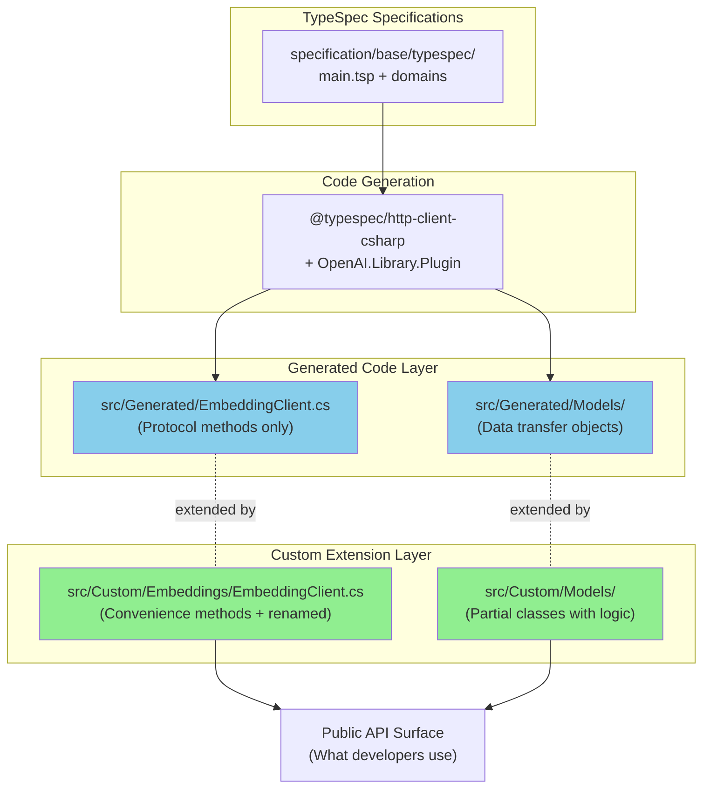
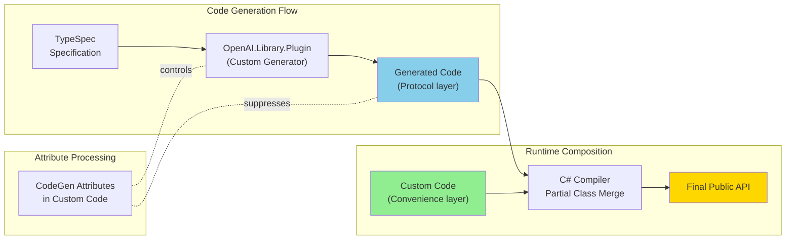
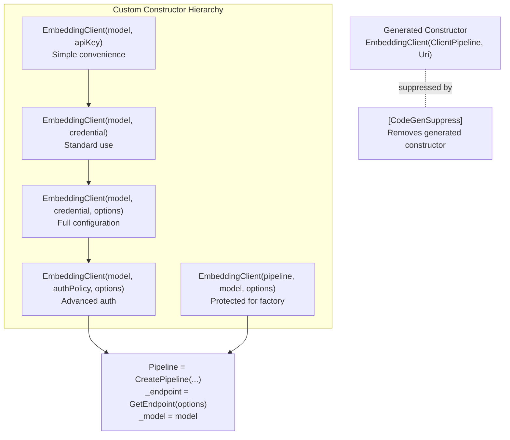
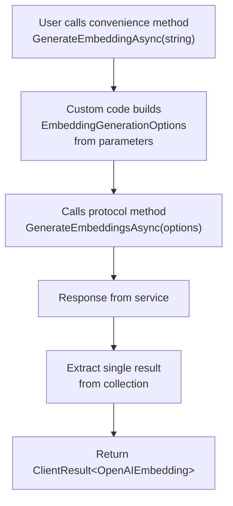
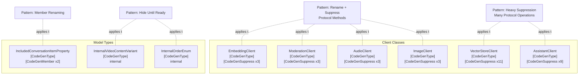
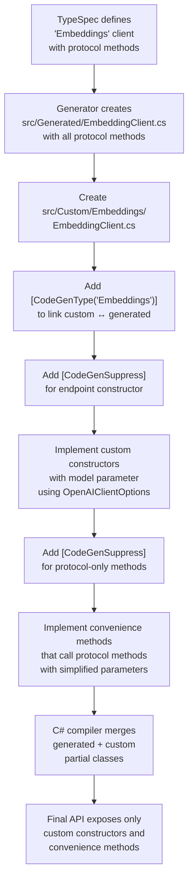

<!-- source: DeepWiki mcp.deepwiki.com · repo openai/openai-dotnet · extra page Custom Extensions and Visitors · fetched 2026-10-26 -->

# Custom Extensions and Visitors

<details>
<summary>Relevant source files</summary>

The following files were used as context for generating this wiki page:

- [codegen/generator/src/OpenAI.Library.Plugin.csproj](codegen/generator/src/OpenAI.Library.Plugin.csproj)
- [codegen/package.json](codegen/package.json)
- [examples/Chat/Example08_ChatSerialization.cs](examples/Chat/Example08_ChatSerialization.cs)
- [package-lock.json](package-lock.json)
- [package.json](package.json)
- [scripts/Submit-GeneratorUpdatePr.ps1](scripts/Submit-GeneratorUpdatePr.ps1)
- [src/Custom/Assistants/AssistantClient.cs](src/Custom/Assistants/AssistantClient.cs)
- [src/Custom/Audio/AudioClient.cs](src/Custom/Audio/AudioClient.cs)
- [src/Custom/Conversations/IncludedConversationItemProperty.cs](src/Custom/Conversations/IncludedConversationItemProperty.cs)
- [src/Custom/Embeddings/EmbeddingClient.cs](src/Custom/Embeddings/EmbeddingClient.cs)
- [src/Custom/Images/ImageClient.cs](src/Custom/Images/ImageClient.cs)
- [src/Custom/Moderations/ModerationClient.cs](src/Custom/Moderations/ModerationClient.cs)
- [src/Custom/VectorStores/VectorStoreClient.cs](src/Custom/VectorStores/VectorStoreClient.cs)
- [src/Custom/Videos/Internal/InternalOrderEnum.cs](src/Custom/Videos/Internal/InternalOrderEnum.cs)
- [src/Custom/Videos/Internal/InternalVideoContentVariant.cs](src/Custom/Videos/Internal/InternalVideoContentVariant.cs)
- [src/Generated/Models/Conversations/IncludedConversationItemProperty.cs](src/Generated/Models/Conversations/IncludedConversationItemProperty.cs)
- [src/Generated/Models/Videos/InternalOrderEnum.cs](src/Generated/Models/Videos/InternalOrderEnum.cs)
- [src/Generated/Models/Videos/InternalVideoContentVariant.cs](src/Generated/Models/Videos/InternalVideoContentVariant.cs)
- [src/Generated/ModerationClient.cs](src/Generated/ModerationClient.cs)

</details>


## Purpose and Scope

This document explains the customization mechanisms used to extend and modify code generated from TypeSpec specifications. It covers the use of partial classes, code generation attributes (`CodeGenType`, `CodeGenSuppress`, `CodeGenMember`), and common patterns for creating developer-friendly APIs on top of protocol-generated code.

For information about the TypeSpec specification structure itself, see [TypeSpec Specifications](#8.1.1). For the overall code generation pipeline, see [Code Generation System](#8.1).

---

## Overview

The OpenAI .NET SDK uses a two-layer code generation approach:

1. **Generated Layer** - Protocol-level code auto-generated from TypeSpec specifications in [src/Generated/]()
2. **Custom Layer** - Hand-written extensions and customizations in [src/Custom/]() that enhance the generated code

This separation allows the SDK to provide both low-level protocol access and high-level convenience APIs while maintaining a single source of truth in TypeSpec.

### File Organization Pattern



**Sources:** [src/Custom/Embeddings/EmbeddingClient.cs:1-309](), [src/Generated/](), [specification/]()

---

## Code Generation Attributes

The `Microsoft.TypeSpec.Generator.Customizations` namespace provides attributes that control how code is generated and how custom code interacts with generated code.

### CodeGenType Attribute

**Purpose:** Renames a generated type to a more appropriate name for .NET conventions.

**Syntax:**
```csharp
[CodeGenType("OriginalTypeSpecName")]
public partial class NewDotNetName
```

**Example:**

[src/Custom/Embeddings/EmbeddingClient.cs:20]() renames the generated `Embeddings` client:

```csharp
[CodeGenType("Embeddings")]
public partial class EmbeddingClient
```

This tells the generator that `EmbeddingClient` in custom code corresponds to the `Embeddings` type in TypeSpec.

**Common Use Cases:**
- Client renaming: `Embeddings` → `EmbeddingClient`
- Model renaming: `IncludeEnum` → `IncludedConversationItemProperty` ([src/Custom/Conversations/IncludedConversationItemProperty.cs:12]())
- Visibility changes: Making internal types from public TypeSpec definitions

**Sources:** [src/Custom/Embeddings/EmbeddingClient.cs:20](), [src/Custom/Moderations/ModerationClient.cs:20](), [src/Custom/Conversations/IncludedConversationItemProperty.cs:12]()

---

### CodeGenSuppress Attribute

**Purpose:** Prevents the generator from emitting specific constructors, methods, or properties that will be replaced with custom implementations.

**Syntax:**
```csharp
[CodeGenSuppress("MethodName", typeof(ParamType1), typeof(ParamType2), ...)]
```

**Example:**

[src/Custom/Embeddings/EmbeddingClient.cs:21-23]() suppresses generated members:

```csharp
[CodeGenSuppress("EmbeddingClient", typeof(ClientPipeline), typeof(Uri))]
[CodeGenSuppress("GenerateEmbeddingsAsync", typeof(EmbeddingGenerationOptions), typeof(CancellationToken))]
[CodeGenSuppress("GenerateEmbeddings", typeof(EmbeddingGenerationOptions), typeof(CancellationToken))]
public partial class EmbeddingClient
```

**Common Suppression Patterns:**

| Pattern | Reason | Example |
|---------|--------|---------|
| Endpoint constructors | Endpoint moved to `OpenAIClientOptions` | [src/Custom/Embeddings/EmbeddingClient.cs:21]() |
| Protocol-only methods | Replaced with convenience overloads | [src/Custom/Embeddings/EmbeddingClient.cs:22-23]() |
| File-based operations | Replaced with Stream/string overloads | [src/Custom/VectorStores/VectorStoreClient.cs:17-30]() |

**Sources:** [src/Custom/Embeddings/EmbeddingClient.cs:21-23](), [src/Custom/Audio/AudioClient.cs:18-20](), [src/Custom/VectorStores/VectorStoreClient.cs:17-32]()

---

### CodeGenMember Attribute

**Purpose:** Renames specific members (properties, fields, enum values) from their TypeSpec names to more idiomatic .NET names.

**Syntax:**
```csharp
[CodeGenMember("OriginalTypeSpecMemberName")]
public SomeType NewDotNetMemberName { get; }
```

**Example:**

[src/Custom/Conversations/IncludedConversationItemProperty.cs:19-24]() renames enum-like struct members:

```csharp
[CodeGenMember("MessageInputImageImageUrl")]
public static IncludedConversationItemProperty MessageInputImageUri { get; } 
    = new IncludedConversationItemProperty(MessageInputImageImageUrlValue);

[CodeGenMember("ComputerCallOutputOutputImageUrl")]
public static IncludedConversationItemProperty ComputerCallOutputImageUri { get; } 
    = new IncludedConversationItemProperty(ComputerCallOutputOutputImageUrlValue);
```

This transforms verbose OpenAPI names like `message.input_image.image_url` into .NET-friendly `MessageInputImageUri`.

**Sources:** [src/Custom/Conversations/IncludedConversationItemProperty.cs:19-24]()

---

## Customization Architecture



**Sources:** [codegen/generator/src/OpenAI.Library.Plugin.csproj:1-21](), [src/Custom/](), [src/Generated/]()

---

## Common Extension Patterns

### Pattern 1: Client Renaming and Constructor Customization

All client classes follow this pattern:

1. Rename from TypeSpec name using `[CodeGenType]`
2. Suppress the generated endpoint-based constructor
3. Add custom constructors that use `OpenAIClientOptions` for configuration
4. Add a `model` parameter to constructors for model-specific clients

**Implementation Example:**

[src/Custom/Embeddings/EmbeddingClient.cs:20-93]() shows the complete pattern:

```csharp
[CodeGenType("Embeddings")]
[CodeGenSuppress("EmbeddingClient", typeof(ClientPipeline), typeof(Uri))]
public partial class EmbeddingClient
{
    private readonly string _model;

    // Convenience constructor with API key string
    public EmbeddingClient(string model, string apiKey) 
        : this(model, new ApiKeyCredential(apiKey), new OpenAIClientOptions())
    { }

    // Main constructor with credential
    public EmbeddingClient(string model, ApiKeyCredential credential, OpenAIClientOptions options)
        : this(model, OpenAIClient.CreateApiKeyAuthenticationPolicy(credential), options)
    { }

    // Advanced constructor with custom authentication
    public EmbeddingClient(string model, AuthenticationPolicy authenticationPolicy, OpenAIClientOptions options)
    {
        _model = model;
        Pipeline = OpenAIClient.CreatePipeline(authenticationPolicy, options);
        _endpoint = OpenAIClient.GetEndpoint(options);
    }

    // Protected constructor for subclassing
    protected internal EmbeddingClient(ClientPipeline pipeline, string model, OpenAIClientOptions options)
    {
        _model = model;
        Pipeline = pipeline;
        _endpoint = OpenAIClient.GetEndpoint(options);
    }
}
```

**Pattern Diagram:**



**Sources:** [src/Custom/Embeddings/EmbeddingClient.cs:29-115](), [src/Custom/Audio/AudioClient.cs:26-112](), [src/Custom/Images/ImageClient.cs:27-113]()

---

### Pattern 2: Convenience Method Overloads

Generated protocol methods typically accept complex options objects. Custom code adds simplified overloads for common scenarios.

**Before (Generated Protocol Method):**
```csharp
// Only accepts options object with all parameters
ClientResult GenerateEmbeddingsAsync(EmbeddingGenerationOptions options, CancellationToken ct)
```

**After (Custom Convenience Methods):**

[src/Custom/Embeddings/EmbeddingClient.cs:136-247]() adds multiple overloads:

```csharp
// Single string input - most common case
ClientResult<OpenAIEmbedding> GenerateEmbeddingAsync(
    string input, 
    EmbeddingGenerationOptions options = null, 
    CancellationToken ct = default)

// Multiple string inputs
ClientResult<OpenAIEmbeddingCollection> GenerateEmbeddingsAsync(
    IEnumerable<string> inputs, 
    EmbeddingGenerationOptions options = null, 
    CancellationToken ct = default)

// Tokenized inputs
ClientResult<OpenAIEmbeddingCollection> GenerateEmbeddingsAsync(
    IEnumerable<ReadOnlyMemory<int>> inputs, 
    EmbeddingGenerationOptions options = null, 
    CancellationToken ct = default)
```

**Implementation Strategy:**



**Sources:** [src/Custom/Embeddings/EmbeddingClient.cs:136-247](), [src/Custom/Moderations/ModerationClient.cs:130-231]()

---

### Pattern 3: File Path Convenience Methods

Many operations support file inputs. Custom code adds file path overloads on top of Stream-based protocol methods.

**Example from AudioClient:**

[src/Custom/Audio/AudioClient.cs:226-258]() shows the pattern:

```csharp
// Protocol method (generated)
Task<ClientResult<AudioTranscription>> TranscribeAudioAsync(
    Stream audio, 
    string audioFilename, 
    AudioTranscriptionOptions options, 
    CancellationToken ct)

// Convenience method (custom)
async Task<ClientResult<AudioTranscription>> TranscribeAudioAsync(
    string audioFilePath, 
    AudioTranscriptionOptions options = null)
{
    using FileStream audioStream = File.OpenRead(audioFilePath);
    return await TranscribeAudioAsync(audioStream, audioFilePath, options);
}
```

**Sources:** [src/Custom/Audio/AudioClient.cs:226-258](), [src/Custom/Images/ImageClient.cs:280-306]()

---

### Pattern 4: Response Type Transformation

Protocol methods return generic `ClientResult`. Custom methods extract and transform to specific types.

**Example:**

[src/Custom/Embeddings/EmbeddingClient.cs:136-146]() transforms collection to single item:

```csharp
public virtual async Task<ClientResult<OpenAIEmbedding>> GenerateEmbeddingAsync(...)
{
    // Build options and create protocol request
    using BinaryContent content = options.ToBinaryContent();
    
    // Call protocol method - returns collection
    ClientResult result = await GenerateEmbeddingsAsync(content, ...);
    
    // Extract first item and return wrapped in new ClientResult
    return ClientResult.FromValue(
        ((OpenAIEmbeddingCollection)result).FirstOrDefault(), 
        result.GetRawResponse());
}
```

**Sources:** [src/Custom/Embeddings/EmbeddingClient.cs:136-146](), [src/Custom/Moderations/ModerationClient.cs:134-144]()

---

### Pattern 5: Internal Type Hiding

Some TypeSpec-generated types are made internal and replaced with more appropriate public types.

**Example:**

[src/Custom/Videos/Internal/InternalVideoContentVariant.cs:1-12]() hides a generated enum:

```csharp
// Made internal until convenience methods are ready
[CodeGenType("VideoContentVariant")]
internal readonly partial struct InternalVideoContentVariant
{
}
```

The generated code in [src/Generated/Models/Videos/InternalVideoContentVariant.cs:1-47]() exists but is not exposed publicly.

**Sources:** [src/Custom/Videos/Internal/InternalVideoContentVariant.cs:1-12](), [src/Custom/Videos/Internal/InternalOrderEnum.cs:1-12]()

---

## Attribute Usage Patterns by File



**Sources:** [src/Custom/Embeddings/EmbeddingClient.cs:20-23](), [src/Custom/VectorStores/VectorStoreClient.cs:16-33](), [src/Custom/Conversations/IncludedConversationItemProperty.cs:12-24]()

---

## Model Extension Example

Not all customizations are in client classes. Model types can also be extended.

**Example: IncludedConversationItemProperty**

Generated code in [src/Generated/Models/Conversations/IncludedConversationItemProperty.cs:1-61]():
```csharp
public readonly partial struct IncludedConversationItemProperty : IEquatable<...>
{
    // Auto-generated members with TypeSpec names
}
```

Custom extension in [src/Custom/Conversations/IncludedConversationItemProperty.cs:1-27]():
```csharp
[CodeGenType("IncludeEnum")]
public readonly partial struct IncludedConversationItemProperty : IEquatable<...>
{
    // Rename members to .NET conventions
    [CodeGenMember("MessageInputImageImageUrl")]
    public static IncludedConversationItemProperty MessageInputImageUri { get; }

    [CodeGenMember("ComputerCallOutputOutputImageUrl")]
    public static IncludedConversationItemProperty ComputerCallOutputImageUri { get; }
}
```

**Sources:** [src/Custom/Conversations/IncludedConversationItemProperty.cs:1-27](), [src/Generated/Models/Conversations/IncludedConversationItemProperty.cs:1-61]()

---

## Complete Client Extension Workflow



**Sources:** [src/Custom/Embeddings/EmbeddingClient.cs:1-309](), [src/Generated/]()

---

## Best Practices

### 1. Always Use Partial Classes

Both generated and custom code must be `partial` to allow the C# compiler to merge them.

**Example:** [src/Custom/Embeddings/EmbeddingClient.cs:24]()
```csharp
public partial class EmbeddingClient
```

### 2. Match Suppression Signatures Exactly

When suppressing methods, parameter types must match exactly including order.

**Incorrect:**
```csharp
[CodeGenSuppress("Method", typeof(int), typeof(string))]  // Wrong order
```

**Correct:**
```csharp
[CodeGenSuppress("Method", typeof(string), typeof(int))]  // Matches generated signature
```

### 3. Preserve Protocol Access

Custom convenience methods should call protocol methods, not replace the protocol layer entirely. This maintains low-level access for advanced scenarios.

**Pattern:** [src/Custom/Embeddings/EmbeddingClient.cs:141-146]()
```csharp
// Convenience method
public async Task<ClientResult<OpenAIEmbedding>> GenerateEmbeddingAsync(string input, ...)
{
    // Build options
    CreateEmbeddingGenerationOptions(input, ref options);
    
    // Call protocol method (not suppressed, still available)
    using BinaryContent content = options.ToBinaryContent();
    ClientResult result = await GenerateEmbeddingsAsync(content, ...);
    
    return ClientResult.FromValue(...);
}
```

### 4. Document Custom Changes

Add `// CUSTOM:` comments explaining why code was customized.

**Example:** [src/Custom/Embeddings/EmbeddingClient.cs:15-17]()
```csharp
// CUSTOM:
// - Renamed.
// - Suppressed constructor that takes endpoint parameter; endpoint is now a property in the options class.
```

### 5. Maintain Consistency Across Clients

All clients follow the same patterns for:
- Constructor overloads
- Parameter ordering (`model`, `credential`, `options`)
- Method naming conventions
- Return type wrapping

**Sources:** [src/Custom/Embeddings/EmbeddingClient.cs:15-17](), [src/Custom/Audio/AudioClient.cs:12-15](), [src/Custom/Images/ImageClient.cs:13-16]()

---

## Summary

The custom extension system provides a powerful mechanism to create idiomatic .NET APIs on top of auto-generated protocol code:

| Mechanism | Purpose | Common Usage |
|-----------|---------|--------------|
| `[CodeGenType]` | Rename types | Client naming (`Embeddings` → `EmbeddingClient`) |
| `[CodeGenSuppress]` | Remove generated members | Endpoint constructors, protocol-only methods |
| `[CodeGenMember]` | Rename members | Enum values, properties |
| Partial classes | Extend generated code | Add convenience methods, custom constructors |
| Custom helper methods | Simplify common cases | String → options, file path → stream |

This architecture enables:
- **Automatic updates** from TypeSpec changes while preserving custom logic
- **Progressive disclosure** from simple string-based APIs to full protocol control
- **Type safety** through compiler-merged partial classes
- **Maintainability** through clear separation of generated vs. custom code

**Sources:** [src/Custom/](), [src/Generated/](), [Microsoft.TypeSpec.Generator.Customizations namespace]

---

