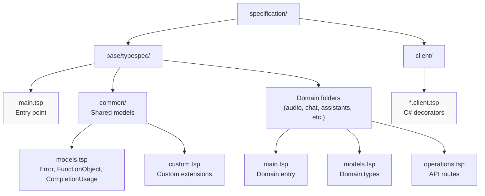
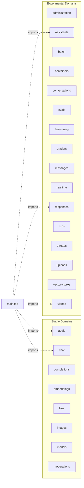
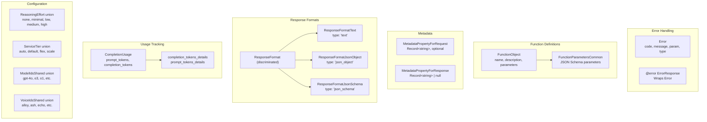
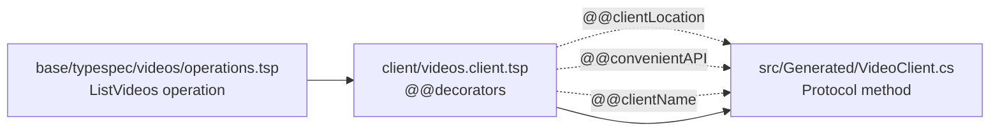
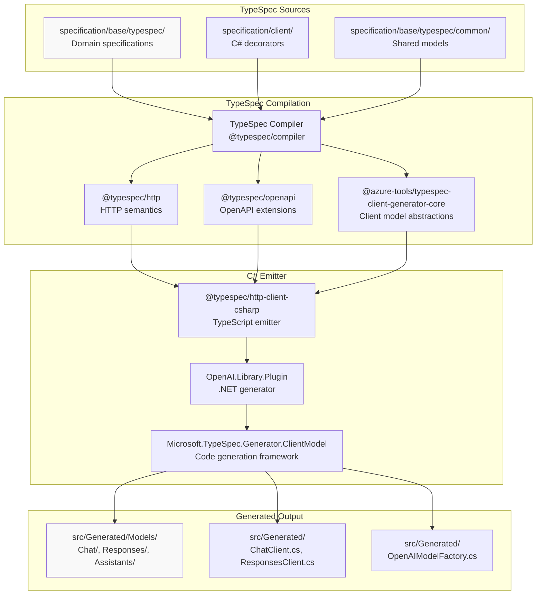
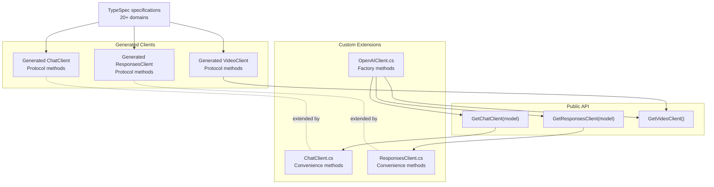

<!-- source: DeepWiki mcp.deepwiki.com · repo openai/openai-dotnet · extra page TypeSpec Specifications · fetched 2026-10-26 -->

# TypeSpec Specifications

<details>
<summary>Relevant source files</summary>

The following files were used as context for generating this wiki page:

- [codegen/generator/src/OpenAI.Library.Plugin.csproj](codegen/generator/src/OpenAI.Library.Plugin.csproj)
- [codegen/package.json](codegen/package.json)
- [package-lock.json](package-lock.json)
- [package.json](package.json)
- [scripts/Submit-GeneratorUpdatePr.ps1](scripts/Submit-GeneratorUpdatePr.ps1)
- [specification/base/typespec/common/models.tsp](specification/base/typespec/common/models.tsp)
- [specification/base/typespec/main.tsp](specification/base/typespec/main.tsp)
- [specification/base/typespec/videos/main.tsp](specification/base/typespec/videos/main.tsp)
- [specification/client/videos.client.tsp](specification/client/videos.client.tsp)
- [src/Custom/Conversations/IncludedConversationItemProperty.cs](src/Custom/Conversations/IncludedConversationItemProperty.cs)
- [src/Custom/OpenAIClient.cs](src/Custom/OpenAIClient.cs)
- [src/Custom/OpenAIClientOptions.cs](src/Custom/OpenAIClientOptions.cs)
- [src/Custom/Videos/Internal/InternalOrderEnum.cs](src/Custom/Videos/Internal/InternalOrderEnum.cs)
- [src/Custom/Videos/Internal/InternalVideoContentVariant.cs](src/Custom/Videos/Internal/InternalVideoContentVariant.cs)
- [src/Generated/Models/Chat/ChatReasoningEffortLevel.cs](src/Generated/Models/Chat/ChatReasoningEffortLevel.cs)
- [src/Generated/Models/Conversations/IncludedConversationItemProperty.cs](src/Generated/Models/Conversations/IncludedConversationItemProperty.cs)
- [src/Generated/Models/Responses/ResponseReasoningEffortLevel.cs](src/Generated/Models/Responses/ResponseReasoningEffortLevel.cs)
- [src/Generated/Models/Videos/InternalOrderEnum.cs](src/Generated/Models/Videos/InternalOrderEnum.cs)
- [src/Generated/Models/Videos/InternalVideoContentVariant.cs](src/Generated/Models/Videos/InternalVideoContentVariant.cs)

</details>


This page documents the TypeSpec specification files that serve as the source of truth for the OpenAI .NET SDK's generated code. These specifications define the API surface, models, operations, and client behavior using the TypeSpec language, which then feeds into the code generation pipeline described in [8.1](#8.1).

For information about extending the generated code with custom logic, see [Custom Extensions and Visitors](#8.1.2). For details on the overall code generation architecture, see [Code Generation System](#8.1).

## Overview

TypeSpec specifications are declarative definitions written in the TypeSpec language (`.tsp` files) that describe:

- API operations (HTTP routes, parameters, responses)
- Data models (request/response types, enums, unions)
- Client behavior (method names, convenience vs protocol methods)
- Shared components (common models, error types, metadata)

These specifications are organized into two main categories:

| Category | Location | Purpose |
|----------|----------|---------|
| **Base Specifications** | `specification/base/typespec/` | API definitions from OpenAPI/OpenAI spec, organized by domain |
| **Client Specifications** | `specification/client/*.client.tsp` | C#-specific customizations using decorators |

Sources: [specification/base/typespec/main.tsp:1-25](), [specification/client/videos.client.tsp:1-27]()

## Directory Structure



**Directory Structure for TypeSpec Specifications**

Sources: [specification/base/typespec/main.tsp:1-25](), [specification/base/typespec/common/models.tsp:1-503](), [specification/base/typespec/videos/main.tsp:1-3](), [specification/client/videos.client.tsp:1-27]()

## Domain Organization

The base specifications are organized into 24 domain folders, each representing a distinct API area. Each domain follows a consistent structure with `main.tsp`, `models.tsp`, and `operations.tsp` files.

### Complete Domain List



**Domain Organization in specification/base/typespec/**

The entry point [specification/base/typespec/main.tsp:1-25]() imports all domains:

```typescript
import "./administration";
import "./audio";
import "./assistants";
import "./batch";
import "./chat";
import "./completions";
import "./containers";
import "./conversations";
import "./embeddings";
import "./evals";
import "./files";
import "./fine-tuning";
import "./graders";
import "./images";
import "./messages";
import "./models";
import "./moderations";
import "./realtime";
import "./runs";
import "./threads";
import "./responses";
import "./vector-stores";
import "./videos";
import "./uploads";
```

Sources: [specification/base/typespec/main.tsp:1-25]()

### Domain File Structure

Each domain typically contains three files:

| File | Purpose | Example Types |
|------|---------|---------------|
| `main.tsp` | Import coordinator | Aggregates `models.tsp` and `operations.tsp` |
| `models.tsp` | Type definitions | Request/response models, enums, unions |
| `operations.tsp` | API operations | HTTP routes, parameters, return types |

Example from the videos domain [specification/base/typespec/videos/main.tsp:1-3]():

```typescript
import "./models.tsp";
import "./operations.tsp";
```

Sources: [specification/base/typespec/videos/main.tsp:1-3]()

## Common Models and Shared Definitions

The `specification/base/typespec/common/models.tsp` file defines foundational types used across multiple domains. These common models ensure consistency and reduce duplication.

### Key Common Models



**Common Model Hierarchy in specification/base/typespec/common/models.tsp**

### Important Common Types

#### Error Models

[specification/base/typespec/common/models.tsp:13-24]() defines the error response structure with the `@error` decorator:

```typescript
model Error {
  code: string | null;
  message: string;
  param: string | null;
  type: string;
}

@error
model ErrorResponse {
  error: Error;
}
```

Generated as `ErrorResponse` in [src/Generated/]() with automatic error handling.

#### Function Call Definitions

[specification/base/typespec/common/models.tsp:41-54]() defines function calling support:

```typescript
model FunctionObject {
  description?: string;
  name: string;
  ...FunctionParametersCommon;
  strict?: boolean | null = false;
}
```

Used by `ChatFunctionToolDefinition`, `FunctionToolDefinition`, and other tool types.

#### Metadata Properties

[specification/base/typespec/common/models.tsp:65-88]() defines reusable metadata models:

```typescript
model MetadataPropertyForRequest {
  @extension("x-oaiTypeLabel", "map")
  metadata?: Record<string>;
}

model MetadataPropertyForResponse {
  @extension("x-oaiTypeLabel", "map")
  metadata: Record<string> | null;
}
```

The split between request (optional) and response (nullable) honors OpenAPI nullability semantics.

#### Response Format Discriminated Union

[specification/base/typespec/common/models.tsp:91-155]() defines structured output formats:

```typescript
model ResponseFormatText extends ResponseFormat {
  type: "text";
}

model ResponseFormatJsonObject extends ResponseFormat {
  type: "json_object";
}

model ResponseFormatJsonSchema extends ResponseFormat {
  type: "json_schema";
  json_schema: {
    name: string;
    description?: string;
    schema?: ResponseFormatJsonSchemaSchema;
    strict?: boolean | null = false;
  };
}
```

Generated as `ChatResponseFormat` with discriminator handling in [src/Generated/Models/Chat/]().

#### Usage Statistics

[specification/base/typespec/common/models.tsp:161-203]() defines token usage tracking:

```typescript
model CompletionUsage {
  completion_tokens: int32 = 0;
  prompt_tokens: int32 = 0;
  total_tokens: int32 = 0;
  
  completion_tokens_details?: {
    accepted_prediction_tokens?: int32 = 0;
    audio_tokens?: int32 = 0;
    reasoning_tokens?: int32 = 0;
    rejected_prediction_tokens?: int32 = 0;
  };
  
  prompt_tokens_details?: {
    audio_tokens?: int32 = 0;
    cached_tokens?: int32 = 0;
  };
}
```

Shared across chat, responses, and assistants domains.

#### Reasoning Effort Levels

[specification/base/typespec/common/models.tsp:222-237]() defines effort constraints for reasoning models:

```typescript
union ReasoningEffort {
  "none",
  "minimal",
  "low",
  "medium",
  "high",
}
```

Generated as `ChatReasoningEffortLevel` [src/Generated/Models/Chat/ChatReasoningEffortLevel.cs:1-58]() and `ResponseReasoningEffortLevel` [src/Generated/Models/Responses/ResponseReasoningEffortLevel.cs:1-58]().

#### Model and Voice IDs

[specification/base/typespec/common/models.tsp:383-467]() defines extensible enumerations:

```typescript
union ModelIdsShared {
  string,
  "gpt-4.1",
  "o4-mini",
  "o3",
  "gpt-4o",
  "chatgpt-4o-latest",
  // ... 30+ known model IDs
}

union VoiceIdsShared {
  string,
  "alloy",
  "ash",
  "echo",
  // ... known voice IDs
}
```

These unions allow both known values and custom strings for forward compatibility.

Sources: [specification/base/typespec/common/models.tsp:13-503](), [src/Generated/Models/Chat/ChatReasoningEffortLevel.cs:1-58](), [src/Generated/Models/Responses/ResponseReasoningEffortLevel.cs:1-58]()

## Client Specifications and C# Customizations

Client specification files in `specification/client/*.client.tsp` apply C#-specific decorators to customize code generation behavior. These decorators control method generation, naming, and client organization without modifying the base API definitions.

### Decorator Usage



**Client Specification Decorator Flow**

Example from [specification/client/videos.client.tsp:1-27]():

```typescript
import "../base/typespec/videos/main.tsp";
import "@azure-tools/typespec-client-generator-core";
import "@typespec/http-client-csharp";

using OpenAI;
using Azure.ClientGenerator.Core;
using TypeSpec.HttpClient.CSharp;

// Move operations into their corresponding interface
@@clientLocation(ListVideos, "Videos");
@@clientLocation(createVideo, "Videos");
@@clientLocation(DeleteVideo, "Videos");

// Not generate convenience methods for these operations
@@convenientAPI(ListVideos, false);
@@convenientAPI(createVideo, false);

// Rename method
@@clientName(RetrieveVideoContent, "DownloadVideo");
```

### Common Decorators

| Decorator | Purpose | Example |
|-----------|---------|---------|
| `@@clientLocation(operation, "ClientName")` | Assigns operation to a specific client class | Places `ListVideos` in `VideoClient` |
| `@@convenientAPI(operation, false)` | Suppresses convenience method generation | Only generates protocol method |
| `@@clientName(operation, "NewName")` | Renames method in generated code | `RetrieveVideoContent` → `DownloadVideo` |
| `@@access(type, Access.internal)` | Changes visibility | Makes type internal |
| `@@usage(type, Usage.input \| Usage.output)` | Declares usage context | Request vs response types |

Sources: [specification/client/videos.client.tsp:1-27]()

## TypeSpec to C# Generation Flow



**TypeSpec to Generated C# Code Pipeline**

### Package Dependencies

The [codegen/package.json:30-36]() file declares TypeSpec dependencies:

```json
"dependencies": {
  "@azure-tools/typespec-client-generator-core": "0.64.1",
  "@typespec/http": "1.8.0",
  "@typespec/http-client-csharp": "1.0.0-alpha.20260116.3",
  "@typespec/openapi": "1.8.0"
}
```

The [codegen/generator/src/OpenAI.Library.Plugin.csproj:8-9]() references the .NET generator:

```xml
<PackageReference Include="Microsoft.TypeSpec.Generator.ClientModel" />
```

### Version Management

The [scripts/Submit-GeneratorUpdatePr.ps1:1-325]() script automates generator updates:

1. Fetches latest `@typespec/http-client-csharp` version
2. Updates injected dependencies (`@azure-tools/typespec-client-generator-core`, `@typespec/http`, `@typespec/openapi`)
3. Regenerates code with new generator
4. Creates pull request with changes

This ensures the SDK stays synchronized with TypeSpec tooling improvements.

Sources: [codegen/package.json:1-47](), [codegen/generator/src/OpenAI.Library.Plugin.csproj:1-21](), [scripts/Submit-GeneratorUpdatePr.ps1:1-325](), [package-lock.json:1-100]()

## Integration with OpenAIClient

The TypeSpec specifications generate client classes that integrate with the `OpenAIClient` factory pattern. Each domain's operations are grouped into a dedicated client accessible via `Get*Client()` methods.

### Client Factory Pattern



**TypeSpec Domain Specifications to Client Factory Integration**

The [src/Custom/OpenAIClient.cs:183-365]() file defines factory methods for each generated client:

```csharp
public virtual AssistantClient GetAssistantClient() => new(Pipeline, _options);
public virtual AudioClient GetAudioClient(string model) => new(Pipeline, model, _options);
public virtual ChatClient GetChatClient(string model) => new(Pipeline, model, _options);
public virtual ResponsesClient GetResponsesClient(string model) => new(Pipeline, model, _options);
public virtual VideoClient GetVideoClient() => new(Pipeline, _options);
// ... additional clients
```

Each factory method creates a new client instance that shares the `Pipeline` and `_options` configured in `OpenAIClient`.

Sources: [src/Custom/OpenAIClient.cs:1-409](), [src/Custom/OpenAIClientOptions.cs:1-75]()

## Specification Maintenance

### Adding New Domains

To add a new API domain:

1. Create `specification/base/typespec/<domain>/` folder
2. Add `main.tsp`, `models.tsp`, `operations.tsp`
3. Import domain in `specification/base/typespec/main.tsp`
4. Create `specification/client/<domain>.client.tsp` with decorators
5. Run `pwsh scripts/Invoke-CodeGen.ps1` to regenerate

### Modifying Existing Specifications

TypeSpec specifications are automatically imported from OpenAPI definitions. Modifications should be made through:

1. **Client decorators** in `specification/client/*.client.tsp` for C#-specific changes
2. **Custom extensions** in `specification/base/typespec/common/custom.tsp` for cross-cutting concerns
3. **Partial classes** in `src/Custom/` for runtime behavior (see [8.1.2](#8.1.2))

Direct edits to `specification/base/typespec/` files are discouraged as they may be overwritten during spec updates.

### Validation

The [.github/workflows/codegen-validation.yml]() workflow validates that:

- Generated code matches committed code
- No uncommitted changes after regeneration
- TypeSpec compilation succeeds without errors

Sources: [specification/base/typespec/main.tsp:1-25](), [specification/base/typespec/common/models.tsp:1-6]()

---

