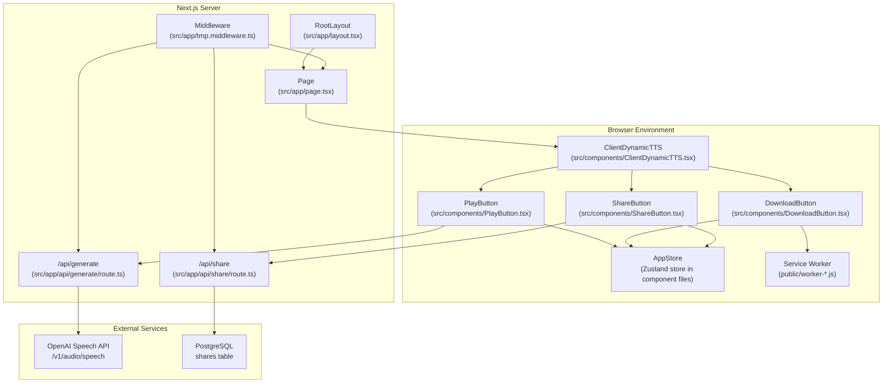
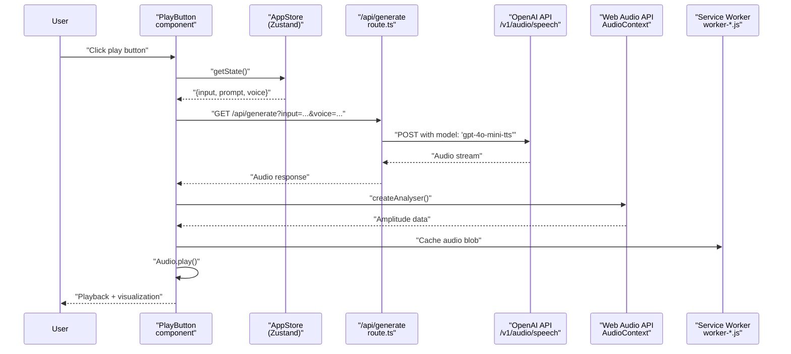

<!-- source: DeepWiki mcp.deepwiki.com · repo openai/openai-fm · page 1 Overview · fetched 2026-10-26 -->

# Overview

<details>
<summary>Relevant source files</summary>

The following files were used as context for generating this wiki page:

- [LICENSE](LICENSE)
- [README.md](README.md)
- [package.json](package.json)

</details>


This document provides a high-level introduction to the OpenAI.fm codebase, summarizing its purpose, core features, technology stack, and architectural patterns. For detailed setup instructions, see [Getting Started](#2). For in-depth technical documentation of individual subsystems, see [System Architecture](#3).

## Purpose

OpenAI.fm is a Next.js-based demonstration application that showcases OpenAI's text-to-speech capabilities through an interactive web interface. The application allows users to generate audio from text input, apply voice transformations through system prompts, visualize audio playback, and share configurations via persistent links.

**Sources:** [README.md:1-10]()

## Project Characteristics

| Characteristic | Description |
|---------------|-------------|
| **Project Name** | `openai-fm` |
| **License** | MIT License |
| **Primary Language** | TypeScript |
| **Framework** | Next.js 15.3.6 with App Router |
| **Runtime** | React 19.0.0 |
| **Deployment Target** | Vercel Platform (recommended) |
| **External Dependencies** | OpenAI Speech API, PostgreSQL (optional) |

**Sources:** [package.json:1-4](), [LICENSE:1-19](), [README.md:1-8]()

## Core Features

The application implements four primary user-facing features:

1. **Audio Generation**: Text-to-speech synthesis using OpenAI's API with configurable voice selection (`alloy`, `echo`, `fable`, `onyx`, `nova`, `shimmer`)
2. **Waveform Visualization**: Real-time audio amplitude visualization during playback using Web Audio API
3. **Download Capability**: Browser-based audio file download with service worker caching
4. **Share Functionality**: Persistent configuration storage enabling shareable URLs (requires PostgreSQL)

**Sources:** [README.md:7-10](), Diagram 1, Diagram 2

## Technology Stack

### Frontend Technologies

| Technology | Version | Purpose |
|-----------|---------|---------|
| `next` | 15.3.6 | Application framework with SSR/SSG support |
| `react` | 19.0.0 | UI component library |
| `zustand` | 5.0.3 | State management (`AppStore`) |
| `@radix-ui/*` | Various | Accessible UI primitives (Switch, Toast, Icons) |
| `tailwindcss` | 4.x | Utility-first styling |
| `@uiw/react-codemirror` | 4.23.10 | Code snippet display |
| `wavesurfer.js` | 7.9.1 | Audio waveform visualization |

### Backend Technologies

| Technology | Purpose |
|-----------|---------|
| Next.js API Routes | Server-side request proxying |
| `@vercel/postgres` | PostgreSQL database client |
| OpenAI Speech API | `gpt-4o-mini-tts` model for audio synthesis |

### Build Tools

| Tool | Purpose |
|------|---------|
| TypeScript | Static type checking |
| ESLint | Code quality enforcement |
| PostCSS | CSS processing pipeline |
| Turbopack/Webpack | Module bundling |

**Sources:** [package.json:11-42]()

## System Architecture

### High-Level Component Topology

The following diagram maps the major system components to their code entity implementations:



**Sources:** Diagram 1, Diagram 4, [src/app/layout.tsx](), [src/app/page.tsx](), [src/components/ClientDynamicTTS.tsx](), [src/components/PlayButton.tsx](), [src/components/DownloadButton.tsx](), [src/components/ShareButton.tsx](), [src/app/api/generate/route.ts](), [src/app/api/share/route.ts]()

### Request Flow Architecture

The following diagram illustrates how user actions map to code execution paths:



**Sources:** Diagram 2, [src/components/PlayButton.tsx](), [src/app/api/generate/route.ts](), [public/worker-444eae9e2e1bdd6edd8969f319655e70.js]()

## Key System Components

### State Management: AppStore

The application uses Zustand for centralized state management. The store maintains:

- `input`: Text to be converted to speech
- `prompt`: System prompt for voice transformation
- `voice`: Selected voice identifier (`alloy` | `echo` | `fable` | `onyx` | `nova` | `shimmer`)
- `latestAudioUrl`: Most recently generated audio URL

All interactive components (`PlayButton`, `DownloadButton`, `ShareButton`, `CodeCopyButton`) access this shared state.

**Sources:** Diagram 1, Diagram 4, [src/components/PlayButton.tsx](), [src/components/DownloadButton.tsx](), [src/components/ShareButton.tsx]()

### API Proxy: /api/generate

Located at [src/app/api/generate/route.ts](), this Next.js API route serves as a secure proxy to the OpenAI Speech API. It:

1. Accepts query parameters: `input`, `prompt`, `voice`
2. Validates and truncates input to maximum lengths
3. Authenticates to OpenAI using `OPENAI_API_KEY` environment variable
4. Forwards requests to `https://api.openai.com/v1/audio/speech`
5. Streams audio response back to client

This architecture prevents exposure of the API key to client browsers.

**Sources:** [src/app/api/generate/route.ts](), Diagram 2, [README.md:27-36]()

### Persistence Layer: /api/share

Located at [src/app/api/share/route.ts](), this route handles configuration persistence:

- **POST**: Stores `{input, prompt, voice}` in PostgreSQL `shares` table, returns UUID hash
- **GET**: Retrieves configuration by hash from database

The database connection requires `POSTGRES_URL` environment variable. This feature is optional; the application functions without database connectivity.

**Sources:** [src/app/api/share/route.ts](), Diagram 3, [README.md:46-55](), [.env.example]()

### Audio Caching: Service Worker

The service worker at [public/worker-444eae9e2e1bdd6edd8969f319655e70.js]() implements client-side audio caching:

1. Intercepts audio URL requests
2. Stores audio blobs in browser cache
3. Serves cached content for subsequent plays
4. Enables offline playback and reduces API calls

Integration occurs in `DownloadButton` and `PlayButton` components via `postMessage` API.

**Sources:** [public/worker-444eae9e2e1bdd6edd8969f319655e70.js](), Diagram 2, [src/components/DownloadButton.tsx]()

### Dynamic Client Rendering

The `ClientDynamicTTS` component at [src/components/ClientDynamicTTS.tsx]() uses Next.js dynamic imports with `ssr: false` to prevent server-side rendering of browser-dependent code (Web Audio API, service worker registration). The main page component at [src/app/page.tsx]() imports this dynamically.

**Sources:** [src/components/ClientDynamicTTS.tsx](), [src/app/page.tsx](), Diagram 4

## Build and Development Configuration

### Package Management

The project uses npm with locked dependencies:

- [package.json:1-43]() defines dependencies and build scripts
- [package-lock.json]() ensures reproducible builds
- Scripts: `dev` (Turbopack), `build`, `start`, `lint`

**Sources:** [package.json:1-43](), Diagram 5

### Next.js Configuration

[next.config.ts]() configures:

- Webpack/Turbopack bundler settings
- SVGR loader for SVG-to-React-component transformation
- Content Security Policy headers
- HSTS headers (production)

**Sources:** [next.config.ts](), Diagram 5, Diagram 6

### Styling Pipeline

The styling system uses:

- TailwindCSS 4.x for utility classes
- [postcss.config.mjs]() for PostCSS integration
- [src/app/globals.css]() for CSS custom properties and global styles

**Sources:** [postcss.config.mjs](), [src/app/globals.css](), Diagram 4, Diagram 5

## Security Model

The application implements multiple security layers:

1. **Nonce-based CSP**: [src/app/tmp.middleware.ts]() injects unique nonces for inline scripts
2. **Static CSP Headers**: [next.config.ts]() defines Content Security Policy restricting resource origins
3. **HSTS**: HTTP Strict Transport Security enforced in production
4. **API Key Isolation**: OpenAI credentials stored server-side, never exposed to clients
5. **Environment Secrets**: `.env.local` for sensitive configuration (not committed to version control)

For comprehensive security documentation, see [Security Considerations](#5).

**Sources:** [src/app/tmp.middleware.ts](), [next.config.ts](), [.env.example](), Diagram 6

## Deployment

The application is designed for deployment on Vercel:

1. Automatic builds triggered by repository commits
2. Environment variables configured via Vercel dashboard
3. Optional Vercel PostgreSQL integration for sharing feature
4. Edge network distribution for global performance

The repository includes standard Vercel configuration files and follows Next.js deployment best practices.

**Sources:** [README.md:65-66](), Diagram 5

## Development Workflow

Typical development workflow:

```bash
# Install dependencies
npm install

# Start development server (Turbopack)
npm run dev

# Run linter
npm run lint

# Production build
npm run build

# Start production server
npm start
```

The development server runs at `http://localhost:3000` with hot module replacement enabled.

**Sources:** [package.json:5-10](), [README.md:38-63]()

## Project Structure Summary

| Directory/File | Purpose |
|---------------|---------|
| `src/app/` | Next.js App Router pages, layouts, API routes, middleware |
| `src/components/` | React components (PlayButton, ShareButton, etc.) |
| `public/` | Static assets (service worker, images, audio files) |
| `package.json` | Dependency manifest and build scripts |
| `next.config.ts` | Next.js framework configuration |
| `postcss.config.mjs` | CSS processing configuration |
| `eslint.config.mjs` | Code quality rules |
| `tsconfig.json` | TypeScript compiler settings |
| `.env.example` | Environment variable template |

**Sources:** [package.json](), [next.config.ts](), [postcss.config.mjs](), [README.md]()

---

