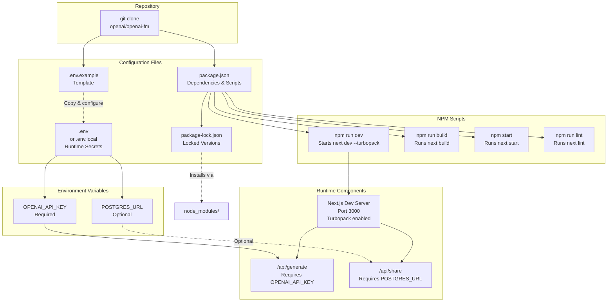
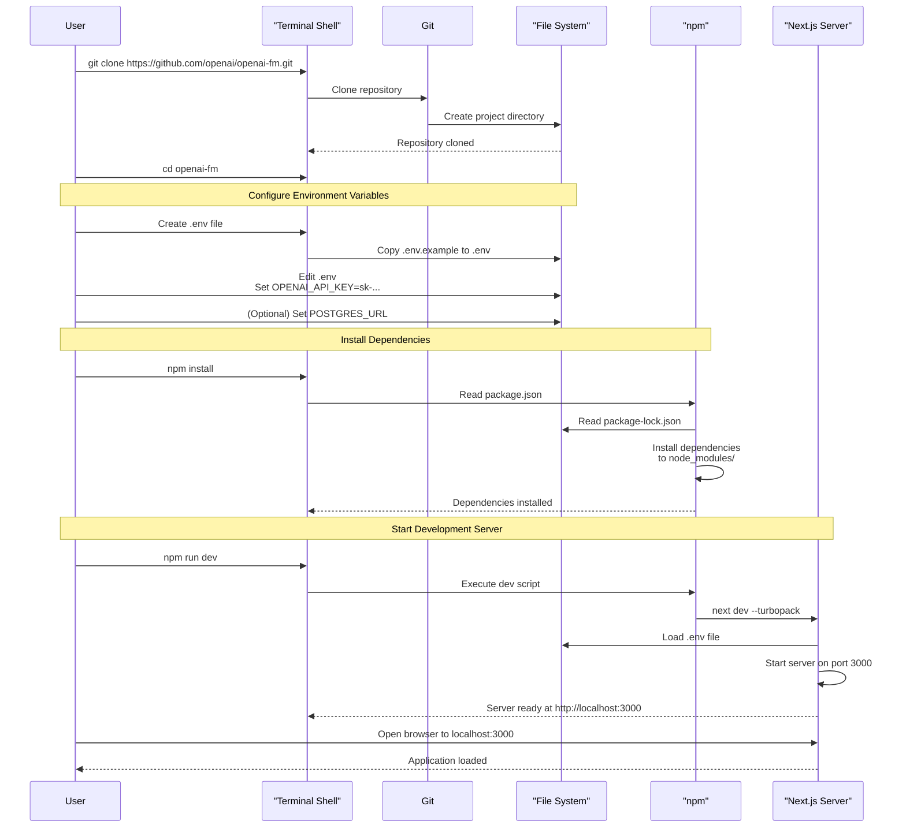
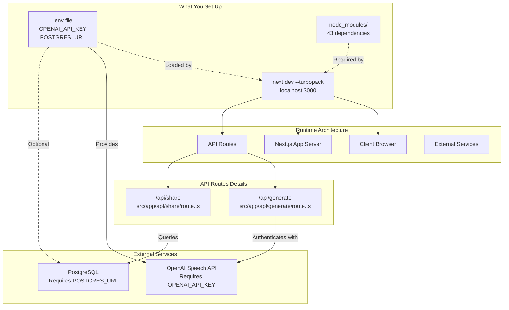

<!-- source: DeepWiki mcp.deepwiki.com · repo openai/openai-fm · page 2 Getting Started · fetched 2026-10-26 -->

# Getting Started

Relevant source files

The following files were used as context for generating this wiki page:

- [README.md](README.md)
- [package.json](package.json)

This page guides you through the initial setup and configuration of the OpenAI.fm application, including prerequisites, environment setup, and running the development server. For detailed installation instructions and package management, see [Installation and Setup](#2.1). For comprehensive environment variable configuration, see [Environment Configuration](#2.2).

## Purpose and Scope

OpenAI.fm is a Next.js application that demonstrates OpenAI's text-to-speech API capabilities. This guide covers:

- System prerequisites and requirements
- Quick start instructions
- Understanding the setup components
- Verifying your installation

This page provides an overview of the setup process. Detailed configuration and troubleshooting are covered in child pages.

## Prerequisites

Before starting, ensure you have the following:

| Requirement | Description | Documentation |
|------------|-------------|---------------|
| **Node.js** | JavaScript runtime (version 20 or higher recommended) | Based on `@types/node` version constraint in [package.json:35]() |
| **npm** | Node package manager (comes with Node.js) | Used by scripts in [package.json:5-9]() |
| **OpenAI API Key** | Required for text-to-speech functionality | See [OpenAI Platform](https://platform.openai.com/) |
| **Git** | For cloning the repository | Standard version control tool |
| **PostgreSQL** (Optional) | Required only for sharing feature | See [README.md:46-56]() |

**Sources:** [package.json:32-42](), [README.md:14-66]()

## Quick Start Overview

The setup process consists of four essential steps:

1. Clone the repository from GitHub
2. Configure the OpenAI API key in environment variables
3. Install dependencies using npm
4. Start the development server

Optional: Configure PostgreSQL database for the sharing feature.

The following diagram illustrates the setup components and their relationships to actual files and code entities in the codebase:

### Setup Components and File Mapping

**Sources:** [package.json:1-43](), [README.md:21-63](), [.env.example]()

## Setup Process Flow

The following sequence diagram shows the exact commands and file operations required to set up OpenAI.fm:

**Sources:** [package.json:5-9](), [README.md:21-63]()

## Core Setup Commands

The following table provides the essential commands referenced in [package.json:5-9]():

| Command | Script Definition | Purpose |
|---------|------------------|---------|
| `npm run dev` | `next dev --turbopack` | Starts development server with Turbopack bundler |
| `npm run build` | `next build` | Creates production build in `.next/` directory |
| `npm start` | `next start` | Runs production server from build output |
| `npm run lint` | `next lint` | Runs ESLint to check code quality |

The `dev` script uses the `--turbopack` flag, which enables Next.js's Turbopack bundler for faster development builds.

**Sources:** [package.json:5-9]()

## Environment Variables Configuration

Two environment variables are used by the application:

| Variable | Required | Used By | Purpose |
|----------|----------|---------|---------|
| `OPENAI_API_KEY` | Yes | [src/app/api/generate/route.ts]() | Authenticates requests to OpenAI Speech API |
| `POSTGRES_URL` | No | [src/app/api/share/route.ts]() | Connects to PostgreSQL for share persistence |

### Configuration Methods

You can configure environment variables using either method:

1. **Local .env file** (recommended for development):
   - Copy [.env.example]() to `.env` or `.env.local`
   - Add your API key: `OPENAI_API_KEY=sk-...`
   - Optionally add: `POSTGRES_URL=postgresql://...`

2. **System environment variables** (global):
   - Set `OPENAI_API_KEY` in your shell profile
   - See [README.md:31]() for platform-specific instructions

Next.js automatically loads variables from `.env.local` and `.env` files at startup. For detailed environment configuration, see [Environment Configuration](#2.2).

**Sources:** [README.md:27-56](), [.env.example]()

## Dependency Installation

The application's dependencies are defined in [package.json:11-42]() and locked to specific versions in [package-lock.json](). Running `npm install` performs the following:

1. Reads dependency definitions from `package.json`
2. Resolves exact versions from `package-lock.json`
3. Downloads packages to `node_modules/`
4. Links binary scripts (e.g., `next`, `eslint`)

### Key Dependencies

| Category | Packages | Purpose |
|----------|----------|---------|
| **Framework** | `next`, `react`, `react-dom` | Next.js application framework |
| **State Management** | `zustand`, `immer` | Global state store |
| **UI Components** | `@radix-ui/*` | Accessible UI primitives |
| **Code Editor** | `@codemirror/*`, `@uiw/react-codemirror` | Syntax-highlighted code display |
| **Audio** | `wavesurfer.js` | Audio waveform visualization |
| **Database** | `@vercel/postgres` | PostgreSQL client (optional) |
| **Styling** | `tailwindcss`, `@tailwindcss/postcss` | Utility-first CSS framework |
| **Build Tools** | `typescript`, `eslint` | Type checking and linting |

For a comprehensive reference of all dependencies, see [Dependencies Reference](#7).

**Sources:** [package.json:11-42]()

## Verifying Your Setup

After completing the setup, verify that the application is running correctly:

### Development Server Check

1. Start the development server: `npm run dev`
2. Look for console output: `Ready started server on 0.0.0.0:3000, url: http://localhost:3000`
3. Open `http://localhost:3000` in your browser
4. You should see the OpenAI.fm interface

### API Integration Check

1. Enter text in the input field
2. Click the **Play** button
3. Audio should be generated and play back
4. If you see an error, verify:
   - `OPENAI_API_KEY` is set correctly in `.env`
   - The API key is valid and has credits
   - Console shows any error messages from [src/app/api/generate/route.ts]()

### Optional: Share Feature Check

If you configured `POSTGRES_URL`:

1. Click the **Share** button
2. A share URL should be copied to clipboard
3. Opening the share URL should load your configuration
4. If this fails, verify:
   - `POSTGRES_URL` is set correctly
   - Database is accessible
   - The `shares` table exists (see [Database Integration](#3.6))

**Sources:** [README.md:57-63]()

## Architecture Context

Understanding what you just set up helps navigate the codebase. The following diagram maps the setup to runtime architecture:

**Sources:** [package.json:1-43](), [README.md:1-91](), [src/app/api/generate/route.ts](), [src/app/api/share/route.ts]()

The development server you started (`next dev --turbopack`) runs:

- **Client-side code**: React components in `src/components/` and `src/app/`
- **API routes**: Server-side endpoints in `src/app/api/`
- **Static assets**: Files from `public/` directory

For detailed architecture information, see [System Architecture](#3).

## Next Steps

After completing setup, you can:

1. **Explore the application**:
   - Try different voices and prompts
   - Test audio playback and download
   - Generate code snippets for API integration

2. **Review the architecture**:
   - See [System Architecture](#3) for component relationships
   - See [Frontend Components](#3.2) for UI component documentation
   - See [API Routes](#3.3) for server-side endpoint details

3. **Start development**:
   - See [Development Guide](#4) for tooling and workflows
   - See [Code Style and Linting](#4.1) for code standards
   - See [Build Process](#4.2) for production builds

4. **Configure optional features**:
   - See [Database Integration](#3.6) to enable sharing
   - See [Environment Configuration](#2.2) for advanced setup

**Sources:** [README.md:1-91]()

## Common Issues

| Issue | Cause | Solution |
|-------|-------|----------|
| Port 3000 already in use | Another process is using the port | Stop the other process or use `PORT=3001 npm run dev` |
| API key error | Missing or invalid `OPENAI_API_KEY` | Verify `.env` file contains valid key |
| Module not found | Dependencies not installed | Run `npm install` |
| Share feature fails | Missing `POSTGRES_URL` | Add PostgreSQL configuration or disable sharing |

For detailed troubleshooting, see [Installation and Setup](#2.1) and [Environment Configuration](#2.2).

**Sources:** [README.md:14-66]()

---

