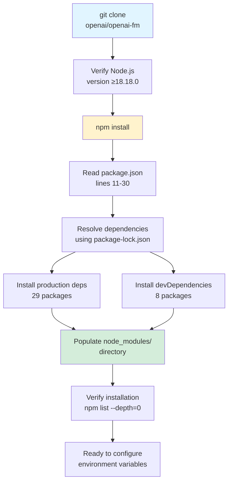
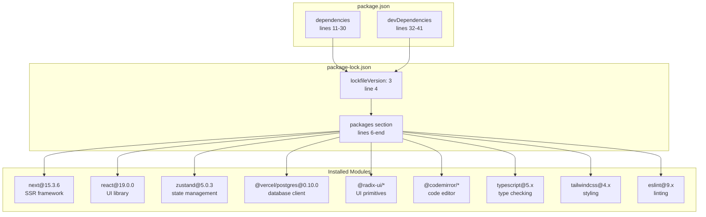

<!-- source: DeepWiki mcp.deepwiki.com · repo openai/openai-fm · page 2.1 Installation and Setup · fetched 2026-10-26 -->

# Installation and Setup

<details>
<summary>Relevant source files</summary>

The following files were used as context for generating this wiki page:

- [README.md](README.md)
- [package-lock.json](package-lock.json)
- [package.json](package.json)

</details>


This document provides detailed instructions for installing dependencies, understanding the package management configuration, and running the OpenAI.fm application locally. It covers prerequisite software requirements, the installation workflow, and verification steps to ensure the application is properly configured.

For environment variable configuration (API keys and database connection strings), see [Environment Configuration](#2.2). For details on the build process and production optimizations, see [Build Process](#4.2).

---

## Prerequisites

OpenAI.fm is built on Next.js 15.3.6 and requires the following software to be installed on your system:

| Software | Minimum Version | Purpose |
|----------|----------------|---------|
| Node.js | 18.18.0+ | JavaScript runtime for Next.js |
| npm | 9.0.0+ | Package manager (included with Node.js) |
| Git | Any recent version | Version control (for cloning repository) |

**Verification Commands:**

```bash
node --version  # Should output v18.18.0 or higher
npm --version   # Should output 9.0.0 or higher
```

Sources: [package-lock.json:1-42](), [package.json:1-43](), README.md mentions Node.js requirement implicitly through Next.js

---

## Installation Workflow

The following diagram illustrates the complete installation process, mapping user actions to specific files and commands:



**Installation Process: From Repository Clone to Configured Application**

Sources: [package.json:1-43](), [package-lock.json:1-42](), [README.md:21-44]()

---

## Step-by-Step Installation

### 1. Clone the Repository

```bash
git clone https://github.com/openai/openai-fm.git
cd openai-fm
```

This creates a local copy of the repository including all source files and configuration.

Sources: [README.md:21-25]()

### 2. Install Dependencies

Execute the following command in the project root directory:

```bash
npm install
```

This command performs the following operations:

1. Reads dependency specifications from [package.json:11-41]()
2. Uses [package-lock.json:1-42]() to resolve exact versions
3. Downloads and installs all packages into `node_modules/`
4. Generates or updates `package-lock.json` if needed

**What Gets Installed:**

The installation process downloads 37 direct dependencies (29 production + 8 development):

| Category | Count | Key Examples |
|----------|-------|--------------|
| Production | 29 | `next`, `react`, `react-dom`, `zustand`, `@vercel/postgres` |
| Development | 8 | `typescript`, `eslint`, `tailwindcss`, `@types/react` |

Sources: [package.json:11-41](), [package-lock.json:7-42]()

### 3. Dependency Resolution Details



**Dependency Resolution: package.json to node_modules/**

Sources: [package.json:11-41](), [package-lock.json:1-42]()

---

## Understanding package.json Scripts

The [package.json:5-9]() file defines four npm scripts that control the application lifecycle:

### Available Scripts

| Script | Command | Purpose | When to Use |
|--------|---------|---------|-------------|
| `dev` | `next dev --turbopack` | Start development server with Turbopack | Local development |
| `build` | `next build` | Create production build | Before deployment |
| `start` | `next start` | Run production server | After building |
| `lint` | `next lint` | Run ESLint checks | Code quality verification |

### Script Details

**`npm run dev`**

Starts the Next.js development server with Turbopack (Next.js's Rust-based bundler):

```bash
npm run dev
# Executes: next dev --turbopack
# Server starts at: http://localhost:3000
# Features: Hot Module Replacement, Fast Refresh, instant feedback
```

The `--turbopack` flag enables faster build times during development compared to Webpack.

**`npm run build`**

Creates an optimized production build:

```bash
npm run build
# Executes: next build
# Output directory: .next/
# Optimizations: Minification, tree shaking, code splitting
```

This command must complete successfully before running `npm start`.

**`npm run start`**

Runs the production server:

```bash
npm run start
# Executes: next start
# Requires: Completed build in .next/
# Port: 3000 (default)
```

**`npm run lint`**

Runs ESLint with Next.js configuration:

```bash
npm run lint
# Executes: next lint
# Config: eslint.config.mjs
# Checks: All .ts, .tsx files in src/
```

Sources: [package.json:5-9]()

---

## Running the Application

### Development Mode

To run the application in development mode:

```bash
npm run dev
```

Expected output:

```
▲ Next.js 15.3.6
- Local:        http://localhost:3000
- Turbopack:    Enabled

✓ Ready in 1.2s
```

The application will be available at `http://localhost:3000`. The development server provides:

- **Hot Module Replacement (HMR)**: Changes to source files are reflected immediately
- **Fast Refresh**: React components update without losing state
- **Error Overlay**: Compilation errors displayed in browser
- **Turbopack**: Faster bundling than traditional Webpack

### Production Mode

For production deployment, execute:

```bash
npm run build
npm run start
```

The build process generates optimized bundles in `.next/` directory. The production server does not include development features like HMR.

Sources: [package.json:6-8](), [README.md:57-63]()

---

## Verification Steps

After installation, verify the setup:

### 1. Check Installed Packages

```bash
npm list --depth=0
```

Expected output should show all packages from [package.json:11-41]() without errors.

### 2. Verify TypeScript Configuration

```bash
npx tsc --noEmit
```

This checks for TypeScript compilation errors without generating output files.

### 3. Run Linter

```bash
npm run lint
```

Should complete without errors or warnings on a fresh installation.

### 4. Test Development Server

```bash
npm run dev
```

Navigate to `http://localhost:3000`. You should see the OpenAI.fm interface (though it will not be fully functional without environment variables configured - see [Environment Configuration](#2.2)).

Sources: [package.json:5-9]()

---

## Troubleshooting Common Issues

### Node Version Mismatch

**Symptom:** Error mentioning "engines" or unsupported Node version

**Solution:** Upgrade Node.js to version 18.18.0 or higher. Many dependencies require this minimum version as specified in [package-lock.json:49-50](), [package-lock.json:284-285]().

### Package Installation Failures

**Symptom:** `npm install` fails with ERESOLVE errors

**Solution:**

```bash
# Clear npm cache
npm cache clean --force

# Remove existing node_modules and package-lock.json
rm -rf node_modules package-lock.json

# Reinstall
npm install
```

### Port 3000 Already in Use

**Symptom:** `EADDRINUSE: address already in use :::3000`

**Solution:** Specify a different port:

```bash
PORT=3001 npm run dev
```

### Turbopack Errors

**Symptom:** Errors related to Turbopack during `npm run dev`

**Solution:** Fall back to Webpack:

```bash
# Modify package.json line 6 to remove --turbopack
"dev": "next dev"
```

Or run directly:

```bash
next dev
```

Sources: [package.json:6]()

---

## Post-Installation Next Steps

After successful installation:

1. **Configure Environment Variables** - Set up `OPENAI_API_KEY` and optional database connection (see [Environment Configuration](#2.2))
2. **Review Build Configuration** - Understand Next.js, TailwindCSS, and TypeScript settings (see [Build Process](#4.2))
3. **Explore Dependencies** - Review the complete dependency tree and their purposes (see [Dependencies Reference](#7))

The application is now installed but requires environment configuration before it can generate audio or persist shared configurations.

Sources: [README.md:27-56](), [package.json:1-43]()

---

## Key File References

The following files govern the installation process:

| File | Lines | Purpose |
|------|-------|---------|
| `package.json` | [5-9]() | npm script definitions |
| `package.json` | [11-30]() | Production dependency specifications |
| `package.json` | [32-41]() | Development dependency specifications |
| `package-lock.json` | [1-42]() | Locked dependency versions and integrity hashes |
| `README.md` | [38-44]() | Installation instructions |

Sources: [package.json:1-43](), [package-lock.json:1-42](), [README.md:38-63]()

---

