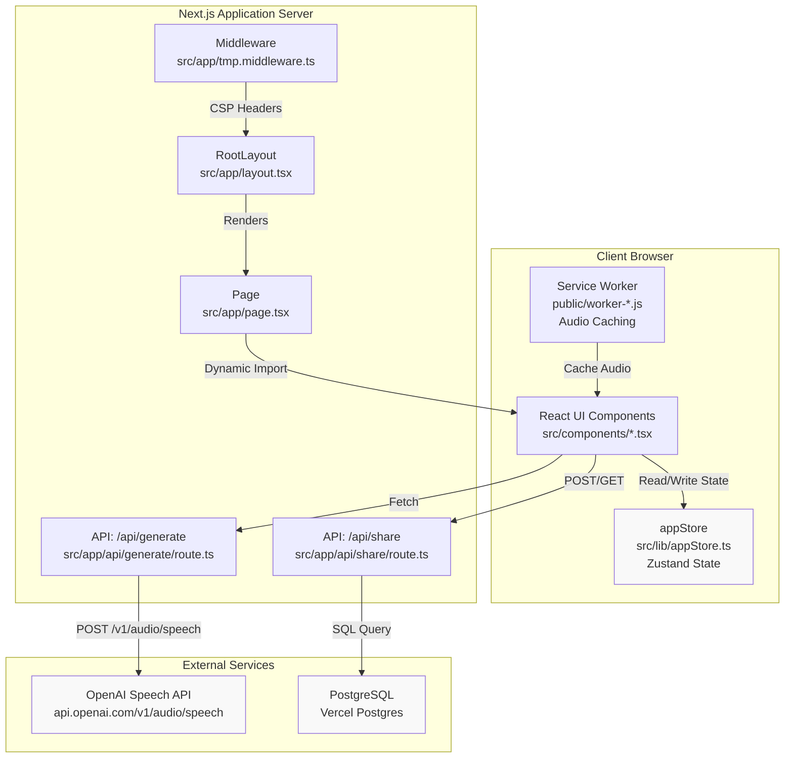
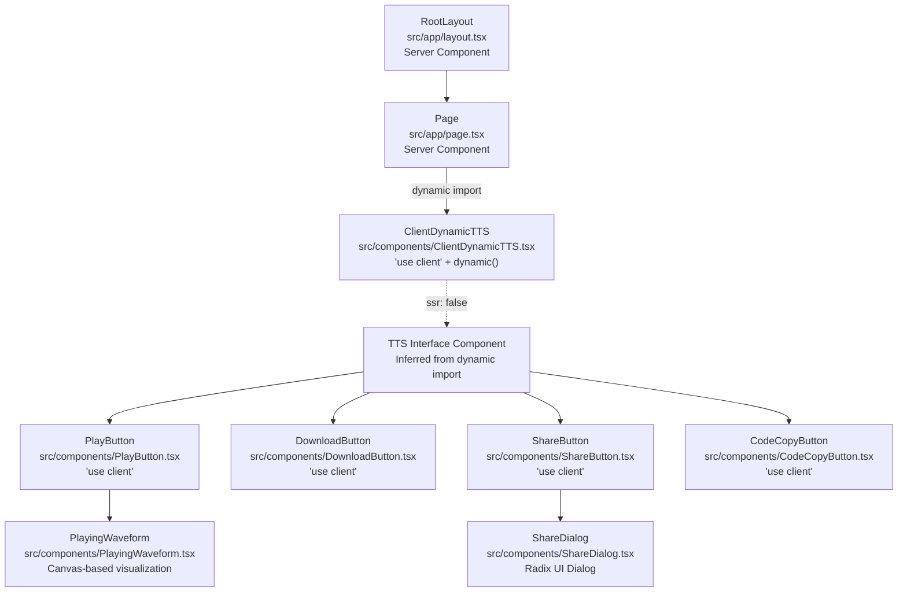
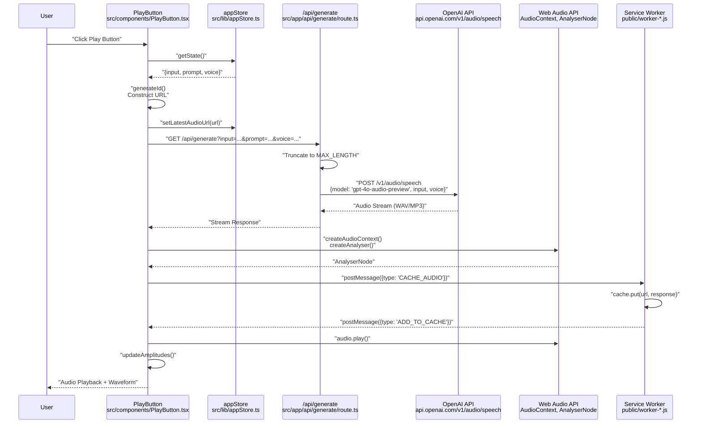
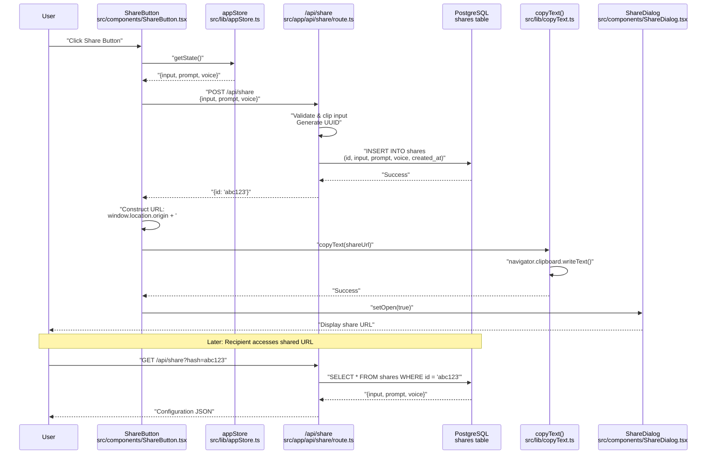
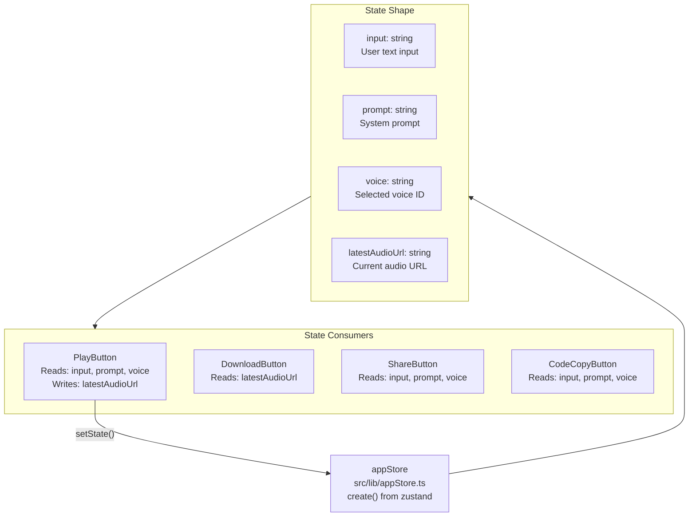
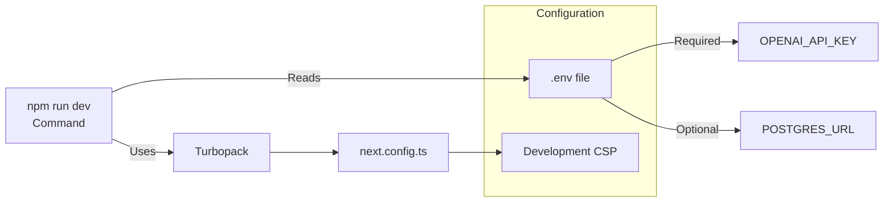
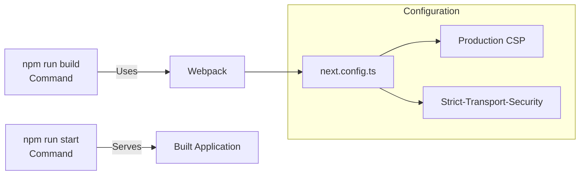
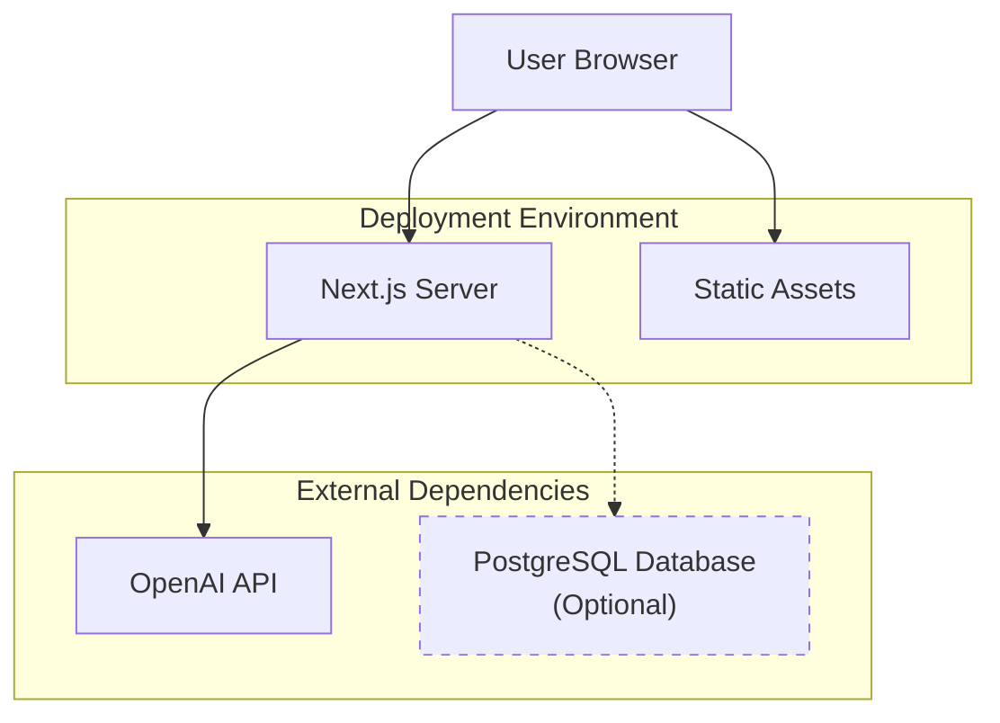

<!-- source: DeepWiki mcp.deepwiki.com · repo openai/openai-fm · page 3 System Architecture · fetched 2026-10-26 -->

# System Architecture

Relevant source files

The following files were used as context for generating this wiki page:

- [next.config.ts](next.config.ts)
- [package.json](package.json)

This document provides a comprehensive overview of the OpenAI.fm system architecture, including component relationships, data flow patterns, and integration points. The architecture follows a standard Next.js application pattern with server-side rendering, API routes, and client-side state management.

The system consists of five primary layers:
1. **Client Layer**: React components, Zustand state management, Service Worker caching
2. **Next.js Server Layer**: Page rendering, API routes, middleware
3. **External APIs**: OpenAI Speech API for text-to-speech generation
4. **Data Persistence**: Optional PostgreSQL database for sharing functionality
5. **Build System**: Next.js with Turbopack/Webpack, TailwindCSS, TypeScript

For detailed information on specific subsystems, see:
- **Section 3.1**: Next.js Application Structure
- **Section 3.2**: Frontend Components
- **Section 3.3**: API Routes
- **Section 3.4**: State Management
- **Section 3.5**: Audio Processing
- **Section 3.6**: Database Integration

## High-Level System Architecture

The following diagram shows the complete system architecture with specific code entities and their relationships:

**Diagram: Complete System Architecture with Code Entities**

Sources: [src/app/layout.tsx:1-30](), [src/app/page.tsx:1-20](), [src/app/api/generate/route.ts:1-100](), [src/app/api/share/route.ts:1-100](), [package.json:11-30]()

## Application Layer Architecture

The application is organized into distinct layers, each with specific responsibilities and interfaces.

**Diagram: Application Layers and Key Files**

```mermaid
graph TD
    subgraph PresentationLayer["Presentation Layer"]
        ClientDynamicTTS["ClientDynamicTTS<br/>src/components/ClientDynamicTTS.tsx<br/>Dynamic Import Boundary"]
        PlayButton["PlayButton<br/>src/components/PlayButton.tsx"]
        DownloadButton["DownloadButton<br/>src/components/DownloadButton.tsx"]
        ShareButton["ShareButton<br/>src/components/ShareButton.tsx"]
        CodeCopyButton["CodeCopyButton<br/>src/components/CodeCopyButton.tsx"]
        PlayingWaveform["PlayingWaveform<br/>src/components/PlayingWaveform.tsx"]
    end
    
    subgraph StateLayer["State Management Layer"]
        appStore["appStore<br/>src/lib/appStore.ts<br/>Zustand Store"]
    end
    
    subgraph ServerLayer["Server Layer"]
        generateRoute["GET /api/generate<br/>src/app/api/generate/route.ts"]
        shareRoute["POST/GET /api/share<br/>src/app/api/share/route.ts"]
    end
    
    subgraph UtilityLayer["Utility Layer"]
        copyText["copyText()<br/>src/lib/copyText.ts"]
        getCodeSnippet["getCodeSnippet()<br/>src/lib/getCodeSnippet.ts"]
    end
    
    PlayButton --> appStore
    DownloadButton --> appStore
    ShareButton --> appStore
    CodeCopyButton --> appStore
    
    PlayButton --> generateRoute
    ShareButton --> shareRoute
    
    ShareButton --> copyText
    CodeCopyButton --> copyText
    CodeCopyButton --> getCodeSnippet
    
    PlayButton --> PlayingWaveform
```

| Layer | Responsibilities | Key Files |
|-------|-----------------|-----------|
| Presentation | User interaction, rendering, visual feedback | `src/components/*.tsx` |
| State Management | Global application state (input, voice, prompt) | `src/lib/appStore.ts` |
| Server | API endpoints, OpenAI proxy, data persistence | `src/app/api/*/route.ts` |
| Utility | Shared functions (clipboard, code generation) | `src/lib/*.ts` |

Sources: [src/components/PlayButton.tsx:1-200](), [src/components/ShareButton.tsx:1-150](), [src/lib/appStore.ts:1-50](), [src/app/api/generate/route.ts:1-100](), [src/app/api/share/route.ts:1-100]()

## Component Hierarchy and Relationships

The component hierarchy follows Next.js conventions with server-side rendering at the root and client-side components for interactive features.

**Diagram: Component Hierarchy from Root to Leaves**

The dynamic import in `ClientDynamicTTS` prevents server-side rendering of client-only components that depend on browser APIs (Web Audio API, `navigator.clipboard`).

Sources: [src/app/layout.tsx:1-30](), [src/app/page.tsx:1-20](), [src/components/ClientDynamicTTS.tsx:1-10](), [src/components/PlayButton.tsx:1-200](), [src/components/ShareButton.tsx:1-150]()

## Primary Data Flows

### Audio Generation and Playback Flow

This is the core functionality of the application, involving multiple systems coordinating to generate and play audio.

**Diagram: Audio Generation Flow with Code References**

| Step | Component | Key Functions/Methods |
|------|-----------|----------------------|
| 1. User Input | `PlayButton` | Event handler, `handlePlay()` |
| 2. State Retrieval | `appStore` | Zustand `getState()` |
| 3. API Request | `/api/generate` | `GET` handler, input validation |
| 4. TTS Generation | OpenAI API | Model: `gpt-4o-audio-preview` |
| 5. Audio Analysis | Web Audio API | `AudioContext`, `AnalyserNode` |
| 6. Caching | Service Worker | `cache.put()`, `postMessage()` |
| 7. Playback | `HTMLAudioElement` | `.play()`, waveform updates |

Sources: [src/components/PlayButton.tsx:1-200](), [src/app/api/generate/route.ts:1-100](), [src/lib/appStore.ts:1-50]()

### Share Configuration Flow

The sharing feature allows users to persist and distribute TTS configurations via unique URLs.

**Diagram: Share Flow with Database Integration**

The `shares` table schema (inferred from API route):

| Column | Type | Description |
|--------|------|-------------|
| `id` | VARCHAR/UUID | Primary key, used in share URL hash |
| `input` | TEXT | User's input text for TTS |
| `prompt` | TEXT | System prompt for voice modification |
| `voice` | VARCHAR | Voice identifier (e.g., 'alloy', 'echo') |
| `created_at` | TIMESTAMP | Record creation timestamp |

Sources: [src/components/ShareButton.tsx:1-150](), [src/app/api/share/route.ts:1-100](), [src/lib/copyText.ts:1-20]()

### State Management Flow

The application uses Zustand for centralized state management, avoiding prop drilling across components.

**Diagram: State Management with appStore**

| State Property | Type | Purpose | Consumers |
|----------------|------|---------|-----------|
| `input` | `string` | Text to convert to speech | `PlayButton`, `ShareButton`, `CodeCopyButton` |
| `prompt` | `string` | System prompt for voice styling | `PlayButton`, `ShareButton`, `CodeCopyButton` |
| `voice` | `string` | Voice identifier ('alloy', 'echo', etc.) | `PlayButton`, `ShareButton`, `CodeCopyButton` |
| `latestAudioUrl` | `string` | URL of most recent audio generation | `PlayButton` (write), `DownloadButton` (read) |

Sources: [src/lib/appStore.ts:1-50](), [src/components/PlayButton.tsx:1-200](), [src/components/ShareButton.tsx:1-150](), [src/components/DownloadButton.tsx:1-100]()

## Build and Runtime Configuration

The application uses different configurations for development and production environments.

### Development Environment

Sources: [next.config.ts:3-16](), [package.json:6](), [README.md:27-36]()

### Production Environment

Sources: [next.config.ts:3-54](), [package.json:7-8]()

## Technical Components in Detail

### Next.js Framework

The application is built on Next.js, which provides:

- Server-side rendering capabilities
- API route handling
- Build optimization
- Development tooling with Turbopack

The configuration in `next.config.ts` includes:

| Configuration | Purpose |
|---------------|---------|
| Content Security Policy | Security headers for controlling resource loading |
| SVG transformation | Converts SVG files to React components |
| HSTS headers | Enforces HTTPS in production |
| Turbopack settings | Optimizes development experience |

Sources: [next.config.ts:1-57]()

### OpenAI API Integration

The application connects to the OpenAI Speech API for text-to-speech conversion. Key aspects include:

- API key configuration through environment variables
- Speech model selection
- Audio format handling

Sources: [README.md:7-11]()

### Database Integration (Optional)

The application can optionally connect to a PostgreSQL database to enable the sharing feature:

- Uses the Vercel Postgres client
- Requires configuration via the `POSTGRES_URL` environment variable
- Only affects the sharing functionality; the core application works without it

Sources: [README.md:46-55](), [package.json:20]()

### Audio Visualization

Audio visualization is handled using WaveSurfer.js:

- Provides waveform visualization of audio data
- Allows for playback control
- Integrates with the React component structure

Sources: [package.json:29]()

## Security Considerations

The application implements several security measures in its architecture:

- Content Security Policy (CSP) headers to control resource loading
- Strict Transport Security (HSTS) headers in production
- SVG transformation to prevent XSS vulnerabilities

For more detailed information on security aspects, see [Security Considerations](#5).

Sources: [next.config.ts:5-54]()

## Deployment Architecture

The application is designed to be deployed as a complete Next.js application:

Sources: [README.md:14-63]()

This architecture provides a balance of performance, maintainability, and extensibility, allowing the application to effectively demonstrate OpenAI's text-to-speech capabilities while providing a smooth user experience.

---

