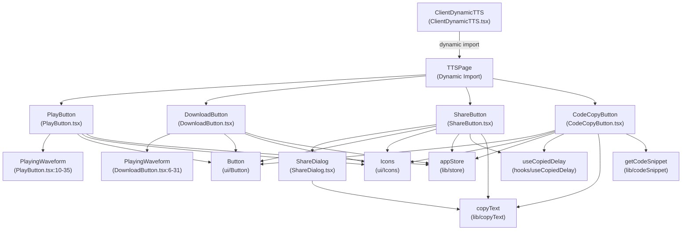
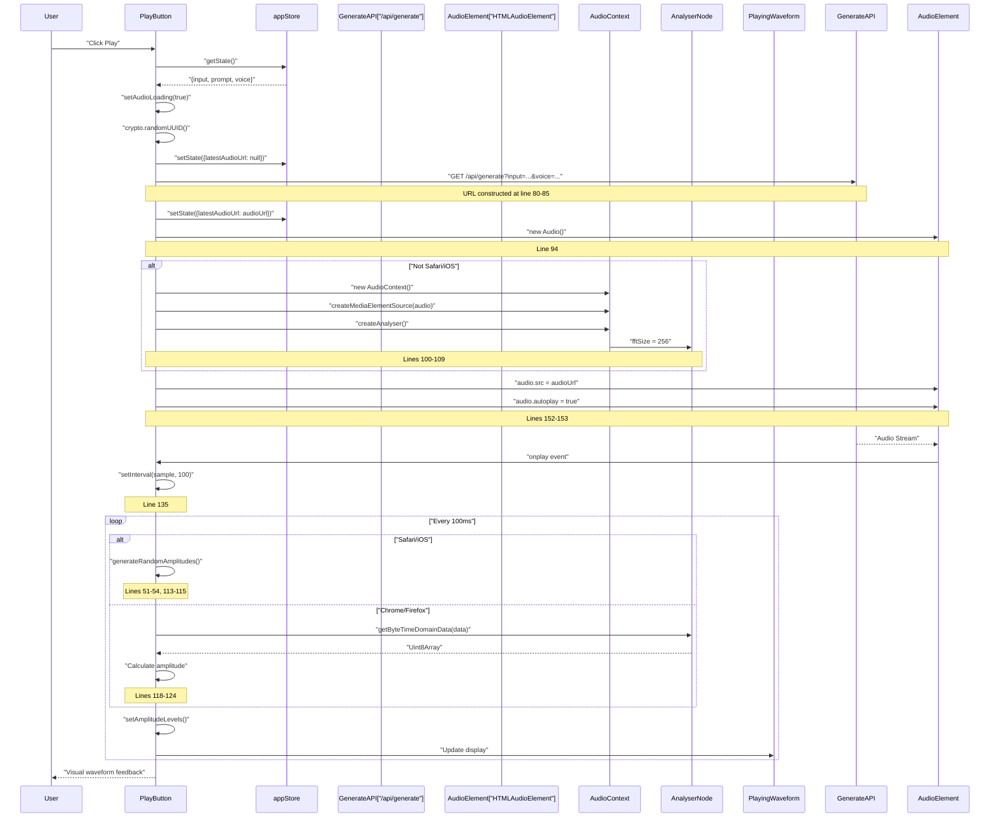
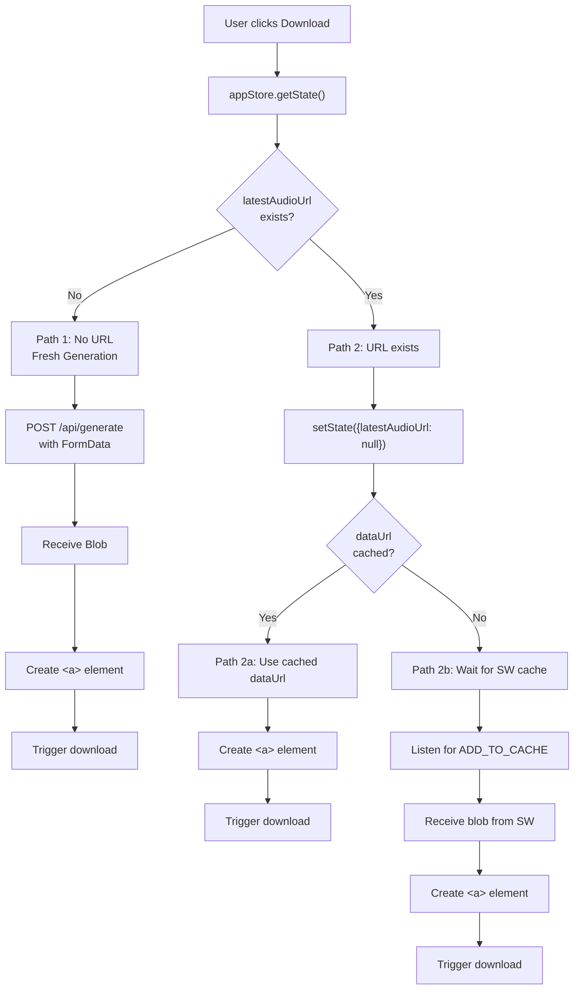
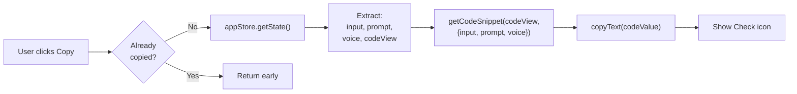
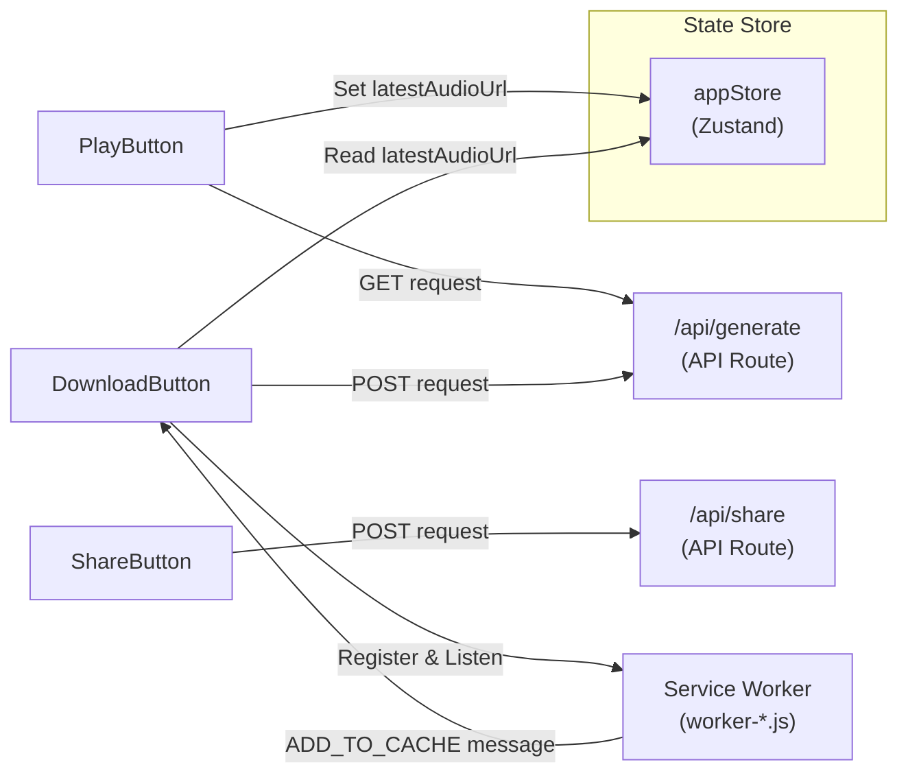

<!-- source: DeepWiki mcp.deepwiki.com · repo openai/openai-fm · page 3.2 Frontend Components · fetched 2026-10-26 -->

# Frontend Components

<details>
<summary>Relevant source files</summary>

The following files were used as context for generating this wiki page:

- [src/components/ClientDynamicTTS.tsx](src/components/ClientDynamicTTS.tsx)
- [src/components/CodeCopyButton.tsx](src/components/CodeCopyButton.tsx)
- [src/components/DownloadButton.tsx](src/components/DownloadButton.tsx)
- [src/components/PlayButton.tsx](src/components/PlayButton.tsx)
- [src/components/ShareButton.tsx](src/components/ShareButton.tsx)
- [src/components/ShareDialog.tsx](src/components/ShareDialog.tsx)

</details>


## Purpose and Scope

This document details the React component architecture of the OpenAI.fm application, covering the main interactive components responsible for audio generation, playback, download, sharing, and code snippet display. These components form the user interface layer and coordinate with the state management system ([3.4](#3.4)) and API routes ([3.3](#3.3)) to deliver the core text-to-speech functionality.

For information about the overall Next.js application structure and routing, see [Next.js Application Structure](#3.1). For details on how components access global state, see [State Management](#3.4). For audio processing internals beyond the UI layer, see [Audio Processing](#3.5).

---

## Component Architecture Overview

The frontend is composed of specialized, single-responsibility components that interact through the centralized Zustand store (`appStore`). The diagram below maps the component hierarchy to actual code entities:

**Diagram: Component Hierarchy and Dependencies**



**Sources:** [src/components/ClientDynamicTTS.tsx](), [src/components/PlayButton.tsx](), [src/components/DownloadButton.tsx](), [src/components/ShareButton.tsx](), [src/components/CodeCopyButton.tsx](), [src/components/ShareDialog.tsx]()

---

## Main Interactive Components

### PlayButton Component

The `PlayButton` component handles audio generation, playback control, and real-time waveform visualization. It orchestrates the complete audio lifecycle from API request to audio playback.

**Component Structure:**

| Aspect | Implementation |
|--------|----------------|
| File Path | [src/components/PlayButton.tsx]() |
| State Management | `appStore.useState()`, `appStore.getState()`, `appStore.setState()` |
| Audio APIs | `HTMLAudioElement`, `AudioContext`, `AnalyserNode` |
| Key State Variables | `audioLoading`, `audioLoaded`, `isPlaying`, `amplitudeLevels` |

**Diagram: PlayButton Audio Generation Flow**



**Key Implementation Details:**

1. **Browser Detection** [src/components/PlayButton.tsx:7-9](): The component detects Safari and iOS to use static animation instead of Web Audio API analysis
2. **Audio Context Setup** [src/components/PlayButton.tsx:100-109](): Creates `AudioContext`, connects `MediaElementSource` to `AnalyserNode` for real-time amplitude extraction
3. **Amplitude Sampling** [src/components/PlayButton.tsx:112-125](): Interval-based sampling at 100ms intervals, using either Web Audio API data or random values for incompatible browsers
4. **State Coordination** [src/components/PlayButton.tsx:76-77, 86](): Sets `latestAudioUrl` in the store for consumption by `DownloadButton`

**Sources:** [src/components/PlayButton.tsx:1-188]()

---

### DownloadButton Component

The `DownloadButton` component manages audio file downloads with Service Worker integration for caching. It can download from cached audio or trigger a fresh generation.

**Component Structure:**

| Aspect | Implementation |
|--------|----------------|
| File Path | [src/components/DownloadButton.tsx]() |
| Service Worker | Registration at [src/components/DownloadButton.tsx:67]() |
| Message Handling | `navigator.serviceWorker.addEventListener("message")` |
| Download Strategies | Cached blob download, fresh API request, pending cache download |

**Diagram: DownloadButton Download Strategies**



**Key Implementation Details:**

1. **Service Worker Registration** [src/components/DownloadButton.tsx:64-70](): Registers worker file `worker-444eae9e2e1bdd6edd8969f319655e70.js` on component mount
2. **Message Event Handling** [src/components/DownloadButton.tsx:44-61](): Listens for `ADD_TO_CACHE` messages containing audio blob
3. **Filename Generation** [src/components/DownloadButton.tsx:81-84](): Constructs filename using voice and vibe parameters, format determined by browser type
4. **Three Download Paths**:
   - Fresh generation [src/components/DownloadButton.tsx:86-104](): POST to `/api/generate` when no cached URL
   - Cached blob [src/components/DownloadButton.tsx:127-132](): Direct download from `dataUrl` object URL
   - Pending cache [src/components/DownloadButton.tsx:109-124](): Wait for Service Worker to cache, then download
5. **Browser Format Detection** [src/components/DownloadButton.tsx:33-37](): Uses Chrome detection to determine WAV vs MP3 format

**Sources:** [src/components/DownloadButton.tsx:1-149]()

---

### ShareButton Component

The `ShareButton` component persists the current TTS configuration to the database and generates a shareable URL. It integrates with the `/api/share` endpoint ([3.3](#3.3)) and PostgreSQL database ([3.6](#3.6)).

**Component Structure:**

| Aspect | Implementation |
|--------|----------------|
| File Path | [src/components/ShareButton.tsx]() |
| API Endpoint | POST `/api/share` |
| State Hook | `useCopiedDelay()` for visual feedback |
| Dialog Component | `ShareDialog` for URL display |

**State Flow Table:**

| Step | Action | Code Reference |
|------|--------|----------------|
| 1 | User clicks Share | [src/components/ShareButton.tsx:45-49]() |
| 2 | Retrieve current state | [src/components/ShareButton.tsx:14]() `appStore.getState()` |
| 3 | POST to API | [src/components/ShareButton.tsx:17-23]() |
| 4 | Receive hash ID | [src/components/ShareButton.tsx:28-29]() |
| 5 | Construct URL | [src/components/ShareButton.tsx:30]() `origin/pathname#hash` |
| 6 | Copy to clipboard | [src/components/ShareButton.tsx:32]() `copyText()` |
| 7 | Show dialog | [src/components/ShareButton.tsx:33-34]() `setOpen(true)` |

**Key Implementation Details:**

1. **Request Payload** [src/components/ShareButton.tsx:22](): Sends JSON with `{input, prompt, voice}` from current state
2. **URL Construction** [src/components/ShareButton.tsx:30](): Uses fragment identifier (`#hash`) for client-side routing
3. **Error Handling** [src/components/ShareButton.tsx:24-27, 35-38](): Alerts user on API failure
4. **Copy Feedback** [src/components/ShareButton.tsx:10, 45-46](): Uses `useCopiedDelay()` hook to prevent double-clicks

**Sources:** [src/components/ShareButton.tsx:1-60]()

---

### CodeCopyButton Component

The `CodeCopyButton` component generates and copies code snippets demonstrating API usage. It reads the current `codeView` selection and application state to generate appropriate examples.

**Component Structure:**

| Aspect | Implementation |
|--------|----------------|
| File Path | [src/components/CodeCopyButton.tsx]() |
| Code Generation | `getCodeSnippet()` utility function |
| State Dependencies | `input`, `prompt`, `voice`, `codeView` from `appStore` |

**Code Generation Flow:**



**Key Implementation Details:**

1. **State Extraction** [src/components/CodeCopyButton.tsx:16](): Destructures `{input, prompt, voice, codeView}` from store
2. **Code Generation** [src/components/CodeCopyButton.tsx:17](): Delegates to `getCodeSnippet()` utility with view type and parameters
3. **Copy Trigger** [src/components/CodeCopyButton.tsx:26](): Invokes `trigger()` from `useCopiedDelay()` hook for UI feedback
4. **Conditional Rendering** [src/components/CodeCopyButton.tsx:30-38](): Shows either Check or Copy icon based on `copied` state

**Sources:** [src/components/CodeCopyButton.tsx:1-43]()

---

## Shared UI Components

### PlayingWaveform Component

The `PlayingWaveform` component is a reusable visualization element that renders animated waveform bars. It appears in both `PlayButton` and `DownloadButton` with different states.

**Component Signature:**

```typescript
PlayingWaveform({
  audioLoaded: boolean,
  amplitudeLevels: number[]
})
```

**Component Instances:**

| Location | Purpose | Amplitude Source |
|----------|---------|------------------|
| [src/components/PlayButton.tsx:10-35]() | Real-time playback visualization | Web Audio API or random values |
| [src/components/DownloadButton.tsx:6-31]() | Loading indicator | Static values `[0.04, 0.04, 0.04, 0.04, 0.04]` |

**Rendering Logic:**

1. **Container** [src/components/PlayButton.tsx:17](): Fixed size `w-[36px] h-[16px]`
2. **Bar Generation** [src/components/PlayButton.tsx:18-29](): Maps `amplitudeLevels` array to visual bars
3. **Height Calculation** [src/components/PlayButton.tsx:19](): Clamps amplitude values: `Math.min(Math.max(level * 30, 0.2), 1.9) * 100%`
4. **Animation** [src/components/PlayButton.tsx:20-21, 24](): Applies `animate-wave` class when `audioLoaded` is false, with staggered delays

**Sources:** [src/components/PlayButton.tsx:10-35](), [src/components/DownloadButton.tsx:6-31]()

---

### ShareDialog Component

The `ShareDialog` component provides a modal interface for displaying and copying shareable URLs. It uses Radix UI's Dialog primitive for accessibility.

**Component Props:**

```typescript
{
  shareUrl: string | null,
  open: boolean,
  onOpenChange: (open: boolean) => void
}
```

**Component Structure Table:**

| Element | Implementation | Purpose |
|---------|----------------|---------|
| Dialog.Root | [src/components/ShareDialog.tsx:15]() | Controls open state |
| Dialog.Overlay | [src/components/ShareDialog.tsx:17]() | Backdrop with fade animation |
| Dialog.Content | [src/components/ShareDialog.tsx:18]() | Centered modal container |
| Dialog.Title | [src/components/ShareDialog.tsx:19-21]() | "Share Link" header |
| Input field | [src/components/ShareDialog.tsx:26-30]() | Displays share URL |
| Copy button | [src/components/ShareDialog.tsx:34-43]() | Copies URL to clipboard |
| Close button | [src/components/ShareDialog.tsx:46-52]() | X icon in top-right |

**Key Implementation Details:**

1. **Radix UI Integration** [src/components/ShareDialog.tsx:2](): Imports from `radix-ui` package
2. **Animation Classes** [src/components/ShareDialog.tsx:17-18](): Uses `data-[state=open]:animate-*` selectors
3. **Copy Action** [src/components/ShareDialog.tsx:36-39](): Invokes `copyText()` utility on button click
4. **Input Default Value** [src/components/ShareDialog.tsx:29](): Displays `shareUrl ?? ""` to handle null state

**Sources:** [src/components/ShareDialog.tsx:1-60]()

---

## Dynamic Import Pattern

### ClientDynamicTTS Component

The `ClientDynamicTTS` component implements Next.js dynamic imports to prevent server-side rendering of browser-dependent code. This is critical for components using Web APIs like `AudioContext`, `navigator.serviceWorker`, and `navigator.userAgent`.

**Implementation:**

```typescript
// src/components/ClientDynamicTTS.tsx:1-11
"use client";
import dynamic from "next/dynamic";

const DynamicComponentWithNoSSR = dynamic(
  () => import("@/components/TTSPage"),
  { ssr: false }
);

export default function ClientDynamicTTS() {
  return <DynamicComponentWithNoSSR />;
}
```

**Technical Details:**

| Aspect | Value |
|--------|-------|
| Client Directive | `"use client"` at [src/components/ClientDynamicTTS.tsx:1]() |
| Dynamic Import | `next/dynamic` with `ssr: false` option |
| Target Component | `@/components/TTSPage` |
| Parent Component | Rendered by `page.tsx` ([3.1](#3.1)) |

**Why This Pattern:**

1. **Browser API Access**: Components like `PlayButton` and `DownloadButton` use `navigator.serviceWorker`, `AudioContext`, and `navigator.userAgent` which don't exist in Node.js environment
2. **SSR Prevention**: The `{ ssr: false }` option prevents Next.js from attempting to render during server-side generation
3. **Hydration Safety**: Ensures client-only code executes only in browser context

**Sources:** [src/components/ClientDynamicTTS.tsx:1-12]()

---

## Component Communication Patterns

### State Access Patterns

All main components access the centralized `appStore` using consistent patterns:

**Pattern Comparison Table:**

| Component | Read Pattern | Write Pattern | State Dependencies |
|-----------|--------------|---------------|-------------------|
| PlayButton | `appStore.getState()` [line 57] | `appStore.setState()` [lines 77, 86] | `input`, `prompt`, `voice` (read), `latestAudioUrl` (write) |
| DownloadButton | `appStore.useState()` [line 40], `appStore.getState()` [line 73] | `appStore.setState()` [line 107] | `latestAudioUrl` (read/write), `selectedEntry`, `input`, `prompt`, `voice` (read) |
| ShareButton | `appStore.getState()` [line 14] | None | `input`, `prompt`, `voice` (read) |
| CodeCopyButton | `appStore.getState()` [line 16] | None | `input`, `prompt`, `voice`, `codeView` (read) |

**Hook Usage Pattern:**

```typescript
// Reactive subscription (DownloadButton)
const latestAudioUrl = appStore.useState((s) => s.latestAudioUrl);

// One-time read (PlayButton, ShareButton, CodeCopyButton)
const { input, prompt, voice } = appStore.getState();
```

**Sources:** [src/components/PlayButton.tsx:57, 77, 86](), [src/components/DownloadButton.tsx:40, 73, 107](), [src/components/ShareButton.tsx:14](), [src/components/CodeCopyButton.tsx:16]()

---

### External Service Integration

Components integrate with external services through different mechanisms:

**Integration Patterns Diagram:**



**Communication Mechanisms:**

1. **HTTP Fetch**: `PlayButton`, `DownloadButton`, and `ShareButton` use `fetch()` for API calls
2. **Service Worker Messages**: `DownloadButton` communicates bidirectionally with Service Worker via `postMessage()` and event listeners
3. **State Store**: `PlayButton` writes `latestAudioUrl`, `DownloadButton` reads it for coordination

**Sources:** [src/components/PlayButton.tsx:80-86](), [src/components/DownloadButton.tsx:44-61, 64-70, 86-104](), [src/components/ShareButton.tsx:17-23]()

---

## Component Dependency Summary

The following table summarizes all external dependencies for each component:

| Component | State Management | Utilities | Hooks | UI Primitives | External APIs |
|-----------|-----------------|-----------|-------|---------------|---------------|
| PlayButton | `appStore` | None | None | `Button`, `Play` icon | `Audio`, `AudioContext`, `AnalyserNode` |
| DownloadButton | `appStore` | None | None | `Button`, `Download` icon | `navigator.serviceWorker`, `fetch()` |
| ShareButton | `appStore` | `copyText` | `useCopiedDelay` | `Button`, `Share` icon, `ShareDialog` | `fetch()` |
| CodeCopyButton | `appStore` | `copyText`, `getCodeSnippet` | `useCopiedDelay` | `Button`, `Copy`/`Check` icons | `navigator.clipboard` (via `copyText`) |
| ShareDialog | None | `copyText` | None | Radix `Dialog.*` | `navigator.clipboard` (via `copyText`) |
| ClientDynamicTTS | None | None | None | None | `next/dynamic` |

**Sources:** [src/components/PlayButton.tsx:1-6](), [src/components/DownloadButton.tsx:1-5](), [src/components/ShareButton.tsx:1-7](), [src/components/CodeCopyButton.tsx:1-6](), [src/components/ShareDialog.tsx:1-4](), [src/components/ClientDynamicTTS.tsx:1-3]()

---

