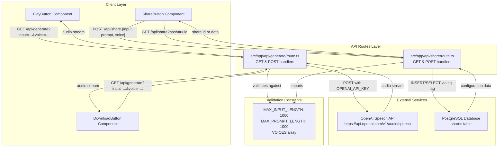
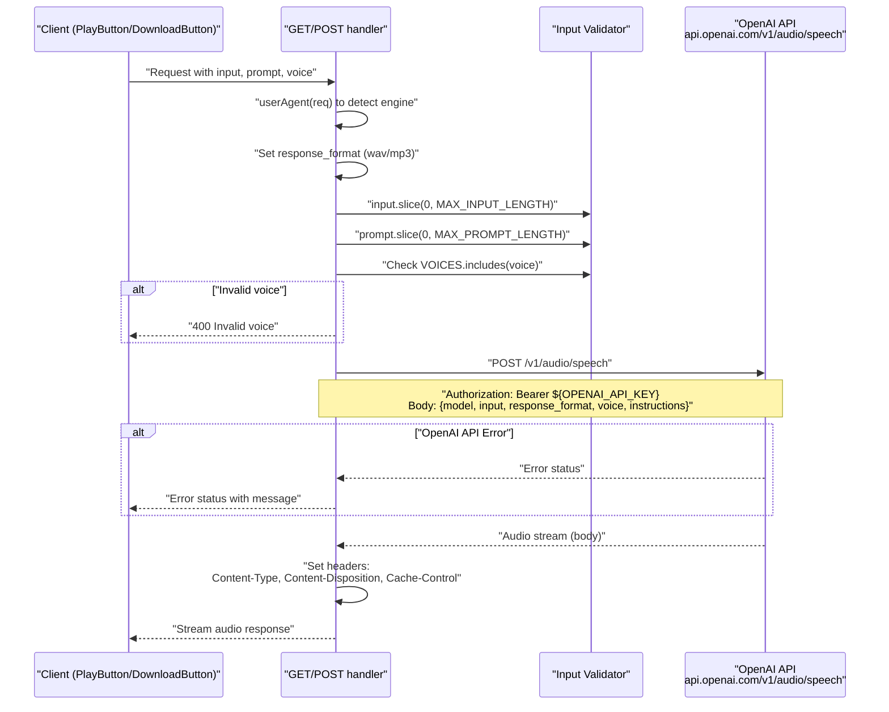
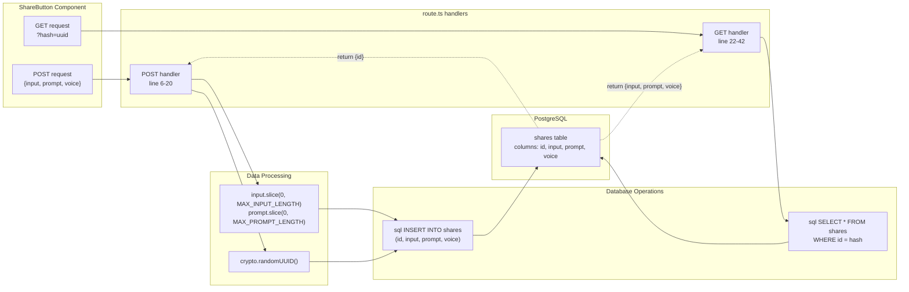

<!-- source: DeepWiki mcp.deepwiki.com · repo openai/openai-fm · page 3.3 API Routes · fetched 2026-10-26 -->

# API Routes

<details>
<summary>Relevant source files</summary>

The following files were used as context for generating this wiki page:

- [src/app/api/generate/route.ts](src/app/api/generate/route.ts)
- [src/app/api/share/route.ts](src/app/api/share/route.ts)

</details>


## Purpose and Scope

This document details the Next.js API routes that provide backend functionality for the OpenAI.fm application. The two primary API routes are `/api/generate` for audio generation and `/api/share` for configuration persistence. These routes serve as secure proxies and data handlers, interfacing with the OpenAI Speech API and PostgreSQL database respectively.

For information about the frontend components that consume these routes, see [Frontend Components](#3.2). For database schema details, see [Database Integration](#3.6). For environment configuration of API keys and database connections, see [Environment Configuration](#2.2).

**Sources:** [src/app/api/generate/route.ts](), [src/app/api/share/route.ts]()

## API Routes Overview

The application implements two API route handlers located in the Next.js App Router structure:

| Route Path | File Location | HTTP Methods | External Service |
|------------|---------------|--------------|------------------|
| `/api/generate` | `src/app/api/generate/route.ts` | GET, POST | OpenAI Speech API |
| `/api/share` | `src/app/api/share/route.ts` | GET, POST | PostgreSQL via `@vercel/postgres` |



**Diagram: API Routes Architecture**

This diagram illustrates the relationship between client components and API routes, showing the specific file paths and code entities involved in request handling.

**Sources:** [src/app/api/generate/route.ts](), [src/app/api/share/route.ts]()

## `/api/generate` Route - Audio Generation

The `generate` route serves as a secure proxy to the OpenAI Speech API, handling both GET and POST requests for audio generation. The route implements identical logic for both HTTP methods to support different client usage patterns.

### Route Handler Functions

The route exports two async functions:

- `GET(req: NextRequest)` - [src/app/api/generate/route.ts:9-69]()
- `POST(req: NextRequest)` - [src/app/api/generate/route.ts:71-129]()

### Request Parameters

Both handlers accept the same parameters, differing only in extraction method (query string vs. form data):

| Parameter | Type | Required | Validation | Description |
|-----------|------|----------|------------|-------------|
| `input` | string | Yes | Truncated to `MAX_INPUT_LENGTH` (1000) | Text to be synthesized |
| `prompt` | string | No | Truncated to `MAX_PROMPT_LENGTH` (1000) | Instructions for voice generation |
| `voice` | string | Yes | Must be in `VOICES` array | Voice identifier |
| `vibe` | string | No | No validation | Used for filename generation |

**GET Handler Parameter Extraction:**
```typescript
const { searchParams } = new URL(req.url);
let input = searchParams.get("input") || "";
let prompt = searchParams.get("prompt") || "";
const voice = searchParams.get("voice") || "";
const vibe = searchParams.get("vibe") || "audio";
```
[src/app/api/generate/route.ts:10-19]()

**POST Handler Parameter Extraction:**
```typescript
const formData = await req.formData();
let input = formData.get("input")?.toString() || "";
let prompt = formData.get("prompt")?.toString() || "";
const voice = formData.get("voice")?.toString() || "";
const vibe = formData.get("vibe") || "audio";
```
[src/app/api/generate/route.ts:75-79]()

**Sources:** [src/app/api/generate/route.ts:1-130]()

### Response Format Selection

The route dynamically selects the audio response format based on the client's user agent:

```typescript
const ua = userAgent(req);
const response_format = ua.engine?.name === "Blink" ? "wav" : "mp3";
```
[src/app/api/generate/route.ts:12-13]()

- **Blink engine** (Chrome, Edge, Opera): Returns `wav` format
- **Other engines** (Firefox, Safari): Returns `mp3` format

**Sources:** [src/app/api/generate/route.ts:12-13](), [src/app/api/generate/route.ts:72-73]()

### OpenAI API Integration



**Diagram: /api/generate Request Flow**

The OpenAI API request is constructed as follows:

```typescript
const apiResponse = await fetch("https://api.openai.com/v1/audio/speech", {
  method: "POST",
  headers: {
    Authorization: `Bearer ${process.env.OPENAI_API_KEY}`,
    "Content-Type": "application/json",
  },
  body: JSON.stringify({
    model: "gpt-4o-mini-tts",
    input,
    response_format,
    voice,
    ...(prompt && { instructions: prompt }),
  }),
});
```
[src/app/api/generate/route.ts:32-46]()

**Key Implementation Details:**

- **Model:** Hard-coded to `"gpt-4o-mini-tts"` [src/app/api/generate/route.ts:39]()
- **Authentication:** Uses `process.env.OPENAI_API_KEY` [src/app/api/generate/route.ts:35]()
- **Conditional Instructions:** The `instructions` field is only included if `prompt` is non-empty [src/app/api/generate/route.ts:44]()

**Sources:** [src/app/api/generate/route.ts:32-46](), [src/app/api/generate/route.ts:92-106]()

### Response Headers and Streaming

The route streams the OpenAI API response directly to the client with appropriate headers:

```typescript
const filename = `openai-fm-${voice}-${vibe}.${response_format}`;

return new Response(apiResponse.body, {
  headers: {
    "Content-Type": response_format === "wav" ? "audio/wav" : "audio/mpeg",
    "Content-Disposition": `inline; filename="${filename}"`,
    "Cache-Control": "no-cache",
  },
});
```
[src/app/api/generate/route.ts:53-62]()

| Header | Value | Purpose |
|--------|-------|---------|
| `Content-Type` | `audio/wav` or `audio/mpeg` | Identifies audio format |
| `Content-Disposition` | `inline; filename="openai-fm-{voice}-{vibe}.{format}"` | Suggests filename for downloads |
| `Cache-Control` | `no-cache` | Prevents browser caching of audio |

**Sources:** [src/app/api/generate/route.ts:53-62](), [src/app/api/generate/route.ts:113-122]()

## `/api/share` Route - Share Functionality

The `share` route provides persistence for TTS configurations, allowing users to save and retrieve their input, prompt, and voice settings via PostgreSQL.

### POST Handler - Create Share

The POST handler persists a new share configuration to the database:

```typescript
export async function POST(req: NextRequest) {
  try {
    const { input, prompt, voice } = await req.json();
    const clippedInput = input.slice(0, MAX_INPUT_LENGTH);
    const clippedPrompt = prompt.slice(0, MAX_PROMPT_LENGTH);
    const id = crypto.randomUUID();
    await sql`INSERT INTO shares (id, input, prompt, voice) VALUES (${id}, ${
      clippedInput ?? ""
    }, ${clippedPrompt ?? ""}, ${voice ?? ""});`;
    return Response.json({ id });
  } catch (err) {
    console.error("Error storing share params:", err);
    return new Response("An error ocurred.", { status: 500 });
  }
}
```
[src/app/api/share/route.ts:6-20]()

**Request Body Schema:**
```json
{
  "input": "string (truncated to 1000 chars)",
  "prompt": "string (truncated to 1000 chars)",
  "voice": "string"
}
```

**Response Schema:**
```json
{
  "id": "uuid-v4-string"
}
```

**Sources:** [src/app/api/share/route.ts:6-20]()

### GET Handler - Retrieve Share

The GET handler retrieves a previously saved configuration by its UUID:

```typescript
export async function GET(req: NextRequest) {
  try {
    const url = new URL(req.url);
    const hash = url.searchParams.get("hash");
    if (!hash) {
      return new Response("Not found", { status: 404 });
    }
    const { rows } = await sql<{
      input: string;
      prompt: string;
      voice: string;
    }>`SELECT input, prompt, voice FROM shares WHERE id = ${hash};`;
    if (rows.length === 0) {
      return new Response("Not found", { status: 404 });
    }
    return Response.json(rows[0]);
  } catch (err) {
    console.error("Error retrieving share params:", err);
    return new Response("An error ocurred.", { status: 500 });
  }
}
```
[src/app/api/share/route.ts:22-42]()

**Request Parameters:**
- `hash` (query parameter): UUID of the share to retrieve

**Response Schema:**
```json
{
  "input": "string",
  "prompt": "string",
  "voice": "string"
}
```

**Sources:** [src/app/api/share/route.ts:22-42]()

### Database Integration



**Diagram: /api/share Database Flow**

The route uses the `sql` template tag from `@vercel/postgres` for parameterized queries:

```typescript
import { sql } from "@vercel/postgres";
```
[src/app/api/share/route.ts:2]()

**Database Schema (inferred from queries):**

| Column | Type | Description |
|--------|------|-------------|
| `id` | UUID (string) | Primary key, generated via `crypto.randomUUID()` |
| `input` | text | TTS input text (max 1000 chars) |
| `prompt` | text | TTS instructions (max 1000 chars) |
| `voice` | text | Voice identifier |

**Sources:** [src/app/api/share/route.ts:1-43]()

## Input Validation and Security

Both routes implement consistent input validation using shared constants:

```typescript
export const MAX_INPUT_LENGTH = 1000;
export const MAX_PROMPT_LENGTH = 1000;
```
[src/app/api/generate/route.ts:3-4]()

These constants are imported and reused in the share route:

```typescript
import { MAX_PROMPT_LENGTH, MAX_INPUT_LENGTH } from "../generate/route";
```
[src/app/api/share/route.ts:3]()

### Validation Rules

| Rule | Implementation | Location |
|------|----------------|----------|
| Input length | `input.slice(0, MAX_INPUT_LENGTH)` | [src/app/api/generate/route.ts:24](), [src/app/api/generate/route.ts:84](), [src/app/api/share/route.ts:9]() |
| Prompt length | `prompt.slice(0, MAX_PROMPT_LENGTH)` | [src/app/api/generate/route.ts:25](), [src/app/api/generate/route.ts:85](), [src/app/api/share/route.ts:10]() |
| Voice validation | `VOICES.includes(voice)` | [src/app/api/generate/route.ts:27](), [src/app/api/generate/route.ts:87]() |

**Voice Validation:**
```typescript
if (!VOICES.includes(voice)) {
  return new Response("Invalid voice", { status: 400 });
}
```
[src/app/api/generate/route.ts:27-29]()

The `VOICES` array is imported from the library module:
```typescript
import { VOICES } from "@/lib/library";
```
[src/app/api/generate/route.ts:8]()

**Sources:** [src/app/api/generate/route.ts:3-4](), [src/app/api/generate/route.ts:8](), [src/app/api/generate/route.ts:24-29](), [src/app/api/share/route.ts:3](), [src/app/api/share/route.ts:9-10]()

## Error Handling

Both routes implement consistent error handling patterns with try-catch blocks and appropriate HTTP status codes.

### `/api/generate` Error Responses

| Error Condition | Status Code | Response Message |
|-----------------|-------------|------------------|
| Invalid voice parameter | 400 | "Invalid voice" |
| OpenAI API error | Proxied status | "An error occurred while generating the audio." |
| Unexpected exception | 500 | "Error generating speech" |

**Implementation:**
```typescript
if (!apiResponse.ok) {
  return new Response(`An error occurred while generating the audio.`, {
    status: apiResponse.status,
  });
}
```
[src/app/api/generate/route.ts:47-51]()

```typescript
catch (err) {
  console.error("Error generating speech:", err);
  return new Response("Error generating speech", {
    status: 500,
  });
}
```
[src/app/api/generate/route.ts:63-68]()

### `/api/share` Error Responses

| Error Condition | Status Code | Response Message |
|-----------------|-------------|------------------|
| Missing hash parameter | 404 | "Not found" |
| Hash not found in database | 404 | "Not found" |
| Database error (POST) | 500 | "An error ocurred." |
| Database error (GET) | 500 | "An error ocurred." |

**Missing Hash Validation:**
```typescript
const hash = url.searchParams.get("hash");
if (!hash) {
  return new Response("Not found", { status: 404 });
}
```
[src/app/api/share/route.ts:25-27]()

**Empty Result Set:**
```typescript
if (rows.length === 0) {
  return new Response("Not found", { status: 404 });
}
```
[src/app/api/share/route.ts:34-36]()

**Sources:** [src/app/api/generate/route.ts:47-68](), [src/app/api/generate/route.ts:107-128](), [src/app/api/share/route.ts:16-19](), [src/app/api/share/route.ts:25-27](), [src/app/api/share/route.ts:34-40]()

## API Route Registration

Next.js App Router automatically registers these routes based on their file system location:

- `src/app/api/generate/route.ts` → `/api/generate`
- `src/app/api/share/route.ts` → `/api/share`

The routes are secured by Content Security Policy headers configured in [next.config.ts]() and [src/app/tmp.middleware.ts]() (see [Security Considerations](#5)).

**Sources:** [src/app/api/generate/route.ts](), [src/app/api/share/route.ts]()

---

