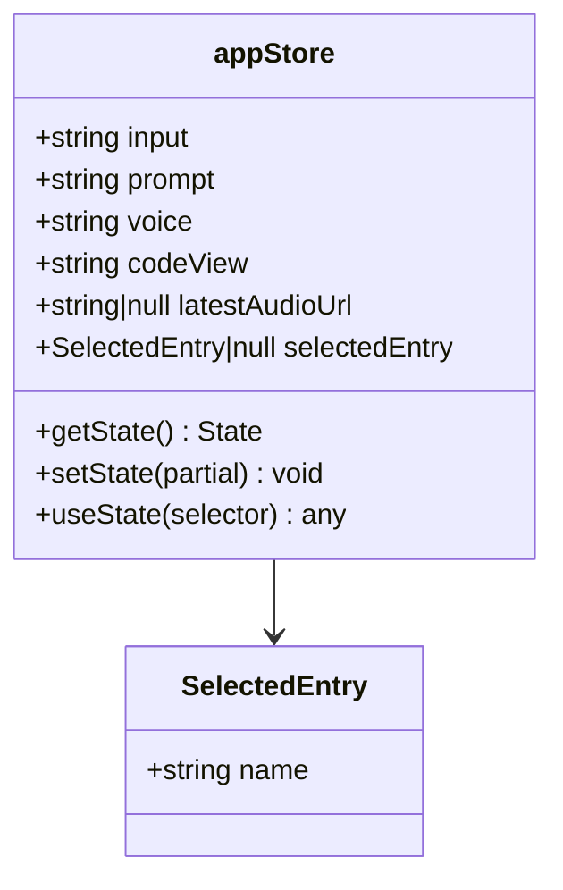
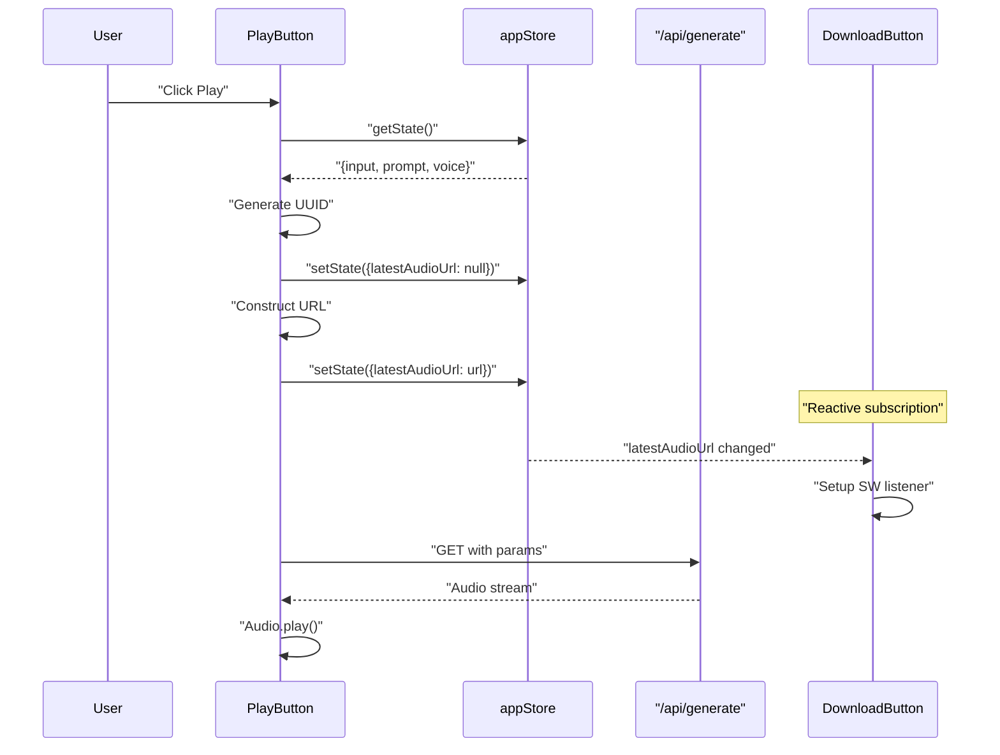
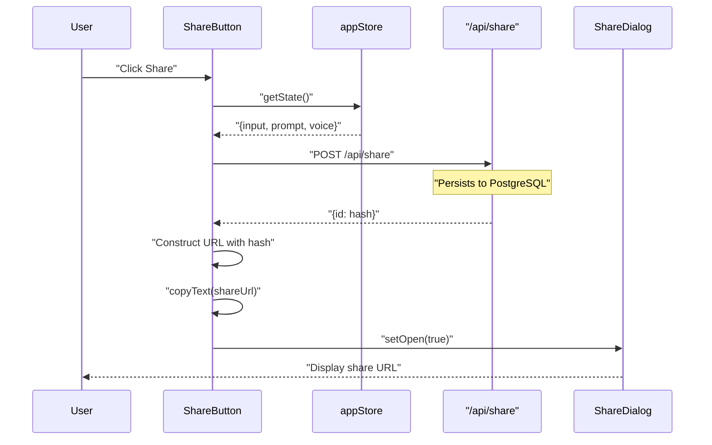
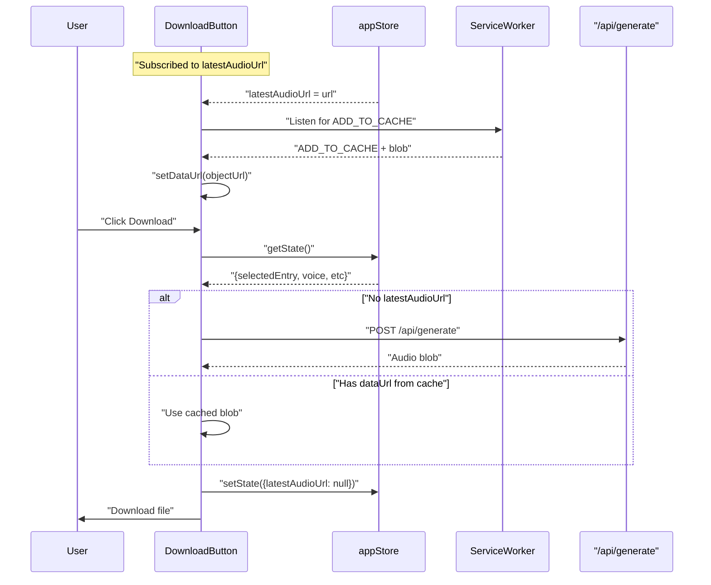
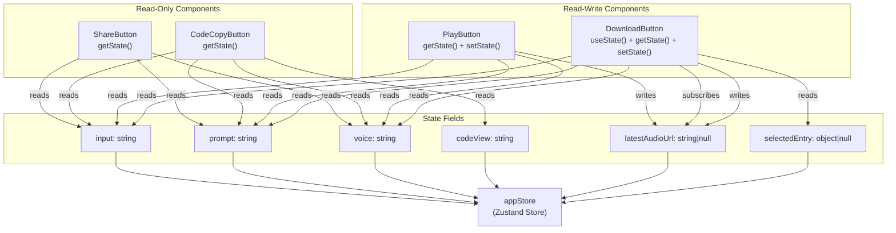

<!-- source: DeepWiki mcp.deepwiki.com · repo openai/openai-fm · page 3.4 State Management · fetched 2026-10-26 -->

# State Management

<details>
<summary>Relevant source files</summary>

The following files were used as context for generating this wiki page:

- [src/components/CodeCopyButton.tsx](src/components/CodeCopyButton.tsx)
- [src/components/DownloadButton.tsx](src/components/DownloadButton.tsx)
- [src/components/PlayButton.tsx](src/components/PlayButton.tsx)
- [src/components/ShareButton.tsx](src/components/ShareButton.tsx)

</details>


## Purpose and Scope

This document explains the centralized state management system used throughout the OpenAI.fm application. The system is built on Zustand, a lightweight state management library that provides a simple API for managing global application state. This page covers the store structure, state fields, access patterns, and how components interact with the state store.

For information about how state is consumed in specific UI components, see [Frontend Components](#3.2). For details on how API routes interact with state data, see [API Routes](#3.3).

---

## Store Architecture

The application uses a single global store implemented with Zustand, exported as `appStore` from [src/lib/store]() (inferred from import statements). Zustand provides a minimal API surface with three primary methods for state interaction:

| Method | Purpose | Return Type |
|--------|---------|-------------|
| `appStore.getState()` | Retrieve current state snapshot | State object |
| `appStore.setState(partial)` | Update state (partial or complete) | void |
| `appStore.useState(selector)` | React hook for reactive subscriptions | Selected value |

The store follows a centralized state pattern where all components access the same shared state instance, eliminating prop drilling and providing a single source of truth for application data.

**Sources:** [src/components/PlayButton.tsx:4](), [src/components/DownloadButton.tsx:4](), [src/components/ShareButton.tsx:4](), [src/components/CodeCopyButton.tsx:4]()

---

## State Schema

The `appStore` maintains the following state fields, which represent the complete application state at runtime:



### State Fields

| Field | Type | Description | Used By |
|-------|------|-------------|---------|
| `input` | `string` | Text input to be converted to speech | All action components |
| `prompt` | `string` | System prompt for TTS generation | All action components |
| `voice` | `string` | Selected voice identifier | All action components |
| `codeView` | `string` | Selected code snippet view type | CodeCopyButton |
| `latestAudioUrl` | `string \| null` | URL of most recently generated audio | PlayButton, DownloadButton |
| `selectedEntry` | `object \| null` | Currently selected preset entry with `name` property | DownloadButton |

**Sources:** [src/components/PlayButton.tsx:57](), [src/components/DownloadButton.tsx:73-79](), [src/components/ShareButton.tsx:14](), [src/components/CodeCopyButton.tsx:16]()

---

## State Access Patterns

### Pattern 1: Snapshot Access with `getState()`

Components use `appStore.getState()` to retrieve a one-time snapshot of the current state. This pattern is used when components need to read state values without subscribing to changes, typically during event handlers or side effects.

**Example Usage:**
```typescript
// PlayButton.tsx:57
const { input, prompt, voice } = appStore.getState();
```

**Components Using This Pattern:**
- **PlayButton** [src/components/PlayButton.tsx:57]() - Reads TTS parameters before generating audio
- **DownloadButton** [src/components/DownloadButton.tsx:73-79]() - Reads state for download filename and API call
- **ShareButton** [src/components/ShareButton.tsx:14]() - Reads configuration to persist via `/api/share`
- **CodeCopyButton** [src/components/CodeCopyButton.tsx:16]() - Reads state to generate code snippet

**Sources:** [src/components/PlayButton.tsx:57](), [src/components/DownloadButton.tsx:73-79](), [src/components/ShareButton.tsx:14](), [src/components/CodeCopyButton.tsx:16]()

### Pattern 2: State Updates with `setState()`

Components use `appStore.setState()` to update state by providing a partial state object. Zustand merges the partial update with the existing state.

**Example Usage:**
```typescript
// PlayButton.tsx:77,86
appStore.setState({ latestAudioUrl: null });
appStore.setState({ latestAudioUrl: audioUrl });
```

**Update Operations:**
- **PlayButton** [src/components/PlayButton.tsx:77,86]() - Sets `latestAudioUrl` during audio generation lifecycle
- **DownloadButton** [src/components/DownloadButton.tsx:107]() - Clears `latestAudioUrl` after download

**Sources:** [src/components/PlayButton.tsx:77,86](), [src/components/DownloadButton.tsx:107]()

### Pattern 3: Reactive Subscription with `useState()`

Components use `appStore.useState()` with a selector function to subscribe to specific state slices. The component re-renders when the selected value changes.

**Example Usage:**
```typescript
// DownloadButton.tsx:40
const latestAudioUrl = appStore.useState((s) => s.latestAudioUrl);
```

**Subscriptions:**
- **DownloadButton** [src/components/DownloadButton.tsx:40]() - Subscribes to `latestAudioUrl` to enable download button and setup service worker listeners

**Sources:** [src/components/DownloadButton.tsx:40]()

---

## State Flow Diagrams

### Audio Generation State Flow



This diagram shows how `PlayButton` orchestrates state updates during audio generation. The component reads initial parameters via `getState()`, clears the previous audio URL, generates a new URL, and stores it via `setState()`. The `DownloadButton` component reactively responds to the state change through its `useState()` subscription.

**Sources:** [src/components/PlayButton.tsx:57,77,86](), [src/components/DownloadButton.tsx:40]()

### Share Functionality State Flow



The share flow demonstrates one-directional state reading. `ShareButton` uses `getState()` to snapshot the current configuration, sends it to the API for persistence, and manages local UI state (`open`, `shareUrl`) without writing back to the global store.

**Sources:** [src/components/ShareButton.tsx:14,17-34]()

### Download Functionality State Flow



The download flow combines both state subscription and snapshot reading. The component subscribes to `latestAudioUrl` via `useState()` to setup service worker listeners, uses `getState()` during the download event to read filename parameters, and calls `setState()` to clear the audio URL after download.

**Sources:** [src/components/DownloadButton.tsx:40,73-79,107]()

---

## Component-Store Interaction Map



This diagram maps each component's interaction mode with the store:

- **Read-Only Components** (`ShareButton`, `CodeCopyButton`) - Use `getState()` to snapshot state for operations
- **Read-Write Components** (`PlayButton`, `DownloadButton`) - Both read and write state, with `DownloadButton` also using reactive subscriptions

**Sources:** [src/components/PlayButton.tsx:4,57,77,86](), [src/components/DownloadButton.tsx:4,40,73-79,107](), [src/components/ShareButton.tsx:4,14](), [src/components/CodeCopyButton.tsx:4,16]()

---

## State Lifecycle and Coordination

### Audio URL Management

The `latestAudioUrl` field coordinates state between `PlayButton` and `DownloadButton`:

1. **Initial State**: `latestAudioUrl` is `null`
2. **PlayButton Generation** [src/components/PlayButton.tsx:77]():
   - Clears `latestAudioUrl` to `null` before generation
   - Constructs new URL with UUID
   - Sets `latestAudioUrl` to the new URL [src/components/PlayButton.tsx:86]()
3. **DownloadButton Subscription** [src/components/DownloadButton.tsx:40,44-61]():
   - Reactive subscription detects URL change
   - Sets up service worker message listener for caching
   - Creates object URL from cached blob
4. **Post-Download Cleanup** [src/components/DownloadButton.tsx:107]():
   - Sets `latestAudioUrl` back to `null`
   - Triggers cleanup in subscription effect

**Sources:** [src/components/PlayButton.tsx:77,86](), [src/components/DownloadButton.tsx:40,44-61,107]()

### Code Snippet Generation

The `CodeCopyButton` reads multiple state fields to generate code snippets:

```typescript
// CodeCopyButton.tsx:16-17
const { input, prompt, voice, codeView } = appStore.getState();
const codeValue = getCodeSnippet(codeView, { input, prompt, voice });
```

The `codeView` field determines the snippet format (language/framework), while `input`, `prompt`, and `voice` provide the actual TTS configuration values.

**Sources:** [src/components/CodeCopyButton.tsx:16-17]()

### Download Filename Generation

The `DownloadButton` composes filenames from multiple state fields:

```typescript
// DownloadButton.tsx:73-84
const { selectedEntry, input, prompt, voice, latestAudioUrl: storeUrl } = appStore.getState();
const vibe = selectedEntry?.name.toLowerCase().replace(/ /g, "-") ?? "audio";
const filename = `openai-fm-${voice}-${vibe}.${IS_CHROME ? "wav" : "mp3"}`;
```

The filename incorporates:
- `voice` - Voice identifier
- `selectedEntry.name` - Preset name (or "audio" fallback)
- Browser detection for format extension

**Sources:** [src/components/DownloadButton.tsx:73-84]()

---

## State Access Summary

| Component | Access Pattern | Fields Read | Fields Written |
|-----------|---------------|-------------|----------------|
| **PlayButton** | `getState()` + `setState()` | `input`, `prompt`, `voice` | `latestAudioUrl` |
| **DownloadButton** | `useState()` + `getState()` + `setState()` | `latestAudioUrl`, `selectedEntry`, `input`, `prompt`, `voice` | `latestAudioUrl` |
| **ShareButton** | `getState()` | `input`, `prompt`, `voice` | None |
| **CodeCopyButton** | `getState()` | `input`, `prompt`, `voice`, `codeView` | None |

**Sources:** [src/components/PlayButton.tsx](), [src/components/DownloadButton.tsx](), [src/components/ShareButton.tsx](), [src/components/CodeCopyButton.tsx]()

---

## Store Implementation Details

While the actual store implementation file is not provided in the source files, we can infer the Zustand store structure from usage patterns:

```typescript
// Inferred store structure from usage
type State = {
  input: string;
  prompt: string;
  voice: string;
  codeView: string;
  latestAudioUrl: string | null;
  selectedEntry: { name: string } | null;
};

// Store API (Zustand standard)
interface AppStore {
  getState: () => State;
  setState: (partial: Partial<State>) => void;
  useState: <T>(selector: (state: State) => T) => T;
}
```

The store is accessed via a single import path `@/lib/store`, which exports the `appStore` instance that all components share.

**Sources:** [src/components/PlayButton.tsx:4](), [src/components/DownloadButton.tsx:4](), [src/components/ShareButton.tsx:4](), [src/components/CodeCopyButton.tsx:4]()

---

