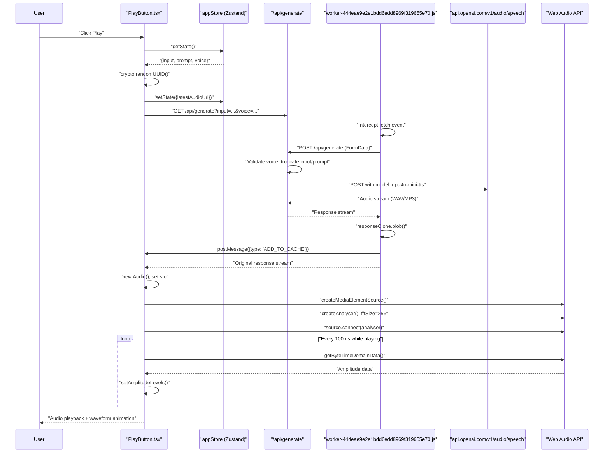
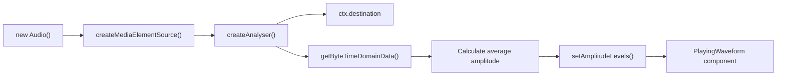
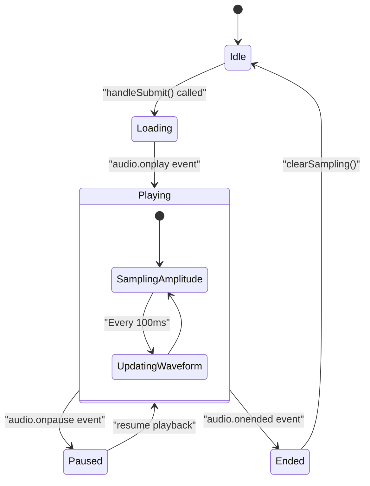
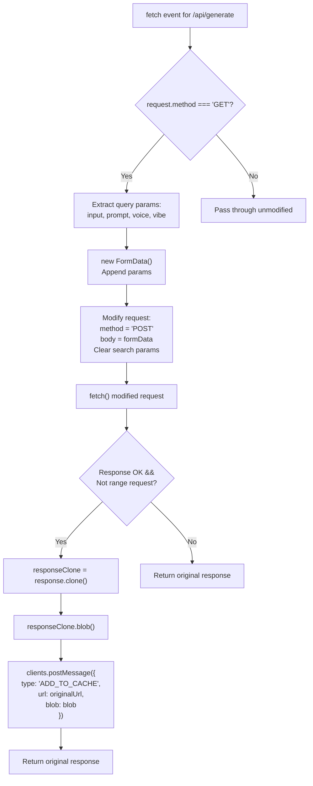
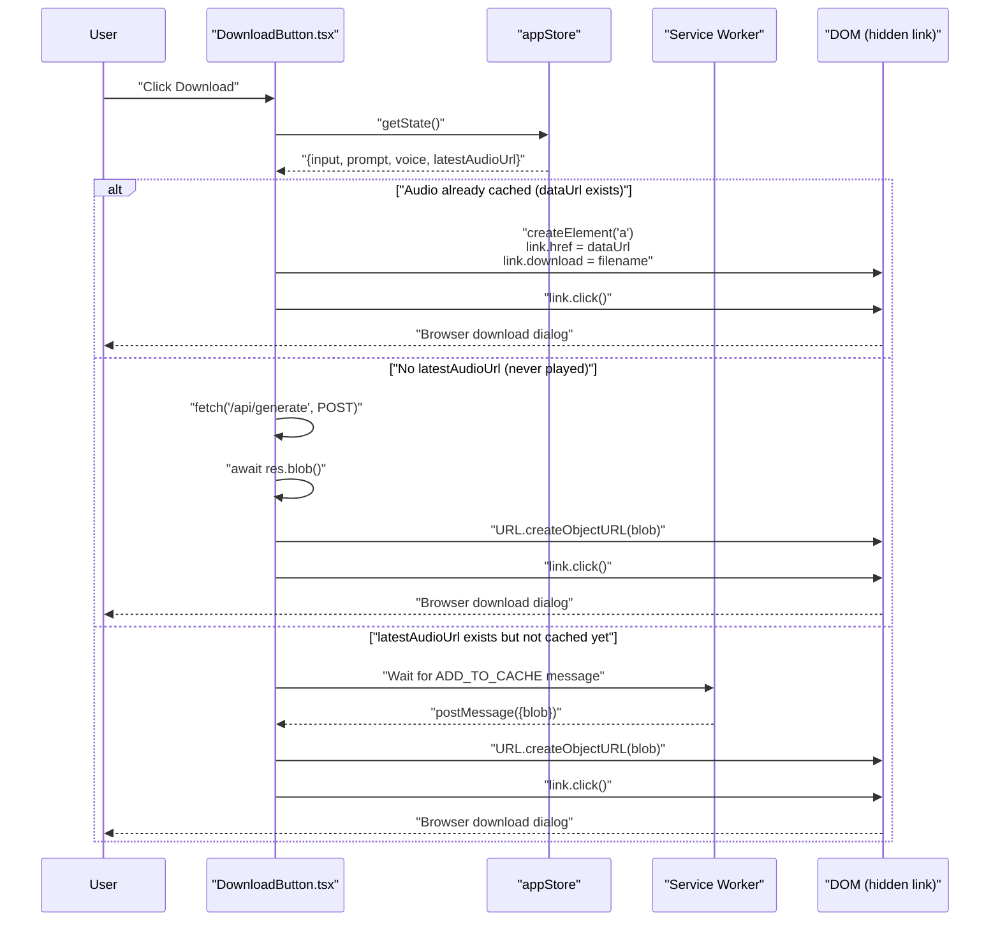
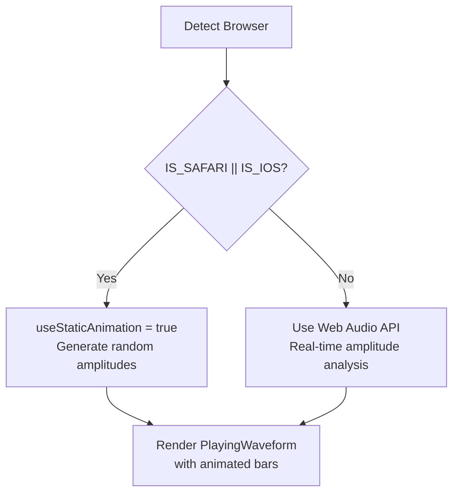

<!-- source: DeepWiki mcp.deepwiki.com · repo openai/openai-fm · page 3.5 Audio Processing · fetched 2026-10-26 -->

# Audio Processing

<details>
<summary>Relevant source files</summary>

The following files were used as context for generating this wiki page:

- [public/worker-444eae9e2e1bdd6edd8969f319655e70.js](public/worker-444eae9e2e1bdd6edd8969f319655e70.js)
- [src/app/api/generate/route.ts](src/app/api/generate/route.ts)
- [src/components/DownloadButton.tsx](src/components/DownloadButton.tsx)
- [src/components/PlayButton.tsx](src/components/PlayButton.tsx)

</details>


This document describes the audio processing workflow in OpenAI.fm, covering audio generation via the OpenAI TTS API, real-time waveform visualization using the Web Audio API, service worker caching, and download functionality.

## System Overview

The audio processing system handles the complete workflow from text input to audio playback. The core components are:

1. **API Route** (`/api/generate`) - Proxies requests to OpenAI's speech API
2. **PlayButton Component** - Manages audio playback and real-time visualization
3. **Service Worker** - Caches audio responses for offline access and downloads
4. **DownloadButton Component** - Provides audio download functionality
5. **Web Audio API Integration** - Real-time amplitude analysis for waveform visualization

### Complete Audio Processing Flow



Sources: [src/components/PlayButton.tsx:1-187](), [src/app/api/generate/route.ts:1-130](), [public/worker-444eae9e2e1bdd6edd8969f319655e70.js:1-56]()

## Audio Generation via `/api/generate`

The `/api/generate` API route acts as a secure proxy to OpenAI's TTS API, handling validation and request formatting.

### API Route Implementation Details

The route supports both GET and POST methods with identical logic. Key operations:

| Operation | Implementation | Location |
|-----------|----------------|----------|
| Input validation | Truncate to `MAX_INPUT_LENGTH` (1000 chars) | [src/app/api/generate/route.ts:24-25]() |
| Prompt validation | Truncate to `MAX_PROMPT_LENGTH` (1000 chars) | [src/app/api/generate/route.ts:25]() |
| Voice validation | Check against `VOICES` array from `@/lib/library` | [src/app/api/generate/route.ts:27-29]() |
| Format selection | WAV for Blink engine (Chrome), MP3 otherwise | [src/app/api/generate/route.ts:13](), [src/app/api/generate/route.ts:73]() |
| OpenAI API call | POST to `https://api.openai.com/v1/audio/speech` | [src/app/api/generate/route.ts:32]() |
| Model | `gpt-4o-mini-tts` | [src/app/api/generate/route.ts:39]() |
| Response streaming | Stream audio back to client | [src/app/api/generate/route.ts:56-62]() |

### Request/Response Format

**Request Parameters (Query or FormData)**:
- `input` - Text to convert to speech
- `prompt` - Optional instructions for the TTS model
- `voice` - Voice identifier (validated against `VOICES`)
- `vibe` - Used for filename generation

**Response**:
```
Content-Type: audio/wav | audio/mpeg
Content-Disposition: inline; filename="openai-fm-{voice}-{vibe}.{format}"
Cache-Control: no-cache
```

The response body is the audio stream from OpenAI's API, passed through directly to enable efficient streaming.

Sources: [src/app/api/generate/route.ts:1-130]()

## Web Audio API Integration

The `PlayButton` component uses the Web Audio API to perform real-time amplitude analysis for waveform visualization.

### Web Audio API Setup

The audio analysis pipeline is established when playback begins:



**Implementation Details:**

| Component | Code Entity | Purpose |
|-----------|-------------|---------|
| Audio Context | `audioContextRef.current = new AudioContext()` | Web Audio API context ([src/components/PlayButton.tsx:101]()) |
| Audio Source | `ctx.createMediaElementSource(audio)` | Connect HTML Audio to Web Audio API ([src/components/PlayButton.tsx:104]()) |
| Analyser Node | `ctx.createAnalyser(); analyser.fftSize = 256` | Analyze frequency/time domain data ([src/components/PlayButton.tsx:105-106]()) |
| Data Sampling | `analyserRef.current.getByteTimeDomainData(data)` | Get waveform amplitude data ([src/components/PlayButton.tsx:119]()) |
| Update Interval | `setInterval(sample, 100)` | Sample amplitude every 100ms ([src/components/PlayButton.tsx:135]()) |

### Amplitude Calculation and Visualization

The `sample()` function ([src/components/PlayButton.tsx:112-125]()) calculates amplitude by:

1. Retrieving time-domain data via `getByteTimeDomainData()`
2. Computing average deviation from center (128): `Math.abs(v - 128)`
3. Normalizing to 0-1 range: `avg / 128`
4. Updating a sliding window of 5 amplitude values

The `PlayingWaveform` component ([src/components/PlayButton.tsx:10-35]()) renders this as 5 animated vertical bars with:
- Height proportional to amplitude: `Math.min(Math.max(level * 30, 0.2), 1.9) * 100%`
- Staggered horizontal positioning: `left: ${idx * 6}px`
- CSS transitions for smooth animation

### Browser-Specific Behavior

| Browser | Implementation | Reason |
|---------|----------------|--------|
| Safari/iOS | Static random animation | Web Audio API restrictions ([src/components/PlayButton.tsx:49]()) |
| Chrome/Other | Real-time amplitude analysis | Full Web Audio API support |

Detection: `IS_SAFARI` and `IS_IOS` constants ([src/components/PlayButton.tsx:7-8]())

Sources: [src/components/PlayButton.tsx:1-187]()

## Audio Playback with HTML5 Audio Element

Playback uses the HTML5 `Audio` element with event listeners for state management:



**Event Handlers:**

| Event | Handler | Effect | Location |
|-------|---------|--------|----------|
| `onerror` | Error handler | Alert user, reset state | [src/components/PlayButton.tsx:127-132]() |
| `onplay` | Play handler | Start amplitude sampling, update UI | [src/components/PlayButton.tsx:134-139]() |
| `onpause` | Pause handler | Stop sampling, reset state | [src/components/PlayButton.tsx:150]() |
| `onended` | End handler | Stop sampling, reset state | [src/components/PlayButton.tsx:151]() |

The component maintains three state flags:
- `audioLoading` - Request in progress
- `audioLoaded` - Audio data loaded and playing
- `isPlaying` - Currently playing (not paused)

Sources: [src/components/PlayButton.tsx:1-187]()

## Service Worker Caching Strategy

The service worker (`worker-444eae9e2e1bdd6edd8969f319655e70.js`) implements a sophisticated caching strategy for audio responses.

### Service Worker Request Transformation



**Key Operations:**

| Step | Implementation | Location |
|------|----------------|----------|
| Intercept requests | `addEventListener("fetch", ...)` | [public/worker-444eae9e2e1bdd6edd8969f319655e70.js:9-55]() |
| GET to POST conversion | `new FormData()` with params from URL | [public/worker-444eae9e2e1bdd6edd8969f319655e70.js:16-20]() |
| Clone response | `networkResponse.clone()` | [public/worker-444eae9e2e1bdd6edd8969f319655e70.js:37]() |
| Extract blob | `responseClone.blob()` | [public/worker-444eae9e2e1bdd6edd8969f319655e70.js:40]() |
| Notify clients | `client.postMessage({type: "ADD_TO_CACHE", ...})` | [public/worker-444eae9e2e1bdd6edd8969f319655e70.js:42-46]() |

**Why Convert GET to POST?**

The service worker converts GET requests to POST to work around browser caching behavior. The POST request with FormData ensures:
1. The request bypasses browser HTTP cache
2. The service worker has full control over caching
3. Audio blobs can be extracted and passed to client components

Sources: [public/worker-444eae9e2e1bdd6edd8969f319655e70.js:1-56]()

## Download Functionality

The `DownloadButton` component provides audio download capability using the cached audio blob from the service worker.

### Download Flow with Service Worker Integration



### Implementation Details

**Service Worker Message Listener:**

The component registers a message listener for `ADD_TO_CACHE` events ([src/components/DownloadButton.tsx:44-61]()):

```typescript
const handler = (e: MessageEvent) => {
  if (e.data.type === "ADD_TO_CACHE" && e.data.url === latestAudioUrl) {
    objectUrl = URL.createObjectURL(e.data.blob);
    setDataUrl(objectUrl);
  }
};
navigator.serviceWorker.addEventListener("message", handler);
```

**Download States:**

| State | Condition | Action |
|-------|-----------|--------|
| Already cached | `dataUrl` exists | Immediate download from object URL ([src/components/DownloadButton.tsx:127-132]()) |
| Never played | `!latestAudioUrl` | Fetch directly, download blob ([src/components/DownloadButton.tsx:86-104]()) |
| Waiting for cache | `latestAudioUrl` but no `dataUrl` | Wait for service worker message ([src/components/DownloadButton.tsx:109-124]()) |

**Filename Generation:**

Format: `openai-fm-{voice}-{vibe}.{format}` where:
- `voice` - Selected voice from appStore
- `vibe` - Derived from `selectedEntry.name` or "audio"
- `format` - "wav" for Chrome (`IS_CHROME`), "mp3" otherwise

Browser detection: `navigator.userAgentData?.brands` ([src/components/DownloadButton.tsx:33-37]())

**Service Worker Registration:**

The component registers the service worker on mount ([src/components/DownloadButton.tsx:63-70]()):

```typescript
navigator.serviceWorker
  .register("/worker-444eae9e2e1bdd6edd8969f319655e70.js")
  .catch((err) => console.error("SW registration failed", err));
```

Sources: [src/components/DownloadButton.tsx:1-149](), [public/worker-444eae9e2e1bdd6edd8969f319655e70.js:1-56]()

## Audio Format Selection and Browser Compatibility

The system selects audio format based on browser capabilities to optimize compatibility and quality.

### Format Selection Logic

| Browser Engine | Format | Reason | Detection Method |
|----------------|--------|--------|------------------|
| Blink (Chrome/Edge) | WAV | Higher quality, better support | `userAgent(req).engine?.name === "Blink"` |
| Other (Safari/Firefox) | MP3 | Universal compatibility | Default fallback |

The format is determined server-side in the API route using Next.js's `userAgent()` helper:

```
const ua = userAgent(req);
const response_format = ua.engine?.name === "Blink" ? "wav" : "mp3";
```

**Locations:**
- GET handler: [src/app/api/generate/route.ts:12-13]()
- POST handler: [src/app/api/generate/route.ts:72-73]()

### Browser-Specific Considerations

**Safari and iOS Limitations:**

Safari and iOS have restrictions on the Web Audio API that affect waveform visualization:



**Detection:**
- `IS_SAFARI`: `/^((?!chrome|android).)*safari/i.test(navigator.userAgent)` ([src/components/PlayButton.tsx:7]())
- `IS_IOS`: `/iPad|iPhone|iPod/.test(navigator.userAgent)` ([src/components/PlayButton.tsx:8]())
- `IS_CHROME`: `navigator.userAgentData?.brands` check ([src/components/DownloadButton.tsx:33-37]())

**Fallback Animation:**

For Safari/iOS, the component generates random amplitudes ([src/components/PlayButton.tsx:51-54]()):

```typescript
const generateRandomAmplitudes = () =>
  Array(5).fill(0).map(() => Math.random() * 0.06);
```

This provides visual feedback without relying on Web Audio API analysis.

Sources: [src/app/api/generate/route.ts:1-130](), [src/components/PlayButton.tsx:1-187](), [src/components/DownloadButton.tsx:1-149]()

## Technical Considerations

The audio processing system has several technical considerations to ensure optimal performance and user experience:

1. **Audio Format Handling**: The system must properly process the audio format returned by the OpenAI API.

2. **Browser Compatibility**: The audio playback relies on browser audio capabilities and must be compatible across different browsers.

3. **State Management**: Zustand is used to manage the application state, including audio playback state.

4. **Performance Optimization**: Audio processing and visualization are optimized to prevent performance issues, especially when handling longer audio samples.

5. **Error Handling**: The system includes error handling for API failures, audio loading issues, and playback problems.

6. **Responsive Design**: The waveform visualization adapts to different screen sizes, maintaining usability on various devices.

Sources: README.md, package.json

## Conclusion

The audio processing system in OpenAI.fm provides a seamless experience for users to generate, visualize, and play speech from text input. By leveraging OpenAI's Text-to-Speech API and WaveSurfer.js, the application offers a powerful demonstration of modern text-to-speech capabilities with an intuitive interface for interaction.

Sources: README.md, package.json

---

