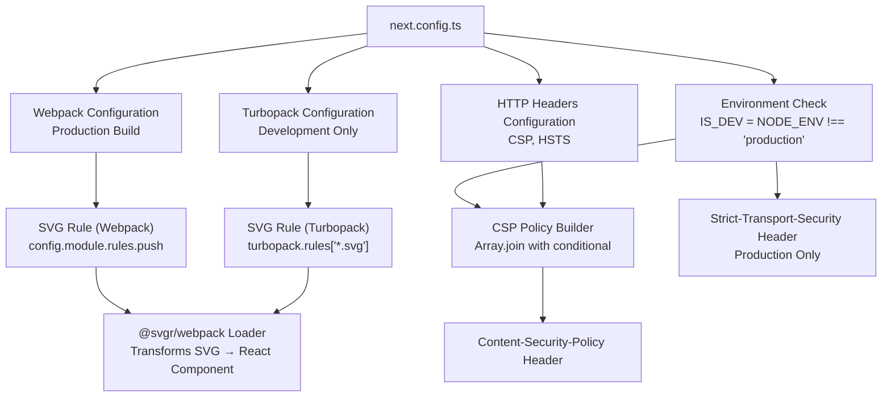
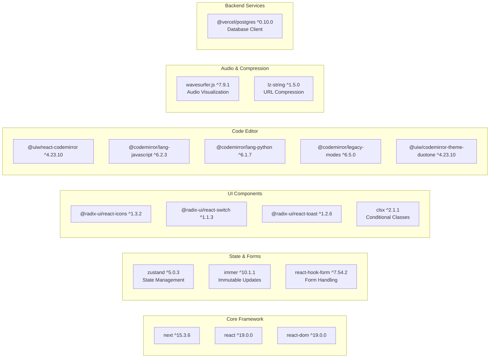
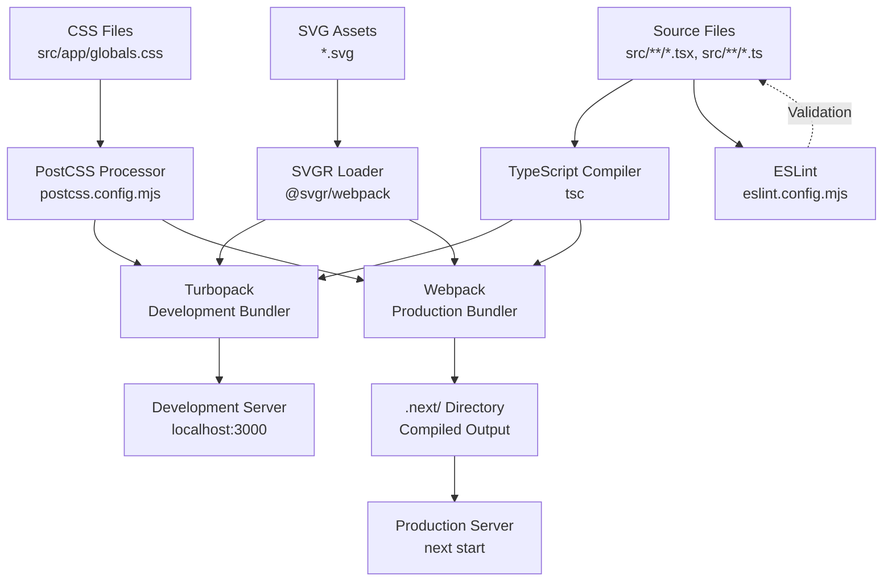

<!-- source: DeepWiki mcp.deepwiki.com · repo openai/openai-fm · page 4 Development Guide · fetched 2026-10-26 -->

# Development Guide

<details>
<summary>Relevant source files</summary>

The following files were used as context for generating this wiki page:

- [next.config.ts](next.config.ts)
- [package.json](package.json)

</details>


## Purpose and Scope

This document provides a comprehensive guide for developers working on the OpenAI.fm codebase. It covers the development toolchain, build process, configuration files, and workflows needed to develop, test, and deploy the application. For initial setup instructions, see [Getting Started](#2). For architecture and component details, see [System Architecture](#3). For security configuration specifics, see [Security Considerations](#5).

---

## Development Workflow and Scripts

The primary development interface is through npm scripts defined in [package.json:5-10](). These scripts control the development server, production builds, and code quality checks.

### Available Scripts

| Script | Command | Purpose |
|--------|---------|---------|
| `npm run dev` | `next dev --turbopack` | Starts development server with Turbopack bundler |
| `npm run build` | `next build` | Creates optimized production build |
| `npm run start` | `next start` | Runs production build locally |
| `npm run lint` | `next lint` | Executes ESLint validation |

### Development Server

The development server uses Turbopack, Next.js's high-performance bundler. The `--turbopack` flag in [package.json:6]() enables this experimental feature, which provides faster hot module replacement (HMR) and reduced startup times compared to Webpack.

```bash
npm run dev
```

This command:
- Starts the Next.js development server on `http://localhost:3000`
- Enables hot module replacement for instant updates
- Uses Turbopack for faster builds during development
- Loads environment variables from `.env.local`

### Production Build

The production build process optimizes the application for deployment:

```bash
npm run build
npm run start
```

The build process:
- Compiles TypeScript to JavaScript
- Bundles and minifies code using Webpack
- Optimizes static assets
- Generates optimized production pages in `.next/`
- Applies production-specific security headers (HSTS)

**Sources:** [package.json:5-10]()

---

## Build Configuration Architecture

The build system is configured through [next.config.ts](), which controls both development (Turbopack) and production (Webpack) bundling behavior.

### Build Configuration Flow



**Diagram: Build Configuration Structure** - Shows how [next.config.ts]() configures different aspects of the build system including bundlers, asset loaders, and security headers.

**Sources:** [next.config.ts:1-58]()

---

## Build System Components

### Environment Detection

The configuration uses an environment check to differentiate between development and production builds:

```typescript
const IS_DEV = process.env.NODE_ENV !== "production";
```

This constant [next.config.ts:3]() controls:
- Whether to apply HSTS headers (production only)
- Whether to enforce HTTPS upgrades in CSP (production only)

### Turbopack Configuration

Turbopack rules are defined for development builds [next.config.ts:19-26]():

| Property | Value | Purpose |
|----------|-------|---------|
| `rules["*.svg"]` | `{loaders: ["@svgr/webpack"], as: "*.js"}` | Transforms SVG files to React components |
| `devIndicators` | `false` | Disables Next.js development indicators |

The SVG rule configuration enables importing SVG files as React components:

```typescript
import Logo from './logo.svg'; // Becomes a React component
```

### Webpack Configuration

For production builds, Webpack is configured through the `webpack` function [next.config.ts:30-37]():

```typescript
webpack(config) {
  config.module.rules.push({
    test: /\.svg$/i,
    issuer: /\.[jt]sx?$/,
    use: ["@svgr/webpack"],
  });
  return config;
}
```

This ensures consistent SVG handling between development (Turbopack) and production (Webpack) builds.

**Sources:** [next.config.ts:19-37]()

---

## Security Headers Configuration

Security headers are applied to all routes through the `headers` async function [next.config.ts:38-54]().

### Content Security Policy (CSP)

The CSP is built as an array and joined into a header string [next.config.ts:5-16]():

```typescript
const CSP = [
  "default-src 'self';",
  "script-src 'self' 'unsafe-eval' 'unsafe-inline' ;",
  "connect-src 'self';",
  "style-src 'self' 'unsafe-inline';",
  "img-src 'self'",
  "object-src 'none';",
  "frame-ancestors 'none';",
  IS_DEV ? null : "upgrade-insecure-requests;",
].filter(Boolean).join(" ");
```

| Directive | Value | Purpose |
|-----------|-------|---------|
| `default-src` | `'self'` | Only load resources from same origin |
| `script-src` | `'self' 'unsafe-eval' 'unsafe-inline'` | Allow scripts from same origin; `unsafe-eval` needed for development |
| `connect-src` | `'self'` | Restrict API calls to same origin |
| `style-src` | `'self' 'unsafe-inline'` | Allow styles from same origin and inline styles |
| `img-src` | `'self'` | Only load images from same origin |
| `object-src` | `'none'` | Disallow plugins (Flash, etc.) |
| `frame-ancestors` | `'none'` | Prevent clickjacking (no iframe embedding) |
| `upgrade-insecure-requests` | (production only) | Upgrade HTTP to HTTPS |

### HTTP Strict Transport Security (HSTS)

In production, HSTS is enforced [next.config.ts:46-51]():

```typescript
if (!IS_DEV) {
  headers.push({
    key: "Strict-Transport-Security",
    value: "max-age=31536000; includeSubDomains; preload",
  });
}
```

This header:
- Forces HTTPS for 1 year (`max-age=31536000`)
- Applies to all subdomains (`includeSubDomains`)
- Allows preloading in browser HSTS lists (`preload`)

**Sources:** [next.config.ts:5-54]()

---

## Dependency Management

Dependencies are managed through npm and locked in [package-lock.json](). The project uses two categories of dependencies defined in [package.json]().

### Production Dependencies



**Diagram: Production Dependencies Structure** - Maps the major dependency groups and their roles in the application.

### Development Dependencies

| Package | Version | Purpose |
|---------|---------|---------|
| `typescript` | `^5` | TypeScript compiler |
| `eslint` | `^9` | Code linting |
| `eslint-config-next` | `15.2.2` | Next.js-specific ESLint rules |
| `@eslint/eslintrc` | `^3` | ESLint legacy config support |
| `tailwindcss` | `^4` | Utility-first CSS framework |
| `@tailwindcss/postcss` | `^4` | PostCSS plugin for Tailwind |
| `@types/node` | `^20` | Node.js type definitions |
| `@types/react` | `^19` | React type definitions |
| `@types/react-dom` | `^19` | React DOM type definitions |

### Dependency Installation

To install dependencies:

```bash
npm install
```

This command:
- Reads [package.json:11-42]()
- Installs exact versions from [package-lock.json]()
- Creates/updates `node_modules/` directory
- Verifies package integrity

**Sources:** [package.json:11-42]()

---

## Development Toolchain Integration

### Complete Development Pipeline



**Diagram: Development Toolchain Flow** - Shows how source files are processed through various tools to produce development and production outputs.

**Sources:** [package.json:5-10](), [next.config.ts:19-37]()

---

## Development vs Production Differences

### Configuration Variations

| Aspect | Development | Production |
|--------|-------------|------------|
| Bundler | Turbopack (via `--turbopack` flag) | Webpack |
| CSP | No `upgrade-insecure-requests` | Includes `upgrade-insecure-requests` |
| HSTS | Not applied | Applied with 1-year max-age |
| Minification | Disabled for faster rebuilds | Enabled for smaller bundles |
| Source Maps | Enabled for debugging | Disabled or limited |
| Hot Reload | Enabled (HMR) | Not applicable |
| Environment | `NODE_ENV=development` | `NODE_ENV=production` |

### Environment Variable Behavior

The `IS_DEV` constant [next.config.ts:3]() controls conditional configuration:

```typescript
const IS_DEV = process.env.NODE_ENV !== "production";
```

This affects:
1. **CSP Header** [next.config.ts:13](): `upgrade-insecure-requests` directive is excluded in development
2. **HSTS Header** [next.config.ts:46-51](): Only applied in production

### Bundle Optimization

Production builds apply several optimizations not present in development:

- **Code Splitting**: Automatic splitting of JavaScript bundles
- **Tree Shaking**: Removal of unused exports
- **Minification**: Compression of JavaScript and CSS
- **Image Optimization**: Automatic image format conversion and resizing
- **Font Optimization**: Automatic font file optimization

**Sources:** [next.config.ts:3-54](), [package.json:6-8]()

---

## SVG Asset Handling

The project uses `@svgr/webpack` to transform SVG files into React components, configured identically for both Turbopack and Webpack.

### Turbopack SVG Configuration

[next.config.ts:19-26]() defines the Turbopack rule:

```typescript
turbopack: {
  rules: {
    "*.svg": {
      loaders: ["@svgr/webpack"],
      as: "*.js",
    },
  },
}
```

### Webpack SVG Configuration

[next.config.ts:30-37]() mirrors the Turbopack configuration:

```typescript
webpack(config) {
  config.module.rules.push({
    test: /\.svg$/i,
    issuer: /\.[jt]sx?$/,
    use: ["@svgr/webpack"],
  });
  return config;
}
```

### Usage Pattern

SVG files can be imported as React components:

```typescript
import IconName from './path/to/icon.svg';

// Use as component
<IconName className="w-6 h-6" />
```

The type definitions for SVG imports are provided in `global.d.ts` (see [Type Definitions](#4.4)).

**Sources:** [next.config.ts:19-37]()

---

## Code Quality and Validation

### ESLint Integration

ESLint is configured through `eslint.config.mjs` and executed via the npm script:

```bash
npm run lint
```

The configuration includes:
- Next.js-specific rules from `eslint-config-next`
- Flat config format support via `@eslint/eslintrc`
- TypeScript-aware linting

### Type Checking

TypeScript is configured through `tsconfig.json` (inferred from project structure). Type checking occurs:
- Automatically during development in IDEs
- During build process via `next build`
- Can be run manually: `npx tsc --noEmit`

### Pre-deployment Checklist

Before deploying changes:

1. **Lint validation**: `npm run lint`
2. **Type checking**: Ensure no TypeScript errors
3. **Build test**: `npm run build` succeeds
4. **Production test**: `npm run start` and manual testing

**Sources:** [package.json:9](), [next.config.ts:38-54]()

---

## Build Output Structure

The build process generates the `.next/` directory with the following structure:

```
.next/
├── cache/              # Build cache for faster rebuilds
├── server/             # Server-side code
│   ├── app/           # App router pages and API routes
│   └── chunks/        # Shared server chunks
├── static/            # Static assets with content hashes
│   ├── chunks/        # JavaScript chunks
│   └── css/           # Compiled CSS files
└── types/             # Generated TypeScript types
```

This output:
- Is generated by `npm run build`
- Should be excluded from version control (see [Version Control](#4.5))
- Is served by `npm run start`
- Is automatically deployed on Vercel platform

**Sources:** [next.config.ts:18-57]()

---

## Related Documentation

- For linting configuration details, see [Code Style and Linting](#4.1)
- For build process internals, see [Build Process](#4.2)
- For styling system configuration, see [Styling System](#4.3)
- For TypeScript type definitions, see [Type Definitions](#4.4)
- For version control practices, see [Version Control](#4.5)
- For deployment procedures, see [Getting Started](#2)
- For security header implementation, see [Security Considerations](#5)

---

