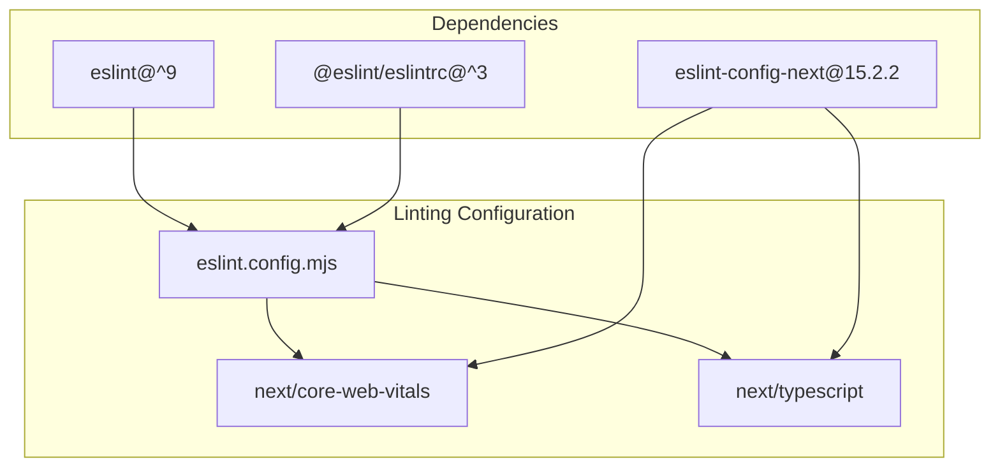
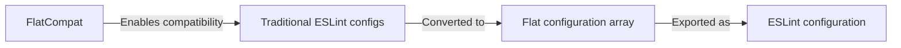
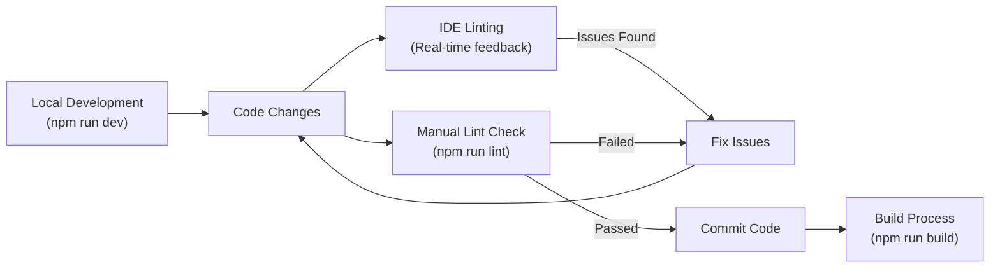
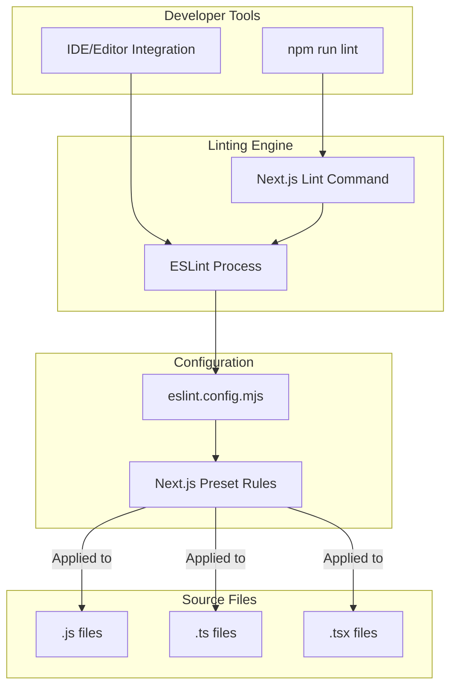
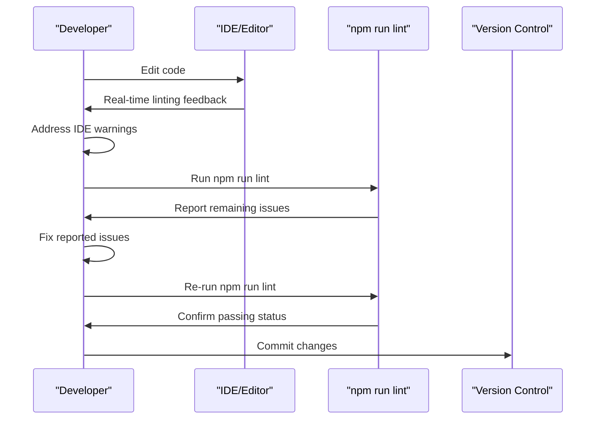

<!-- source: DeepWiki mcp.deepwiki.com · repo openai/openai-fm · page 4.1 Code Style and Linting · fetched 2026-10-26 -->

# Code Style and Linting

<details>
<summary>Relevant source files</summary>

The following files were used as context for generating this wiki page:

- [eslint.config.mjs](eslint.config.mjs)

</details>


This document details the code style guidelines and linting configuration used in the OpenAI.fm project. It covers the ESLint setup, configuration approach, and workflow for enforcing code quality standards throughout the codebase. For information about the build process that incorporates these linting checks, see [Build Process](#4.2).

## Overview

The OpenAI.fm project enforces code style and quality through a combination of ESLint and TypeScript type checking. The configuration is designed to align with Next.js best practices, ensuring consistency and preventing common errors before they reach production.

## ESLint Configuration

The project uses ESLint with the new flat configuration format, which is defined in the root directory.



Sources: [eslint.config.mjs](), [package.json:32-41]()

### Configuration Details

The ESLint configuration extends two preset configurations from the Next.js ecosystem:

1. `next/core-web-vitals`: Includes rules optimized for Next.js applications with a focus on Core Web Vitals performance metrics
2. `next/typescript`: Provides TypeScript-specific linting rules

The configuration file uses the `@eslint/eslintrc` compatibility layer to incorporate these traditional configurations into the modern flat config system:



Sources: [eslint.config.mjs:1-16]()

## Running Linting Checks

Developers can verify code quality by running the following command:

```
npm run lint
```

This command runs Next.js's built-in linting command, which checks all JavaScript and TypeScript files in the project according to the configuration.

Sources: [package.json:9]()

## TypeScript Integration

The project uses TypeScript throughout the codebase. The linting system works in conjunction with TypeScript to provide comprehensive code quality checks:

1. ESLint handles code style, common errors, and TypeScript-specific issues through the Next.js presets
2. TypeScript's compiler performs static type checking

The project is configured to ignore TypeScript build artifacts (`*.tsbuildinfo` and `next-env.d.ts`) in version control.

Sources: [package.json:35-41](), [.gitignore:40-42]()

## Linting in Development Workflow

The following diagram illustrates how linting integrates into the development workflow:



Sources: [package.json:5-10]()

## Linting Architecture

The linting system architecture consists of several interconnected components:



Sources: [eslint.config.mjs](), [package.json:5-10]()

## Code Style Guidelines

The project follows Next.js and React best practices through the extended configurations. While there are no custom rules defined beyond the Next.js presets, the following style guidelines are enforced:

| Category | Guidelines |
|----------|------------|
| **JavaScript/TypeScript** | ES6+ syntax, TypeScript type safety |
| **React Components** | Function components with hooks, proper prop typing |
| **Imports/Exports** | Proper module imports, no unused imports |
| **Performance** | Following Core Web Vitals best practices |
| **Accessibility** | React accessibility guidelines via Next.js rules |

Sources: [eslint.config.mjs:12-14]()

## Best Practices for Developers

To maintain code quality when working on the OpenAI.fm codebase:

1. **Configure your IDE** with ESLint integration for real-time feedback
2. **Run linting before commits** using `npm run lint`
3. **Address all linting warnings** as well as errors
4. **Verify TypeScript types** are correctly defined for all code

Sources: [package.json:9]()

## Example Linting Workflow

A typical workflow for a developer adding new features to the codebase:



Sources: [package.json:5-10]()

By adhering to these standards and utilizing the linting tools, the OpenAI.fm team maintains code quality and consistency throughout the project.

---

