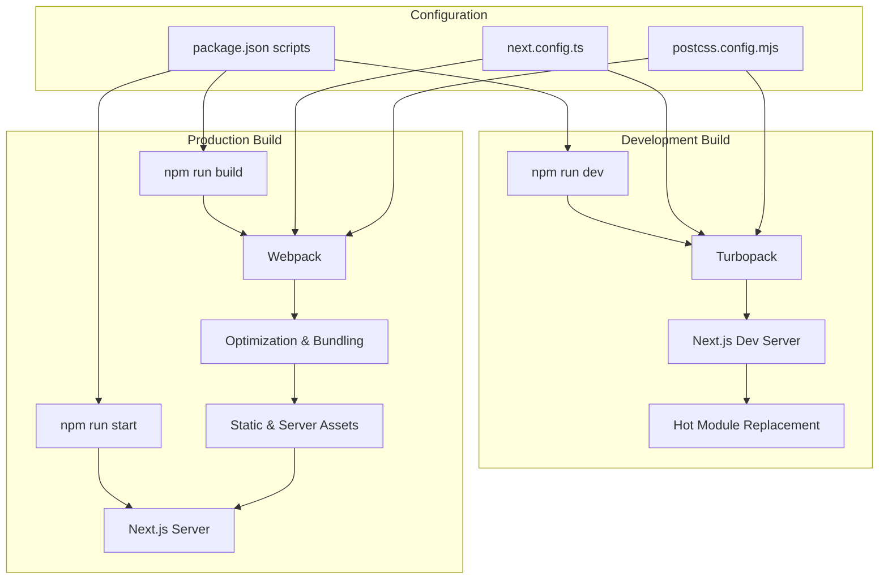
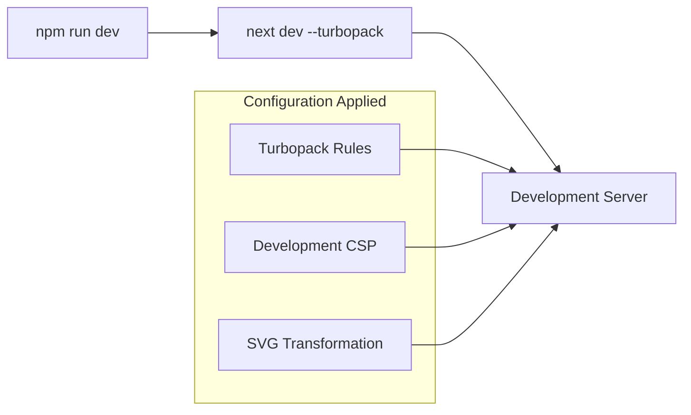
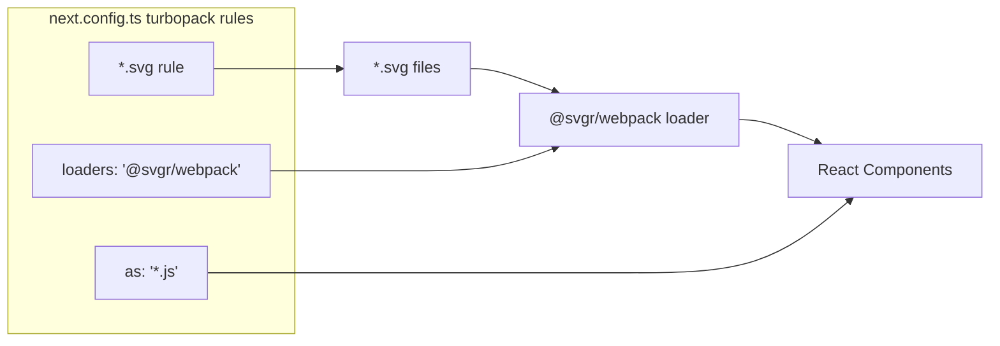
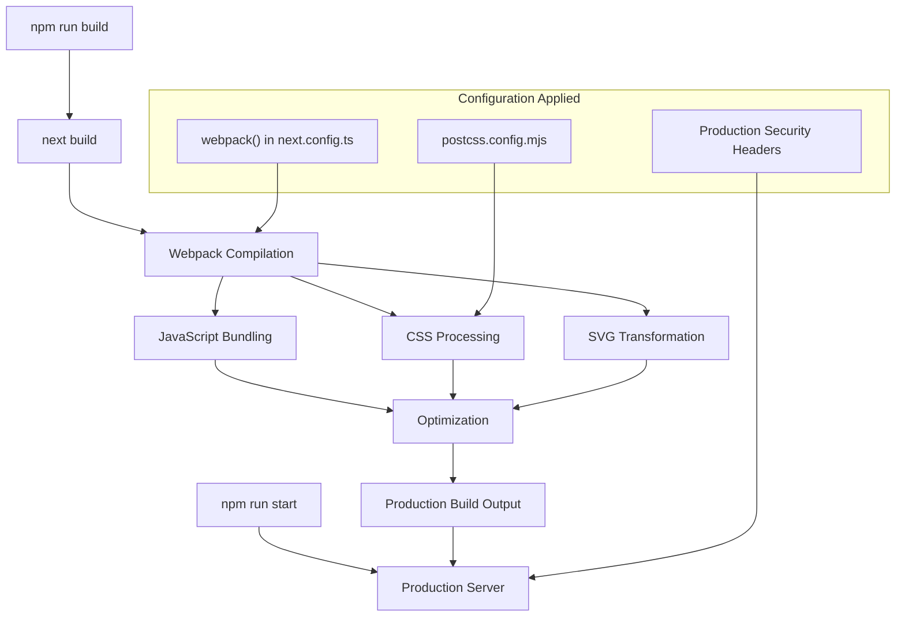
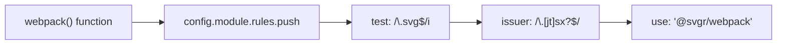
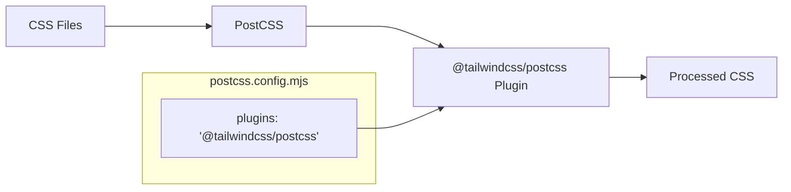
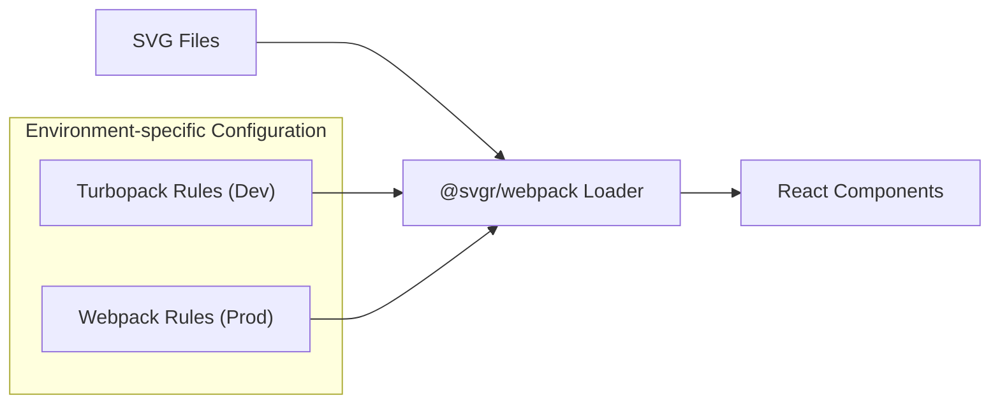
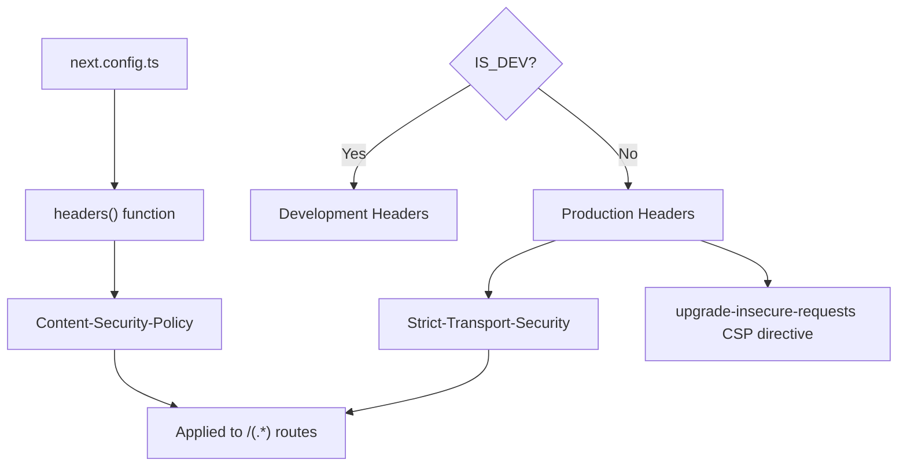
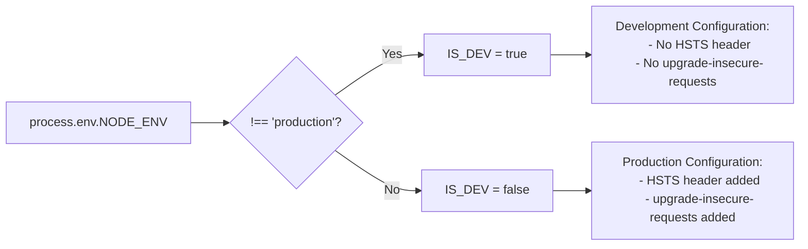

<!-- source: DeepWiki mcp.deepwiki.com · repo openai/openai-fm · page 4.2 Build Process · fetched 2026-10-26 -->

# Build Process

<details>
<summary>Relevant source files</summary>

The following files were used as context for generating this wiki page:

- [next.config.ts](next.config.ts)
- [package.json](package.json)
- [postcss.config.mjs](postcss.config.mjs)

</details>


This document details the build process for OpenAI.fm, explaining how the application is configured, built, and deployed in both development and production environments. It covers Next.js configuration, Turbopack integration, CSS processing, and asset handling. For information about code style and linting practices, see [Code Style and Linting](#4.1).

## Build System Overview

The OpenAI.fm application uses Next.js as its core framework with different build tools for development and production environments. Development builds leverage Turbopack for faster refresh times, while production builds use Webpack for optimization.



Sources: [package.json:5-10](), [next.config.ts:18-37]()

## Build Scripts

The application defines the following build-related scripts in package.json:

| Script | Command | Purpose |
|--------|---------|---------|
| `dev` | `next dev --turbopack` | Starts development server with Turbopack |
| `build` | `next build` | Creates production-optimized build |
| `start` | `next start` | Serves production build |
| `lint` | `next lint` | Runs ESLint for code quality checks |

Sources: [package.json:5-10]()

## Development Build Process

The development build is optimized for rapid iteration with hot module replacement.



Sources: [package.json:6](), [next.config.ts:19-26]()

### Turbopack Configuration

Turbopack is explicitly enabled in the development command and configured in `next.config.ts`. It includes custom rules for handling SVG files:



Sources: [next.config.ts:19-26]()

## Production Build Process

The production build process creates optimized assets for deployment.



Sources: [package.json:7-8](), [next.config.ts:30-37](), [next.config.ts:38-54]()

### Webpack Configuration

For production builds, webpack is configured to handle SVG files similarly to Turbopack:



Sources: [next.config.ts:30-37]()

## CSS Processing

CSS processing is handled through PostCSS with Tailwind CSS integration.



Sources: [postcss.config.mjs:1-5]()

## SVG Processing

SVG files are processed consistently in both development and production environments to transform them into React components.



Sources: [next.config.ts:19-26](), [next.config.ts:30-37]()

## Security Headers Configuration

Security headers are configured as part of the build process and differ between development and production environments.



Sources: [next.config.ts:5-16](), [next.config.ts:38-54]()

### Content Security Policy

A Content Security Policy is defined to enhance security by restricting which resources can be loaded:

```
default-src 'self';
script-src 'self' 'unsafe-eval' 'unsafe-inline';
connect-src 'self';
style-src 'self' 'unsafe-inline';
img-src 'self';
object-src 'none';
frame-ancestors 'none';
```

In production, an additional `upgrade-insecure-requests` directive is added.

Sources: [next.config.ts:5-16]()

## Environment-Based Configuration

The build process detects the environment to apply different configurations:



Sources: [next.config.ts:3](), [next.config.ts:13](), [next.config.ts:46-51]()

## Build Configuration Files

The build process is controlled by several configuration files:

| File | Purpose |
|------|---------|
| `next.config.ts` | Configures Next.js, Turbopack, Webpack, and security headers |
| `postcss.config.mjs` | Configures CSS processing with Tailwind CSS |
| `package.json` | Defines build scripts and dependencies |

Sources: [next.config.ts](), [postcss.config.mjs](), [package.json]()

## Developer Experience Features

The build system includes features to enhance developer experience:

1. Development indicators are disabled (`devIndicators: false`) to provide a cleaner interface during development
2. Turbopack is used for faster refresh times in development
3. Hot Module Replacement for immediate feedback during development

Sources: [next.config.ts:27](), [package.json:6]()

---

