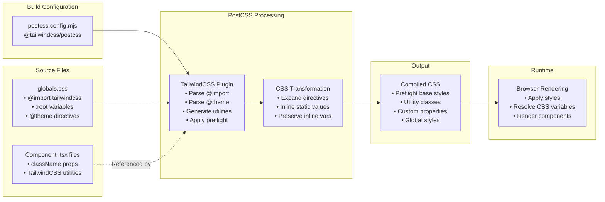
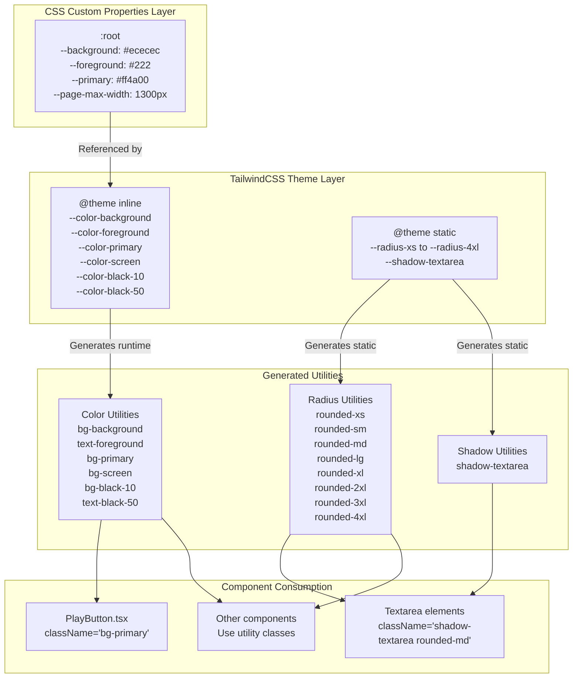
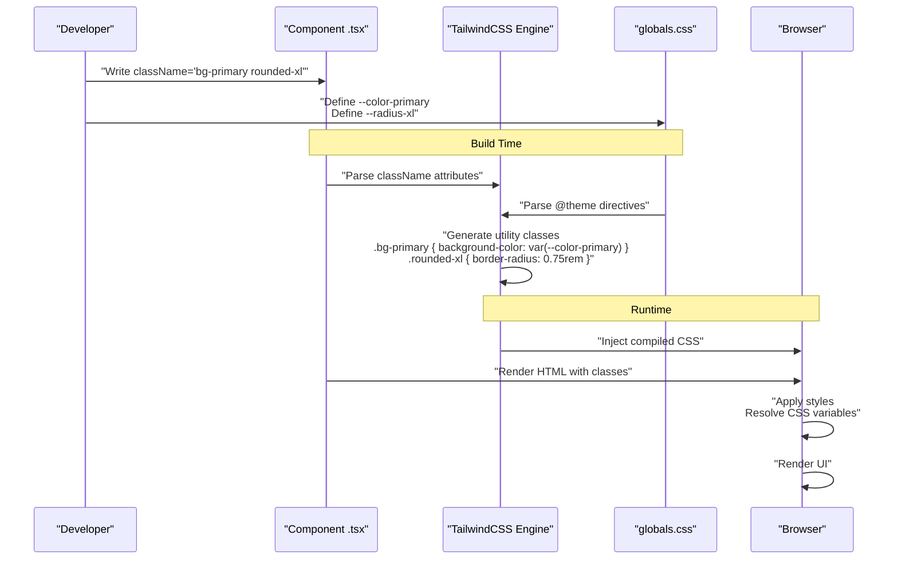

<!-- source: DeepWiki mcp.deepwiki.com · repo openai/openai-fm · page 4.3 Styling System · fetched 2026-10-26 -->

# Styling System

<details>
<summary>Relevant source files</summary>

The following files were used as context for generating this wiki page:

- [postcss.config.mjs](postcss.config.mjs)
- [src/app/globals.css](src/app/globals.css)

</details>


## Purpose and Scope

This document describes the styling architecture for OpenAI.fm, which uses TailwindCSS integrated through PostCSS. The system defines a custom theming layer using CSS custom properties and TailwindCSS's `@theme` directive. This page covers the configuration, CSS variable system, global styles, and the build-time processing pipeline.

For information about the build process that compiles these styles, see [Build Process](#4.2). For the overall component architecture that consumes these styles, see [Frontend Components](#3.2).

---

## PostCSS Configuration

The styling system is configured through [postcss.config.mjs:1-5](), which defines a minimal PostCSS pipeline with a single plugin:

```javascript
plugins: ["@tailwindcss/postcss"]
```

This plugin handles the new TailwindCSS v4 CSS-first configuration approach, where TailwindCSS directives are written directly in CSS files rather than in a separate JavaScript configuration file. The PostCSS processor transforms the TailwindCSS-specific syntax (such as `@import "tailwindcss"` and `@theme`) into standard CSS.

**Sources:** [postcss.config.mjs:1-5]()

---

## TailwindCSS Integration

### Import Directive

The entry point for TailwindCSS is at the top of [src/app/globals.css:1]():

```css
@import "tailwindcss";
```

This single directive imports the entire TailwindCSS framework, including all utility classes, the preflight base styles, and the theme system. During the build process, PostCSS expands this import into the complete TailwindCSS stylesheet.

**Sources:** [src/app/globals.css:1]()

---

## CSS Custom Properties and Theming

The styling system defines two categories of CSS custom properties: **root-level variables** for semantic color values and **TailwindCSS theme variables** for exposing values to the utility class system.

### Root Variables

Root-level CSS custom properties are defined in [src/app/globals.css:3-8]():

| Variable | Value | Purpose |
|----------|-------|---------|
| `--background` | `#ececec` | Primary background color |
| `--foreground` | `#222` | Primary text color |
| `--primary` | `#ff4a00` | Brand accent color |
| `--page-max-width` | `1300px` | Maximum page width constraint |

These variables establish the semantic color palette and layout constraints. They are referenced by TailwindCSS theme variables and can also be used directly in component styles.

### Theme Variables - Inline

The `@theme inline` directive in [src/app/globals.css:10-17]() defines color tokens that are exposed to TailwindCSS utilities as CSS custom properties:

| Theme Variable | Value | Generated Utilities |
|----------------|-------|---------------------|
| `--color-background` | `var(--background)` | `bg-background`, `text-background` |
| `--color-foreground` | `var(--foreground)` | `bg-foreground`, `text-foreground` |
| `--color-primary` | `var(--primary)` | `bg-primary`, `text-primary` |
| `--color-screen` | `#f3f3f3` | `bg-screen`, `text-screen` |
| `--color-black-10` | `rgba(0, 0, 0, 0.1)` | `bg-black-10`, `text-black-10` |
| `--color-black-50` | `rgba(0, 0, 0, 0.5)` | `bg-black-50`, `text-black-50` |

The `inline` keyword indicates these values are kept as CSS custom properties in the generated output, allowing for dynamic runtime changes.

### Theme Variables - Static

The `@theme static` directive in [src/app/globals.css:19-31]() defines design tokens that are compiled into static values:

**Border Radius Scale:**
| Variable | Value |
|----------|-------|
| `--radius-xs` | `0.125rem` (2px) |
| `--radius-sm` | `0.25rem` (4px) |
| `--radius-md` | `0.375rem` (6px) |
| `--radius-lg` | `0.5rem` (8px) |
| `--radius-xl` | `0.75rem` (12px) |
| `--radius-2xl` | `1rem` (16px) |
| `--radius-3xl` | `1.5rem` (24px) |
| `--radius-4xl` | `2rem` (32px) |

**Shadow Definitions:**
| Variable | Value | Usage |
|----------|-------|-------|
| `--shadow-textarea` | Inset multi-layer shadow | Textarea input styling |

The `static` keyword indicates these values are inlined directly into utility classes at build time, resulting in smaller CSS bundles and better performance.

**Sources:** [src/app/globals.css:3-31]()

---

## Style Processing Pipeline



**Process Flow:**

1. **Source Parsing**: PostCSS reads [src/app/globals.css:1-56]() and detects the `@import "tailwindcss"` directive
2. **Plugin Execution**: The `@tailwindcss/postcss` plugin processes the TailwindCSS directives
3. **Theme Processing**: 
   - `@theme inline` variables are preserved as CSS custom properties
   - `@theme static` variables are compiled into static utility classes
4. **Utility Generation**: TailwindCSS generates utility classes based on theme values (e.g., `bg-primary`, `rounded-xl`)
5. **CSS Output**: The compiled CSS is injected into the application

**Sources:** [postcss.config.mjs:1-5](), [src/app/globals.css:1-31]()

---

## Global Base Styles

### Typography Configuration

The base HTML font configuration is defined in [src/app/globals.css:33-36]():

```css
html {
  font-size: 14px;
  line-height: 130%;
}
```

This establishes a **14px base font size** (smaller than the browser default of 16px) and a tight **130% line height** for compact text rendering. All `rem` units throughout the application are relative to this 14px base.

### Body Styling with Responsive Variants

The body element styling in [src/app/globals.css:38-50]() demonstrates TailwindCSS's `@variant` directive for responsive design:

```css
body {
  background-color: var(--background);
  color: var(--foreground);

  @variant sm {
    background-image: linear-gradient(
      to bottom right,
      #f8f8f8,
      var(--background) 20%
    );
    background-repeat: no-repeat;
  }
}
```

**Default (Mobile)**: Solid background color using `--background`

**Small screens and above**: Gradient background from `#f8f8f8` to `var(--background)` at 20%, creating a subtle diagonal fade effect

The `@variant sm` directive is TailwindCSS v4's syntax for applying styles at the `sm` breakpoint and above, equivalent to a `min-width` media query.

### SVG Normalization

[src/app/globals.css:52-55]() applies global SVG normalization:

```css
svg {
  display: block;
  flex-shrink: 0;
}
```

This ensures SVG elements:
- Render as block elements (avoiding inline spacing issues)
- Do not shrink in flex containers (`flex-shrink: 0`)

**Sources:** [src/app/globals.css:33-55]()

---

## Theme Architecture Diagram



This diagram illustrates the three-layer theming architecture:

1. **CSS Custom Properties**: Root-level semantic variables
2. **TailwindCSS Theme Layer**: `@theme` directives that map to utility classes
3. **Generated Utilities**: The actual CSS classes consumed by components

The `inline` theme variables maintain the CSS custom property chain (allowing runtime theming), while `static` theme variables compile to fixed values (optimizing bundle size).

**Sources:** [src/app/globals.css:3-31]()

---

## Component Styling Workflow



**Workflow Steps:**

1. **Development**: Developer writes React components with `className` props using TailwindCSS utility classes
2. **Build Time**:
   - TailwindCSS scans all `.tsx` files for class usage
   - Processes `@theme` directives in [src/app/globals.css:10-31]()
   - Generates only the utility classes that are actually used (tree-shaking)
3. **Runtime**:
   - Browser loads the compiled CSS
   - Inline theme variables (like `--color-primary`) are resolved at runtime
   - Static theme values (like border radius) are already compiled into the CSS

**Sources:** [src/app/globals.css:1-56](), [postcss.config.mjs:1-5]()

---

## Styling System Integration Points

### Root Layout

The global stylesheet is imported in the root layout at [src/app/layout.tsx]() (referenced in Diagram 4), making all styles available throughout the application.

### Component Usage

Components throughout the codebase use TailwindCSS utilities. For example:
- **PlayButton**: Uses `bg-primary` for brand-colored buttons
- **ShareButton**: Uses radius utilities like `rounded-xl`
- **Input elements**: Use `shadow-textarea` for inset shadow effects

The styling system provides a **utility-first** approach where components compose styles from pre-generated classes rather than writing custom CSS.

### Responsive Design

The system supports TailwindCSS's responsive modifier syntax. The `@variant sm` in [src/app/globals.css:42-49]() demonstrates how breakpoint-specific styles are applied using the new v4 syntax.

**Sources:** [src/app/globals.css:1-56]()

---

## Key Design Decisions

### TailwindCSS v4 CSS-First Approach

The system uses TailwindCSS v4's new CSS-first configuration, where theme customization happens in CSS files using `@theme` directives rather than in a JavaScript configuration file. This approach:
- Reduces build complexity (no separate `tailwind.config.js`)
- Leverages native CSS custom properties
- Improves IDE autocomplete and type safety

### Inline vs Static Theme Values

The system strategically separates theme values:
- **Inline** (`@theme inline`): Color values that may need runtime theming
- **Static** (`@theme static`): Fixed design tokens (spacing, shadows) for better performance

### Minimal PostCSS Configuration

[postcss.config.mjs:1-5]() defines only a single plugin, keeping the build pipeline simple and reducing configuration overhead.

**Sources:** [postcss.config.mjs:1-5](), [src/app/globals.css:10-31]()

---

## Summary

The OpenAI.fm styling system is built on:

1. **TailwindCSS v4** integrated via [postcss.config.mjs:1-5]()
2. **CSS Custom Properties** for theming defined in [src/app/globals.css:3-8]()
3. **`@theme` Directives** for generating utility classes from [src/app/globals.css:10-31]()
4. **Global Base Styles** for typography and layout from [src/app/globals.css:33-55]()
5. **Utility-First Component Styling** where components compose pre-generated classes

This architecture provides a maintainable, performant styling system with clear separation between semantic design tokens and generated utility classes.

**Sources:** [postcss.config.mjs:1-5](), [src/app/globals.css:1-56]()

---

