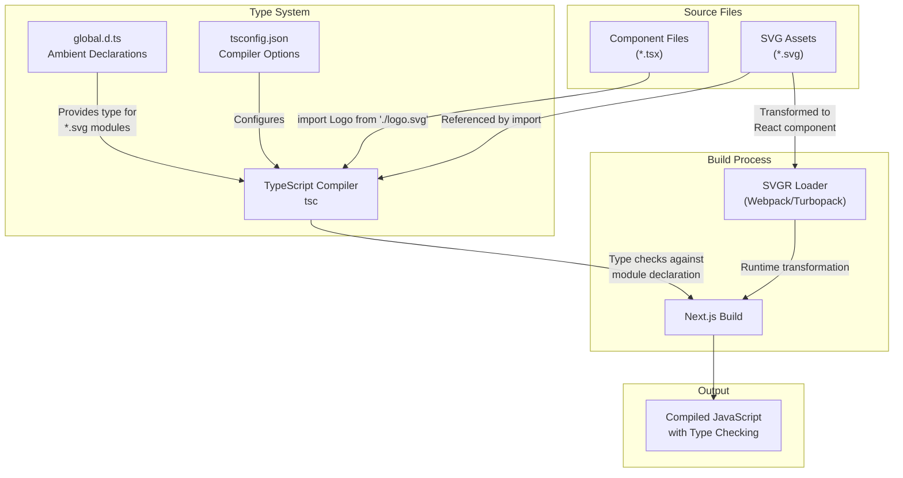
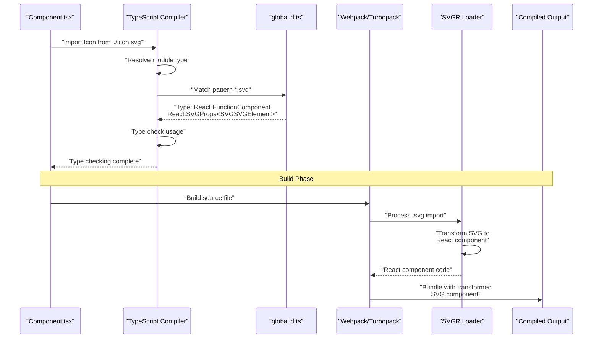
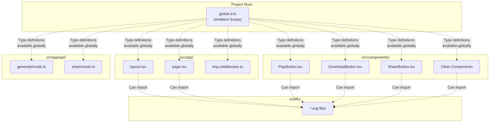
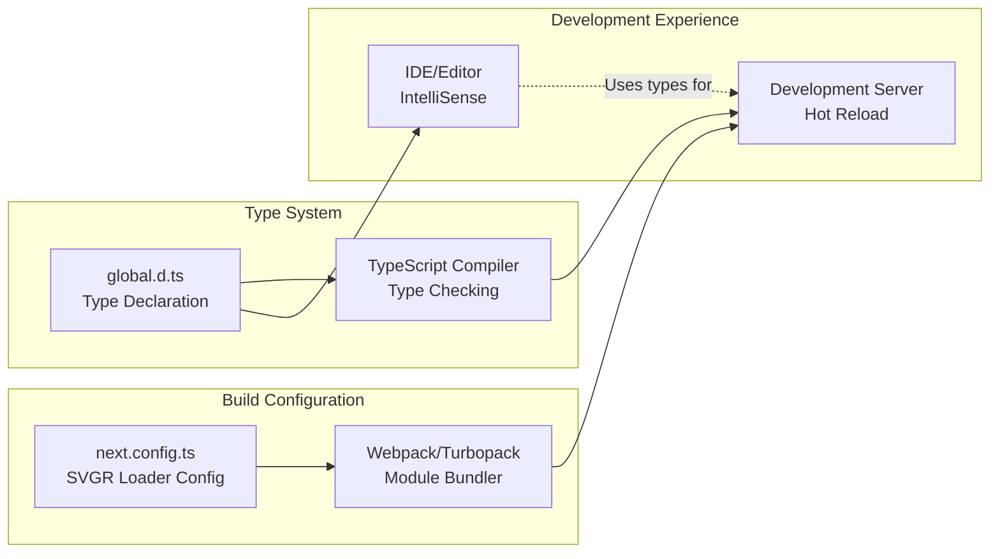

<!-- source: DeepWiki mcp.deepwiki.com · repo openai/openai-fm · page 4.4 Type Definitions · fetched 2026-10-26 -->

# Type Definitions

<details>
<summary>Relevant source files</summary>

The following files were used as context for generating this wiki page:

- [global.d.ts](global.d.ts)

</details>


## Purpose and Scope

This page documents the custom TypeScript type definitions used in the OpenAI.fm project. These definitions extend TypeScript's type system to support project-specific module imports, particularly SVG files imported as React components through the SVGR loader. The type definitions enable compile-time type checking for assets that are transformed during the build process.

For general TypeScript configuration and compiler settings, see [Build Process](#4.2). For information about how these types are used in React components, see [Frontend Components](#3.2).

**Sources:** [global.d.ts:1-6]()

---

## Overview

The project uses a single custom type definition file (`global.d.ts`) located at the project root. This file provides ambient module declarations that extend TypeScript's module resolution capabilities beyond standard `.ts` and `.tsx` files.

The type definitions serve two critical functions:
1. **Enable SVG imports as React components** - Allows TypeScript to recognize `.svg` files imported via SVGR loader
2. **Provide type safety for build-time transformations** - Ensures type checking for modules transformed by Webpack loaders

**Sources:** [global.d.ts:1-6]()

---

## Type Definition Architecture

The following diagram illustrates how custom type definitions integrate with the TypeScript compilation process:



**Sources:** [global.d.ts:1-6](), [next.config.ts]()

---

## SVG Module Declaration

The primary type definition in the project declares SVG files as importable modules that export React components.

### Declaration Structure

The complete SVG module declaration is defined in [global.d.ts:1-5]():

```typescript
declare module "*.svg" {
  import * as React from "react";
  const ReactComponent: React.FunctionComponent<React.SVGProps<SVGSVGElement>>;
  export default ReactComponent;
}
```

### Type Components

| Component | Purpose | Type |
|-----------|---------|------|
| `declare module` | Creates ambient module declaration for pattern-matched imports | TypeScript keyword |
| `"*.svg"` | Wildcard pattern matching all `.svg` file imports | Module pattern |
| `ReactComponent` | Named constant representing the transformed component | `React.FunctionComponent` |
| `React.SVGProps<SVGSVGElement>` | Props interface for SVG elements | Generic type parameter |
| `export default` | Default export from the module | Export statement |

**Sources:** [global.d.ts:1-5]()

### Type Inference

When a component imports an SVG file, TypeScript uses this declaration to infer types. For example:

```typescript
// Example import in a component
import Logo from "./logo.svg";

// TypeScript infers:
// Logo: React.FunctionComponent<React.SVGProps<SVGSVGElement>>

// Usage is type-safe:
<Logo width={24} height={24} className="icon" />
```

The `React.SVGProps<SVGSVGElement>` type ensures that only valid SVG attributes can be passed as props, providing compile-time type safety for:
- Standard HTML attributes (`id`, `className`, `style`)
- SVG-specific attributes (`width`, `height`, `viewBox`, `fill`, `stroke`)
- React event handlers (`onClick`, `onMouseEnter`, etc.)
- ARIA attributes for accessibility

**Sources:** [global.d.ts:1-5]()

---

## Integration with Build System

The SVG type declaration works in conjunction with the SVGR loader configured in the Next.js build system. The following diagram shows the module resolution flow:



**Sources:** [global.d.ts:1-5](), [next.config.ts]()

### Build Configuration

The type declaration coordinates with the SVGR loader configuration in `next.config.ts`, which transforms SVG files into React components at build time. The type definition ensures TypeScript understands this transformation will occur, preventing type errors during development.

The two-phase process:
1. **Type checking phase**: TypeScript uses `global.d.ts` to validate imports and usage
2. **Build phase**: Webpack/Turbopack uses SVGR to perform actual transformation

**Sources:** [global.d.ts:1-5](), [next.config.ts]()

---

## Ambient Declaration Scope

The following diagram illustrates the scope and visibility of ambient declarations in `global.d.ts`:



The ambient module declaration in `global.d.ts` is automatically available to all TypeScript files in the project without requiring explicit imports. This is because:

1. **Ambient declarations are global** - TypeScript automatically includes `.d.ts` files in the project root
2. **No import needed** - Types are available in all `.ts` and `.tsx` files
3. **Pattern matching** - The `*.svg` pattern applies to any SVG import path

**Sources:** [global.d.ts:1-5]()

---

## File Location and Discovery

The `global.d.ts` file is located at the project root, which ensures TypeScript automatically discovers and includes it during compilation.

### TypeScript Module Resolution

TypeScript's default configuration includes all `.d.ts` files in the project root. The compiler:
1. Scans the project root for `*.d.ts` files
2. Includes them in the global type scope
3. Uses ambient declarations for module resolution

No explicit `include` or `types` configuration in `tsconfig.json` is required for root-level `.d.ts` files.

**Sources:** [global.d.ts:1-5]()

---

## Usage Patterns

The SVG module declaration enables several usage patterns throughout the codebase.

### Direct Component Usage

SVG files can be imported and used directly as React components:

```typescript
import IconName from "@/path/to/icon.svg";

function MyComponent() {
  return <IconName className="w-6 h-6" />;
}
```

### With TypeScript Props

The type declaration ensures full type safety for SVG attributes:

```typescript
import Logo from "./logo.svg";

// TypeScript validates all props
<Logo
  width={48}              // Valid: number
  height={48}             // Valid: number
  fill="currentColor"     // Valid: string
  className="logo"        // Valid: string
  invalidProp={true}      // Error: Property does not exist
/>
```

### In Component Libraries

The type definition supports importing SVGs in shared component libraries where type safety is critical:

```typescript
import * as React from "react";
import Icon from "./shared-icon.svg";

interface ButtonProps {
  icon?: React.FunctionComponent<React.SVGProps<SVGSVGElement>>;
  label: string;
}

function Button({ icon: Icon, label }: ButtonProps) {
  return (
    <button>
      {Icon && <Icon className="button-icon" />}
      {label}
    </button>
  );
}
```

**Sources:** [global.d.ts:1-5]()

---

## Type Safety Verification

The type declaration provides compile-time safety that prevents common errors:

### Prevented Error Cases

| Error Scenario | TypeScript Behavior | Benefit |
|----------------|---------------------|---------|
| Importing non-existent SVG | Module not found error | Catches broken imports |
| Invalid SVG props | Type error on attribute | Prevents runtime errors |
| Wrong component type | Type mismatch error | Ensures correct usage |
| Missing SVG file | Build-time error | Early error detection |

### Validation Example

```typescript
// TypeScript prevents these errors at compile time:

import Icon from "./nonexistent.svg";
// Error: Cannot find module './nonexistent.svg'

<Icon invalidAttribute="value" />
// Error: Property 'invalidAttribute' does not exist

const icon: string = Icon;
// Error: Type 'FunctionComponent<SVGProps<SVGSVGElement>>' 
// is not assignable to type 'string'
```

**Sources:** [global.d.ts:1-5]()

---

## Relationship to Build System

The type definition works as part of a coordinated system with Next.js configuration:



This coordination ensures:
- **Development**: IDE provides autocomplete and type checking using `global.d.ts`
- **Type checking**: TypeScript compiler validates imports against type declarations
- **Build time**: Webpack/Turbopack transforms SVGs using SVGR loader
- **Runtime**: Transformed components match declared types exactly

**Sources:** [global.d.ts:1-5](), [next.config.ts]()

---

## Extending Type Definitions

While the current project only requires SVG module declarations, the `global.d.ts` file can be extended to support additional ambient module types.

### Potential Extensions

Additional module declarations can be added for other asset types transformed by Webpack loaders:

```typescript
// Example extensions (not in current codebase)

// Image formats
declare module "*.png" {
  const content: string;
  export default content;
}

// JSON files
declare module "*.json" {
  const value: any;
  export default value;
}

// CSS modules
declare module "*.module.css" {
  const classes: { [key: string]: string };
  export default classes;
}
```

These patterns follow the same structure as the SVG declaration but with different exported types based on how Webpack loaders transform the files.

**Sources:** [global.d.ts:1-5]()

---

## Best Practices

### Maintaining Type Definitions

When working with custom type definitions in this project:

1. **Keep declarations minimal** - Only declare types for build-time transformations
2. **Match loader behavior** - Type declarations should match actual Webpack loader output
3. **Use specific types** - Prefer `React.FunctionComponent<Props>` over `any`
4. **Document transformations** - Comment complex declarations with their purpose
5. **Avoid duplication** - Ambient declarations apply globally; don't redeclare in multiple files

### Verification Steps

To verify type definitions are working correctly:

1. Import an SVG file in a component
2. Check IDE autocomplete shows SVG props
3. Run `npm run build` to verify TypeScript compilation
4. Confirm no type errors during development

**Sources:** [global.d.ts:1-5]()

---

## Summary

The type definitions in OpenAI.fm provide essential TypeScript support for SVG imports transformed by SVGR. The single `global.d.ts` file at the project root:

- Declares `*.svg` imports as React components with type `React.FunctionComponent<React.SVGProps<SVGSVGElement>>`
- Provides compile-time type safety for SVG attributes
- Integrates seamlessly with the Next.js build system and SVGR loader
- Enables IDE features like autocomplete and type checking
- Prevents runtime errors through early compile-time validation

This minimal but crucial type definition enables type-safe usage of SVG assets throughout the application while maintaining full TypeScript compiler support and developer experience.

**Sources:** [global.d.ts:1-6]()

---

