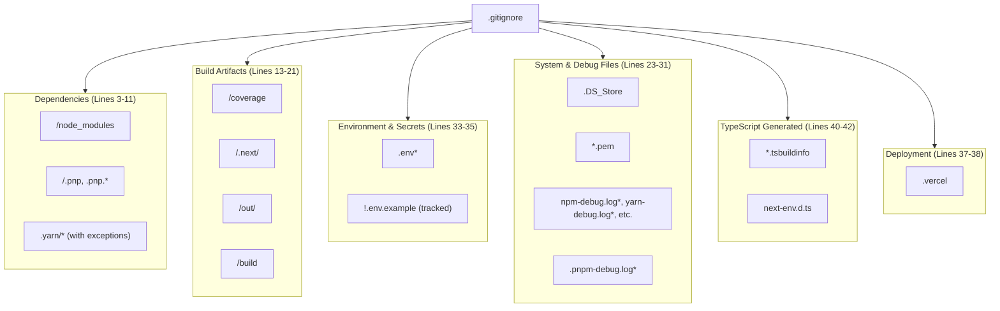
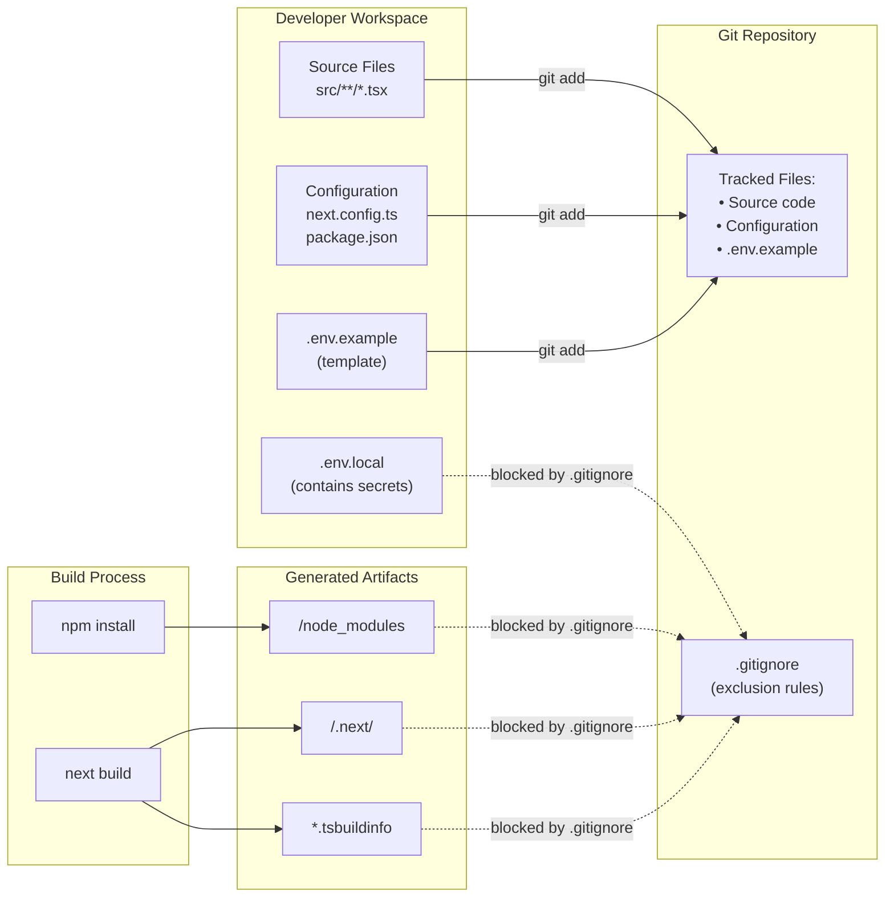

<!-- source: DeepWiki mcp.deepwiki.com · repo openai/openai-fm · page 4.5 Version Control · fetched 2026-10-26 -->

# Version Control

<details>
<summary>Relevant source files</summary>

The following files were used as context for generating this wiki page:

- [.gitignore](.gitignore)

</details>


## Purpose and Scope

This document describes version control practices and configuration for the OpenAI.fm project. It covers the `.gitignore` configuration, which determines which files and directories are excluded from Git version control, and explains the rationale behind these exclusions.

For information about environment configuration and secrets management, see [Environment Configuration](#2.2). For information about the build process and generated artifacts, see [Build Process](#4.2).

## Version Control System

OpenAI.fm uses **Git** for version control. The repository is hosted at `https://github.com/openai/openai-fm` and follows standard Git workflows for collaborative development.

**Sources:** Repository context

## Gitignore Configuration

The project's version control exclusions are defined in [.gitignore:1-43](). This file prevents sensitive data, build artifacts, dependencies, and system-specific files from being committed to the repository.

### Ignored File Categories

The following diagram illustrates the major categories of excluded files and their relationships:



**Sources:** [.gitignore:1-43]()

### Detailed Exclusion Rules

The following table documents each exclusion pattern and its purpose:

| Line(s) | Pattern | Purpose |
|---------|---------|---------|
| 4 | `/node_modules` | Excludes all npm dependencies installed via `npm install`. These are large, reproducible from `package-lock.json`, and should never be committed. |
| 5-6 | `/.pnp`, `.pnp.*` | Excludes Yarn Plug'n'Play runtime files (not used in this project, but commonly ignored). |
| 7-11 | `.yarn/*` with exceptions | Excludes Yarn cache while preserving patches, plugins, releases, and versions that should be tracked. |
| 14 | `/coverage` | Excludes test coverage reports generated during testing. |
| 17 | `/.next/` | **Critical:** Excludes Next.js build output directory. This contains compiled pages, API routes, and optimized assets generated by the build process described in [Build Process](#4.2). |
| 18 | `/out/` | Excludes static export output directory when using `next export`. |
| 21 | `/build` | Excludes alternative build directories. |
| 24 | `.DS_Store` | Excludes macOS system files that store folder metadata. |
| 25 | `*.pem` | **Security:** Excludes private key files used for SSL/TLS certificates. |
| 28-31 | `*-debug.log*`, `.pnpm-debug.log*` | Excludes debug logs from npm, yarn, and pnpm package managers. |
| 34 | `.env*` | **Security Critical:** Excludes all environment variable files that may contain secrets like `OPENAI_API_KEY` or `POSTGRES_URL`. |
| 35 | `!.env.example` | **Exception:** Tracks `.env.example` as a template showing required variables without actual secrets. See [Environment Configuration](#2.2). |
| 38 | `.vercel` | Excludes Vercel deployment configuration and cache. |
| 41 | `*.tsbuildinfo` | Excludes TypeScript incremental compilation cache files. |
| 42 | `next-env.d.ts` | Excludes Next.js auto-generated TypeScript declarations (regenerated on build). |

**Sources:** [.gitignore:1-43]()

## Version Control Workflow

The following diagram illustrates the workflow of file categorization during development:



**Sources:** [.gitignore:1-43](), [package.json](), [next.config.ts]()

## Security-Critical Exclusions

### Environment Variable Files

Lines [.gitignore:34-35]() implement a critical security pattern:

```
.env*
!.env.example
```

This pattern:
1. **Excludes all `.env*` files** - Prevents accidental commits of files like `.env.local` that contain sensitive credentials (`OPENAI_API_KEY`, `POSTGRES_URL`)
2. **Tracks `.env.example`** - Preserves the template that documents required environment variables without exposing actual secrets

This approach is essential for the API routes that depend on secrets:
- [src/app/api/generate/route.ts]() requires `OPENAI_API_KEY` to authenticate with OpenAI's Speech API
- [src/app/api/share/route.ts]() requires `POSTGRES_URL` for database connections

**Sources:** [.gitignore:33-35](), [.env.example](), [src/app/api/generate/route.ts](), [src/app/api/share/route.ts]()

### Private Key Files

Line [.gitignore:25]() excludes `*.pem` files, which commonly contain:
- SSL/TLS private keys
- Authentication certificates
- SSH private keys

These files must never be committed to version control as they provide privileged access to systems and services.

**Sources:** [.gitignore:25]()

## Build Artifact Exclusions

### Next.js Build Output

The [.gitignore:17]() pattern excludes `/.next/`, which is the primary build output directory for Next.js. This directory contains:

| Subdirectory | Contents | Regeneration Source |
|--------------|----------|---------------------|
| `/.next/server/` | Server-rendered pages and API routes | Compiled from `src/app/**/*` |
| `/.next/static/` | Static assets, JS bundles, CSS | Optimized from source files and `public/` |
| `/.next/cache/` | Build cache for faster rebuilds | Generated during build |

These artifacts are:
- **Large** (typically 100MB+)
- **Machine-specific** (contain absolute paths)
- **Reproducible** (regenerated via `npm run build`)
- **Environment-specific** (dev vs. production builds differ)

**Sources:** [.gitignore:17](), [next.config.ts]()

### TypeScript Compilation Cache

Lines [.gitignore:41-42]() exclude TypeScript-generated files:

- `*.tsbuildinfo` - Incremental compilation cache enabling faster rebuilds
- `next-env.d.ts` - Auto-generated Next.js type declarations, regenerated on each build

These files are managed by the TypeScript compiler configured via `tsconfig.json` and should not be tracked.

**Sources:** [.gitignore:40-42]()

## Dependency Exclusions

### Node Modules

Line [.gitignore:4]() excludes `/node_modules`, which contains all npm dependencies. This directory:

- Is **reproducible** from [package-lock.json]() via `npm install`
- Contains **thousands of files** (50,000+ for typical Next.js projects)
- Is **platform-specific** (may contain native binaries)

The deterministic dependency tree is preserved in:
- [package.json]() - Declares direct dependencies and their version ranges
- [package-lock.json]() - Locks exact versions of all transitive dependencies

**Sources:** [.gitignore:4](), [package.json](), [package-lock.json]()

## Best Practices

### What to Commit

✅ **Always commit:**
- Source code: `src/**/*.tsx`, `src/**/*.ts`
- Configuration: `next.config.ts`, `package.json`, `postcss.config.mjs`, `eslint.config.mjs`
- Type declarations: `global.d.ts`
- Static assets: `public/**/*` (excluding generated service worker)
- Environment templates: `.env.example`
- Documentation: `README.md`, wiki pages

### What Never to Commit

❌ **Never commit:**
- Secrets or credentials: `.env.local`, API keys, passwords
- Build artifacts: `/.next/`, `/out/`, `/build`
- Dependencies: `/node_modules`
- Personal files: `.DS_Store`, IDE settings not shared by team
- Debug logs: `npm-debug.log*`, `yarn-error.log*`

### Verification Commands

To verify no ignored files are accidentally staged:

```bash
# Check what would be committed
git status

# Verify .gitignore patterns match correctly
git check-ignore -v <filename>

# List all tracked files
git ls-files
```

**Sources:** [.gitignore:1-43]()

## Relationship to Deployment

The [.gitignore:38]() pattern excludes `.vercel`, a directory created by Vercel CLI that contains:
- Deployment configuration
- Build cache
- Project linking metadata

This directory is local to each developer's machine and deployment environment. Vercel reads configuration from tracked files like `next.config.ts` and `package.json` instead.

**Sources:** [.gitignore:37-38](), [next.config.ts](), [package.json]()

---

