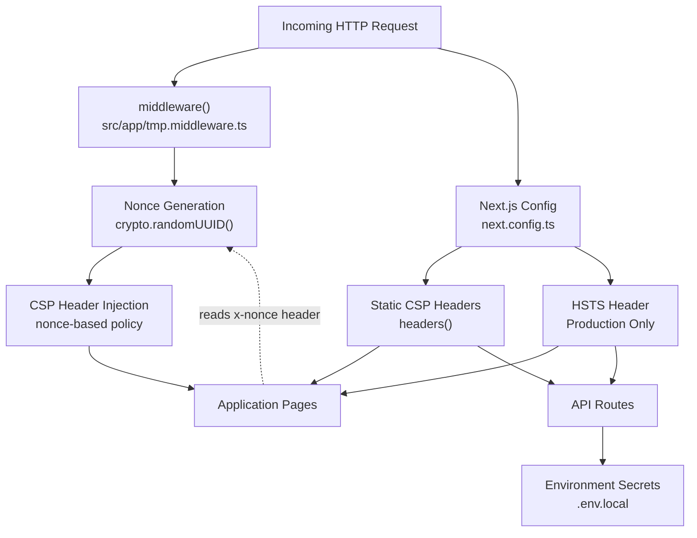
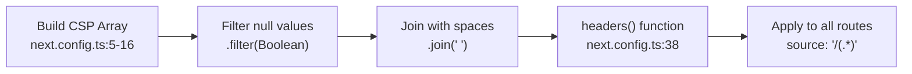
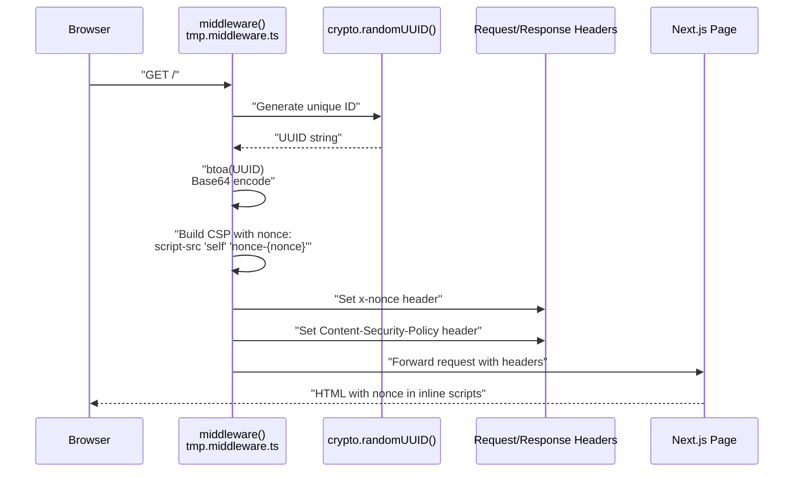
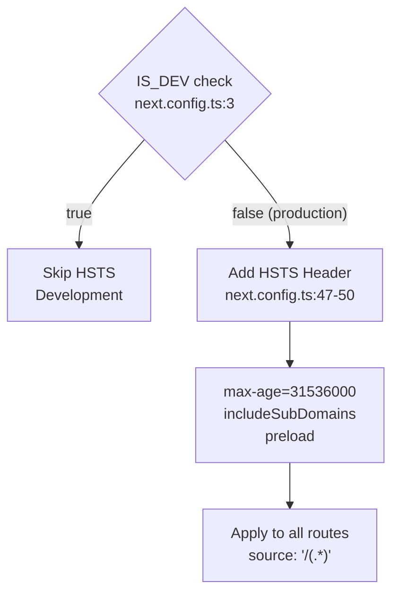
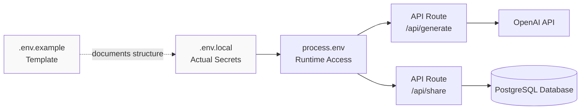
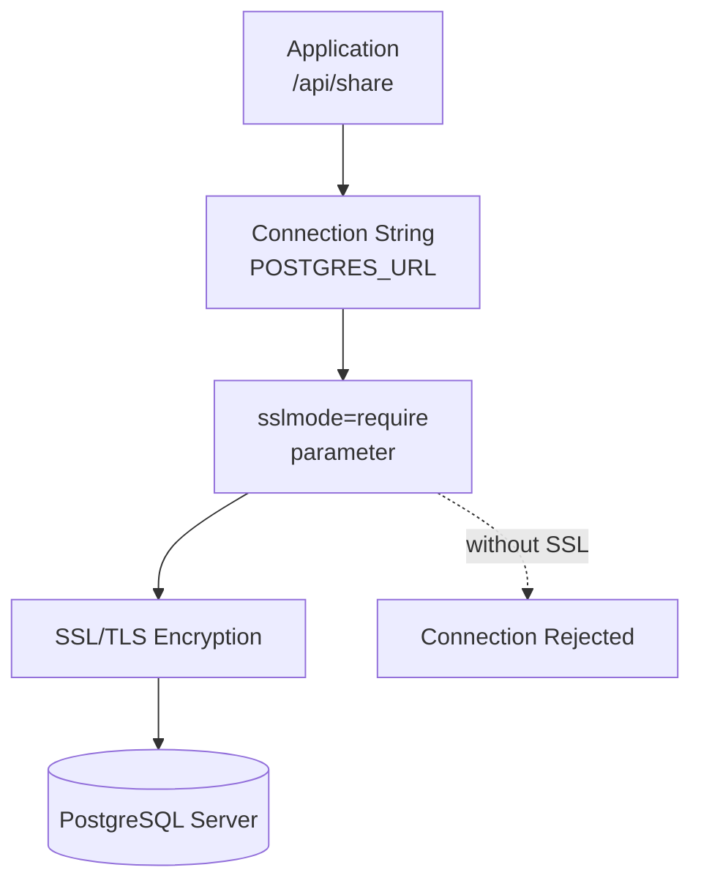

<!-- source: DeepWiki mcp.deepwiki.com · repo openai/openai-fm · page 5 Security Considerations · fetched 2026-10-26 -->

# Security Considerations

Relevant source files

The following files were used as context for generating this wiki page:

- [.env.example](.env.example)
- [next.config.ts](next.config.ts)
- [src/app/tmp.middleware.ts](src/app/tmp.middleware.ts)

## Purpose and Scope

This document covers the security mechanisms implemented in OpenAI.fm to protect against common web vulnerabilities and secure sensitive data. The application implements multiple layers of security including Content Security Policy (CSP), HTTP Strict Transport Security (HSTS), nonce-based script execution controls, and environment-based secrets management.

For information about API authentication and external service integration, see [API Routes](#3.3). For database schema and connection patterns, see [Database Integration](#3.6).

---

## Security Architecture Overview

The application employs a defense-in-depth strategy with security controls implemented at multiple layers:

**Diagram: Multi-Layer Security Architecture**

The security architecture operates at two primary levels:
1. **Request-time security** via middleware that generates unique nonces and applies dynamic CSP
2. **Static security** via Next.js configuration that applies CSP and HSTS headers to all routes

**Sources:** [src/app/tmp.middleware.ts](), [next.config.ts]()

---

## Content Security Policy (CSP)

### Static CSP Configuration

The application defines a baseline CSP in [next.config.ts:5-16]() that applies to all routes. This policy is constructed conditionally based on the environment:

| Directive | Value | Purpose |
|-----------|-------|---------|
| `default-src` | `'self'` | Only load resources from same origin |
| `script-src` | `'self' 'unsafe-eval' 'unsafe-inline'` | Allow same-origin scripts and inline scripts |
| `connect-src` | `'self'` | Restrict fetch/XHR to same origin |
| `style-src` | `'self' 'unsafe-inline'` | Allow same-origin and inline styles |
| `img-src` | `'self'` | Only load images from same origin |
| `object-src` | `'none'` | Block plugins (Flash, Java, etc.) |
| `frame-ancestors` | `'none'` | Prevent clickjacking via iframes |
| `upgrade-insecure-requests` | (production only) | Automatically upgrade HTTP to HTTPS |

The CSP string is constructed in [next.config.ts:5-16]() and applied via the `headers()` function in [next.config.ts:38-54]():

**Diagram: Static CSP Construction Pipeline**

The conditional `IS_DEV` check in [next.config.ts:3]() determines whether `upgrade-insecure-requests` is included, allowing HTTP connections during local development.

**Sources:** [next.config.ts:5-16](), [next.config.ts:38-54]()

### Nonce-Based CSP Middleware

A more restrictive nonce-based CSP is applied to page navigations via the middleware in [src/app/tmp.middleware.ts](). This provides stronger protection against XSS attacks by requiring scripts and styles to include a unique nonce attribute.

**Diagram: Nonce-Based CSP Request Flow**

The middleware implements the following security enhancements in [src/app/tmp.middleware.ts:9-52]():

1. **Nonce Generation** ([src/app/tmp.middleware.ts:11]()): Uses `crypto.randomUUID()` to generate a cryptographically random value, then Base64-encodes it via `btoa()`.

2. **Strict CSP Policy** ([src/app/tmp.middleware.ts:14-25]()): Constructs a CSP with the following key directives:
   - `script-src 'self' 'nonce-${nonce}' 'strict-dynamic'`: Scripts must either be same-origin or include the nonce attribute. The `strict-dynamic` directive allows nonce-authenticated scripts to load additional scripts.
   - `style-src 'self' 'nonce-${nonce}'`: Styles must be same-origin or include the nonce.
   - `img-src 'self' blob: data:`: Allow images from same-origin, blob URLs (for dynamically generated images), and data URIs.

3. **Header Injection** ([src/app/tmp.middleware.ts:32-50]()): The nonce and CSP are attached to both the incoming request headers (`x-nonce` custom header) and outgoing response headers (`Content-Security-Policy` standard header).

4. **Selective Application** ([src/app/tmp.middleware.ts:56-71]()): The middleware only runs for page navigations, excluding:
   - API routes (`/api/*`)
   - Static files (`/_next/static/*`)
   - Image optimization (`/_next/image/*`)
   - Prefetch requests (detected via `next-router-prefetch` header)

**Sources:** [src/app/tmp.middleware.ts:9-72]()

### CSP Comparison Table

| Aspect | Static CSP (next.config.ts) | Nonce-Based CSP (middleware) |
|--------|----------------------------|------------------------------|
| **Applied to** | All routes | Page navigations only |
| **script-src** | `'self' 'unsafe-eval' 'unsafe-inline'` | `'self' 'nonce-{value}' 'strict-dynamic'` |
| **style-src** | `'self' 'unsafe-inline'` | `'self' 'nonce-{value}'` |
| **img-src** | `'self'` | `'self' blob: data:` |
| **Nonce required** | No | Yes |
| **XSS protection** | Basic | Enhanced |
| **Implementation** | [next.config.ts:5-16]() | [src/app/tmp.middleware.ts:14-25]() |

**Sources:** [next.config.ts](), [src/app/tmp.middleware.ts]()

---

## HTTP Strict Transport Security (HSTS)

HSTS headers are configured in [next.config.ts:46-51]() to enforce HTTPS connections in production environments. This prevents protocol downgrade attacks and cookie hijacking.

**Diagram: HSTS Configuration Logic**

The HSTS header in [next.config.ts:49]() includes three directives:

| Directive | Value | Purpose |
|-----------|-------|---------|
| `max-age` | `31536000` (1 year) | Duration browsers should remember to only use HTTPS |
| `includeSubDomains` | enabled | Apply HSTS to all subdomains |
| `preload` | enabled | Eligible for browser HSTS preload lists |

The HSTS header is only added when `IS_DEV` is false ([next.config.ts:46]()), allowing HTTP connections during local development without browser warnings.

**Sources:** [next.config.ts:3](), [next.config.ts:46-51]()

---

## Environment Secrets Management

Sensitive credentials and API keys are managed via environment variables to prevent hardcoding secrets in the codebase.

**Diagram: Environment Variables Flow**

### Required Secrets

The application requires the following secrets for full functionality:

| Variable | Purpose | Required By | Example Location |
|----------|---------|-------------|------------------|
| `OPENAI_API_KEY` | OpenAI API authentication | `/api/generate` | Not in repo |
| `POSTGRES_URL` | Primary database connection | `/api/share` | [.env.example:1]() |
| `POSTGRES_PRISMA_URL` | Connection pooling | `/api/share` | [.env.example:2]() |
| `POSTGRES_URL_NON_POOLING` | Direct connection | `/api/share` | [.env.example:4]() |

### Environment File Structure

The [.env.example]() file serves as a template documenting all possible PostgreSQL connection string formats:

- **Standard Connection** ([.env.example:1]()): `POSTGRES_URL` with SSL mode required
- **Pooled Connection** ([.env.example:2]()): `POSTGRES_PRISMA_URL` with pgbouncer and connection timeout
- **Non-SSL Connection** ([.env.example:3]()): `POSTGRES_URL_NO_SSL` for development environments
- **Non-Pooling Connection** ([.env.example:4]()): `POSTGRES_URL_NON_POOLING` for direct database access

Additional connection parameters in [.env.example:5-8]() include:
- `POSTGRES_USER`: Database username
- `POSTGRES_HOST`: Database server hostname
- `POSTGRES_PASSWORD`: Database password
- `POSTGRES_DATABASE`: Database name

### Secret Storage Best Practices

1. **Never commit** `.env.local` or `.env` files containing actual secrets
2. **Use** `.env.example` as documentation only, with placeholder values
3. **Store** production secrets in Vercel's environment variables dashboard
4. **Rotate** API keys and database passwords regularly
5. **Limit** database user permissions to minimum required (read/write on `shares` table only)

**Sources:** [.env.example:1-8]()

---

## Database Connection Security

PostgreSQL connections include SSL requirements to ensure encrypted data transmission.

### SSL Mode Configuration

The `sslmode=require` parameter in [.env.example:1,2,4]() enforces encrypted connections:

**Diagram: SSL Enforcement Flow**

### Connection String Parameters

The connection strings in [.env.example]() include several security-relevant parameters:

| Parameter | Value | Purpose | Line Reference |
|-----------|-------|---------|----------------|
| `sslmode` | `require` | Enforce SSL/TLS encryption | [.env.example:1,2,4]() |
| `pgbouncer` | `true` | Enable connection pooling | [.env.example:2]() |
| `connect_timeout` | `15` | Timeout in seconds | [.env.example:2]() |

The connection pooling configuration in [.env.example:2]() (`pgbouncer=true&connect_timeout=15`) provides additional security benefits:
- **Connection reuse** reduces connection overhead and limits resource exhaustion attacks
- **Timeouts** prevent hung connections from consuming server resources
- **Connection limits** can be enforced at the pooler level

**Sources:** [.env.example:1-4]()

---

## Security Headers Summary

The following table summarizes all security headers applied by the application:

| Header | Value Source | Applied To | Environment |
|--------|--------------|------------|-------------|
| `Content-Security-Policy` (static) | [next.config.ts:5-16]() | All routes | All |
| `Content-Security-Policy` (nonce) | [src/app/tmp.middleware.ts:14-25]() | Page navigations | All |
| `Strict-Transport-Security` | [next.config.ts:49]() | All routes | Production only |
| `x-nonce` (custom) | [src/app/tmp.middleware.ts:33]() | Page navigations | All |

### Security Header Verification

To verify security headers are properly applied:

1. **Development**: Run `npm run dev` and inspect network responses in browser DevTools
2. **Production Build**: Run `npm run build && npm start` to test production configuration
3. **HSTS Verification**: Check that HSTS header only appears in production builds
4. **Nonce Verification**: Inspect page HTML to confirm `<script>` tags include `nonce` attributes matching the `x-nonce` header value

**Sources:** [next.config.ts:38-54](), [src/app/tmp.middleware.ts:9-72]()

---

## Threat Mitigation Matrix

| Threat | Mitigation | Implementation | Effectiveness |
|--------|------------|----------------|---------------|
| **Cross-Site Scripting (XSS)** | Nonce-based CSP | [src/app/tmp.middleware.ts:16]() | High |
| **Script injection** | `script-src 'self' 'nonce-{value}'` | [src/app/tmp.middleware.ts:16]() | High |
| **Inline style injection** | `style-src 'self' 'nonce-{value}'` | [src/app/tmp.middleware.ts:17]() | High |
| **Clickjacking** | `frame-ancestors 'none'` | [next.config.ts:12](), [src/app/tmp.middleware.ts:23]() | High |
| **Protocol downgrade** | HSTS with preload | [next.config.ts:49]() | High (production) |
| **Man-in-the-middle** | SSL enforcement | [.env.example:1]() | High |
| **Cookie hijacking** | HSTS enforces HTTPS | [next.config.ts:49]() | High (production) |
| **API key exposure** | Environment variables | [.env.example]() | Medium (depends on deployment) |
| **SQL injection** | Parameterized queries (ORM) | API routes | High |
| **Plugin vulnerabilities** | `object-src 'none'` | [next.config.ts:11]() | High |

**Sources:** [next.config.ts](), [src/app/tmp.middleware.ts](), [.env.example]()

---

