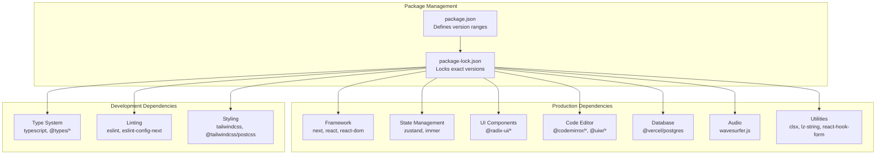
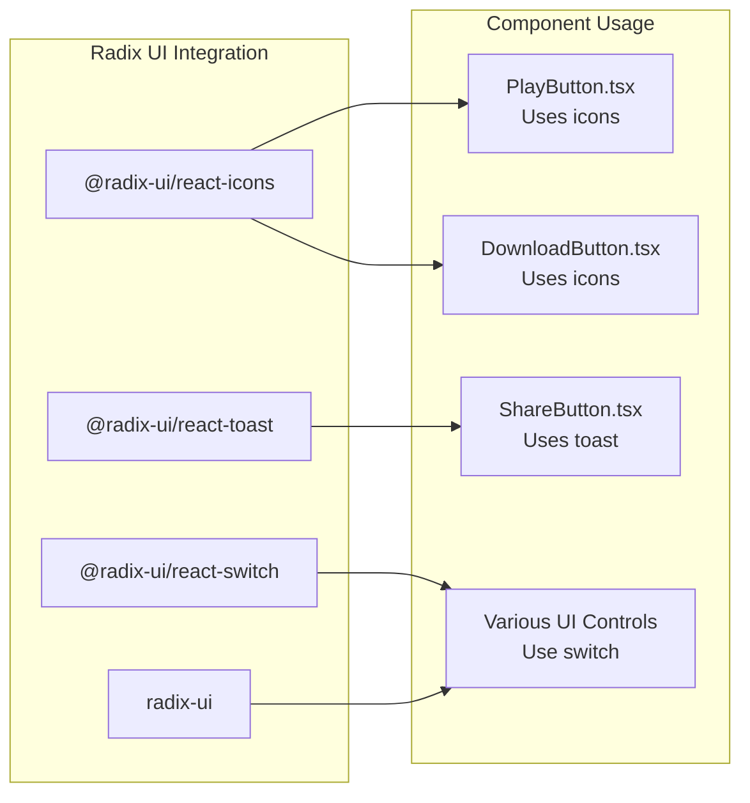
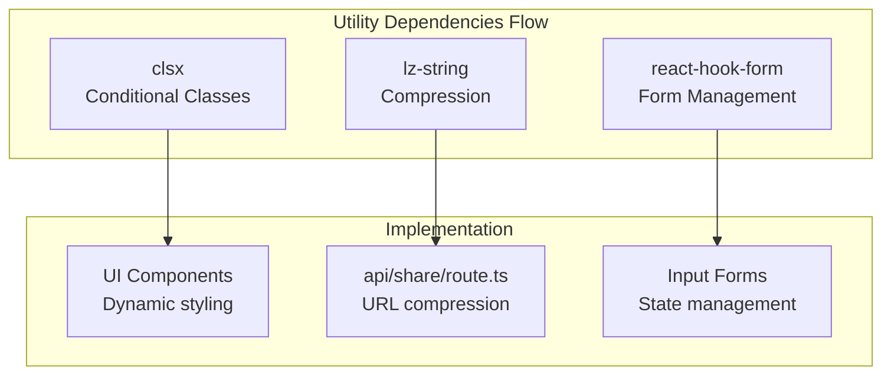
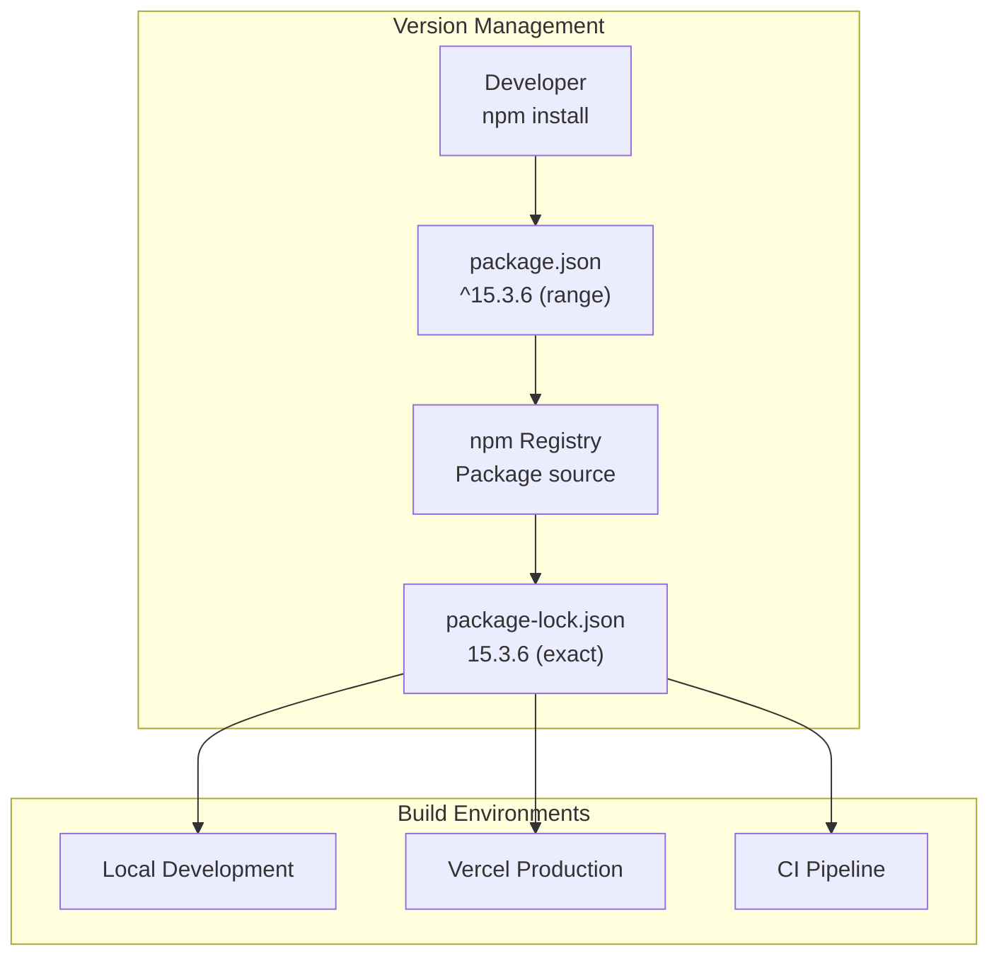
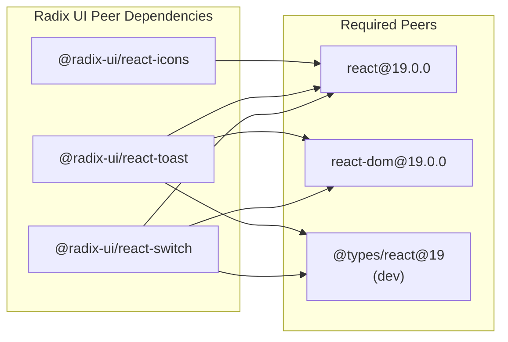

<!-- source: DeepWiki mcp.deepwiki.com · repo openai/openai-fm · page 7 Dependencies Reference · fetched 2026-10-26 -->

# Dependencies Reference

Relevant source files

The following files were used as context for generating this wiki page:

- [package-lock.json](package-lock.json)
- [package.json](package.json)

This page provides a comprehensive reference for all project dependencies defined in [package.json:1-43]() and their locked versions in [package-lock.json:1-end](). It documents the purpose of each dependency, their version constraints, and how they integrate into the OpenAI.fm application architecture.

For information about the build process that uses these dependencies, see [Build Process](#4.2). For environment configuration affecting dependencies like `@vercel/postgres`, see [Environment Configuration](#2.2).

## Dependency Structure Overview

The project uses npm as its package manager with two distinct dependency categories: production dependencies required for runtime operation and development dependencies used only during the build process.

**Sources:** [package.json:1-43](), [package-lock.json:1-6]()

## Production Dependencies

Production dependencies are installed in deployed environments and required for the application to function at runtime. These are defined in [package.json:11-30]().

### Framework and Core Libraries

| Package | Version | Purpose | Usage in Codebase |
|---------|---------|---------|-------------------|
| `next` | ^15.3.6 | Next.js framework providing SSR, routing, and API routes | [src/app/layout.tsx](), [src/app/page.tsx](), [src/app/api/generate/route.ts]() |
| `react` | ^19.0.0 | React library for building UI components | All component files in [src/components/]() |
| `react-dom` | ^19.0.0 | React DOM rendering engine | [src/app/layout.tsx:26]() |

**Sources:** [package.json:24-27](), [package-lock.json:936-941]()

### State Management

| Package | Version | Purpose | Usage in Codebase |
|---------|---------|---------|-------------------|
| `zustand` | ^5.0.3 | Lightweight state management library | [src/lib/appStore.ts]() for global application state |
| `immer` | ^10.1.1 | Immutable state updates | Used with Zustand middleware for state mutations |

The `zustand` package provides the `appStore` which manages global state including `input`, `prompt`, `voice`, and `latestAudioUrl`.

**Sources:** [package.json:22,30](), [src/lib/appStore.ts]()

### UI Component Libraries

The project uses Radix UI primitives for accessible, unstyled components that are styled with TailwindCSS.

| Package | Version | Purpose | Code Usage |
|---------|---------|---------|------------|
| `@radix-ui/react-icons` | ^1.3.2 | Icon components | [src/components/PlayButton.tsx](), [src/components/DownloadButton.tsx]() |
| `@radix-ui/react-switch` | ^1.1.3 | Toggle switch component | Used for UI controls |
| `@radix-ui/react-toast` | ^1.2.6 | Toast notification system | [src/components/ShareButton.tsx]() for notifications |
| `radix-ui` | ^1.1.3 | Meta package for Radix UI | Provides additional Radix components |

**Sources:** [package.json:15-17,25](), [package-lock.json:1644-1651]()

**Sources:** [src/components/PlayButton.tsx](), [src/components/DownloadButton.tsx](), [src/components/ShareButton.tsx]()

### Code Editor Components

The application includes a code editor for displaying code snippets, powered by CodeMirror.

| Package | Version | Purpose | Integration Point |
|---------|---------|---------|-------------------|
| `@codemirror/lang-javascript` | ^6.2.3 | JavaScript syntax support | Code snippet display for JS examples |
| `@codemirror/lang-python` | ^6.1.7 | Python syntax support | Code snippet display for Python examples |
| `@codemirror/legacy-modes` | ^6.5.0 | Additional language modes | Extended language support |
| `@uiw/react-codemirror` | ^4.23.10 | React wrapper for CodeMirror | [src/components/CodeCopyButton.tsx]() |
| `@uiw/codemirror-theme-duotone` | ^4.23.10 | Theme for code editor | Visual styling for code display |

These packages work together to provide syntax-highlighted code examples showing how to use the OpenAI TTS API in different languages.

**Sources:** [package.json:12-14,18-19](), [package-lock.json:92-106]()

### Database Integration

| Package | Version | Purpose | Usage in Codebase |
|---------|---------|---------|-------------------|
| `@vercel/postgres` | ^0.10.0 | PostgreSQL client for Vercel | [src/app/api/share/route.ts]() for persisting share data |

The `@vercel/postgres` package provides the `sql` client used to store and retrieve share configurations in the `shares` table. This dependency is optional and only required if the sharing feature is enabled.

**Sources:** [package.json:20](), [src/app/api/share/route.ts]()

### Audio Processing

| Package | Version | Purpose | Usage in Codebase |
|---------|---------|---------|-------------------|
| `wavesurfer.js` | ^7.9.1 | Audio waveform visualization | [src/components/PlayingWaveform.tsx]() for visual feedback |

The `wavesurfer.js` library is used to create real-time waveform visualizations during audio playback, analyzing amplitude data from the Web Audio API.

**Sources:** [package.json:29](), [src/components/PlayingWaveform.tsx]()

### Utility Libraries

| Package | Version | Purpose | Code Usage |
|---------|---------|---------|------------|
| `clsx` | ^2.1.1 | Conditional CSS class utility | Used throughout components for dynamic className generation |
| `lz-string` | ^1.5.0 | String compression for URLs | [src/app/api/share/route.ts]() for compressing share data |
| `react-hook-form` | ^7.54.2 | Form state management | Form handling for TTS input fields |

**Sources:** [package.json:21,23,28]()

**Sources:** [src/app/api/share/route.ts](), [src/components/]()

## Development Dependencies

Development dependencies are only installed during development and build processes. They are not included in production deployments. These are defined in [package.json:32-42]().

### Type System

| Package | Version | Purpose | Configuration |
|---------|---------|---------|---------------|
| `typescript` | ^5 | TypeScript compiler | [tsconfig.json]() defines compiler options |
| `@types/node` | ^20 | Node.js type definitions | Required for Node API types |
| `@types/react` | ^19 | React type definitions | Required for React component types |
| `@types/react-dom` | ^19 | React DOM type definitions | Required for ReactDOM types |

TypeScript provides static type checking across the entire codebase, with custom declarations in [global.d.ts:1-3]() for SVG module imports.

**Sources:** [package.json:35-37,41](), [global.d.ts:1-3]()

### Linting and Code Quality

| Package | Version | Purpose | Configuration File |
|---------|---------|---------|-------------------|
| `eslint` | ^9 | JavaScript/TypeScript linter | [eslint.config.mjs]() |
| `eslint-config-next` | 15.2.2 | Next.js ESLint configuration | Imported in [eslint.config.mjs]() |
| `@eslint/eslintrc` | ^3 | ESLint configuration utilities | Supports flat config format |

The linting setup uses ESLint v9's flat configuration format with Next.js-specific rules to enforce code quality and catch common errors.

**Sources:** [package.json:33,38-39](), [eslint.config.mjs]()

### Styling System

| Package | Version | Purpose | Configuration |
|---------|---------|---------|---------------|
| `tailwindcss` | ^4 | Utility-first CSS framework | [postcss.config.mjs]() |
| `@tailwindcss/postcss` | ^4 | TailwindCSS PostCSS plugin | [postcss.config.mjs:1-9]() |

TailwindCSS v4 processes utility classes defined in components and generates the final CSS output. The PostCSS plugin integrates TailwindCSS into the build pipeline.

**Sources:** [package.json:34,40](), [postcss.config.mjs:1-9]()

## Version Locking Mechanism

The [package-lock.json:1-end]() file locks exact dependency versions and their entire dependency trees, ensuring reproducible builds across environments.

The lockfile structure at [package-lock.json:1-6]() includes:
- `lockfileVersion: 3` - npm lockfile format version
- `requires: true` - Automatic dependency resolution
- Package definitions with exact resolved versions and integrity hashes

**Sources:** [package-lock.json:1-6]()

## Dependency Graph by Feature

This diagram shows how dependencies map to application features, bridging between natural language system names and actual package names.

```mermaid
graph TB
    subgraph "Audio Generation Feature"
        AudioGenAPI["api/generate/route.ts"]
        NextRuntime["next@15.3.6<br/>API Routes"]
        ReactUI["react@19.0.0<br/>UI Layer"]
    end
    
    subgraph "State Management Feature"
        AppStore["lib/appStore.ts"]
        Zustand["zustand@5.0.3"]
        Immer["immer@10.1.1"]
    end
    
    subgraph "Sharing Feature"
        ShareAPI["api/share/route.ts"]
        PostgresClient["@vercel/postgres@0.10.0"]
        LZString["lz-string@1.5.0"]
    end
    
    subgraph "Waveform Visualization Feature"
        PlayingWaveform["components/PlayingWaveform.tsx"]
        Wavesurfer["wavesurfer.js@7.9.1"]
    end
    
    subgraph "Code Examples Feature"
        CodeCopyButton["components/CodeCopyButton.tsx"]
        CodeMirror["@uiw/react-codemirror@4.23.10"]
        JSLang["@codemirror/lang-javascript@6.2.3"]
        PyLang["@codemirror/lang-python@6.1.7"]
    end
    
    subgraph "UI Components Feature"
        PlayButton["components/PlayButton.tsx"]
        ShareButton["components/ShareButton.tsx"]
        RadixIcons["@radix-ui/react-icons@1.3.2"]
        RadixToast["@radix-ui/react-toast@1.2.6"]
    end
    
    AudioGenAPI --> NextRuntime
    AudioGenAPI --> ReactUI
    AppStore --> Zustand
    Zustand --> Immer
    ShareAPI --> PostgresClient
    ShareAPI --> LZString
    PlayingWaveform --> Wavesurfer
    CodeCopyButton --> CodeMirror
    CodeMirror --> JSLang
    CodeMirror --> PyLang
    PlayButton --> RadixIcons
    ShareButton --> RadixToast
    ShareButton --> RadixIcons
```

**Sources:** [package.json:11-30](), [src/app/api/generate/route.ts](), [src/app/api/share/route.ts](), [src/lib/appStore.ts](), [src/components/]()

## Dependency Version Constraints

The project uses semantic versioning with caret (^) ranges to allow compatible updates.

| Version Syntax | Meaning | Example | Allows |
|----------------|---------|---------|--------|
| `^15.3.6` | Compatible with 15.3.6 | `next: ^15.3.6` | 15.3.7, 15.4.0, but not 16.0.0 |
| `^19.0.0` | Compatible with 19.0.0 | `react: ^19.0.0` | 19.0.1, 19.1.0, but not 20.0.0 |
| `^5` | Compatible with 5.x.x | `typescript: ^5` | 5.0.0, 5.1.0, 5.9.9, but not 6.0.0 |
| `15.2.2` | Exact version | `eslint-config-next: 15.2.2` | Only 15.2.2 |

**Sources:** [package.json:11-42]()

## Optional Dependencies

Certain dependencies are functionally optional based on feature usage:

| Package | Condition | Feature Requirement |
|---------|-----------|---------------------|
| `@vercel/postgres` | Requires `POSTGRES_URL` environment variable | Share functionality via [api/share/route.ts]() |
| `wavesurfer.js` | UI enhancement only | Waveform visualization in [PlayingWaveform.tsx]() |

When `POSTGRES_URL` is not configured, the sharing API returns appropriate error responses at [src/app/api/share/route.ts]().

**Sources:** [.env.example](), [src/app/api/share/route.ts]()

## Peer Dependencies

Some packages have peer dependency requirements that are satisfied by the project:

All Radix UI components declare peer dependencies on `react`, `react-dom`, and optionally `@types/react`, which are satisfied by the versions installed at [package.json:26-27,36-37]().

**Sources:** [package-lock.json:2177-2204](), [package.json:26-27,36-37]()

## Build Tool Dependencies

Next.js includes built-in support for several tools that don't require separate packages:

| Built-in Tool | Purpose | Configuration |
|---------------|---------|---------------|
| Webpack / Turbopack | Module bundler | [next.config.ts]() |
| SWC | Fast TypeScript/JavaScript compiler | Enabled by default in Next.js 15 |
| SVGR | SVG to React component loader | Configured in [next.config.ts]() |

The `next` package at version 15.3.6 includes platform-specific SWC binaries as optional dependencies in [package-lock.json:952-1079]().

**Sources:** [next.config.ts](), [package-lock.json:952-1079]()

## Dependency Update Strategy

To update dependencies:

1. **Minor/Patch Updates**: Run `npm update` to update within caret ranges
2. **Major Updates**: Modify [package.json]() version constraints manually
3. **Lockfile Regeneration**: Run `npm install` to update [package-lock.json]()
4. **Verification**: Run `npm run build` and `npm run lint` to verify compatibility

The locked versions in [package-lock.json]() ensure consistent builds until explicitly updated.

**Sources:** [package.json:5-9](), [package-lock.json:1-6]()