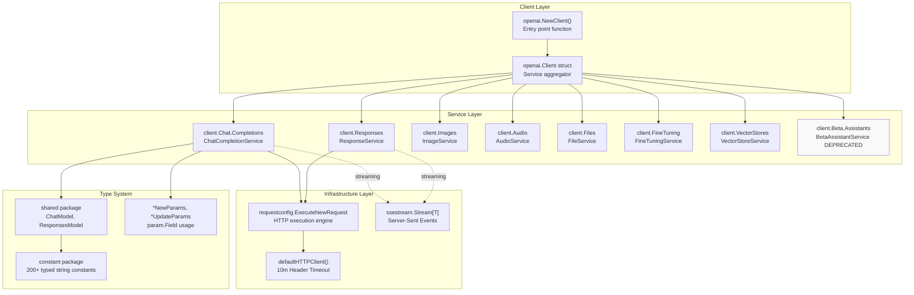
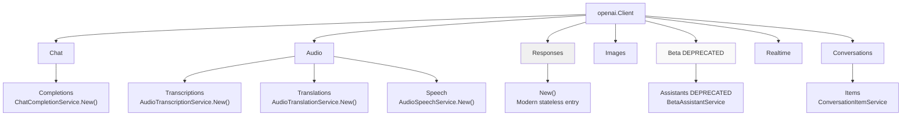
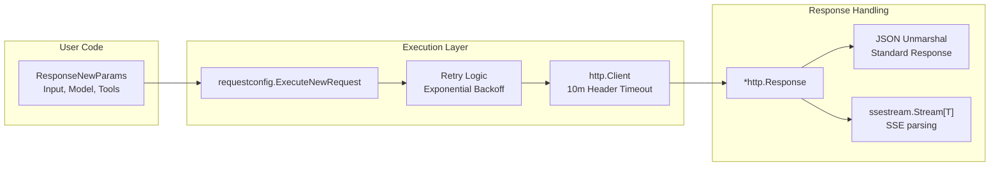

<!-- source: DeepWiki mcp.deepwiki.com · repo openai/openai-go · page 1 Overview · fetched 2026-10-26 -->

# Overview

<details>
<summary>Relevant source files</summary>

The following files were used as context for generating this wiki page:

- [.release-please-manifest.json](.release-please-manifest.json)
- [CHANGELOG.md](CHANGELOG.md)
- [README.md](README.md)
- [api.md](api.md)
- [client.go](client.go)
- [default_http_client.go](default_http_client.go)
- [internal/version.go](internal/version.go)
- [packages/ssestream/ssestream.go](packages/ssestream/ssestream.go)
- [shared/constant/constants.go](shared/constant/constants.go)

</details>


This document introduces the **openai-go SDK**, the official Go client library for accessing the OpenAI REST API. It covers the SDK's architecture, code generation pipeline, service organization, and key features including streaming responses, multi-modal inputs, and tool calling capabilities.

For detailed information about specific APIs:
- Chat Completions API: see [Chat Completions API](#3)
- Modern Responses API: see [Responses API](#4)
- Deprecated Beta Assistants: see [Beta Assistants API (Deprecated)](#15)
- Advanced configuration options: see [Client Configuration and Options](#2.1)

**Sources:** [README.md:1-10](), [client.go:23-59]()

## Purpose and Key Features

The openai-go SDK provides convenient, type-safe access to OpenAI's REST API from Go applications. The library is entirely generated from an OpenAPI specification, ensuring consistency with the API contract and automatic updates when the API evolves.

**Key capabilities:**

| Feature | Description | Code Entry Point |
|---------|-------------|------------------|
| **Type Safety** | Generated strongly-typed request/response structs | `openai.ChatCompletionNewParams`, `openai.ChatCompletion` |
| **Streaming** | Server-Sent Events for progressive responses | `ssestream.Stream[T]`, `.NewStreaming()` methods |
| **Multi-Modal** | Text, images, audio, files in single requests | `openai.ChatCompletionContentPartUnionParam` |
| **Tool Calling** | 7 tool types (Function, FileSearch, WebSearch, etc.) | `responses.ToolUnionParam` |
| **Retry Logic** | Exponential backoff with 2 default retries | `option.WithMaxRetries()` |
| **Modern API** | State-of-the-art Responses API for text/tools | `client.Responses` |

The SDK requires **Go 1.22+** and is distributed as `github.com/openai/openai-go/v3` with the current version at **3.33.0**.

**Sources:** [README.md:16-41](), [internal/version.go:5](), [README.md:46-48]()

## Layered Architecture

The SDK follows a clean layered architecture separating concerns across client initialization, service interfaces, HTTP execution, and type systems.



**Architecture Overview**

### Client Layer
The `openai.NewClient()` function ([client.go:97-125]()) serves as the single entry point, returning an `openai.Client` struct that aggregates all service interfaces. Configuration is applied via functional options from the `option` package.

### Service Layer
Top-level services are accessed as fields on the client (e.g., `client.Chat`, `client.Responses`, `client.Images`). Each service exposes methods for API operations like `.New()`, `.Get()`, `.List()`, `.Delete()`.

**Key Services:**
- `ChatCompletionService`: Multi-modal chat completions with tool calling ([api.md:49-65]())
- `ResponseService`: Modern response API with stateless/linked design ([client.go:52]())
- `RealtimeService`: WebSocket-based voice and audio communication ([client.go:53]())
- `ConversationService`: Management of stateful conversation items ([client.go:55]())

### Infrastructure Layer
- **`requestconfig.ExecuteNewRequest`**: Handles HTTP request execution, retry logic, and serialization ([client.go:158-161]()).
- **`ssestream.Stream[T]`**: Generic streaming iterator for Server-Sent Events ([packages/ssestream/ssestream.go:137-143]()).
- **`defaultHTTPClient`**: Clones `http.DefaultTransport` and adds a 10-minute `ResponseHeaderTimeout` ([default_http_client.go:20-24]()).

### Type System
- **Shared Types**: Common types like `ChatModel`, `ResponsesModel`, and `FunctionDefinition` reside in the `shared` package ([api.md:3-16]()).
- **Constants**: The `constant` package provides hundreds of typed string constants for events, models, and statuses ([shared/constant/constants.go:21-97]()).

**Sources:** [client.go:23-59](), [packages/ssestream/ssestream.go:137-143](), [default_http_client.go:14-24]()

## Service Hierarchy and Entry Points

The SDK organizes 20+ services in a hierarchical structure.



**Service Access Patterns**

Services are accessed via dot notation on the client:
- **Level 1**: `client.Chat`, `client.Responses`, `client.Images` ([client.go:23-59]())
- **Level 2**: `client.Chat.Completions`, `client.Audio.Transcriptions` ([api.md:45-120]())

Common method names across services:
- `.New(ctx, params)`: Create a resource ([api.md:45]())
- `.NewStreaming(ctx, params)`: Create with streaming response ([README.md:168]())
- `.Get(ctx, id)`: Retrieve a resource by ID

**Sources:** [api.md:35-311](), [client.go:23-59]()

## Request/Response Flow

The SDK implements a pipeline with parameter transformation and dual response modes.



**Streaming Mechanism**
The `ssestream.Stream[T]` handles SSE events, parsing `[DONE]` markers and synthesizing event data for thread-based events ([packages/ssestream/ssestream.go:181-206]()).

**Sources:** [packages/ssestream/ssestream.go:171-228](), [default_http_client.go:14-24]()

## Installation and Quick Start

### Installation

```bash
# Install the v3 SDK
go get -u 'github.com/openai/openai-go/v3@v3.33.0'
```

**Minimum version:** Go 1.22+ ([README.md:40]())

### Basic Usage Example (Modern Responses API)

```go
package main

import (
	"context"
	"github.com/openai/openai-go/v3"
	"github.com/openai/openai-go/v3/option"
	"github.com/openai/openai-go/v3/responses"
)

func main() {
	client := openai.NewClient(
		option.WithAPIKey("My API Key"), // defaults to OPENAI_API_KEY
	)

	resp, err := client.Responses.New(context.Background(), responses.ResponseNewParams{
		Input: responses.ResponseNewParamsInputUnion{OfString: openai.String("Hello!")},
		Model: openai.ChatModelGPT4o,
	})
	if err != nil {
		panic(err)
	}
	println(resp.OutputText())
}
```

**Sources:** [README.md:46-78](), [client.go:61-90]()

## Architectural Shift: Beta Assistants → Responses API

The SDK highlights a transition from the stateful **Beta Assistants API** to the modern **Responses API**.

| Aspect | Beta Assistants (Deprecated) | Responses API (Modern) |
|--------|----------------------------|----------------------|
| **Primary Field** | `client.Beta.Assistants` | `client.Responses` |
| **Context** | Stateful `Thread` objects | Linked via `PreviousResponseID` |
| **Usage** | Persistent configuration | Stateless/Linked per-request |
| **Streaming** | Run events | `ResponseStreamEventUnion` |

The Responses API is now the recommended primary API for interacting with OpenAI models ([README.md:46]()).

**Sources:** [README.md:46-48](), [README.md:84-107](), [client.go:47-52]()

---
For details on installation, see [Installation and Setup](#1.1).  
To start coding immediately, see [Quick Start Guide](#1.2).

---

