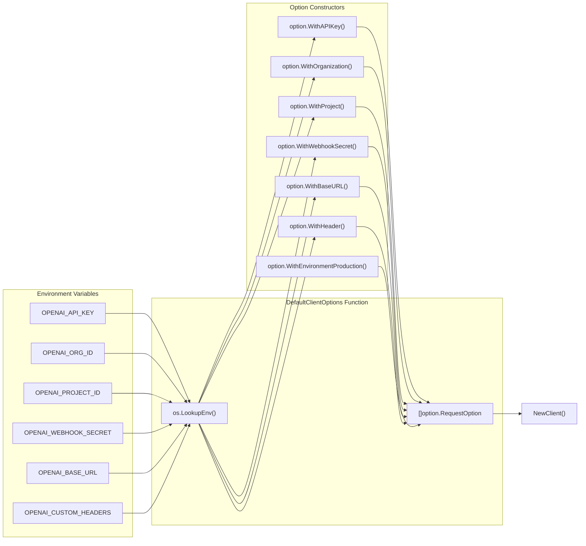
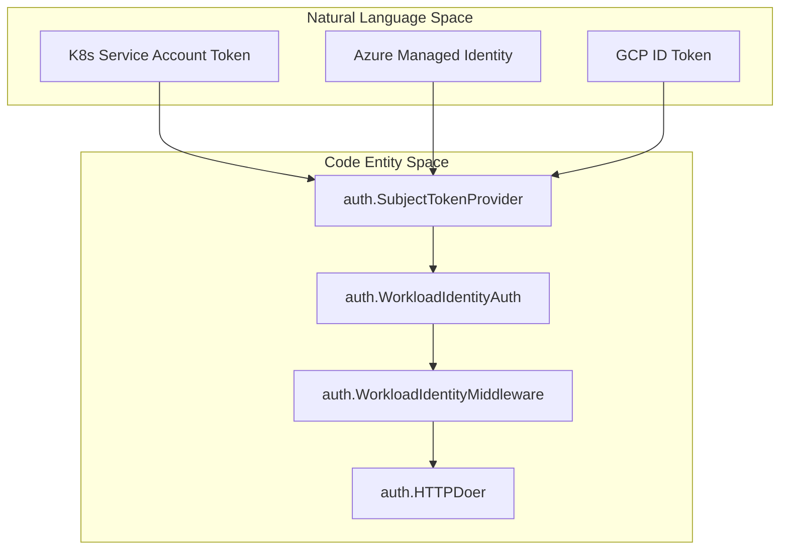
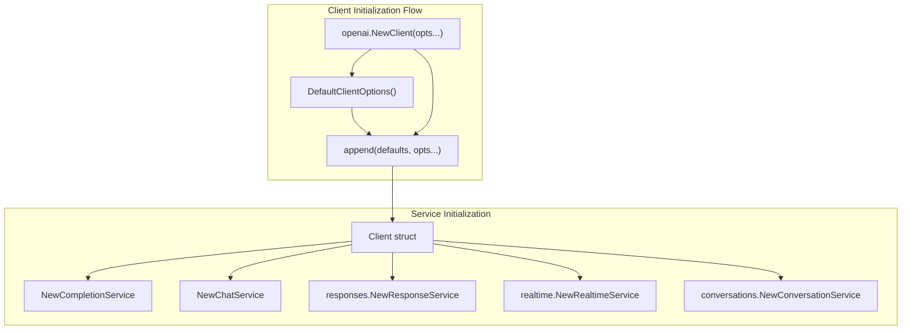

<!-- source: DeepWiki mcp.deepwiki.com · repo openai/openai-go · page 1.1 Installation and Setup · fetched 2026-10-26 -->

# Installation and Setup

<details>
<summary>Relevant source files</summary>

The following files were used as context for generating this wiki page:

- [.release-please-manifest.json](.release-please-manifest.json)
- [CHANGELOG.md](CHANGELOG.md)
- [README.md](README.md)
- [auth/error.go](auth/error.go)
- [auth/middleware.go](auth/middleware.go)
- [auth/subjecttokenprovider.go](auth/subjecttokenprovider.go)
- [auth/subjecttokenprovider_test.go](auth/subjecttokenprovider_test.go)
- [auth/types.go](auth/types.go)
- [auth/workloadidentity.go](auth/workloadidentity.go)
- [auth/workloadidentity_test.go](auth/workloadidentity_test.go)
- [client.go](client.go)
- [default_http_client.go](default_http_client.go)
- [internal/version.go](internal/version.go)
- [packages/ssestream/ssestream.go](packages/ssestream/ssestream.go)
- [shared/constant/constants.go](shared/constant/constants.go)

</details>


This document covers the installation of the `openai-go` SDK, authentication configuration, and client initialization. It provides the foundational steps required to begin making API calls to OpenAI's services.

For information about configuring request options and middleware, see **Client Configuration and Options**. For details on making your first API call, see **Quick Start Guide**.

---

## System Requirements

The `openai-go` SDK requires **Go 1.22 or later**.

**Sources:** [README.md:38-40]()

---

## Installation

### Adding the SDK Dependency

Import the SDK in your Go code:

```go
import (
    "github.com/openai/openai-go/v3" // imported as openai
)
```

The SDK uses semantic versioning with the major version in the import path. The current major version is `v3`.

**Sources:** [README.md:18-26]()

### Version Pinning

To pin a specific version using `go get`:

```sh
go get -u 'github.com/openai/openai-go/v3@v3.33.0'
```

The current version is tracked in multiple locations:
- [.release-please-manifest.json:2]() - Release version manifest
- [internal/version.go:5]() - Package version constant `PackageVersion`

**Sources:** [README.md:28-36](), [.release-please-manifest.json:1-3](), [internal/version.go:1-6]()

---

## Authentication Configuration

The SDK supports multiple authentication methods, with API keys being the primary mechanism. Authentication can be configured via environment variables, direct client options, or advanced Workload Identity.

### Environment Variable Configuration

The SDK automatically reads authentication credentials from the following environment variables:

| Environment Variable | Purpose |
|---------------------|---------|
| `OPENAI_API_KEY` | OpenAI API authentication key |
| `OPENAI_ORG_ID` | Organization identifier |
| `OPENAI_PROJECT_ID` | Project identifier |
| `OPENAI_WEBHOOK_SECRET` | Webhook signature verification secret |
| `OPENAI_BASE_URL` | Custom base URL for API endpoint |
| `OPENAI_CUSTOM_HEADERS` | Newline-separated custom headers (e.g., `Header: Value`) |

#### Environment Variable to Configuration Mapping



The [client.go:64-90]() `DefaultClientOptions` function performs this environment variable lookup and returns a slice of `option.RequestOption` values. These are automatically applied when calling [client.go:97]() `NewClient`.

**Sources:** [client.go:61-90](), [README.md:62]()

### Direct Configuration via Options

Authentication can be explicitly configured using option functions, which override environment variables:

```go
client := openai.NewClient(
    option.WithAPIKey("sk-..."),           // Override OPENAI_API_KEY
    option.WithOrganization("org-..."),    // Override OPENAI_ORG_ID
    option.WithProject("proj-..."),        // Override OPENAI_PROJECT_ID
)
```

Options passed to `NewClient` are appended to defaults, meaning they take precedence.

**Sources:** [README.md:59-63](), [client.go:97-100]()

### Advanced: Workload Identity

For environments requiring short-lived tokens or identity-based auth (Kubernetes, Azure, GCP), the SDK provides a `WorkloadIdentity` system.



Key components include:
- **`SubjectTokenProvider`**: Fetches the initial subject token (e.g., K8s JWT from disk) [auth/types.go:19-22]().
- **`WorkloadIdentityAuth`**: Manages token exchange for OpenAI access tokens and handles caching/expiration [auth/workloadidentity_test.go:82-87]().
- **`WorkloadIdentityMiddleware`**: Automatically injects the `Authorization: Bearer <token>` header and handles 401 Unauthorized retries by invalidating the cached token [auth/middleware.go:7-25]().

**Sources:** [auth/types.go:19-30](), [auth/middleware.go:7-50](), [auth/subjecttokenprovider_test.go:14-162]()

---

## Client Initialization

### Basic Client Creation

The primary entry point is the `openai.NewClient` function, which initializes the main client and all sub-services.



The [client.go:97-125]() `NewClient` function:
1. Combines default options with provided options.
2. Sets a default HTTP client with a 10-minute header timeout if none is provided [default_http_client.go:14-24]().
3. Instantiates the `Client` struct and initializes all services.

**Sources:** [client.go:97-125](), [default_http_client.go:10-24]()

### Client Structure

The `Client` struct aggregates services that route to specific API segments:

| Service Field | Type | Purpose |
|--------------|------|---------|
| `Responses` | `responses.ResponseService` | Modern Responses API (successor to Assistants) |
| `Chat` | `ChatService` | Standard Chat Completion APIs |
| `Realtime` | `realtime.RealtimeService` | WebSocket-based real-time communication |
| `Conversations`| `conversations.ConversationService` | State management for conversation items |
| `Files` | `FileService` | File upload and management |
| `Beta` | `BetaService` | Legacy Assistants and other beta features |

**Sources:** [client.go:23-59]()

---

## Verification

Verify the client setup by making a simple request to the modern `Responses` API:

```go
package main

import (
    "context"
    "github.com/openai/openai-go/v3"
    "github.com/openai/openai-go/v3/responses"
)

func main() {
    client := openai.NewClient()
    
    resp, err := client.Responses.New(context.Background(), responses.ResponseNewParams{
        Model: openai.ChatModelGPT4o,
        Input: responses.ResponseNewParamsInputUnion{
            OfString: openai.String("Hello, world!"),
        },
    })
    if err != nil {
        panic(err)
    }
    println(resp.OutputText())
}
```

**Sources:** [README.md:59-78]()

---

