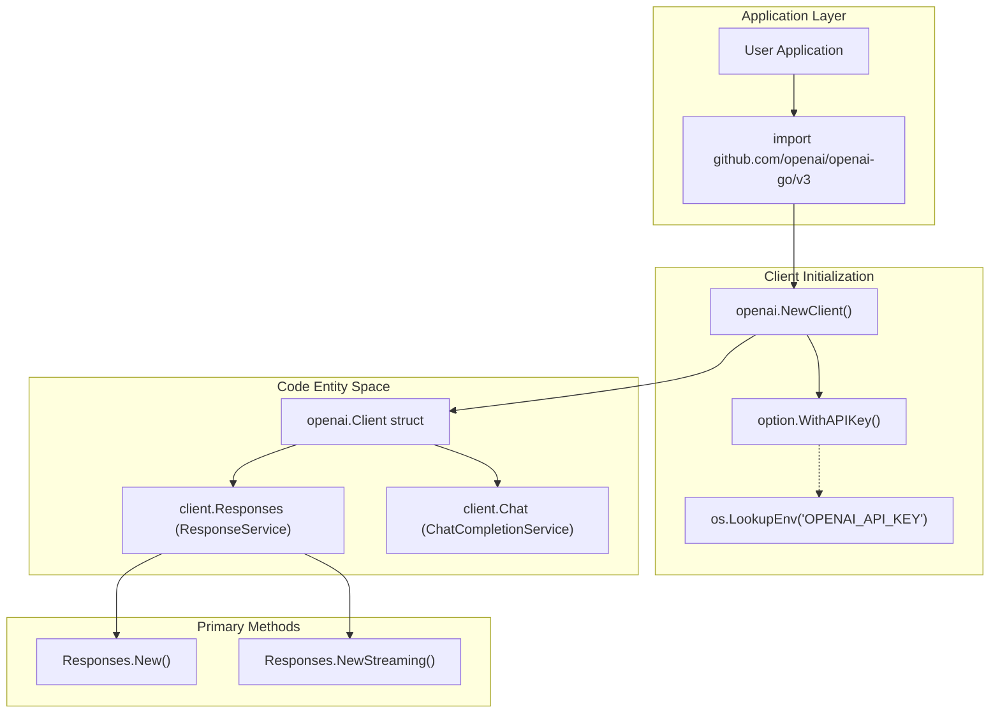
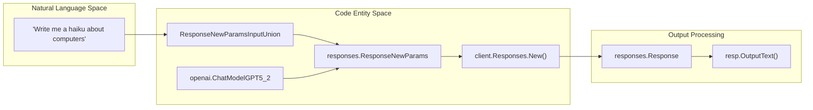

<!-- source: DeepWiki mcp.deepwiki.com · repo openai/openai-go · page 1.2 Quick Start Guide · fetched 2026-10-26 -->

# Quick Start Guide

<details>
<summary>Relevant source files</summary>

The following files were used as context for generating this wiki page:

- [.release-please-manifest.json](.release-please-manifest.json)
- [CHANGELOG.md](CHANGELOG.md)
- [README.md](README.md)
- [examples/audio-text-to-speech/main.go](examples/audio-text-to-speech/main.go)
- [examples/audio-transcriptions/main.go](examples/audio-transcriptions/main.go)
- [examples/chat-completion-streaming/main.go](examples/chat-completion-streaming/main.go)
- [examples/chat-completion/main.go](examples/chat-completion/main.go)
- [examples/go.mod](examples/go.mod)
- [examples/go.sum](examples/go.sum)
- [examples/image-generation/main.go](examples/image-generation/main.go)
- [examples/structured-outputs/main.go](examples/structured-outputs/main.go)
- [internal/version.go](internal/version.go)
- [packages/ssestream/ssestream.go](packages/ssestream/ssestream.go)

</details>


This guide provides a minimal working example to get started with the `openai-go` SDK. It covers installation, client initialization, and making your first API call using the primary **Responses API**. For detailed information about client configuration options, see [Client Configuration and Options](#2.1).

## Installation and Requirements

The `openai-go` SDK requires **Go 1.22 or later** [README.md:38-40](). Install the SDK using Go modules:

```bash
go get -u 'github.com/openai/openai-go/v3@v3.33.0'
```

Import the package in your code:

```go
import (
    "github.com/openai/openai-go/v3"
    "github.com/openai/openai-go/v3/option"
    "github.com/openai/openai-go/v3/responses"
)
```

The SDK version is managed via `internal.PackageVersion` [internal/version.go:5]().

**Sources:** [README.md:16-40](), [internal/version.go:1-6](), [.release-please-manifest.json:1-2]()

---

## Client Initialization Flow

The following diagram shows how the client initialization process maps to code entities. The SDK uses a functional options pattern to configure the client.



**Sources:** [README.md:59-63](), [examples/chat-completion/main.go:10-10]()

---

## Initializing the Client

The `openai.NewClient()` function creates a client instance. Authentication is handled via API key, which defaults to the `OPENAI_API_KEY` environment variable [README.md:62-62]():

```go
// Using environment variable (default)
client := openai.NewClient()

// Or explicitly set the API key using functional options
client := openai.NewClient(
    option.WithAPIKey("My API Key"),
)
```

The client provides access to various services like `Responses`, `Chat`, `Audio`, and `Images`.

**Sources:** [README.md:59-63](), [examples/audio-transcriptions/main.go:11-11]()

---

## Making Your First Response Request

The primary API for interacting with OpenAI models is the **Responses API** [README.md:46-46](). This replaces the legacy Chat Completions API for most use cases.

### Request Data Flow



### Minimal Example

```go
ctx := context.Background()
client := openai.NewClient()

resp, err := client.Responses.New(ctx, responses.ResponseNewParams{
    Input: responses.ResponseNewParamsInputUnion{
        OfString: openai.String("Write me a haiku about computers"),
    },
    Model: openai.ChatModelGPT5_2,
})

if err != nil {
    panic(err)
}

println(resp.OutputText())
```

| Component | Code Entity | Role |
|-----------|-------------|------|
| **Input** | `ResponseNewParamsInputUnion` | Accepts strings or structured items [README.md:68-68]() |
| **Model** | `openai.ChatModelGPT5_2` | Typed constant for model selection [README.md:69-69]() |
| **Method** | `client.Responses.New()` | Executes the request [README.md:67-67]() |
| **Output** | `resp.OutputText()` | Helper to extract text from the response object [README.md:76-76]() |

**Sources:** [README.md:49-78](), [examples/chat-completion/main.go:10-30]()

---

## Streaming Responses

For real-time applications, use `NewStreaming`. The SDK manages the Server-Sent Events (SSE) stream using the `ssestream` package.

```go
stream := client.Responses.NewStreaming(ctx, responses.ResponseNewParams{
    Model: openai.ChatModelGPT5_2,
    Input: responses.ResponseNewParamsInputUnion{
        OfString: openai.String("Write a haiku about programming"),
    },
})

for stream.Next() {
    event := stream.Current()
    print(event.Delta)
}

if stream.Err() != nil {
    panic(stream.Err())
}
```

The `Stream[T]` struct handles the iteration logic, checking for `[DONE]` markers and unmarshaling incoming JSON chunks [packages/ssestream/ssestream.go:137-228]().

**Sources:** [README.md:168-183](), [packages/ssestream/ssestream.go:171-228]()

---

## Continuing Conversations

The Responses API is stateless by default but allows chaining via `PreviousResponseID`.

```go
// First turn
resp, _ := client.Responses.New(ctx, responses.ResponseNewParams{
    Model: openai.ChatModelGPT5_2,
    Input: responses.ResponseNewParamsInputUnion{OfString: openai.String("What is the capital of France?")},
})

// Second turn - referencing the first response
followUp, _ := client.Responses.New(ctx, responses.ResponseNewParams{
    Model:              openai.ChatModelGPT5_2,
    PreviousResponseID: openai.String(resp.ID),
    Input:              responses.ResponseNewParamsInputUnion{OfString: openai.String("And its population?")},
})
```

**Sources:** [README.md:84-107]()

---

## Next Steps

Explore advanced capabilities of the SDK:

- **[Structured Outputs and Response Formats](#3.4)**: Use `ResponseFormatJSONSchema` for validated JSON responses [examples/structured-outputs/main.go:54-71]().
- **[Tool Calling and Functions](#3.3)**: Define functions for the model to call using `FunctionToolParam` [README.md:201-214]().
- **[Audio Services](#6)**: Generate speech [examples/audio-text-to-speech/main.go:17-22]() or transcribe audio [examples/audio-transcriptions/main.go:19-22]().
- **[Image Generation and Editing](#5)**: Create images with DALL-E 3 [examples/image-generation/main.go:24-29]().

**Sources:** [README.md:43](), [examples/structured-outputs/main.go:1-93]()

---

