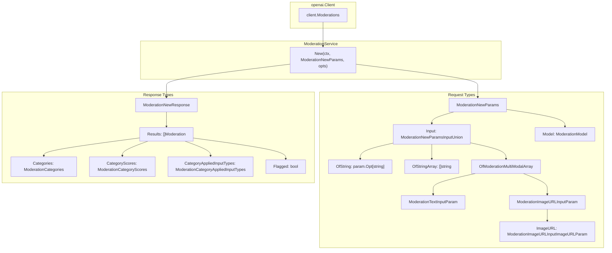
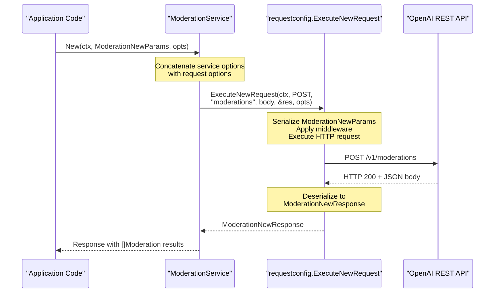
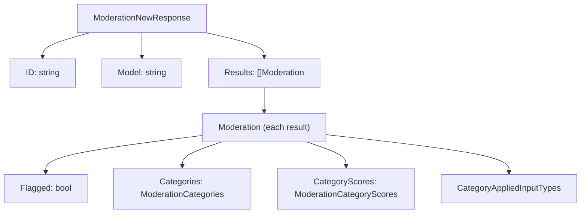
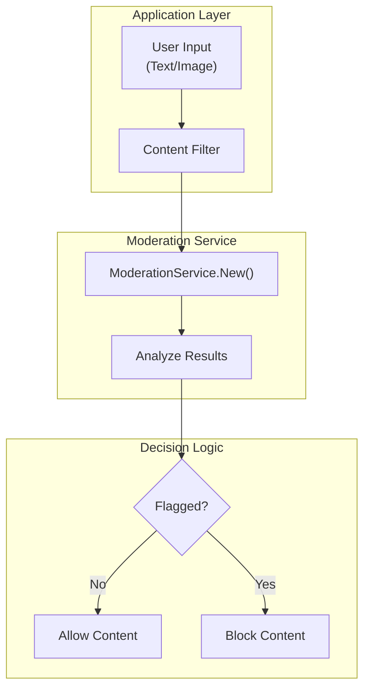

<!-- source: DeepWiki mcp.deepwiki.com · repo openai/openai-go · page 10 Content Moderation · fetched 2026-10-26 -->

# Content Moderation

<details>
<summary>Relevant source files</summary>

The following files were used as context for generating this wiki page:

- [audiospeech_test.go](audiospeech_test.go)
- [audiotranscription.go](audiotranscription.go)
- [audiotranslation.go](audiotranslation.go)
- [completion_test.go](completion_test.go)
- [moderation.go](moderation.go)
- [moderation_test.go](moderation_test.go)
- [realtime/call_test.go](realtime/call_test.go)
- [realtime/clientsecret_test.go](realtime/clientsecret_test.go)
- [uploadpart.go](uploadpart.go)

</details>


The `ModerationService` classifies text and image inputs for potentially harmful content. It returns binary flags and confidence scores across 13 harm categories, enabling applications to implement content filtering policies based on OpenAI's safety guidelines.

## Overview

The moderation API analyzes text and/or image inputs against OpenAI's content policy, returning both flagged status and per-category confidence scores. Applications can use these results to block, allow, or queue content for manual review based on their specific safety requirements.

**Core Types:**
- `ModerationService`: Service interface at [moderation.go:27-29]()
- `ModerationNewParams`: Request parameters with union types for text/image/multimodal input [moderation.go:440-458]()
- `ModerationNewResponse`: Response containing ID, model name, and moderation results [moderation.go:417-437]()
- `Moderation`: Individual result with categories, scores, and applied input types [moderation.go:49-67]()
- `ModerationModel`: Model constants such as `omni-moderation-latest` [moderation.go:315-322]()

Sources: [moderation.go:27-67](), [moderation.go:315-322](), [moderation.go:417-458]()

## Service Architecture

**Type System Overview**



Sources: [moderation.go:27-38](), [moderation.go:42-47](), [moderation.go:440-458](), [moderation.go:463-486]()

## Request Execution Flow

**ModerationService.New() Execution**



Sources: [moderation.go:34-47]()

## Input Types

The `ModerationNewParams.Input` field accepts three variant types through the `ModerationNewParamsInputUnion` at [moderation.go:463-486]():

### Input Variants

| Variant | Type | Use Case |
|---------|------|----------|
| `OfString` | `param.Opt[string]` | Single text string for simple moderation. |
| `OfStringArray` | `[]string` | Batch process multiple text strings in one request. |
| `OfModerationMultiModalArray` | `[]ModerationMultiModalInputUnionParam` | Analyze multimodal content (text and images). |

Sources: [moderation.go:463-486]()

### Multimodal Input Construction

For multimodal inputs, each array element is a `ModerationMultiModalInputUnionParam` defined at [moderation.go:339-361]():

**Text Input:**
- Helper: `openai.ModerationMultiModalInputParamOfText(text)` [moderation.go:330-334]()
- Constructs `ModerationTextInputParam` with `Type: constant.Text` [moderation.go:395-401]()

**Image URL Input:**
- Helper: `openai.ModerationMultiModalInputParamOfImageURL(imageURLParam)` [moderation.go:324-328]()
- Constructs `ModerationImageURLInputParam` with `Type: constant.ImageURL` [moderation.go:363-369]()

Sources: [moderation.go:324-334](), [moderation.go:339-401]()

## Moderation Models

The `Model` parameter selects which moderation model to use [moderation.go:315-322]():

| Model Constant | Value | Capabilities |
|----------------|-------|--------------|
| `ModerationModelOmniModerationLatest` | `"omni-moderation-latest"` | Text + images (latest) |
| `ModerationModelOmniModeration2024_09_26` | `"omni-moderation-2024-09-26"` | Text + images (versioned) |
| `ModerationModelTextModerationLatest` | `"text-moderation-latest"` | Text only (latest) |
| `ModerationModelTextModerationStable` | `"text-moderation-stable"` | Text only (stable) |

Sources: [moderation.go:315-322]()

## Moderation Categories

The API evaluates content across categories defined in `ModerationCategories` [moderation.go:76-138]().

### Category Definitions

| Field | Description |
|-------|-------------|
| `Harassment` | Harassing language towards any target. |
| `Hate` | Hate based on protected group status. |
| `Illicit` | Instructions facilitating wrongdoing. |
| `SelfHarm` | Promoting/depicting self-harm acts. |
| `Sexual` | Sexually explicit content. |
| `Violence` | Depicting death, violence, or physical injury. |

Sources: [moderation.go:76-138]()

### Applied Input Types by Category

The `CategoryAppliedInputTypes` field [moderation.go:147-221]() indicates which input types (text, image) were evaluated for each category. For example:
- `Harassment` is applied to `text` inputs [moderation.go:151]().
- `Violence` can be applied to both `text` and `image` inputs [moderation.go:214]().

Sources: [moderation.go:147-221]()

## Response Structure

**ModerationNewResponse Type**



Each `Moderation` result contains three synchronized structures with the same category keys:
1. `ModerationCategories`: Binary flags [moderation.go:76-138]().
2. `ModerationCategoryScores`: Confidence scores (0.0 to 1.0) [moderation.go:227-275]().
3. `ModerationCategoryAppliedInputTypes`: The input types analyzed per category [moderation.go:147-221]().

Sources: [moderation.go:49-67](), [moderation.go:76-138](), [moderation.go:147-221](), [moderation.go:227-275](), [moderation.go:417-437]()

## Usage Examples

### Single Text Moderation

```go
response, err := client.Moderations.New(context.TODO(), openai.ModerationNewParams{
    Input: openai.ModerationNewParamsInputUnion{
        OfString: openai.String("I want to kill them."),
    },
    Model: openai.ModerationModelOmniModerationLatest,
})
```

Sources: [moderation_test.go:28-33]()

### Integration Pattern: Content Filtering Pipeline



Sources: [moderation.go:42-47](), [moderation.go:57]()

---

