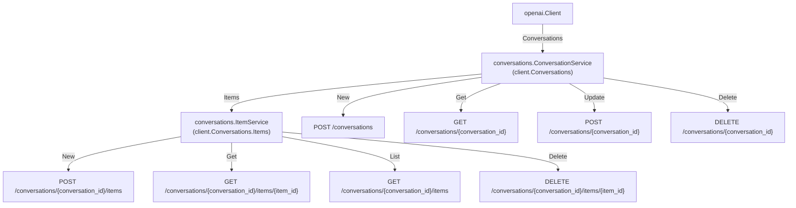
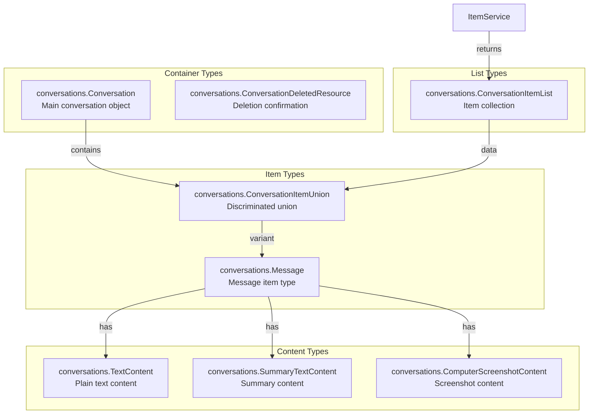
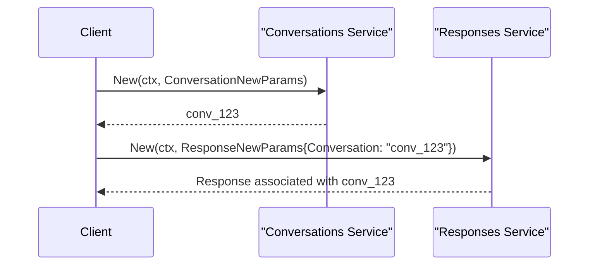

<!-- source: DeepWiki mcp.deepwiki.com · repo openai/openai-go · page 11 Conversations API · fetched 2026-10-26 -->

# Conversations API

Relevant source files

The following files were used as context for generating this wiki page:

- [conversations/aliases.go](conversations/aliases.go)
- [conversations/conversation.go](conversations/conversation.go)
- [conversations/conversation_test.go](conversations/conversation_test.go)
- [conversations/item.go](conversations/item.go)
- [conversations/item_test.go](conversations/item_test.go)
- [realtime/aliases.go](realtime/aliases.go)
- [responses/api.md](responses/api.md)
- [responses/inputitem.go](responses/inputitem.go)
- [responses/inputitem_test.go](responses/inputitem_test.go)
- [responses/response_test.go](responses/response_test.go)
- [webhooks/aliases.go](webhooks/aliases.go)

The Conversations API provides stateful conversation management through the `ConversationService`, enabling applications to create, manage, and persist multi-turn dialogues. This service maintains conversation history by organizing content into items that can be independently created, retrieved, and deleted. Unlike the stateless Responses API (see [Responses API](#4)), conversations persist across multiple API calls and can link to responses via the `conversation` parameter in response creation.

For real-time conversational interfaces, see [Realtime API](#12). For the deprecated stateful Assistant threads, see [Beta Assistants API (Deprecated)](#15).

---

## Service Architecture

The Conversations API implements a two-level service hierarchy with the main `ConversationService` managing conversation lifecycle and a nested `ItemService` handling conversation content.

### Service Hierarchy

**Sources**: [conversations/conversation.go:31-45](), [conversations/item.go:33-44]()

### Type System

The Conversations API defines distinct types for conversation containers and their content items:

**Sources**: [conversations/conversation.go:133-180](), [conversations/item.go:138-163]()

---

## Managing Conversations

The `ConversationService` provides full CRUD operations for conversation lifecycle management. All operations are accessed through `client.Conversations`.

### Creating Conversations

Create a new conversation container using `ConversationService.New()`:

| Parameter | Type | Description |
|-----------|------|-------------|
| `ctx` | `context.Context` | Request context |
| `body` | `conversations.ConversationNewParams` | Conversation configuration |

**Returns**: `*conversations.Conversation`

**Endpoint**: `POST /conversations`

The `ConversationNewParams` structure supports metadata and configuration options for initializing the conversation state. For details, see [Managing Conversations](#11.1).

**Sources**: [conversations/conversation.go:48-53]()

### Retrieving Conversations

Retrieve an existing conversation by ID:

| Parameter | Type | Description |
|-----------|------|-------------|
| `ctx` | `context.Context` | Request context |
| `conversationID` | `string` | Unique conversation identifier |

**Returns**: `*conversations.Conversation`

**Endpoint**: `GET /conversations/{conversation_id}`

**Sources**: [conversations/conversation.go:56-65]()

### Updating Conversations

Modify conversation metadata or configuration:

| Parameter | Type | Description |
|-----------|------|-------------|
| `ctx` | `context.Context` | Request context |
| `conversationID` | `string` | Conversation to update |
| `body` | `conversations.ConversationUpdateParams` | Update parameters |

**Returns**: `*conversations.Conversation`

**Endpoint**: `POST /conversations/{conversation_id}`

**Sources**: [conversations/conversation.go:68-77]()

### Deleting Conversations

Permanently delete a conversation:

| Parameter | Type | Description |
|-----------|------|-------------|
| `ctx` | `context.Context` | Request context |
| `conversationID` | `string` | Conversation to delete |

**Returns**: `*conversations.ConversationDeletedResource`

**Endpoint**: `DELETE /conversations/{conversation_id}`

Note that items in the conversation will not be deleted by this call.

**Sources**: [conversations/conversation.go:80-89]()

---

## Conversation Items

Items represent individual pieces of content within a conversation. The `ItemService` manages items through the nested service path `client.Conversations.Items`.

### Item Types and Content

Conversation items use a discriminated union type `ConversationItemUnion` with variants including:

- `conversations.Message`: Message content from users or assistants
- `responses.ResponseFunctionToolCallItem`: Results from tool execution

Each item can contain multiple content types, such as `conversations.TextContent` or `conversations.ComputerScreenshotContent`. For details, see [Conversation Items](#11.2).

**Sources**: [conversations/item.go:117-163]()

### Adding Items to Conversations

Create new items within a conversation:

| Parameter | Type | Description |
|-----------|------|-------------|
| `ctx` | `context.Context` | Request context |
| `conversationID` | `string` | Parent conversation ID |
| `params` | `conversations.ItemNewParams` | Item content and configuration |

**Returns**: `*conversations.ConversationItemList`

**Endpoint**: `POST /conversations/{conversation_id}/items`

**Sources**: [conversations/item.go:47-56]()

### Retrieving Individual Items

Get a specific item by ID:

| Parameter | Type | Description |
|-----------|------|-------------|
| `ctx` | `context.Context` | Request context |
| `conversationID` | `string` | Parent conversation ID |
| `itemID` | `string` | Item identifier |
| `query` | `conversations.ItemGetParams` | Query parameters |

**Returns**: `*conversations.ConversationItemUnion`

**Endpoint**: `GET /conversations/{conversation_id}/items/{item_id}`

**Sources**: [conversations/item.go:59-72]()

### Listing Conversation Items

Retrieve paginated items from a conversation:

| Parameter | Type | Description |
|-----------|------|-------------|
| `ctx` | `context.Context` | Request context |
| `conversationID` | `string` | Parent conversation ID |
| `query` | `conversations.ItemListParams` | Pagination and filter parameters |

**Returns**: `*pagination.ConversationCursorPage[conversations.ConversationItemUnion]`

**Endpoint**: `GET /conversations/{conversation_id}/items`

Uses cursor-based pagination via `ConversationCursorPage`, which supports auto-paging through the `.ListAutoPaging()` method.

**Sources**: [conversations/item.go:75-98]()

---

## Integration with Responses API

Conversations can be linked to the Responses API (see [Creating and Managing Responses](#4.1)) through the `Conversation` parameter in `ResponseNewParams`.

This enables building stateful multi-turn dialogues where each response is aware of the full conversation history stored in the conversation container.

**Sources**: [responses/response_test.go:36-38](), [conversations/conversation_test.go:31-45]()

---

