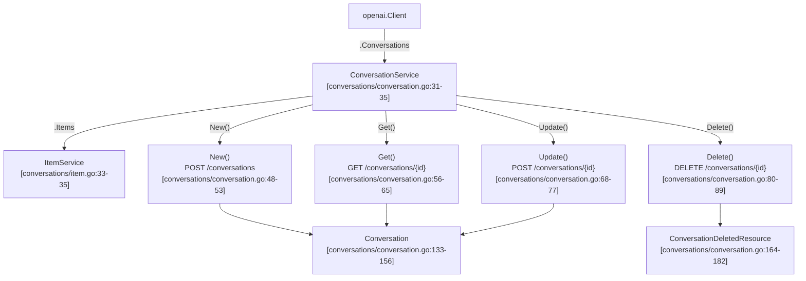
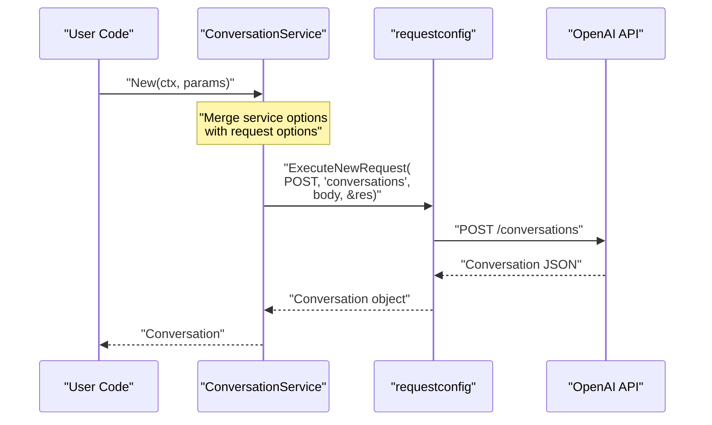
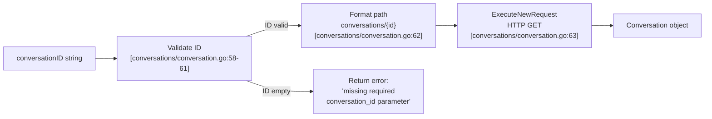
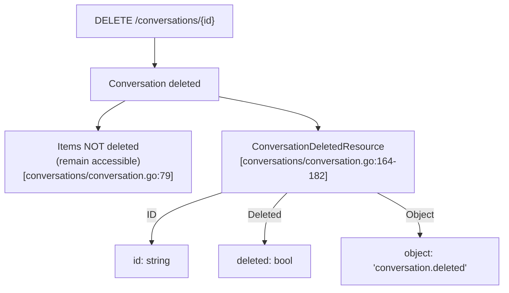
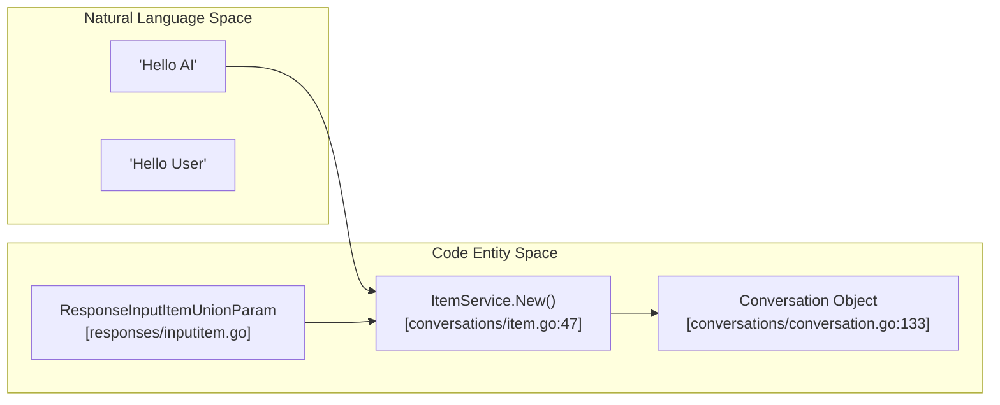

<!-- source: DeepWiki mcp.deepwiki.com · repo openai/openai-go · page 11.1 Managing Conversations · fetched 2026-10-26 -->

# Managing Conversations

<details>
<summary>Relevant source files</summary>

The following files were used as context for generating this wiki page:

- [conversations/conversation.go](conversations/conversation.go)
- [conversations/conversation_test.go](conversations/conversation_test.go)
- [conversations/item.go](conversations/item.go)
- [conversations/item_test.go](conversations/item_test.go)
- [responses/api.md](responses/api.md)
- [responses/inputitem.go](responses/inputitem.go)
- [responses/inputitem_test.go](responses/inputitem_test.go)
- [responses/response_test.go](responses/response_test.go)

</details>


This page documents the `ConversationService` and its methods for creating, retrieving, updating, and deleting conversations. Conversations serve as containers for dialogue items and provide metadata management capabilities.

For information about managing items within conversations (messages, tool calls, etc.), see page 11.2 Conversation Items.

## ConversationService Structure

The `ConversationService` provides methods for conversation lifecycle management. It is accessed via the `Conversations` field on the main client and contains a nested `Items` service for managing conversation items.

Title: Conversation Service Hierarchy


**Sources:** [conversations/conversation.go:31-89](), [conversations/item.go:33-35]()

## Creating Conversations

The `New` method creates a conversation with optional initial items and metadata. It accepts `ConversationNewParams` and returns a `Conversation` object.

### Method Signature

[conversations/conversation.go:48-53]()

```go
func (r *ConversationService) New(
    ctx context.Context, 
    body ConversationNewParams, 
    opts ...option.RequestOption
) (res *Conversation, err error)
```

### Request Parameters

| Parameter | Type | Required | Description |
|-----------|------|----------|-------------|
| `Items` | `[]responses.ResponseInputItemUnionParam` | No | Initial items to include in the conversation |
| `Metadata` | `shared.Metadata` | No | Key-value pairs for object categorization |

### Execution Flow

Title: Conversation Creation Sequence


The SDK provides a test case demonstrating creation with optional parameters including initial messages:

[conversations/conversation_test.go:19-53]()

**Sources:** [conversations/conversation.go:48-53](), [conversations/conversation_test.go:31-45]()

## Retrieving Conversations

The `Get` method retrieves a conversation by its unique identifier. It performs validation to ensure the ID is not empty before executing the request.

### Method Signature

[conversations/conversation.go:56-65]()

```go
func (r *ConversationService) Get(
    ctx context.Context, 
    conversationID string, 
    opts ...option.RequestOption
) (res *Conversation, err error)
```

### Validation and Routing

Title: Conversation Get Logic


**Sources:** [conversations/conversation.go:56-65](), [conversations/conversation_test.go:55-75]()

## Updating Conversations

The `Update` method allows modifying conversation metadata. The request uses the `POST` method against the resource ID endpoint.

### Method Signature

[conversations/conversation.go:68-77]()

```go
func (r *ConversationService) Update(
    ctx context.Context, 
    conversationID string, 
    body ConversationUpdateParams, 
    opts ...option.RequestOption
) (res *Conversation, err error)
```

### Metadata Management

The update parameters accept `shared.Metadata`, which is a map for storing structured information.

[conversations/conversation_test.go:89-105]()

**Sources:** [conversations/conversation.go:68-77](), [conversations/conversation_test.go:92-97]()

## Deleting Conversations

The `Delete` method removes a conversation container. Crucially, the items contained within the conversation are preserved.

### Method Signature

[conversations/conversation.go:80-89]()

```go
func (r *ConversationService) Delete(
    ctx context.Context, 
    conversationID string, 
    opts ...option.RequestOption
) (res *ConversationDeletedResource, err error)
```

### Deletion Behavior

Title: Conversation Deletion Side Effects


**Sources:** [conversations/conversation.go:79-89](), [conversations/conversation.go:164-182](), [conversations/conversation_test.go:107-127]()

## Conversation Data Structures

The SDK utilizes a structured type system to represent conversation resources and their lifecycle states.

### Conversation Object

The `Conversation` struct represents the core stateful object.

[conversations/conversation.go:133-156]()

| Field | Type | Description |
|-------|------|-------------|
| `ID` | `string` | The unique ID of the conversation. |
| `CreatedAt` | `int64` | Creation time in Unix epoch seconds. |
| `Metadata` | `any` | Key-value pairs (16 max) for object categorization. |
| `Object` | `constant.Conversation` | Discriminator, always `conversation`. |

### Response JSON Metadata

All conversation-related structs include a `JSON` field for metadata tracking and access to raw response data.

[conversations/conversation.go:148-155]()

```go
	JSON struct {
		ID          respjson.Field
		CreatedAt   respjson.Field
		Metadata    respjson.Field
		Object      respjson.Field
		ExtraFields map[string]respjson.Field
		raw         string
	} `json:"-"`
```

**Sources:** [conversations/conversation.go:133-156](), [conversations/conversation.go:164-182]()

## Integration with Input Items

Conversations are populated with items (messages, tool calls). While `ConversationService` manages the container, the `ItemService` handles granular item operations.

Title: Conversation-Item Relationship


The SDK allows listing input items specifically associated with a response within a conversation via the `InputItemService`.

[responses/inputitem.go:43-62]()

**Sources:** [conversations/item.go:47-56](), [responses/inputitem.go:43-62](), [conversations/conversation.go:133-142]()

---

