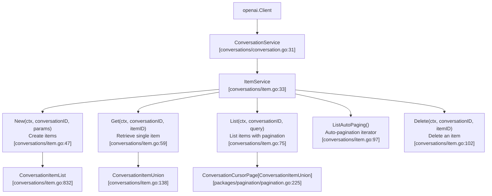
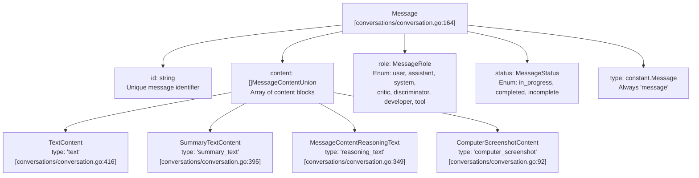

<!-- source: DeepWiki mcp.deepwiki.com · repo openai/openai-go · page 11.2 Conversation Items · fetched 2026-10-26 -->

# Conversation Items

Relevant source files

The following files were used as context for generating this wiki page:

- [conversations/conversation.go](conversations/conversation.go)
- [conversations/item.go](conversations/item.go)
- [responses/api.md](responses/api.md)
- [responses/inputitem.go](responses/inputitem.go)

This page documents the conversation items system, which represents the individual elements within a conversation dialogue. Conversation items include messages, tool calls, tool outputs, reasoning traces, and Model Context Protocol (MCP) interactions. Items are managed through the `ItemService` and represented as a discriminated union type supporting 18+ variants.

For information about managing conversations themselves (creating, updating, deleting conversations), see [Managing Conversations](11.1). For details about the Responses API which also produces output items, see [Response API](4).

## ItemService Overview

The `ItemService` provides methods for creating, retrieving, listing, and deleting items within a conversation. It is accessed via `client.Conversations.Items` and operates on items within a specific conversation identified by `conversationID`.

### Item Execution Flow

The following diagram bridges the high-level service methods to the internal execution pipeline and data entities.

Title: Conversation Item Service Architecture

**Sources:** [conversations/item.go:33-115](), [conversations/conversation.go:31-45](), [packages/pagination/pagination.go:225-284]()

### Service Methods

| Method | Purpose | Parameters | Return Type |
|--------|---------|------------|-------------|
| `New` | Create items in a conversation (up to 20 at once) | `conversationID`, `ItemNewParams` | `*ConversationItemList` |
| `Get` | Retrieve a single item by ID | `conversationID`, `itemID`, `ItemGetParams` | `*ConversationItemUnion` |
| `List` | List items with cursor-based pagination | `conversationID`, `ItemListParams` | `*ConversationCursorPage[ConversationItemUnion]` |
| `ListAutoPaging` | Automatic pagination iterator | `conversationID`, `ItemListParams` | `*ConversationCursorPageAutoPager[ConversationItemUnion]` |
| `Delete` | Delete a specific item | `conversationID`, `itemID` | `*Conversation` |

**Sources:** [conversations/item.go:47-115]()

## ConversationItemUnion Type System

The `ConversationItemUnion` is a discriminated union type that can represent any of 18 different item variants. Each variant has a `type` field that serves as the discriminator. The union provides type-safe access to variants through `AsAny()` and variant-specific `As*()` methods.

Title: Conversation Item Type Hierarchy

```mermaid
graph TB
    ConversationItemUnion["ConversationItemUnion<br/>[conversations/item.go:138]<br/>Discriminated by 'type' field"]
    
    ConversationItemUnion --> Message["Message<br/>type: 'message'<br/>[conversations/conversation.go:164]"]
    ConversationItemUnion --> FunctionCall["ResponseFunctionToolCallItem<br/>type: 'function_call'<br/>[responses/item.go]"]
    ConversationItemUnion --> FunctionOutput["ResponseFunctionToolCallOutputItem<br/>type: 'function_call_output'<br/>[responses/item.go]"]
    ConversationItemUnion --> FileSearch["ResponseFileSearchToolCall<br/>type: 'file_search_call'<br/>[responses/item.go]"]
    ConversationItemUnion --> WebSearch["ResponseFunctionWebSearch<br/>type: 'web_search_call'<br/>[responses/item.go]"]
    ConversationItemUnion --> ImageGen["ConversationItemImageGenerationCall<br/>type: 'image_generation_call'<br/>[conversations/item.go:527]"]
    ConversationItemUnion --> ComputerCall["ResponseComputerToolCall<br/>type: 'computer_call'<br/>[responses/item.go]"]
    ConversationItemUnion --> ComputerOutput["ResponseComputerToolCallOutputItem<br/>type: 'computer_call_output'<br/>[responses/item.go]"]
    ConversationItemUnion --> Reasoning["ResponseReasoningItem<br/>type: 'reasoning'<br/>[responses/item.go]"]
    ConversationItemUnion --> CodeInterpreter["ResponseCodeInterpreterToolCall<br/>type: 'code_interpreter_call'<br/>[responses/item.go]"]
    ConversationItemUnion --> LocalShellCall["ConversationItemLocalShellCall<br/>type: 'local_shell_call'<br/>[conversations/item.go:556]"]
    ConversationItemUnion --> LocalShellOutput["ConversationItemLocalShellCallOutput<br/>type: 'local_shell_call_output'<br/>[conversations/item.go:621]"]
    ConversationItemUnion --> McpListTools["ConversationItemMcpListTools<br/>type: 'mcp_list_tools'<br/>[conversations/item.go:650]"]
    ConversationItemUnion --> McpApprovalReq["ConversationItemMcpApprovalRequest<br/>type: 'mcp_approval_request'<br/>[conversations/item.go:707]"]
    ConversationItemUnion --> McpApprovalResp["ConversationItemMcpApprovalResponse<br/>type: 'mcp_approval_response'<br/>[conversations/item.go:737]"]
    ConversationItemUnion --> McpCall["ConversationItemMcpCall<br/>type: 'mcp_call'<br/>[conversations/item.go:767]"]
    ConversationItemUnion --> CustomToolCall["ResponseCustomToolCall<br/>type: 'custom_tool_call'<br/>[responses/item.go]"]
    ConversationItemUnion --> CustomToolOutput["ResponseCustomToolCallOutput<br/>type: 'custom_tool_call_output'<br/>[responses/item.go]"]
```

**Sources:** [conversations/item.go:138-398](), [conversations/conversation.go:164-199]()

### Type Discrimination Pattern

The union uses a switch-based type discrimination pattern accessible through the `AsAny()` method [conversations/item.go:259](). Each variant also has a dedicated `As*()` method for direct casting: `AsMessage()`, `AsFunctionCall()`, `AsImageGenerationCall()`, etc [conversations/item.go:301-398]().

**Sources:** [conversations/item.go:259-398]()

## Message Items

Messages are the most common conversation item type, representing dialogue turns between the user, assistant, system, or other roles. Each message contains content (which itself is a union type), a role identifier, and a status indicator.

Title: Message Structure and Content Types

**Sources:** [conversations/conversation.go:164-199](), [conversations/conversation.go:201-347](), [conversations/conversation.go:92-114]()

### MessageRole and Status

The participants and states are defined by typed constants:

| Role | Constant | Status | Constant |
|------|----------|--------|----------|
| User | `MessageRoleUser` | In Progress | `MessageStatusInProgress` |
| Assistant | `MessageRoleAssistant` | Completed | `MessageStatusCompleted` |
| System | `MessageRoleSystem` | Incomplete | `MessageStatusIncomplete` |
| Developer | `MessageRoleDeveloper` | | |

**Sources:** [conversations/conversation.go:370-383](), [conversations/conversation.go:385-393]()

## Tool and Execution Items

Conversation items include various tool invocation types and their corresponding outputs. These represent the model's interaction with the environment.

### Tool Call Variants

| Type | Description | Key Fields |
|------|-------------|------------|
| `function_call` | Application function invocation | `name`, `arguments`, `call_id` |
| `file_search_call` | RAG search over vector stores | `queries`, `results` |
| `computer_call` | Mouse/Keyboard/Screenshot actions | `action`, `status` |
| `code_interpreter_call` | Python code execution | `code`, `outputs` |
| `image_generation_call` | Base64 image generation | `result`, `status` |

**Sources:** [conversations/item.go:138-176](), [conversations/item.go:527-554]()

### Local Shell and MCP

- **Local Shell**: Allows executing shell commands (`ConversationItemLocalShellCall`) and capturing their output (`ConversationItemLocalShellCallOutput`) [conversations/item.go:556-648]().
- **MCP**: Supports Model Context Protocol for tool discovery (`ConversationItemMcpListTools`), human-in-the-loop approval (`ConversationItemMcpApprovalRequest`/`Response`), and execution (`ConversationItemMcpCall`) [conversations/item.go:650-801]().

Title: MCP Interaction Workflow

**Sources:** [conversations/item.go:650-801]()

## Pagination and Management

### ConversationCursorPage

The `List` method returns a `ConversationCursorPage` [conversations/item.go:75](). Unlike standard pagination, it uses a `last_id` cursor explicitly designed for conversation items [packages/pagination/pagination.go:225-239]().

### Creating Items

Items are created via `ItemService.New` using `ItemNewParams` [conversations/item.go:803](). You can create up to 20 items in a single request [conversations/item.go:46](). The `items` parameter is a list of `ResponseInputItemUnionParam` [conversations/item.go:810]().

### Deleting Items

The `Delete` method [conversations/item.go:102]() removes an item from a conversation. Note that deleting a conversation via `ConversationService.Delete` does NOT delete its constituent items [conversations/conversation.go:79]().

**Sources:** [conversations/item.go:46-115](), [conversations/item.go:803-856](), [packages/pagination/pagination.go:225-239](), [conversations/conversation.go:79-89]()

---

