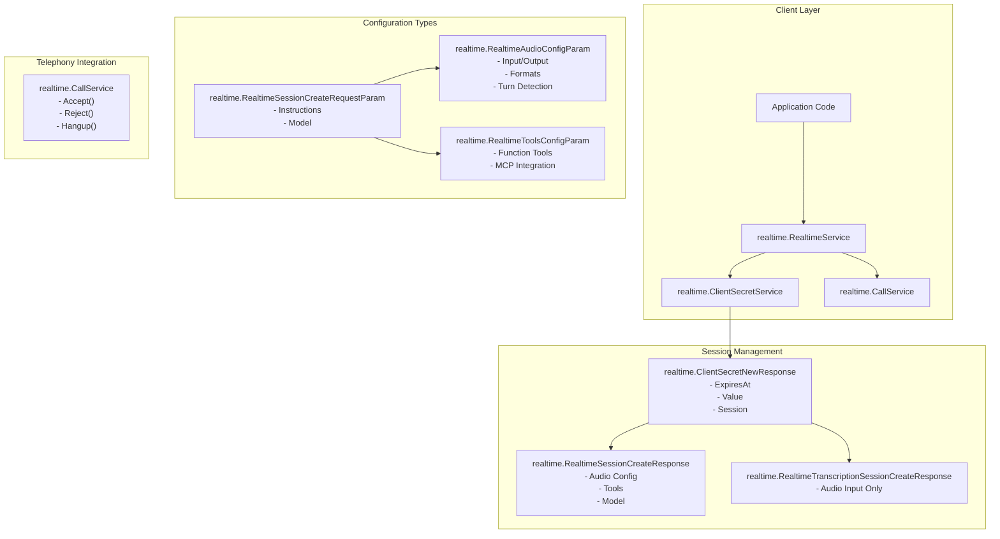
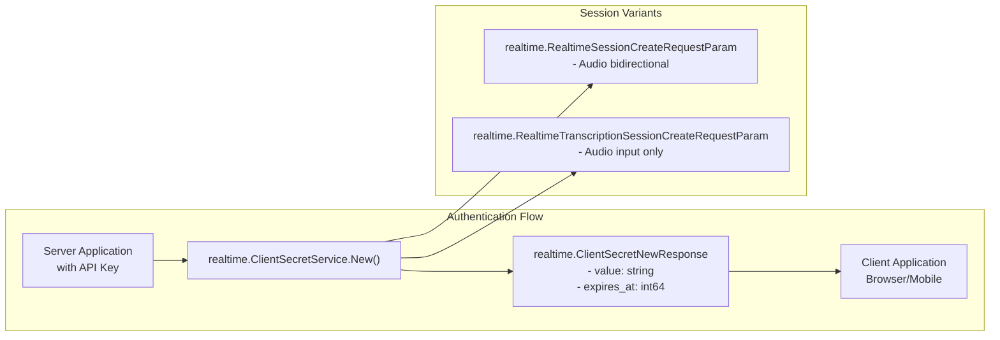

<!-- source: DeepWiki mcp.deepwiki.com · repo openai/openai-go · page 12 Realtime API · fetched 2026-10-26 -->

# Realtime API

Relevant source files

The following files were used as context for generating this wiki page:

- [audiospeech.go](audiospeech.go)
- [conversations/aliases.go](conversations/aliases.go)
- [conversations/api.md](conversations/api.md)
- [realtime/aliases.go](realtime/aliases.go)
- [realtime/api.md](realtime/api.md)
- [realtime/clientsecret.go](realtime/clientsecret.go)
- [realtime/realtime.go](realtime/realtime.go)
- [webhooks/aliases.go](webhooks/aliases.go)
- [webhooks/api.md](webhooks/api.md)

The Realtime API enables real-time audio communication with OpenAI models, supporting bidirectional streaming audio conversations via WebSockets or WebRTC. This API is designed for applications requiring low-latency voice interactions, such as voice assistants, phone systems, and real-time conversational interfaces.

The `RealtimeService` provides the entry point for managing ephemeral client secrets and session configurations, as well as telephony call operations.

## Architecture Overview

The Realtime API is built around ephemeral client secrets and session configurations, providing secure, time-limited access to real-time model interactions.

Sources: [realtime/realtime.go:22-37](), [realtime/clientsecret.go:26-59]()

## Client Secret Management

Client secrets provide ephemeral, secure access to realtime sessions without exposing long-term API keys in client environments (e.g., browsers or mobile apps). The `ClientSecretService` manages the creation of these time-limited authentication tokens.

For details, see [Realtime Sessions and Authentication](#12.1).

Sources: [realtime/clientsecret.go:39-54](), [realtime/clientsecret.go:62-77]()

## Audio and Voice Activity

Realtime sessions support comprehensive configuration for audio input and output, including model-based Voice Activity Detection (VAD) and semantic turn detection.

- **Audio Buffers**: The API handles streaming audio data via `input_audio_buffer` events.
- **Turn Detection**: Supports `server_vad` for volume-based detection and `semantic_vad` for more natural conversation flow using turn-detection models.
- **Transcription**: Input audio can be transcribed in real-time using models like `whisper-1` or `gpt-4o-transcribe`.

For details, see [Audio Buffers and Voice Activity](#12.2).

Sources: [realtime/realtime.go:146-160](), [realtime/realtime.go:39-63]()

## Tools and Telephony

The Realtime API integrates with the standard OpenAI tool-calling system and adds specialized support for telephony operations.

- **Realtime Tools**: Models can trigger function calls or interact with MCP (Model Context Protocol) servers during a live session.
- **Telephony**: The `CallService` manages life-cycle operations for voice calls, including accepting incoming calls and hanging up.

For details, see [Realtime Tools and Telephony](#12.3).

| Operation | Service Method | Description |
|-----------|----------------|-------------|
| Accept Call | `Realtime.Calls.Accept` | Accepts an incoming call |
| Reject Call | `Realtime.Calls.Reject` | Rejects an incoming call |
| Hangup | `Realtime.Calls.Hangup` | Terminates an active call |
| Refer | `Realtime.Calls.Refer` | Transfers a call to another destination |

Sources: [realtime/realtime.go:25-35](), [realtime/api.md:52-56]()

## Available Models

The Realtime API supports specific model identifiers optimized for streaming and low-latency audio processing.

| Model Constant | Value |
|----------------|-------|
| `ChatModelGPT4oRealtimePreview` | `gpt-4o-realtime-preview` |
| `ChatModelGPT4oMiniRealtimePreview` | `gpt-4o-mini-realtime-preview` |

Sources: [realtime/aliases.go:202-218]()

---

