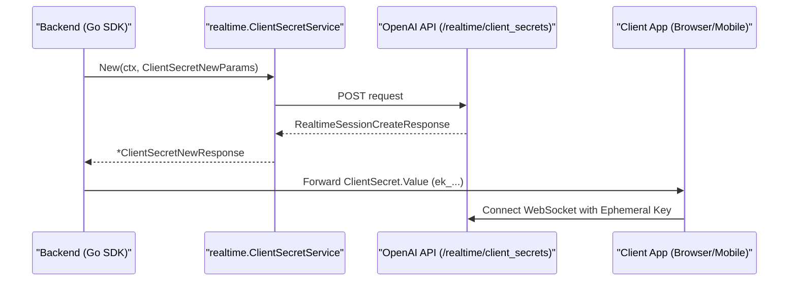
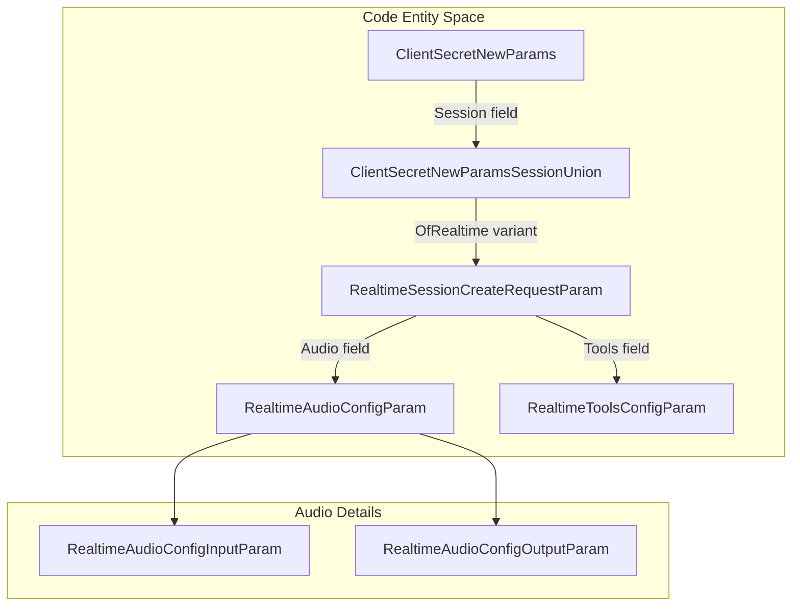
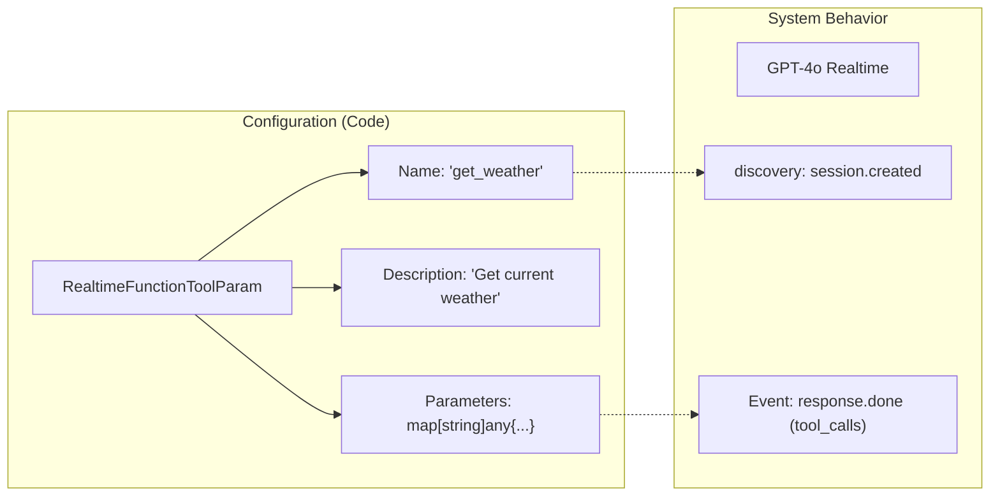

<!-- source: DeepWiki mcp.deepwiki.com · repo openai/openai-go · page 12.1 Realtime Sessions and Authentication · fetched 2026-10-26 -->

# Realtime Sessions and Authentication

<details>
<summary>Relevant source files</summary>

The following files were used as context for generating this wiki page:

- [audiospeech.go](audiospeech.go)
- [audiospeech_test.go](audiospeech_test.go)
- [completion_test.go](completion_test.go)
- [moderation_test.go](moderation_test.go)
- [realtime/call_test.go](realtime/call_test.go)
- [realtime/clientsecret.go](realtime/clientsecret.go)
- [realtime/clientsecret_test.go](realtime/clientsecret_test.go)
- [realtime/realtime.go](realtime/realtime.go)

</details>


## Purpose and Scope

This page covers authentication and session management for the OpenAI Realtime API, which enables WebSocket-based real-time voice and audio communication. The Realtime API uses a client secret mechanism to securely delegate access to client-side environments (web/mobile) without exposing the main API key. Sessions are highly configurable, supporting bidirectional audio, tool calling, and advanced voice activity detection.

**Sources:** [realtime/realtime.go:16-26](), [realtime/clientsecret.go:20-28](), [realtime/clientsecret.go:39-50]()

---

## Authentication Model

The Realtime API utilizes **client secrets** (ephemeral keys) for authentication. These are short-lived tokens generated server-side that grant access to the Realtime API for a specific session configuration.

### Client Secret Generation Flow

The following diagram illustrates the data flow from the server-side SDK to the client environment for establishing a WebSocket connection.



**Sources:** [realtime/clientsecret.go:39-59](), [realtime/clientsecret.go:62-77]()

### Key Authentication Entities

| Entity | Code Identifier | Role |
| :--- | :--- | :--- |
| **Service** | `ClientSecretService` | Manages the creation of ephemeral keys. [realtime/clientsecret.go:26-28]() |
| **Secret Object** | `RealtimeSessionClientSecret` | Contains the `Value` (the key string) and `ExpiresAt` timestamp. [realtime/clientsecret.go:62-77]() |
| **Response** | `ClientSecretNewResponse` | The root response containing the secret and session metadata. [realtime/clientsecret.go:174-180]() |

**Sources:** [realtime/clientsecret.go:26-28](), [realtime/clientsecret.go:62-77](), [realtime/clientsecret.go:174-180]()

---

## Session Configuration

When creating a client secret, you can attach a session configuration. This configuration defines the behavior of the model, audio processing, and available tools.

### Code Entity Space: Session Configuration



**Sources:** [realtime/clientsecret.go:203-214](), [realtime/clientsecret.go:252-261](), [realtime/realtime.go:132-136](), [realtime/realtime.go:189-192]()

### Core Configuration Parameters

| Parameter | Type | Description |
| :--- | :--- | :--- |
| `Instructions` | `string` | System instructions for the model's behavior and voice style. [realtime/clientsecret.go:112-112]() |
| `Modalities` | `[]string` | Set to `["audio"]` (audio+transcript) or `["text"]`. [realtime/clientsecret.go:125-125]() |
| `Voice` | `RealtimeAudioConfigOutputVoiceUnionParam` | Selection of built-in voices (e.g., `alloy`, `ash`, `shimmer`). [realtime/realtime.go:217-224]() |
| `TurnDetection` | `RealtimeAudioInputTurnDetectionUnionParam` | Configures Server VAD or Semantic VAD. [realtime/realtime.go:146-160]() |
| `Tools` | `RealtimeToolsConfigParam` | Definitions for functions the model can call. [realtime/realtime.go:189-192]() |

**Sources:** [realtime/clientsecret.go:112-125](), [realtime/realtime.go:146-160](), [realtime/realtime.go:189-192](), [realtime/realtime.go:217-224]()

---

## Transcription Sessions

The Realtime API supports specific configurations for audio transcription within a session. This is handled via the `AudioTranscriptionParam` struct.

### Transcription Settings

The transcription model can be configured to use Whisper or specialized Realtime transcription variants.

| Field | Code Identifier | Description |
| :--- | :--- | :--- |
| **Model** | `AudioTranscriptionModel` | Options include `whisper-1`, `gpt-4o-transcribe`, or `gpt-4o-transcribe-diarize`. [realtime/realtime.go:84-92]() |
| **Language** | `Language` | ISO-639-1 code (e.g., "en") to improve accuracy. [realtime/realtime.go:95-98]() |
| **Prompt** | `Prompt` | Keywords or context to guide the model's style. [realtime/realtime.go:99-104]() |

**Sources:** [realtime/realtime.go:39-63](), [realtime/realtime.go:84-92](), [realtime/realtime.go:94-111]()

---

## Tool Integration

Full Realtime sessions support function calling. Tools are defined during session creation and can be used by the model to interact with external systems.

### Tool Definition Mapping



**Sources:** [realtime/realtime.go:175-182](), [realtime/clientsecret_test.go:97-104]()

---

## Implementation Example

Creating a client secret involves initializing the `ClientSecretService` and providing the desired session parameters.

```go
// Using the service to create a new client secret
// Source: [realtime/clientsecret_test.go:31-36]
resp, err := client.Realtime.ClientSecrets.New(context.TODO(), realtime.ClientSecretNewParams{
    ExpiresAfter: realtime.ClientSecretNewParamsExpiresAfter{
        Anchor:  "created_at",
        Seconds: openai.Int(60),
    },
    Session: realtime.ClientSecretNewParamsSessionUnion{
        OfRealtime: &realtime.RealtimeSessionCreateRequestParam{
            Model: realtime.RealtimeSessionCreateRequestModelGPTRealtime,
            Instructions: openai.String("You are a helpful assistant."),
            Voice: realtime.RealtimeAudioConfigOutputVoiceUnionParam{
                OfRealtimeAudioConfigOutputVoiceString2: openai.String("alloy"),
            },
        },
    },
})
```

**Sources:** [realtime/clientsecret_test.go:31-83](), [realtime/clientsecret.go:54-59]()

---

